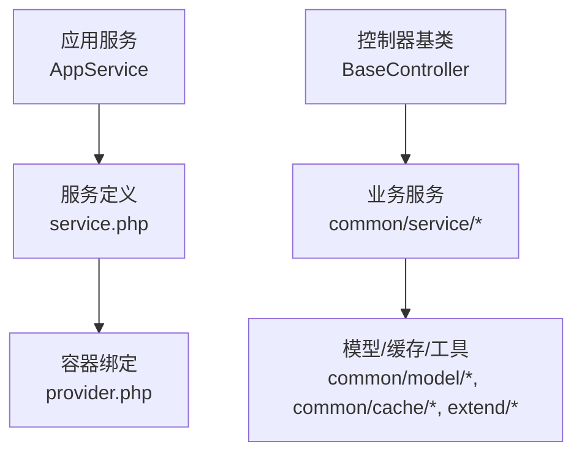
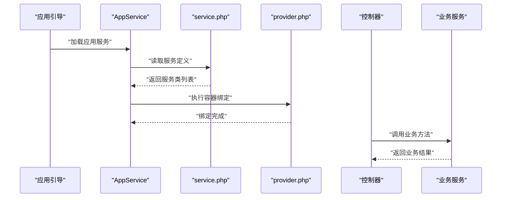
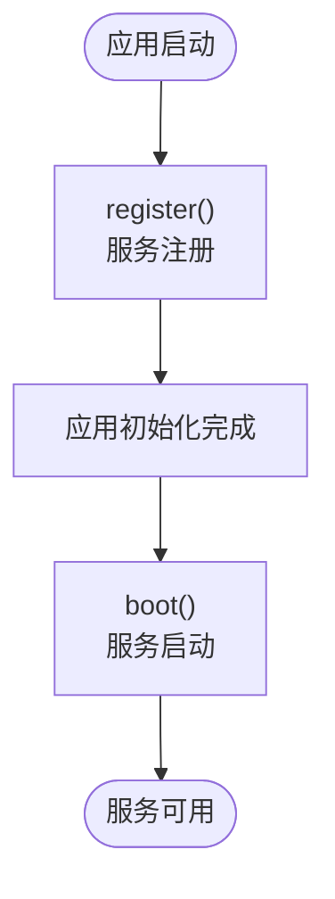
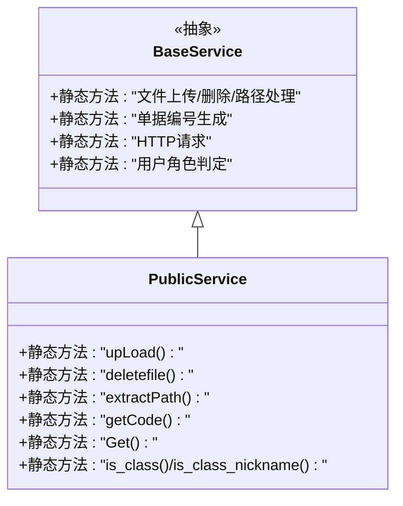
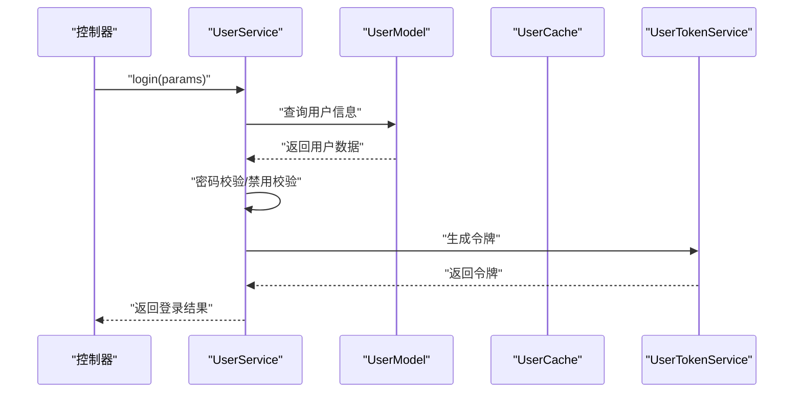
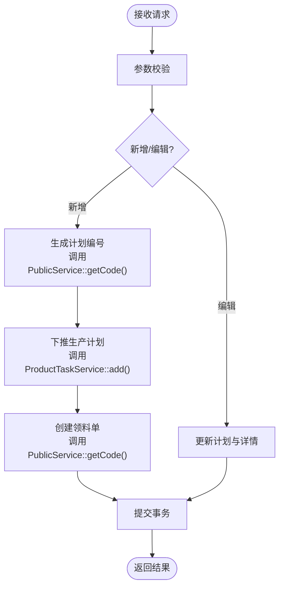
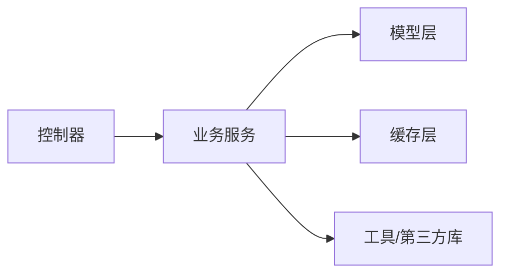
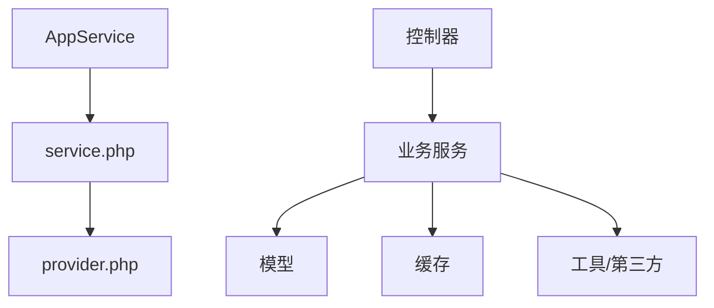

# 服务层架构设计

<cite>
**本文引用的文件**   
- [AppService.php](file://gccd_server/app/AppService.php)
- [provider.php](file://gccd_server/app/provider.php)
- [service.php](file://gccd_server/app/service.php)
- [BaseController.php](file://gccd_server/app/BaseController.php)
- [PublicService.php](file://gccd_server/app/common/service/admin/PublicService.php)
- [UserService.php](file://gccd_server/app/common/service/system/UserService.php)
- [ProductionService.php](file://gccd_server/app/common/service/admin/ProductionService.php)
</cite>

## 目录
1. [简介](#简介)
2. [项目结构](#项目结构)
3. [核心组件](#核心组件)
4. [架构总览](#架构总览)
5. [详细组件分析](#详细组件分析)
6. [依赖关系分析](#依赖关系分析)
7. [性能考量](#性能考量)
8. [故障排查指南](#故障排查指南)
9. [结论](#结论)
10. [附录](#附录)

## 简介
本文件面向ThinkPHP服务层架构，系统性阐述服务层的整体架构模式、服务注册机制、生命周期管理与依赖注入系统；解析服务层与应用服务(AppService)的关系及其在MVC架构中的定位；梳理服务层组织结构与公共服务基类的设计理念及继承体系；说明服务层初始化流程、服务发现机制与自动加载策略；总结服务层最佳实践与设计原则，并给出服务层与控制器、模型层的交互模式与数据流转过程。

## 项目结构
服务层位于后端服务工程gccd_server中，采用按功能域分层的组织方式：
- 应用服务：通过AppService统一注册与引导
- 服务定义：通过service.php集中声明
- 依赖绑定：通过provider.php进行容器绑定
- 控制器基类：通过BaseController提供通用能力
- 业务服务：按模块划分在common/service下，如admin、system、member等

图表来源
- [AppService.php:17-28](file://gccd_server/app/AppService.php#L17-L28)
- [service.php:13-15](file://gccd_server/app/service.php#L13-L15)
- [provider.php:14-17](file://gccd_server/app/provider.php#L14-L17)
- [BaseController.php:19-62](file://gccd_server/app/BaseController.php#L19-L62)

章节来源
- [AppService.php:17-28](file://gccd_server/app/AppService.php#L17-L28)
- [service.php:13-15](file://gccd_server/app/service.php#L13-L15)
- [provider.php:14-17](file://gccd_server/app/provider.php#L14-L17)
- [BaseController.php:19-62](file://gccd_server/app/BaseController.php#L19-L62)

## 核心组件
- 应用服务(AppService)：继承框架Service，负责register与boot两个生命周期钩子，作为服务层的入口与引导者
- 服务定义(service.php)：集中声明需要在应用初始化完成后执行的服务类
- 容器绑定(provider.php)：将接口与实现类绑定到容器，支持依赖注入
- 控制器基类(BaseController)：提供请求实例、应用实例、批量验证等通用能力
- 业务服务：以静态方法为主的服务类，封装领域逻辑，如用户管理、生产计划、公共工具等

章节来源
- [AppService.php:17-28](file://gccd_server/app/AppService.php#L17-L28)
- [service.php:13-15](file://gccd_server/app/service.php#L13-L15)
- [provider.php:14-17](file://gccd_server/app/provider.php#L14-L17)
- [BaseController.php:19-62](file://gccd_server/app/BaseController.php#L19-L62)

## 架构总览
服务层在ThinkPHP中的定位：
- 位于控制器与模型之间，承担业务编排与领域逻辑封装
- 通过AppService与service.php完成服务注册与引导
- 通过provider.php实现依赖注入与接口绑定
- 控制器通过依赖注入或静态调用访问服务层

图表来源
- [AppService.php:19-27](file://gccd_server/app/AppService.php#L19-L27)
- [service.php:13-15](file://gccd_server/app/service.php#L13-L15)
- [provider.php:14-17](file://gccd_server/app/provider.php#L14-L17)

## 详细组件分析

### 应用服务(AppService)与生命周期
- register阶段：预留服务注册点，可在此处进行服务发现与注册
- boot阶段：应用初始化完成后执行，适合进行全局配置、缓存预热、监听器注册等

图表来源
- [AppService.php:19-27](file://gccd_server/app/AppService.php#L19-L27)

章节来源
- [AppService.php:19-27](file://gccd_server/app/AppService.php#L19-L27)

### 服务定义与自动加载
- service.php集中声明服务类，框架在应用初始化完成后逐一引导
- 该机制实现了服务的延迟加载与集中管理，避免不必要的资源占用

章节来源
- [service.php:13-15](file://gccd_server/app/service.php#L13-L15)

### 依赖注入与容器绑定
- provider.php将接口映射到具体实现类，支持框架的依赖注入
- 典型绑定包括请求类与异常处理器等，便于在控制器与服务中透明使用

章节来源
- [provider.php:14-17](file://gccd_server/app/provider.php#L14-L17)

### 控制器基类与验证
- BaseController提供请求实例、应用实例、批量验证等通用能力
- 通过validate方法支持多种验证器与场景，提升控制器层的复用性

章节来源
- [BaseController.php:74-99](file://gccd_server/app/BaseController.php#L74-L99)

### 公共服务基类与继承体系
- 公共服务基类采用静态方法封装通用能力，如文件上传、删除、路径提取、单据编号生成、HTTP请求、用户角色判定等
- 优点：无状态、易测试、跨模块复用；缺点：难以替换与扩展，建议结合接口与依赖注入优化

图表来源
- [PublicService.php:23-351](file://gccd_server/app/common/service/admin/PublicService.php#L23-L351)

章节来源
- [PublicService.php:23-351](file://gccd_server/app/common/service/admin/PublicService.php#L23-L351)

### 用户服务(UserService)与领域编排
- 职责：用户列表、信息、添加、修改、删除、登录、登出、角色菜单整合等
- 设计要点：事务控制、缓存读写、关联关系维护、权限菜单计算
- 交互模式：控制器调用UserService静态方法，UserService内部组合模型、缓存、服务与工具

图表来源
- [UserService.php:492-544](file://gccd_server/app/common/service/system/UserService.php#L492-L544)

章节来源
- [UserService.php:492-544](file://gccd_server/app/common/service/system/UserService.php#L492-L544)

### 生产服务(ProductionService)与复杂业务编排
- 职责：生产计划的增删改查、下推生产任务、生成领料单、统计工序成本、导出报表等
- 设计要点：多模型联表查询、事务一致性、跨服务调用（如PublicService、ProductTaskService）
- 交互模式：控制器调用ProductionService静态方法，Service内部协调模型、工具与第三方库

图表来源
- [ProductionService.php:152-217](file://gccd_server/app/common/service/admin/ProductionService.php#L152-L217)
- [ProductionService.php:314-415](file://gccd_server/app/common/service/admin/ProductionService.php#L314-L415)

章节来源
- [ProductionService.php:152-217](file://gccd_server/app/common/service/admin/ProductionService.php#L152-L217)
- [ProductionService.php:314-415](file://gccd_server/app/common/service/admin/ProductionService.php#L314-L415)

### 服务层与控制器、模型的交互模式
- 控制器仅负责参数接收、校验与结果返回，业务逻辑下沉至服务层
- 服务层通过模型层完成数据持久化，必要时通过缓存层提升性能
- 服务层之间通过静态方法或依赖注入进行协作，避免紧耦合

图表来源
- [BaseController.php:74-99](file://gccd_server/app/BaseController.php#L74-L99)
- [UserService.php:27-604](file://gccd_server/app/common/service/system/UserService.php#L27-L604)
- [ProductionService.php:32-799](file://gccd_server/app/common/service/admin/ProductionService.php#L32-L799)

## 依赖关系分析
- AppService通过service.php引入服务类，再由provider.php完成容器绑定
- 业务服务通过静态方法调用模型、缓存与工具，形成清晰的依赖链
- 控制器通过依赖注入或静态调用访问服务，降低耦合度

图表来源
- [AppService.php:19-27](file://gccd_server/app/AppService.php#L19-L27)
- [service.php:13-15](file://gccd_server/app/service.php#L13-L15)
- [provider.php:14-17](file://gccd_server/app/provider.php#L14-L17)
- [UserService.php:27-604](file://gccd_server/app/common/service/system/UserService.php#L27-L604)
- [ProductionService.php:32-799](file://gccd_server/app/common/service/admin/ProductionService.php#L32-L799)

章节来源
- [AppService.php:19-27](file://gccd_server/app/AppService.php#L19-L27)
- [service.php:13-15](file://gccd_server/app/service.php#L13-L15)
- [provider.php:14-17](file://gccd_server/app/provider.php#L14-L17)
- [UserService.php:27-604](file://gccd_server/app/common/service/system/UserService.php#L27-L604)
- [ProductionService.php:32-799](file://gccd_server/app/common/service/admin/ProductionService.php#L32-L799)

## 性能考量
- 缓存优先：用户信息、菜单权限等高频数据应走缓存，减少数据库压力
- 批量操作：列表查询时尽量一次性拉取所需字段与关联，避免N+1查询
- 事务边界：长事务会阻塞资源，应尽量缩短事务范围，必要时拆分为多次提交
- 异步化：报表导出、大文件处理等耗时操作建议异步执行，避免阻塞主线程
- 依赖注入：通过容器统一管理依赖，有利于缓存与连接池的复用

## 故障排查指南
- 服务未注册：检查service.php中是否正确声明服务类
- 依赖注入失败：核对provider.php中的绑定项是否完整
- 验证失败：确认BaseController::validate的参数与场景配置
- 业务异常：关注服务层静态方法中的异常抛出与回滚逻辑

章节来源
- [service.php:13-15](file://gccd_server/app/service.php#L13-L15)
- [provider.php:14-17](file://gccd_server/app/provider.php#L14-L17)
- [BaseController.php:74-99](file://gccd_server/app/BaseController.php#L74-L99)

## 结论
服务层在ThinkPHP中承担了业务编排与领域逻辑封装的关键职责。通过AppService与service.php实现服务注册与引导，借助provider.php完成依赖注入，配合BaseController提供通用能力，最终形成“控制器薄、服务厚”的清晰架构。建议在保持现有静态服务优势的同时，逐步引入接口与依赖注入，增强可测试性与可替换性，进一步提升系统的可维护性与扩展性。

## 附录
- 最佳实践与设计原则
  - 单一职责：每个服务聚焦一个业务域，避免“上帝类”
  - 依赖倒置：优先依赖抽象接口，通过容器注入实现解耦
  - 开闭原则：对扩展开放，对修改关闭；通过接口与策略模式扩展行为
  - 里氏替换：静态服务可被替换为实例服务，保持对外接口一致
  - 接口隔离：按业务边界拆分接口，避免“胖接口”
  - 迪米特法则：服务间通过明确接口交互，避免过度耦合