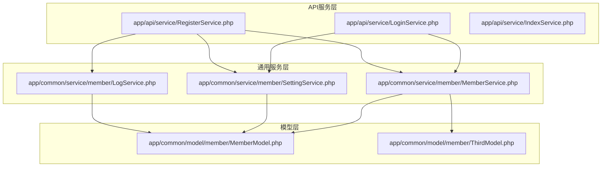
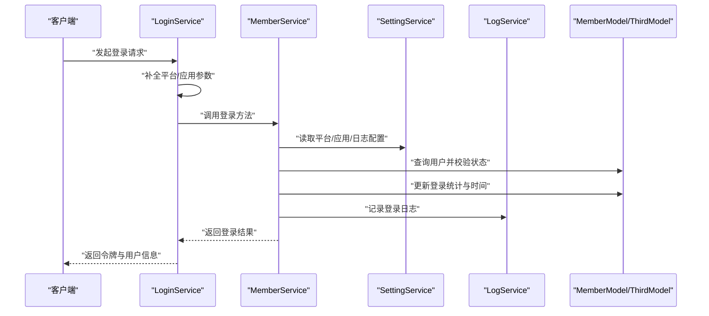
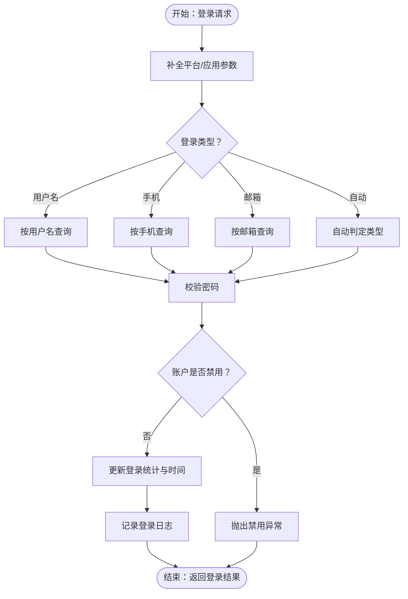
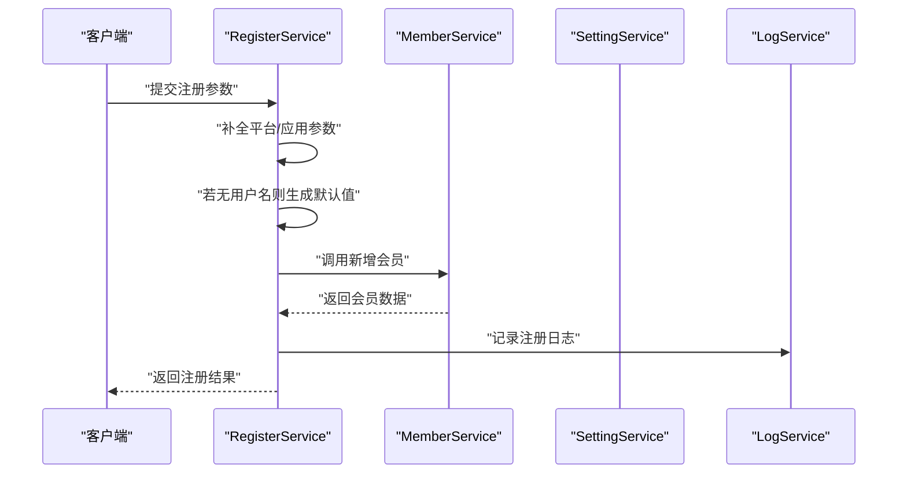
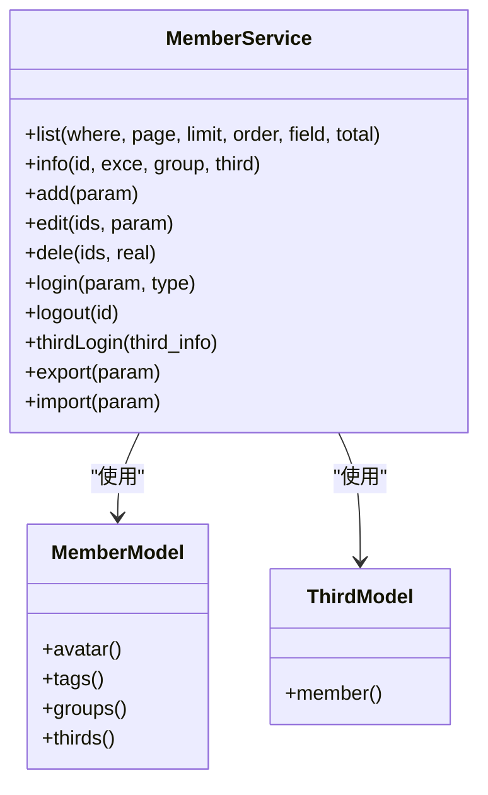
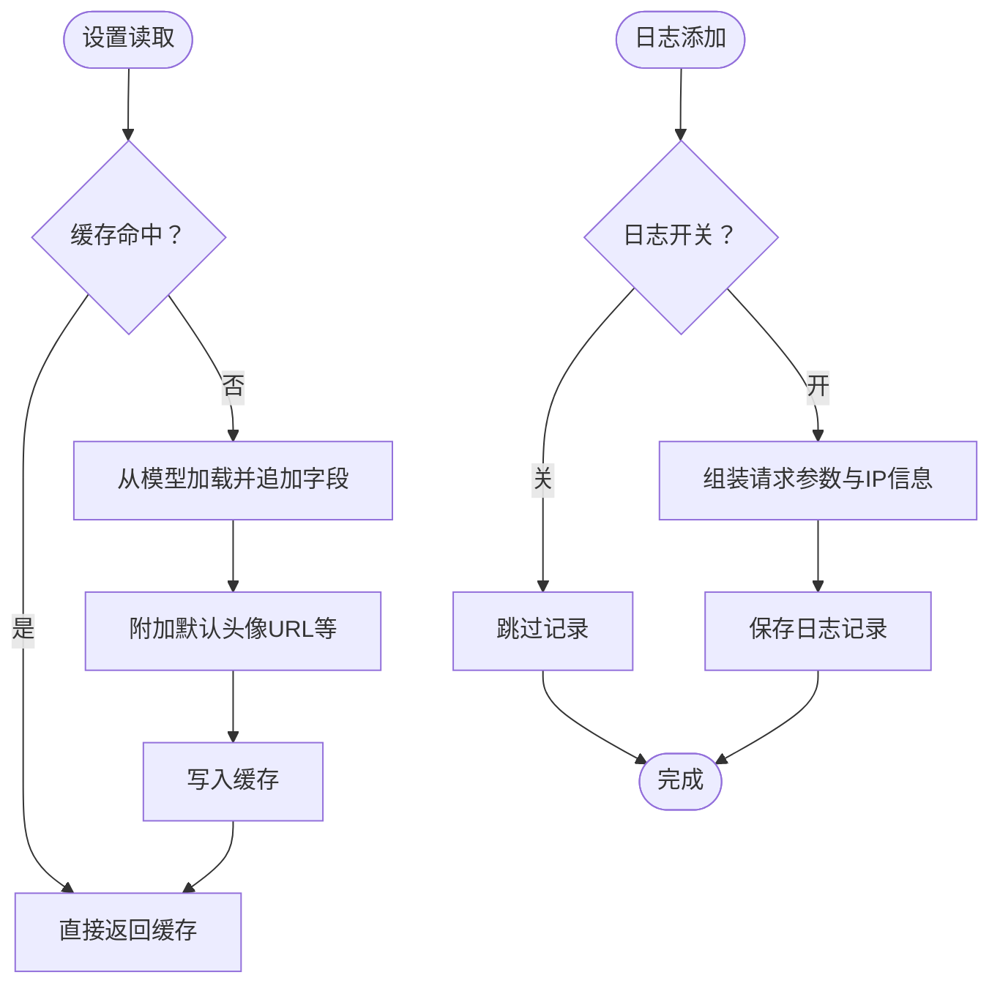
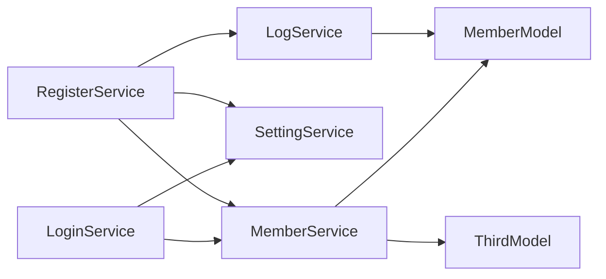

# 服务层测试策略

<cite>
**本文引用的文件**
- [gccd_server/README.md](file://gccd_server/README.md)
- [gccd_server/composer.json](file://gccd_server/composer.json)
- [gccd_server/app/api/service/LoginService.php](file://gccd_server/app/api/service/LoginService.php)
- [gccd_server/app/api/service/RegisterService.php](file://gccd_server/app/api/service/RegisterService.php)
- [gccd_server/app/api/service/IndexService.php](file://gccd_server/app/api/service/IndexService.php)
- [gccd_server/app/common/service/member/MemberService.php](file://gccd_server/app/common/service/member/MemberService.php)
- [gccd_server/app/common/service/member/SettingService.php](file://gccd_server/app/common/service/member/SettingService.php)
- [gccd_server/app/common/service/member/LogService.php](file://gccd_server/app/common/service/member/LogService.php)
- [gccd_server/app/common/model/member/MemberModel.php](file://gccd_server/app/common/model/member/MemberModel.php)
- [gccd_server/app/common/model/member/ThirdModel.php](file://gccd_server/app/common/model/member/ThirdModel.php)
</cite>

## 目录
1. [引言](#引言)
2. [项目结构](#项目结构)
3. [核心组件](#核心组件)
4. [架构总览](#架构总览)
5. [详细组件分析](#详细组件分析)
6. [依赖关系分析](#依赖关系分析)
7. [性能考虑](#性能考虑)
8. [故障排查指南](#故障排查指南)
9. [结论](#结论)
10. [附录](#附录)

## 引言
本文件面向ThinkPHP8服务层的测试策略，聚焦于单元测试与集成测试的设计与实施。内容涵盖测试隔离、依赖注入与Mock对象的使用、测试用例设计与断言方法、数据库与外部服务测试、端到端测试、异常处理与事务回滚验证、测试覆盖率与性能压力测试方法，以及测试自动化与持续集成的配置与实践。目标是帮助开发者在不直接依赖具体代码实现的前提下，系统性地构建高质量、可维护的测试体系。

## 项目结构
后端采用ThinkPHP多应用架构，服务层位于 app/api/service 与 app/common/service 下，分别承载前台API服务与通用业务服务。通用服务层进一步细分为 member、content、file、setting、system、wechat 等子域，便于按业务边界组织测试。

**图表来源**
- [gccd_server/app/api/service/LoginService.php:17-62](file://gccd_server/app/api/service/LoginService.php#L17-L62)
- [gccd_server/app/api/service/RegisterService.php:19-48](file://gccd_server/app/api/service/RegisterService.php#L19-L48)
- [gccd_server/app/api/service/IndexService.php:15-31](file://gccd_server/app/api/service/IndexService.php#L15-L31)
- [gccd_server/app/common/service/member/MemberService.php:28-570](file://gccd_server/app/common/service/member/MemberService.php#L28-L570)
- [gccd_server/app/common/service/member/SettingService.php:21-399](file://gccd_server/app/common/service/member/SettingService.php#L21-L399)
- [gccd_server/app/common/service/member/LogService.php:21-283](file://gccd_server/app/common/service/member/LogService.php#L21-L283)
- [gccd_server/app/common/model/member/MemberModel.php:20-174](file://gccd_server/app/common/model/member/MemberModel.php#L20-L174)
- [gccd_server/app/common/model/member/ThirdModel.php:19-80](file://gccd_server/app/common/model/member/ThirdModel.php#L19-L80)

**章节来源**
- [gccd_server/README.md:1-189](file://gccd_server/README.md#L1-L189)
- [gccd_server/composer.json:1-65](file://gccd_server/composer.json#L1-L65)

## 核心组件
- API服务层：对外提供登录、注册、首页等能力，通常作为控制器的调用方，负责参数预处理与跨服务编排。
- 通用服务层：封装领域业务逻辑，如会员管理、设置、日志等，承担数据校验、事务控制、缓存与外部服务交互。
- 模型层：封装ORM映射与关联关系，提供属性追加与序列化输出。

关键职责与测试关注点：
- LoginService：登录入口编排，参数平台与应用默认值处理，委派给MemberService。
- RegisterService：注册流程编排，参数默认值、调用MemberService新增、写入日志。
- MemberService：核心业务逻辑，含列表查询、详情、增删改、登录、第三方登录、导出导入、事务控制等。
- SettingService：平台/应用/日志类型常量与配置读取，影响登录与第三方登录行为。
- LogService：请求日志记录，包含IP解析、请求参数脱敏、日志清理等。
- MemberModel/ThirdModel：关联关系与属性追加，用于服务层返回数据的丰富化。

**章节来源**
- [gccd_server/app/api/service/LoginService.php:17-62](file://gccd_server/app/api/service/LoginService.php#L17-L62)
- [gccd_server/app/api/service/RegisterService.php:19-48](file://gccd_server/app/api/service/RegisterService.php#L19-L48)
- [gccd_server/app/api/service/IndexService.php:15-31](file://gccd_server/app/api/service/IndexService.php#L15-L31)
- [gccd_server/app/common/service/member/MemberService.php:28-570](file://gccd_server/app/common/service/member/MemberService.php#L28-L570)
- [gccd_server/app/common/service/member/SettingService.php:21-399](file://gccd_server/app/common/service/member/SettingService.php#L21-L399)
- [gccd_server/app/common/service/member/LogService.php:21-283](file://gccd_server/app/common/service/member/LogService.php#L21-L283)
- [gccd_server/app/common/model/member/MemberModel.php:20-174](file://gccd_server/app/common/model/member/MemberModel.php#L20-L174)
- [gccd_server/app/common/model/member/ThirdModel.php:19-80](file://gccd_server/app/common/model/member/ThirdModel.php#L19-L80)

## 架构总览
服务层测试应遵循“自顶向下”的策略：先以API服务层为入口进行集成测试，再下沉到通用服务层进行单元测试，最后针对模型层进行数据一致性与关联关系测试。

**图表来源**
- [gccd_server/app/api/service/LoginService.php:27-36](file://gccd_server/app/api/service/LoginService.php#L27-L36)
- [gccd_server/app/common/service/member/MemberService.php:434-512](file://gccd_server/app/common/service/member/MemberService.php#L434-L512)
- [gccd_server/app/common/service/member/SettingService.php:283-341](file://gccd_server/app/common/service/member/SettingService.php#L283-L341)
- [gccd_server/app/common/service/member/LogService.php:131-176](file://gccd_server/app/common/service/member/LogService.php#L131-L176)
- [gccd_server/app/common/model/member/MemberModel.php:20-174](file://gccd_server/app/common/model/member/MemberModel.php#L20-L174)

## 详细组件分析

### 登录服务测试策略
- 测试隔离：通过依赖注入或静态方法替换，将MemberService、SettingService、LogService替换为可控的Mock对象，避免真实数据库与外部服务调用。
- 参数预处理：验证未传入平台/应用时的默认值填充逻辑。
- 登录流程：覆盖用户名/手机/邮箱三种登录方式、密码校验、账户禁用、登录统计与日志记录。
- 异常处理：账号不存在、密码错误、账户禁用、第三方平台开关关闭等场景。
- 断言要点：返回字段完整性、令牌生成、登录次数与时间更新、日志记录存在性。

**图表来源**
- [gccd_server/app/api/service/LoginService.php:27-36](file://gccd_server/app/api/service/LoginService.php#L27-L36)
- [gccd_server/app/common/service/member/MemberService.php:434-512](file://gccd_server/app/common/service/member/MemberService.php#L434-L512)
- [gccd_server/app/common/service/member/LogService.php:131-176](file://gccd_server/app/common/service/member/LogService.php#L131-L176)

**章节来源**
- [gccd_server/app/api/service/LoginService.php:27-36](file://gccd_server/app/api/service/LoginService.php#L27-L36)
- [gccd_server/app/common/service/member/MemberService.php:434-512](file://gccd_server/app/common/service/member/MemberService.php#L434-L512)
- [gccd_server/app/common/service/member/LogService.php:131-176](file://gccd_server/app/common/service/member/LogService.php#L131-L176)

### 注册服务测试策略
- 测试隔离：将MemberService、SettingService、LogService替换为Mock，确保注册流程独立可控。
- 参数默认值：验证未传用户名时的默认生成逻辑。
- 业务流程：调用MemberService新增会员、写入注册日志。
- 断言要点：返回会员标识、日志类型正确、平台与应用字段填充。

**图表来源**
- [gccd_server/app/api/service/RegisterService.php:28-47](file://gccd_server/app/api/service/RegisterService.php#L28-L47)
- [gccd_server/app/common/service/member/MemberService.php:209-256](file://gccd_server/app/common/service/member/MemberService.php#L209-L256)
- [gccd_server/app/common/service/member/LogService.php:131-176](file://gccd_server/app/common/service/member/LogService.php#L131-L176)

**章节来源**
- [gccd_server/app/api/service/RegisterService.php:28-47](file://gccd_server/app/api/service/RegisterService.php#L28-L47)
- [gccd_server/app/common/service/member/MemberService.php:209-256](file://gccd_server/app/common/service/member/MemberService.php#L209-L256)
- [gccd_server/app/common/service/member/LogService.php:131-176](file://gccd_server/app/common/service/member/LogService.php#L131-L176)

### 会员服务测试策略
- 列表与详情：验证条件过滤、字段选择、分页与总数计算、关联数据追加与隐藏。
- 新增/编辑/删除：覆盖密码加密、默认分组、标签与分组关系维护、软删除与真实删除分支。
- 登录/退出：覆盖多种登录方式、密码校验、登录统计与日志、退出时间更新。
- 第三方登录：覆盖UnionId/OpenId匹配、平台应用白名单、注册开关、事务一致性与日志记录。
- 导出/导入：覆盖文件存储路径生成、任务队列触发、导入文件落盘与任务登记。
- 事务回滚：在新增/编辑/删除与第三方登录场景下，验证异常发生时的数据一致性。

**图表来源**
- [gccd_server/app/common/service/member/MemberService.php:62-570](file://gccd_server/app/common/service/member/MemberService.php#L62-L570)
- [gccd_server/app/common/model/member/MemberModel.php:57-174](file://gccd_server/app/common/model/member/MemberModel.php#L57-L174)
- [gccd_server/app/common/model/member/ThirdModel.php:26-80](file://gccd_server/app/common/model/member/ThirdModel.php#L26-L80)

**章节来源**
- [gccd_server/app/common/service/member/MemberService.php:62-570](file://gccd_server/app/common/service/member/MemberService.php#L62-L570)
- [gccd_server/app/common/model/member/MemberModel.php:57-174](file://gccd_server/app/common/model/member/MemberModel.php#L57-L174)
- [gccd_server/app/common/model/member/ThirdModel.php:26-80](file://gccd_server/app/common/model/member/ThirdModel.php#L26-L80)

### 设置与日志服务测试策略
- SettingService：验证平台/应用枚举、日志类型枚举、配置读取与缓存键生成、CLI/Cgi差异处理。
- LogService：验证日志列表查询、详情缓存、日志添加（含请求参数脱敏、UA截断、IP解析）、清理策略与定时清理。

**图表来源**
- [gccd_server/app/common/service/member/SettingService.php:283-341](file://gccd_server/app/common/service/member/SettingService.php#L283-L341)
- [gccd_server/app/common/service/member/LogService.php:131-176](file://gccd_server/app/common/service/member/LogService.php#L131-L176)

**章节来源**
- [gccd_server/app/common/service/member/SettingService.php:283-341](file://gccd_server/app/common/service/member/SettingService.php#L283-L341)
- [gccd_server/app/common/service/member/LogService.php:131-176](file://gccd_server/app/common/service/member/LogService.php#L131-L176)

## 依赖关系分析
- API服务层依赖通用服务层：LoginService与RegisterService均委派至MemberService与SettingService、LogService。
- 通用服务层依赖模型层：MemberService与LogService使用MemberModel/ThirdModel进行数据读写与关联查询。
- 外部依赖：配置中心（Config）、请求上下文（Request）、文件系统（Filesystem）、缓存（Cache）等。

**图表来源**
- [gccd_server/app/api/service/LoginService.php:12-12](file://gccd_server/app/api/service/LoginService.php#L12-L12)
- [gccd_server/app/api/service/RegisterService.php:12-14](file://gccd_server/app/api/service/RegisterService.php#L12-L14)
- [gccd_server/app/common/service/member/MemberService.php:21-23](file://gccd_server/app/common/service/member/MemberService.php#L21-L23)
- [gccd_server/app/common/service/member/LogService.php:15-16](file://gccd_server/app/common/service/member/LogService.php#L15-L16)
- [gccd_server/app/common/model/member/MemberModel.php:12-14](file://gccd_server/app/common/model/member/MemberModel.php#L12-L14)
- [gccd_server/app/common/model/member/ThirdModel.php:12-13](file://gccd_server/app/common/model/member/ThirdModel.php#L12-L13)

**章节来源**
- [gccd_server/app/api/service/LoginService.php:12-12](file://gccd_server/app/api/service/LoginService.php#L12-L12)
- [gccd_server/app/api/service/RegisterService.php:12-14](file://gccd_server/app/api/service/RegisterService.php#L12-L14)
- [gccd_server/app/common/service/member/MemberService.php:21-23](file://gccd_server/app/common/service/member/MemberService.php#L21-L23)
- [gccd_server/app/common/service/member/LogService.php:15-16](file://gccd_server/app/common/service/member/LogService.php#L15-L16)
- [gccd_server/app/common/model/member/MemberModel.php:12-14](file://gccd_server/app/common/model/member/MemberModel.php#L12-L14)
- [gccd_server/app/common/model/member/ThirdModel.php:12-13](file://gccd_server/app/common/model/member/ThirdModel.php#L12-L13)

## 性能考虑
- 单元测试：优先使用内存数据库或内存表，减少IO；对大列表查询进行分页与字段裁剪，避免全量加载。
- 集成测试：对文件上传/下载、第三方SDK调用进行Mock，必要时使用本地临时存储；对日志清理与定时任务进行时间窗口控制。
- 事务回滚：在测试中显式开启/回滚事务，避免真实写入造成数据膨胀。
- 缓存：对缓存读写进行隔离，使用独立前缀或Key空间，避免测试间相互污染。
- 并发与压力：对高频接口（登录/注册）进行并发压测，观察数据库连接池与缓存命中率，识别瓶颈。

## 故障排查指南
- 登录失败：检查账号是否存在、密码校验、账户禁用状态、平台/应用开关。
- 第三方登录异常：核对UnionId/OpenId匹配、应用白名单、注册开关、事务一致性。
- 日志缺失：确认日志开关、请求参数脱敏配置、UA长度限制、IP解析可用性。
- 数据不一致：重点核查事务回滚路径，确保异常时不会产生半写状态。

**章节来源**
- [gccd_server/app/common/service/member/MemberService.php:468-512](file://gccd_server/app/common/service/member/MemberService.php#L468-L512)
- [gccd_server/app/common/service/member/MemberService.php:684-733](file://gccd_server/app/common/service/member/MemberService.php#L684-L733)
- [gccd_server/app/common/service/member/LogService.php:131-176](file://gccd_server/app/common/service/member/LogService.php#L131-L176)

## 结论
通过明确的测试隔离与Mock策略、清晰的测试用例设计与断言方法、完善的异常与事务回滚验证，以及对性能与覆盖率的关注，可以有效保障ThinkPHP服务层的质量与稳定性。建议在CI中引入自动化测试流水线，结合覆盖率阈值与性能基线，持续提升交付质量。

## 附录

### 测试设计原则
- 隔离：使用依赖注入或静态方法替换，避免真实数据库与外部服务。
- 可控：通过Mock/Fake对象控制输入与输出，确保测试可重复。
- 覆盖：关注核心业务路径、边界条件、异常分支与事务回滚。
- 可观测：断言返回结构、关键字段、日志与缓存状态。

### 测试数据准备
- 使用内存数据库或专用测试库，确保每次测试前后的数据干净。
- 对第三方登录场景准备UnionId/OpenId与应用白名单数据。
- 对导出/导入场景准备临时文件路径与任务记录。

### 测试自动化与持续集成
- 在CI中执行单元测试与集成测试，设置覆盖率阈值。
- 对高频接口进行回归测试与压力测试，监控响应时间与错误率。
- 使用独立配置文件与环境变量，隔离测试与生产环境。

**章节来源**
- [gccd_server/composer.json:49-51](file://gccd_server/composer.json#L49-L51)
- [gccd_server/README.md:46-114](file://gccd_server/README.md#L46-L114)