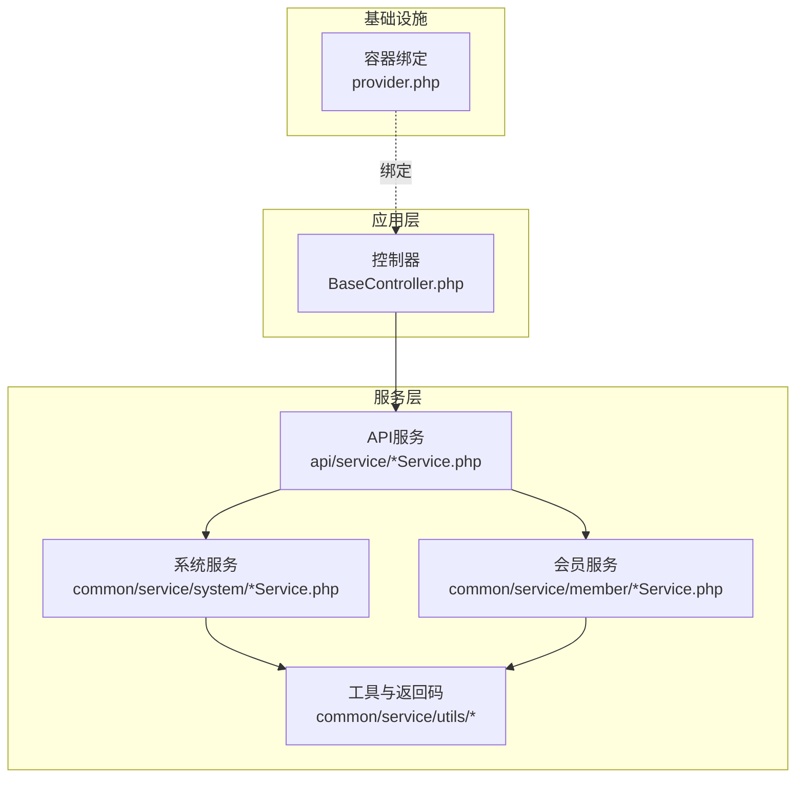
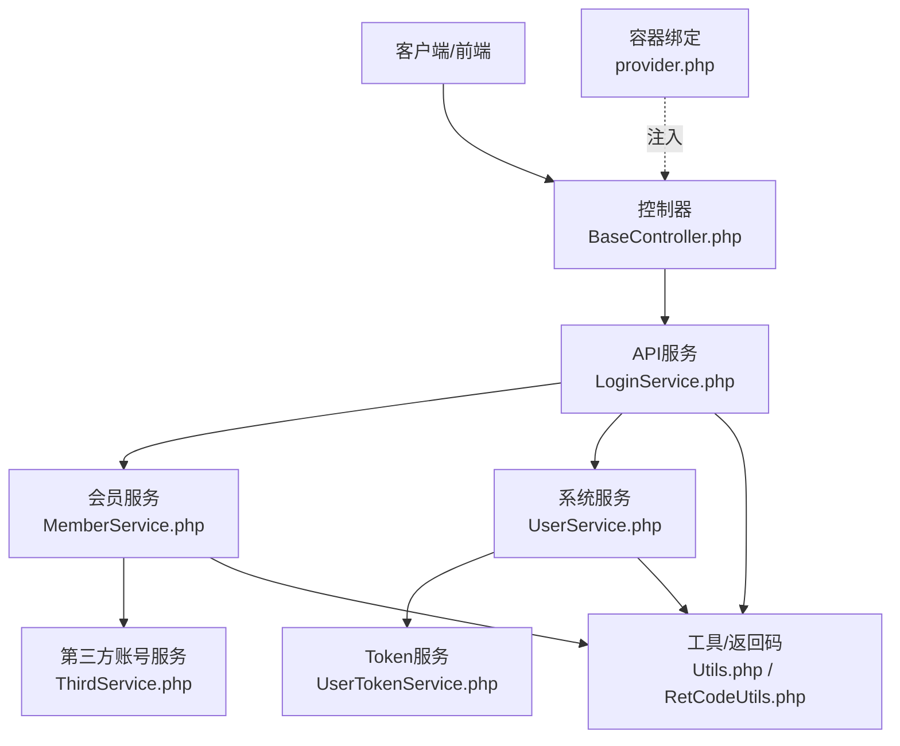
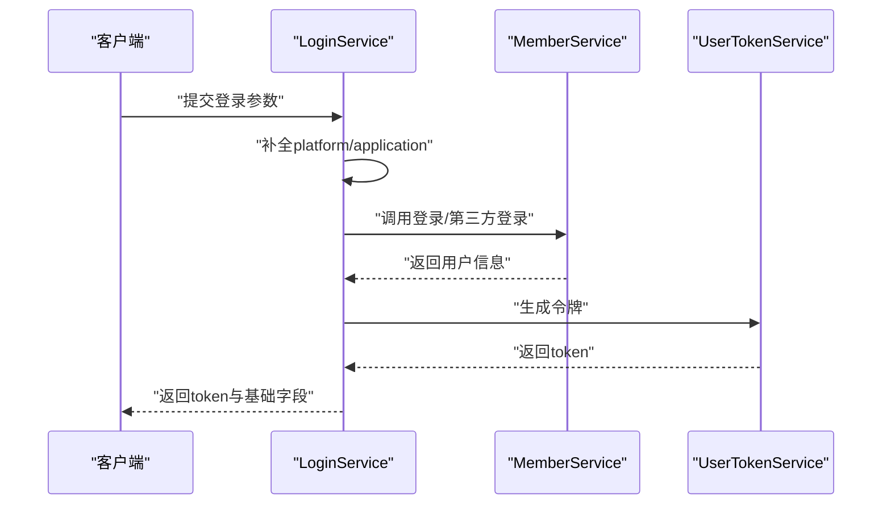
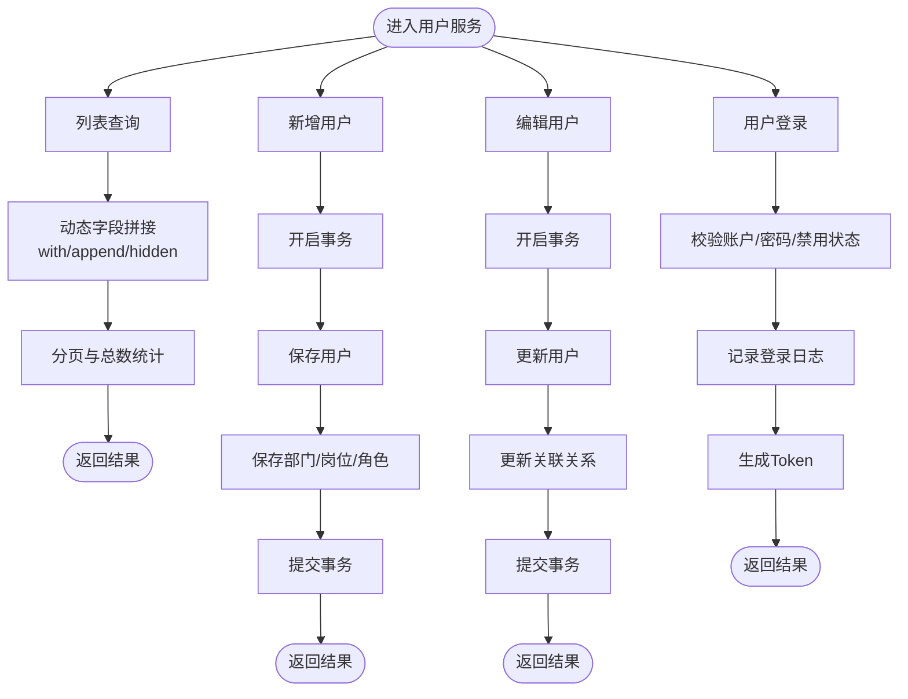
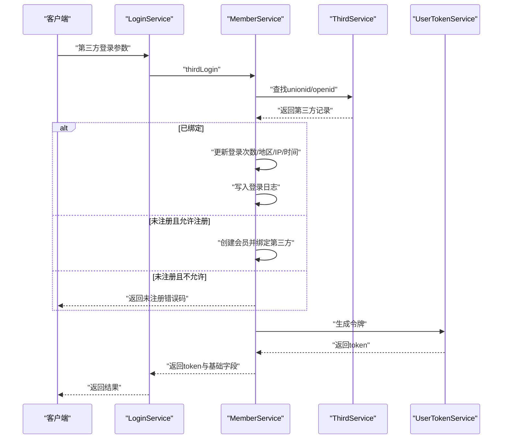
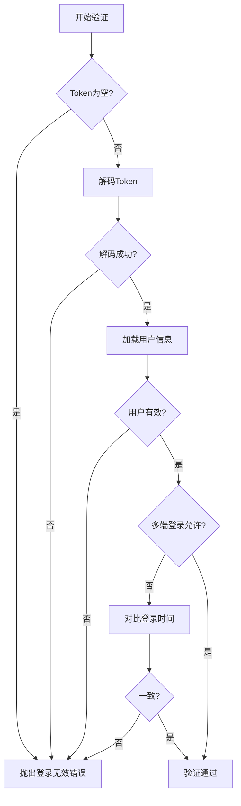
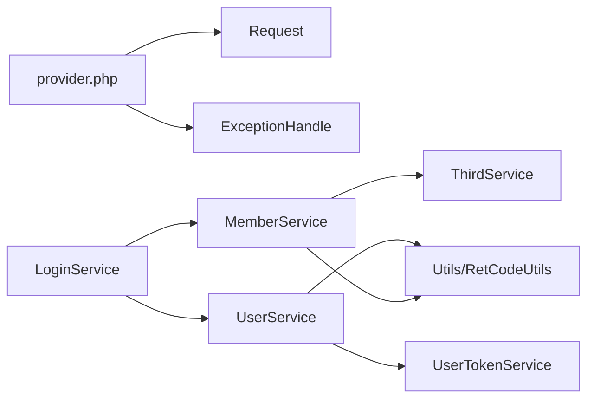

# 服务层设计

<cite>
**本文引用的文件**
- [BaseController.php](file://gccd_server/app/BaseController.php)
- [provider.php](file://gccd_server/app/provider.php)
- [LoginService.php](file://gccd_server/app/api/service/LoginService.php)
- [UserService.php](file://gccd_server/app/common/service/system/UserService.php)
- [MemberService.php](file://gccd_server/app/common/service/member/MemberService.php)
- [ThirdService.php](file://gccd_server/app/common/service/member/ThirdService.php)
- [UserTokenService.php](file://gccd_server/app/common/service/system/UserTokenService.php)
- [RetCodeUtils.php](file://gccd_server/app/common/service/utils/RetCodeUtils.php)
- [Utils.php](file://gccd_server/app/common/service/utils/Utils.php)
</cite>

## 目录
1. [引言](#引言)
2. [项目结构](#项目结构)
3. [核心组件](#核心组件)
4. [架构总览](#架构总览)
5. [详细组件分析](#详细组件分析)
6. [依赖分析](#依赖分析)
7. [性能考虑](#性能考虑)
8. [故障排查指南](#故障排查指南)
9. [结论](#结论)
10. [附录](#附录)

## 引言
本文件面向ThinkPHP项目的服务层设计，系统性阐述服务层在整体架构中的作用与价值，重点覆盖以下方面：
- 业务逻辑封装与职责边界
- 事务处理与数据一致性保障
- 数据聚合与跨模型关联处理
- 服务类命名规范、继承关系与依赖注入机制
- 服务层与控制器、模型层的协作模式
- 常见服务设计模式（工厂、策略）在业务中的应用
- 典型业务场景实现示例（用户认证、第三方登录、数据校验、复杂查询）
- 单元测试策略与Mock对象使用建议

## 项目结构
服务层位于应用目录下的公共模块中，按业务域划分子目录，便于职责清晰与扩展：
- api/service：对外API入口服务，负责参数预处理与调用通用服务
- common/service：通用业务服务，按领域拆分（如system、member、file、content等）
- common/service/utils：通用工具与返回码常量
- app/provider.php：容器绑定，声明Request与异常处理器的替换实现

**图示来源**
- [BaseController.php:1-101](file://gccd_server/app/BaseController.php#L1-L101)
- [provider.php:1-18](file://gccd_server/app/provider.php#L1-L18)
- [LoginService.php:1-63](file://gccd_server/app/api/service/LoginService.php#L1-L63)
- [UserService.php:1-604](file://gccd_server/app/common/service/system/UserService.php#L1-L604)
- [MemberService.php:1-800](file://gccd_server/app/common/service/member/MemberService.php#L1-L800)
- [RetCodeUtils.php:1-85](file://gccd_server/app/common/service/utils/RetCodeUtils.php#L1-L85)
- [Utils.php:1-190](file://gccd_server/app/common/service/utils/Utils.php#L1-L190)

**章节来源**
- [BaseController.php:1-101](file://gccd_server/app/BaseController.php#L1-L101)
- [provider.php:1-18](file://gccd_server/app/provider.php#L1-L18)

## 核心组件
- API服务层（api/service）：作为对外接口的薄层，负责参数标准化、平台与应用维度的默认值注入，并委派到通用服务完成具体业务。
- 通用服务层（common/service）：承载核心业务逻辑，包含系统服务（用户、菜单、角色、Token）、会员服务（用户、第三方账号、分组、标签等）、文件导入导出、内容管理、设置等。
- 工具与返回码（utils）：统一返回码常量、IP解析、随机字符串、字节格式化、服务器信息采集等。

**章节来源**
- [LoginService.php:1-63](file://gccd_server/app/api/service/LoginService.php#L1-L63)
- [UserService.php:1-604](file://gccd_server/app/common/service/system/UserService.php#L1-L604)
- [MemberService.php:1-800](file://gccd_server/app/common/service/member/MemberService.php#L1-L800)
- [ThirdService.php:1-224](file://gccd_server/app/common/service/member/ThirdService.php#L1-L224)
- [UserTokenService.php:1-147](file://gccd_server/app/common/service/system/UserTokenService.php#L1-L147)
- [RetCodeUtils.php:1-85](file://gccd_server/app/common/service/utils/RetCodeUtils.php#L1-L85)
- [Utils.php:1-190](file://gccd_server/app/common/service/utils/Utils.php#L1-L190)

## 架构总览
服务层围绕“控制器-服务-模型”三层协作展开，API服务作为入口，系统与会员服务作为核心，工具与缓存贯穿各环节，容器绑定确保请求与异常处理的可替换性。

**图示来源**
- [BaseController.php:1-101](file://gccd_server/app/BaseController.php#L1-L101)
- [LoginService.php:1-63](file://gccd_server/app/api/service/LoginService.php#L1-L63)
- [UserService.php:1-604](file://gccd_server/app/common/service/system/UserService.php#L1-L604)
- [MemberService.php:1-800](file://gccd_server/app/common/service/member/MemberService.php#L1-L800)
- [ThirdService.php:1-224](file://gccd_server/app/common/service/member/ThirdService.php#L1-L224)
- [UserTokenService.php:1-147](file://gccd_server/app/common/service/system/UserTokenService.php#L1-L147)
- [RetCodeUtils.php:1-85](file://gccd_server/app/common/service/utils/RetCodeUtils.php#L1-L85)
- [Utils.php:1-190](file://gccd_server/app/common/service/utils/Utils.php#L1-L190)
- [provider.php:1-18](file://gccd_server/app/provider.php#L1-L18)

## 详细组件分析

### 组件一：API服务（以登录为例）
- 职责：接收外部请求参数，注入平台与应用维度默认值，委派到通用服务执行业务。
- 关键点：
  - 参数标准化：自动补齐platform与application字段
  - 委派调用：LoginService.login -> MemberService.login 或 MemberService.thirdLogin
  - 返回值：统一封装为包含令牌与必要字段的对象

**图示来源**
- [LoginService.php:27-61](file://gccd_server/app/api/service/LoginService.php#L27-L61)
- [MemberService.php:434-511](file://gccd_server/app/common/service/member/MemberService.php#L434-L511)
- [UserTokenService.php:41-56](file://gccd_server/app/common/service/system/UserTokenService.php#L41-L56)

**章节来源**
- [LoginService.php:1-63](file://gccd_server/app/api/service/LoginService.php#L1-L63)

### 组件二：系统服务（用户管理与认证）
- 职责：用户增删改查、登录登出、角色菜单聚合、Token生成与校验、登录信息记录等。
- 关键点：
  - 列表查询：支持多维关联with/append/hidden，动态拼接字段，分页与总数统计
  - 复杂查询：根据部门/岗位/角色ID进行关联过滤
  - 事务处理：新增/编辑/删除均包裹事务，异常回滚
  - 缓存：用户信息与菜单权限缓存，降低重复查询成本
  - 认证流程：用户名/手机/邮箱自适应识别，密码校验，登录IP/地区记录，日志写入

**图示来源**
- [UserService.php:57-133](file://gccd_server/app/common/service/system/UserService.php#L57-L133)
- [UserService.php:283-329](file://gccd_server/app/common/service/system/UserService.php#L283-L329)
- [UserService.php:339-399](file://gccd_server/app/common/service/system/UserService.php#L339-L399)
- [UserService.php:409-452](file://gccd_server/app/common/service/system/UserService.php#L409-L452)
- [UserService.php:492-544](file://gccd_server/app/common/service/system/UserService.php#L492-L544)

**章节来源**
- [UserService.php:1-604](file://gccd_server/app/common/service/system/UserService.php#L1-L604)

### 组件三：会员服务（用户与第三方账号）
- 职责：会员增删改查、登录/登出、第三方账号绑定与登录、导出导入、权限聚合。
- 关键点：
  - 登录适配：支持用户名/手机/邮箱三种账户类型，自动识别
  - 第三方登录：基于unionid/openid匹配，支持多平台/多端应用开关控制
  - 事务一致性：第三方账号与会员信息的新增/更新在事务内完成
  - 权限聚合：基于分组与个人API授权，生成树形权限结构与URL集合

**图示来源**
- [LoginService.php:46-49](file://gccd_server/app/api/service/LoginService.php#L46-L49)
- [MemberService.php:636-733](file://gccd_server/app/common/service/member/MemberService.php#L636-L733)
- [ThirdService.php:48-104](file://gccd_server/app/common/service/member/ThirdService.php#L48-L104)
- [UserTokenService.php:41-56](file://gccd_server/app/common/service/system/UserTokenService.php#L41-L56)

**章节来源**
- [MemberService.php:1-800](file://gccd_server/app/common/service/member/MemberService.php#L1-L800)
- [ThirdService.php:1-224](file://gccd_server/app/common/service/member/ThirdService.php#L1-L224)

### 组件四：Token服务（认证与鉴权）
- 职责：Token生成、解码、验证、用户ID提取；结合用户状态与登录时间进行有效性校验。
- 关键点：
  - 配置来源：从系统设置读取密钥、算法、过期时长、多端登录开关
  - 验证策略：空Token、解码异常、用户被删除/禁用、密码修改导致会话失效、多端登录冲突

**图示来源**
- [UserTokenService.php:87-117](file://gccd_server/app/common/service/system/UserTokenService.php#L87-L117)
- [RetCodeUtils.php:34-44](file://gccd_server/app/common/service/utils/RetCodeUtils.php#L34-L44)

**章节来源**
- [UserTokenService.php:1-147](file://gccd_server/app/common/service/system/UserTokenService.php#L1-L147)
- [RetCodeUtils.php:1-85](file://gccd_server/app/common/service/utils/RetCodeUtils.php#L1-L85)

### 组件五：工具与返回码
- 工具类：IP解析、字节格式化、随机字符串、服务器信息采集
- 返回码：统一错误码与消息映射，便于前后端一致处理

**章节来源**
- [Utils.php:1-190](file://gccd_server/app/common/service/utils/Utils.php#L1-L190)
- [RetCodeUtils.php:1-85](file://gccd_server/app/common/service/utils/RetCodeUtils.php#L1-L85)

## 依赖分析
- 控制器依赖注入：通过容器绑定替换Request与异常处理器，保证请求解析与异常处理可替换。
- 服务间依赖：API服务依赖通用服务；通用服务依赖模型、缓存、工具与返回码；Token服务依赖系统设置与用户服务。
- 外部依赖：JWT用于Token生成与解码；ip2region用于IP归属地解析；数据库事务用于一致性保障。

**图示来源**
- [provider.php:14-17](file://gccd_server/app/provider.php#L14-L17)
- [LoginService.php:12-35](file://gccd_server/app/api/service/LoginService.php#L12-L35)
- [UserService.php:12-22](file://gccd_server/app/common/service/system/UserService.php#L12-L22)
- [MemberService.php:12-23](file://gccd_server/app/common/service/member/MemberService.php#L12-L23)
- [UserTokenService.php:12-15](file://gccd_server/app/common/service/system/UserTokenService.php#L12-L15)

**章节来源**
- [provider.php:1-18](file://gccd_server/app/provider.php#L1-L18)
- [LoginService.php:1-63](file://gccd_server/app/api/service/LoginService.php#L1-L63)
- [UserService.php:1-604](file://gccd_server/app/common/service/system/UserService.php#L1-L604)
- [MemberService.php:1-800](file://gccd_server/app/common/service/member/MemberService.php#L1-L800)
- [UserTokenService.php:1-147](file://gccd_server/app/common/service/system/UserTokenService.php#L1-L147)

## 性能考虑
- 查询优化
  - 动态字段拼接与with/append/hidden组合，避免N+1查询，减少冗余字段传输
  - 分页与总数统计分离，仅在需要时计算总数
- 缓存利用
  - 用户信息与菜单权限缓存，降低重复查询与计算开销
- 事务边界
  - 将相关写操作置于同一事务，减少锁竞争与不一致风险
- IO与网络
  - IP解析结果缓存，避免重复查询ip2region
  - 文件上传路径与导入导出任务异步化，减轻请求阻塞

## 故障排查指南
- 登录失败
  - 检查账户是否存在、密码是否正确、是否被禁用
  - 核对平台/应用开关是否允许登录/注册
- Token失效
  - 确认Token是否为空、是否过期、是否被修改密码
  - 多端登录配置是否冲突
- 第三方登录异常
  - 校验unionid/openid是否正确，平台/应用是否在白名单
  - 未注册场景下是否允许注册
- 事务回滚
  - 查看异常栈与回滚分支，确认写入顺序与外键约束

**章节来源**
- [MemberService.php:466-485](file://gccd_server/app/common/service/member/MemberService.php#L466-L485)
- [MemberService.php:682-733](file://gccd_server/app/common/service/member/MemberService.php#L682-L733)
- [UserTokenService.php:87-117](file://gccd_server/app/common/service/system/UserTokenService.php#L87-L117)
- [UserService.php:297-320](file://gccd_server/app/common/service/system/UserService.php#L297-L320)

## 结论
服务层在ThinkPHP项目中承担了业务逻辑的核心职责，通过清晰的领域划分、严格的事务边界、完善的缓存与工具支撑，实现了高内聚、低耦合的架构目标。API服务作为薄层入口，系统与会员服务作为业务骨干，配合Token与工具链，形成稳定可靠的业务闭环。建议在后续演进中持续强化单元测试与Mock策略，进一步提升可维护性与可测试性。

## 附录

### 服务类命名规范与继承关系
- 命名规范
  - 采用领域+功能命名，如UserService、MemberService、ThirdService
  - API服务以Service结尾，通用服务同名
- 继承关系
  - 控制器基类：BaseController
  - 服务类通常无显式继承，通过静态方法组织业务逻辑
- 依赖注入机制
  - 通过容器绑定替换Request与异常处理器
  - 服务内部通过静态方法调用其他服务，体现松耦合

**章节来源**
- [BaseController.php:19-62](file://gccd_server/app/BaseController.php#L19-L62)
- [provider.php:14-17](file://gccd_server/app/provider.php#L14-L17)

### 常用服务设计模式
- 工厂模式
  - 在API服务中根据类型参数选择不同登录路径（用户名/手机/邮箱/第三方），体现简单工厂思想
- 策略模式
  - 平台/应用维度的登录策略可通过配置项切换，不同策略对应不同的登录与注册行为
- 观察者/事件
  - 登录日志与用户日志写入，可视为事件驱动的副作用处理

**章节来源**
- [LoginService.php:27-61](file://gccd_server/app/api/service/LoginService.php#L27-L61)
- [MemberService.php:644-733](file://gccd_server/app/common/service/member/MemberService.php#L644-L733)

### 单元测试策略与Mock对象使用
- 测试策略
  - 使用容器Mock替换Request与异常处理器，隔离外部依赖
  - 对API服务进行集成测试，覆盖参数标准化与委派调用
  - 对系统/会员服务进行单元测试，重点覆盖事务分支、缓存命中与异常路径
- Mock对象
  - 使用Mock替换第三方SDK（如JWT、ip2region）
  - 使用内存缓存替代Redis/Memcache，提高测试稳定性
  - 使用Fake模型或Repository模拟数据库交互，聚焦业务逻辑

[本节为通用指导，无需特定文件引用]