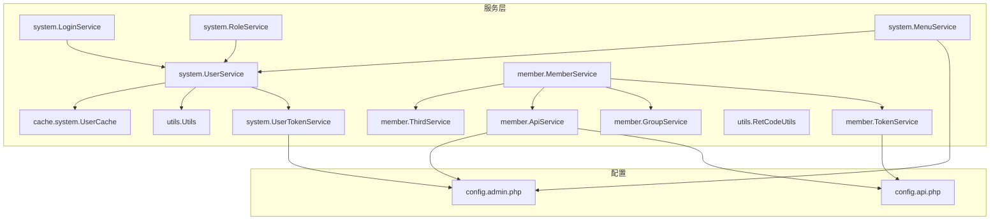
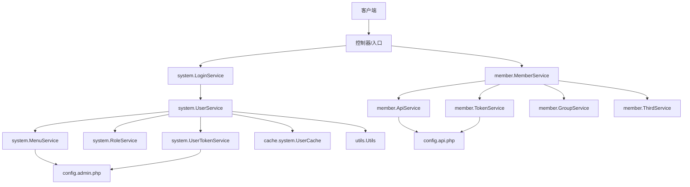
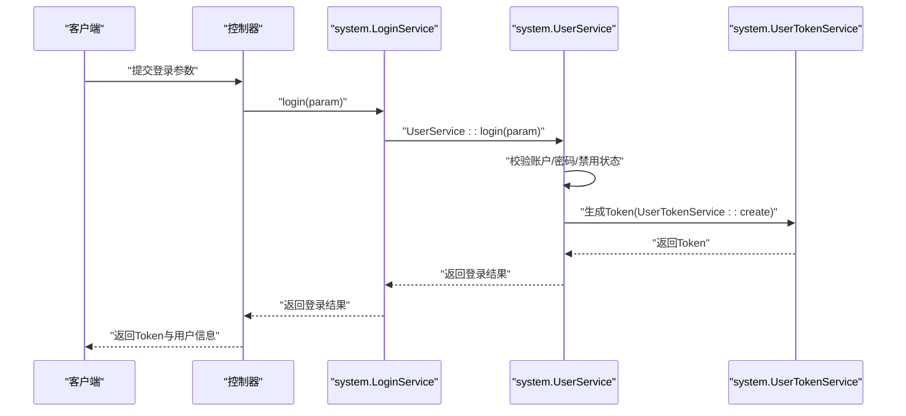
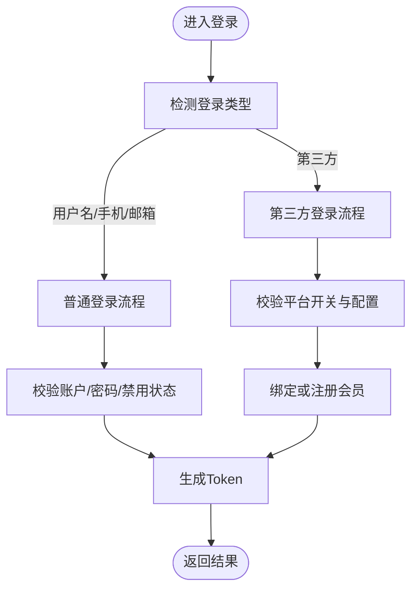
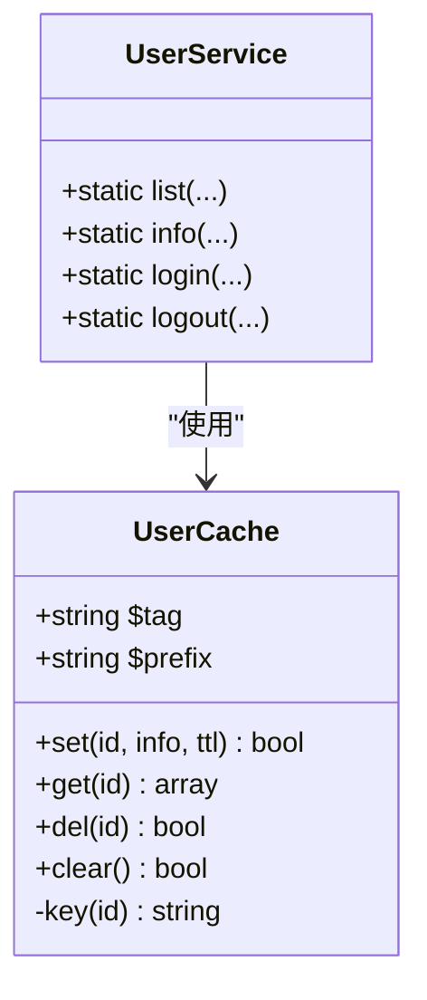
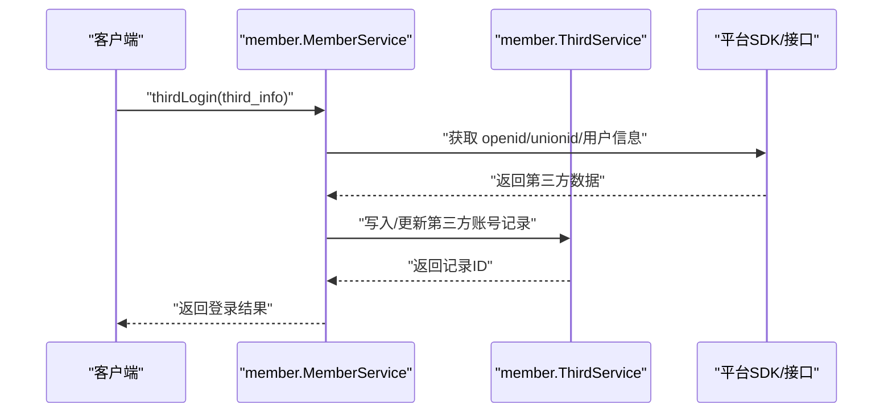
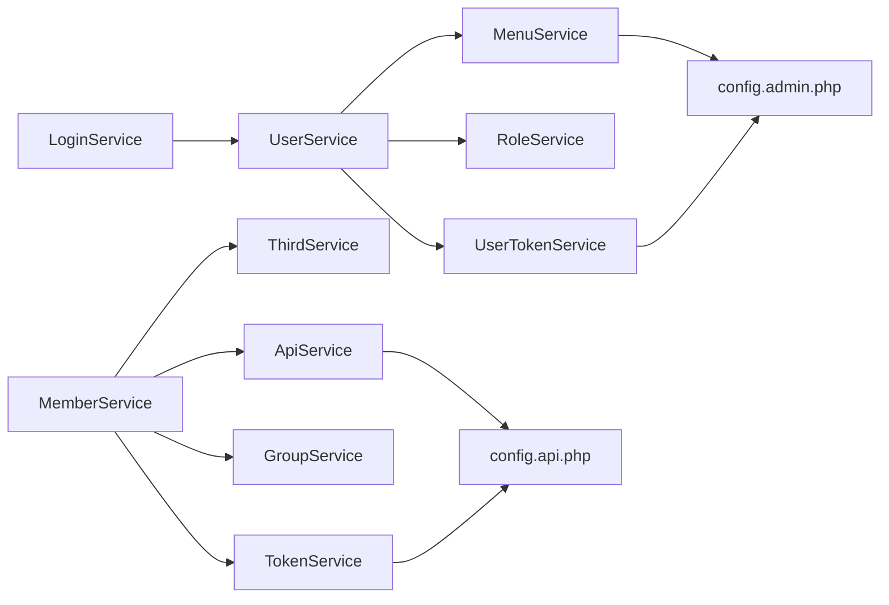

# 服务设计模式

<cite>
**本文引用的文件**
- [AppService.php](file://gccd_server/app/AppService.php)
- [UserService.php](file://gccd_server/app/common/service/system/UserService.php)
- [MemberService.php](file://gccd_server/app/common/service/member/MemberService.php)
- [ThirdService.php](file://gccd_server/app/common/service/member/ThirdService.php)
- [ApiService.php](file://gccd_server/app/common/service/member/ApiService.php)
- [GroupService.php](file://gccd_server/app/common/service/member/GroupService.php)
- [LoginService.php](file://gccd_server/app/common/service/system/LoginService.php)
- [RoleService.php](file://gccd_server/app/common/service/system/RoleService.php)
- [MenuService.php](file://gccd_server/app/common/service/system/MenuService.php)
- [UserCache.php](file://gccd_server/app/common/cache/system/UserCache.php)
- [Utils.php](file://gccd_server/app/common/service/utils/Utils.php)
- [UserTokenService.php](file://gccd_server/app/common/service/system/UserTokenService.php)
- [TokenService.php](file://gccd_server/app/common/service/member/TokenService.php)
- [RetCodeUtils.php](file://gccd_server/app/common/service/utils/RetCodeUtils.php)
- [api.php](file://gccd_server/config/api.php)
- [admin.php](file://gccd_server/config/admin.php)
</cite>

## 目录
1. [引言](#引言)
2. [项目结构](#项目结构)
3. [核心组件](#核心组件)
4. [架构总览](#架构总览)
5. [详细组件分析](#详细组件分析)
6. [依赖分析](#依赖分析)
7. [性能考量](#性能考量)
8. [故障排查指南](#故障排查指南)
9. [结论](#结论)
10. [附录](#附录)

## 引言
本文件聚焦于 ThinkPHP 服务层中的常见设计模式与实践，结合仓库中的实际代码，系统性解析以下主题：
- 工厂模式在服务实例化与动态服务创建中的应用
- 策略模式在业务逻辑分支处理中的使用（认证策略、数据处理策略等）
- 单例模式在服务缓存与资源管理中的实现
- 适配器模式在第三方服务集成中的应用
- 设计模式选择原则与性能考量

目标是帮助读者在理解现有实现的基础上，安全地扩展与优化服务层。

## 项目结构
服务层位于 gccd_server/app/common/service 下，按领域划分（system、member、content、file、setting、wechat、utils），每个领域内包含若干 Service 类，负责封装业务逻辑、调用模型与缓存、协调其他服务。

图表来源
- [UserService.php:1-604](file://gccd_server/app/common/service/system/UserService.php#L1-L604)
- [LoginService.php:1-41](file://gccd_server/app/common/service/system/LoginService.php#L1-L41)
- [RoleService.php:1-344](file://gccd_server/app/common/service/system/RoleService.php#L1-L344)
- [MenuService.php:1-636](file://gccd_server/app/common/service/system/MenuService.php#L1-L636)
- [MemberService.php:1-800](file://gccd_server/app/common/service/member/MemberService.php#L1-L800)
- [ThirdService.php:1-224](file://gccd_server/app/common/service/member/ThirdService.php#L1-L224)
- [ApiService.php:1-391](file://gccd_server/app/common/service/member/ApiService.php#L1-L391)
- [GroupService.php:1-353](file://gccd_server/app/common/service/member/GroupService.php#L1-L353)
- [TokenService.php:1-143](file://gccd_server/app/common/service/member/TokenService.php#L1-L143)
- [UserTokenService.php:1-147](file://gccd_server/app/common/service/system/UserTokenService.php#L1-L147)
- [UserCache.php:1-88](file://gccd_server/app/common/cache/system/UserCache.php#L1-L88)
- [Utils.php:1-190](file://gccd_server/app/common/service/utils/Utils.php#L1-L190)
- [RetCodeUtils.php:1-85](file://gccd_server/app/common/service/utils/RetCodeUtils.php#L1-L85)
- [admin.php:1-65](file://gccd_server/config/admin.php#L1-L65)
- [api.php:1-59](file://gccd_server/config/api.php#L1-L59)

章节来源
- [AppService.php:1-29](file://gccd_server/app/AppService.php#L1-L29)

## 核心组件
- 系统用户服务：封装用户增删改查、登录、退出、角色菜单聚合等逻辑，广泛使用静态方法与缓存。
- 会员服务：封装会员增删改查、登录、第三方账号绑定与登录、接口权限与分组授权等。
- 认证令牌服务：统一生成、解码、校验 Token，支持多端配置与并发登录控制。
- 缓存服务：以 UserCache 为代表的缓存抽象，提供键空间、TTL、批量删除与清理能力。
- 工具类：IP 解析、字节格式化、服务器信息采集等通用能力。
- 配置：admin.php 与 api.php 提供 token 名称、免登/免权/免限列表等策略依据。

章节来源
- [UserService.php:1-604](file://gccd_server/app/common/service/system/UserService.php#L1-L604)
- [MemberService.php:1-800](file://gccd_server/app/common/service/member/MemberService.php#L1-L800)
- [UserTokenService.php:1-147](file://gccd_server/app/common/service/system/UserTokenService.php#L1-L147)
- [TokenService.php:1-143](file://gccd_server/app/common/service/member/TokenService.php#L1-L143)
- [UserCache.php:1-88](file://gccd_server/app/common/cache/system/UserCache.php#L1-L88)
- [Utils.php:1-190](file://gccd_server/app/common/service/utils/Utils.php#L1-L190)
- [admin.php:1-65](file://gccd_server/config/admin.php#L1-L65)
- [api.php:1-59](file://gccd_server/config/api.php#L1-L59)

## 架构总览
服务层采用“静态方法 + 缓存 + 配置”的组合模式，围绕用户/会员两大主体展开，通过 Token 服务实现认证，通过 Role/Menu/Api/Group 等服务实现权限与接口授权，形成清晰的职责边界与可扩展的策略空间。

图表来源
- [LoginService.php:1-41](file://gccd_server/app/common/service/system/LoginService.php#L1-L41)
- [UserService.php:1-604](file://gccd_server/app/common/service/system/UserService.php#L1-L604)
- [MemberService.php:1-800](file://gccd_server/app/common/service/member/MemberService.php#L1-L800)
- [UserTokenService.php:1-147](file://gccd_server/app/common/service/system/UserTokenService.php#L1-L147)
- [TokenService.php:1-143](file://gccd_server/app/common/service/member/TokenService.php#L1-L143)
- [RoleService.php:1-344](file://gccd_server/app/common/service/system/RoleService.php#L1-L344)
- [MenuService.php:1-636](file://gccd_server/app/common/service/system/MenuService.php#L1-L636)
- [ApiService.php:1-391](file://gccd_server/app/common/service/member/ApiService.php#L1-L391)
- [GroupService.php:1-353](file://gccd_server/app/common/service/member/GroupService.php#L1-L353)
- [ThirdService.php:1-224](file://gccd_server/app/common/service/member/ThirdService.php#L1-L224)
- [UserCache.php:1-88](file://gccd_server/app/common/cache/system/UserCache.php#L1-L88)
- [Utils.php:1-190](file://gccd_server/app/common/service/utils/Utils.php#L1-L190)
- [admin.php:1-65](file://gccd_server/config/admin.php#L1-L65)
- [api.php:1-59](file://gccd_server/config/api.php#L1-L59)

## 详细组件分析

### 工厂模式：服务实例化与动态服务创建
- 静态工厂方法：大量服务通过静态方法对外暴露，便于在不显式 new 的情况下完成业务操作，降低耦合度。
  - 示例路径：[UserService::login:492-544](file://gccd_server/app/common/service/system/UserService.php#L492-L544)，[MemberService::login:434-512](file://gccd_server/app/common/service/member/MemberService.php#L434-L512)
- 动态服务创建：通过配置与常量驱动的服务选择（例如不同平台/应用的登录策略）。
  - 示例路径：[MemberService::thirdLogin:636-800](file://gccd_server/app/common/service/member/MemberService.php#L636-L800) 中根据 application 选择不同平台策略
- 依赖注入与配置：Token 服务从配置读取 token_key、token_exps、token_name 等，形成“配置即工厂”的变体。
  - 示例路径：[UserTokenService::config:27-32](file://gccd_server/app/common/service/system/UserTokenService.php#L27-L32)，[TokenService::config:27-32](file://gccd_server/app/common/service/member/TokenService.php#L27-L32)

图表来源
- [LoginService.php:1-41](file://gccd_server/app/common/service/system/LoginService.php#L1-L41)
- [UserService.php:492-544](file://gccd_server/app/common/service/system/UserService.php#L492-L544)
- [UserTokenService.php:41-56](file://gccd_server/app/common/service/system/UserTokenService.php#L41-L56)

章节来源
- [LoginService.php:1-41](file://gccd_server/app/common/service/system/LoginService.php#L1-L41)
- [UserService.php:1-604](file://gccd_server/app/common/service/system/UserService.php#L1-L604)
- [UserTokenService.php:1-147](file://gccd_server/app/common/service/system/UserTokenService.php#L1-L147)
- [TokenService.php:1-143](file://gccd_server/app/common/service/member/TokenService.php#L1-L143)

### 策略模式：业务逻辑分支处理
- 认证策略：根据登录类型（用户名/手机/邮箱/第三方）选择不同分支，最终统一走对应服务的 login 方法。
  - 示例路径：[MemberService::login:434-512](file://gccd_server/app/common/service/member/MemberService.php#L434-L512)
- 第三方登录策略：根据 application（微信小程序/公众号/网站/移动等）执行不同的登录/注册流程与开关校验。
  - 示例路径：[MemberService::thirdLogin:636-800](file://gccd_server/app/common/service/member/MemberService.php#L636-L800)
- 免登/免权/免限策略：由配置文件提供白名单，服务层在运行时读取并判断，形成“策略即配置”的模式。
  - 示例路径：[ApiService::unloginList:292-318](file://gccd_server/app/common/service/member/ApiService.php#L292-L318)，[MenuService::unloginList:490-516](file://gccd_server/app/common/service/system/MenuService.php#L490-L516)，[MenuService::unauthList:525-552](file://gccd_server/app/common/service/system/MenuService.php#L525-L552)，[MenuService::unrateList:561-587](file://gccd_server/app/common/service/system/MenuService.php#L561-L587)

图表来源
- [MemberService.php:434-512](file://gccd_server/app/common/service/member/MemberService.php#L434-L512)
- [MemberService.php:636-800](file://gccd_server/app/common/service/member/MemberService.php#L636-L800)
- [ApiService.php:292-318](file://gccd_server/app/common/service/member/ApiService.php#L292-L318)
- [MenuService.php:490-516](file://gccd_server/app/common/service/system/MenuService.php#L490-L516)

章节来源
- [MemberService.php:1-800](file://gccd_server/app/common/service/member/MemberService.php#L1-L800)
- [ApiService.php:1-391](file://gccd_server/app/common/service/member/ApiService.php#L1-L391)
- [MenuService.php:1-636](file://gccd_server/app/common/service/system/MenuService.php#L1-L636)
- [api.php:1-59](file://gccd_server/config/api.php#L1-L59)
- [admin.php:1-65](file://gccd_server/config/admin.php#L1-L65)

### 单例模式：服务缓存与资源管理
- 缓存单例：UserCache 以类变量维护 tag 与 prefix，提供 set/get/del/clear 等静态方法，形成“单例式缓存访问”。
  - 示例路径：[UserCache::set:45-48](file://gccd_server/app/common/cache/system/UserCache.php#L45-L48)，[UserCache::get:57-60](file://gccd_server/app/common/cache/system/UserCache.php#L57-L60)，[UserCache::del:69-76](file://gccd_server/app/common/cache/system/UserCache.php#L69-L76)，[UserCache::clear:83-86](file://gccd_server/app/common/cache/system/UserCache.php#L83-L86)
- 服务单例：UserService/MemberService 内部通过静态方法与缓存协作，对外表现为“无状态服务”，内部通过缓存实现“单例式资源复用”。

图表来源
- [UserCache.php:1-88](file://gccd_server/app/common/cache/system/UserCache.php#L1-L88)
- [UserService.php:1-604](file://gccd_server/app/common/service/system/UserService.php#L1-L604)

章节来源
- [UserCache.php:1-88](file://gccd_server/app/common/cache/system/UserCache.php#L1-L88)
- [UserService.php:1-604](file://gccd_server/app/common/service/system/UserService.php#L1-L604)

### 适配器模式：第三方服务集成
- 第三方账号适配：MemberService.thirdLogin 统一处理不同平台（微信/QQ/微博）的 openid/unionid 获取、头像昵称同步、手机号绑定、注册/登录策略等。
  - 示例路径：[MemberService::thirdLogin:636-800](file://gccd_server/app/common/service/member/MemberService.php#L636-L800)
- 平台适配器：ThirdService 提供第三方账号的增删改查与列表查询，作为适配器屏蔽底层差异。
  - 示例路径：[ThirdService::list:48-104](file://gccd_server/app/common/service/member/ThirdService.php#L48-L104)，[ThirdService::info:114-133](file://gccd_server/app/common/service/member/ThirdService.php#L114-L133)

图表来源
- [MemberService.php:636-800](file://gccd_server/app/common/service/member/MemberService.php#L636-L800)
- [ThirdService.php:1-224](file://gccd_server/app/common/service/member/ThirdService.php#L1-L224)

章节来源
- [MemberService.php:1-800](file://gccd_server/app/common/service/member/MemberService.php#L1-L800)
- [ThirdService.php:1-224](file://gccd_server/app/common/service/member/ThirdService.php#L1-L224)

### 代码示例与最佳实践
- 服务类构造函数设计：多数服务未定义构造函数，通过静态方法直接调用，减少对象生命周期管理复杂度。
  - 参考路径：[UserService.php:1-604](file://gccd_server/app/common/service/system/UserService.php#L1-L604)
- 静态方法使用：登录、查询、导出、导入等常用操作均以静态方法提供，便于跨模块调用。
  - 参考路径：[MemberService::login:434-512](file://gccd_server/app/common/service/member/MemberService.php#L434-L512)，[MemberService::export:386-424](file://gccd_server/app/common/service/member/MemberService.php#L386-L424)
- 依赖注入配置：Token 服务从配置读取密钥、算法、过期时间、名称等，避免硬编码。
  - 参考路径：[UserTokenService::config:27-32](file://gccd_server/app/common/service/system/UserTokenService.php#L27-L32)，[TokenService::config:27-32](file://gccd_server/app/common/service/member/TokenService.php#L27-L32)

章节来源
- [UserService.php:1-604](file://gccd_server/app/common/service/system/UserService.php#L1-L604)
- [MemberService.php:1-800](file://gccd_server/app/common/service/member/MemberService.php#L1-L800)
- [UserTokenService.php:1-147](file://gccd_server/app/common/service/system/UserTokenService.php#L1-L147)
- [TokenService.php:1-143](file://gccd_server/app/common/service/member/TokenService.php#L1-L143)

## 依赖分析
- 低耦合高内聚：各领域服务独立，仅通过静态方法与缓存交互，避免循环依赖。
- 关键依赖链：
  - 登录链路：LoginService → UserService → UserTokenService → 配置
  - 会员链路：MemberService → ThirdService/ApiService/GroupService/TokenService → 配置
  - 权限链路：RoleService/MenuService → 配置（免登/免权/免限）

图表来源
- [LoginService.php:1-41](file://gccd_server/app/common/service/system/LoginService.php#L1-L41)
- [UserService.php:1-604](file://gccd_server/app/common/service/system/UserService.php#L1-L604)
- [RoleService.php:1-344](file://gccd_server/app/common/service/system/RoleService.php#L1-L344)
- [MenuService.php:1-636](file://gccd_server/app/common/service/system/MenuService.php#L1-L636)
- [MemberService.php:1-800](file://gccd_server/app/common/service/member/MemberService.php#L1-L800)
- [ThirdService.php:1-224](file://gccd_server/app/common/service/member/ThirdService.php#L1-L224)
- [ApiService.php:1-391](file://gccd_server/app/common/service/member/ApiService.php#L1-L391)
- [GroupService.php:1-353](file://gccd_server/app/common/service/member/GroupService.php#L1-L353)
- [UserTokenService.php:1-147](file://gccd_server/app/common/service/system/UserTokenService.php#L1-L147)
- [TokenService.php:1-143](file://gccd_server/app/common/service/member/TokenService.php#L1-L143)
- [admin.php:1-65](file://gccd_server/config/admin.php#L1-L65)
- [api.php:1-59](file://gccd_server/config/api.php#L1-L59)

章节来源
- [LoginService.php:1-41](file://gccd_server/app/common/service/system/LoginService.php#L1-L41)
- [UserService.php:1-604](file://gccd_server/app/common/service/system/UserService.php#L1-L604)
- [MemberService.php:1-800](file://gccd_server/app/common/service/member/MemberService.php#L1-L800)
- [ApiService.php:1-391](file://gccd_server/app/common/service/member/ApiService.php#L1-L391)
- [MenuService.php:1-636](file://gccd_server/app/common/service/system/MenuService.php#L1-L636)
- [admin.php:1-65](file://gccd_server/config/admin.php#L1-L65)
- [api.php:1-59](file://gccd_server/config/api.php#L1-L59)

## 性能考量
- 缓存优先：用户信息、菜单、接口、分组等均通过缓存服务加速，减少数据库与重复计算。
  - 参考路径：[UserCache:1-88](file://gccd_server/app/common/cache/system/UserCache.php#L1-L88)，[MenuService::list:66-110](file://gccd_server/app/common/service/system/MenuService.php#L66-L110)，[ApiService::list:45-83](file://gccd_server/app/common/service/member/ApiService.php#L45-L83)
- 批量删除与清理：缓存支持批量删除与按标签清理，避免脏数据。
  - 参考路径：[UserCache::del:69-76](file://gccd_server/app/common/cache/system/UserCache.php#L69-L76)，[UserCache::clear:83-86](file://gccd_server/app/common/cache/system/UserCache.php#L83-L86)
- Token 过期与并发控制：Token 服务支持过期时间、多端登录控制与密码变更后的失效策略。
  - 参考路径：[UserTokenService::verify:87-117](file://gccd_server/app/common/service/system/UserTokenService.php#L87-L117)，[TokenService::verify:83-113](file://gccd_server/app/common/service/member/TokenService.php#L83-L113)
- IP 解析缓存：Utils.ipInfo 对 IP 地址解析结果进行缓存，降低外部查询压力。
  - 参考路径：[Utils::ipInfo:87-130](file://gccd_server/app/common/service/utils/Utils.php#L87-L130)

章节来源
- [UserCache.php:1-88](file://gccd_server/app/common/cache/system/UserCache.php#L1-L88)
- [MenuService.php:1-636](file://gccd_server/app/common/service/system/MenuService.php#L1-L636)
- [ApiService.php:1-391](file://gccd_server/app/common/service/member/ApiService.php#L1-L391)
- [UserTokenService.php:1-147](file://gccd_server/app/common/service/system/UserTokenService.php#L1-L147)
- [TokenService.php:1-143](file://gccd_server/app/common/service/member/TokenService.php#L1-L143)
- [Utils.php:1-190](file://gccd_server/app/common/service/utils/Utils.php#L1-L190)

## 故障排查指南
- 登录失败/失效：检查 Token 配置与过期时间、多端登录策略、密码变更导致的失效。
  - 参考路径：[UserTokenService::verify:87-117](file://gccd_server/app/common/service/system/UserTokenService.php#L87-L117)，[TokenService::verify:83-113](file://gccd_server/app/common/service/member/TokenService.php#L83-L113)，[RetCodeUtils:1-85](file://gccd_server/app/common/service/utils/RetCodeUtils.php#L1-L85)
- 第三方登录异常：核对 application 是否在允许列表、平台开关是否开启、openid/unionid 获取是否成功。
  - 参考路径：[MemberService::thirdLogin:636-800](file://gccd_server/app/common/service/member/MemberService.php#L636-L800)，[api.php:1-59](file://gccd_server/config/api.php#L1-L59)，[admin.php:1-65](file://gccd_server/config/admin.php#L1-L65)
- 权限判定问题：确认免登/免权/免限列表配置与菜单/接口缓存是否一致。
  - 参考路径：[MenuService::unloginList:490-516](file://gccd_server/app/common/service/system/MenuService.php#L490-L516)，[ApiService::unauthList:327-354](file://gccd_server/app/common/service/member/ApiService.php#L327-L354)

章节来源
- [UserTokenService.php:1-147](file://gccd_server/app/common/service/system/UserTokenService.php#L1-L147)
- [TokenService.php:1-143](file://gccd_server/app/common/service/member/TokenService.php#L1-L143)
- [RetCodeUtils.php:1-85](file://gccd_server/app/common/service/utils/RetCodeUtils.php#L1-L85)
- [MemberService.php:1-800](file://gccd_server/app/common/service/member/MemberService.php#L1-L800)
- [MenuService.php:1-636](file://gccd_server/app/common/service/system/MenuService.php#L1-L636)
- [ApiService.php:1-391](file://gccd_server/app/common/service/member/ApiService.php#L1-L391)
- [api.php:1-59](file://gccd_server/config/api.php#L1-L59)
- [admin.php:1-65](file://gccd_server/config/admin.php#L1-L65)

## 结论
该服务层通过“静态服务 + 缓存 + 配置”的组合，实现了工厂、策略、单例与适配器等多种设计模式的自然融合。其优势在于：
- 易用性强：静态方法简化调用，降低对象管理成本
- 可扩展性好：策略由配置驱动，新增平台/场景只需调整配置
- 性能稳定：缓存贯穿关键路径，Token 与权限策略兼顾安全与效率

建议在后续演进中：
- 对高频静态方法引入更细粒度的缓存键空间
- 对第三方平台接入增加统一适配器接口，进一步抽象差异
- 在控制器层引入依赖注入容器，逐步替换纯静态调用，提升测试性与可维护性

## 附录
- 设计模式选择原则
  - 以“可配置即策略”为首要原则，减少硬编码分支
  - 以“缓存即单例”为资源管理原则，统一访问入口
  - 以“静态方法即工厂”为调用简化原则，保持低耦合
- 性能优化建议
  - 优先缓存热点数据，合理设置 TTL
  - 使用批量删除与标签清理，避免脏数据
  - 对外部依赖（IP 解析、第三方接口）增加本地缓存与降级策略