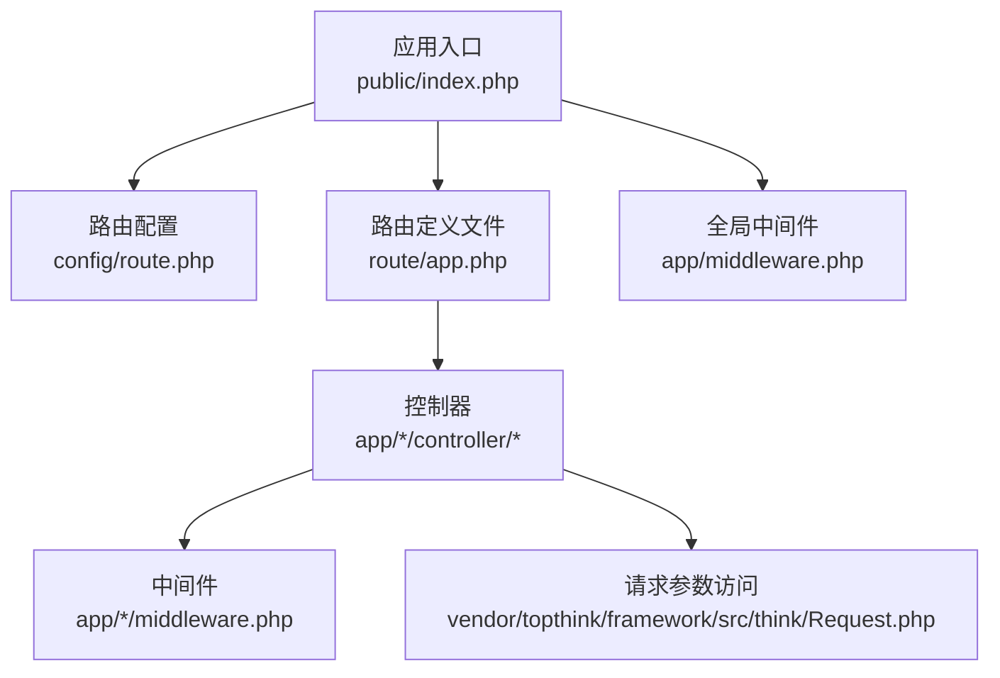
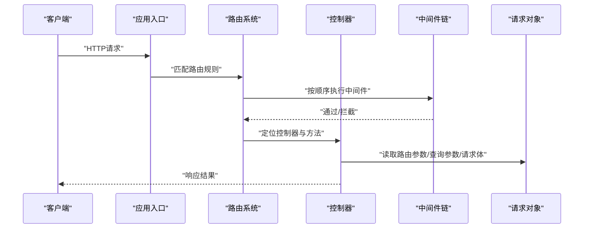
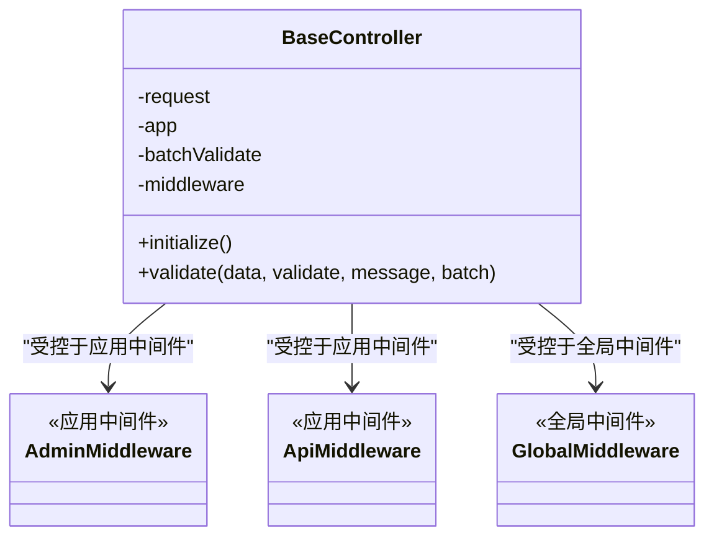
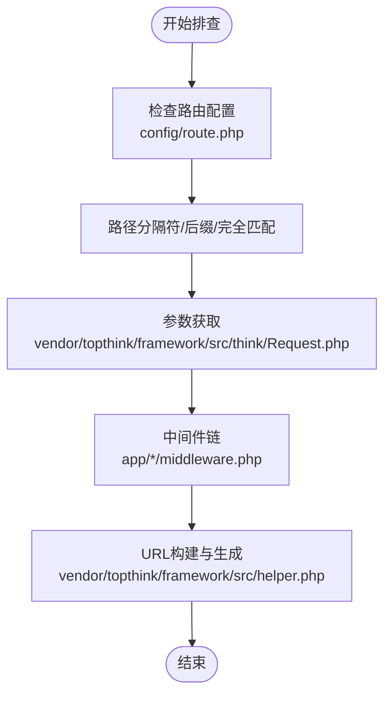
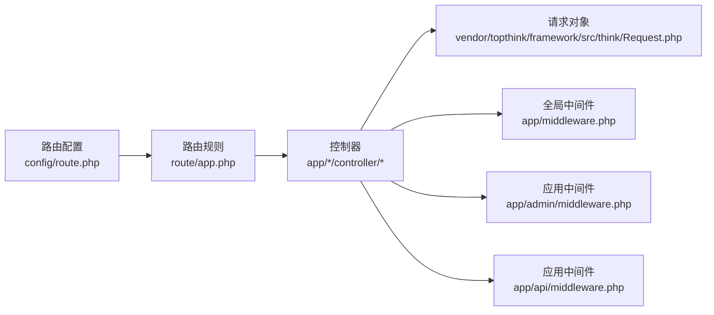

# 路由系统

<cite>
**本文引用的文件**
- [route/app.php](file://gccd_server/route/app.php)
- [config/route.php](file://gccd_server/config/route.php)
- [app/middleware.php](file://gccd_server/app/middleware.php)
- [app/admin/middleware.php](file://gccd_server/app/admin/middleware.php)
- [app/api/middleware.php](file://gccd_server/app/api/middleware.php)
- [app/BaseController.php](file://gccd_server/app/BaseController.php)
- [app/admin/controller/system/Index.php](file://gccd_server/app/admin/controller/system/Index.php)
- [app/api/controller/Index.php](file://gccd_server/app/api/controller/Index.php)
- [vendor/topthink/framework/src/think/Request.php](file://gccd_server/vendor/topthink/framework/src/think/Request.php)
- [vendor/topthink/framework/src/think/route/Rule.php](file://gccd_server/vendor/topthink/framework/src/think/route/Rule.php)
- [vendor/topthink/framework/src/helper.php](file://gccd_server/vendor/topthink/framework/src/helper.php)
</cite>

## 目录
1. [简介](#简介)
2. [项目结构](#项目结构)
3. [核心组件](#核心组件)
4. [架构总览](#架构总览)
5. [详细组件分析](#详细组件分析)
6. [依赖关系分析](#依赖关系分析)
7. [性能考虑](#性能考虑)
8. [故障排查指南](#故障排查指南)
9. [结论](#结论)
10. [附录](#附录)

## 简介
本文件面向ThinkPHP 8路由系统，结合项目实际代码，系统性梳理路由配置语法与规则（静态路由、动态路由、正则路由）、RESTful API设计原则与URL规范、路由分组与命名空间、中间件绑定策略、路由缓存与性能优化、路由调试与常见问题排查，并给出可直接落地的配置示例路径，帮助开发者在不同应用与模块中高效构建稳定的路由体系。

## 项目结构
本项目采用多应用架构（admin/api/common等），路由配置与中间件按应用维度组织，便于隔离与扩展。路由相关的关键位置如下：
- 路由定义入口：gccd_server/route/app.php（路由定义文件）
- 路由全局配置：gccd_server/config/route.php（路由行为与默认值）
- 全局中间件：gccd_server/app/middleware.php（跨应用通用中间件）
- 应用级中间件：gccd_server/app/admin/middleware.php、gccd_server/app/api/middleware.php（按应用绑定中间件）
- 控制器与路由映射：各应用下的controller目录（通过注解或路由定义文件进行映射）
- 请求参数访问：vendor/topthink/framework/src/think/Request.php（路由参数获取）

**图示来源**
- [config/route.php:11-50](file://gccd_server/config/route.php#L11-L50)
- [route/app.php:1-10](file://gccd_server/route/app.php#L1-L10)
- [app/middleware.php:11-22](file://gccd_server/app/middleware.php#L11-L22)
- [app/admin/middleware.php:11-20](file://gccd_server/app/admin/middleware.php#L11-L20)
- [app/api/middleware.php:11-20](file://gccd_server/app/api/middleware.php#L11-L20)
- [vendor/topthink/framework/src/think/Request.php:886](file://gccd_server/vendor/topthink/framework/src/think/Request.php#L886)

**章节来源**
- [route/app.php:1-10](file://gccd_server/route/app.php#L1-L10)
- [config/route.php:11-50](file://gccd_server/config/route.php#L11-L50)

## 核心组件
- 路由配置中心：config/route.php
  - 控制器层命名、空控制器、默认控制器/动作、后缀规则、默认路由变量规则、请求缓存开关与过期时间等。
- 路由定义文件：route/app.php
  - 统一声明路由规则，支持静态/动态/正则/分组/中间件绑定等。
- 中间件体系：app/middleware.php（全局）+ app/admin/middleware.php（管理端）+ app/api/middleware.php（接口端）
  - 用于鉴权、日志、限流等横切能力。
- 控制器基类：app/BaseController.php
  - 提供统一的参数校验、中间件声明等能力。
- 请求参数访问：vendor/topthink/framework/src/think/Request.php
  - 提供路由参数获取与合并逻辑。

**章节来源**
- [config/route.php:11-50](file://gccd_server/config/route.php#L11-L50)
- [app/middleware.php:11-22](file://gccd_server/app/middleware.php#L11-L22)
- [app/admin/middleware.php:11-20](file://gccd_server/app/admin/middleware.php#L11-L20)
- [app/api/middleware.php:11-20](file://gccd_server/app/api/middleware.php#L11-L20)
- [app/BaseController.php:19-101](file://gccd_server/app/BaseController.php#L19-L101)
- [vendor/topthink/framework/src/think/Request.php:886](file://gccd_server/vendor/topthink/framework/src/think/Request.php#L886)

## 架构总览
下图展示了从HTTP请求到控制器执行的整体流程，以及路由参数的提取与传递。

**图示来源**
- [vendor/topthink/framework/src/think/Request.php:886](file://gccd_server/vendor/topthink/framework/src/think/Request.php#L886)
- [vendor/topthink/framework/src/think/route/Rule.php:751](file://gccd_server/vendor/topthink/framework/src/think/route/Rule.php#L751)
- [app/middleware.php:11-22](file://gccd_server/app/middleware.php#L11-L22)
- [app/admin/middleware.php:11-20](file://gccd_server/app/admin/middleware.php#L11-L20)
- [app/api/middleware.php:11-20](file://gccd_server/app/api/middleware.php#L11-L20)

## 详细组件分析

### 路由配置语法与规则
- 静态路由
  - 使用固定路径前缀映射到控制器方法，适合明确的资源路径与REST端点。
  - 示例路径参考：[app/admin/controller/system/Index.php:25-114](file://gccd_server/app/admin/controller/system/Index.php#L25-L114)、[app/api/controller/Index.php:21-36](file://gccd_server/app/api/controller/Index.php#L21-L36)
- 动态路由
  - 使用变量占位符（如{id}、{name}）捕获路径片段，配合控制器参数获取。
  - 变量默认规则由配置项决定，见“默认路由变量规则”。
- 正则路由
  - 对变量进行更严格的约束（如数字、字母、组合），提升安全性与准确性。
  - 可在路由定义时为变量指定正则模式。
- 路由分组与命名空间
  - 通过路由分组对同一业务域的路由进行归类，结合命名空间避免控制器冲突。
  - 项目中控制器位于 app/admin/controller/* 与 app/api/controller/*，天然体现分组思想。
- 中间件绑定
  - 在路由定义时为特定路由或路由组绑定中间件，实现权限、日志、限流等功能。
  - 全局中间件与应用级中间件叠加生效。

**章节来源**
- [config/route.php:32-33](file://gccd_server/config/route.php#L32-L33)
- [app/admin/controller/system/Index.php:25-114](file://gccd_server/app/admin/controller/system/Index.php#L25-L114)
- [app/api/controller/Index.php:21-36](file://gccd_server/app/api/controller/Index.php#L21-L36)
- [app/middleware.php:11-22](file://gccd_server/app/middleware.php#L11-L22)
- [app/admin/middleware.php:11-20](file://gccd_server/app/admin/middleware.php#L11-L20)
- [app/api/middleware.php:11-20](file://gccd_server/app/api/middleware.php#L11-L20)

### RESTful API 路由设计原则与URL规范
- 资源化命名
  - 使用名词复数表示资源集合，动词使用HTTP方法表达动作（GET/POST/PUT/DELETE/PATCH）。
- 路径层级清晰
  - 通过嵌套路径表达资源关系，如 /api/v1/users/{userId}/orders。
- 参数与过滤
  - 查询参数用于过滤、排序、分页；路径参数用于定位资源。
- 响应一致性
  - 统一的成功/失败结构，便于前端消费。

（本节为概念性说明，不直接分析具体文件）

### 路由分组、命名空间与中间件绑定
- 分组与命名空间
  - 项目按 admin 与 api 两大应用划分，分别对应不同的控制器命名空间与中间件栈。
- 中间件绑定策略
  - 全局中间件：跨应用通用（如跨域、日志清理、语言包加载）。
  - 应用中间件：按应用注入（如Token校验、接口校验、限流）。
  - 控制器中间件：在控制器基类中声明，按需覆盖。

**图示来源**
- [app/BaseController.php:19-101](file://gccd_server/app/BaseController.php#L19-L101)
- [app/admin/middleware.php:11-20](file://gccd_server/app/admin/middleware.php#L11-L20)
- [app/api/middleware.php:11-20](file://gccd_server/app/api/middleware.php#L11-L20)
- [app/middleware.php:11-22](file://gccd_server/app/middleware.php#L11-L22)

**章节来源**
- [app/BaseController.php:19-101](file://gccd_server/app/BaseController.php#L19-L101)
- [app/admin/middleware.php:11-20](file://gccd_server/app/admin/middleware.php#L11-L20)
- [app/api/middleware.php:11-20](file://gccd_server/app/api/middleware.php#L11-L20)
- [app/middleware.php:11-22](file://gccd_server/app/middleware.php#L11-L22)

### 路由缓存机制与性能优化
- 配置项
  - 请求缓存开关与过期时间、全局请求缓存排除规则等，均在路由配置中集中管理。
- 实施建议
  - 对热点接口启用请求缓存，合理设置过期时间。
  - 将动态参数较多的接口排除在缓存之外。
  - 结合中间件与路由规则，避免不必要的重复计算。

**章节来源**
- [config/route.php:34-39](file://gccd_server/config/route.php#L34-L39)

### 路由调试与常见问题排查
- 调试工具
  - 使用框架提供的路由构建与URL生成能力辅助定位问题。
- 常见问题
  - 路由未匹配：检查路径分隔符、后缀、是否完全匹配、默认控制器/动作。
  - 参数丢失：确认路由参数与查询参数的获取方式。
  - 中间件未生效：核对中间件注册顺序与作用域（全局/应用/路由组）。

**图示来源**
- [config/route.php:12-45](file://gccd_server/config/route.php#L12-L45)
- [vendor/topthink/framework/src/think/Request.php:961](file://gccd_server/vendor/topthink/framework/src/think/Request.php#L961)
- [vendor/topthink/framework/src/helper.php:504](file://gccd_server/vendor/topthink/framework/src/helper.php#L504)
- [app/middleware.php:11-22](file://gccd_server/app/middleware.php#L11-L22)
- [app/admin/middleware.php:11-20](file://gccd_server/app/admin/middleware.php#L11-L20)
- [app/api/middleware.php:11-20](file://gccd_server/app/api/middleware.php#L11-L20)

**章节来源**
- [config/route.php:12-45](file://gccd_server/config/route.php#L12-L45)
- [vendor/topthink/framework/src/think/Request.php:961](file://gccd_server/vendor/topthink/framework/src/think/Request.php#L961)
- [vendor/topthink/framework/src/helper.php:504](file://gccd_server/vendor/topthink/framework/src/helper.php#L504)

### 实际路由配置示例（路径指引）
以下示例仅提供路径与上下文，不直接展示代码内容：
- 管理端首页控制器（静态路由示例）
  - [app/admin/controller/system/Index.php:25-114](file://gccd_server/app/admin/controller/system/Index.php#L25-L114)
- 接口端首页控制器（静态路由示例）
  - [app/api/controller/Index.php:21-36](file://gccd_server/app/api/controller/Index.php#L21-L36)
- 路由定义文件（统一声明路由规则）
  - [route/app.php:1-10](file://gccd_server/route/app.php#L1-L10)
- 路由配置中心（路由行为与默认值）
  - [config/route.php:11-50](file://gccd_server/config/route.php#L11-L50)
- 全局中间件（跨应用通用）
  - [app/middleware.php:11-22](file://gccd_server/app/middleware.php#L11-22)
- 应用中间件（管理端）
  - [app/admin/middleware.php:11-20](file://gccd_server/app/admin/middleware.php#L11-20)
- 应用中间件（接口端）
  - [app/api/middleware.php:11-20](file://gccd_server/app/api/middleware.php#L11-20)
- 控制器基类（参数校验与中间件声明）
  - [app/BaseController.php:19-101](file://gccd_server/app/BaseController.php#L19-L101)

**章节来源**
- [app/admin/controller/system/Index.php:25-114](file://gccd_server/app/admin/controller/system/Index.php#L25-L114)
- [app/api/controller/Index.php:21-36](file://gccd_server/app/api/controller/Index.php#L21-L36)
- [route/app.php:1-10](file://gccd_server/route/app.php#L1-L10)
- [config/route.php:11-50](file://gccd_server/config/route.php#L11-L50)
- [app/middleware.php:11-22](file://gccd_server/app/middleware.php#L11-L22)
- [app/admin/middleware.php:11-20](file://gccd_server/app/admin/middleware.php#L11-L20)
- [app/api/middleware.php:11-20](file://gccd_server/app/api/middleware.php#L11-L20)
- [app/BaseController.php:19-101](file://gccd_server/app/BaseController.php#L19-L101)

## 依赖关系分析
- 路由系统依赖
  - 路由规则解析与执行依赖控制器与中间件链。
  - 请求参数获取依赖Request对象的route/get/param合并逻辑。
- 中间件依赖
  - 全局中间件先于应用中间件执行，再按路由定义顺序执行。
- 控制器依赖
  - 控制器继承基类，复用参数校验与中间件声明能力。

**图示来源**
- [config/route.php:11-50](file://gccd_server/config/route.php#L11-L50)
- [route/app.php:1-10](file://gccd_server/route/app.php#L1-L10)
- [vendor/topthink/framework/src/think/Request.php:886](file://gccd_server/vendor/topthink/framework/src/think/Request.php#L886)
- [app/middleware.php:11-22](file://gccd_server/app/middleware.php#L11-L22)
- [app/admin/middleware.php:11-20](file://gccd_server/app/admin/middleware.php#L11-L20)
- [app/api/middleware.php:11-20](file://gccd_server/app/api/middleware.php#L11-L20)

**章节来源**
- [config/route.php:11-50](file://gccd_server/config/route.php#L11-L50)
- [route/app.php:1-10](file://gccd_server/route/app.php#L1-L10)
- [vendor/topthink/framework/src/think/Request.php:886](file://gccd_server/vendor/topthink/framework/src/think/Request.php#L886)
- [app/middleware.php:11-22](file://gccd_server/app/middleware.php#L11-L22)
- [app/admin/middleware.php:11-20](file://gccd_server/app/admin/middleware.php#L11-L20)
- [app/api/middleware.php:11-20](file://gccd_server/app/api/middleware.php#L11-L20)

## 性能考虑
- 路由解析优化
  - 关闭延迟解析（若无必要），减少运行时解析成本。
  - 合并路由规则（谨慎开启），降低规则数量带来的匹配开销。
- 缓存策略
  - 对高频读取接口启用请求缓存，合理设置过期时间与排除规则。
- 中间件链精简
  - 仅在必要处引入中间件，避免链路过长导致的性能损耗。

（本节为通用指导，不直接分析具体文件）

## 故障排查指南
- 路由未命中
  - 检查路径分隔符、URL后缀、是否完全匹配、默认控制器/动作。
- 参数缺失
  - 确认路由参数与查询参数的获取方式，参考请求对象的route/get/param合并逻辑。
- 中间件异常
  - 核对中间件注册顺序与作用域，确保全局/应用/路由组中间件正确叠加。

**章节来源**
- [config/route.php:12-45](file://gccd_server/config/route.php#L12-L45)
- [vendor/topthink/framework/src/think/Request.php:886](file://gccd_server/vendor/topthink/framework/src/think/Request.php#L886)

## 结论
本项目基于ThinkPHP 8的路由体系，通过集中化的路由配置、清晰的应用分组与中间件绑定策略，实现了可维护、可扩展的路由架构。结合请求缓存与中间件链优化，可在保证功能灵活性的同时提升性能与稳定性。建议在新增路由时遵循RESTful设计原则与URL规范，充分利用分组与命名空间，确保路由规则清晰、可预测、易调试。

## 附录
- 关键配置项速览
  - 路径分隔符、URL后缀、是否完全匹配、默认控制器/动作、后缀规则、默认路由变量规则、请求缓存开关与过期时间、全局请求缓存排除规则。
- 参考文件
  - [config/route.php:11-50](file://gccd_server/config/route.php#L11-L50)
  - [route/app.php:1-10](file://gccd_server/route/app.php#L1-L10)
  - [app/middleware.php:11-22](file://gccd_server/app/middleware.php#L11-L22)
  - [app/admin/middleware.php:11-20](file://gccd_server/app/admin/middleware.php#L11-L20)
  - [app/api/middleware.php:11-20](file://gccd_server/app/api/middleware.php#L11-L20)
  - [app/BaseController.php:19-101](file://gccd_server/app/BaseController.php#L19-L101)
  - [vendor/topthink/framework/src/think/Request.php](file://gccd_server/vendor/topthink/framework/src/think/Request.php#L886)
  - [vendor/topthink/framework/src/think/route/Rule.php](file://gccd_server/vendor/topthink/framework/src/think/route/Rule.php#L751)
  - [vendor/topthink/framework/src/helper.php](file://gccd_server/vendor/topthink/framework/src/helper.php#L504)