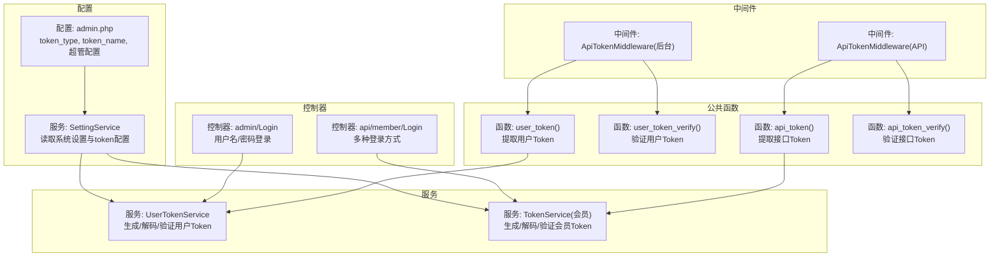
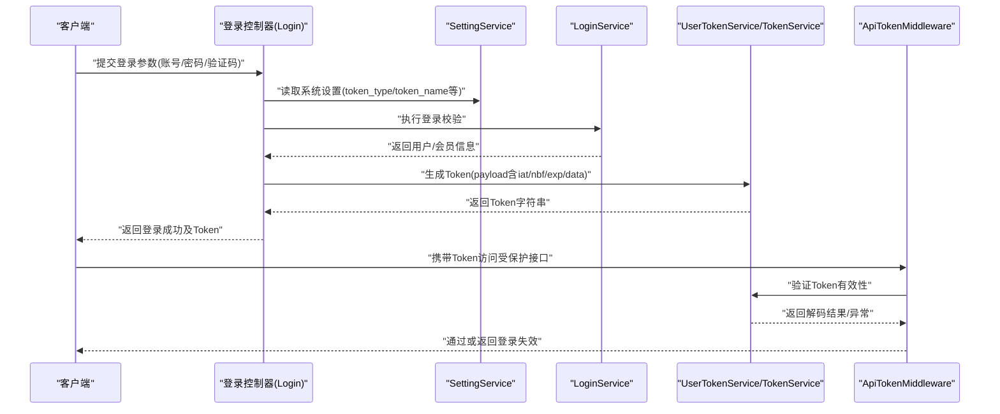
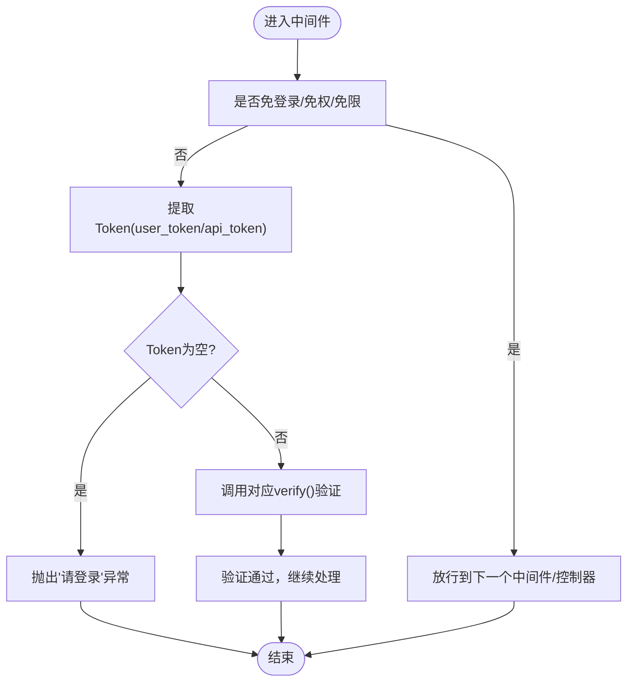
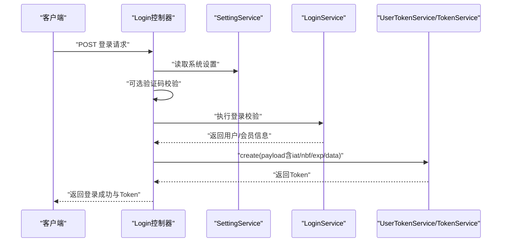
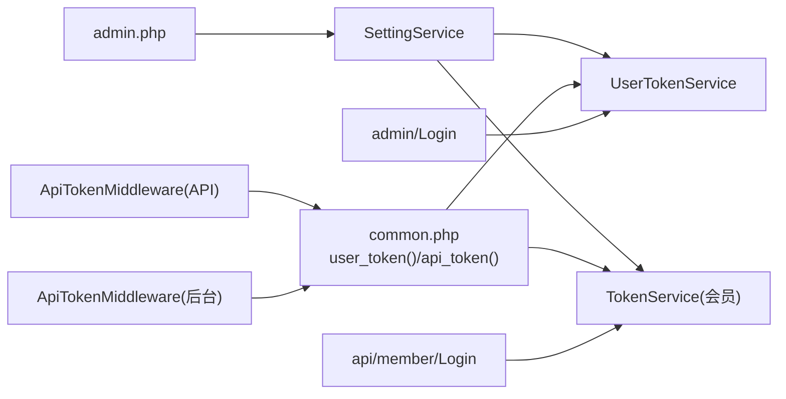
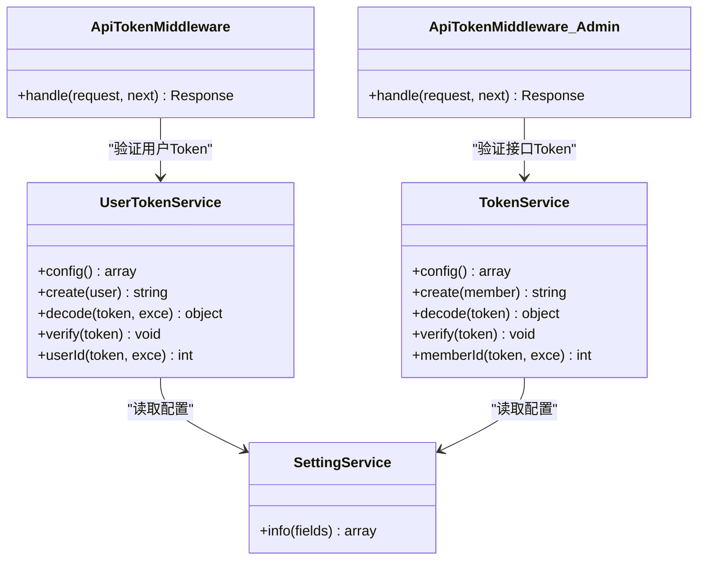

# JWT认证机制

<cite>
**本文引用的文件**
- [gccd_server/app/common/service/system/UserTokenService.php](file://gccd_server/app/common/service/system/UserTokenService.php)
- [gccd_server/app/common/service/member/TokenService.php](file://gccd_server/app/common/service/member/TokenService.php)
- [gccd_server/app/api/middleware/ApiTokenMiddleware.php](file://gccd_server/app/api/middleware/ApiTokenMiddleware.php)
- [gccd_server/app/admin/middleware/ApiTokenMiddleware.php](file://gccd_server/app/admin/middleware/ApiTokenMiddleware.php)
- [gccd_server/app/common.php](file://gccd_server/app/common.php)
- [gccd_server/app/common/service/system/SettingService.php](file://gccd_server/app/common/service/system/SettingService.php)
- [gccd_server/config/admin.php](file://gccd_server/config/admin.php)
- [gccd_server/app/admin/controller/system/Login.php](file://gccd_server/app/admin/controller/system/Login.php)
- [gccd_server/app/api/controller/member/Login.php](file://gccd_server/app/api/controller/member/Login.php)
</cite>

## 目录
1. [简介](#简介)
2. [项目结构](#项目结构)
3. [核心组件](#核心组件)
4. [架构总览](#架构总览)
5. [组件详解](#组件详解)
6. [依赖关系分析](#依赖关系分析)
7. [性能考量](#性能考量)
8. [故障排查指南](#故障排查指南)
9. [结论](#结论)
10. [附录](#附录)

## 简介
本文件系统性阐述本项目的JWT认证机制，覆盖以下要点：
- JWT工作原理与结构组成（头部、载荷、签名）
- Token生命周期管理（创建、验证、失效处理）
- 中间件ApiTokenMiddleware的实现与异常处理
- 登录流程（用户名/密码、图形验证码、第三方登录等）到签发Token的全过程
- 请求头中Token的传递方式与前端存储策略
- JWT配置参数（过期时间、签名密钥、算法等）
- 常见问题排查与安全最佳实践

## 项目结构
围绕JWT认证的关键文件分布如下：
- Token服务层：用户Token与会员Token的生成、解码、验证
- 中间件层：API与后台两套中间件，拦截请求并校验Token
- 配置层：系统设置与环境变量，决定Token名称、传输方式、过期时长等
- 控制器层：登录接口，完成身份校验与Token签发
- 公共函数：统一的Token提取与验证入口

图表来源
- [gccd_server/config/admin.php:11-20](file://gccd_server/config/admin.php#L11-L20)
- [gccd_server/app/common/service/system/SettingService.php:109-160](file://gccd_server/app/common/service/system/SettingService.php#L109-L160)
- [gccd_server/app/common/service/system/UserTokenService.php:27-32](file://gccd_server/app/common/service/system/UserTokenService.php#L27-L32)
- [gccd_server/app/common/service/member/TokenService.php:27-32](file://gccd_server/app/common/service/member/TokenService.php#L27-L32)
- [gccd_server/app/api/middleware/ApiTokenMiddleware.php:29-45](file://gccd_server/app/api/middleware/ApiTokenMiddleware.php#L29-L45)
- [gccd_server/app/admin/middleware/ApiTokenMiddleware.php:29-43](file://gccd_server/app/admin/middleware/ApiTokenMiddleware.php#L29-L43)
- [gccd_server/app/common.php:355-389](file://gccd_server/app/common.php#L355-L389)
- [gccd_server/app/admin/controller/system/Login.php:105-139](file://gccd_server/app/admin/controller/system/Login.php#L105-L139)
- [gccd_server/app/api/controller/member/Login.php:91-138](file://gccd_server/app/api/controller/member/Login.php#L91-L138)

章节来源
- [gccd_server/config/admin.php:11-20](file://gccd_server/config/admin.php#L11-L20)
- [gccd_server/app/common/service/system/SettingService.php:109-160](file://gccd_server/app/common/service/system/SettingService.php#L109-L160)
- [gccd_server/app/common/service/system/UserTokenService.php:27-32](file://gccd_server/app/common/service/system/UserTokenService.php#L27-L32)
- [gccd_server/app/common/service/member/TokenService.php:27-32](file://gccd_server/app/common/service/member/TokenService.php#L27-L32)
- [gccd_server/app/api/middleware/ApiTokenMiddleware.php:29-45](file://gccd_server/app/api/middleware/ApiTokenMiddleware.php#L29-L45)
- [gccd_server/app/admin/middleware/ApiTokenMiddleware.php:29-43](file://gccd_server/app/admin/middleware/ApiTokenMiddleware.php#L29-L43)
- [gccd_server/app/common.php:355-389](file://gccd_server/app/common.php#L355-L389)
- [gccd_server/app/admin/controller/system/Login.php:105-139](file://gccd_server/app/admin/controller/system/Login.php#L105-L139)
- [gccd_server/app/api/controller/member/Login.php:91-138](file://gccd_server/app/api/controller/member/Login.php#L91-L138)

## 核心组件
- Token服务
  - 用户Token服务：负责用户Token的配置、生成、解码、验证、用户ID解析
  - 会员Token服务：负责会员Token的配置、生成、解码、验证、会员ID解析
- 中间件
  - API中间件：拦截API请求，提取并验证接口Token
  - 后台中间件：拦截后台请求，提取并验证用户Token
- 配置与设置
  - SettingService：统一读取系统设置，计算token_exps（小时转秒）、合并token_type/token_name等
  - admin.php：定义token_type（header/param）、token_name、超管配置、免登录/免权/免限菜单列表等
- 公共函数
  - user_token()/api_token()：按配置从Header或Query参数提取Token
  - user_token_verify()/api_token_verify()：调用对应TokenService进行验证
- 登录控制器
  - 后台登录：用户名/密码+可选验证码，通过LoginService完成校验后调用UserTokenService生成Token
  - 会员登录：支持多种登录方式（账号密码、手机、邮箱、小程序、公众号、网站、移动端等），通过LoginService完成校验后调用TokenService生成Token

章节来源
- [gccd_server/app/common/service/system/UserTokenService.php:27-145](file://gccd_server/app/common/service/system/UserTokenService.php#L27-L145)
- [gccd_server/app/common/service/member/TokenService.php:27-141](file://gccd_server/app/common/service/member/TokenService.php#L27-L141)
- [gccd_server/app/api/middleware/ApiTokenMiddleware.php:29-45](file://gccd_server/app/api/middleware/ApiTokenMiddleware.php#L29-L45)
- [gccd_server/app/admin/middleware/ApiTokenMiddleware.php:29-43](file://gccd_server/app/admin/middleware/ApiTokenMiddleware.php#L29-L43)
- [gccd_server/app/common/service/system/SettingService.php:109-160](file://gccd_server/app/common/service/system/SettingService.php#L109-L160)
- [gccd_server/config/admin.php:11-20](file://gccd_server/config/admin.php#L11-L20)
- [gccd_server/app/common.php:355-389](file://gccd_server/app/common.php#L355-L389)
- [gccd_server/app/admin/controller/system/Login.php:105-139](file://gccd_server/app/admin/controller/system/Login.php#L105-L139)
- [gccd_server/app/api/controller/member/Login.php:91-138](file://gccd_server/app/api/controller/member/Login.php#L91-L138)

## 架构总览
下图展示JWT认证在系统中的整体流转：客户端发起登录请求，服务端完成身份校验后签发Token，后续请求由中间件拦截并验证Token。

图表来源
- [gccd_server/app/admin/controller/system/Login.php:105-139](file://gccd_server/app/admin/controller/system/Login.php#L105-L139)
- [gccd_server/app/api/controller/member/Login.php:91-138](file://gccd_server/app/api/controller/member/Login.php#L91-L138)
- [gccd_server/app/common/service/system/SettingService.php:109-160](file://gccd_server/app/common/service/system/SettingService.php#L109-L160)
- [gccd_server/app/common/service/system/UserTokenService.php:41-56](file://gccd_server/app/common/service/system/UserTokenService.php#L41-L56)
- [gccd_server/app/common/service/member/TokenService.php:41-56](file://gccd_server/app/common/service/member/TokenService.php#L41-L56)
- [gccd_server/app/api/middleware/ApiTokenMiddleware.php:29-45](file://gccd_server/app/api/middleware/ApiTokenMiddleware.php#L29-L45)
- [gccd_server/app/admin/middleware/ApiTokenMiddleware.php:29-43](file://gccd_server/app/admin/middleware/ApiTokenMiddleware.php#L29-L43)

## 组件详解

### JWT工作原理与结构
- 结构组成
  - 头部(Header)：声明算法(HS256)与类型
  - 载荷(Payload)：包含签发时间(iat)、生效时间(nbf)、过期时间(exp)，以及业务数据(data，如用户ID/登录时间)
  - 签名(Signature)：使用对称密钥与算法对Header和Payload进行签名
- 算法与密钥
  - 使用HS256算法与对称密钥
  - 密钥来源于系统设置，首次运行时自动生成并持久化
- 过期时间
  - token_exps以秒为单位，由token_exp（小时）乘以3600换算得到

章节来源
- [gccd_server/app/common/service/system/UserTokenService.php:45-55](file://gccd_server/app/common/service/system/UserTokenService.php#L45-L55)
- [gccd_server/app/common/service/member/TokenService.php:45-55](file://gccd_server/app/common/service/member/TokenService.php#L45-L55)
- [gccd_server/app/common/service/system/SettingService.php:142-142](file://gccd_server/app/common/service/system/SettingService.php#L142-L142)

### Token生命周期管理
- 创建
  - 生成payload：填充iat/nbf/exp与data
  - 使用JWT库对payload进行编码，返回字符串Token
- 验证
  - 提取Token：根据配置从Header或Query参数提取
  - 解码与校验：使用Key对象进行解码，捕获异常并转换为业务异常
  - 业务校验：检查用户状态（是否删除/禁用/密码修改）、多端登录策略
- 刷新与过期
  - 本项目未实现自动刷新机制，过期后需重新登录获取新Token

章节来源
- [gccd_server/app/common/service/system/UserTokenService.php:41-117](file://gccd_server/app/common/service/system/UserTokenService.php#L41-L117)
- [gccd_server/app/common/service/member/TokenService.php:41-113](file://gccd_server/app/common/service/member/TokenService.php#L41-L113)
- [gccd_server/app/common.php:355-389](file://gccd_server/app/common.php#L355-L389)

### 中间件实现逻辑
- API中间件
  - 若非免登录接口：提取api_token，若为空则抛出“请登录”异常；否则调用api_token_verify进行验证
- 后台中间件
  - 若非免登录菜单：提取user_token，若为空则抛出“请登录”异常；否则调用user_token_verify进行验证
- 异常处理
  - 中间件统一抛出登录无效类异常，便于上层统一处理

图表来源
- [gccd_server/app/api/middleware/ApiTokenMiddleware.php:29-45](file://gccd_server/app/api/middleware/ApiTokenMiddleware.php#L29-L45)
- [gccd_server/app/admin/middleware/ApiTokenMiddleware.php:29-43](file://gccd_server/app/admin/middleware/ApiTokenMiddleware.php#L29-L43)
- [gccd_server/app/common.php:355-389](file://gccd_server/app/common.php#L355-L389)

章节来源
- [gccd_server/app/api/middleware/ApiTokenMiddleware.php:29-45](file://gccd_server/app/api/middleware/ApiTokenMiddleware.php#L29-L45)
- [gccd_server/app/admin/middleware/ApiTokenMiddleware.php:29-43](file://gccd_server/app/admin/middleware/ApiTokenMiddleware.php#L29-L43)
- [gccd_server/app/common.php:355-389](file://gccd_server/app/common.php#L355-L389)

### 登录流程（用户/会员）
- 后台登录（用户名/密码）
  - 获取系统设置（含token_type/token_name等）
  - 可选验证码校验
  - 调用LoginService完成登录，随后调用UserTokenService.create生成Token
- 会员登录（多种方式）
  - 支持账号密码、手机短信、邮箱邮件、小程序、公众号、网站应用、移动端等
  - 统一通过LoginService完成校验，再调用TokenService.create生成Token
  - 第三方登录场景，回调页将Token作为查询参数回跳至前端

图表来源
- [gccd_server/app/admin/controller/system/Login.php:105-139](file://gccd_server/app/admin/controller/system/Login.php#L105-L139)
- [gccd_server/app/api/controller/member/Login.php:91-138](file://gccd_server/app/api/controller/member/Login.php#L91-L138)
- [gccd_server/app/common/service/system/SettingService.php:109-160](file://gccd_server/app/common/service/system/SettingService.php#L109-L160)
- [gccd_server/app/common/service/system/UserTokenService.php:41-56](file://gccd_server/app/common/service/system/UserTokenService.php#L41-L56)
- [gccd_server/app/common/service/member/TokenService.php:41-56](file://gccd_server/app/common/service/member/TokenService.php#L41-L56)

章节来源
- [gccd_server/app/admin/controller/system/Login.php:105-139](file://gccd_server/app/admin/controller/system/Login.php#L105-L139)
- [gccd_server/app/api/controller/member/Login.php:91-138](file://gccd_server/app/api/controller/member/Login.php#L91-L138)
- [gccd_server/app/common/service/system/SettingService.php:109-160](file://gccd_server/app/common/service/system/SettingService.php#L109-L160)
- [gccd_server/app/common/service/system/UserTokenService.php:41-56](file://gccd_server/app/common/service/system/UserTokenService.php#L41-L56)
- [gccd_server/app/common/service/member/TokenService.php:41-56](file://gccd_server/app/common/service/member/TokenService.php#L41-L56)

### Token传递与前端存储
- 传递方式
  - 由配置决定：header或param
  - 默认Header名为AdminToken（可在环境变量中覆盖）
- 前端存储策略
  - 登录成功后，接口会在响应中附带全局可用的Token键值（如AdminToken/ApiToken），前端可将其保存在本地存储或内存中，并在后续请求中通过统一拦截器注入到请求头或参数中

章节来源
- [gccd_server/config/admin.php:12-15](file://gccd_server/config/admin.php#L12-L15)
- [gccd_server/app/common.php:355-372](file://gccd_server/app/common.php#L355-L372)
- [gccd_server/app/admin/controller/system/Login.php:97-100](file://gccd_server/app/admin/controller/system/Login.php#L97-L100)
- [gccd_server/app/api/controller/member/Login.php:83-86](file://gccd_server/app/api/controller/member/Login.php#L83-L86)

### JWT配置参数说明
- token_type：传输方式，header或param
- token_name：Token键名，前后端需保持一致
- token_exp：过期时间（小时），内部换算为秒
- token_key：签名密钥，首次运行自动生成
- token_alg：算法，固定为HS256
- is_multi_login：是否允许多端登录（0禁止，其他允许）

章节来源
- [gccd_server/config/admin.php:12-15](file://gccd_server/config/admin.php#L12-L15)
- [gccd_server/app/common/service/system/SettingService.php:140-142](file://gccd_server/app/common/service/system/SettingService.php#L140-L142)
- [gccd_server/app/common/service/system/UserTokenService.php:27-31](file://gccd_server/app/common/service/system/UserTokenService.php#L27-L31)
- [gccd_server/app/common/service/member/TokenService.php:27-31](file://gccd_server/app/common/service/member/TokenService.php#L27-L31)

## 依赖关系分析
- 低耦合高内聚
  - Token服务独立于控制器与中间件，仅依赖SettingService提供的配置
  - 中间件仅依赖公共函数进行Token提取与验证
- 关键依赖链
  - SettingService -> 配置(admin.php)与缓存
  - TokenService(User/Member) -> SettingService + JWT库
  - 中间件 -> 公共函数 -> TokenService
  - 控制器 -> SettingService + TokenService

图表来源
- [gccd_server/config/admin.php:11-20](file://gccd_server/config/admin.php#L11-L20)
- [gccd_server/app/common/service/system/SettingService.php:109-160](file://gccd_server/app/common/service/system/SettingService.php#L109-L160)
- [gccd_server/app/common/service/system/UserTokenService.php:27-32](file://gccd_server/app/common/service/system/UserTokenService.php#L27-L32)
- [gccd_server/app/common/service/member/TokenService.php:27-32](file://gccd_server/app/common/service/member/TokenService.php#L27-L32)
- [gccd_server/app/common.php:355-389](file://gccd_server/app/common.php#L355-L389)
- [gccd_server/app/api/middleware/ApiTokenMiddleware.php:29-45](file://gccd_server/app/api/middleware/ApiTokenMiddleware.php#L29-L45)
- [gccd_server/app/admin/middleware/ApiTokenMiddleware.php:29-43](file://gccd_server/app/admin/middleware/ApiTokenMiddleware.php#L29-L43)
- [gccd_server/app/admin/controller/system/Login.php:105-139](file://gccd_server/app/admin/controller/system/Login.php#L105-L139)
- [gccd_server/app/api/controller/member/Login.php:91-138](file://gccd_server/app/api/controller/member/Login.php#L91-L138)

章节来源
- [gccd_server/config/admin.php:11-20](file://gccd_server/config/admin.php#L11-L20)
- [gccd_server/app/common/service/system/SettingService.php:109-160](file://gccd_server/app/common/service/system/SettingService.php#L109-L160)
- [gccd_server/app/common/service/system/UserTokenService.php:27-32](file://gccd_server/app/common/service/system/UserTokenService.php#L27-L32)
- [gccd_server/app/common/service/member/TokenService.php:27-32](file://gccd_server/app/common/service/member/TokenService.php#L27-L32)
- [gccd_server/app/common.php:355-389](file://gccd_server/app/common.php#L355-L389)
- [gccd_server/app/api/middleware/ApiTokenMiddleware.php:29-45](file://gccd_server/app/api/middleware/ApiTokenMiddleware.php#L29-L45)
- [gccd_server/app/admin/middleware/ApiTokenMiddleware.php:29-43](file://gccd_server/app/admin/middleware/ApiTokenMiddleware.php#L29-L43)
- [gccd_server/app/admin/controller/system/Login.php:105-139](file://gccd_server/app/admin/controller/system/Login.php#L105-L139)
- [gccd_server/app/api/controller/member/Login.php:91-138](file://gccd_server/app/api/controller/member/Login.php#L91-L138)

## 性能考量
- Token解码与验证为O(1)操作，性能开销主要来自数据库查询（用户状态校验）
- 建议
  - 对用户状态查询进行缓存
  - 合理设置token_exps，避免过短导致频繁登录
  - 在高并发场景下，确保JWT库与缓存层稳定

## 故障排查指南
- “请登录”
  - 检查请求是否携带Token，确认token_type与token_name配置一致
  - 确认中间件是否正确拦截并调用verify
- “登录状态已失效”
  - 检查token是否过期或被篡改
  - 确认token_key是否被意外更改
- “账号已被删除/禁用/密码已修改”
  - 用户状态变更后，旧Token将被判定为无效
  - 建议在用户状态变更时主动清理或强制重新登录
- “已在另一处登录”
  - 多端登录策略为关闭（is_multi_login=0），同一账号在新登录时会使旧Token失效
  - 如需允许多端登录，调整is_multi_login配置

章节来源
- [gccd_server/app/common/service/system/UserTokenService.php:87-117](file://gccd_server/app/common/service/system/UserTokenService.php#L87-L117)
- [gccd_server/app/common/service/member/TokenService.php:83-113](file://gccd_server/app/common/service/member/TokenService.php#L83-L113)
- [gccd_server/app/common.php:381-389](file://gccd_server/app/common.php#L381-L389)

## 结论
本项目采用标准JWT方案，结合中间件拦截与统一Token服务，实现了清晰、可扩展的认证体系。通过配置化的token_type/token_name/token_exps等参数，满足不同部署场景的需求。建议在生产环境中强化密钥管理与日志审计，并根据业务需要评估是否启用多端登录策略。

## 附录

### 类关系图（代码级）

图表来源
- [gccd_server/app/common/service/system/UserTokenService.php:20-145](file://gccd_server/app/common/service/system/UserTokenService.php#L20-L145)
- [gccd_server/app/common/service/member/TokenService.php:20-141](file://gccd_server/app/common/service/member/TokenService.php#L20-L141)
- [gccd_server/app/api/middleware/ApiTokenMiddleware.php:20-45](file://gccd_server/app/api/middleware/ApiTokenMiddleware.php#L20-L45)
- [gccd_server/app/admin/middleware/ApiTokenMiddleware.php:20-43](file://gccd_server/app/admin/middleware/ApiTokenMiddleware.php#L20-L43)
- [gccd_server/app/common/service/system/SettingService.php:109-160](file://gccd_server/app/common/service/system/SettingService.php#L109-L160)