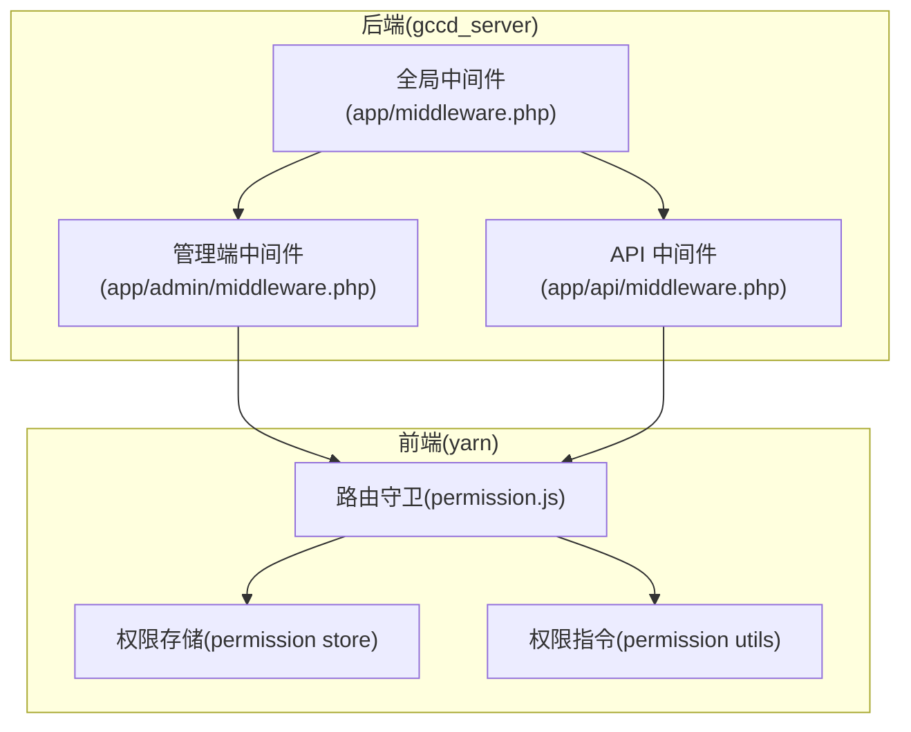
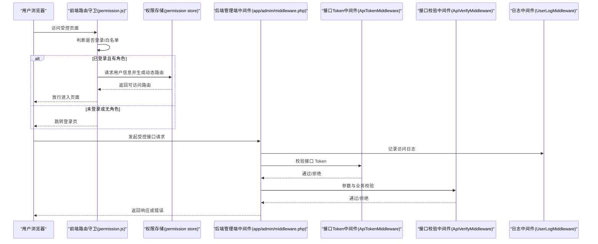
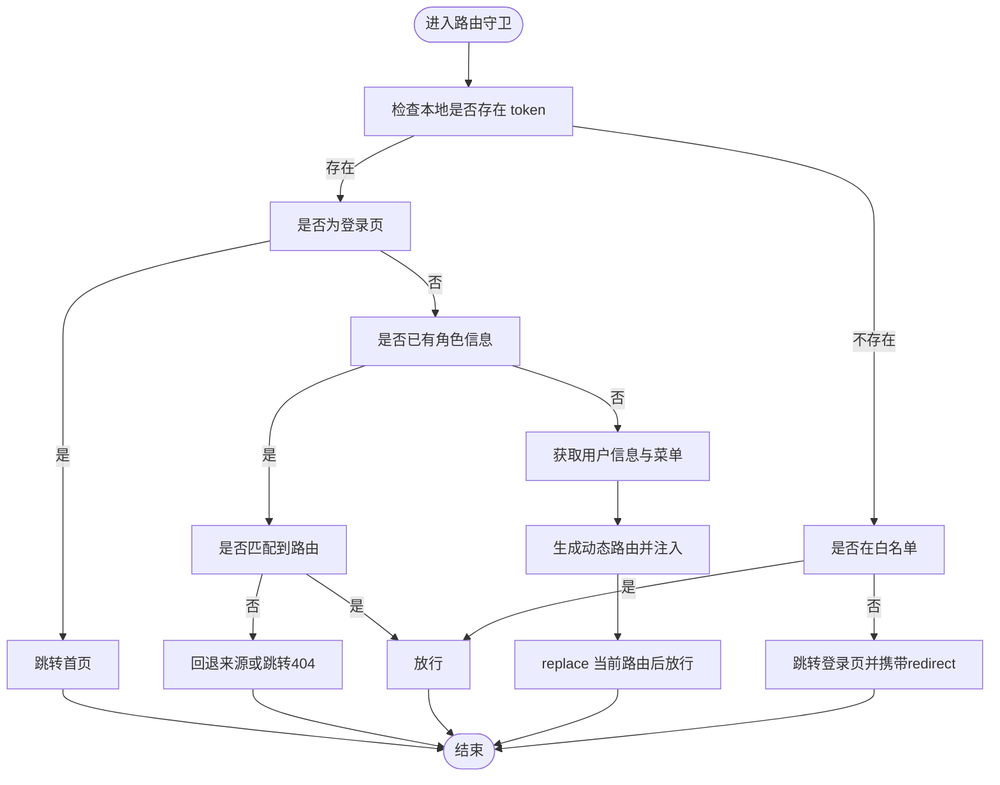
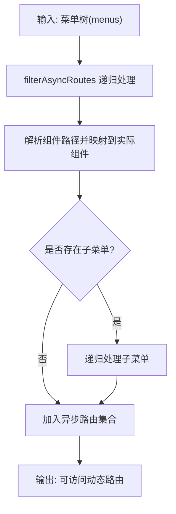
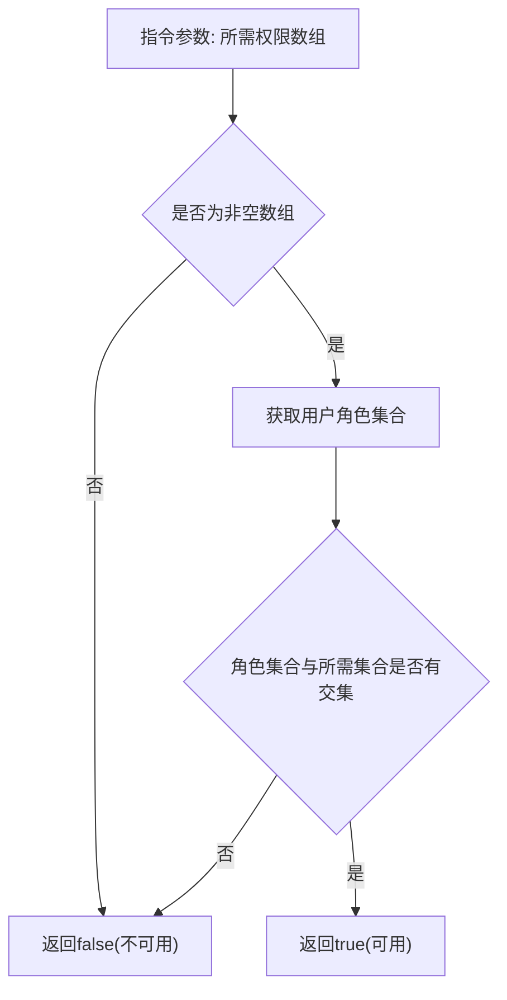
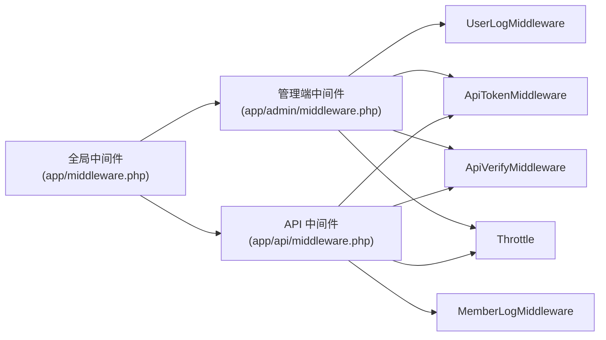
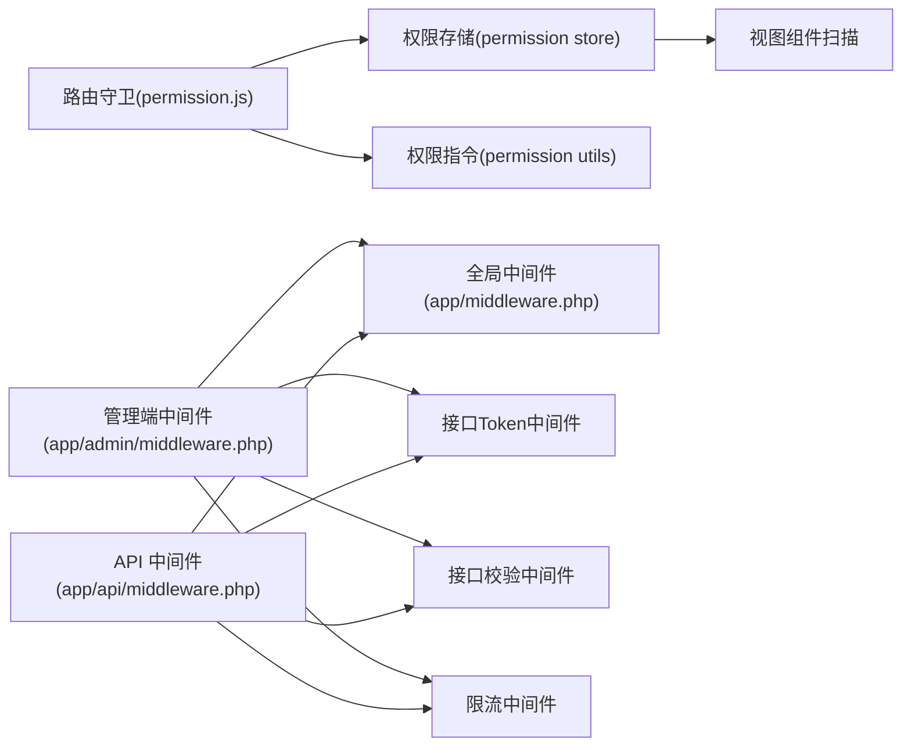

# 安全与权限

<cite>
**本文引用的文件**
- [yarn/src/permission.js](file://yarn/src/permission.js)
- [yarn/src/store/modules/permission.js](file://yarn/src/store/modules/permission.js)
- [yarn/src/utils/permission.js](file://yarn/src/utils/permission.js)
- [gccd_server/app/middleware.php](file://gccd_server/app/middleware.php)
- [gccd_server/app/admin/middleware.php](file://gccd_server/app/admin/middleware.php)
- [gccd_server/app/api/middleware.php](file://gccd_server/app/api/middleware.php)
</cite>

## 目录
1. [引言](#引言)
2. [项目结构](#项目结构)
3. [核心组件](#核心组件)
4. [架构总览](#架构总览)
5. [详细组件分析](#详细组件分析)
6. [依赖关系分析](#依赖关系分析)
7. [性能考虑](#性能考虑)
8. [故障排查指南](#故障排查指南)
9. [结论](#结论)
10. [附录](#附录)

## 引言
本文件聚焦于“高齿传动项目”的安全与权限控制体系，围绕前端路由与权限守卫、后端中间件链路、以及与之配套的数据安全与审计日志能力进行系统化梳理。由于当前仓库未包含 JWT 认证与刷新的具体实现代码，本文在“JWT 认证机制”部分以通用实践与现有中间件能力为基础进行说明；在“权限控制系统设计”“中间件作用”“数据安全保护”“审计日志管理”等方面，严格基于可查证的源码进行分析，并给出可视化图示与实操建议。

## 项目结构
本项目由三大部分组成：
- 前端（Vue3 + Vite + Pinia）：负责路由守卫、菜单/按钮级权限校验、UI 展示与交互。
- 后端（ThinkPHP）：提供接口层与中间件链，统一处理跨域、日志清理、接口鉴权、接口校验与限流。
- 管理端与 API 端中间件：分别面向后台管理与会员 API 场景，串联日志、Token 校验、接口校验与限流。

图表来源
- [yarn/src/permission.js:1-73](file://yarn/src/permission.js#L1-L73)
- [yarn/src/store/modules/permission.js:1-79](file://yarn/src/store/modules/permission.js#L1-L79)
- [yarn/src/utils/permission.js:1-20](file://yarn/src/utils/permission.js#L1-L20)
- [gccd_server/app/middleware.php:1-23](file://gccd_server/app/middleware.php#L1-L23)
- [gccd_server/app/admin/middleware.php:1-21](file://gccd_server/app/admin/middleware.php#L1-L21)
- [gccd_server/app/api/middleware.php:1-21](file://gccd_server/app/api/middleware.php#L1-L21)

章节来源
- [yarn/src/permission.js:1-73](file://yarn/src/permission.js#L1-L73)
- [gccd_server/app/middleware.php:1-23](file://gccd_server/app/middleware.php#L1-L23)

## 核心组件
- 前端路由与权限守卫：负责登录态判断、白名单放行、动态路由注入与 404 回退。
- 权限存储与动态路由：根据后端返回的菜单树生成可访问路由集合并挂载至路由器。
- 权限指令与按钮级校验：通过角色集合与所需权限集合的交集判定决定 UI 控件显示。
- 后端中间件链：统一处理跨域、日志清理、接口 Token 校验、接口参数校验与限流。

章节来源
- [yarn/src/store/modules/permission.js:1-79](file://yarn/src/store/modules/permission.js#L1-L79)
- [yarn/src/utils/permission.js:1-20](file://yarn/src/utils/permission.js#L1-L20)
- [gccd_server/app/admin/middleware.php:1-21](file://gccd_server/app/admin/middleware.php#L1-L21)
- [gccd_server/app/api/middleware.php:1-21](file://gccd_server/app/api/middleware.php#L1-L21)

## 架构总览
下图展示了从前端到后端的关键交互路径与安全控制节点：

图表来源
- [yarn/src/permission.js:18-68](file://yarn/src/permission.js#L18-L68)
- [yarn/src/store/modules/permission.js:53-60](file://yarn/src/store/modules/permission.js#L53-L60)
- [gccd_server/app/admin/middleware.php:12-20](file://gccd_server/app/admin/middleware.php#L12-L20)

## 详细组件分析

### 前端路由与权限守卫
- 登录态与白名单：通过本地存储的 token 名称前缀与键名判断是否已登录；白名单仅包含登录页。
- 动态路由注入：首次获取用户信息后，依据后端返回的菜单树生成可访问路由，逐个 addRoute 注入。
- 404 回退：当目标路由未匹配到任何已注入路由时，优先回退来源路由，否则跳转 404。
- 错误恢复：若拉取用户信息失败，重置 token 并引导至登录页，携带 redirect 参数保留原地址。

图表来源
- [yarn/src/permission.js:21-68](file://yarn/src/permission.js#L21-L68)

章节来源
- [yarn/src/permission.js:18-68](file://yarn/src/permission.js#L18-L68)

### 权限存储与动态路由
- 组件映射：通过模块目录扫描注册视图组件，支持 Layout 与具体页面组件的自动解析。
- 递归过滤：对后端返回的菜单树进行递归处理，补全缺失字段并替换组件引用。
- 菜单联动：支持混合布局下的左侧菜单切换，按顶层菜单项动态更新子菜单列表。

图表来源
- [yarn/src/store/modules/permission.js:13-39](file://yarn/src/store/modules/permission.js#L13-L39)

章节来源
- [yarn/src/store/modules/permission.js:1-79](file://yarn/src/store/modules/permission.js#L1-L79)

### 权限指令与按钮级校验
- 角色集合比对：将用户角色集合与指令传入的权限集合取交集，存在交集则允许渲染。
- 参数校验：要求传入数组且非空，否则直接返回不可用。

图表来源
- [yarn/src/utils/permission.js:7-19](file://yarn/src/utils/permission.js#L7-L19)

章节来源
- [yarn/src/utils/permission.js:1-20](file://yarn/src/utils/permission.js#L1-L20)

### 后端中间件链与安全控制
- 全局中间件：统一处理跨域、日志清理、多语言加载等。
- 管理端中间件：串联用户访问日志、接口 Token 校验、接口参数校验与限流。
- API 中间件：面向会员 API 的日志、Token 校验、参数校验与限流。

图表来源
- [gccd_server/app/middleware.php:11-22](file://gccd_server/app/middleware.php#L11-L22)
- [gccd_server/app/admin/middleware.php:11-20](file://gccd_server/app/admin/middleware.php#L11-L20)
- [gccd_server/app/api/middleware.php:11-20](file://gccd_server/app/api/middleware.php#L11-L20)

章节来源
- [gccd_server/app/middleware.php:1-23](file://gccd_server/app/middleware.php#L1-L23)
- [gccd_server/app/admin/middleware.php:1-21](file://gccd_server/app/admin/middleware.php#L1-L21)
- [gccd_server/app/api/middleware.php:1-21](file://gccd_server/app/api/middleware.php#L1-L21)

### JWT 认证机制（现状与建议）
- 现状：当前仓库未发现显式的 JWT 生成、验证、刷新与过期处理代码。后端中间件链中包含“接口 Token 中间件”，但未在本文件中展示具体实现细节。
- 建议（通用实践）：
  - 生成：登录成功后签发短期访问令牌与可选长期刷新令牌，设置合理过期时间。
  - 验证：中间件从请求头读取并校验令牌有效性与签名，必要时校验租户/用户状态。
  - 刷新：在访问令牌即将过期时使用刷新令牌换取新的访问令牌，同时撤销旧令牌。
  - 过期处理：对过期或无效令牌返回明确错误码，触发前端登出流程。
- 与现有中间件的衔接：建议将“接口 Token 中间件”作为 JWT 校验的承载点，结合“接口校验中间件”完成参数与业务规则校验。

章节来源
- [gccd_server/app/admin/middleware.php:14-15](file://gccd_server/app/admin/middleware.php#L14-L15)
- [gccd_server/app/api/middleware.php:13-15](file://gccd_server/app/api/middleware.php#L13-L15)

### 权限控制系统设计
- 角色管理：前端通过用户信息中的角色集合参与按钮级权限判断；后端中间件链中的“接口校验中间件”用于进一步约束业务权限。
- 菜单权限：后端返回菜单树，前端据此生成动态路由，未授权菜单不会被注入。
- 按钮权限：通过权限指令对按钮/功能控件进行细粒度控制。
- 多层次控制：前端路由守卫+动态路由+按钮指令形成“可见性控制”，后端中间件链形成“可访问性与合规性控制”。

章节来源
- [yarn/src/store/modules/permission.js:53-60](file://yarn/src/store/modules/permission.js#L53-L60)
- [yarn/src/utils/permission.js:7-19](file://yarn/src/utils/permission.js#L7-L19)
- [gccd_server/app/admin/middleware.php:16-17](file://gccd_server/app/admin/middleware.php#L16-L17)
- [gccd_server/app/api/middleware.php:14-16](file://gccd_server/app/api/middleware.php#L14-L16)

### 中间件在安全控制中的作用
- 请求拦截：全局中间件负责跨域与日志清理；管理端与 API 中间件负责日志、Token 校验、参数校验与限流。
- 权限验证：接口 Token 中间件与接口校验中间件共同完成鉴权与参数合规性检查。
- 日志记录：用户访问日志与会员访问日志中间件分别记录管理端与 API 的访问行为，便于审计与追踪。

章节来源
- [gccd_server/app/middleware.php:12-15](file://gccd_server/app/middleware.php#L12-L15)
- [gccd_server/app/admin/middleware.php:12-20](file://gccd_server/app/admin/middleware.php#L12-L20)
- [gccd_server/app/api/middleware.php:12-20](file://gccd_server/app/api/middleware.php#L12-L20)

### 数据安全保护措施
- 敏感数据加密：建议对数据库连接串、密钥与敏感配置采用环境变量与只读权限存储；传输层使用 HTTPS。
- SQL 注入防护：后端应统一使用 ORM 或预编译语句，避免拼接 SQL；参数校验中间件可作为第二道防线。
- XSS 攻击防范：前端对用户输入与富文本输出进行转义与白名单过滤；后端对入参进行严格清洗与长度限制。
- 速率限制：后端中间件链包含限流中间件，建议针对不同接口设置差异化阈值与维度（IP/用户/接口）。

章节来源
- [gccd_server/app/admin/middleware.php:19](file://gccd_server/app/admin/middleware.php#L19)
- [gccd_server/app/api/middleware.php:18-20](file://gccd_server/app/api/middleware.php#L18-L20)

### 审计日志管理
- 用户操作记录：管理端日志中间件记录管理员操作轨迹；API 日志中间件记录会员接口调用。
- 系统访问日志：全局中间件负责日志清理与统一格式化，确保日志生命周期可控。
- 异常事件追踪：结合限流与参数校验中间件，对异常请求与频繁失败场景进行标记与告警。

章节来源
- [gccd_server/app/middleware.php:14](file://gccd_server/app/middleware.php#L14)
- [gccd_server/app/admin/middleware.php:12-13](file://gccd_server/app/admin/middleware.php#L12-L13)
- [gccd_server/app/api/middleware.php:12-14](file://gccd_server/app/api/middleware.php#L12-L14)

## 依赖关系分析
- 前端依赖：路由守卫依赖权限存储与用户状态；权限存储依赖视图组件扫描与菜单树；权限指令依赖用户角色集合。
- 后端依赖：管理端与 API 中间件均依赖全局中间件；接口 Token 与接口校验中间件共同构成鉴权闭环；限流中间件贯穿两类场景。

图表来源
- [yarn/src/permission.js:14-16](file://yarn/src/permission.js#L14-L16)
- [yarn/src/store/modules/permission.js:5-6](file://yarn/src/store/modules/permission.js#L5-L6)
- [yarn/src/utils/permission.js:9-10](file://yarn/src/utils/permission.js#L9-L10)
- [gccd_server/app/admin/middleware.php:11-20](file://gccd_server/app/admin/middleware.php#L11-L20)
- [gccd_server/app/api/middleware.php:11-20](file://gccd_server/app/api/middleware.php#L11-L20)
- [gccd_server/app/middleware.php:11-22](file://gccd_server/app/middleware.php#L11-L22)

章节来源
- [yarn/src/permission.js:1-73](file://yarn/src/permission.js#L1-L73)
- [yarn/src/store/modules/permission.js:1-79](file://yarn/src/store/modules/permission.js#L1-L79)
- [yarn/src/utils/permission.js:1-20](file://yarn/src/utils/permission.js#L1-L20)
- [gccd_server/app/admin/middleware.php:1-21](file://gccd_server/app/admin/middleware.php#L1-L21)
- [gccd_server/app/api/middleware.php:1-21](file://gccd_server/app/api/middleware.php#L1-L21)
- [gccd_server/app/middleware.php:1-23](file://gccd_server/app/middleware.php#L1-L23)

## 性能考虑
- 前端：动态路由仅在首次拉取用户信息时生成，后续复用；组件懒加载与按需引入减少首屏体积。
- 后端：中间件链顺序影响整体延迟，建议将快速失败的校验（如限流、Token 校验）前置；对日志写入采用异步或批量策略。

## 故障排查指南
- 登录后仍被重定向至登录页
  - 检查本地 token 是否正确写入与命名一致；确认路由守卫中的白名单与 token 名称前缀配置。
  - 关注用户信息拉取与动态路由注入流程，定位失败分支。
- 动态路由未生效或出现 404
  - 核对后端返回的菜单树结构与前端组件映射规则；确认递归过滤逻辑是否覆盖所有层级。
- 按钮不显示或权限指令无效
  - 检查用户角色集合是否正确下发；确认指令传入的权限数组非空且类型正确。
- 接口返回鉴权失败
  - 检查接口 Token 中间件是否正确读取与校验请求头；核对接口校验中间件的参数规则与业务逻辑。

章节来源
- [yarn/src/permission.js:51-56](file://yarn/src/permission.js#L51-L56)
- [yarn/src/store/modules/permission.js:13-39](file://yarn/src/store/modules/permission.js#L13-L39)
- [yarn/src/utils/permission.js:7-19](file://yarn/src/utils/permission.js#L7-L19)
- [gccd_server/app/admin/middleware.php:14-17](file://gccd_server/app/admin/middleware.php#L14-L17)
- [gccd_server/app/api/middleware.php:13-16](file://gccd_server/app/api/middleware.php#L13-L16)

## 结论
本项目在前端实现了完善的路由与权限控制，在后端构建了可扩展的中间件安全链路。建议下一步补充 JWT 的完整实现（生成、验证、刷新与过期处理），并在中间件中强化参数校验与异常捕获，以形成前后端协同的纵深防御体系。

## 附录
- 安全配置清单（建议）
  - 使用 HTTPS 与安全响应头（CSP、HSTS 等）。
  - 对数据库凭据与密钥采用环境变量与最小权限存储。
  - 在网关或反向代理层启用 WAF 与速率限制。
  - 定期轮换密钥与令牌，建立失效与撤销机制。
- 漏洞防护策略（建议）
  - 输入验证与输出编码，防止 SQL 注入与 XSS。
  - 对上传文件进行类型与大小限制，并隔离存储。
  - 对敏感操作增加二次确认与操作日志。
- 应急响应方案（建议）
  - 建立分级告警与处置流程，明确责任人与升级路径。
  - 定期演练与复盘，完善应急预案与恢复计划。