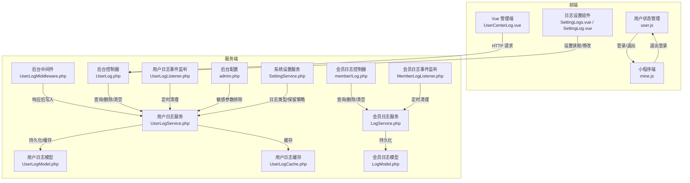
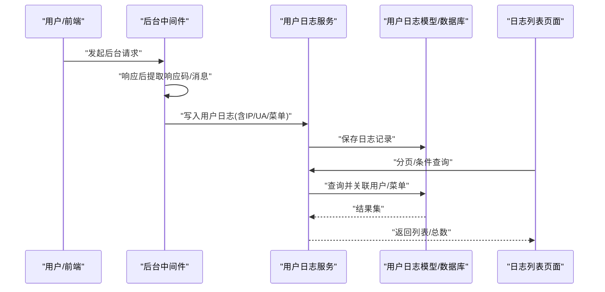
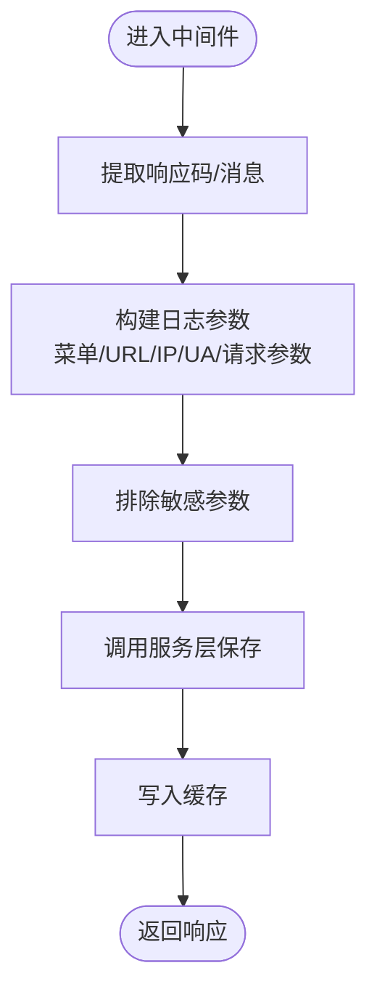
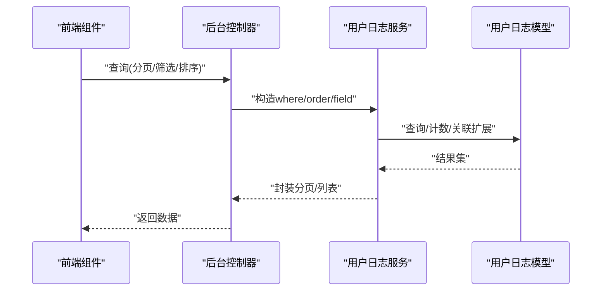
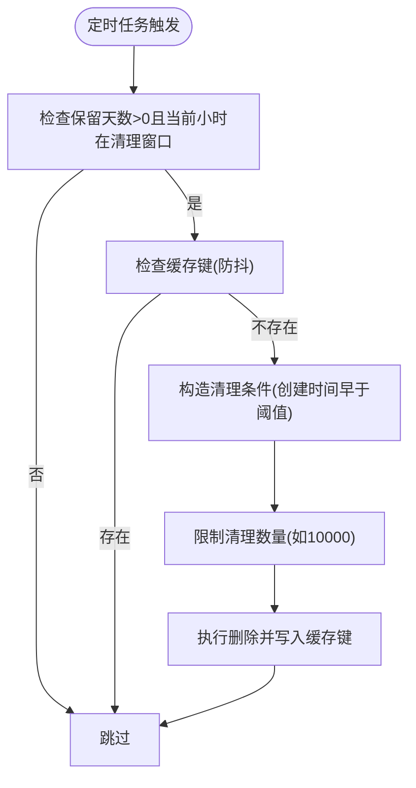
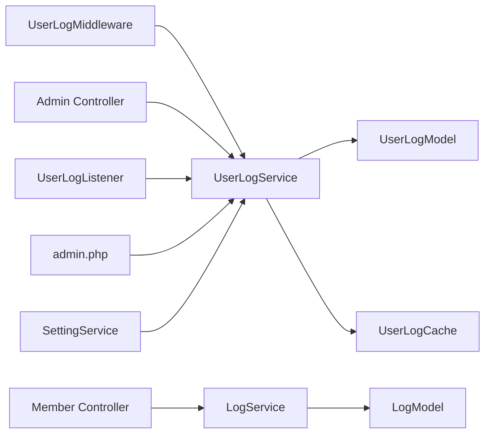

# 审计日志管理

<cite>
**本文引用的文件**
- [gccd_server/app/common/service/system/UserLogService.php](file://gccd_server/app/common/service/system/UserLogService.php)
- [gccd_server/app/common/model/system/UserLogModel.php](file://gccd_server/app/common/model/system/UserLogModel.php)
- [gccd_server/app/admin/controller/system/UserLog.php](file://gccd_server/app/admin/controller/system/UserLog.php)
- [gccd_server/app/admin/middleware/UserLogMiddleware.php](file://gccd_server/app/admin/middleware/UserLogMiddleware.php)
- [gccd_server/app/common/service/member/LogService.php](file://gccd_server/app/common/service/member/LogService.php)
- [gccd_server/app/common/model/member/LogModel.php](file://gccd_server/app/common/model/member/LogModel.php)
- [gccd_server/app/admin/controller/member/Log.php](file://gccd_server/app/admin/controller/member/Log.php)
- [gccd_server/app/listener/UserLogListener.php](file://gccd_server/app/listener/UserLogListener.php)
- [gccd_server/app/listener/MemberLogListener.php](file://gccd_server/app/listener/MemberLogListener.php)
- [gccd_server/app/common/cache/system/UserLogCache.php](file://gccd_server/app/common/cache/system/UserLogCache.php)
- [gccd_server/app/common/service/system/SettingService.php](file://gccd_server/app/common/service/system/SettingService.php)
- [gccd_server/config/admin.php](file://gccd_server/config/admin.php)
- [yarn/src/views/system/components/UserCenterLog.vue](file://yarn/src/views/system/components/UserCenterLog.vue)
- [yarn/src/views/system/components/SettingLogs.vue](file://yarn/src/views/system/components/SettingLogs.vue)
- [yarn/src/views/member/components/SettingLog.vue](file://yarn/src/views/member/components/SettingLog.vue)
- [yarn/src/store/modules/user.js](file://yarn/src/store/modules/user.js)
- [gccd_mini/pages/mine/mine.js](file://gccd_mini/pages/mine/mine.js)
</cite>

## 目录
1. [简介](#简介)
2. [项目结构](#项目结构)
3. [核心组件](#核心组件)
4. [架构总览](#架构总览)
5. [详细组件分析](#详细组件分析)
6. [依赖关系分析](#依赖关系分析)
7. [性能考量](#性能考量)
8. [故障排查指南](#故障排查指南)
9. [结论](#结论)
10. [附录](#附录)

## 简介
本文件面向“审计日志管理”的完整文档需求，系统化梳理日志系统的架构设计与实现细节，覆盖日志采集、存储、查询、归档与清理等核心能力，并对用户操作日志（登录、操作、退出）的记录机制进行深入说明。同时给出日志数据结构定义、查询与统计能力、存储策略（轮转、清理）、分析工具使用指南以及安全与合规要点。

## 项目结构
围绕审计日志管理，系统在服务端采用 ThinkPHP 框架，前端采用 Vue3 + Element Plus，小程序端提供基础退出登录流程。日志体系分为两部分：
- 后台用户日志：记录管理员后台用户的登录、操作、退出行为
- 会员日志：记录会员在 API 接口侧的注册、登录、操作、退出行为

图表来源
- [gccd_server/app/admin/middleware/UserLogMiddleware.php:29-50](file://gccd_server/app/admin/middleware/UserLogMiddleware.php#L29-L50)
- [gccd_server/app/admin/controller/system/UserLog.php:44-104](file://gccd_server/app/admin/controller/system/UserLog.php#L44-L104)
- [gccd_server/app/common/service/system/UserLogService.php:129-171](file://gccd_server/app/common/service/system/UserLogService.php#L129-L171)
- [gccd_server/app/common/model/system/UserLogModel.php:18-67](file://gccd_server/app/common/model/system/UserLogModel.php#L18-L67)
- [gccd_server/app/common/cache/system/UserLogCache.php:17-87](file://gccd_server/app/common/cache/system/UserLogCache.php#L17-L87)
- [gccd_server/app/admin/controller/member/Log.php:46-105](file://gccd_server/app/admin/controller/member/Log.php#L46-L105)
- [gccd_server/app/common/service/member/LogService.php:131-176](file://gccd_server/app/common/service/member/LogService.php#L131-L176)
- [gccd_server/app/common/model/member/LogModel.php:19-88](file://gccd_server/app/common/model/member/LogModel.php#L19-L88)
- [gccd_server/app/listener/UserLogListener.php:27-30](file://gccd_server/app/listener/UserLogListener.php#L27-L30)
- [gccd_server/app/listener/MemberLogListener.php:27-31](file://gccd_server/app/listener/MemberLogListener.php#L27-L31)
- [gccd_server/config/admin.php:46-60](file://gccd_server/config/admin.php#L46-L60)
- [gccd_server/app/common/service/system/SettingService.php:64-95](file://gccd_server/app/common/service/system/SettingService.php#L64-L95)
- [yarn/src/views/system/components/UserCenterLog.vue:226-239](file://yarn/src/views/system/components/UserCenterLog.vue#L226-L239)
- [yarn/src/views/system/components/SettingLogs.vue:52-85](file://yarn/src/views/system/components/SettingLogs.vue#L52-L85)
- [yarn/src/views/member/components/SettingLog.vue:52-85](file://yarn/src/views/member/components/SettingLog.vue#L52-L85)
- [yarn/src/store/modules/user.js:24-38](file://yarn/src/store/modules/user.js#L24-L38)
- [gccd_mini/pages/mine/mine.js:24-45](file://gccd_mini/pages/mine/mine.js#L24-L45)

章节来源
- [gccd_server/app/admin/middleware/UserLogMiddleware.php:29-50](file://gccd_server/app/admin/middleware/UserLogMiddleware.php#L29-L50)
- [gccd_server/app/admin/controller/system/UserLog.php:44-104](file://gccd_server/app/admin/controller/system/UserLog.php#L44-L104)
- [gccd_server/app/common/service/system/UserLogService.php:129-171](file://gccd_server/app/common/service/system/UserLogService.php#L129-L171)
- [gccd_server/app/common/model/system/UserLogModel.php:18-67](file://gccd_server/app/common/model/system/UserLogModel.php#L18-L67)
- [gccd_server/app/common/cache/system/UserLogCache.php:17-87](file://gccd_server/app/common/cache/system/UserLogCache.php#L17-L87)
- [gccd_server/app/admin/controller/member/Log.php:46-105](file://gccd_server/app/admin/controller/member/Log.php#L46-L105)
- [gccd_server/app/common/service/member/LogService.php:131-176](file://gccd_server/app/common/service/member/LogService.php#L131-L176)
- [gccd_server/app/common/model/member/LogModel.php:19-88](file://gccd_server/app/common/model/member/LogModel.php#L19-L88)
- [gccd_server/app/listener/UserLogListener.php:27-30](file://gccd_server/app/listener/UserLogListener.php#L27-L30)
- [gccd_server/app/listener/MemberLogListener.php:27-31](file://gccd_server/app/listener/MemberLogListener.php#L27-L31)
- [gccd_server/config/admin.php:46-60](file://gccd_server/config/admin.php#L46-L60)
- [gccd_server/app/common/service/system/SettingService.php:64-95](file://gccd_server/app/common/service/system/SettingService.php#L64-L95)
- [yarn/src/views/system/components/UserCenterLog.vue:226-239](file://yarn/src/views/system/components/UserCenterLog.vue#L226-L239)
- [yarn/src/views/system/components/SettingLogs.vue:52-85](file://yarn/src/views/system/components/SettingLogs.vue#L52-L85)
- [yarn/src/views/member/components/SettingLog.vue:52-85](file://yarn/src/views/member/components/SettingLog.vue#L52-L85)
- [yarn/src/store/modules/user.js:24-38](file://yarn/src/store/modules/user.js#L24-L38)
- [gccd_mini/pages/mine/mine.js:24-45](file://gccd_mini/pages/mine/mine.js#L24-L45)

## 核心组件
- 用户日志服务：负责用户日志的增删改查、批量清理、定时清理、请求参数脱敏与地理信息解析
- 用户日志模型：定义表结构、关联用户、序列化/反序列化请求参数
- 用户日志控制器：提供列表、详情、删除、清空等接口
- 用户日志中间件：在响应阶段自动采集用户操作日志
- 用户日志缓存：基于标签的缓存管理，提升读取性能
- 会员日志服务/模型/控制器：与用户日志类似，但面向会员 API 场景
- 事件监听器：每日固定时段触发清理过期日志
- 配置与设置：日志开关、保留天数、敏感参数排除列表、日志类型枚举
- 前端组件：日志列表查询、详情查看、批量删除、日志设置开关与保留天数

章节来源
- [gccd_server/app/common/service/system/UserLogService.php:35-87](file://gccd_server/app/common/service/system/UserLogService.php#L35-L87)
- [gccd_server/app/common/model/system/UserLogModel.php:18-67](file://gccd_server/app/common/model/system/UserLogModel.php#L18-L67)
- [gccd_server/app/admin/controller/system/UserLog.php:44-104](file://gccd_server/app/admin/controller/system/UserLog.php#L44-L104)
- [gccd_server/app/admin/middleware/UserLogMiddleware.php:29-50](file://gccd_server/app/admin/middleware/UserLogMiddleware.php#L29-L50)
- [gccd_server/app/common/cache/system/UserLogCache.php:17-87](file://gccd_server/app/common/cache/system/UserLogCache.php#L17-L87)
- [gccd_server/app/common/service/member/LogService.php:35-89](file://gccd_server/app/common/service/member/LogService.php#L35-L89)
- [gccd_server/app/common/model/member/LogModel.php:19-88](file://gccd_server/app/common/model/member/LogModel.php#L19-L88)
- [gccd_server/app/admin/controller/member/Log.php:46-105](file://gccd_server/app/admin/controller/member/Log.php#L46-L105)
- [gccd_server/app/listener/UserLogListener.php:27-30](file://gccd_server/app/listener/UserLogListener.php#L27-L30)
- [gccd_server/app/listener/MemberLogListener.php:27-31](file://gccd_server/app/listener/MemberLogListener.php#L27-L31)
- [gccd_server/config/admin.php:46-60](file://gccd_server/config/admin.php#L46-L60)
- [gccd_server/app/common/service/system/SettingService.php:64-95](file://gccd_server/app/common/service/system/SettingService.php#L64-L95)
- [yarn/src/views/system/components/UserCenterLog.vue:226-239](file://yarn/src/views/system/components/UserCenterLog.vue#L226-L239)
- [yarn/src/views/system/components/SettingLogs.vue:52-85](file://yarn/src/views/system/components/SettingLogs.vue#L52-L85)
- [yarn/src/views/member/components/SettingLog.vue:52-85](file://yarn/src/views/member/components/SettingLog.vue#L52-L85)

## 架构总览
下图展示从用户操作到日志落库与查询的端到端流程，涵盖中间件采集、服务层处理、模型持久化、缓存与定时清理。

图表来源
- [gccd_server/app/admin/middleware/UserLogMiddleware.php:29-50](file://gccd_server/app/admin/middleware/UserLogMiddleware.php#L29-L50)
- [gccd_server/app/common/service/system/UserLogService.php:129-171](file://gccd_server/app/common/service/system/UserLogService.php#L129-L171)
- [gccd_server/app/common/model/system/UserLogModel.php:18-67](file://gccd_server/app/common/model/system/UserLogModel.php#L18-L67)
- [yarn/src/views/system/components/UserCenterLog.vue:226-239](file://yarn/src/views/system/components/UserCenterLog.vue#L226-L239)

## 详细组件分析

### 用户日志采集与记录
- 中间件在响应阶段读取响应码与消息，组装用户日志参数，调用服务层写入
- 服务层补充菜单信息、请求方法、URL、IP 地理信息、User-Agent、请求参数（排除敏感字段）
- 写入成功后更新缓存，便于后续读取与详情展示

图表来源
- [gccd_server/app/admin/middleware/UserLogMiddleware.php:29-50](file://gccd_server/app/admin/middleware/UserLogMiddleware.php#L29-L50)
- [gccd_server/app/common/service/system/UserLogService.php:129-171](file://gccd_server/app/common/service/system/UserLogService.php#L129-L171)
- [gccd_server/config/admin.php:46-60](file://gccd_server/config/admin.php#L46-L60)

章节来源
- [gccd_server/app/admin/middleware/UserLogMiddleware.php:29-50](file://gccd_server/app/admin/middleware/UserLogMiddleware.php#L29-L50)
- [gccd_server/app/common/service/system/UserLogService.php:129-171](file://gccd_server/app/common/service/system/UserLogService.php#L129-L171)
- [gccd_server/config/admin.php:46-60](file://gccd_server/config/admin.php#L46-L60)

### 用户日志查询与统计
- 控制器提供列表、详情、删除、清空接口
- 服务层支持分页、排序、字段裁剪、关联用户/菜单扩展字段
- 前端组件支持按字段、表达式、时间范围查询，支持导出/复制请求参数

图表来源
- [gccd_server/app/admin/controller/system/UserLog.php:44-104](file://gccd_server/app/admin/controller/system/UserLog.php#L44-L104)
- [gccd_server/app/common/service/system/UserLogService.php:35-87](file://gccd_server/app/common/service/system/UserLogService.php#L35-L87)
- [gccd_server/app/common/model/system/UserLogModel.php:18-67](file://gccd_server/app/common/model/system/UserLogModel.php#L18-L67)
- [yarn/src/views/system/components/UserCenterLog.vue:226-239](file://yarn/src/views/system/components/UserCenterLog.vue#L226-L239)

章节来源
- [gccd_server/app/admin/controller/system/UserLog.php:44-104](file://gccd_server/app/admin/controller/system/UserLog.php#L44-L104)
- [gccd_server/app/common/service/system/UserLogService.php:35-87](file://gccd_server/app/common/service/system/UserLogService.php#L35-L87)
- [gccd_server/app/common/model/system/UserLogModel.php:18-67](file://gccd_server/app/common/model/system/UserLogModel.php#L18-L67)
- [yarn/src/views/system/components/UserCenterLog.vue:226-239](file://yarn/src/views/system/components/UserCenterLog.vue#L226-L239)

### 会员日志采集与查询
- 会员日志服务与用户日志类似，但面向 API 场景，补充平台、应用、接口等维度
- 控制器提供列表、详情、删除、清空接口，支持按 API、平台、应用筛选

章节来源
- [gccd_server/app/admin/controller/member/Log.php:46-105](file://gccd_server/app/admin/controller/member/Log.php#L46-L105)
- [gccd_server/app/common/service/member/LogService.php:35-89](file://gccd_server/app/common/service/member/LogService.php#L35-L89)
- [gccd_server/app/common/model/member/LogModel.php:19-88](file://gccd_server/app/common/model/member/LogModel.php#L19-L88)

### 日志数据结构设计
- 用户日志字段（示例，以实际模型为准）：日志ID、用户ID、菜单ID、请求方法、请求URL、请求IP、国家/省/市/区域、运营商、请求参数、User-Agent、响应码、响应消息、创建时间
- 会员日志字段（示例，以实际模型为准）：日志ID、会员ID、接口ID、平台、应用、请求方法、请求URL、请求IP、国家/省/市/区域、运营商、请求参数、User-Agent、响应码、响应消息、创建时间
- 关联字段：用户昵称/账号、菜单名称/链接、接口名称/URL、平台/应用名称

章节来源
- [gccd_server/app/common/model/system/UserLogModel.php:18-67](file://gccd_server/app/common/model/system/UserLogModel.php#L18-L67)
- [gccd_server/app/common/model/member/LogModel.php:19-88](file://gccd_server/app/common/model/member/LogModel.php#L19-L88)

### 存储策略与清理机制
- 日志开关与保留天数：通过系统设置控制是否记录、保留时长（0 表示永久）
- 敏感参数排除：配置文件中定义需排除的字段，避免敏感信息入库
- 定时清理：每日固定时间段（如凌晨 0-8 点）触发清理超过保留期限的日志，带防抖缓存键避免重复执行
- 批量清理：支持按条件批量清空，限制每次清理数量防止阻塞

图表来源
- [gccd_server/app/common/service/system/UserLogService.php:270-282](file://gccd_server/app/common/service/system/UserLogService.php#L270-L282)
- [gccd_server/app/common/service/member/LogService.php:270-282](file://gccd_server/app/common/service/member/LogService.php#L270-L282)
- [gccd_server/app/common/service/system/SettingService.php:64-95](file://gccd_server/app/common/service/system/SettingService.php#L64-L95)
- [gccd_server/config/admin.php:46-60](file://gccd_server/config/admin.php#L46-L60)
- [gccd_server/app/listener/UserLogListener.php:27-30](file://gccd_server/app/listener/UserLogListener.php#L27-L30)
- [gccd_server/app/listener/MemberLogListener.php:27-31](file://gccd_server/app/listener/MemberLogListener.php#L27-L31)

章节来源
- [gccd_server/app/common/service/system/UserLogService.php:270-282](file://gccd_server/app/common/service/system/UserLogService.php#L270-L282)
- [gccd_server/app/common/service/member/LogService.php:270-282](file://gccd_server/app/common/service/member/LogService.php#L270-L282)
- [gccd_server/app/common/service/system/SettingService.php:64-95](file://gccd_server/app/common/service/system/SettingService.php#L64-L95)
- [gccd_server/config/admin.php:46-60](file://gccd_server/config/admin.php#L46-L60)
- [gccd_server/app/listener/UserLogListener.php:27-30](file://gccd_server/app/listener/UserLogListener.php#L27-L30)
- [gccd_server/app/listener/MemberLogListener.php:27-31](file://gccd_server/app/listener/MemberLogListener.php#L27-L31)

### 日志分析与可视化
- 前端提供日志列表查询、排序、分页、批量删除、详情查看、请求参数复制
- 支持按用户、时间、操作类型（登录/操作/退出）等维度检索
- 可结合后端导出能力进行离线分析（若后端提供）

章节来源
- [yarn/src/views/system/components/UserCenterLog.vue:226-239](file://yarn/src/views/system/components/UserCenterLog.vue#L226-L239)
- [yarn/src/views/system/components/SettingLogs.vue:52-85](file://yarn/src/views/system/components/SettingLogs.vue#L52-L85)
- [yarn/src/views/member/components/SettingLog.vue:52-85](file://yarn/src/views/member/components/SettingLog.vue#L52-L85)

### 登录与退出流程
- 管理端登录：前端 Store 调用登录接口，成功后路由跳转
- 小程序退出：弹窗确认后清除本地 Token 与用户信息，Toast 提示并跳转登录页
- 退出行为会被中间件识别为“退出”类型日志

章节来源
- [yarn/src/store/modules/user.js:24-38](file://yarn/src/store/modules/user.js#L24-L38)
- [gccd_mini/pages/mine/mine.js:24-45](file://gccd_mini/pages/mine/mine.js#L24-L45)
- [gccd_server/app/admin/middleware/UserLogMiddleware.php:33-48](file://gccd_server/app/admin/middleware/UserLogMiddleware.php#L33-L48)

## 依赖关系分析
- 组件耦合
  - 中间件依赖服务层写入日志
  - 控制器依赖服务层进行业务处理
  - 服务层依赖模型进行持久化与关联查询
  - 缓存层与服务层双向交互，提升读性能
  - 事件监听器与服务层解耦，仅触发清理逻辑
- 外部依赖
  - 配置文件 admin.php 提供敏感参数排除列表
  - SettingService 提供日志类型枚举与保留策略

图表来源
- [gccd_server/app/admin/middleware/UserLogMiddleware.php:29-50](file://gccd_server/app/admin/middleware/UserLogMiddleware.php#L29-L50)
- [gccd_server/app/admin/controller/system/UserLog.php:44-104](file://gccd_server/app/admin/controller/system/UserLog.php#L44-L104)
- [gccd_server/app/common/service/system/UserLogService.php:129-171](file://gccd_server/app/common/service/system/UserLogService.php#L129-L171)
- [gccd_server/app/common/model/system/UserLogModel.php:18-67](file://gccd_server/app/common/model/system/UserLogModel.php#L18-L67)
- [gccd_server/app/common/cache/system/UserLogCache.php:17-87](file://gccd_server/app/common/cache/system/UserLogCache.php#L17-L87)
- [gccd_server/app/listener/UserLogListener.php:27-30](file://gccd_server/app/listener/UserLogListener.php#L27-L30)
- [gccd_server/app/admin/controller/member/Log.php:46-105](file://gccd_server/app/admin/controller/member/Log.php#L46-L105)
- [gccd_server/app/common/service/member/LogService.php:131-176](file://gccd_server/app/common/service/member/LogService.php#L131-L176)
- [gccd_server/app/common/model/member/LogModel.php:19-88](file://gccd_server/app/common/model/member/LogModel.php#L19-L88)
- [gccd_server/config/admin.php:46-60](file://gccd_server/config/admin.php#L46-L60)
- [gccd_server/app/common/service/system/SettingService.php:64-95](file://gccd_server/app/common/service/system/SettingService.php#L64-L95)

章节来源
- [gccd_server/app/admin/middleware/UserLogMiddleware.php:29-50](file://gccd_server/app/admin/middleware/UserLogMiddleware.php#L29-L50)
- [gccd_server/app/admin/controller/system/UserLog.php:44-104](file://gccd_server/app/admin/controller/system/UserLog.php#L44-L104)
- [gccd_server/app/common/service/system/UserLogService.php:129-171](file://gccd_server/app/common/service/system/UserLogService.php#L129-L171)
- [gccd_server/app/common/model/system/UserLogModel.php:18-67](file://gccd_server/app/common/model/system/UserLogModel.php#L18-L67)
- [gccd_server/app/common/cache/system/UserLogCache.php:17-87](file://gccd_server/app/common/cache/system/UserLogCache.php#L17-L87)
- [gccd_server/app/listener/UserLogListener.php:27-30](file://gccd_server/app/listener/UserLogListener.php#L27-L30)
- [gccd_server/app/admin/controller/member/Log.php:46-105](file://gccd_server/app/admin/controller/member/Log.php#L46-L105)
- [gccd_server/app/common/service/member/LogService.php:131-176](file://gccd_server/app/common/service/member/LogService.php#L131-L176)
- [gccd_server/app/common/model/member/LogModel.php:19-88](file://gccd_server/app/common/model/member/LogModel.php#L19-L88)
- [gccd_server/config/admin.php:46-60](file://gccd_server/config/admin.php#L46-L60)
- [gccd_server/app/common/service/system/SettingService.php:64-95](file://gccd_server/app/common/service/system/SettingService.php#L64-L95)

## 性能考量
- 缓存优化：详情与列表查询通过缓存减少数据库压力，注意变更时及时清理缓存
- 分页与字段裁剪：默认仅返回必要字段，避免大对象传输
- 定时清理窗口：在低峰时段执行大批量删除，降低对在线业务的影响
- 敏感参数排除：减少大字段入库，降低存储与网络开销

## 故障排查指南
- 日志未记录
  - 检查日志开关与保留天数设置
  - 确认中间件是否生效
  - 查看配置文件中的敏感参数排除列表是否误删关键字段
- 查询无结果
  - 检查筛选条件与时间范围
  - 确认缓存是否过期或被清理
- 清理不生效
  - 确认当前小时处于清理窗口
  - 检查缓存键防抖是否阻止执行
  - 查看服务层清理逻辑与条件构造

章节来源
- [gccd_server/app/common/service/system/SettingService.php:64-95](file://gccd_server/app/common/service/system/SettingService.php#L64-L95)
- [gccd_server/app/admin/middleware/UserLogMiddleware.php:29-50](file://gccd_server/app/admin/middleware/UserLogMiddleware.php#L29-L50)
- [gccd_server/config/admin.php:46-60](file://gccd_server/config/admin.php#L46-L60)
- [gccd_server/app/common/service/system/UserLogService.php:270-282](file://gccd_server/app/common/service/system/UserLogService.php#L270-L282)

## 结论
该日志系统通过中间件自动采集、服务层统一处理、模型持久化与缓存优化，实现了后台用户与会员两类日志的完整闭环。配合定时清理与敏感参数排除策略，兼顾了性能与合规性。前端提供了完善的查询与分析界面，满足日常审计与运营分析需求。

## 附录
- 日志类型枚举：登录、操作、退出
- 常用配置项：日志开关、保留天数、敏感参数排除列表
- 前端常用操作：列表查询、详情查看、批量删除、请求参数复制

章节来源
- [gccd_server/app/common/service/system/SettingService.php:64-95](file://gccd_server/app/common/service/system/SettingService.php#L64-L95)
- [gccd_server/config/admin.php:46-60](file://gccd_server/config/admin.php#L46-L60)
- [yarn/src/views/system/components/UserCenterLog.vue:226-239](file://yarn/src/views/system/components/UserCenterLog.vue#L226-L239)
- [yarn/src/views/system/components/SettingLogs.vue:52-85](file://yarn/src/views/system/components/SettingLogs.vue#L52-L85)
- [yarn/src/views/member/components/SettingLog.vue:52-85](file://yarn/src/views/member/components/SettingLog.vue#L52-L85)