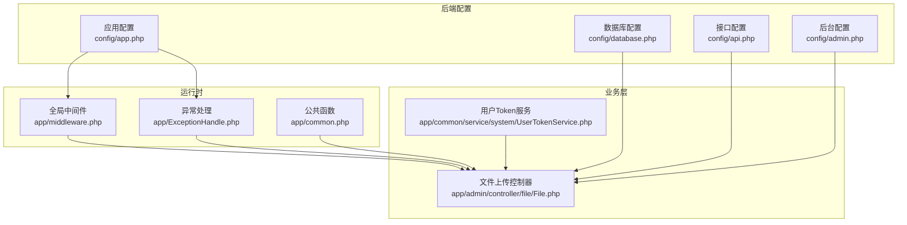
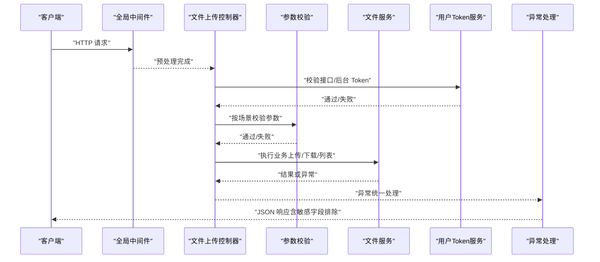
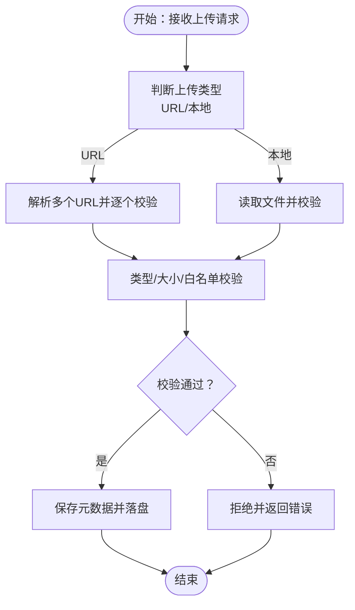
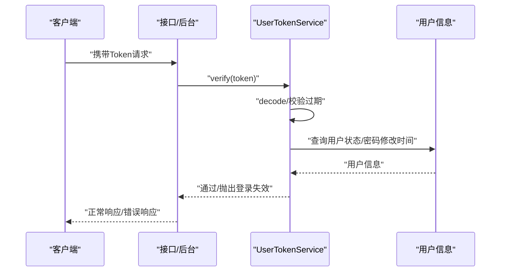
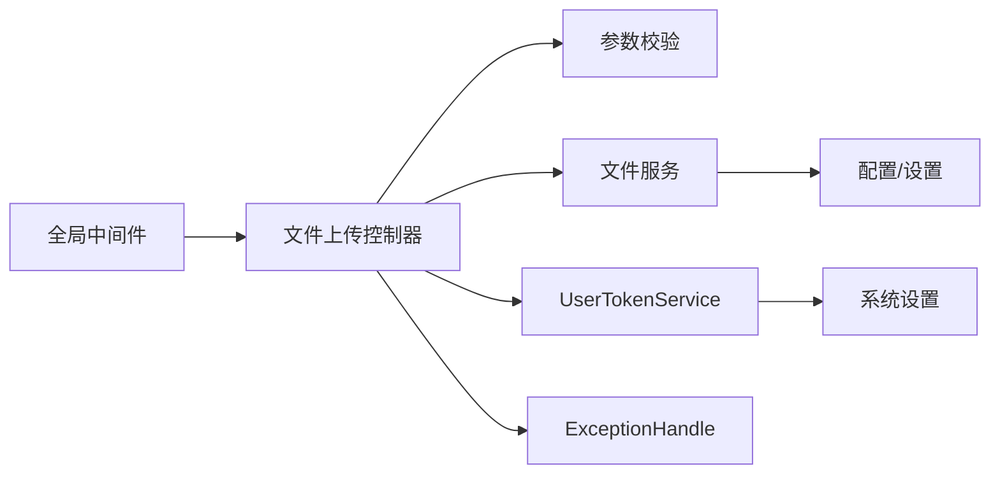

# 数据安全保护

<cite>
**本文引用的文件**
- [gccd_server/config/database.php](file://gccd_server/config/database.php)
- [gccd_server/config/app.php](file://gccd_server/config/app.php)
- [gccd_server/app/common.php](file://gccd_server/app/common.php)
- [gccd_server/app/ExceptionHandle.php](file://gccd_server/app/ExceptionHandle.php)
- [gccd_server/app/middleware.php](file://gccd_server/app/middleware.php)
- [gccd_server/config/api.php](file://gccd_server/config/api.php)
- [gccd_server/config/admin.php](file://gccd_server/config/admin.php)
- [gccd_server/app/admin/controller/file/File.php](file://gccd_server/app/admin/controller/file/File.php)
- [gccd_server/app/common/service/system/UserTokenService.php](file://gccd_server/app/common/service/system/UserTokenService.php)
</cite>

## 目录
1. [简介](#简介)
2. [项目结构](#项目结构)
3. [核心组件](#核心组件)
4. [架构总览](#架构总览)
5. [详细组件分析](#详细组件分析)
6. [依赖关系分析](#依赖关系分析)
7. [性能与安全特性](#性能与安全特性)
8. [故障排查指南](#故障排查指南)
9. [结论](#结论)
10. [附录](#附录)

## 简介
本技术文档聚焦于数据安全保护，围绕以下主题展开：敏感数据加密存储策略（密码加密、数据脱敏、传输加密）、SQL 注入防护（参数绑定、输入验证、查询白名单）、XSS 防范（输出编码、CSP、输入过滤）、CSRF 防护（token 验证、SameSite、Referer 检查）、文件上传安全控制（类型校验、大小限制、病毒扫描）、数据库安全配置（连接加密、访问控制、备份加密），以及安全漏洞扫描与应急响应流程。文档在保证可操作性的同时，尽量以图示化方式呈现实现要点与风险控制点。

## 项目结构
本仓库包含小程序前端、Vue 后台与 ThinkPHP 后端三部分。与安全直接相关的关键位置如下：
- 后端 ThinkPHP 配置层：应用配置、数据库配置、接口与后台管理配置
- 后端公共函数与异常处理：统一返回、敏感字段排除、异常渲染
- 后端中间件：跨域、日志清理等全局行为
- 后端控制器：文件上传入口与参数校验场景
- 后端服务层：JWT Token 生成与校验逻辑

图表来源
- [gccd_server/config/app.php:1-44](file://gccd_server/config/app.php#L1-L44)
- [gccd_server/config/database.php:1-71](file://gccd_server/config/database.php#L1-L71)
- [gccd_server/config/api.php:1-59](file://gccd_server/config/api.php#L1-L59)
- [gccd_server/config/admin.php:1-65](file://gccd_server/config/admin.php#L1-L65)
- [gccd_server/app/middleware.php:1-23](file://gccd_server/app/middleware.php#L1-L23)
- [gccd_server/app/ExceptionHandle.php:1-98](file://gccd_server/app/ExceptionHandle.php#L1-L98)
- [gccd_server/app/common.php:1-800](file://gccd_server/app/common.php#L1-L800)
- [gccd_server/app/admin/controller/file/File.php:1-436](file://gccd_server/app/admin/controller/file/File.php#L1-L436)
- [gccd_server/app/common/service/system/UserTokenService.php:1-147](file://gccd_server/app/common/service/system/UserTokenService.php#L1-L147)

章节来源
- [gccd_server/config/app.php:1-44](file://gccd_server/config/app.php#L1-L44)
- [gccd_server/config/database.php:1-71](file://gccd_server/config/database.php#L1-L71)
- [gccd_server/config/api.php:1-59](file://gccd_server/config/api.php#L1-L59)
- [gccd_server/config/admin.php:1-65](file://gccd_server/config/admin.php#L1-L65)
- [gccd_server/app/middleware.php:1-23](file://gccd_server/app/middleware.php#L1-L23)
- [gccd_server/app/ExceptionHandle.php:1-98](file://gccd_server/app/ExceptionHandle.php#L1-L98)
- [gccd_server/app/common.php:1-800](file://gccd_server/app/common.php#L1-L800)
- [gccd_server/app/admin/controller/file/File.php:1-436](file://gccd_server/app/admin/controller/file/File.php#L1-L436)
- [gccd_server/app/common/service/system/UserTokenService.php:1-147](file://gccd_server/app/common/service/system/UserTokenService.php#L1-L147)

## 核心组件
- 应用与异常处理：统一返回结构、敏感字段排除、异常渲染与调试开关
- 中间件：跨域、日志清理等全局行为
- 接口与后台配置：token 类型与名称、免登/免权/免限 URL 白名单、日志参数排除字段
- 数据库配置：字符集、字段缓存、断线重连、监听 SQL 等
- 文件上传控制器：参数校验、批量 URL 添加、本地下载、设置项读取
- 用户 Token 服务：JWT 生成、解码、验证、多端登录控制

章节来源
- [gccd_server/app/common.php:1-800](file://gccd_server/app/common.php#L1-L800)
- [gccd_server/app/ExceptionHandle.php:1-98](file://gccd_server/app/ExceptionHandle.php#L1-L98)
- [gccd_server/app/middleware.php:1-23](file://gccd_server/app/middleware.php#L1-L23)
- [gccd_server/config/api.php:1-59](file://gccd_server/config/api.php#L1-L59)
- [gccd_server/config/admin.php:1-65](file://gccd_server/config/admin.php#L1-L65)
- [gccd_server/config/database.php:1-71](file://gccd_server/config/database.php#L1-L71)
- [gccd_server/app/admin/controller/file/File.php:1-436](file://gccd_server/app/admin/controller/file/File.php#L1-L436)
- [gccd_server/app/common/service/system/UserTokenService.php:1-147](file://gccd_server/app/common/service/system/UserTokenService.php#L1-L147)

## 架构总览
下图展示从请求进入后端到响应返回的关键路径，以及与安全相关的控制点（参数校验、Token 验证、异常处理、日志排除）：

图表来源
- [gccd_server/app/middleware.php:1-23](file://gccd_server/app/middleware.php#L1-L23)
- [gccd_server/app/admin/controller/file/File.php:1-436](file://gccd_server/app/admin/controller/file/File.php#L1-L436)
- [gccd_server/app/common/service/system/UserTokenService.php:1-147](file://gccd_server/app/common/service/system/UserTokenService.php#L1-L147)
- [gccd_server/app/ExceptionHandle.php:1-98](file://gccd_server/app/ExceptionHandle.php#L1-L98)

## 详细组件分析

### 敏感数据加密存储策略
- 密码加密
  - 项目中存在“密码”相关字段的排除记录，用于日志与返回，避免泄露。建议在入库前对密码进行不可逆哈希处理，并结合盐值与足够迭代次数，确保即使数据库泄露也无法还原明文。
  - 参考路径：[接口配置中的日志排除字段:45-57](file://gccd_server/config/api.php#L45-L57)，[后台配置中的日志排除字段:46-60](file://gccd_server/config/admin.php#L46-L60)
- 数据脱敏
  - 对日志与返回体中的敏感字段（如密码、图片、视频、音频、文档、附件等）进行排除，降低敏感信息外泄风险。
  - 参考路径：[公共函数中的日志参数排除字段](file://gccd_server/app/common.php:45-L58)
- 传输加密
  - 建议强制 HTTPS，TLS 版本不低于 1.2，禁用弱密码套件；后端与数据库通信建议启用 TLS；前端与后端交互应仅通过 HTTPS。

章节来源
- [gccd_server/config/api.php:45-57](file://gccd_server/config/api.php#L45-L57)
- [gccd_server/config/admin.php:46-60](file://gccd_server/config/admin.php#L46-L60)
- [gccd_server/app/common.php:45-58](file://gccd_server/app/common.php#L45-L58)

### SQL 注入防护
- 参数绑定与 ORM
  - 控制器中使用了参数提取与 where 条件拼装，建议统一通过 ORM 的参数绑定或原生语句绑定参数，避免字符串拼接。
  - 参考路径：[文件上传控制器中的参数提取与 where 组装:48-86](file://gccd_server/app/admin/controller/file/File.php#L48-L86)
- 输入验证
  - 控制器内针对不同场景调用验证器，建议在更上游增加基础类型校验与长度/范围限制。
  - 参考路径：[文件上传控制器中的场景校验:105-105](file://gccd_server/app/admin/controller/file/File.php#L105-L105)
- 查询白名单
  - 建议对排序字段、搜索字段、枚举值建立白名单，拒绝未知字段参与查询。
  - 参考路径：[公共函数中的 where_exps 表达式集合](file://gccd_server/app/common.php:794-L800)

章节来源
- [gccd_server/app/admin/controller/file/File.php:48-86](file://gccd_server/app/admin/controller/file/File.php#L48-L86)
- [gccd_server/app/admin/controller/file/File.php:105-105](file://gccd_server/app/admin/controller/file/File.php#L105-L105)
- [gccd_server/app/common.php:794-800](file://gccd_server/app/common.php#L794-L800)

### XSS 攻击防范
- 输出编码
  - 建议在模板或渲染层对动态输出进行 HTML 编码，避免脚本注入。
- 内容安全策略（CSP）
  - 建议在响应头中加入 Content-Security-Policy，限制脚本来源与内联脚本执行。
- 输入过滤
  - 建议在入库前对富文本与特殊字符进行白名单过滤或 HTML Purifier 清洗。

[本节为通用安全建议，不直接分析具体文件]

### CSRF 攻击防护
- Token 验证
  - 建议在关键接口引入一次性 CSRF Token，并在服务端校验。
- SameSite Cookie
  - 建议将会话 Cookie 设置为 SameSite=Strict/Lax，减少跨站请求风险。
- Referer/Origin 校验
  - 建议对重要接口校验 Referer 或 Origin，防止跨站伪造。

[本节为通用安全建议，不直接分析具体文件]

### 文件上传安全控制
- 文件类型验证
  - 建议基于 MIME 与扩展名双重校验，并维护允许类型白名单。
- 大小限制
  - 建议在网关/服务端均设置上传大小上限，并记录阈值。
- 病毒扫描
  - 建议集成病毒扫描服务或第三方云存储自带扫描能力。
- 业务实现要点
  - 控制器支持“URL 添加”与“本地上传”，并读取设置项决定是否允许上传；建议在上传前进行类型与大小校验。
  - 参考路径：[文件上传控制器中的类型选择与参数校验:127-185](file://gccd_server/app/admin/controller/file/File.php#L127-L185)

图表来源
- [gccd_server/app/admin/controller/file/File.php:127-185](file://gccd_server/app/admin/controller/file/File.php#L127-L185)

章节来源
- [gccd_server/app/admin/controller/file/File.php:127-185](file://gccd_server/app/admin/controller/file/File.php#L127-L185)

### 数据库安全配置
- 连接加密
  - 建议启用 MySQL TLS 连接，禁止明文传输。
- 访问控制
  - 为不同环境创建专用账户，最小权限原则；限制主机来源与最大连接数。
- 备份加密
  - 备份文件需加密存储，传输通道也应加密；定期轮换密钥。
- 配置参考
  - 字符集与字段缓存、断线重连、SQL 监听等配置项可用于诊断与优化。
  - 参考路径：[数据库配置项:27-66](file://gccd_server/config/database.php#L27-L66)

章节来源
- [gccd_server/config/database.php:27-66](file://gccd_server/config/database.php#L27-L66)

### Token 与认证授权
- Token 生成与校验
  - 使用 JWT 生成与解码，校验过期、禁用、删除、密码修改时间、多端登录等。
  - 参考路径：[用户 Token 服务:41-117](file://gccd_server/app/common/service/system/UserTokenService.php#L41-L117)
- 接口与后台 Token 配置
  - token_type 与 token_name 可通过环境变量配置，免登/免权/免限 URL 白名单便于放行公开接口。
  - 参考路径：[接口配置:12-34](file://gccd_server/config/api.php#L12-L34)，[后台配置:12-38](file://gccd_server/config/admin.php#L12-L38)

图表来源
- [gccd_server/app/common/service/system/UserTokenService.php:87-117](file://gccd_server/app/common/service/system/UserTokenService.php#L87-L117)

章节来源
- [gccd_server/app/common/service/system/UserTokenService.php:41-117](file://gccd_server/app/common/service/system/UserTokenService.php#L41-L117)
- [gccd_server/config/api.php:12-34](file://gccd_server/config/api.php#L12-L34)
- [gccd_server/config/admin.php:12-38](file://gccd_server/config/admin.php#L12-L38)

## 依赖关系分析
- 控制器依赖验证器与服务层，服务层依赖模型与配置
- 异常处理统一拦截各类异常，按需返回结构化错误
- 中间件提供跨域与日志清理等横切能力
- Token 服务依赖系统设置与用户服务

图表来源
- [gccd_server/app/admin/controller/file/File.php:1-436](file://gccd_server/app/admin/controller/file/File.php#L1-L436)
- [gccd_server/app/common/service/system/UserTokenService.php:1-147](file://gccd_server/app/common/service/system/UserTokenService.php#L1-L147)
- [gccd_server/app/ExceptionHandle.php:1-98](file://gccd_server/app/ExceptionHandle.php#L1-L98)
- [gccd_server/app/middleware.php:1-23](file://gccd_server/app/middleware.php#L1-L23)

章节来源
- [gccd_server/app/admin/controller/file/File.php:1-436](file://gccd_server/app/admin/controller/file/File.php#L1-L436)
- [gccd_server/app/common/service/system/UserTokenService.php:1-147](file://gccd_server/app/common/service/system/UserTokenService.php#L1-L147)
- [gccd_server/app/ExceptionHandle.php:1-98](file://gccd_server/app/ExceptionHandle.php#L1-L98)
- [gccd_server/app/middleware.php:1-23](file://gccd_server/app/middleware.php#L1-L23)

## 性能与安全特性
- 性能
  - 字段缓存与 schema 缓存路径可降低查询开销，但需注意缓存一致性与更新策略。
  - 断线重连与 SQL 监听可用于运维诊断，但生产环境应谨慎开启。
- 安全
  - 统一异常处理与敏感字段排除降低信息泄露面
  - Token 多端登录控制与密码修改时间校验提升会话安全性

章节来源
- [gccd_server/config/database.php:63-66](file://gccd_server/config/database.php#L63-L66)
- [gccd_server/app/ExceptionHandle.php:64-95](file://gccd_server/app/ExceptionHandle.php#L64-L95)
- [gccd_server/app/common/service/system/UserTokenService.php:112-117](file://gccd_server/app/common/service/system/UserTokenService.php#L112-L117)

## 故障排查指南
- 统一异常处理
  - 检查异常处理类对 ValidateException、HttpException、模型不存在异常的处理分支，确认调试模式下的详细信息输出。
  - 参考路径：[异常处理类:69-95](file://gccd_server/app/ExceptionHandle.php#L69-L95)
- 敏感字段排除
  - 若发现日志或返回中仍出现敏感信息，检查配置中的 log_param_without 与公共函数中的排除逻辑。
  - 参考路径：[接口配置:45-57](file://gccd_server/config/api.php#L45-L57)，[后台配置:46-60](file://gccd_server/config/admin.php#L46-L60)，[公共函数:45-58](file://gccd_server/app/common.php#L45-L58)
- Token 失效
  - 检查 Token 配置项、过期时间、用户状态变更（删除/禁用/密码修改）、多端登录策略。
  - 参考路径：[用户 Token 服务:87-117](file://gccd_server/app/common/service/system/UserTokenService.php#L87-L117)

章节来源
- [gccd_server/app/ExceptionHandle.php:69-95](file://gccd_server/app/ExceptionHandle.php#L69-L95)
- [gccd_server/config/api.php:45-57](file://gccd_server/config/api.php#L45-L57)
- [gccd_server/config/admin.php:46-60](file://gccd_server/config/admin.php#L46-L60)
- [gccd_server/app/common.php:45-58](file://gccd_server/app/common.php#L45-L58)
- [gccd_server/app/common/service/system/UserTokenService.php:87-117](file://gccd_server/app/common/service/system/UserTokenService.php#L87-L117)

## 结论
本项目在安全方面具备一定的基础：统一异常处理、敏感字段排除、Token 校验与多端登录控制、参数校验与查询表达式白名单等。为进一步强化数据安全，建议补充传输加密、XSS/CSP/CSRF 防护、文件上传病毒扫描、数据库连接加密与备份加密、以及完善安全漏洞扫描与应急响应流程。

## 附录
- 安全漏洞扫描工具使用建议
  - SAST：SonarQube/SpotBugs/ESLint/Prettier 规则
  - DAST：OWASP ZAP/Postman/Nuclei
  - IAST：Snyk/Contrast Security（视团队能力）
- 应急响应流程
  - 发现风险 -> 快速隔离 -> 影响评估 -> 修复与回滚 -> 复盘与加固 -> 文档更新

[本节为通用流程建议，不直接分析具体文件]