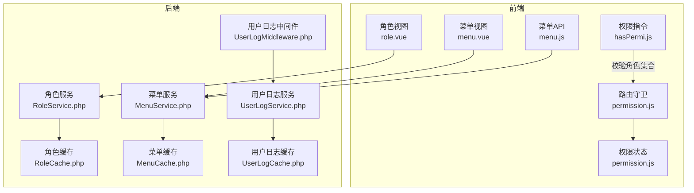
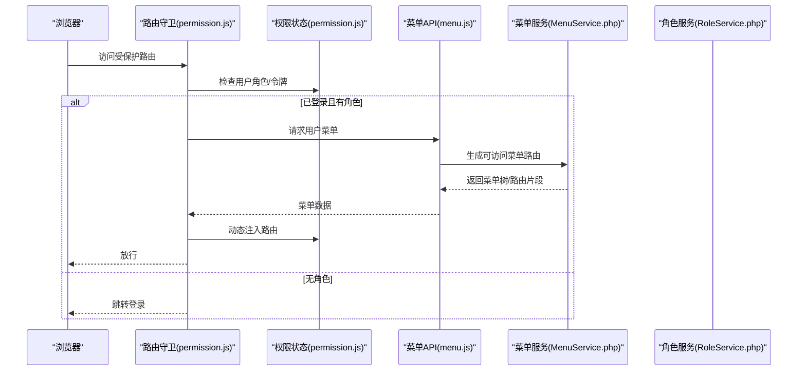
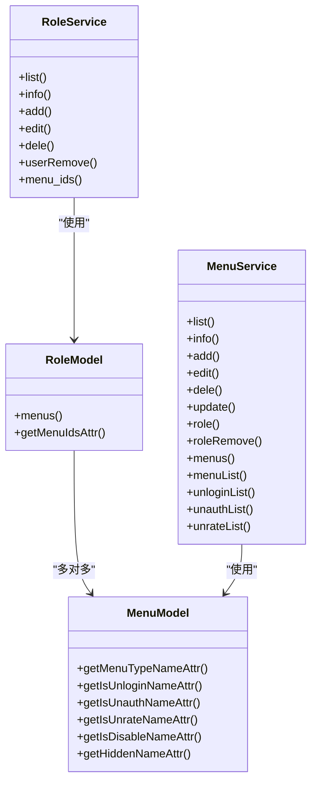
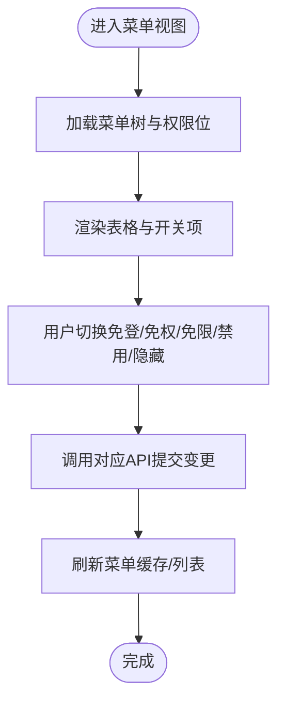
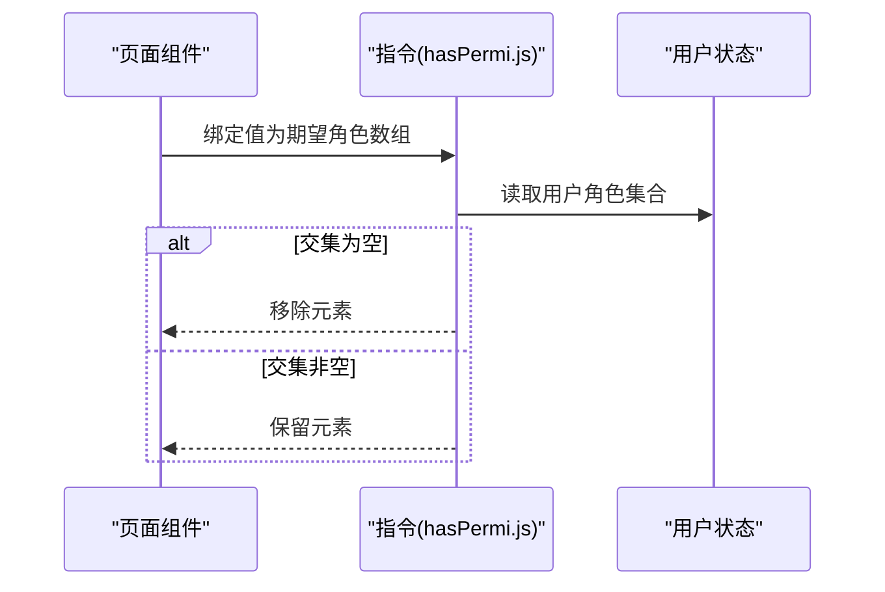
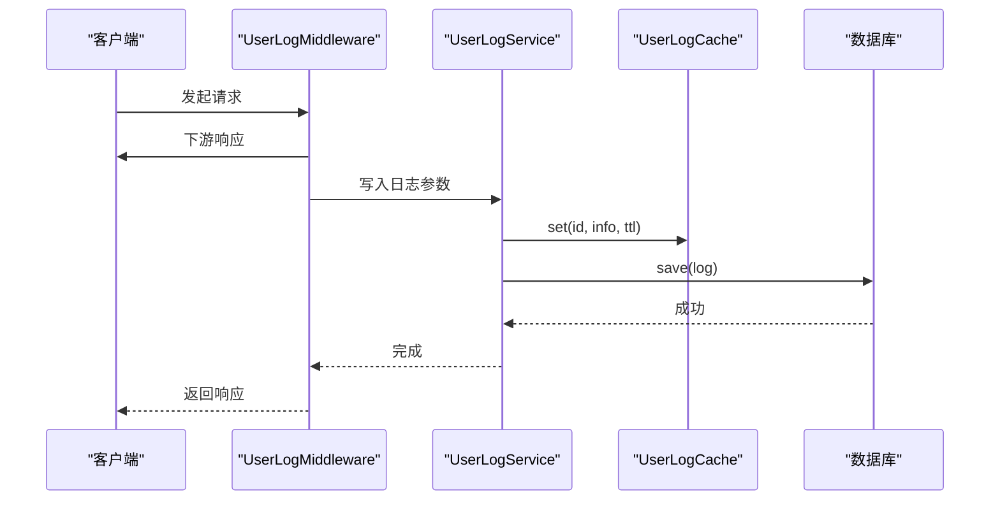
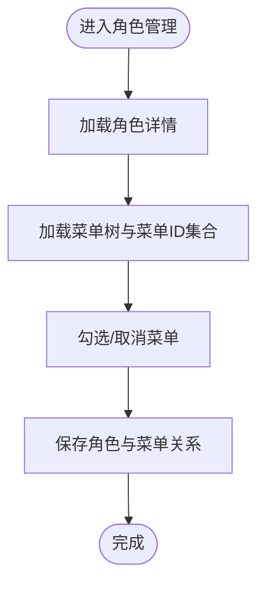
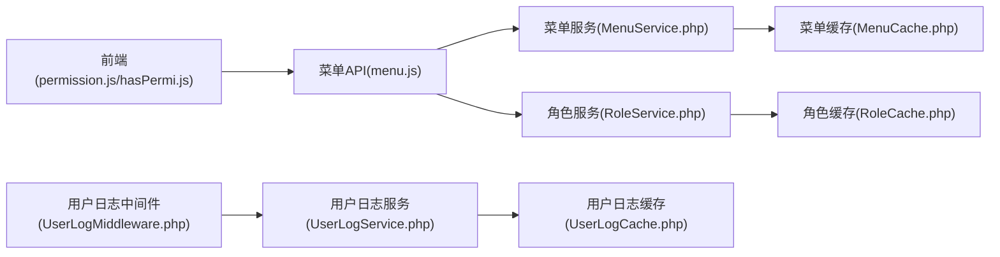

# 权限控制系统

<cite>
**本文引用的文件**
- [gccd_server/app/admin/middleware/UserLogMiddleware.php](file://gccd_server/app/admin/middleware/UserLogMiddleware.php)
- [gccd_server/app/common/service/system/UserLogService.php](file://gccd_server/app/common/service/system/UserLogService.php)
- [gccd_server/app/common/cache/system/UserLogCache.php](file://gccd_server/app/common/cache/system/UserLogCache.php)
- [gccd_server/app/common/service/system/RoleService.php](file://gccd_server/app/common/service/system/RoleService.php)
- [gccd_server/app/common/model/system/RoleModel.php](file://gccd_server/app/common/model/system/RoleModel.php)
- [gccd_server/app/common/service/system/MenuService.php](file://gccd_server/app/common/service/system/MenuService.php)
- [gccd_server/app/common/model/system/MenuModel.php](file://gccd_server/app/common/model/system/MenuModel.php)
- [gccd_server/app/common/cache/system/RoleCache.php](file://gccd_server/app/common/cache/system/RoleCache.php)
- [gccd_server/app/common/cache/system/MenuCache.php](file://gccd_server/app/common/cache/system/MenuCache.php)
- [yarn/src/permission.js](file://yarn/src/permission.js)
- [yarn/src/directive/common/hasPermi.js](file://yarn/src/directive/common/hasPermi.js)
- [yarn/src/store/modules/permission.js](file://yarn/src/store/modules/permission.js)
- [yarn/src/views/system/role.vue](file://yarn/src/views/system/role.vue)
- [yarn/src/views/system/menu.vue](file://yarn/src/views/system/menu.vue)
- [yarn/src/api/system/menu.js](file://yarn/src/api/system/menu.js)
- [gccd_server/public/admin/js/permission.HLIVEAed.js](file://gccd_server/public/admin/js/permission.HLIVEAed.js)
- [gccd_server/public/js/permission.HLIVEAed.js](file://gccd_server/public/js/permission.HLIVEAed.js)
</cite>

## 目录
1. [简介](#简介)
2. [项目结构](#项目结构)
3. [核心组件](#核心组件)
4. [架构总览](#架构总览)
5. [详细组件分析](#详细组件分析)
6. [依赖关系分析](#依赖关系分析)
7. [性能考虑](#性能考虑)
8. [故障排查指南](#故障排查指南)
9. [结论](#结论)
10. [附录](#附录)

## 简介
本文件系统化梳理权限控制体系，围绕基于角色的权限控制模型（RBAC）进行深入解析，覆盖用户角色分配、权限矩阵设计、菜单与按钮权限控制、多层次权限体系（系统权限、数据权限、操作权限）、用户操作日志与中间件追踪、权限缓存策略与性能优化、权限配置流程以及调试与常见问题处理。文档同时给出前后端协同的权限控制机制说明，帮助开发者与运维人员快速理解与落地。

## 项目结构
权限控制涉及后端服务层（ThinkPHP 6）、缓存层、中间件与前端（Vue 3 + Pinia + Element Plus）。后端提供角色、菜单、日志等服务与缓存；前端负责路由守卫、指令级权限控制与UI元素显隐。

**图表来源**
- [yarn/src/permission.js:1-73](file://yarn/src/permission.js#L1-L73)
- [yarn/src/directive/common/hasPermi.js:1-23](file://yarn/src/directive/common/hasPermi.js#L1-L23)
- [yarn/src/store/modules/permission.js:1-79](file://yarn/src/store/modules/permission.js#L1-L79)
- [yarn/src/views/system/role.vue:64-518](file://yarn/src/views/system/role.vue#L64-L518)
- [yarn/src/views/system/menu.vue:206-671](file://yarn/src/views/system/menu.vue#L206-L671)
- [yarn/src/api/system/menu.js:72-157](file://yarn/src/api/system/menu.js#L72-L157)
- [gccd_server/app/common/service/system/RoleService.php:1-344](file://gccd_server/app/common/service/system/RoleService.php#L1-L344)
- [gccd_server/app/common/service/system/MenuService.php:1-636](file://gccd_server/app/common/service/system/MenuService.php#L1-L636)
- [gccd_server/app/admin/middleware/UserLogMiddleware.php:1-52](file://gccd_server/app/admin/middleware/UserLogMiddleware.php#L1-L52)
- [gccd_server/app/common/service/system/UserLogService.php:1-284](file://gccd_server/app/common/service/system/UserLogService.php#L1-L284)
- [gccd_server/app/common/cache/system/RoleCache.php:1-88](file://gccd_server/app/common/cache/system/RoleCache.php#L1-L88)
- [gccd_server/app/common/cache/system/MenuCache.php:1-88](file://gccd_server/app/common/cache/system/MenuCache.php#L1-L88)
- [gccd_server/app/common/cache/system/UserLogCache.php:1-88](file://gccd_server/app/common/cache/system/UserLogCache.php#L1-L88)

**章节来源**
- [yarn/src/permission.js:1-73](file://yarn/src/permission.js#L1-L73)
- [gccd_server/app/common/service/system/RoleService.php:1-344](file://gccd_server/app/common/service/system/RoleService.php#L1-L344)
- [gccd_server/app/common/service/system/MenuService.php:1-636](file://gccd_server/app/common/service/system/MenuService.php#L1-L636)

## 核心组件
- 角色与菜单服务：提供角色列表、详情、增删改、菜单列表、路由生成、免登/免权/免限清单等能力。
- 缓存层：角色、菜单、用户日志分别提供独立缓存，提升查询与生成路由效率。
- 中间件与日志：统一在管理员请求链路中记录用户操作日志，支持开关、清理与参数脱敏。
- 前端路由守卫与指令：根据用户菜单动态生成路由，指令级控制按钮与操作权限显隐。

**章节来源**
- [gccd_server/app/common/service/system/RoleService.php:1-344](file://gccd_server/app/common/service/system/RoleService.php#L1-L344)
- [gccd_server/app/common/service/system/MenuService.php:1-636](file://gccd_server/app/common/service/system/MenuService.php#L1-L636)
- [gccd_server/app/common/cache/system/RoleCache.php:1-88](file://gccd_server/app/common/cache/system/RoleCache.php#L1-L88)
- [gccd_server/app/common/cache/system/MenuCache.php:1-88](file://gccd_server/app/common/cache/system/MenuCache.php#L1-L88)
- [gccd_server/app/admin/middleware/UserLogMiddleware.php:1-52](file://gccd_server/app/admin/middleware/UserLogMiddleware.php#L1-L52)
- [gccd_server/app/common/service/system/UserLogService.php:1-284](file://gccd_server/app/common/service/system/UserLogService.php#L1-L284)
- [yarn/src/permission.js:1-73](file://yarn/src/permission.js#L1-L73)
- [yarn/src/directive/common/hasPermi.js:1-23](file://yarn/src/directive/common/hasPermi.js#L1-L23)

## 架构总览
RBAC权限模型以“用户—角色—菜单/按钮”为主线，结合“免登/免权/免限”三类系统权限位，形成多维度控制。前端通过路由守卫与指令实现界面元素的显示与可用性控制，后端通过中间件与服务层实现权限判定与日志记录。

**图表来源**
- [yarn/src/permission.js:21-68](file://yarn/src/permission.js#L21-L68)
- [yarn/src/store/modules/permission.js:53-60](file://yarn/src/store/modules/permission.js#L53-L60)
- [yarn/src/api/system/menu.js:72-157](file://yarn/src/api/system/menu.js#L72-L157)
- [gccd_server/app/common/service/system/MenuService.php:596-634](file://gccd_server/app/common/service/system/MenuService.php#L596-L634)

## 详细组件分析

### 角色与菜单服务（RBAC核心）
- 角色模型关联菜单，提供菜单ID集合派生字段，便于快速判断角色拥有的菜单集合。
- 角色服务支持角色列表、详情、新增/编辑（含菜单批量授权）、删除、角色用户解除等。
- 菜单服务提供菜单树/列表、路由生成、免登/免权/免限清单构建、菜单角色解除等。

**图表来源**
- [gccd_server/app/common/model/system/RoleModel.php:18-50](file://gccd_server/app/common/model/system/RoleModel.php#L18-L50)
- [gccd_server/app/common/service/system/RoleService.php:1-344](file://gccd_server/app/common/service/system/RoleService.php#L1-L344)
- [gccd_server/app/common/model/system/MenuModel.php:19-83](file://gccd_server/app/common/model/system/MenuModel.php#L19-L83)
- [gccd_server/app/common/service/system/MenuService.php:1-636](file://gccd_server/app/common/service/system/MenuService.php#L1-L636)

**章节来源**
- [gccd_server/app/common/model/system/RoleModel.php:18-50](file://gccd_server/app/common/model/system/RoleModel.php#L18-L50)
- [gccd_server/app/common/service/system/RoleService.php:35-90](file://gccd_server/app/common/service/system/RoleService.php#L35-L90)
- [gccd_server/app/common/model/system/MenuModel.php:26-83](file://gccd_server/app/common/model/system/MenuModel.php#L26-L83)
- [gccd_server/app/common/service/system/MenuService.php:57-110](file://gccd_server/app/common/service/system/MenuService.php#L57-L110)

### 菜单权限与按钮权限控制
- 菜单支持“免登/免权/免限/禁用/隐藏”等系统权限位，配合前端指令与路由生成实现界面控制。
- 前端指令 v-hasPermi 通过比较用户角色集合与绑定值（期望角色数组）决定元素显隐。
- 菜单视图提供开关式快捷修改“免登/免权/免限/禁用/隐藏”，并支持角色授权/解除授权。

**图表来源**
- [yarn/src/views/system/menu.vue:206-240](file://yarn/src/views/system/menu.vue#L206-L240)
- [yarn/src/api/system/menu.js:72-157](file://yarn/src/api/system/menu.js#L72-L157)
- [gccd_server/app/common/service/system/MenuService.php:413-451](file://gccd_server/app/common/service/system/MenuService.php#L413-L451)

**章节来源**
- [yarn/src/views/system/menu.vue:206-240](file://yarn/src/views/system/menu.vue#L206-L240)
- [yarn/src/api/system/menu.js:72-157](file://yarn/src/api/system/menu.js#L72-L157)
- [gccd_server/app/common/service/system/MenuService.php:413-451](file://gccd_server/app/common/service/system/MenuService.php#L413-L451)

### 前端权限指令与路由守卫
- 路由守卫在进入受保护路由时检查令牌与角色，若无角色则拉取用户菜单并动态注入路由。
- 指令 v-hasPermi 在挂载阶段比对用户角色与绑定值，若不满足则移除DOM节点，确保按钮/操作不可见或不可点。

**图表来源**
- [yarn/src/directive/common/hasPermi.js:6-21](file://yarn/src/directive/common/hasPermi.js#L6-L21)
- [gccd_server/public/admin/js/permission.HLIVEAed.js:1-1](file://gccd_server/public/admin/js/permission.HLIVEAed.js#L1-L1)
- [gccd_server/public/js/permission.HLIVEAed.js:1-1](file://gccd_server/public/js/permission.HLIVEAed.js#L1-L1)

**章节来源**
- [yarn/src/permission.js:21-68](file://yarn/src/permission.js#L21-L68)
- [yarn/src/directive/common/hasPermi.js:1-23](file://yarn/src/directive/common/hasPermi.js#L1-L23)
- [gccd_server/public/admin/js/permission.HLIVEAed.js:1-1](file://gccd_server/public/admin/js/permission.HLIVEAed.js#L1-L1)
- [gccd_server/public/js/permission.HLIVEAed.js:1-1](file://gccd_server/public/js/permission.HLIVEAed.js#L1-L1)

### 用户日志中间件与日志服务
- 管理端中间件在请求完成后读取响应数据，提取状态码与消息，结合当前用户ID写入用户日志。
- 日志服务支持列表、详情、新增、修改、删除、清空、定时清理等功能，并提供参数脱敏与IP归属解析。
- 缓存层对日志详情进行短期缓存，降低重复查询压力。

**图表来源**
- [gccd_server/app/admin/middleware/UserLogMiddleware.php:29-50](file://gccd_server/app/admin/middleware/UserLogMiddleware.php#L29-L50)
- [gccd_server/app/common/service/system/UserLogService.php:129-171](file://gccd_server/app/common/service/system/UserLogService.php#L129-L171)
- [gccd_server/app/common/cache/system/UserLogCache.php:45-76](file://gccd_server/app/common/cache/system/UserLogCache.php#L45-L76)

**章节来源**
- [gccd_server/app/admin/middleware/UserLogMiddleware.php:1-52](file://gccd_server/app/admin/middleware/UserLogMiddleware.php#L1-L52)
- [gccd_server/app/common/service/system/UserLogService.php:121-171](file://gccd_server/app/common/service/system/UserLogService.php#L121-L171)
- [gccd_server/app/common/cache/system/UserLogCache.php:1-88](file://gccd_server/app/common/cache/system/UserLogCache.php#L1-L88)

### 角色授权与菜单授权（界面与流程）
- 角色视图加载菜单树与菜单ID集合，支持勾选菜单并保存，实现批量授权。
- 菜单视图支持“菜单角色”查询与“解除授权”操作，便于精细化回收权限。

**图表来源**
- [yarn/src/views/system/role.vue:496-510](file://yarn/src/views/system/role.vue#L496-L510)
- [yarn/src/views/system/role.vue:64-100](file://yarn/src/views/system/role.vue#L64-L100)

**章节来源**
- [yarn/src/views/system/role.vue:64-100](file://yarn/src/views/system/role.vue#L64-L100)
- [yarn/src/views/system/role.vue:496-510](file://yarn/src/views/system/role.vue#L496-L510)

## 依赖关系分析
- 低耦合：前端通过API与后端交互，权限判定逻辑集中在后端服务层与中间件，前端仅做展示与交互控制。
- 缓存解耦：角色、菜单、日志各自维护独立缓存标签与键空间，避免相互污染。
- 可观测：日志中间件统一采集，便于审计与监控。

**图表来源**
- [yarn/src/permission.js:1-73](file://yarn/src/permission.js#L1-L73)
- [yarn/src/directive/common/hasPermi.js:1-23](file://yarn/src/directive/common/hasPermi.js#L1-L23)
- [yarn/src/api/system/menu.js:72-157](file://yarn/src/api/system/menu.js#L72-L157)
- [gccd_server/app/common/service/system/MenuService.php:1-636](file://gccd_server/app/common/service/system/MenuService.php#L1-L636)
- [gccd_server/app/common/service/system/RoleService.php:1-344](file://gccd_server/app/common/service/system/RoleService.php#L1-L344)
- [gccd_server/app/common/cache/system/MenuCache.php:1-88](file://gccd_server/app/common/cache/system/MenuCache.php#L1-L88)
- [gccd_server/app/common/cache/system/RoleCache.php:1-88](file://gccd_server/app/common/cache/system/RoleCache.php#L1-L88)
- [gccd_server/app/admin/middleware/UserLogMiddleware.php:1-52](file://gccd_server/app/admin/middleware/UserLogMiddleware.php#L1-L52)
- [gccd_server/app/common/service/system/UserLogService.php:1-284](file://gccd_server/app/common/service/system/UserLogService.php#L1-L284)
- [gccd_server/app/common/cache/system/UserLogCache.php:1-88](file://gccd_server/app/common/cache/system/UserLogCache.php#L1-L88)

**章节来源**
- [gccd_server/app/common/cache/system/MenuCache.php:1-88](file://gccd_server/app/common/cache/system/MenuCache.php#L1-L88)
- [gccd_server/app/common/cache/system/RoleCache.php:1-88](file://gccd_server/app/common/cache/system/RoleCache.php#L1-L88)
- [gccd_server/app/common/cache/system/UserLogCache.php:1-88](file://gccd_server/app/common/cache/system/UserLogCache.php#L1-L88)

## 性能考虑
- 缓存策略
  - 角色与菜单：默认缓存有效期约12小时，写入/删除时主动失效，减少数据库压力。
  - 用户日志：详情短期缓存，配合定时清理任务按配置天数滚动清理，避免历史日志膨胀。
- 路由生成
  - 菜单服务将菜单转换为路由树，前端一次性注入，避免重复计算。
- 参数脱敏
  - 日志服务在记录请求参数时排除敏感字段，降低泄露风险并减小存储体积。
- 清理与降噪
  - 提供定时清理任务与日志开关，避免长期运行导致的IO与存储压力。

**章节来源**
- [gccd_server/app/common/cache/system/RoleCache.php:45-48](file://gccd_server/app/common/cache/system/RoleCache.php#L45-L48)
- [gccd_server/app/common/cache/system/MenuCache.php:45-48](file://gccd_server/app/common/cache/system/MenuCache.php#L45-L48)
- [gccd_server/app/common/service/system/UserLogService.php:270-282](file://gccd_server/app/common/service/system/UserLogService.php#L270-L282)
- [gccd_server/app/common/service/system/UserLogService.php:142-147](file://gccd_server/app/common/service/system/UserLogService.php#L142-L147)

## 故障排查指南
- 登录后无法进入页面
  - 检查路由守卫是否正确拉取用户菜单并注入路由；确认用户角色是否已授权对应菜单。
  - 参考路径：[yarn/src/permission.js:44-56](file://yarn/src/permission.js#L44-L56)
- 按钮/操作不可见
  - 检查指令 v-hasPermi 的绑定值是否包含用户角色；确认用户角色集合是否正确。
  - 参考路径：[yarn/src/directive/common/hasPermi.js:8-14](file://yarn/src/directive/common/hasPermi.js#L8-L14)
- 菜单开关无效
  - 确认菜单API调用成功且菜单缓存已清理；检查免登/免权/免限/禁用/隐藏字段是否正确持久化。
  - 参考路径：[yarn/src/api/system/menu.js:72-157](file://yarn/src/api/system/menu.js#L72-L157)，[gccd_server/app/common/service/system/MenuService.php:413-451](file://gccd_server/app/common/service/system/MenuService.php#L413-L451)
- 日志未记录
  - 检查中间件是否生效、日志开关是否开启、响应数据结构是否包含标准字段。
  - 参考路径：[gccd_server/app/admin/middleware/UserLogMiddleware.php:33-48](file://gccd_server/app/admin/middleware/UserLogMiddleware.php#L33-L48)，[gccd_server/app/common/service/system/UserLogService.php:132-140](file://gccd_server/app/common/service/system/UserLogService.php#L132-L140)

**章节来源**
- [yarn/src/permission.js:44-56](file://yarn/src/permission.js#L44-L56)
- [yarn/src/directive/common/hasPermi.js:8-14](file://yarn/src/directive/common/hasPermi.js#L8-L14)
- [yarn/src/api/system/menu.js:72-157](file://yarn/src/api/system/menu.js#L72-L157)
- [gccd_server/app/common/service/system/MenuService.php:413-451](file://gccd_server/app/common/service/system/MenuService.php#L413-L451)
- [gccd_server/app/admin/middleware/UserLogMiddleware.php:33-48](file://gccd_server/app/admin/middleware/UserLogMiddleware.php#L33-L48)
- [gccd_server/app/common/service/system/UserLogService.php:132-140](file://gccd_server/app/common/service/system/UserLogService.php#L132-L140)

## 结论
该权限控制系统以RBAC为核心，结合菜单与按钮级权限控制、系统权限位（免登/免权/免限/禁用/隐藏）与统一日志中间件，形成从前端到后端的完整闭环。通过缓存与定时清理策略保障性能与可维护性，配合清晰的配置界面与API，能够高效支撑业务权限治理需求。

## 附录

### 多层次权限体系说明
- 系统权限
  - 免登：无需登录即可访问的菜单。
  - 免权：访问该菜单无需鉴权（通常用于公开接口或特殊场景）。
  - 免限：不受频率限制影响。
  - 禁用：禁止访问。
  - 隐藏：菜单不显示于侧边栏，但仍可通过URL直接访问。
- 数据权限
  - 通过用户隐藏条件与数据范围限制实现，日志服务在查询时自动叠加过滤条件。
- 操作权限
  - 通过指令 v-hasPermi 对按钮/操作进行显隐控制，确保用户只能看到并操作其具备角色授权的功能。

**章节来源**
- [gccd_server/app/common/model/system/MenuModel.php:31-81](file://gccd_server/app/common/model/system/MenuModel.php#L31-L81)
- [gccd_server/app/common/service/system/UserLogService.php:49-51](file://gccd_server/app/common/service/system/UserLogService.php#L49-L51)
- [yarn/src/directive/common/hasPermi.js:8-14](file://yarn/src/directive/common/hasPermi.js#L8-L14)

### 权限配置指南（角色创建、权限分配、批量授权）
- 创建角色
  - 在角色视图填写角色名称、描述、排序与备注，提交后返回角色ID。
  - 参考路径：[yarn/src/views/system/role.vue:512-518](file://yarn/src/views/system/role.vue#L512-L518)
- 分配菜单权限
  - 在角色视图勾选菜单树，保存后完成授权。
  - 参考路径：[yarn/src/views/system/role.vue:64-100](file://yarn/src/views/system/role.vue#L64-L100)
- 批量授权/解除授权
  - 在菜单视图选择“菜单角色”查看授权角色，支持一键解除授权。
  - 参考路径：[yarn/src/views/system/menu.vue:140-157](file://yarn/src/views/system/menu.vue#L140-L157)，[gccd_server/app/common/service/system/MenuService.php:423-451](file://gccd_server/app/common/service/system/MenuService.php#L423-L451)

**章节来源**
- [yarn/src/views/system/role.vue:512-518](file://yarn/src/views/system/role.vue#L512-L518)
- [yarn/src/views/system/role.vue:64-100](file://yarn/src/views/system/role.vue#L64-L100)
- [yarn/src/views/system/menu.vue:140-157](file://yarn/src/views/system/menu.vue#L140-L157)
- [gccd_server/app/common/service/system/MenuService.php:423-451](file://gccd_server/app/common/service/system/MenuService.php#L423-L451)