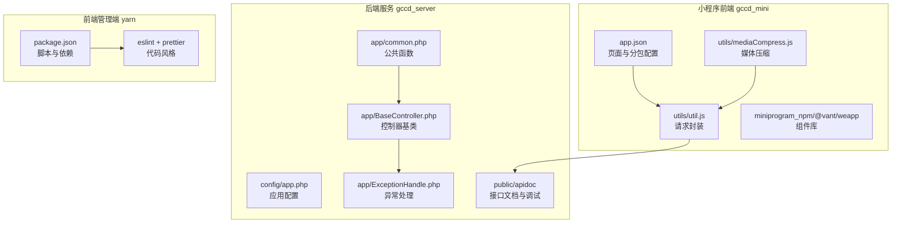
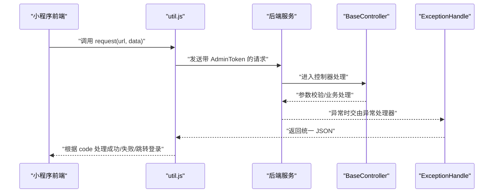
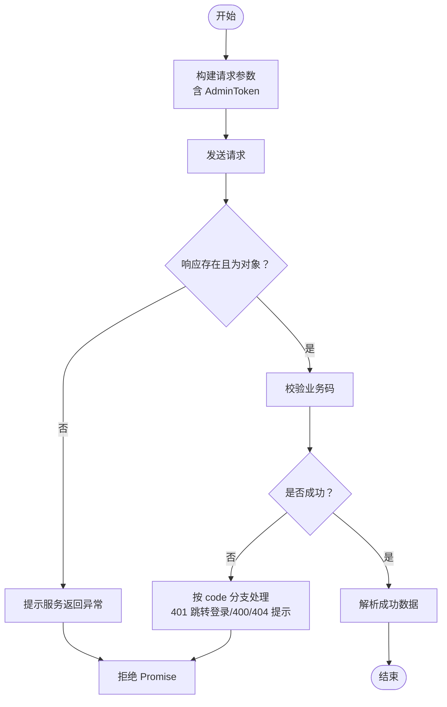
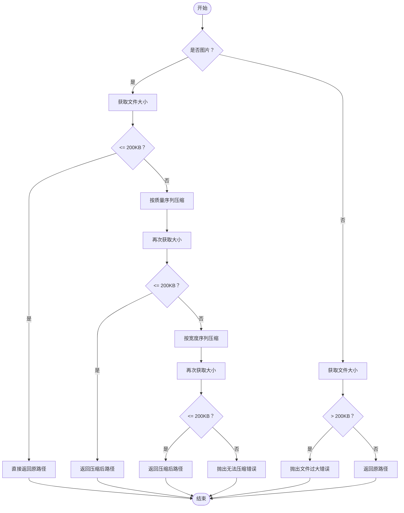
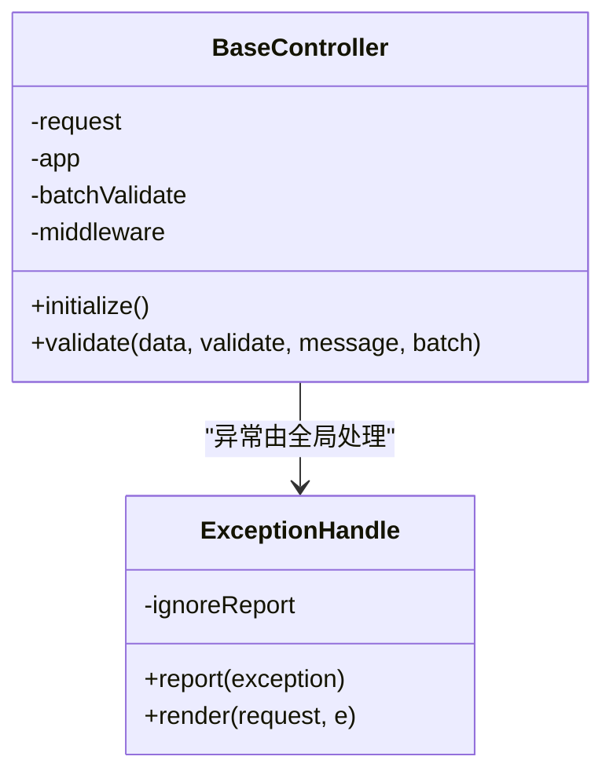
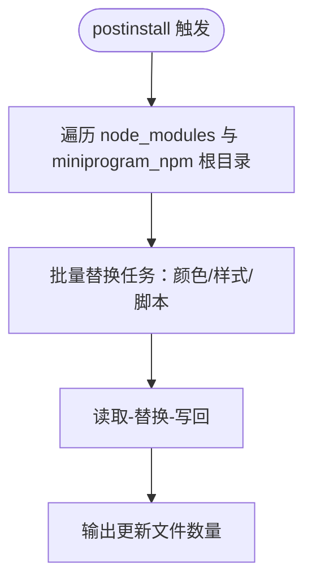
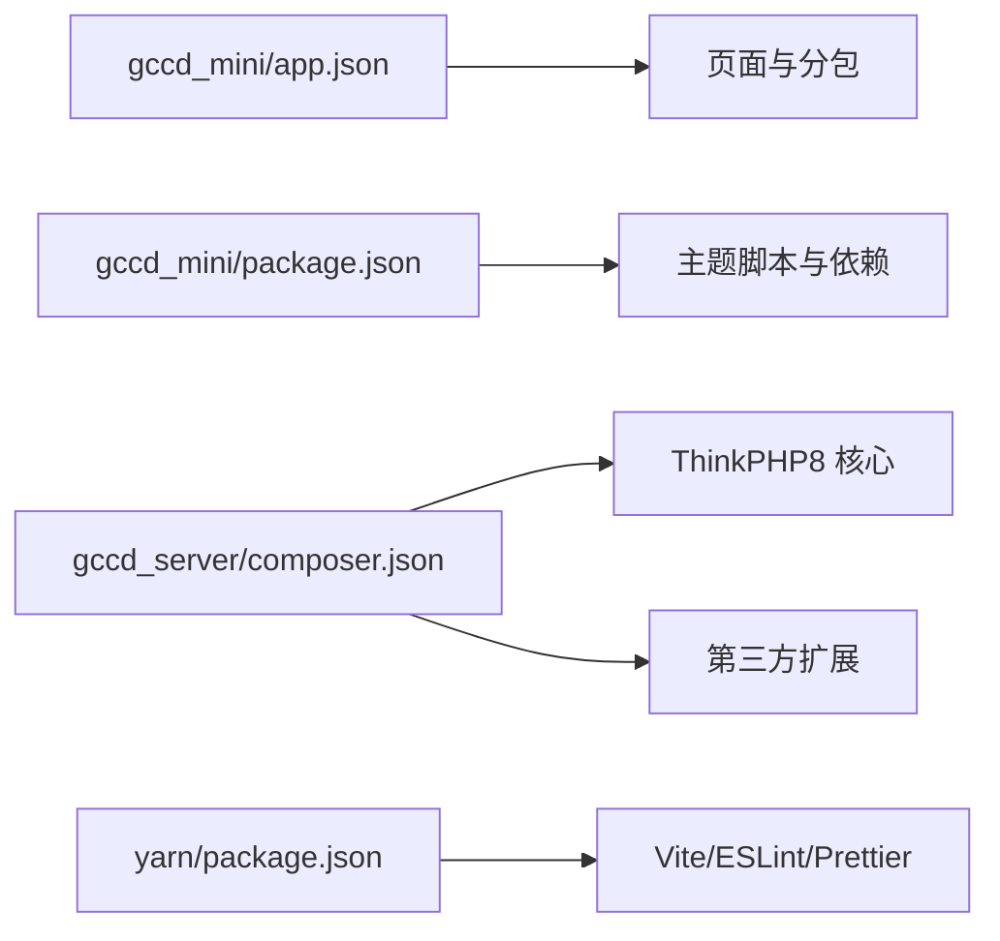

# 开发指南

<cite>
**本文引用的文件**
- [README.md](file://README.md)
- [gccd_mini/app.json](file://gccd_mini/app.json)
- [gccd_mini/package.json](file://gccd_mini/package.json)
- [gccd_mini/scripts/apply-vant-theme.js](file://gccd_mini/scripts/apply-vant-theme.js)
- [gccd_mini/utils/util.js](file://gccd_mini/utils/util.js)
- [gccd_mini/utils/mediaCompress.js](file://gccd_mini/utils/mediaCompress.js)
- [gccd_server/README.md](file://gccd_server/README.md)
- [gccd_server/composer.json](file://gccd_server/composer.json)
- [gccd_server/config/app.php](file://gccd_server/config/app.php)
- [gccd_server/app/common.php](file://gccd_server/app/common.php)
- [gccd_server/app/BaseController.php](file://gccd_server/app/BaseController.php)
- [gccd_server/app/ExceptionHandle.php](file://gccd_server/app/ExceptionHandle.php)
- [yarn/README.md](file://yarn/README.md)
- [yarn/package.json](file://yarn/package.json)
- [yarn/.eslintrc.cjs](file://yarn/.eslintrc.cjs)
- [yarn/.prettierrc.json](file://yarn/.prettierrc.json)
</cite>

## 目录
1. [简介](#简介)
2. [项目结构](#项目结构)
3. [核心组件](#核心组件)
4. [架构总览](#架构总览)
5. [详细组件分析](#详细组件分析)
6. [依赖关系分析](#依赖关系分析)
7. [性能考虑](#性能考虑)
8. [故障排除指南](#故障排除指南)
9. [结论](#结论)
10. [附录](#附录)

## 简介
本开发指南面向“高齿传动”项目团队成员，旨在统一开发规范、Git 工作流、最佳实践、调试与排障方法，并提供环境配置与代码审查要点，帮助新成员快速上手并高效协作。

## 项目结构
项目采用前后端分离架构：
- 小程序前端：gccd_mini（基于 WeUI/Weapp 组件体系）
- 后端服务：gccd_server（基于 ThinkPHP8）
- 前端管理端（Vue3 + Element Plus）：yarn（独立仓库，参考其规范）

**图表来源**
- [gccd_mini/app.json:1-99](file://gccd_mini/app.json#L1-L99)
- [gccd_mini/utils/util.js:1-98](file://gccd_mini/utils/util.js#L1-L98)
- [gccd_mini/utils/mediaCompress.js:1-104](file://gccd_mini/utils/mediaCompress.js#L1-L104)
- [gccd_server/config/app.php:1-44](file://gccd_server/config/app.php#L1-L44)
- [gccd_server/app/common.php:1-921](file://gccd_server/app/common.php#L1-L921)
- [gccd_server/app/BaseController.php:1-101](file://gccd_server/app/BaseController.php#L1-L101)
- [gccd_server/app/ExceptionHandle.php:1-98](file://gccd_server/app/ExceptionHandle.php#L1-L98)
- [yarn/package.json:1-88](file://yarn/package.json#L1-L88)

**章节来源**
- [gccd_mini/app.json:1-99](file://gccd_mini/app.json#L1-L99)
- [gccd_server/config/app.php:1-44](file://gccd_server/config/app.php#L1-L44)
- [yarn/package.json:1-88](file://yarn/package.json#L1-L88)

## 核心组件
- 小程序请求与鉴权：统一通过工具模块封装请求、鉴权头注入与通用错误处理。
- 媒体上传压缩：针对图片与音视频在上传前进行体积压缩或校验，避免超限。
- 后端控制器基类：提供统一的参数校验入口，简化控制器实现。
- 异常处理：集中处理参数校验、HTTP 异常与通用异常，输出统一 JSON 结构。
- 主题定制：通过脚本替换组件库品牌色，结合全局样式变量形成项目主题。

**章节来源**
- [gccd_mini/utils/util.js:1-98](file://gccd_mini/utils/util.js#L1-L98)
- [gccd_mini/utils/mediaCompress.js:1-104](file://gccd_mini/utils/mediaCompress.js#L1-L104)
- [gccd_server/app/BaseController.php:1-101](file://gccd_server/app/BaseController.php#L1-L101)
- [gccd_server/app/ExceptionHandle.php:1-98](file://gccd_server/app/ExceptionHandle.php#L1-L98)
- [gccd_mini/scripts/apply-vant-theme.js:1-95](file://gccd_mini/scripts/apply-vant-theme.js#L1-L95)

## 架构总览
整体交互从小程序前端发起请求，经后端统一鉴权与异常处理，最终返回结构化响应；前端管理端负责接口文档与调试。

**图表来源**
- [gccd_mini/utils/util.js:22-94](file://gccd_mini/utils/util.js#L22-L94)
- [gccd_server/app/BaseController.php:74-99](file://gccd_server/app/BaseController.php#L74-L99)
- [gccd_server/app/ExceptionHandle.php:59-96](file://gccd_server/app/ExceptionHandle.php#L59-L96)

## 详细组件分析

### 小程序请求与鉴权组件
- 统一请求封装：支持自定义成功业务码集合，自动处理 401 跳转登录、400/404 等提示。
- 鉴权头注入：从本地存储读取 AdminToken 并附加到请求头。
- 错误处理：网络异常与业务异常均弹窗提示并拒绝 Promise，避免页面“卡住”。

**图表来源**
- [gccd_mini/utils/util.js:22-94](file://gccd_mini/utils/util.js#L22-L94)

**章节来源**
- [gccd_mini/utils/util.js:1-98](file://gccd_mini/utils/util.js#L1-L98)

### 媒体上传压缩组件
- 图片优先压缩：按质量阈值与宽高阈值迭代压缩，直至小于等于 200KB。
- 音频/文件体积校验：超过阈值则报错，提示更换更小文件。
- 适配多格式：支持常见图片与音频格式识别。

**图表来源**
- [gccd_mini/utils/mediaCompress.js:48-98](file://gccd_mini/utils/mediaCompress.js#L48-L98)

**章节来源**
- [gccd_mini/utils/mediaCompress.js:1-104](file://gccd_mini/utils/mediaCompress.js#L1-L104)

### 后端控制器基类与异常处理
- 控制器基类：提供统一 validate 方法，支持场景化校验与批量校验，简化控制器逻辑。
- 异常处理：区分 apidoc 异常、参数校验异常、HTTP 异常与通用异常，统一输出 JSON；调试模式下补充堆栈信息。

**图表来源**
- [gccd_server/app/BaseController.php:1-101](file://gccd_server/app/BaseController.php#L1-L101)
- [gccd_server/app/ExceptionHandle.php:1-98](file://gccd_server/app/ExceptionHandle.php#L1-L98)

**章节来源**
- [gccd_server/app/BaseController.php:1-101](file://gccd_server/app/BaseController.php#L1-L101)
- [gccd_server/app/ExceptionHandle.php:1-98](file://gccd_server/app/ExceptionHandle.php#L1-L98)

### 主题定制与样式
- 自动替换组件库品牌色：安装依赖后自动将组件库中的蓝色替换为项目主色，并输出更新统计。
- 与全局样式变量配合：形成完整的主题体系。

**图表来源**
- [gccd_mini/scripts/apply-vant-theme.js:76-95](file://gccd_mini/scripts/apply-vant-theme.js#L76-L95)

**章节来源**
- [gccd_mini/scripts/apply-vant-theme.js:1-95](file://gccd_mini/scripts/apply-vant-theme.js#L1-L95)

## 依赖关系分析
- 小程序前端依赖组件库与主题脚本，页面与分包在 app.json 中集中声明。
- 后端服务依赖 ThinkPHP8 与各类扩展，统一通过 composer 管理。
- 前端管理端使用 Vite + ESLint + Prettier，脚本统一在 package.json 中定义。

**图表来源**
- [gccd_mini/app.json:1-99](file://gccd_mini/app.json#L1-L99)
- [gccd_mini/package.json:1-12](file://gccd_mini/package.json#L1-L12)
- [gccd_server/composer.json:1-65](file://gccd_server/composer.json#L1-L65)
- [yarn/package.json:1-88](file://yarn/package.json#L1-L88)

**章节来源**
- [gccd_mini/app.json:1-99](file://gccd_mini/app.json#L1-L99)
- [gccd_mini/package.json:1-12](file://gccd_mini/package.json#L1-L12)
- [gccd_server/composer.json:1-65](file://gccd_server/composer.json#L1-L65)
- [yarn/package.json:1-88](file://yarn/package.json#L1-L88)

## 性能考虑
- 小程序端
  - 媒体上传前压缩与体积校验，降低带宽与服务器压力。
  - 统一请求封装减少重复逻辑，提升稳定性。
- 后端
  - 控制器基类统一参数校验，避免重复校验带来的性能损耗。
  - 异常处理集中化，减少异常传播成本。
- 前端管理端
  - ESLint + Prettier 统一代码风格，减少重构成本与潜在性能隐患。

[本节为通用指导，无需列出具体文件来源]

## 故障排除指南
- 小程序请求失败
  - 检查 AdminToken 是否存在与过期；401 时应跳转登录页。
  - 网络异常提示时检查设备网络状态与域名白名单。
  - 业务码非 200 时查看服务端返回消息并定位问题。
- 媒体上传失败
  - 图片无法压缩至阈值内：更换更小图片或调整压缩参数。
  - 音频/文件超过阈值：提示用户更换文件。
- 后端异常
  - 参数校验失败：查看异常处理返回的错误信息。
  - HTTP 异常：确认请求方法与路由配置。
  - 通用异常：开启调试模式查看堆栈信息以定位问题。

**章节来源**
- [gccd_mini/utils/util.js:49-83](file://gccd_mini/utils/util.js#L49-L83)
- [gccd_mini/utils/mediaCompress.js:89-96](file://gccd_mini/utils/mediaCompress.js#L89-L96)
- [gccd_server/app/ExceptionHandle.php:69-96](file://gccd_server/app/ExceptionHandle.php#L69-L96)

## 结论
本指南提供了从代码规范、Git 工作流、最佳实践到调试与排障的完整指引。建议团队在日常开发中严格遵循统一的请求封装、参数校验与异常处理流程，确保前后端交互的一致性与可维护性。

[本节为总结性内容，无需列出具体文件来源]

## 附录

### 代码规范与格式
- JavaScript/Vue
  - 使用 ESLint 与 Prettier 统一风格，禁止使用分号、单引号、2 空格缩进、无尾逗号。
  - Vue 组件命名与属性顺序遵循推荐规则。
- 小程序
  - 页面与分包在 app.json 中集中声明，避免遗漏。
  - 主题色替换通过脚本完成，避免手动修改组件库源码。

**章节来源**
- [yarn/.eslintrc.cjs:1-63](file://yarn/.eslintrc.cjs#L1-L63)
- [yarn/.prettierrc.json:1-10](file://yarn/.prettierrc.json#L1-L10)
- [gccd_mini/app.json:1-99](file://gccd_mini/app.json#L1-L99)
- [gccd_mini/scripts/apply-vant-theme.js:1-95](file://gccd_mini/scripts/apply-vant-theme.js#L1-L95)

### Git 工作流程与协作
- 分支管理
  - 主分支：稳定发布分支
  - 开发分支：feature/* 或 develop
  - 修复分支：fix/* 或 hotfix/*
- 提交规范
  - 类型：feat/fix/docs/style/refactor/test/build/chore
  - 示例：feat(api): 添加用户登录接口
- 合并与发布
  - 通过 Pull Request 合并，至少一名同学 Review 通过后合并
  - 发布前更新依赖、同步数据库结构、清理缓存

[本节为通用流程说明，无需列出具体文件来源]

### 开发最佳实践
- 模块设计
  - 小程序：页面与组件职责清晰，公共逻辑抽离到 utils。
  - 后端：控制器基类统一校验，异常处理集中化。
- 组件复用
  - 小程序：统一请求与媒体处理工具，避免重复代码。
  - 后端：公共函数集中于 app/common.php，便于跨模块调用。
- 错误处理
  - 前端：统一提示与跳转逻辑，避免静默失败。
  - 后端：区分异常类型，统一返回结构。
- 性能优化
  - 小程序：上传前压缩与体积校验。
  - 后端：批量校验与异常快速返回。

**章节来源**
- [gccd_mini/utils/util.js:1-98](file://gccd_mini/utils/util.js#L1-L98)
- [gccd_mini/utils/mediaCompress.js:1-104](file://gccd_mini/utils/mediaCompress.js#L1-L104)
- [gccd_server/app/common.php:1-921](file://gccd_server/app/common.php#L1-L921)
- [gccd_server/app/BaseController.php:74-99](file://gccd_server/app/BaseController.php#L74-L99)
- [gccd_server/app/ExceptionHandle.php:59-96](file://gccd_server/app/ExceptionHandle.php#L59-L96)

### 调试工具使用
- 浏览器调试
  - 前端管理端：Vite 开发服务器，支持热更新与源码映射。
- 服务器日志
  - 后端：开启调试模式查看详细堆栈；生产关闭调试。
- API 测试工具
  - 后端：使用 apidoc 在线调试接口，支持参数校验与示例。

**章节来源**
- [yarn/package.json:16-24](file://yarn/package.json#L16-L24)
- [gccd_server/config/app.php:12-17](file://gccd_server/config/app.php#L12-L17)
- [gccd_server/README.md:1-189](file://gccd_server/README.md#L1-L189)

### 开发环境配置与优化
- 小程序
  - 安装依赖后自动应用主题脚本，确保组件库主题一致。
  - 页面与分包在 app.json 中声明，避免运行时缺失。
- 后端
  - 按 README 步骤安装依赖、导入数据库、配置伪静态。
  - 环境变量与主机地址在配置文件中设置。
- 前端管理端
  - Node 与 NPM 版本满足要求，安装依赖后启动开发服务器。

**章节来源**
- [gccd_mini/package.json:1-12](file://gccd_mini/package.json#L1-L12)
- [gccd_mini/scripts/apply-vant-theme.js:1-95](file://gccd_mini/scripts/apply-vant-theme.js#L1-L95)
- [gccd_mini/app.json:1-99](file://gccd_mini/app.json#L1-L99)
- [gccd_server/README.md:44-151](file://gccd_server/README.md#L44-L151)
- [yarn/README.md:44-151](file://yarn/README.md#L44-L151)

### 代码审查流程与质量保证
- 代码审查
  - PR 必须有至少一名同学 Review 通过
  - 关注点：命名一致性、错误处理、性能影响、安全风险
- 质量保证
  - 前端：ESLint + Prettier 自动检查与格式化
  - 后端：统一异常处理与参数校验
  - 小程序：统一请求封装与媒体处理

**章节来源**
- [yarn/.eslintrc.cjs:1-63](file://yarn/.eslintrc.cjs#L1-L63)
- [yarn/.prettierrc.json:1-10](file://yarn/.prettierrc.json#L1-L10)
- [gccd_server/app/ExceptionHandle.php:1-98](file://gccd_server/app/ExceptionHandle.php#L1-L98)
- [gccd_server/app/BaseController.php:74-99](file://gccd_server/app/BaseController.php#L74-L99)
- [gccd_mini/utils/util.js:1-98](file://gccd_mini/utils/util.js#L1-L98)

### 新成员入职培训材料与学习资源
- 前端管理端
  - 参考 yarn 仓库 README 的安装与开发步骤
  - 熟悉 package.json 中的脚本与依赖
- 后端服务
  - 参考 gccd_server 仓库 README 的安装与开发步骤
  - 熟悉 composer.json 与 config/app.php
- 小程序前端
  - 熟悉 gccd_mini/app.json 的页面与分包配置
  - 掌握 util.js 与 mediaCompress.js 的使用

**章节来源**
- [yarn/README.md:1-189](file://yarn/README.md#L1-L189)
- [gccd_server/README.md:1-189](file://gccd_server/README.md#L1-L189)
- [gccd_mini/app.json:1-99](file://gccd_mini/app.json#L1-L99)
- [gccd_mini/package.json:1-12](file://gccd_mini/package.json#L1-L12)