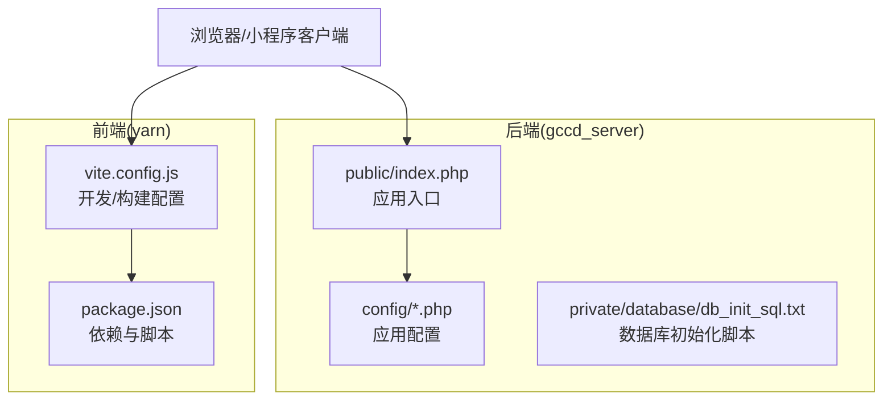
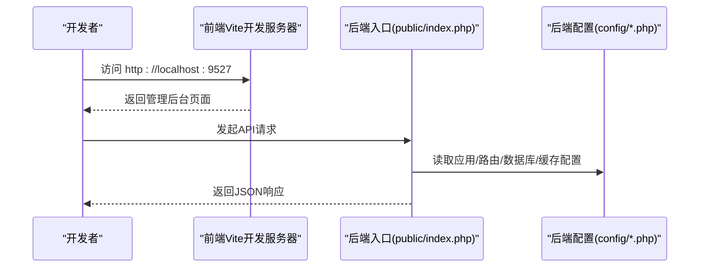
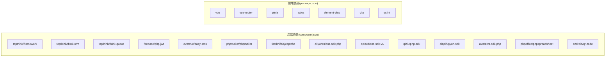

# 快速开始

<cite>
**本文引用的文件**
- [README.md](file://README.md)
- [gccd_server/README.md](file://gccd_server/README.md)
- [gccd_server/composer.json](file://gccd_server/composer.json)
- [yarn/package.json](file://yarn/package.json)
- [gccd_server/config/app.php](file://gccd_server/config/app.php)
- [gccd_server/config/database.php](file://gccd_server/config/database.php)
- [gccd_server/config/cache.php](file://gccd_server/config/cache.php)
- [gccd_server/config/session.php](file://gccd_server/config/session.php)
- [gccd_server/config/view.php](file://gccd_server/config/view.php)
- [gccd_server/config/middleware.php](file://gccd_server/config/middleware.php)
- [gccd_server/config/route.php](file://gccd_server/config/route.php)
- [gccd_server/private/database/db_init_sql.txt](file://gccd_server/private/database/db_init_sql.txt)
- [gccd_server/public/index.php](file://gccd_server/public/index.php)
- [yarn/vite.config.js](file://yarn/vite.config.js)
</cite>

## 目录
1. [简介](#简介)
2. [项目结构](#项目结构)
3. [核心组件](#核心组件)
4. [架构总览](#架构总览)
5. [详细组件分析](#详细组件分析)
6. [依赖关系分析](#依赖关系分析)
7. [性能考虑](#性能考虑)
8. [故障排查指南](#故障排查指南)
9. [结论](#结论)
10. [附录](#附录)

## 简介
本指南面向新开发者，帮助你在最短时间内完成“高齿传动”项目的本地开发环境搭建与首次运行验证。项目采用前后端分离架构：后端基于 ThinkPHP 8 的 yylAdmin 管理系统，前端基于 Vue 3 的 yylAdminWeb。你将获得完整的环境要求、安装步骤、开发与生产配置差异、首次运行验证方法以及常见问题解决方案。

## 项目结构
项目分为三个主要部分：
- 后端服务（gccd_server）：ThinkPHP 8 应用，提供 API、管理后台、接口文档与调试、队列、缓存、会话、路由等能力。
- 前端工程（yarn）：Vue 3 + Vite 工程，提供管理后台界面与开发工具链。
- 微信小程序（gccd_mini）：基于 WeApp/Vant 的小程序工程，与后端配合实现移动端能力（本快速开始不涉及小程序部署）。

图表来源
- [gccd_server/public/index.php:1-25](file://gccd_server/public/index.php#L1-L25)
- [gccd_server/config/app.php:1-44](file://gccd_server/config/app.php#L1-L44)
- [gccd_server/config/database.php:1-71](file://gccd_server/config/database.php#L1-L71)
- [gccd_server/private/database/db_init_sql.txt:1-62](file://gccd_server/private/database/db_init_sql.txt#L1-L62)
- [yarn/vite.config.js:1-185](file://yarn/vite.config.js#L1-L185)
- [yarn/package.json:1-88](file://yarn/package.json#L1-L88)

章节来源
- [README.md:1-4](file://README.md#L1-L4)
- [gccd_server/README.md:1-189](file://gccd_server/README.md#L1-L189)

## 核心组件
- 后端框架与版本
  - PHP >= 8.0（推荐 8.0.x），启用 fileinfo、redis 扩展，允许 putenv、proc_open。
  - ThinkPHP 8，支持多应用模式，默认应用为 api。
- 前端框架与版本
  - Node >= 18.18，NPM >= 8.19。
  - Vue 3 + Vite，开发服务器默认端口 9527。
- 数据库与缓存
  - MySQL >= 5.5；Redis >= 5.0（可选，用于缓存）。
- 伪静态与路由
  - 后端通过 public/index.php 入口与路由配置实现 RESTful API。
  - 前端开发服务器默认监听 0.0.0.0:9527。

章节来源
- [gccd_server/README.md:46-55](file://gccd_server/README.md#L46-L55)
- [gccd_server/composer.json:23-47](file://gccd_server/composer.json#L23-L47)
- [yarn/package.json:83-86](file://yarn/package.json#L83-L86)
- [gccd_server/config/app.php:11-27](file://gccd_server/config/app.php#L11-L27)
- [yarn/vite.config.js:33-37](file://yarn/vite.config.js#L33-L37)

## 架构总览
后端通过入口文件加载框架并执行 HTTP 请求，路由与中间件在配置中统一管理；前端通过 Vite 提供开发服务器与构建产物。数据库与缓存通过配置文件集中管理，支持多驱动切换。

图表来源
- [gccd_server/public/index.php:15-24](file://gccd_server/public/index.php#L15-L24)
- [gccd_server/config/app.php:11-27](file://gccd_server/config/app.php#L11-L27)
- [gccd_server/config/route.php:11-50](file://gccd_server/config/route.php#L11-L50)
- [yarn/vite.config.js:33-37](file://yarn/vite.config.js#L33-L37)

## 详细组件分析

### 后端环境与安装
- 环境要求
  - PHP >= 8.0，启用 fileinfo、redis 扩展，允许 putenv、proc_open。
  - MySQL >= 5.5，Redis >= 5.0（可选）。
  - Node >= 18.18，NPM >= 8.19。
- 安装步骤
  - 克隆后端仓库并进入目录。
  - 配置 Composer 镜像源以提升下载速度。
  - 安装 PHP 依赖（composer install）。
  - 导入数据库：使用私有初始化 SQL 或数据库备份文件。
  - 复制并编辑环境变量文件（.env），填写数据库、Redis、应用主机等配置。
  - 配置 Web 服务器伪静态（Nginx/Apache），否则接口文档无法访问。
  - 启动后端服务（通常由 Web 服务器指向 public 目录）。

章节来源
- [gccd_server/README.md:46-114](file://gccd_server/README.md#L46-L114)
- [gccd_server/private/database/db_init_sql.txt:1-62](file://gccd_server/private/database/db_init_sql.txt#L1-L62)

### 前端环境与安装
- 环境要求
  - Node >= 18.18，NPM >= 8.19。
- 安装步骤
  - 克隆前端仓库并进入目录。
  - 配置 NPM 镜像源。
  - 安装依赖（npm install）。
  - 复制并编辑 .env.*.local 环境变量文件，配置后端 API 地址等。
  - 启动开发服务器（npm run dev），默认监听 0.0.0.0:9527。
  - 构建生产包（npm run build:prod）或测试包（npm run build:stage）。

章节来源
- [gccd_server/README.md:116-150](file://gccd_server/README.md#L116-L150)
- [yarn/package.json:16-24](file://yarn/package.json#L16-L24)
- [yarn/vite.config.js:33-37](file://yarn/vite.config.js#L33-L37)

### 配置文件要点
- 应用配置（app.php）
  - 调试模式、应用主机、时区、默认应用（api）、路由/事件开关等。
- 数据库配置（database.php）
  - 默认驱动 mysql，支持 utf8mb4 字符集与 ya_ 表前缀，可配置断线重连、SQL 触发等。
- 缓存配置（cache.php）
  - 支持 file、redis、memcache、wincache 等驱动，可通过环境变量覆盖。
- 会话配置（session.php）
  - 默认 file 驱动，过期时间 1440 秒。
- 视图配置（view.php）
  - Think 模板引擎，模板后缀 .html。
- 中间件配置（middleware.php）
  - 别名与优先级预留，便于扩展。
- 路由配置（route.php）
  - URL 后缀、完全匹配、默认控制器/动作等。

章节来源
- [gccd_server/config/app.php:11-43](file://gccd_server/config/app.php#L11-L43)
- [gccd_server/config/database.php:27-69](file://gccd_server/config/database.php#L27-L69)
- [gccd_server/config/cache.php:13-85](file://gccd_server/config/cache.php#L13-L85)
- [gccd_server/config/session.php:11-24](file://gccd_server/config/session.php#L11-L24)
- [gccd_server/config/view.php:11-30](file://gccd_server/config/view.php#L11-L30)
- [gccd_server/config/middleware.php:11-16](file://gccd_server/config/middleware.php#L11-L16)
- [gccd_server/config/route.php:11-50](file://gccd_server/config/route.php#L11-L50)

### 首次运行验证
- 启动前端
  - 在 yarn 目录执行开发命令，确认浏览器访问 http://localhost:9527。
- 启动后端
  - 配置 Web 服务器指向后端 public 目录，确保伪静态生效。
  - 访问后端 API（如 /api/...）与接口文档页面。
- 数据库初始化
  - 使用提供的初始化 SQL 清空/重置相关业务表，或导入完整数据库备份。
- 登录后台
  - 使用默认账号（参考后端文档中的演示账号与密码）登录后台管理界面。

章节来源
- [gccd_server/README.md:152-159](file://gccd_server/README.md#L152-L159)
- [gccd_server/private/database/db_init_sql.txt:1-62](file://gccd_server/private/database/db_init_sql.txt#L1-L62)

### 开发环境与生产环境差异
- 开发环境
  - 后端：开启调试模式（app_debug），便于查看异常与日志。
  - 前端：开发服务器热更新，监听 0.0.0.0:9527。
- 生产环境
  - 后端：关闭调试模式，配置生产数据库与 Redis，设置安全的伪静态规则。
  - 前端：构建生产包（build:prod），部署静态资源至 CDN 或 Web 服务器。

章节来源
- [gccd_server/config/app.php:13-17](file://gccd_server/config/app.php#L13-L17)
- [yarn/vite.config.js:147-182](file://yarn/vite.config.js#L147-L182)
- [gccd_server/README.md:92-114](file://gccd_server/README.md#L92-L114)

## 依赖关系分析
后端通过 composer.json 声明核心依赖（框架、ORM、多应用、文件系统、WebSocket Worker、限流、队列、JWT、短信、邮件、验证码、对象存储、Excel、二维码等）。前端通过 package.json 声明 Vue 3 生态与开发工具链依赖。

图表来源
- [gccd_server/composer.json:23-47](file://gccd_server/composer.json#L23-L47)
- [yarn/package.json:25-57](file://yarn/package.json#L25-L57)

章节来源
- [gccd_server/composer.json:1-65](file://gccd_server/composer.json#L1-L65)
- [yarn/package.json:1-88](file://yarn/package.json#L1-L88)

## 性能考虑
- 后端
  - 启用 Redis 缓存可显著降低数据库压力；合理设置缓存前缀与过期策略。
  - 对大文件上传与导出场景，建议结合对象存储 SDK 并优化队列处理。
- 前端
  - 构建时移除 console 与 debugger，减小包体；按需引入组件与图标，避免全量引入。
  - 使用 Vite 预构建与代码分割，提升首屏加载性能。

## 故障排查指南
- 伪静态未配置
  - 现象：接口文档无法访问。
  - 处理：为 Nginx/Apache 配置伪静态规则，确保所有请求转发到入口文件。
- 数据库连接失败
  - 现象：登录或访问接口报数据库错误。
  - 处理：核对 .env 中数据库主机、端口、用户名、密码、字符集与表前缀；确认数据库已初始化。
- 缓存驱动异常
  - 现象：缓存读写失败或报错。
  - 处理：检查缓存驱动配置（file/redis/memcache/wincache），确认 Redis 服务可用或切换为 file。
- 前端跨域问题
  - 现象：浏览器控制台出现跨域错误。
  - 处理：确认后端 CORS 配置与前端代理设置；开发时确保后端与前端端口一致或正确代理。
- 开发服务器无法访问
  - 现象：http://localhost:9527 无法打开。
  - 处理：检查 Vite 配置的 host/port，确认防火墙与端口占用情况。

章节来源
- [gccd_server/README.md:114-114](file://gccd_server/README.md#L114-L114)
- [gccd_server/config/database.php:27-69](file://gccd_server/config/database.php#L27-L69)
- [gccd_server/config/cache.php:13-85](file://gccd_server/config/cache.php#L13-L85)
- [yarn/vite.config.js:33-37](file://yarn/vite.config.js#L33-L37)

## 结论
通过本指南，你可以在本地快速完成后端 ThinkPHP 8 与前端 Vue 3 的环境搭建，理解关键配置项的作用，并完成首次运行验证。建议在开发过程中持续关注配置文件与依赖版本，遵循开发与生产的差异化配置策略，以获得稳定高效的开发体验。

## 附录
- 常用命令摘要（请根据实际目录调整）
  - 后端安装依赖：composer install
  - 前端安装依赖：npm install
  - 前端开发：npm run dev
  - 前端构建生产包：npm run build:prod
  - 前端构建测试包：npm run build:stage
- 关键配置文件路径
  - 后端应用配置：config/app.php
  - 后端数据库配置：config/database.php
  - 后端缓存配置：config/cache.php
  - 后端会话配置：config/session.php
  - 后端视图配置：config/view.php
  - 后端中间件配置：config/middleware.php
  - 后端路由配置：config/route.php
  - 前端开发/构建配置：yarn/vite.config.js
  - 前端依赖与脚本：yarn/package.json
  - 后端入口：gccd_server/public/index.php
  - 数据库初始化脚本：gccd_server/private/database/db_init_sql.txt