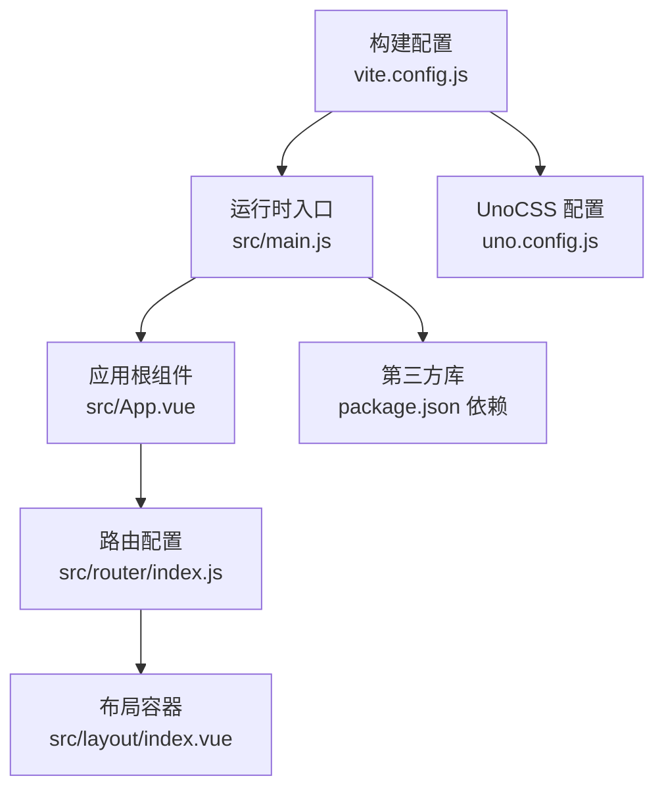
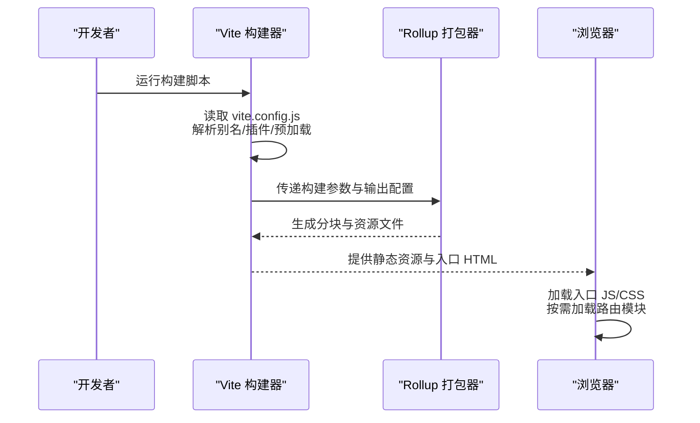
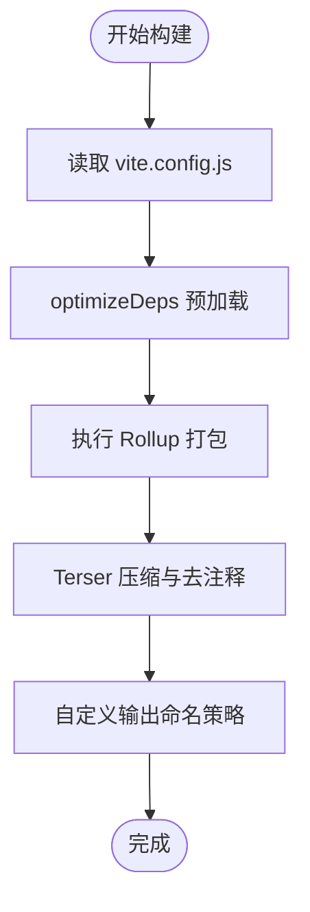
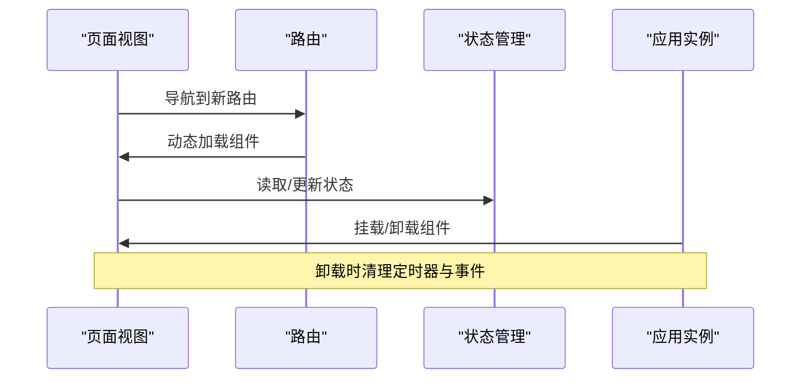
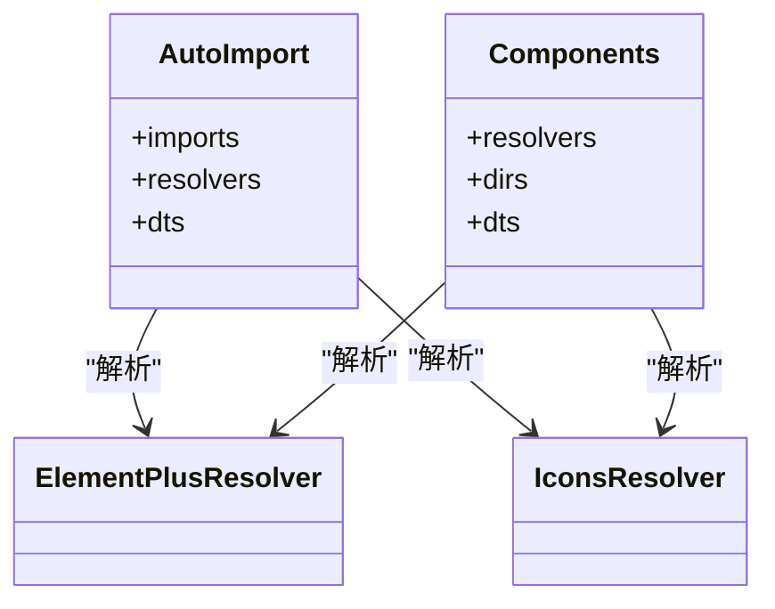
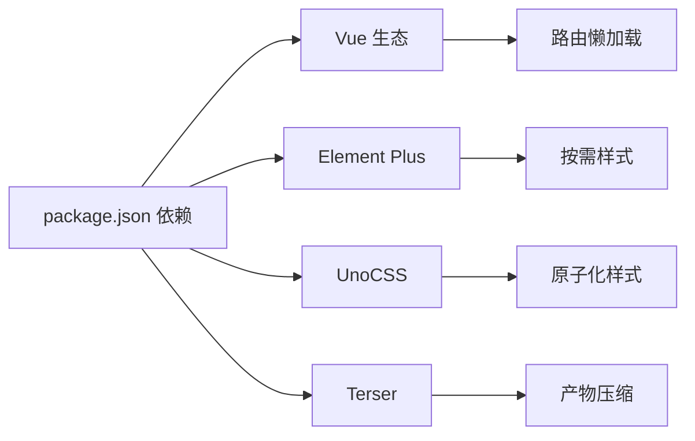

# 前端性能优化

<cite>
**本文引用的文件**
- [vite.config.js](file://yarn/vite.config.js)
- [package.json](file://yarn/package.json)
- [main.js](file://yarn/src/main.js)
- [App.vue](file://yarn/src/App.vue)
- [index.js](file://yarn/src/router/index.js)
- [index.vue](file://yarn/src/layout/index.vue)
- [uno.config.js](file://yarn/uno.config.js)
- [util.js](file://yarn/src/components/AjCaptcha/utils/util.js)
</cite>

## 目录
1. [引言](#引言)
2. [项目结构](#项目结构)
3. [核心组件](#核心组件)
4. [架构总览](#架构总览)
5. [详细组件分析](#详细组件分析)
6. [依赖分析](#依赖分析)
7. [性能考量](#性能考量)
8. [故障排查指南](#故障排查指南)
9. [结论](#结论)
10. [附录](#附录)

## 引言
本文件面向“高齿传动”项目的前端团队，系统化梳理并给出可落地的性能优化方案。重点覆盖以下方面：
- Vite 构建配置优化：代码分割、懒加载、资源压缩与命名、预加载策略
- Vue 3 应用性能：组件懒加载、虚拟滚动、防抖节流、内存泄漏防护
- Element Plus 按需引入与 Tree Shaking
- 图片与静态资源优化：压缩、CDN、缓存策略
- 浏览器缓存：强缓存与协商缓存
- 性能监控与分析：Lighthouse、Bundle 分析工具
- 实战案例与实施建议

## 项目结构
本项目采用 Vite + Vue 3 技术栈，核心目录与职责如下：
- 构建与开发：vite.config.js、uno.config.js、package.json
- 应用入口：src/main.js、src/App.vue
- 路由与布局：src/router/index.js、src/layout/index.vue
- 组件与工具：src/components、src/utils
- 样式与主题：src/styles、src/assets

图表来源
- [vite.config.js:1-185](file://yarn/vite.config.js#L1-L185)
- [main.js:1-44](file://yarn/src/main.js#L1-L44)
- [uno.config.js:1-22](file://yarn/uno.config.js#L1-L22)
- [App.vue:1-57](file://yarn/src/App.vue#L1-L57)
- [index.js:1-106](file://yarn/src/router/index.js#L1-L106)
- [index.vue:1-270](file://yarn/src/layout/index.vue#L1-L270)
- [package.json:1-88](file://yarn/package.json#L1-L88)

章节来源
- [vite.config.js:1-185](file://yarn/vite.config.js#L1-L185)
- [main.js:1-44](file://yarn/src/main.js#L1-L44)
- [uno.config.js:1-22](file://yarn/uno.config.js#L1-L22)
- [App.vue:1-57](file://yarn/src/App.vue#L1-L57)
- [index.js:1-106](file://yarn/src/router/index.js#L1-L106)
- [index.vue:1-270](file://yarn/src/layout/index.vue#L1-L270)
- [package.json:1-88](file://yarn/package.json#L1-L88)

## 核心组件
- Vite 构建配置：通过 optimizeDeps 预加载核心依赖、Rollup 输出命名策略、Terser 去除 console/debugger、移除注释
- Vue 应用入口：统一注册插件、指令、国际化、粒子动画、Element Plus 图标
- 路由与懒加载：使用动态 import 实现页面级懒加载；静态路由集中管理
- 布局与响应式：基于尺寸监听切换布局模式，减少不必要的渲染
- UnoCSS：原子化工具链，减少样式体积与重复

章节来源
- [vite.config.js:38-185](file://yarn/vite.config.js#L38-L185)
- [main.js:17-44](file://yarn/src/main.js#L17-L44)
- [index.js:1-106](file://yarn/src/router/index.js#L1-L106)
- [index.vue:32-95](file://yarn/src/layout/index.vue#L32-L95)
- [uno.config.js:12-22](file://yarn/uno.config.js#L12-L22)

## 架构总览
下图展示从构建到运行的关键路径与优化点：

图表来源
- [vite.config.js:13-185](file://yarn/vite.config.js#L13-L185)
- [index.js:2-25](file://yarn/src/router/index.js#L2-L25)

## 详细组件分析

### Vite 构建配置优化
- 代码分割与懒加载
  - 路由使用动态 import，实现页面级懒加载，降低首屏 JS 体积
  - 通过 optimizeDeps.include 预热核心依赖，缩短冷启动时间
- 资源压缩与命名
  - Terser 去除 console、debugger、注释，减小产物体积
  - 自定义 Rollup 输出命名策略，便于浏览器缓存与 CDN 缓存
- 预加载机制
  - 使用 optimizeDeps.include 列举常用依赖，提升二次构建与冷启动性能
- CSS 与图标
  - UnoCSS 与自动导入图标，减少手动引入成本
  - SVG 图标缓存与符号 ID 规范化，避免重复加载

图表来源
- [vite.config.js:72-185](file://yarn/vite.config.js#L72-L185)

章节来源
- [vite.config.js:38-185](file://yarn/vite.config.js#L38-L185)
- [index.js:2-25](file://yarn/src/router/index.js#L2-L25)

### Vue 3 应用性能优化
- 组件懒加载与 KeepAlive
  - 路由视图使用动态 import，结合 keep-alive 控制缓存
  - 首页与常用页面可开启 keepAlive，减少重复渲染
- 响应式与计算属性
  - 布局切换逻辑使用计算属性与 watchEffect，避免频繁 DOM 访问
- 内存泄漏防护
  - 页面卸载事件中清理定时器与临时状态，防止后台任务常驻
- 国际化与插件
  - 统一注册 i18n、插件与指令，避免重复挂载

图表来源
- [App.vue:28-41](file://yarn/src/App.vue#L28-L41)
- [index.js:32-44](file://yarn/src/router/index.js#L32-L44)

章节来源
- [App.vue:17-57](file://yarn/src/App.vue#L17-L57)
- [index.js:1-106](file://yarn/src/router/index.js#L1-L106)
- [index.vue:32-95](file://yarn/src/layout/index.vue#L32-L95)

### Element Plus 按需引入与 Tree Shaking
- 自动导入与组件解析
  - 使用 unplugin-auto-import 与 unplugin-vue-components，自动导入 API 与组件
  - ElementPlusResolver 与 IconsResolver 支持按需引入与图标自动注册
- 样式按需
  - optimizeDeps.include 中显式列出大量 element-plus/es/components/*/style/css，确保样式按需加载
- Tree Shaking
  - 结合动态 import 与按需解析，减少未使用代码进入产物

图表来源
- [vite.config.js:39-69](file://yarn/vite.config.js#L39-L69)
- [vite.config.js:41-55](file://yarn/vite.config.js#L41-L55)
- [vite.config.js:72-144](file://yarn/vite.config.js#L72-L144)

章节来源
- [vite.config.js:39-144](file://yarn/vite.config.js#L39-L144)

### 图片与静态资源优化
- 资源分类与命名
  - 自定义 assetFileNames 将媒体、图片、字体分别输出到不同目录，利于缓存与 CDN 策略
- 图标与 SVG
  - 使用 vite-plugin-svg-icons 缓存图标并生成 symbolId，减少请求次数
- 压缩与格式
  - 建议在构建前对图片进行压缩与格式选择（WebP/JPEG2000），并在服务端启用压缩传输
- CDN 与缓存
  - 将静态资源部署至 CDN，并设置长缓存与版本化命名，结合 ETag/Last-Modified 实现协商缓存

章节来源
- [vite.config.js:161-179](file://yarn/vite.config.js#L161-L179)
- [vite.config.js:64-69](file://yarn/vite.config.js#L64-L69)

### 浏览器缓存机制
- 强缓存
  - 对 JS/CSS/字体等稳定资源设置较长 max-age，结合哈希命名
- 协商缓存
  - 对 HTML 设置较短缓存并启用 ETag/Last-Modified，保证变更及时生效
- 预加载与并行
  - 使用 <link rel="prefetch"> 或 <link rel="modulepreload"> 提前加载关键模块

章节来源
- [vite.config.js:161-179](file://yarn/vite.config.js#L161-L179)

### 性能监控与分析
- Lighthouse
  - 定期在生产构建后运行 Lighthouse，关注 Largest Contentful Paint、Cumulative Layout Shift、Total Blocking Time 等指标
- Bundle 分析
  - 使用可视化工具分析包体构成，定位大体积依赖与重复模块
- 实时监控
  - 建议接入 Web Vitals 与错误上报，持续跟踪用户体验

## 依赖分析
- 核心依赖
  - Vue 3、Vue Router、Pinia、Element Plus、Axios、ECharts、UnoCSS、Terser
- 插件生态
  - 自动导入、组件解析、图标、SVG 图标缓存、UnoCSS
- 优化耦合点
  - 构建配置与路由懒加载紧密相关；Element Plus 的按需引入与样式预加载共同影响体积

图表来源
- [package.json:25-58](file://yarn/package.json#L25-L58)
- [vite.config.js:38-69](file://yarn/vite.config.js#L38-L69)

章节来源
- [package.json:1-88](file://yarn/package.json#L1-L88)
- [vite.config.js:38-69](file://yarn/vite.config.js#L38-L69)

## 性能考量
- 首屏优化
  - 路由懒加载、关键资源优先加载、骨架屏/占位符
- 运行时性能
  - 避免在渲染周期做重计算；合理使用计算属性与防抖节流
  - 大列表使用虚拟滚动，减少 DOM 节点数量
- 资源体积
  - 合理拆分代码块，避免单个 chunk 过大；定期分析 bundle
- 缓存策略
  - 静态资源长缓存 + 版本化；HTML 短缓存 + 协商缓存
- 可观测性
  - 建立性能基线，持续监控关键指标，快速回滚异常变更

## 故障排查指南
- 构建体积过大
  - 检查是否遗漏按需引入与 Tree Shaking；确认 Terser 配置是否生效
- 首屏加载慢
  - 核查 optimizeDeps 是否包含关键依赖；确认路由懒加载是否正确
- 图标或样式缺失
  - 检查 SVG 图标缓存配置与 symbolId；确认 Element Plus 解析器配置
- 内存泄漏
  - 检查页面卸载事件中的清理逻辑；避免全局事件未解绑

章节来源
- [vite.config.js:72-185](file://yarn/vite.config.js#L72-L185)
- [App.vue:28-41](file://yarn/src/App.vue#L28-L41)

## 结论
通过系统化的构建配置优化、路由懒加载、按需引入与 Tree Shaking、资源与缓存策略以及持续的性能监控，可以显著提升“高齿传动”前端应用的加载速度与运行效率。建议在迭代过程中持续评估关键指标，逐步完善自动化与可观测体系。

## 附录
- 实施清单
  - 确认 optimizeDeps.include 覆盖核心依赖
  - 路由页面全部使用动态 import
  - 启用 Terser 去除 console/debugger/注释
  - 静态资源按类型分类输出并启用 CDN
  - 部署后运行 Lighthouse 并对比 Bundle 分析结果
- 参考路径
  - [vite.config.js 全文:1-185](file://yarn/vite.config.js#L1-L185)
  - [package.json 依赖:25-58](file://yarn/package.json#L25-L58)
  - [路由懒加载示例:2-25](file://yarn/src/router/index.js#L2-L25)
  - [应用入口注册流程:17-44](file://yarn/src/main.js#L17-L44)
  - [UnoCSS 配置:12-22](file://yarn/uno.config.js#L12-L22)
  - [布局响应式逻辑:32-95](file://yarn/src/layout/index.vue#L32-L95)
  - [卸载清理示例:28-41](file://yarn/src/App.vue#L28-L41)