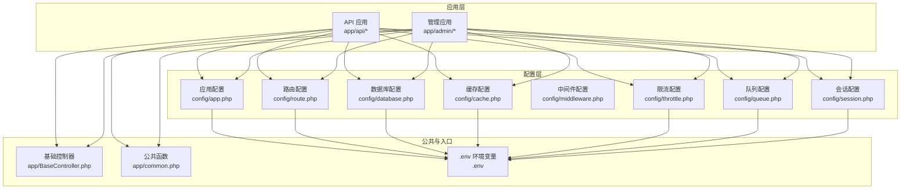
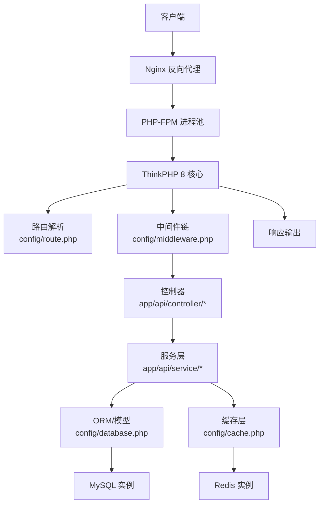
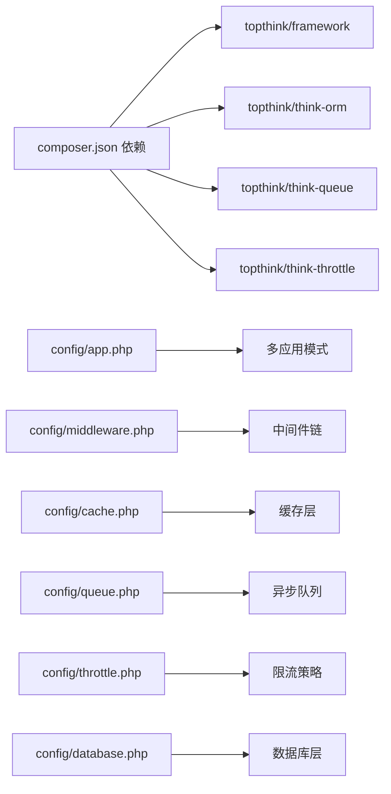

# 后端性能优化

<cite>
**本文引用的文件**
- [composer.json](file://gccd_server/composer.json)
- [.env](file://gccd_server/.env)
- [app.php](file://gccd_server/config/app.php)
- [database.php](file://gccd_server/config/database.php)
- [cache.php](file://gccd_server/config/cache.php)
- [route.php](file://gccd_server/config/route.php)
- [middleware.php](file://gccd_server/config/middleware.php)
- [queue.php](file://gccd_server/config/queue.php)
- [throttle.php](file://gccd_server/config/throttle.php)
- [session.php](file://gccd_server/config/session.php)
- [BaseController.php](file://gccd_server/app/BaseController.php)
- [common.php](file://gccd_server/app/common.php)
- [Index.php](file://gccd_server/app/api/controller/Index.php)
</cite>

## 目录
1. [简介](#简介)
2. [项目结构](#项目结构)
3. [核心组件](#核心组件)
4. [架构总览](#架构总览)
5. [详细组件分析](#详细组件分析)
6. [依赖关系分析](#依赖关系分析)
7. [性能考量](#性能考量)
8. [故障排查指南](#故障排查指南)
9. [结论](#结论)
10. [附录](#附录)

## 简介
本文件面向“高齿传动”项目的后端性能优化，基于 ThinkPHP 8 框架与现有配置，系统梳理并提出可落地的优化策略，覆盖路由、中间件、服务注册、数据库连接池与查询、缓存体系、API 性能、服务器资源与负载均衡、以及监控与分析工具的使用方法，并给出优化案例与性能测试建议。

## 项目结构
后端位于 gccd_server 目录，采用 ThinkPHP 多应用模式（api/admin），核心配置集中在 config 下，公共函数与基础控制器位于 app 目录，路由定义在 route 目录，队列与节流等能力通过独立配置文件启用。

图表来源
- [app.php:11-43](file://gccd_server/config/app.php#L11-L43)
- [route.php:11-50](file://gccd_server/config/route.php#L11-L50)
- [database.php:11-70](file://gccd_server/config/database.php#L11-L70)
- [cache.php:13-85](file://gccd_server/config/cache.php#L13-L85)
- [middleware.php:11-16](file://gccd_server/config/middleware.php#L11-L16)
- [throttle.php:17-78](file://gccd_server/config/throttle.php#L17-L78)
- [queue.php:23-55](file://gccd_server/config/queue.php#L23-L55)
- [session.php:11-24](file://gccd_server/config/session.php#L11-L24)
- [BaseController.php:19-100](file://gccd_server/app/BaseController.php#L19-L100)
- [common.php:20-921](file://gccd_server/app/common.php#L20-L921)
- [.env:11-122](file://gccd_server/.env#L11-L122)

章节来源
- [app.php:11-43](file://gccd_server/config/app.php#L11-L43)
- [route.php:11-50](file://gccd_server/config/route.php#L11-L50)
- [database.php:11-70](file://gccd_server/config/database.php#L11-L70)
- [cache.php:13-85](file://gccd_server/config/cache.php#L13-L85)
- [middleware.php:11-16](file://gccd_server/config/middleware.php#L11-L16)
- [throttle.php:17-78](file://gccd_server/config/throttle.php#L17-L78)
- [queue.php:23-55](file://gccd_server/config/queue.php#L23-L55)
- [session.php:11-24](file://gccd_server/config/session.php#L11-L24)
- [BaseController.php:19-100](file://gccd_server/app/BaseController.php#L19-L100)
- [common.php:20-921](file://gccd_server/app/common.php#L20-L921)
- [.env:11-122](file://gccd_server/.env#L11-L122)

## 核心组件
- 应用与多应用模式：默认应用为 api，支持 admin，路由与事件均启用，便于按模块拆分与隔离。
- 路由与中间件：路由设置包含完整匹配、默认控制器/动作、请求缓存开关等；中间件别名与优先级预留扩展点。
- 数据库：默认 mysql，支持字段缓存、断线重连、触发 SQL 监听等；读写分离未启用，适合单库场景。
- 缓存：支持 file/redis/memcache/wincache，当前默认 file，可快速切换至 redis。
- 限流：基于 think-throttle，支持按应用、用户、菜单/API 维度动态限速，算法可选。
- 队列：默认 database，支持 redis，可异步处理耗时任务。
- 会话：默认 file，过期时间 1440 秒。
- 公共函数与基础控制器：统一返回结构、验证封装、常用工具函数。

章节来源
- [app.php:11-43](file://gccd_server/config/app.php#L11-L43)
- [route.php:11-50](file://gccd_server/config/route.php#L11-L50)
- [middleware.php:11-16](file://gccd_server/config/middleware.php#L11-L16)
- [database.php:11-70](file://gccd_server/config/database.php#L11-L70)
- [cache.php:13-85](file://gccd_server/config/cache.php#L13-L85)
- [throttle.php:17-78](file://gccd_server/config/throttle.php#L17-L78)
- [queue.php:23-55](file://gccd_server/config/queue.php#L23-L55)
- [session.php:11-24](file://gccd_server/config/session.php#L11-L24)
- [BaseController.php:19-100](file://gccd_server/app/BaseController.php#L19-L100)
- [common.php:20-921](file://gccd_server/app/common.php#L20-L921)

## 架构总览
下图展示请求从 Nginx 到 PHP-FPM、ThinkPHP 路由与中间件、服务层、数据库与缓存的整体流转。

图表来源
- [route.php:11-50](file://gccd_server/config/route.php#L11-L50)
- [middleware.php:11-16](file://gccd_server/config/middleware.php#L11-L16)
- [database.php:11-70](file://gccd_server/config/database.php#L11-L70)
- [cache.php:13-85](file://gccd_server/config/cache.php#L13-L85)
- [Index.php:21-36](file://gccd_server/app/api/controller/Index.php#L21-L36)

## 详细组件分析

### 路由优化
- 完整匹配与默认控制器：开启完整匹配与默认控制器/动作，减少歧义与冗余解析。
- 请求缓存：request_cache 默认关闭，建议对 GET 且无状态接口开启短期缓存以降低重复计算。
- 合并规则与延迟解析：route_rule_merge 与 url_lazy_route 保持默认，避免过度优化导致复杂度上升。
- URL 后缀与参数：url_html_suffix 与 url_common_param 保持默认，确保兼容性。

优化建议
- 对高频只读接口开启 request_cache，结合缓存键前缀与过期时间，避免脏读。
- 将静态资源与上传目录交由 Nginx 直出，减少 PHP 层负担。

章节来源
- [route.php:11-50](file://gccd_server/config/route.php#L11-L50)
- [Index.php:21-36](file://gccd_server/app/api/controller/Index.php#L21-L36)

### 中间件优化
- 别名与优先级：alias 为空，priority 为空，建议按“鉴权 -> 日志 -> 限流 -> 业务逻辑”的顺序显式声明优先级。
- 作用域与性能：尽量将耗时逻辑（如远程校验）放入队列或异步任务，避免阻塞请求链路。

优化建议
- 在中间件中仅做必要校验与上下文注入，避免在热路径做 IO。
- 使用队列处理日志上报、统计等异步任务。

章节来源
- [middleware.php:11-16](file://gccd_server/config/middleware.php#L11-L16)
- [throttle.php:17-78](file://gccd_server/config/throttle.php#L17-L78)

### 服务注册优化
- 服务发现与发布：composer 的 post-autoload-dump 脚本调用 think service:discover 与 vendor:publish，确保服务与配置在启动时完成注册与发布。
- 多应用模式：默认应用为 api，建议将服务按模块划分到对应应用，减少不必要的加载。

优化建议
- 将第三方 SDK 初始化与配置发布放在服务注册阶段，避免首次请求触发。
- 对大型服务进行懒加载，按需实例化。

章节来源
- [composer.json:17-22](file://gccd_server/composer.json#L17-L22)
- [app.php:25-34](file://gccd_server/config/app.php#L25-L34)

### 数据库连接池与查询优化
- 连接配置：默认 mysql，charset 为 utf8mb4，字段缓存开启，断线重连可按需开启。
- 读写分离：rw_separate 关闭，适合单库；若扩展为主从，建议开启并合理分配 master_num/slave_no。
- 触发 SQL：trigger_sql 默认关闭，生产环境可临时开启定位慢查询。
- 字段缓存：fields_cache 默认开启，减少反射与元数据开销。

查询与索引优化建议
- 使用索引覆盖常见查询条件，避免全表扫描；对高频过滤字段建立复合索引。
- 避免 SELECT *，仅取所需字段；对分页查询使用覆盖索引与游标分页。
- 合理使用 EXPLAIN 分析慢查询，关注 key、rows、Extra 等指标。

事务优化建议
- 将相关写操作包裹在事务中，减少锁竞争；短事务优先，避免长时间持有行锁。
- 对批量写入使用批量 INSERT/UPDATE，减少往返与锁持有时间。

章节来源
- [database.php:11-70](file://gccd_server/config/database.php#L11-L70)
- [.env:26-56](file://gccd_server/.env#L26-L56)

### 缓存系统优化
- 驱动选择：当前默认 file，建议在生产环境切换为 redis，提升并发与共享能力。
- 前缀与序列化：redis 前缀含命名空间，避免键冲突；根据场景选择序列化策略。
- 长连接：persistent 可按需开启，减少连接开销。
- 缓存穿透：对空结果设置短 TTL；对热点数据预热。
- 缓存雪崩：为 key 设置随机 TTL；使用互斥锁避免同一时间大量重建缓存。
- 缓存更新：采用写后失效或写后更新策略，保证一致性与性能平衡。

章节来源
- [cache.php:13-85](file://gccd_server/config/cache.php#L13-L85)
- [.env:58-74](file://gccd_server/.env#L58-L74)

### API 接口性能优化
- 请求合并与批量处理：对多资源读取接口支持批量参数，减少多次往返。
- 异步处理：将耗时任务（导出、报表、通知）投递到队列，立即返回轻量响应。
- 并发控制：结合限流配置与中间件，控制每个用户/接口的并发与速率。
- 响应压缩：在 Nginx 层启用 gzip，降低带宽占用。

章节来源
- [queue.php:23-55](file://gccd_server/config/queue.php#L23-L55)
- [throttle.php:17-78](file://gccd_server/config/throttle.php#L17-L78)

### 服务器资源配置与负载均衡
- Nginx：静态资源直出、gzip 压缩、连接复用、超时与限速配置。
- PHP-FPM：进程数与管理模式（dynamic/spawn）按并发与内存估算；设置 pm.max_requests 降低碎片化。
- 进程管理：使用 systemd 或 supervisor 管理进程，确保健康检查与自动重启。
- 负载均衡：Nginx upstream + keepalive，配合健康检查与权重调度。

[本节为通用实践说明，无需特定文件引用]

### 性能监控与分析
- APM：接入 SaaS 型 APM（如 New Relic、SkyWalking）采集链路与指标。
- 慢查询日志：开启慢查询阈值与日志轮转，定期分析并优化。
- 内存与 CPU：使用 top/htop、php-fpm status、apcu 与 opcache 统计，定位内存泄漏与缓存命中率。
- 日志分析：集中化日志（ELK/Graylog），对错误与慢请求进行聚合告警。

[本节为通用实践说明，无需特定文件引用]

## 依赖关系分析
- ThinkPHP 8 与 ORM：提供 MVC 与 ORM 能力，是性能优化的基础。
- 多应用与中间件：通过 app.php 与 middleware.php 控制应用边界与中间件链。
- 缓存与队列：cache.php 与 queue.php 提供高性能缓存与异步处理能力。
- 限流：throttle.php 与 session.php 配合实现速率控制与会话存储。

图表来源
- [composer.json:23-47](file://gccd_server/composer.json#L23-L47)
- [app.php:11-43](file://gccd_server/config/app.php#L11-L43)
- [middleware.php:11-16](file://gccd_server/config/middleware.php#L11-L16)
- [cache.php:13-85](file://gccd_server/config/cache.php#L13-L85)
- [queue.php:23-55](file://gccd_server/config/queue.php#L23-L55)
- [throttle.php:17-78](file://gccd_server/config/throttle.php#L17-L78)
- [database.php:11-70](file://gccd_server/config/database.php#L11-L70)

章节来源
- [composer.json:23-47](file://gccd_server/composer.json#L23-L47)
- [app.php:11-43](file://gccd_server/config/app.php#L11-L43)
- [middleware.php:11-16](file://gccd_server/config/middleware.php#L11-L16)
- [cache.php:13-85](file://gccd_server/config/cache.php#L13-L85)
- [queue.php:23-55](file://gccd_server/config/queue.php#L23-L55)
- [throttle.php:17-78](file://gccd_server/config/throttle.php#L17-L78)
- [database.php:11-70](file://gccd_server/config/database.php#L11-L70)

## 性能考量
- 启动与加载
  - 启用 opcache 与 apcu，减少脚本编译与常量加载开销。
  - 合理设置 autoload 优化，避免不必要的类加载。
- I/O 与网络
  - 将静态资源与上传目录交由 Nginx 直出。
  - 对外部 API 调用设置连接超时与重试策略。
- 并发与限流
  - 结合限流配置与中间件，控制突发流量。
  - 对热点接口增加本地缓存与分布式缓存双层保护。
- 数据库
  - 使用连接池与长连接（按需），避免频繁握手。
  - 对写密集场景使用批量写入与事务合并。
- 缓存
  - 采用多级缓存（本地/远端），设置合理的过期与回退策略。
  - 对缓存键进行规范化与版本化，避免脏读。

[本节为通用实践说明，无需特定文件引用]

## 故障排查指南
- 调试与追踪
  - 开发阶段开启 app_debug 与 app_trace，定位问题；生产关闭以避免信息泄露。
- 慢查询定位
  - 临时开启 trigger_sql，结合 EXPLAIN 分析；优化索引与 SQL。
- 缓存问题
  - 检查缓存前缀与键空间，确认序列化与 TTL 设置。
- 限流与会话
  - 核对 throttle 的 key 生成逻辑与 visit_method，确认会话过期与存储驱动。

章节来源
- [app.php:12-17](file://gccd_server/config/app.php#L12-L17)
- [database.php:60-61](file://gccd_server/config/database.php#L60-L61)
- [cache.php:14-15](file://gccd_server/config/cache.php#L14-L15)
- [throttle.php:54-57](file://gccd_server/config/throttle.php#L54-L57)
- [session.php:20-21](file://gccd_server/config/session.php#L20-L21)
- [.env:14-16](file://gccd_server/.env#L14-L16)

## 结论
通过路由与中间件的精细化配置、数据库查询与索引优化、缓存体系的多级策略、API 的异步与批量处理、以及服务器与监控体系的完善，高齿传动后端可在保证稳定性的同时显著提升性能与可维护性。建议先从缓存切换与限流策略入手，再逐步推进数据库与队列优化，并持续以监控与测试驱动迭代。

## 附录

### 优化案例与测试方法
- 案例一：首页接口
  - 场景：GET /api/index，返回欢迎信息。
  - 优化：开启请求缓存（短期 TTL），使用 Redis 缓存热点数据。
  - 测试：压测工具模拟并发请求，观察响应时间与缓存命中率。
  
  章节来源
  - [Index.php:21-36](file://gccd_server/app/api/controller/Index.php#L21-L36)
  - [route.php:34-37](file://gccd_server/config/route.php#L34-L37)
  - [cache.php:33-52](file://gccd_server/config/cache.php#L33-L52)

- 案例二：批量查询
  - 场景：列表接口支持批量 ID 查询。
  - 优化：使用 IN 查询与索引覆盖，避免 N+1；对分页使用游标分页。
  - 测试：构造不同规模的数据集，对比查询耗时与内存占用。

  章节来源
  - [database.php:11-70](file://gccd_server/config/database.php#L11-L70)

- 案例三：异步导出
  - 场景：报表导出为耗时任务。
  - 优化：投递到队列，立即返回任务 ID；前端轮询或推送通知。
  - 测试：对比同步与异步导出的吞吐量与延迟。

  章节来源
  - [queue.php:23-55](file://gccd_server/config/queue.php#L23-L55)

- 案例四：限流策略
  - 场景：管理员与会员接口分别限流。
  - 优化：按用户与菜单/API 动态设置速率，避免误伤正常用户。
  - 测试：模拟高频请求，验证限流生效与响应码。

  章节来源
  - [throttle.php:17-78](file://gccd_server/config/throttle.php#L17-L78)