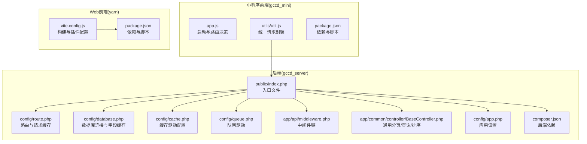
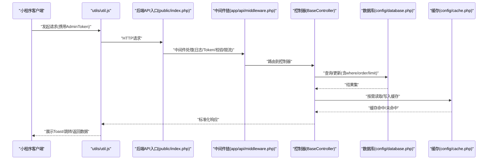
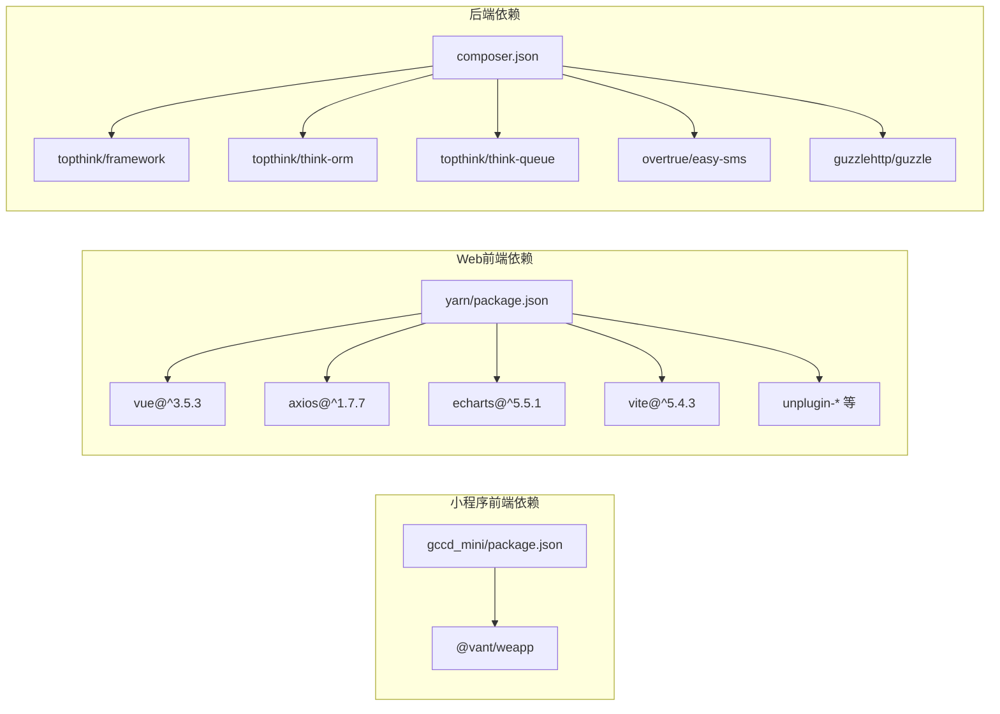

# 性能优化

<cite>
**本文引用的文件**
- [gccd_mini/app.js](file://gccd_mini/app.js)
- [gccd_mini/utils/util.js](file://gccd_mini/utils/util.js)
- [gccd_mini/package.json](file://gccd_mini/package.json)
- [yarn/vite.config.js](file://yarn/vite.config.js)
- [yarn/package.json](file://yarn/package.json)
- [gccd_server/config/app.php](file://gccd_server/config/app.php)
- [gccd_server/config/database.php](file://gccd_server/config/database.php)
- [gccd_server/config/cache.php](file://gccd_server/config/cache.php)
- [gccd_server/config/queue.php](file://gccd_server/config/queue.php)
- [gccd_server/config/route.php](file://gccd_server/config/route.php)
- [gccd_server/app/common/controller/BaseController.php](file://gccd_server/app/common/controller/BaseController.php)
- [gccd_server/app/api/middleware.php](file://gccd_server/app/api/middleware.php)
- [gccd_server/public/index.php](file://gccd_server/public/index.php)
- [gccd_server/composer.json](file://gccd_server/composer.json)
</cite>

## 目录
1. [简介](#简介)
2. [项目结构](#项目结构)
3. [核心组件](#核心组件)
4. [架构总览](#架构总览)
5. [详细组件分析](#详细组件分析)
6. [依赖分析](#依赖分析)
7. [性能考量](#性能考量)
8. [故障排查指南](#故障排查指南)
9. [结论](#结论)
10. [附录](#附录)

## 简介
本指南面向“高齿传动”项目的前端与后端性能优化，围绕以下目标展开：
- 前端：代码分割、懒加载、资源压缩、缓存策略、构建产物命名与体积控制
- 后端：数据库查询优化、索引设计、缓存机制、并发处理、队列异步化
- API：请求合并、响应缓存、限流、异步处理、负载均衡
- 监控与测试：关键指标、性能分析方法、基准测试方案
- 实施建议：具体优化案例与落地步骤

## 项目结构
项目由三部分组成：
- 小程序前端：gccd_mini（基于 WeChat Mini Program，使用 @vant/weapp 组件）
- Web 管理端前端：yarn（基于 Vue3 + Vite，使用 Element Plus、Axios 等）
- 后端服务：gccd_server（基于 ThinkPHP 8，提供 API 与管理端）

图表来源
- [gccd_mini/app.js:1-33](file://gccd_mini/app.js#L1-L33)
- [gccd_mini/utils/util.js:1-98](file://gccd_mini/utils/util.js#L1-L98)
- [gccd_mini/package.json:1-12](file://gccd_mini/package.json#L1-L12)
- [yarn/vite.config.js:1-185](file://yarn/vite.config.js#L1-L185)
- [yarn/package.json:1-88](file://yarn/package.json#L1-L88)
- [gccd_server/public/index.php:1-25](file://gccd_server/public/index.php#L1-L25)
- [gccd_server/config/route.php:1-51](file://gccd_server/config/route.php#L1-L51)
- [gccd_server/config/database.php:1-71](file://gccd_server/config/database.php#L1-L71)
- [gccd_server/config/cache.php:1-86](file://gccd_server/config/cache.php#L1-L86)
- [gccd_server/config/queue.php:1-56](file://gccd_server/config/queue.php#L1-L56)
- [gccd_server/app/api/middleware.php:1-21](file://gccd_server/app/api/middleware.php#L1-L21)
- [gccd_server/app/common/controller/BaseController.php:1-244](file://gccd_server/app/common/controller/BaseController.php#L1-L244)
- [gccd_server/config/app.php:1-44](file://gccd_server/config/app.php#L1-L44)
- [gccd_server/composer.json:1-65](file://gccd_server/composer.json#L1-L65)

章节来源
- [gccd_mini/app.js:1-33](file://gccd_mini/app.js#L1-L33)
- [gccd_mini/utils/util.js:1-98](file://gccd_mini/utils/util.js#L1-L98)
- [gccd_mini/package.json:1-12](file://gccd_mini/package.json#L1-L12)
- [yarn/vite.config.js:1-185](file://yarn/vite.config.js#L1-L185)
- [yarn/package.json:1-88](file://yarn/package.json#L1-L88)
- [gccd_server/public/index.php:1-25](file://gccd_server/public/index.php#L1-L25)
- [gccd_server/config/route.php:1-51](file://gccd_server/config/route.php#L1-L51)
- [gccd_server/config/database.php:1-71](file://gccd_server/config/database.php#L1-L71)
- [gccd_server/config/cache.php:1-86](file://gccd_server/config/cache.php#L1-L86)
- [gccd_server/config/queue.php:1-56](file://gccd_server/config/queue.php#L1-L56)
- [gccd_server/app/api/middleware.php:1-21](file://gccd_server/app/api/middleware.php#L1-L21)
- [gccd_server/app/common/controller/BaseController.php:1-244](file://gccd_server/app/common/controller/BaseController.php#L1-L244)
- [gccd_server/config/app.php:1-44](file://gccd_server/config/app.php#L1-L44)
- [gccd_server/composer.json:1-65](file://gccd_server/composer.json#L1-L65)

## 核心组件
- 小程序启动与路由：在应用启动时根据本地 Token 决策跳转，减少无效渲染与重复登录请求。
- 统一请求封装：集中处理鉴权头、状态码判断、错误提示与跳转逻辑，避免重复代码与分散的错误处理。
- Web 构建配置：Vite 预构建、Terser 压缩、按类型输出资源命名、chunkSize 警告阈值调整，降低首屏体积与提升缓存命中。
- 后端应用配置：路由与请求缓存开关、调试与追踪开关、默认时区等，影响请求处理路径与可观测性。
- 数据库配置：字段缓存、字符集、读写分离开关、断线重连等，直接影响查询性能与稳定性。
- 缓存配置：支持 file/redis/memcache 等多种驱动，可按场景选择持久化或高性能缓存。
- 队列配置：支持 sync/database/redis 三种驱动，适合将耗时任务异步化，提升接口响应速度。
- 中间件链：日志、Token 校验、接口校验、限流，形成统一的安全与性能控制点。

章节来源
- [gccd_mini/app.js:1-33](file://gccd_mini/app.js#L1-L33)
- [gccd_mini/utils/util.js:18-94](file://gccd_mini/utils/util.js#L18-L94)
- [yarn/vite.config.js:146-182](file://yarn/vite.config.js#L146-L182)
- [gccd_server/config/app.php:11-43](file://gccd_server/config/app.php#L11-L43)
- [gccd_server/config/database.php:27-66](file://gccd_server/config/database.php#L27-L66)
- [gccd_server/config/cache.php:14-85](file://gccd_server/config/cache.php#L14-L85)
- [gccd_server/config/queue.php:24-50](file://gccd_server/config/queue.php#L24-L50)
- [gccd_server/app/api/middleware.php:11-20](file://gccd_server/app/api/middleware.php#L11-L20)

## 架构总览
从前端到后端的关键调用链如下：

图表来源
- [gccd_mini/utils/util.js:22-94](file://gccd_mini/utils/util.js#L22-L94)
- [gccd_server/public/index.php:17-24](file://gccd_server/public/index.php#L17-L24)
- [gccd_server/app/api/middleware.php:11-20](file://gccd_server/app/api/middleware.php#L11-L20)
- [gccd_server/app/common/controller/BaseController.php:67-242](file://gccd_server/app/common/controller/BaseController.php#L67-L242)
- [gccd_server/config/database.php:27-66](file://gccd_server/config/database.php#L27-L66)
- [gccd_server/config/cache.php:14-85](file://gccd_server/config/cache.php#L14-L85)

## 详细组件分析

### 小程序前端性能优化
- 启动与路由决策
  - 在启动阶段根据本地 Token 决定直接跳转首页或登录页，减少不必要的页面渲染与登录流程。
  - 建议：将常用页面进行预加载或使用分包策略，缩短首次进入关键路径。
- 统一请求封装
  - 集中处理 AdminToken 注入、状态码判断、错误提示与跳转逻辑，避免重复代码与分散的错误处理。
  - 建议：对高频接口增加本地缓存与去抖/节流，减少重复请求；对图片/视频等资源启用 CDN 与懒加载。

章节来源
- [gccd_mini/app.js:3-21](file://gccd_mini/app.js#L3-L21)
- [gccd_mini/utils/util.js:22-94](file://gccd_mini/utils/util.js#L22-L94)

### Web 前端性能优化
- 代码分割与懒加载
  - 使用 Vite 的动态 import 实现路由级/组件级懒加载，结合预构建优化常用依赖，减少首屏体积。
  - 建议：对大组件（如图表、编辑器）按需引入；对第三方库使用外部化与 CDN 加速。
- 资源压缩与产物命名
  - Terser 去除 console/debugger，移除注释；Rollup 输出按类型命名，利于浏览器缓存。
  - 建议：开启 gzip/br 压缩；合理设置静态资源缓存策略与版本号。
- 构建体积控制
  - 调整 chunkSize 警告阈值，关注超大模块；通过 optimizeDeps 预构建关键依赖。
  - 建议：定期审计依赖树，移除未使用模块；对大体积库进行按需引入。

章节来源
- [yarn/vite.config.js:71-145](file://yarn/vite.config.js#L71-L145)
- [yarn/vite.config.js:146-182](file://yarn/vite.config.js#L146-L182)
- [yarn/package.json:16-24](file://yarn/package.json#L16-L24)

### 后端数据库与缓存优化
- 查询优化与分页
  - BaseController 提供分页、查询条件、排序等通用逻辑，注意 limit 的上限与内存占用关系。
  - 建议：对高频查询建立合适索引；限制单次查询量；使用覆盖索引与分页优化。
- 字段缓存与连接参数
  - 启用字段缓存可减少反射与元数据开销；字符集与前缀配置影响兼容性与性能。
  - 建议：结合业务热点数据开启查询缓存；合理设置断线重连与只读分离。
- 缓存策略
  - 多种缓存驱动可选，Redis/Memcache 适合高并发场景；file 适合开发与小规模。
  - 建议：对列表/字典/统计类数据设置短 TTL；对热点读取加互斥锁避免缓存击穿。

章节来源
- [gccd_server/app/common/controller/BaseController.php:67-196](file://gccd_server/app/common/controller/BaseController.php#L67-L196)
- [gccd_server/config/database.php:27-66](file://gccd_server/config/database.php#L27-L66)
- [gccd_server/config/cache.php:14-85](file://gccd_server/config/cache.php#L14-L85)

### 队列与异步处理
- 队列驱动
  - 支持同步、数据库与 Redis 三种驱动；生产环境建议使用 Redis 或数据库驱动以解耦。
- 任务参数
  - 通过命令行参数控制重试次数、超时与内存限制，确保长时间任务稳定运行。
- 建议
  - 对耗时任务（导出、通知、上报）放入队列；对失败任务记录与重试策略；监控队列积压。

章节来源
- [gccd_server/config/queue.php:24-50](file://gccd_server/config/queue.php#L24-L50)

### API 中间件与限流
- 中间件链
  - 日志、Token 校验、接口校验、限流，形成统一的安全与性能控制点。
- 建议
  - 对不同接口设置差异化限流阈值；对幂等接口考虑请求缓存；对敏感接口增加二次校验。

章节来源
- [gccd_server/app/api/middleware.php:11-20](file://gccd_server/app/api/middleware.php#L11-L20)
- [gccd_server/config/route.php:34-39](file://gccd_server/config/route.php#L34-L39)

### 路由与请求缓存
- 路由配置
  - 控制器层、后缀、完全匹配等配置影响路由解析效率与兼容性。
- 请求缓存
  - 可按请求参数缓存响应，减少重复计算；需谨慎设置过期与排除规则。
- 建议
  - 对只读列表/详情接口启用请求缓存；对动态数据禁用缓存或设置短 TTL。

章节来源
- [gccd_server/config/route.php:11-50](file://gccd_server/config/route.php#L11-L50)

### 应用设置与调试
- 应用配置
  - 调试模式、Trace、默认时区、错误消息等影响开发体验与线上性能。
- 建议
  - 生产关闭调试与 Trace；统一错误提示；设置合理的时区与时钟同步。

章节来源
- [gccd_server/config/app.php:11-43](file://gccd_server/config/app.php#L11-L43)

## 依赖分析
前后端依赖与构建工具的关系如下：

图表来源
- [gccd_mini/package.json:8-11](file://gccd_mini/package.json#L8-L11)
- [yarn/package.json:25-57](file://yarn/package.json#L25-L57)
- [gccd_server/composer.json:23-46](file://gccd_server/composer.json#L23-L46)

章节来源
- [gccd_mini/package.json:1-12](file://gccd_mini/package.json#L1-L12)
- [yarn/package.json:1-88](file://yarn/package.json#L1-L88)
- [gccd_server/composer.json:1-65](file://gccd_server/composer.json#L1-L65)

## 性能考量
- 响应时间
  - 前端：减少首屏 JS 体积、启用懒加载与 CDN；后端：启用请求缓存、优化慢查询、合理使用缓存。
- 吞吐量
  - 后端：队列异步化、限流保护、连接池与只读分离；前端：静态资源缓存与压缩。
- 资源使用率
  - 后端：合理设置队列内存与超时；数据库：字段缓存与连接复用；缓存：热点数据短 TTL。
- 并发处理
  - 后端：多进程/多实例部署，配合负载均衡；前端：并发请求合并与去重。
- API 优化
  - 请求合并：对多个小请求合并为批量接口；响应缓存：对只读接口启用缓存；异步处理：耗时任务入队；负载均衡：多实例横向扩展。

## 故障排查指南
- 常见问题定位
  - 小程序请求失败：检查 AdminToken 是否存在与过期；查看 Toast 提示与拒绝原因。
  - 后端接口报错：查看路由与中间件链是否正确；检查数据库连接与缓存配置。
  - 队列任务堆积：检查队列驱动与消费进程；调整重试次数与超时。
- 建议措施
  - 增加关键路径日志与埋点；对慢查询与慢接口进行专项分析；定期巡检缓存命中率与队列长度。

章节来源
- [gccd_mini/utils/util.js:49-83](file://gccd_mini/utils/util.js#L49-L83)
- [gccd_server/app/api/middleware.php:11-20](file://gccd_server/app/api/middleware.php#L11-L20)
- [gccd_server/config/queue.php:10-18](file://gccd_server/config/queue.php#L10-L18)

## 结论
通过前端代码分割与资源压缩、后端数据库与缓存优化、队列异步化与中间件限流，以及 API 层的请求合并与缓存策略，可以系统性地提升系统的整体性能与用户体验。建议结合监控指标与基准测试持续迭代优化。

## 附录
- 监控指标建议
  - 前端：首屏时间、交互延迟、缓存命中率、资源体积与加载时间
  - 后端：请求响应时间、吞吐量、CPU/内存使用率、数据库慢查询数、队列积压
- 性能测试方法
  - 前端：Lighthouse、WebPageTest、Vite 预览与真实设备测试
  - 后端：ab/jmeter 压测、慢查询日志分析、缓存命中率测试
- 基准测试方案
  - 设定关键接口基准（如列表/详情），在不同数据规模下对比优化前后的指标变化，形成优化报告与回归基线