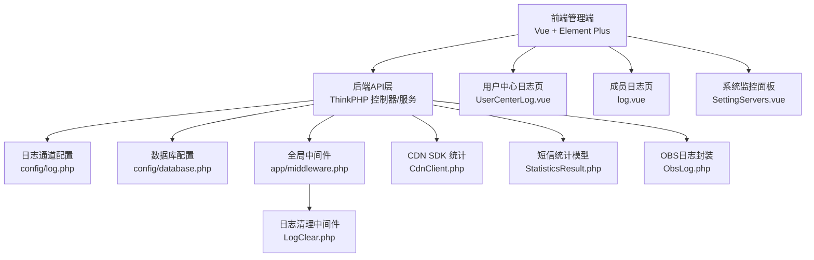
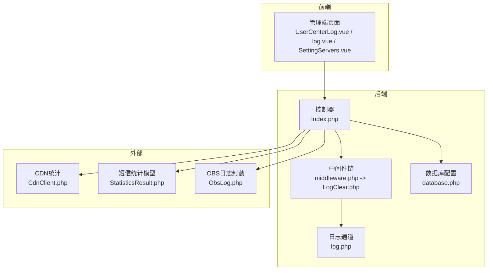
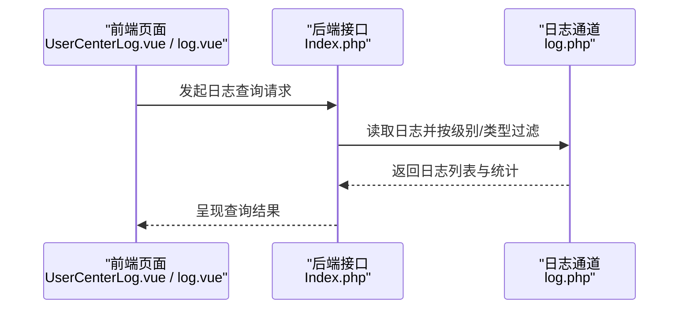
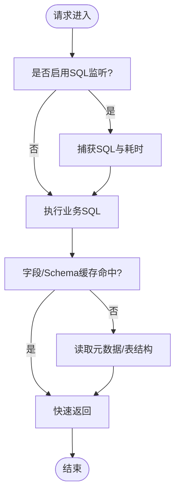
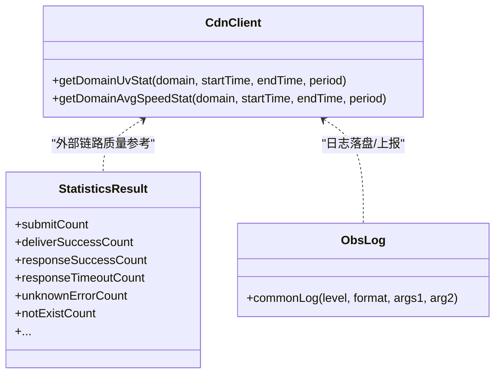
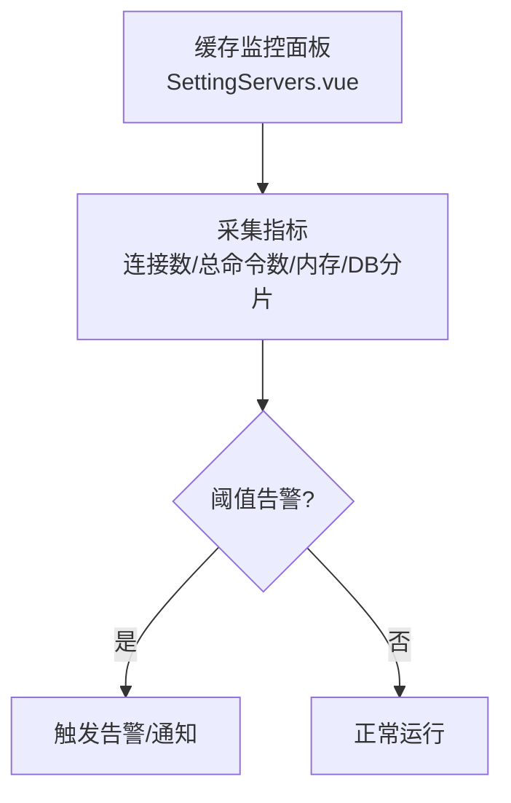
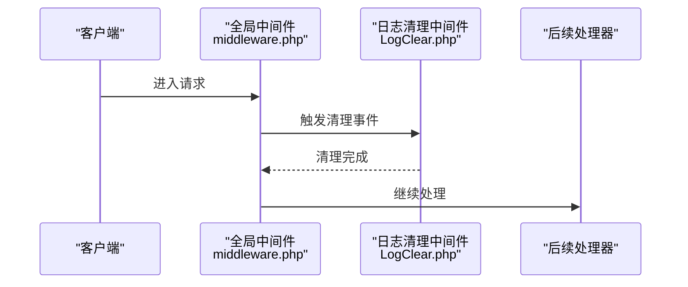
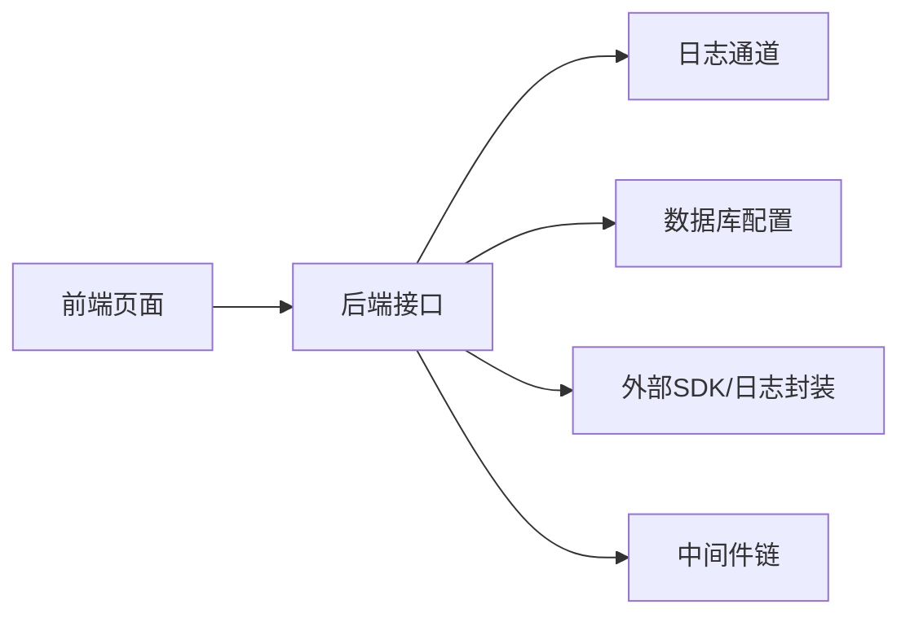

# 性能监控与指标

<cite>
**本文引用的文件**   
- [gccd_server/config/log.php](file://gccd_server/config/log.php)
- [gccd_server/config/database.php](file://gccd_server/config/database.php)
- [gccd_server/app/middleware.php](file://gccd_server/app/middleware.php)
- [gccd_server/app/common/middleware/LogClear.php](file://gccd_server/app/common/middleware/LogClear.php)
- [gccd_server/app/common.php](file://gccd_server/app/common.php)
- [gccd_server/app/api/controller/Index.php](file://gccd_server/app/api/controller/Index.php)
- [gccd_server/extend/bce-php-sdk-0.9.23/src/BaiduBce/Services/Cdn/CdnClient.php](file://gccd_server/extend/bce-php-sdk-0.9.23/src/BaiduBce/Services/Cdn/CdnClient.php)
- [gccd_server/extend/bce-php-sdk-0.9.23/src/BaiduBce/Services/Sms/model/StatisticsResult.php](file://gccd_server/extend/bce-php-sdk-0.9.23/src/BaiduBce/Services/Sms/model/StatisticsResult.php)
- [gccd_server/extend/bce-php-sdk-0.9.23/src/BaiduBce/Services/Blb/BlbClient.php](file://gccd_server/extend/bce-php-sdk-0.9.23/src/BaiduBce/Services/Blb/BlbClient.php)
- [gccd_server/extend/esdk-obs-php-3.23.11/Obs/Log/ObsLog.php](file://gccd_server/extend/esdk-obs-php-3.23.11/Obs/Log/ObsLog.php)
- [gccd_server/public/apidoc/monacoeditorwork/editor.worker.bundle.js](file://gccd_server/public/apidoc/monacoeditorwork/editor.worker.bundle.js)
- [gccd_server/public/apidoc/monacoeditorwork/json.worker.bundle.js](file://gccd_server/public/apidoc/monacoeditorwork/json.worker.bundle.js)
- [yarn/src/views/system/components/UserCenterLog.vue](file://yarn/src/views/system/components/UserCenterLog.vue)
- [yarn/src/views/member/log.vue](file://yarn/src/views/member/log.vue)
- [yarn/src/views/system/components/SettingServers.vue](file://yarn/src/views/system/components/SettingServers.vue)
</cite>

## 目录
1. [引言](#引言)
2. [项目结构](#项目结构)
3. [核心组件](#核心组件)
4. [架构总览](#架构总览)
5. [详细组件分析](#详细组件分析)
6. [依赖关系分析](#依赖关系分析)
7. [性能考量](#性能考量)
8. [故障排查指南](#故障排查指南)
9. [结论](#结论)
10. [附录](#附录)

## 引言
本文件面向“高齿传动”项目的性能监控与指标体系，围绕前端性能监控、后端性能监控、数据库性能监控三大部分展开，结合现有代码中的日志通道、中间件、CDN/短信SDK统计能力、Redis/Memcache监控界面等，给出可落地的监控配置、KPI定义与计算方法、日志采集与分析、APM集成建议、性能测试方法以及瓶颈定位策略。目标是帮助研发与运维团队建立统一、可观测、可预警的性能治理体系。

## 项目结构
项目由三部分组成：
- 后端服务（ThinkPHP框架）：负责业务逻辑、接口、日志与数据库配置。
- 前端管理端（Vue + Element Plus）：提供日志查询、系统监控面板等可视化界面。
- 第三方SDK与云服务：如百度云CDN/短信统计、对象存储日志等，可用于补充外部链路与资源指标。

**图表来源**
- [gccd_server/config/log.php:1-51](file://gccd_server/config/log.php#L1-L51)
- [gccd_server/config/database.php:1-71](file://gccd_server/config/database.php#L1-L71)
- [gccd_server/app/middleware.php:1-23](file://gccd_server/app/middleware.php#L1-L23)
- [gccd_server/app/common/middleware/LogClear.php:1-40](file://gccd_server/app/common/middleware/LogClear.php#L1-L40)
- [gccd_server/extend/bce-php-sdk-0.9.23/src/BaiduBce/Services/Cdn/CdnClient.php:1796-1870](file://gccd_server/extend/bce-php-sdk-0.9.23/src/BaiduBce/Services/Cdn/CdnClient.php#L1796-L1870)
- [gccd_server/extend/bce-php-sdk-0.9.23/src/BaiduBce/Services/Sms/model/StatisticsResult.php:49-236](file://gccd_server/extend/bce-php-sdk-0.9.23/src/BaiduBce/Services/Sms/model/StatisticsResult.php#L49-L236)
- [gccd_server/extend/esdk-obs-php-3.23.11/Obs/Log/ObsLog.php:75-127](file://gccd_server/extend/esdk-obs-php-3.23.11/Obs/Log/ObsLog.php#L75-L127)
- [yarn/src/views/system/components/UserCenterLog.vue:183-236](file://yarn/src/views/system/components/UserCenterLog.vue#L183-L236)
- [yarn/src/views/member/log.vue:30-73](file://yarn/src/views/member/log.vue#L30-L73)
- [yarn/src/views/system/components/SettingServers.vue:63-95](file://yarn/src/views/system/components/SettingServers.vue#L63-L95)

**章节来源**
- [gccd_server/config/log.php:1-51](file://gccd_server/config/log.php#L1-L51)
- [gccd_server/config/database.php:1-71](file://gccd_server/config/database.php#L1-L71)
- [gccd_server/app/middleware.php:1-23](file://gccd_server/app/middleware.php#L1-L23)
- [gccd_server/app/common/middleware/LogClear.php:1-40](file://gccd_server/app/common/middleware/LogClear.php#L1-L40)
- [yarn/src/views/system/components/UserCenterLog.vue:183-236](file://yarn/src/views/system/components/UserCenterLog.vue#L183-L236)
- [yarn/src/views/member/log.vue:30-73](file://yarn/src/views/member/log.vue#L30-L73)
- [yarn/src/views/system/components/SettingServers.vue:63-95](file://yarn/src/views/system/components/SettingServers.vue#L63-L95)

## 核心组件
- 日志系统：通过通道化配置支持按级别独立输出，便于分环境与模块化采集。
- 中间件链：全局中间件负责跨域、日志清理与语言包加载，可扩展性能埋点与审计。
- 数据库配置：支持触发SQL监听、字段缓存、断线重连等，便于性能观测与优化。
- 前端监控面板：提供Redis/Memcache等缓存实例的运行时指标展示，辅助资源使用率分析。
- 外部SDK统计：CDN/短信统计接口可用于衡量外部链路质量与成功率。

**章节来源**
- [gccd_server/config/log.php:24-48](file://gccd_server/config/log.php#L24-L48)
- [gccd_server/app/middleware.php:11-22](file://gccd_server/app/middleware.php#L11-L22)
- [gccd_server/config/database.php:60-66](file://gccd_server/config/database.php#L60-L66)
- [yarn/src/views/system/components/SettingServers.vue:63-95](file://yarn/src/views/system/components/SettingServers.vue#L63-L95)
- [gccd_server/extend/bce-php-sdk-0.9.23/src/BaiduBce/Services/Cdn/CdnClient.php:1796-1870](file://gccd_server/extend/bce-php-sdk-0.9.23/src/BaiduBce/Services/Cdn/CdnClient.php#L1796-L1870)
- [gccd_server/extend/bce-php-sdk-0.9.23/src/BaiduBce/Services/Sms/model/StatisticsResult.php:49-236](file://gccd_server/extend/bce-php-sdk-0.9.23/src/BaiduBce/Services/Sms/model/StatisticsResult.php#L49-L236)

## 架构总览
下图展示了从前端到后端、再到外部服务的完整监控链路，强调了日志采集、数据库观测与外部链路统计的协同。

**图表来源**
- [gccd_server/app/api/controller/Index.php:21-36](file://gccd_server/app/api/controller/Index.php#L21-L36)
- [gccd_server/app/middleware.php:11-22](file://gccd_server/app/middleware.php#L11-L22)
- [gccd_server/app/common/middleware/LogClear.php:29-38](file://gccd_server/app/common/middleware/LogClear.php#L29-L38)
- [gccd_server/config/log.php:24-48](file://gccd_server/config/log.php#L24-L48)
- [gccd_server/config/database.php:60-66](file://gccd_server/config/database.php#L60-L66)
- [gccd_server/extend/bce-php-sdk-0.9.23/src/BaiduBce/Services/Cdn/CdnClient.php:1796-1870](file://gccd_server/extend/bce-php-sdk-0.9.23/src/BaiduBce/Services/Cdn/CdnClient.php#L1796-L1870)
- [gccd_server/extend/bce-php-sdk-0.9.23/src/BaiduBce/Services/Sms/model/StatisticsResult.php:49-236](file://gccd_server/extend/bce-php-sdk-0.9.23/src/BaiduBce/Services/Sms/model/StatisticsResult.php#L49-L236)
- [gccd_server/extend/esdk-obs-php-3.23.11/Obs/Log/ObsLog.php:75-127](file://gccd_server/extend/esdk-obs-php-3.23.11/Obs/Log/ObsLog.php#L75-L127)

## 详细组件分析

### 日志系统与采集
- 通道化配置：支持按级别拆分输出，便于将错误、SQL、定时器、队列、短信、邮件、OSS等模块化日志分流，提升检索效率与成本控制。
- 实时写入开关：可通过配置项控制实时写入，平衡I/O与延迟。
- 前端日志查询：提供按类型、平台、应用、时间范围等维度的检索界面，支撑快速定位问题。

**图表来源**
- [yarn/src/views/system/components/UserCenterLog.vue:226-236](file://yarn/src/views/system/components/UserCenterLog.vue#L226-L236)
- [yarn/src/views/member/log.vue:30-73](file://yarn/src/views/member/log.vue#L30-L73)
- [gccd_server/app/api/controller/Index.php:29-35](file://gccd_server/app/api/controller/Index.php#L29-L35)
- [gccd_server/config/log.php:24-48](file://gccd_server/config/log.php#L24-L48)

**章节来源**
- [gccd_server/config/log.php:24-48](file://gccd_server/config/log.php#L24-L48)
- [yarn/src/views/system/components/UserCenterLog.vue:183-236](file://yarn/src/views/system/components/UserCenterLog.vue#L183-L236)
- [yarn/src/views/member/log.vue:30-73](file://yarn/src/views/member/log.vue#L30-L73)

### 数据库性能监控
- SQL监听：可启用触发SQL输出，便于发现慢查询与异常调用。
- 字段缓存：开启字段缓存与Schema缓存路径，降低元数据查询开销。
- 断线重连：在网络抖动场景下提升可用性，减少因连接中断导致的性能波动。

**图表来源**
- [gccd_server/config/database.php:60-66](file://gccd_server/config/database.php#L60-L66)

**章节来源**
- [gccd_server/config/database.php:60-66](file://gccd_server/config/database.php#L60-L66)

### 外部链路与资源监控
- CDN统计：提供域名UV、平均速度等统计接口，用于评估边缘节点质量与访问体验。
- 短信统计模型：提供提交、下发、成功、超时、未知等多维统计字段，便于计算成功率与失败率。
- OBS日志封装：提供统一的日志写入入口，便于将SDK内部事件落盘或上报。

**图表来源**
- [gccd_server/extend/bce-php-sdk-0.9.23/src/BaiduBce/Services/Cdn/CdnClient.php:1796-1870](file://gccd_server/extend/bce-php-sdk-0.9.23/src/BaiduBce/Services/Cdn/CdnClient.php#L1796-L1870)
- [gccd_server/extend/bce-php-sdk-0.9.23/src/BaiduBce/Services/Sms/model/StatisticsResult.php:49-236](file://gccd_server/extend/bce-php-sdk-0.9.23/src/BaiduBce/Services/Sms/model/StatisticsResult.php#L49-L236)
- [gccd_server/extend/esdk-obs-php-3.23.11/Obs/Log/ObsLog.php:75-127](file://gccd_server/extend/esdk-obs-php-3.23.11/Obs/Log/ObsLog.php#L75-L127)

**章节来源**
- [gccd_server/extend/bce-php-sdk-0.9.23/src/BaiduBce/Services/Cdn/CdnClient.php:1796-1870](file://gccd_server/extend/bce-php-sdk-0.9.23/src/BaiduBce/Services/Cdn/CdnClient.php#L1796-L1870)
- [gccd_server/extend/bce-php-sdk-0.9.23/src/BaiduBce/Services/Sms/model/StatisticsResult.php:49-236](file://gccd_server/extend/bce-php-sdk-0.9.23/src/BaiduBce/Services/Sms/model/StatisticsResult.php#L49-L236)
- [gccd_server/extend/esdk-obs-php-3.23.11/Obs/Log/ObsLog.php:75-127](file://gccd_server/extend/esdk-obs-php-3.23.11/Obs/Log/ObsLog.php#L75-L127)

### 缓存资源监控面板
前端提供缓存实例运行状态展示，包括连接数、总命令数、内存使用、DB分片等，便于快速判断缓存侧瓶颈。

**图表来源**
- [yarn/src/views/system/components/SettingServers.vue:63-95](file://yarn/src/views/system/components/SettingServers.vue#L63-L95)

**章节来源**
- [yarn/src/views/system/components/SettingServers.vue:63-95](file://yarn/src/views/system/components/SettingServers.vue#L63-L95)

### 中间件与全局清理
- 全局中间件：负责跨域、日志清理、语言包加载等。
- 日志清理中间件：在每次请求前触发用户/会员日志清理事件，避免日志堆积影响性能。

**图表来源**
- [gccd_server/app/middleware.php:11-22](file://gccd_server/app/middleware.php#L11-L22)
- [gccd_server/app/common/middleware/LogClear.php:29-38](file://gccd_server/app/common/middleware/LogClear.php#L29-L38)

**章节来源**
- [gccd_server/app/middleware.php:11-22](file://gccd_server/app/middleware.php#L11-L22)
- [gccd_server/app/common/middleware/LogClear.php:29-38](file://gccd_server/app/common/middleware/LogClear.php#L29-L38)

## 依赖关系分析
- 前端依赖后端接口返回的日志与监控数据；后端依赖日志通道与数据库配置；外部依赖CDN/短信SDK与OBS日志封装。
- 中间件链对请求生命周期进行拦截与增强，确保日志清理与跨域等横切关注点一致化。

**图表来源**
- [gccd_server/config/log.php:24-48](file://gccd_server/config/log.php#L24-L48)
- [gccd_server/config/database.php:60-66](file://gccd_server/config/database.php#L60-L66)
- [gccd_server/app/middleware.php:11-22](file://gccd_server/app/middleware.php#L11-L22)
- [gccd_server/extend/bce-php-sdk-0.9.23/src/BaiduBce/Services/Cdn/CdnClient.php:1796-1870](file://gccd_server/extend/bce-php-sdk-0.9.23/src/BaiduBce/Services/Cdn/CdnClient.php#L1796-L1870)
- [gccd_server/extend/esdk-obs-php-3.23.11/Obs/Log/ObsLog.php:75-127](file://gccd_server/extend/esdk-obs-php-3.23.11/Obs/Log/ObsLog.php#L75-L127)

**章节来源**
- [gccd_server/config/log.php:24-48](file://gccd_server/config/log.php#L24-L48)
- [gccd_server/config/database.php:60-66](file://gccd_server/config/database.php#L60-L66)
- [gccd_server/app/middleware.php:11-22](file://gccd_server/app/middleware.php#L11-L22)

## 性能考量
- 日志写入策略：根据业务峰值调整实时写入与单文件写入，避免磁盘IO成为瓶颈。
- SQL观测：启用SQL监听，定期巡检慢查询，结合索引与查询计划优化。
- 缓存健康：通过监控面板观察连接数、命令数与内存碎片率，及时扩容或优化键空间。
- 外部链路：利用CDN/短信统计接口评估外部质量，设定SLA阈值并联动告警。

[本节为通用指导，无需具体文件引用]

## 故障排查指南
- 快速定位：前端日志查询页支持按类型/平台/应用/时间范围筛选，结合后端日志通道配置进行交叉验证。
- SQL问题：开启数据库SQL监听，定位慢查询与异常调用；检查字段缓存命中率，必要时扩大缓存容量。
- 外部链路：查看CDN/短信统计，核对成功率与超时比例，确认是否为上游问题。
- 缓存异常：关注连接数、总命令数、内存碎片率等指标，排查键过期策略与热点键。

**章节来源**
- [yarn/src/views/system/components/UserCenterLog.vue:226-236](file://yarn/src/views/system/components/UserCenterLog.vue#L226-L236)
- [gccd_server/config/database.php:60-66](file://gccd_server/config/database.php#L60-L66)
- [gccd_server/extend/bce-php-sdk-0.9.23/src/BaiduBce/Services/Cdn/CdnClient.php:1796-1870](file://gccd_server/extend/bce-php-sdk-0.9.23/src/BaiduBce/Services/Cdn/CdnClient.php#L1796-L1870)
- [gccd_server/extend/bce-php-sdk-0.9.23/src/BaiduBce/Services/Sms/model/StatisticsResult.php:49-236](file://gccd_server/extend/bce-php-sdk-0.9.23/src/BaiduBce/Services/Sms/model/StatisticsResult.php#L49-L236)
- [yarn/src/views/system/components/SettingServers.vue:63-95](file://yarn/src/views/system/components/SettingServers.vue#L63-L95)

## 结论
通过通道化日志、中间件拦截、数据库SQL监听、外部SDK统计与前端监控面板的组合，高齿传动项目已具备较为完善的性能监控基础。建议在此基础上完善KPI定义与告警阈值、引入APM面板与趋势分析，并制定标准化的性能测试流程，持续迭代监控体系以保障系统稳定与用户体验。

[本节为总结，无需具体文件引用]

## 附录

### 关键性能指标（KPI）定义与计算
- 响应时间
  - 定义：接口从接收请求到返回响应的总耗时。
  - 计算：后端在中间件或服务层记录请求开始与结束时间差，前端可结合浏览器Performance API进行前端渲染与资源加载耗时统计。
  - 参考实现位置：中间件链与服务层埋点可参考现有中间件与公共函数路径。
  - 参考来源
    - [gccd_server/app/middleware.php:11-22](file://gccd_server/app/middleware.php#L11-L22)
    - [gccd_server/app/common.php:29-54](file://gccd_server/app/common.php#L29-L54)

- 吞吐量
  - 定义：单位时间内处理的请求数（QPS）。
  - 计算：按分钟/小时统计成功响应次数，结合日志与外部CDN统计进行交叉校验。
  - 参考来源
    - [gccd_server/extend/bce-php-sdk-0.9.23/src/BaiduBce/Services/Cdn/CdnClient.php:1796-1870](file://gccd_server/extend/bce-php-sdk-0.9.23/src/BaiduBce/Services/Cdn/CdnClient.php#L1796-L1870)

- 错误率
  - 定义：错误响应次数占总请求数的比例。
  - 计算：结合日志通道中错误级别统计与短信/CDN统计中的失败字段（如超时、未知错误）进行归因。
  - 参考来源
    - [gccd_server/config/log.php:24-48](file://gccd_server/config/log.php#L24-L48)
    - [gccd_server/extend/bce-php-sdk-0.9.23/src/BaiduBce/Services/Sms/model/StatisticsResult.php:49-236](file://gccd_server/extend/bce-php-sdk-0.9.23/src/BaiduBce/Services/Sms/model/StatisticsResult.php#L49-L236)

- 资源使用率
  - 定义：CPU、内存、磁盘、网络带宽、缓存连接等指标。
  - 计算：前端监控面板已提供连接数、命令数、内存碎片率等指标；后端可结合日志通道与数据库配置进行资源占用分析。
  - 参考来源
    - [yarn/src/views/system/components/SettingServers.vue:63-95](file://yarn/src/views/system/components/SettingServers.vue#L63-L95)
    - [gccd_server/config/database.php:60-66](file://gccd_server/config/database.php#L60-L66)

### 日志系统配置与分析
- 通道配置要点：按级别拆分输出、独立日志级别、最大文件数、实时写入开关等。
- 前端查询：支持按类型、平台、应用、时间范围筛选，便于快速定位问题。
- 参考来源
  - [gccd_server/config/log.php:24-48](file://gccd_server/config/log.php#L24-L48)
  - [yarn/src/views/system/components/UserCenterLog.vue:226-236](file://yarn/src/views/system/components/UserCenterLog.vue#L226-L236)
  - [yarn/src/views/member/log.vue:30-73](file://yarn/src/views/member/log.vue#L30-L73)

### APM（应用性能管理）集成建议
- 面板：基于现有前端监控面板扩展，增加响应时间、吞吐量、错误率、资源使用率的可视化看板。
- 告警：结合日志通道与外部统计接口，设定阈值告警（如错误率>1%、P95响应>2s、缓存连接数>阈值）。
- 趋势：按天/周/月聚合KPI，形成趋势图，辅助容量规划与回归分析。
- 参考来源
  - [gccd_server/config/log.php:24-48](file://gccd_server/config/log.php#L24-L48)
  - [gccd_server/extend/bce-php-sdk-0.9.23/src/BaiduBce/Services/Cdn/CdnClient.php:1796-1870](file://gccd_server/extend/bce-php-sdk-0.9.23/src/BaiduBce/Services/Cdn/CdnClient.php#L1796-L1870)
  - [yarn/src/views/system/components/SettingServers.vue:63-95](file://yarn/src/views/system/components/SettingServers.vue#L63-L95)

### 性能测试方法与工具
- 压力测试：使用压测工具对核心接口施加逐步递增的并发负载，记录响应时间、错误率与资源使用率。
- 负载测试：在接近生产峰值的条件下长时间运行，观察系统稳定性与资源变化趋势。
- 并发测试：模拟真实用户行为，验证多场景并发下的性能表现。
- 工具建议：JMeter/Gatling/Locust等（工具选择需结合团队与环境），测试前后对比KPI与日志。
- 参考来源
  - [gccd_server/app/api/controller/Index.php:29-35](file://gccd_server/app/api/controller/Index.php#L29-L35)
  - [gccd_server/config/database.php:60-66](file://gccd_server/config/database.php#L60-L66)

### 性能瓶颈识别与诊断
- CPU使用率分析：结合系统监控与APM面板，定位高CPU占用的接口或任务。
- 内存泄漏检测：通过前端监控面板的内存指标与后端日志通道中的内存相关日志，配合代码审查与内存分析工具。
- 数据库查询分析：启用SQL监听，识别慢查询与重复查询，优化索引与SQL结构。
- 外部链路分析：利用CDN/短信统计接口评估外部质量，定位网络抖动或上游限流。
- 参考来源
  - [gccd_server/extend/bce-php-sdk-0.9.23/src/BaiduBce/Services/Cdn/CdnClient.php:1796-1870](file://gccd_server/extend/bce-php-sdk-0.9.23/src/BaiduBce/Services/Cdn/CdnClient.php#L1796-L1870)
  - [gccd_server/extend/bce-php-sdk-0.9.23/src/BaiduBce/Services/Sms/model/StatisticsResult.php:49-236](file://gccd_server/extend/bce-php-sdk-0.9.23/src/BaiduBce/Services/Sms/model/StatisticsResult.php#L49-L236)
  - [gccd_server/config/database.php:60-66](file://gccd_server/config/database.php#L60-L66)

### 监控仪表板与告警规则示例
- 仪表板建议
  - 后端接口：响应时间分布、错误率、吞吐量。
  - 数据库：慢查询数、连接数、缓存命中率。
  - 缓存：连接数、总命令数、内存碎片率、DB分片。
  - 外部链路：CDN UV/平均速度、短信成功率/超时率。
- 告警规则示例
  - 错误率 > 1%（5分钟窗口）
  - P95响应时间 > 2s（5分钟窗口）
  - 缓存连接数 > 阈值（1分钟窗口）
  - 短信超时/未知错误占比 > 5%
- 参考来源
  - [yarn/src/views/system/components/SettingServers.vue:63-95](file://yarn/src/views/system/components/SettingServers.vue#L63-L95)
  - [gccd_server/extend/bce-php-sdk-0.9.23/src/BaiduBce/Services/Cdn/CdnClient.php:1796-1870](file://gccd_server/extend/bce-php-sdk-0.9.23/src/BaiduBce/Services/Cdn/CdnClient.php#L1796-L1870)
  - [gccd_server/extend/bce-php-sdk-0.9.23/src/BaiduBce/Services/Sms/model/StatisticsResult.php:49-236](file://gccd_server/extend/bce-php-sdk-0.9.23/src/BaiduBce/Services/Sms/model/StatisticsResult.php#L49-L236)