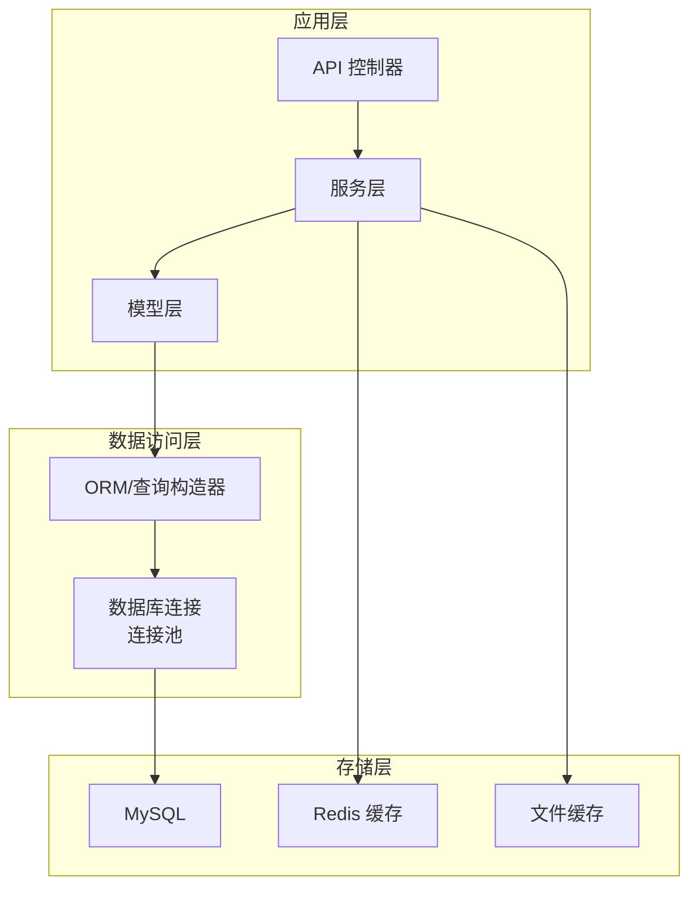
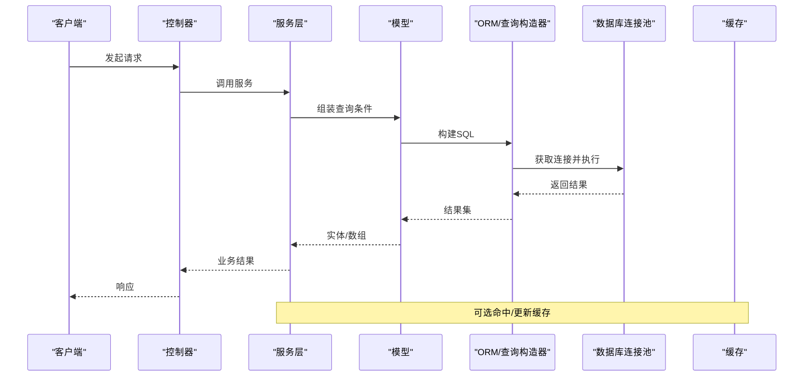
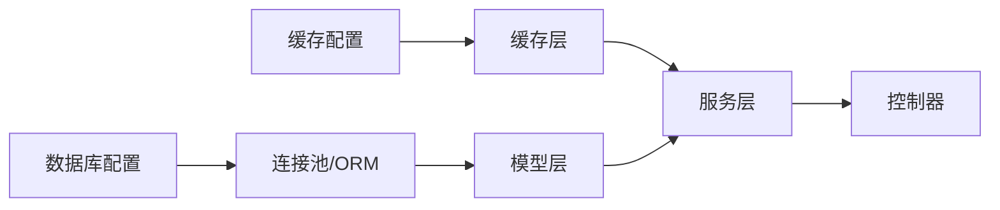

# 数据库性能优化

<cite>
**本文引用的文件**
- [gccd_server/config/database.php](file://gccd_server/config/database.php)
- [gccd_server/config/cache.php](file://gccd_server/config/cache.php)
- [gccd_server/private/database/db_init_sql.txt](file://gccd_server/private/database/db_init_sql.txt)
- [gccd_server/app/common/model/admin/ProductionModel.php](file://gccd_server/app/common/model/admin/ProductionModel.php)
- [gccd_server/app/common/model/admin/ProductReportModel.php](file://gccd_server/app/common/model/admin/ProductReportModel.php)
- [gccd_server/app/common/model/admin/QualityCheckRecordModel.php](file://gccd_server/app/common/model/admin/QualityCheckRecordModel.php)
- [gccd_server/app/common/model/admin/MaterialInventoryModel.php](file://gccd_server/app/common/model/admin/MaterialInventoryModel.php)
- [gccd_server/app/common/model/admin/StockModel.php](file://gccd_server/app/common/model/admin/StockModel.php)
- [gccd_server/app/common/model/admin/ProcessesModel.php](file://gccd_server/app/common/model/admin/ProcessesModel.php)
- [gccd_server/app/common/model/admin/RepairModel.php](file://gccd_server/app/common/model/admin/RepairModel.php)
- [gccd_server/app/common/model/admin/WageModel.php](file://gccd_server/app/common/model/admin/WageModel.php)
- [gccd_server/app/common/model/admin/UserWageModel.php](file://gccd_server/app/common/model/admin/UserWageModel.php)
- [gccd_server/app/common/model/admin/DeviceModel.php](file://gccd_server/app/common/model/admin/DeviceModel.php)
- [gccd_server/app/common/model/admin/OutStockModel.php](file://gccd_server/app/common/model/admin/OutStockModel.php)
- [gccd_server/app/common/model/admin/InStockModel.php](file://gccd_server/app/common/model/admin/InStockModel.php)
- [gccd_server/app/common/model/admin/ReceivingModel.php](file://gccd_server/app/common/model/admin/ReceivingModel.php)
- [gccd_server/app/common/model/admin/ShipModel.php](file://gccd_server/app/common/model/admin/ShipModel.php)
- [gccd_server/app/common/model/admin/RoutingModel.php](file://gccd_server/app/common/model/admin/RoutingModel.php)
- [gccd_server/app/common/model/admin/PowerModel.php](file://gccd_server/app/common/model/admin/PowerModel.php)
- [gccd_server/app/common/model/admin/ProductPowerModel.php](file://gccd_server/app/common/model/admin/ProductPowerModel.php)
- [gccd_server/app/common/model/admin/ProductionDetailModel.php](file://gccd_server/app/common/model/admin/ProductionDetailModel.php)
- [gccd_server/app/common/model/admin/ProductTaskModel.php](file://gccd_server/app/common/model/admin/ProductTaskModel.php)
- [gccd_server/app/common/model/admin/ProcessWageModel.php](file://gccd_server/app/common/model/admin/ProcessWageModel.php)
- [gccd_server/app/common/model/admin/UserWageDetailModel.php](file://gccd_server/app/common/model/admin/UserWageDetailModel.php)
- [gccd_server/app/common/model/admin/StockMaterialModel.php](file://gccd_server/app/common/model/admin/StockMaterialModel.php)
- [gccd_server/app/common/model/admin/MaterialModel.php](file://gccd_server/app/common/model/admin/MaterialModel.php)
- [gccd_server/app/common/model/admin/CheckModel.php](file://gccd_server/app/common/model/admin/CheckModel.php)
- [gccd_server/app/common/model/admin/ProcessesCheckModel.php](file://gccd_server/app/common/model/admin/ProcessesCheckModel.php)
- [gccd_server/app/common/model/admin/QualityCheckDefectModel.php](file://gccd_server/app/common/model/admin/QualityCheckDefectModel.php)
- [gccd_server/app/common/model/admin/QualityCheckItemModel.php](file://gccd_server/app/common/model/admin/QualityCheckItemModel.php)
- [gccd_server/app/common/model/admin/MesCodeModel.php](file://gccd_server/app/common/model/admin/MesCodeModel.php)
- [gccd_server/app/common/model/admin/RoutingDetailModel.php](file://gccd_server/app/common/model/admin/RoutingDetailModel.php)
- [gccd_server/app/common/model/admin/MessageModel.php](file://gccd_server/app/common/model/admin/MessageModel.php)
- [gccd_server/app/common/model/admin/RepairDetailModel.php](file://gccd_server/app/common/model/admin/RepairDetailModel.php)
- [gccd_server/app/common/model/admin/ProductCountModel.php](file://gccd_server/app/common/model/admin/ProductCountModel.php)
- [gccd_server/app/common/model/admin/WmsMaterialModel.php](file://gccd_server/app/common/model/admin/WmsMaterialModel.php)
</cite>

## 目录
1. [简介](#简介)
2. [项目结构](#项目结构)
3. [核心组件](#核心组件)
4. [架构总览](#架构总览)
5. [详细组件分析](#详细组件分析)
6. [依赖关系分析](#依赖关系分析)
7. [性能考量](#性能考量)
8. [故障排查指南](#故障排查指南)
9. [结论](#结论)
10. [附录](#附录)

## 简介
本文件面向“高齿传动”项目的数据库性能优化，结合现有配置与模型文件，系统梳理MySQL数据库在表结构设计、索引策略、查询优化、连接池与缓存、分区与分表、监控与分析、备份恢复与高可用等方面的实践建议，并提供可落地的SQL优化思路与案例路径，帮助提升系统整体吞吐与稳定性。

## 项目结构
项目采用前后端分离架构，后端基于 ThinkPHP 生态（yylAdmin），数据库配置集中在配置文件中，缓存支持多驱动（文件、Redis、Memcache、WinCache）。业务模型分布在 admin 目录下，覆盖生产、质量、物料、设备、工资等多个领域。

图示来源
- [gccd_server/config/database.php:27-66](file://gccd_server/config/database.php#L27-L66)
- [gccd_server/config/cache.php:18-52](file://gccd_server/config/cache.php#L18-L52)

章节来源
- [gccd_server/config/database.php:11-71](file://gccd_server/config/database.php#L11-L71)
- [gccd_server/config/cache.php:13-86](file://gccd_server/config/cache.php#L13-L86)

## 核心组件
- 数据库连接配置：集中于数据库配置文件，支持字符集、表前缀、读写分离、断线重连、字段缓存、触发SQL等选项。
- 缓存配置：支持文件、Redis、Memcache、WinCache 多种驱动，可通过环境变量控制过期、序列化、持久化等行为。
- 模型层：业务模型覆盖生产、质量、库存、设备、工资等模块，是SQL优化与索引设计的主要依据。

章节来源
- [gccd_server/config/database.php:27-66](file://gccd_server/config/database.php#L27-L66)
- [gccd_server/config/cache.php:18-52](file://gccd_server/config/cache.php#L18-L52)

## 架构总览
后端通过 ORM/查询构造器与数据库交互，连接池由框架管理；缓存层可选Redis或文件缓存，用于热点数据与结果集缓存。业务请求经控制器进入服务层，再调用模型进行数据操作。

图示来源
- [gccd_server/config/database.php:27-66](file://gccd_server/config/database.php#L27-L66)
- [gccd_server/config/cache.php:18-52](file://gccd_server/config/cache.php#L18-L52)

## 详细组件分析

### 表结构设计优化
- 字段类型与约束
  - 使用合适的数值类型（如整型、无符号整型）减少存储与比较成本。
  - 对频繁过滤/连接的字段设置非空与默认值，避免NULL参与计算。
  - 对枚举类状态字段使用TINYINT/SMALLINT并配合注释或字典表维护。
- 表前缀与命名规范
  - 项目统一使用前缀，便于识别与迁移，建议与业务域对应（如生产、质量、设备）。
- 分区与分表
  - 按时间维度（如年/月）对大表进行分区，降低扫描范围。
  - 对超高并发写入表采用水平分表，按主键哈希或业务键拆分，避免单点瓶颈。
- 垂直分表
  - 将长文本、大对象与高频查询字段分离，减少行宽度，提高缓存命中率。

### 索引设计原则
- 唯一索引
  - 对唯一标识（如编号、编码）建立唯一索引，保证一致性与加速查找。
- 联合索引
  - 遵循最左前缀原则，将高频过滤条件前置，避免回表。
- 覆盖索引
  - 将查询所需字段纳入联合索引，避免回表，显著降低IO。
- 基于模型的索引建议
  - 生产与报表相关表（如生产明细、产品报表）常涉及日期、工单号、工序号等过滤，建议在这些字段上建立联合索引。
  - 质量检查记录常按日期、缺陷类型、批次号过滤，建议相应组合索引。
  - 物料与库存相关表（如出入库、库存、收发）常按物料编码、仓库、时间过滤，建议相应组合索引。
  - 设备与维修相关表常按设备编号、故障类型、时间过滤，建议相应组合索引。
  - 工资相关表常按人员、部门、周期过滤，建议相应组合索引。

章节来源
- [gccd_server/app/common/model/admin/ProductionDetailModel.php](file://gccd_server/app/common/model/admin/ProductionDetailModel.php)
- [gccd_server/app/common/model/admin/ProductReportModel.php](file://gccd_server/app/common/model/admin/ProductReportModel.php)
- [gccd_server/app/common/model/admin/QualityCheckRecordModel.php](file://gccd_server/app/common/model/admin/QualityCheckRecordModel.php)
- [gccd_server/app/common/model/admin/MaterialInventoryModel.php](file://gccd_server/app/common/model/admin/MaterialInventoryModel.php)
- [gccd_server/app/common/model/admin/StockModel.php](file://gccd_server/app/common/model/admin/StockModel.php)
- [gccd_server/app/common/model/admin/OutStockModel.php](file://gccd_server/app/common/model/admin/OutStockModel.php)
- [gccd_server/app/common/model/admin/InStockModel.php](file://gccd_server/app/common/model/admin/InStockModel.php)
- [gccd_server/app/common/model/admin/ReceivingModel.php](file://gccd_server/app/common/model/admin/ReceivingModel.php)
- [gccd_server/app/common/model/admin/ShipModel.php](file://gccd_server/app/common/model/admin/ShipModel.php)
- [gccd_server/app/common/model/admin/RoutingModel.php](file://gccd_server/app/common/model/admin/RoutingModel.php)
- [gccd_server/app/common/model/admin/PowerModel.php](file://gccd_server/app/common/model/admin/PowerModel.php)
- [gccd_server/app/common/model/admin/ProductPowerModel.php](file://gccd_server/app/common/model/admin/ProductPowerModel.php)
- [gccd_server/app/common/model/admin/ProcessWageModel.php](file://gccd_server/app/common/model/admin/ProcessWageModel.php)
- [gccd_server/app/common/model/admin/UserWageDetailModel.php](file://gccd_server/app/common/model/admin/UserWageDetailModel.php)
- [gccd_server/app/common/model/admin/DeviceModel.php](file://gccd_server/app/common/model/admin/DeviceModel.php)
- [gccd_server/app/common/model/admin/RepairModel.php](file://gccd_server/app/common/model/admin/RepairModel.php)
- [gccd_server/app/common/model/admin/WageModel.php](file://gccd_server/app/common/model/admin/WageModel.php)
- [gccd_server/app/common/model/admin/UserWageModel.php](file://gccd_server/app/common/model/admin/UserWageModel.php)

### 查询语句优化
- JOIN优化
  - 优先使用INNER JOIN并确保ON条件有索引；避免笛卡尔积。
  - 将过滤条件尽量前置到WHERE中，减少中间结果集大小。
  - 对多表关联，先小表驱动大表，必要时强制使用合适索引。
- 子查询优化
  - 能用JOIN替代的子查询尽量改写为JOIN，避免相关子查询导致重复执行。
  - 将IN/EXISTS子查询改写为JOIN或临时表，减少嵌套层级。
- GROUP BY优化
  - 将排序与聚合字段纳入同一联合索引，避免Using filesort。
  - 合理使用LIMIT，避免全量排序。
- ORDER BY优化
  - 排序字段与过滤字段尽量在同一索引中，避免Using filesort。
- LIMIT优化
  - 大偏移量分页使用“基于索引的游标翻页”，避免深度OFFSET。

### 存储过程与函数
- 建议使用视图或物化视图替代复杂存储过程，便于维护与索引利用。
- 对频繁统计的报表逻辑，可在应用层通过批量查询+内存聚合实现，减少存储过程复杂度。

### 连接池配置优化
- 连接数设置
  - 根据最大并发请求数与数据库承载能力设置最大连接数，避免过高导致资源争用。
- 超时配置
  - 设置合理的连接超时、命令超时与空闲回收时间，防止连接泄漏。
- 连接复用策略
  - 在应用层启用连接复用，避免频繁创建/销毁连接。
- 关键配置项参考
  - 断线重连：根据网络波动情况开启断线重连，平衡可靠性与性能。
  - 触发SQL：开发阶段可开启触发SQL输出，定位慢查询与异常SQL。
  - 字段缓存：开启字段缓存可减少元数据查询开销，提升启动与动态查询效率。

章节来源
- [gccd_server/config/database.php:27-66](file://gccd_server/config/database.php#L27-L66)

### 缓存策略
- 查询缓存与结果集缓存
  - 对高频读取且变更不频繁的数据（如基础字典、配置项）使用Redis缓存，设置合理过期时间。
  - 对查询结果进行序列化缓存，避免重复计算。
- 热点数据缓存
  - 对关键业务键（如设备编号、物料编码、工单号）建立热点缓存，结合本地缓存与分布式缓存双写。
- 缓存驱动选择
  - 文件缓存适合开发测试；生产推荐Redis，具备持久化、集群与淘汰策略优势。
  - Memcache适合简单KV场景；WinCache适合Windows平台IIS环境。

章节来源
- [gccd_server/config/cache.php:18-52](file://gccd_server/config/cache.php#L18-L52)

### 分区与分表策略
- 水平分表
  - 按主键哈希或业务键（如年月、设备编号区间）拆分，路由规则需稳定且可扩展。
  - 分表后需统一聚合查询方案（如全局汇总表或中间层合并）。
- 垂直分表
  - 将长文本、大对象与高频字段分离，降低单行宽度，提升IO效率。
- 分区表
  - 对按时间维度增长的大表（如日志、流水）采用分区，简化归档与维护。

### 监控与性能分析
- 慢查询日志
  - 开启慢查询日志，设定阈值，定期分析慢SQL与索引缺失。
- 执行计划分析
  - 使用执行计划工具查看索引使用、是否回表、排序与临时表情况。
- 性能指标监控
  - 监控连接数、QPS、TPS、锁等待、缓冲池命中率、磁盘IO等关键指标。

### SQL优化案例（路径）
以下为常见场景的优化思路与可参考的模型位置（不直接展示代码内容）：
- JOIN优化
  - 场景：生产明细与工序、设备关联查询
  - 参考模型：[ProductionDetailModel.php](file://gccd_server/app/common/model/admin/ProductionDetailModel.php)、[ProcessesModel.php](file://gccd_server/app/common/model/admin/ProcessesModel.php)、[DeviceModel.php](file://gccd_server/app/common/model/admin/DeviceModel.php)
- 子查询优化
  - 场景：按日期范围统计质量检查记录
  - 参考模型：[QualityCheckRecordModel.php](file://gccd_server/app/common/model/admin/QualityCheckRecordModel.php)
- GROUP BY优化
  - 场景：按物料编码与仓库统计库存
  - 参考模型：[MaterialInventoryModel.php](file://gccd_server/app/common/model/admin/MaterialInventoryModel.php)、[StockModel.php](file://gccd_server/app/common/model/admin/StockModel.php)
- LIMIT优化
  - 场景：分页查询出入库流水
  - 参考模型：[OutStockModel.php](file://gccd_server/app/common/model/admin/OutStockModel.php)、[InStockModel.php](file://gccd_server/app/common/model/admin/InStockModel.php)

### 备份恢复与高可用
- 备份策略
  - 全量+增量备份结合，定期校验恢复流程，确保RPO/RTO达标。
- 高可用
  - 主从复制或集群架构，开启读写分离与故障切换。
- 安全加固
  - 最小权限原则、审计日志、敏感字段加密、网络隔离。

## 依赖关系分析
- 配置依赖
  - 数据库配置影响连接池、字符集、表前缀、读写分离与字段缓存。
  - 缓存配置决定热点数据与结果集的缓存介质与策略。
- 模型依赖
  - 模型层承担SQL构建与索引设计的最终落地，直接影响查询性能。
- 控制器/服务依赖
  - 通过服务层协调模型与缓存，形成稳定的查询链路。

图示来源
- [gccd_server/config/database.php:27-66](file://gccd_server/config/database.php#L27-L66)
- [gccd_server/config/cache.php:18-52](file://gccd_server/config/cache.php#L18-L52)

## 性能考量
- 读写分离与主从一致性
  - 写多读少场景建议开启读写分离，注意事务内一致性问题。
- 索引与统计信息
  - 定期更新统计信息，确保执行计划最优。
- 连接池与超时
  - 合理设置连接池上限与超时，避免阻塞与资源耗尽。
- 缓存命中率
  - 提升热点数据命中率，降低数据库压力。
- 分区与分表
  - 明确路由规则与扩容策略，避免热点倾斜。

## 故障排查指南
- 快速定位
  - 开启触发SQL与慢查询日志，结合执行计划定位问题。
- 常见问题
  - 索引缺失：通过执行计划确认是否回表或文件排序。
  - 锁等待：检查长事务与热点更新，必要时拆分热点。
  - 连接不足：检查连接池上限与超时设置。
- 缓存问题
  - 缓存穿透：对空结果设置短命缓存。
  - 缓存雪崩：设置随机过期时间，限流保护。

章节来源
- [gccd_server/config/database.php:60-61](file://gccd_server/config/database.php#L60-L61)

## 结论
通过规范化表结构与索引设计、优化查询语句、合理配置连接池与缓存、实施分区与分表、完善监控与备份恢复，以及持续的性能分析与迭代，可显著提升高齿传动项目的数据库性能与稳定性。建议以模型为切入点，逐步完善各业务域的索引与查询策略，并结合缓存与读写分离实现高并发下的低延迟响应。

## 附录
- 初始化SQL参考（谨慎执行，会清空数据）
  - [db_init_sql.txt:11-62](file://gccd_server/private/database/db_init_sql.txt#L11-L62)