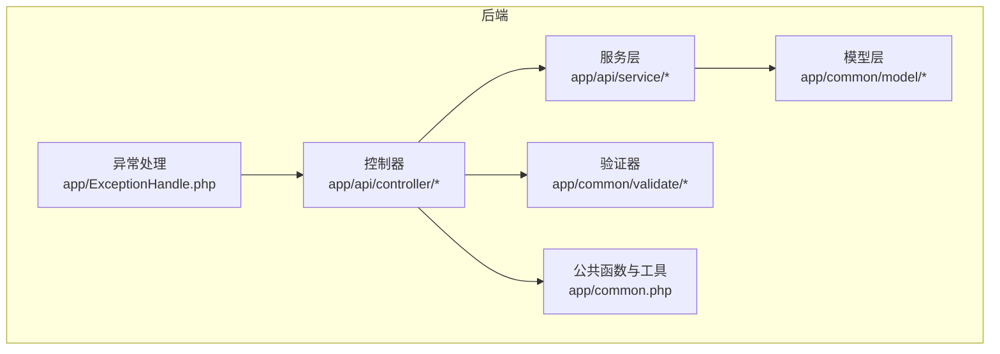
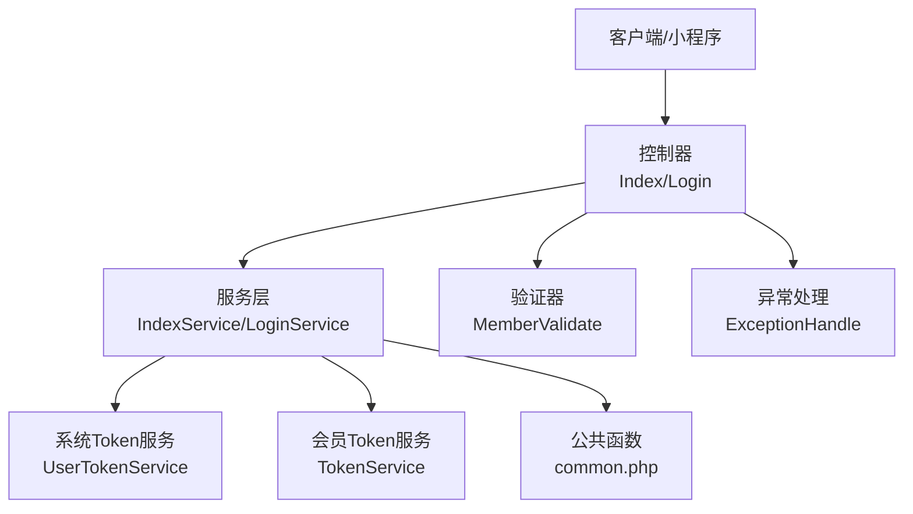
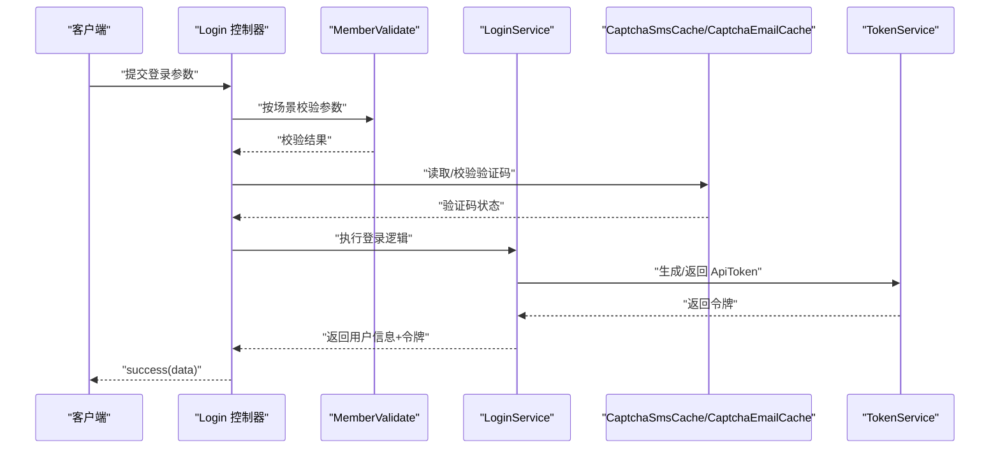
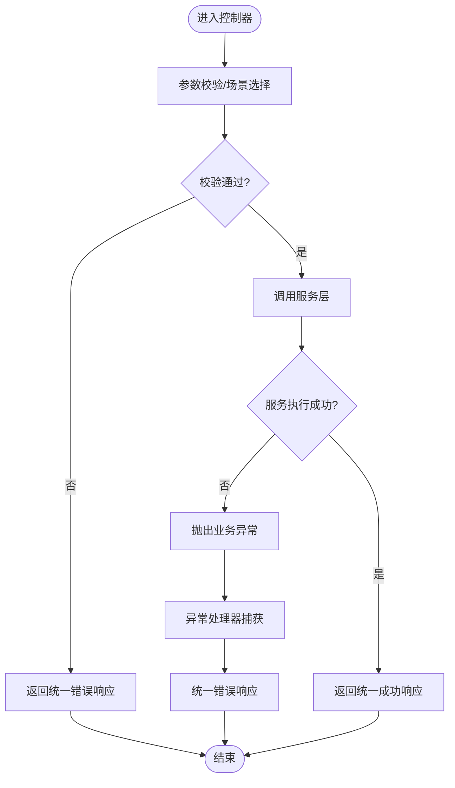
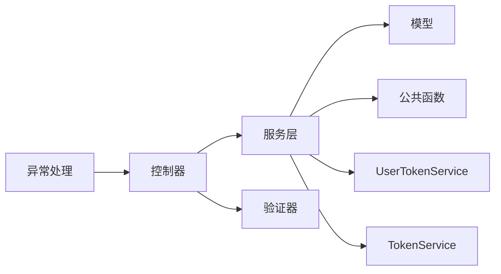

# 业务逻辑扩展

<cite>
**本文引用的文件**
- [BaseController.php](file://gccd_server/app/BaseController.php)
- [common.php](file://gccd_server/app/common.php)
- [UserTokenService.php](file://gccd_server/app/common/service/system/UserTokenService.php)
- [TokenService.php](file://gccd_server/app/common/service/member/TokenService.php)
- [Index.php](file://gccd_server/app/api/controller/Index.php)
- [Login.php](file://gccd_server/app/api/controller/member/Login.php)
- [ExceptionHandle.php](file://gccd_server/app/ExceptionHandle.php)
</cite>

## 目录
1. [引言](#引言)
2. [项目结构](#项目结构)
3. [核心组件](#核心组件)
4. [架构总览](#架构总览)
5. [详细组件分析](#详细组件分析)
6. [依赖分析](#依赖分析)
7. [性能考虑](#性能考虑)
8. [故障排查指南](#故障排查指南)
9. [结论](#结论)
10. [附录](#附录)

## 引言
本指南面向“高齿传动”项目的业务逻辑扩展开发者，聚焦于在现有框架下进行可维护、可演进的业务扩展。内容涵盖设计模式（策略、工厂、观察者等）的应用建议与落地方式；服务层扩展（自定义服务类、服务组合、服务注入）；控制器扩展（自定义控制器、继承与行为扩展）；业务规则扩展（规则引擎、条件判断、流程控制）；以及最佳实践（代码组织、错误处理、性能优化）。文中所有技术要点均基于仓库中现有文件进行提炼与总结，并提供可直接参考的实现模板与图示。

## 项目结构
项目采用前后端分离架构，后端基于 ThinkPHP 6 框架，采用模块化分层（api/admin/common 等），并以 apidoc 注解驱动接口文档生成。前端为微信小程序与 Vue 前端工程，此处重点围绕后端业务扩展能力展开。

[无图表来源：该图为概念性结构示意，不直接映射具体源码文件]

## 核心组件
- 控制器基类：提供统一的请求解析、批量验证开关、中间件与初始化钩子，便于扩展控制器时复用通用逻辑。
- 公共函数库：封装统一的成功/失败响应、HTTP 请求、树形结构转换、查询条件构造、Token 解析与校验等常用工具。
- Token 服务：分别面向系统用户与会员用户的 Token 生成、解码、校验与用户 ID 提取，支撑多端登录与鉴权。
- 异常处理：集中处理参数校验、HTTP 请求、文档异常与通用异常，输出统一格式响应。

章节来源
- [BaseController.php:1-101](file://gccd_server/app/BaseController.php#L1-L101)
- [common.php:1-921](file://gccd_server/app/common.php#L1-L921)
- [UserTokenService.php:1-147](file://gccd_server/app/common/service/system/UserTokenService.php#L1-L147)
- [TokenService.php:1-143](file://gccd_server/app/common/service/member/TokenService.php#L1-L143)
- [ExceptionHandle.php:1-98](file://gccd_server/app/ExceptionHandle.php#L1-L98)

## 架构总览
后端采用“控制器-服务-模型-验证器”的分层架构，配合公共函数与异常处理，形成清晰的职责边界与扩展点。业务扩展应遵循“控制器只做编排与参数校验，服务层承载业务规则，模型负责数据持久化”的原则。

图表来源
- [Index.php:1-37](file://gccd_server/app/api/controller/Index.php#L1-L37)
- [Login.php:1-587](file://gccd_server/app/api/controller/member/Login.php#L1-L587)
- [UserTokenService.php:1-147](file://gccd_server/app/common/service/system/UserTokenService.php#L1-L147)
- [TokenService.php:1-143](file://gccd_server/app/common/service/member/TokenService.php#L1-L143)
- [common.php:1-921](file://gccd_server/app/common.php#L1-L921)
- [ExceptionHandle.php:1-98](file://gccd_server/app/ExceptionHandle.php#L1-L98)

## 详细组件分析

### 设计模式在业务逻辑扩展中的应用
- 策略模式
  - 场景：多登录方式（用户名/手机/邮箱/第三方）、多验证码策略（图形/行为验证码）。
  - 实现建议：将不同登录策略封装为独立策略类或服务方法，通过上下文（如 LoginService）按条件选择执行，避免在控制器中堆叠分支。
  - 参考入口：登录控制器中对多种登录入口的分支处理，可抽象为策略类。
  
  章节来源
  - [Login.php:91-138](file://gccd_server/app/api/controller/member/Login.php#L91-L138)
  - [Login.php:289-340](file://gccd_server/app/api/controller/member/Login.php#L289-L340)
  - [Login.php:394-432](file://gccd_server/app/api/controller/member/Login.php#L394-L432)

- 工厂模式
  - 场景：根据平台/应用类型动态创建第三方 SDK 实例（微信/QQ/微博）。
  - 实现建议：在工厂类中集中管理实例化逻辑与配置读取，控制器仅调用工厂方法获取实例。
  - 参考入口：登录控制器中对不同第三方 SDK 的实例化与调用。
  
  章节来源
  - [Login.php:309-316](file://gccd_server/app/api/controller/member/Login.php#L309-L316)
  - [Login.php:408-416](file://gccd_server/app/api/controller/member/Login.php#L408-L416)
  - [Login.php:561-567](file://gccd_server/app/api/controller/member/Login.php#L561-L567)

- 观察者模式
  - 场景：登录成功后的日志记录、全局变量设置（如 ApiToken）等副作用。
  - 实现建议：通过事件监听器或服务层回调实现，避免在控制器中直接耦合副作用逻辑。
  - 参考入口：控制器返回前的 apidoc 注解用于设置全局 Header/Query/Body 中的 ApiToken，可作为副作用的触发点。
  
  章节来源
  - [Login.php:84-87](file://gccd_server/app/api/controller/member/Login.php#L84-L87)
  - [Login.php:172-175](file://gccd_server/app/api/controller/member/Login.php#L172-L175)
  - [Login.php:281-284](file://gccd_server/app/api/controller/member/Login.php#L281-L284)

### 服务层扩展开发指南
- 自定义服务类
  - 建议：新建服务类置于 app/api/service 或 app/common/service 下，命名以 Service 结尾，职责单一，方法语义明确。
  - 示例模板：参考现有 IndexService 的调用方式，在控制器中通过静态方法调用服务层。
  
  章节来源
  - [Index.php:31](file://gccd_server/app/api/controller/Index.php#L31)

- 服务组合与注入
  - 建议：通过构造函数注入或静态方法组合多个服务，避免在服务内部硬编码依赖。
  - 示例模板：参考 Token 服务的静态方法组合，控制器中直接调用服务方法。
  
  章节来源
  - [UserTokenService.php:41-56](file://gccd_server/app/common/service/system/UserTokenService.php#L41-L56)
  - [TokenService.php:41-56](file://gccd_server/app/common/service/member/TokenService.php#L41-L56)

- 业务规则与流程控制
  - 建议：将复杂流程拆分为步骤化的方法，结合条件判断与短路返回，提升可读性与可测试性。
  - 示例模板：参考登录流程中的验证码校验、第三方登录、缓存读写等步骤，可在服务层按顺序编排。

  章节来源
  - [Login.php:113-133](file://gccd_server/app/api/controller/member/Login.php#L113-L133)
  - [Login.php:187-201](file://gccd_server/app/api/controller/member/Login.php#L187-L201)
  - [Login.php:251-265](file://gccd_server/app/api/controller/member/Login.php#L251-L265)

### 控制器扩展方法
- 自定义控制器
  - 建议：继承 BaseController，利用 initialize、batchValidate、middleware 等特性统一处理。
  - 示例模板：参考 Index 控制器的最小实现，仅调用服务层并返回统一响应。
  
  章节来源
  - [BaseController.php:46-62](file://gccd_server/app/BaseController.php#L46-L62)
  - [Index.php:29-35](file://gccd_server/app/api/controller/Index.php#L29-L35)

- 控制器继承与行为扩展
  - 建议：将通用行为（如鉴权、日志、参数校验）下沉到基类或中间件，子类仅关注业务差异。
  - 示例模板：参考登录控制器对多种登录入口的统一编排，可抽取为通用行为。
  
  章节来源
  - [Login.php:91-138](file://gccd_server/app/api/controller/member/Login.php#L91-L138)

### 业务规则扩展实现
- 规则引擎思路
  - 建议：将规则配置化（如开关、阈值、白名单），通过服务层读取配置并按优先级执行，必要时引入规则缓存。
  - 参考：登录开关、验证码开关、多端登录限制等配置项，均可视为规则的一部分。
  
  章节来源
  - [Login.php:94-96](file://gccd_server/app/api/controller/member/Login.php#L94-L96)
  - [Login.php:114-133](file://gccd_server/app/api/controller/member/Login.php#L114-L133)

- 条件判断与流程控制
  - 建议：使用卫语句与早返回减少嵌套，将复杂条件拆分为私有方法，提升可维护性。
  - 参考：登录流程中的验证码校验、缓存比对、第三方回调处理等。
  
  章节来源
  - [Login.php:189-196](file://gccd_server/app/api/controller/member/Login.php#L189-L196)
  - [Login.php:253-260](file://gccd_server/app/api/controller/member/Login.php#L253-L260)
  - [Login.php:442-507](file://gccd_server/app/api/controller/member/Login.php#L442-L507)

### 业务逻辑扩展示例与实现模板
- 登录流程时序（参考现有 Login 控制器）

图表来源
- [Login.php:91-138](file://gccd_server/app/api/controller/member/Login.php#L91-L138)
- [Login.php:187-201](file://gccd_server/app/api/controller/member/Login.php#L187-L201)
- [Login.php:251-265](file://gccd_server/app/api/controller/member/Login.php#L251-L265)
- [TokenService.php:41-56](file://gccd_server/app/common/service/member/TokenService.php#L41-L56)

- 统一响应与错误处理（参考公共函数与异常处理）

图表来源
- [common.php:29-54](file://gccd_server/app/common.php#L29-L54)
- [ExceptionHandle.php:59-96](file://gccd_server/app/ExceptionHandle.php#L59-L96)

## 依赖分析
- 控制器依赖服务层与验证器，服务层依赖模型与公共工具，异常处理贯穿全链路。
- Token 服务与 SettingService 配置联动，影响登录策略与多端登录行为。
- apidoc 注解在控制器中用于生成文档与设置全局变量，属于非业务依赖但影响集成体验。

图表来源
- [Index.php:1-37](file://gccd_server/app/api/controller/Index.php#L1-L37)
- [Login.php:1-587](file://gccd_server/app/api/controller/member/Login.php#L1-L587)
- [UserTokenService.php:1-147](file://gccd_server/app/common/service/system/UserTokenService.php#L1-L147)
- [TokenService.php:1-143](file://gccd_server/app/common/service/member/TokenService.php#L1-L143)
- [common.php:1-921](file://gccd_server/app/common.php#L1-L921)
- [ExceptionHandle.php:1-98](file://gccd_server/app/ExceptionHandle.php#L1-L98)

## 性能考虑
- 缓存与短路：对频繁读取的配置（如登录开关、验证码开关）进行缓存，减少重复 IO。
- 异步与队列：对耗时操作（如短信/邮件发送、第三方回调）采用异步任务或队列处理。
- 日志与追踪：在开发环境开启调试信息，生产环境精简日志，避免敏感信息泄露。
- 响应体压缩：对大体量数据返回启用压缩，降低带宽占用。

[本节为通用指导，无需列出章节来源]

## 故障排查指南
- 统一错误响应
  - 使用统一的成功/失败响应函数，确保前后端交互一致性。
  - 参考：成功与错误响应函数的签名与返回结构。
  
  章节来源
  - [common.php:29-54](file://gccd_server/app/common.php#L29-L54)

- 参数校验异常
  - 使用验证器与批量验证，快速定位参数问题。
  - 参考：控制器中对 MemberValidate 的场景化调用。
  
  章节来源
  - [Login.php:156](file://gccd_server/app/api/controller/member/Login.php#L156)
  - [Login.php:220](file://gccd_server/app/api/controller/member/Login.php#L220)
  - [Login.php:253](file://gccd_server/app/api/controller/member/Login.php#L253)

- 登录状态与 Token 校验
  - 检查 Token 生成、解码、校验与用户状态（禁用/删除/密码修改）。
  - 参考：系统用户与会员 Token 服务的校验流程。
  
  章节来源
  - [UserTokenService.php:87-117](file://gccd_server/app/common/service/system/UserTokenService.php#L87-L117)
  - [TokenService.php:83-113](file://gccd_server/app/common/service/member/TokenService.php#L83-L113)

- 异常处理与调试
  - 开启调试模式查看行号、文件与堆栈，关闭调试模式隐藏敏感信息。
  - 参考：异常处理类对不同异常类型的统一输出。
  
  章节来源
  - [ExceptionHandle.php:86-95](file://gccd_server/app/ExceptionHandle.php#L86-L95)

## 结论
通过对现有控制器基类、公共函数、Token 服务与异常处理的深入分析，可以构建一套稳定、可扩展的业务逻辑扩展体系。建议在新增功能时遵循“控制器编排、服务承载、模型持久化”的分层原则，结合策略、工厂、观察者等设计模式，提升代码的可维护性与可测试性。同时，借助统一响应与异常处理机制，确保前后端交互的一致性与可观测性。

[本节为总结性内容，无需列出章节来源]

## 附录
- 实现模板清单（路径参考）
  - 控制器基类使用与初始化：[BaseController.php:46-62](file://gccd_server/app/BaseController.php#L46-L62)
  - 统一响应函数：[common.php:29-54](file://gccd_server/app/common.php#L29-L54)
  - 登录控制器示例：[Login.php:91-138](file://gccd_server/app/api/controller/member/Login.php#L91-L138)
  - 系统用户 Token 服务：[UserTokenService.php:41-56](file://gccd_server/app/common/service/system/UserTokenService.php#L41-L56)
  - 会员 Token 服务：[TokenService.php:41-56](file://gccd_server/app/common/service/member/TokenService.php#L41-L56)
  - 异常处理类：[ExceptionHandle.php:59-96](file://gccd_server/app/ExceptionHandle.php#L59-L96)