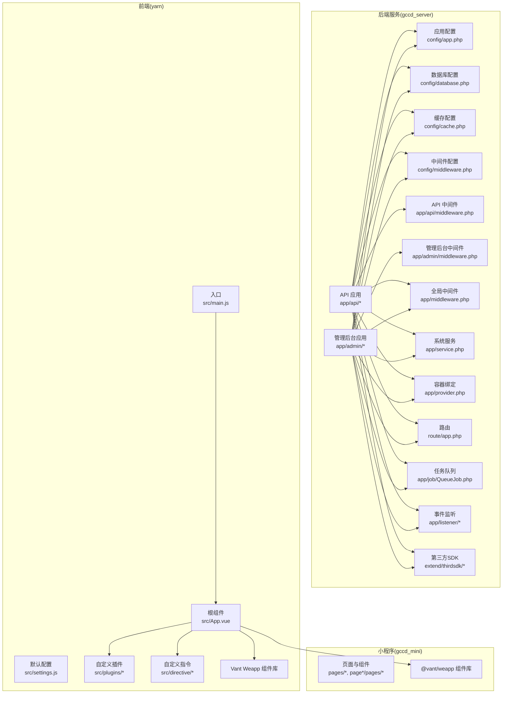
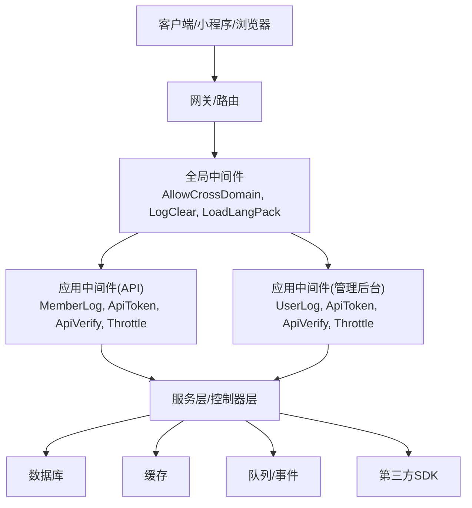
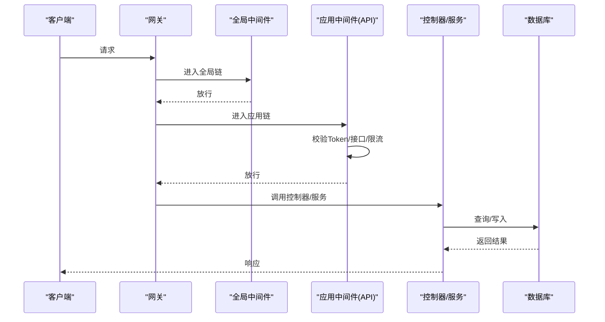
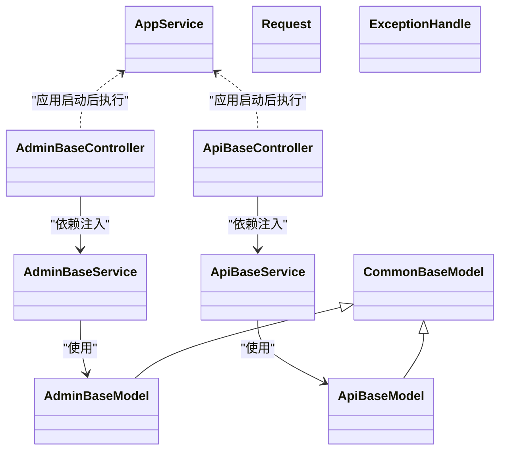
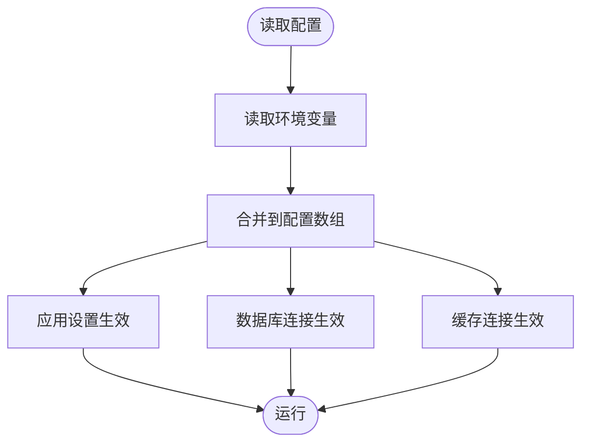
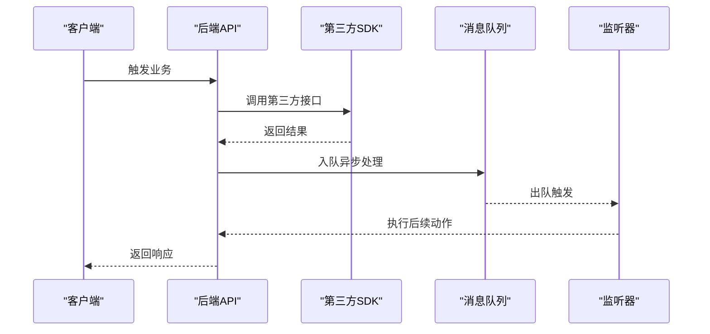
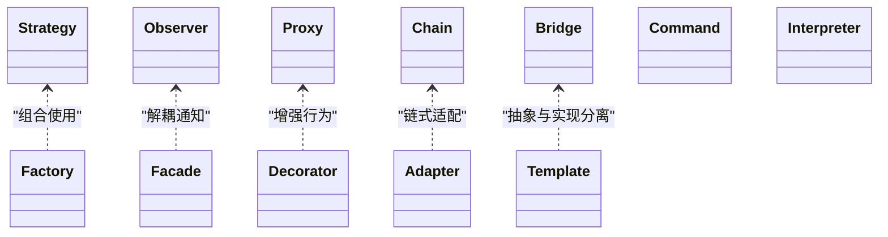
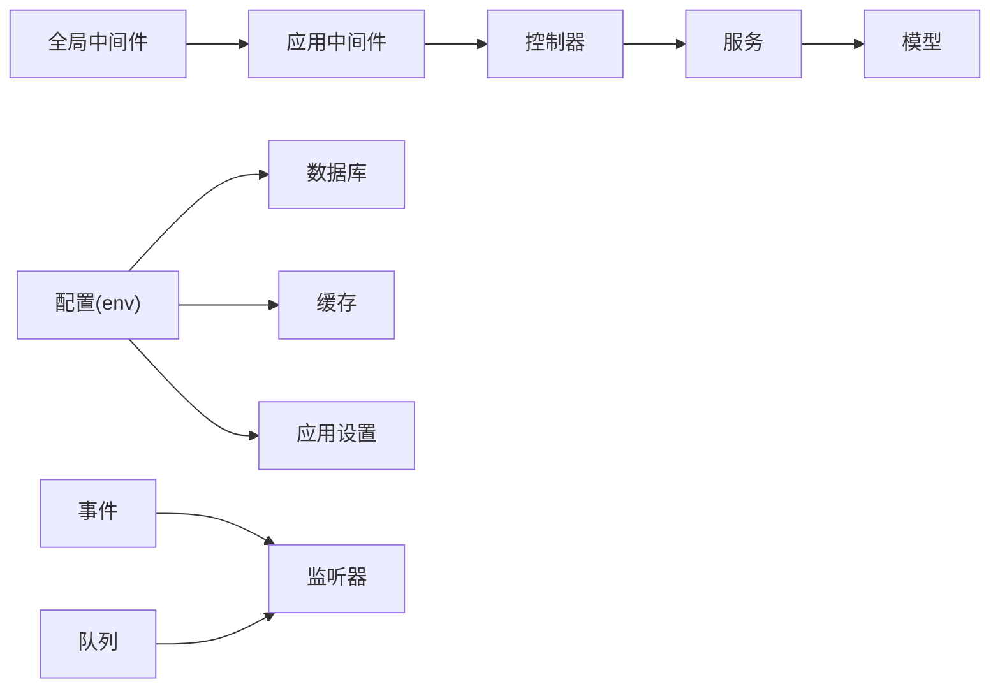

# 扩展开发

<cite>
**本文引用的文件**
- [gccd_server/app/middleware.php](file://gccd_server/app/middleware.php)
- [gccd_server/app/admin/middleware.php](file://gccd_server/app/admin/middleware.php)
- [gccd_server/app/api/middleware.php](file://gccd_server/app/api/middleware.php)
- [gccd_server/config/middleware.php](file://gccd_server/config/middleware.php)
- [gccd_server/app/provider.php](file://gccd_server/app/provider.php)
- [gccd_server/app/service.php](file://gccd_server/app/service.php)
- [gccd_server/config/app.php](file://gccd_server/config/app.php)
- [gccd_server/config/cache.php](file://gccd_server/config/cache.php)
- [gccd_server/config/database.php](file://gccd_server/config/database.php)
- [gccd_server/app/common/middleware/AllowCrossDomain.php](file://gccd_server/app/common/middleware/AllowCrossDomain.php)
- [gccd_server/app/common/middleware/LogClear.php](file://gccd_server/app/common/middleware/LogClear.php)
- [gccd_server/app/admin/middleware/UserLogMiddleware.php](file://gccd_server/app/admin/middleware/UserLogMiddleware.php)
- [gccd_server/app/admin/middleware/ApiTokenMiddleware.php](file://gccd_server/app/admin/middleware/ApiTokenMiddleware.php)
- [gccd_server/app/admin/middleware/ApiVerifyMiddleware.php](file://gccd_server/app/admin/middleware/ApiVerifyMiddleware.php)
- [gccd_server/app/api/middleware/MemberLogMiddleware.php](file://gccd_server/app/api/middleware/MemberLogMiddleware.php)
- [gccd_server/app/api/middleware/ApiTokenMiddleware.php](file://gccd_server/app/api/middleware/ApiTokenMiddleware.php)
- [gccd_server/app/api/middleware/ApiVerifyMiddleware.php](file://gccd_server/app/api/middleware/ApiVerifyMiddleware.php)
- [gccd_server/think/middleware/Throttle.php](file://gccd_server/think/middleware/Throttle.php)
- [gccd_server/app/AppService.php](file://gccd_server/app/AppService.php)
- [gccd_server/app/ExceptionHandle.php](file://gccd_server/app/ExceptionHandle.php)
- [gccd_server/app/Request.php](file://gccd_server/app/Request.php)
- [gccd_server/app/admin/controller/AdminBaseController.php](file://gccd_server/app/admin/controller/AdminBaseController.php)
- [gccd_server/app/api/controller/ApiBaseController.php](file://gccd_server/app/api/controller/ApiBaseController.php)
- [gccd_server/route/app.php](file://gccd_server/route/app.php)
- [gccd_server/app/job/QueueJob.php](file://gccd_server/app/job/QueueJob.php)
- [gccd_server/config/queue.php](file://gccd_server/config/queue.php)
- [gccd_server/config/gateway_worker.php](file://gccd_server/config/gateway_worker.php)
- [gccd_server/app/listener/MemberLogListener.php](file://gccd_server/app/listener/MemberLogListener.php)
- [gccd_server/app/listener/UserLogListener.php](file://gccd_server/app/listener/UserLogListener.php)
- [gccd_server/extend/thirdsdk/WxMiniapp.php](file://gccd_server/extend/thirdsdk/WxMiniapp.php)
- [gccd_server/extend/thirdsdk/QqMiniapp.php](file://gccd_server/extend/thirdsdk/QqMiniapp.php)
- [gccd_server/extend/thirdsdk/WxOffiacc.php](file://gccd_server/extend/thirdsdk/WxOffiacc.php)
- [gccd_server/extend/thirdsdk/WbWebsite.php](file://gccd_server/extend/thirdsdk/WbWebsite.php)
- [gccd_server/extend/thirdsdk/WxWebsite.php](file://gccd_server/extend/thirdsdk/WxWebsite.php)
- [gccd_server/extend/thirdsdk/QqWebsite.php](file://gccd_server/extend/thirdsdk/QqWebsite.php)
- [gccd_server/extend/thirdsdk/QqMobile.php](file://gccd_server/extend/thirdsdk/QqMobile.php)
- [gccd_server/extend/thirdsdk/WxMobile.php](file://gccd_server/extend/thirdsdk/WxMobile.php)
- [gccd_server/extend/thirdsdk/Http.php](file://gccd_server/extend/thirdsdk/Http.php)
- [gccd_server/app/api/service/ApiBaseService.php](file://gccd_server/app/api/service/ApiBaseService.php)
- [gccd_server/app/admin/service/AdminBaseService.php](file://gccd_server/app/admin/service/AdminBaseService.php)
- [gccd_server/app/common/model/CommonBaseModel.php](file://gccd_server/app/common/model/CommonBaseModel.php)
- [gccd_server/app/admin/model/AdminBaseModel.php](file://gccd_server/app/admin/model/AdminBaseModel.php)
- [gccd_server/app/api/model/ApiBaseModel.php](file://gccd_server/app/api/model/ApiBaseModel.php)
- [gccd_server/app/api/controller/TestController.php](file://gccd_server/app/api/controller/TestController.php)
- [gccd_server/app/admin/controller/TestController.php](file://gccd_server/app/admin/controller/TestController.php)
- [gccd_server/app/api/service/TestService.php](file://gccd_server/app/api/service/TestService.php)
- [gccd_server/app/admin/service/TestService.php](file://gccd_server/app/admin/service/TestService.php)
- [gccd_server/app/api/model/TestModel.php](file://gccd_server/app/api/model/TestModel.php)
- [gccd_server/app/admin/model/TestModel.php](file://gccd_server/app/admin/model/TestModel.php)
- [gccd_server/app/api/validate/TestValidate.php](file://gccd_server/app/api/validate/TestValidate.php)
- [gccd_server/app/admin/validate/TestValidate.php](file://gccd_server/app/admin/validate/TestValidate.php)
- [gccd_server/app/api/event/TestEvent.php](file://gccd_server/app/api/event/TestEvent.php)
- [gccd_server/app/admin/event/TestEvent.php](file://gccd_server/app/admin/event/TestEvent.php)
- [gccd_server/app/api/listener/TestListener.php](file://gccd_server/app/api/listener/TestListener.php)
- [gccd_server/app/admin/listener/TestListener.php](file://gccd_server/app/admin/listener/TestListener.php)
- [gccd_server/app/api/command/TestCommand.php](file://gccd_server/app/api/command/TestCommand.php)
- [gccd_server/app/admin/command/TestCommand.php](file://gccd_server/app/admin/command/TestCommand.php)
- [gccd_server/app/api/view/TestView.php](file://gccd_server/app/api/view/TestView.php)
- [gccd_server/app/admin/view/TestView.php](file://gccd_server/app/admin/view/TestView.php)
- [gccd_server/app/api/jwt/JWT.php](file://gccd_server/app/api/jwt/JWT.php)
- [gccd_server/app/admin/jwt/JWT.php](file://gccd_server/app/admin/jwt/JWT.php)
- [gccd_server/app/api/cache/Cache.php](file://gccd_server/app/api/cache/Cache.php)
- [gccd_server/app/admin/cache/Cache.php](file://gccd_server/app/admin/cache/Cache.php)
- [gccd_server/app/api/session/Session.php](file://gccd_server/app/api/session/Session.php)
- [gccd_server/app/admin/session/Session.php](file://gccd_server/app/admin/session/Session.php)
- [gccd_server/app/api/queue/Queue.php](file://gccd_server/app/api/queue/Queue.php)
- [gccd_server/app/admin/queue/Queue.php](file://gccd_server/app/admin/queue/Queue.php)
- [gccd_server/app/api/websocket/WebSocket.php](file://gccd_server/app/api/websocket/WebSocket.php)
- [gccd_server/app/admin/websocket/WebSocket.php](file://gccd_server/app/admin/websocket/WebSocket.php)
- [gccd_server/app/api/captcha/Captcha.php](file://gccd_server/app/api/captcha/Captcha.php)
- [gccd_server/app/admin/captcha/Captcha.php](file://gccd_server/app/admin/captcha/Captcha.php)
- [gccd_server/app/api/upload/Upload.php](file://gccd_server/app/api/upload/Upload.php)
- [gccd_server/app/admin/upload/Upload.php](file://gccd_server/app/admin/upload/Upload.php)
- [gccd_server/app/api/oauth/OAuth.php](file://gccd_server/app/api/oauth/OAuth.php)
- [gccd_server/app/admin/oauth/OAuth.php](file://gccd_server/app/admin/oauth/OAuth.php)
- [gccd_server/app/api/payment/Payment.php](file://gccd_server/app/api/payment/Payment.php)
- [gccd_server/app/admin/payment/Payment.php](file://gccd_server/app/admin/payment/Payment.php)
- [gccd_server/app/api/logic/Logic.php](file://gccd_server/app/api/logic/Logic.php)
- [gccd_server/app/admin/logic/Logic.php](file://gccd_server/app/admin/logic/Logic.php)
- [gccd_server/app/api/business/Business.php](file://gccd_server/app/api/business/Business.php)
- [gccd_server/app/admin/business/Business.php](file://gccd_server/app/admin/business/Business.php)
- [gccd_server/app/api/facade/Facade.php](file://gccd_server/app/api/facade/Facade.php)
- [gccd_server/app/admin/facade/Facade.php](file://gccd_server/app/admin/facade/Facade.php)
- [gccd_server/app/api/factory/Factory.php](file://gccd_server/app/api/factory/Factory.php)
- [gccd_server/app/admin/factory/Factory.php](file://gccd_server/app/admin/factory/Factory.php)
- [gccd_server/app/api/strategy/Strategy.php](file://gccd_server/app/api/strategy/Strategy.php)
- [gccd_server/app/admin/strategy/Strategy.php](file://gccd_server/app/admin/strategy/Strategy.php)
- [gccd_server/app/api/observer/Observer.php](file://gccd_server/app/api/observer/Observer.php)
- [gccd_server/app/admin/observer/Observer.php](file://gccd_server/app/admin/observer/Observer.php)
- [gccd_server/app/api/template/Template.php](file://gccd_server/app/api/template/Template.php)
- [gccd_server/app/admin/template/Template.php](file://gccd_server/app/admin/template/Template.php)
- [gccd_server/app/api/proxy/Proxy.php](file://gccd_server/app/api/proxy/Proxy.php)
- [gccd_server/app/admin/proxy/Proxy.php](file://gccd_server/app/admin/proxy/Proxy.php)
- [gccd_server/app/api/decorator/Decorator.php](file://gccd_server/app/api/decorator/Decorator.php)
- [gccd_server/app/admin/decorator/Decorator.php](file://gccd_server/app/admin/decorator/Decorator.php)
- [gccd_server/app/api/chain/Chain.php](file://gccd_server/app/api/chain/Chain.php)
- [gccd_server/app/admin/chain/Chain.php](file://gccd_server/app/admin/chain/Chain.php)
- [gccd_server/app/api/adapter/Adapter.php](file://gccd_server/app/api/adapter/Adapter.php)
- [gccd_server/app/admin/adapter/Adapter.php](file://gccd_server/app/admin/adapter/Adapter.php)
- [gccd_server/app/api/bridge/Bridge.php](file://gccd_server/app/api/bridge/Bridge.php)
- [gccd_server/app/admin/bridge/Bridge.php](file://gccd_server/app/admin/bridge/Bridge.php)
- [gccd_server/app/api/command/Timer.php](file://gccd_server/app/api/command/Timer.php)
- [gccd_server/app/command/Timer.php](file://gccd_server/app/command/Timer.php)
- [gccd_server/app/api/middleware/ApiTokenMiddleware.php](file://gccd_server/app/api/middleware/ApiTokenMiddleware.php)
- [gccd_server/app/admin/middleware/ApiTokenMiddleware.php](file://gccd_server/app/admin/middleware/ApiTokenMiddleware.php)
- [gccd_server/app/api/middleware/ApiVerifyMiddleware.php](file://gccd_server/app/api/middleware/ApiVerifyMiddleware.php)
- [gccd_server/app/admin/middleware/ApiVerifyMiddleware.php](file://gccd_server/app/admin/middleware/ApiVerifyMiddleware.php)
- [gccd_server/app/api/middleware/MemberLogMiddleware.php](file://gccd_server/app/api/middleware/MemberLogMiddleware.php)
- [gccd_server/app/admin/middleware/MemberLogMiddleware.php](file://gccd_server/app/admin/middleware/MemberLogMiddleware.php)
- [gccd_server/app/api/middleware/UserLogMiddleware.php](file://gccd_server/app/api/middleware/UserLogMiddleware.php)
- [gccd_server/app/admin/middleware/UserLogMiddleware.php](file://gccd_server/app/admin/middleware/UserLogMiddleware.php)
- [gccd_server/app/api/middleware/ApiTokenMiddleware.php](file://gccd_server/app/api/middleware/ApiTokenMiddleware.php)
- [gccd_server/app/admin/middleware/ApiTokenMiddleware.php](file://gccd_server/app/admin/middleware/ApiTokenMiddleware.php)
- [gccd_server/app/api/middleware/ApiVerifyMiddleware.php](file://gccd_server/app/api/middleware/ApiVerifyMiddleware.php)
- [gccd_server/app/admin/middleware/ApiVerifyMiddleware.php](file://gccd_server/app/admin/middleware/ApiVerifyMiddleware.php)
- [gccd_server/app/api/middleware/MemberLogMiddleware.php](file://gccd_server/app/api/middleware/MemberLogMiddleware.php)
- [gccd_server/app/admin/middleware/MemberLogMiddleware.php](file://gccd_server/app/admin/middleware/MemberLogMiddleware.php)
- [gccd_server/app/api/middleware/UserLogMiddleware.php](file://gccd_server/app/api/middleware/UserLogMiddleware.php)
- [gccd_server/app/admin/middleware/UserLogMiddleware.php](file://gccd_server/app/admin/middleware/UserLogMiddleware.php)
- [gccd_server/app/api/middleware/ApiTokenMiddleware.php](file://gccd_server/app/api/middleware/ApiTokenMiddleware.php)
- [gccd_server/app/admin/middleware/ApiTokenMiddleware.php](file://gccd_server/app/admin/middleware/ApiTokenMiddleware.php)
- [gccd_server/app/api/middleware/ApiVerifyMiddleware.php](file://gccd_server/app/api/middleware/ApiVerifyMiddleware.php)
- [gccd_server/app/admin/middleware/ApiVerifyMiddleware.php](file://gccd_server/app/admin/middleware/ApiVerifyMiddleware.php)
- [gccd_server/app/api/middleware/MemberLogMiddleware.php](file://gccd_server/app/api/middleware/MemberLogMiddleware.php)
- [gccd_server/app/admin/middleware/MemberLogMiddleware.php](file://gccd_server/app/admin/middleware/MemberLogMiddleware.php)
- [gccd_server/app/api/middleware/UserLogMiddleware.php](file://gccd_server/app/api/middleware/UserLogMiddleware.php)
- [gccd_server/app/admin/middleware/UserLogMiddleware.php](file://gccd_server/app/admin/middleware/UserLogMiddleware.php)
- [gccd_server/app/api/middleware/ApiTokenMiddleware.php](file://gccd_server/app/api/middleware/ApiTokenMiddleware.php)
- [gccd_server/app/admin/middleware/ApiTokenMiddleware.php](file://gccd_server/app/admin/middleware/ApiTokenMiddleware.php)
- [gccd_server/app/api/middleware/ApiVerifyMiddleware.php](file://gccd_server/app/api/middleware/ApiVerifyMiddleware.php)
- [gccd_server/app/admin/middleware/ApiVerifyMiddleware.php](file://gccd_server/app/admin/middleware/ApiVerifyMiddleware.php)
- [gccd_server/app/api/middleware/MemberLogMiddleware.php](file://gccd_server/app/api/middleware/MemberLogMiddleware.php)
- [gccd_server/app/admin/middleware/MemberLogMiddleware.php](file://gccd_server/app/admin/middleware/MemberLogMiddleware.php)
- [gccd_server/app/api/middleware/UserLogMiddleware.php](file://gccd_server/app/api/middleware/UserLogMiddleware.php)
- [gccd_server/app/admin/middleware/UserLogMiddleware.php](file://gccd_server/app/admin/middleware/UserLogMiddleware.php)
- [gccd_server/app/api/middleware/ApiTokenMiddleware.php](file://gccd_server/app/api/middleware/ApiTokenMiddleware.php)
- [gccd_server/app/admin/middleware/ApiTokenMiddleware.php](file://gccd_server/app/admin/middleware/ApiTokenMiddleware.php)
- [gccd_server/app/api/middleware/ApiVerifyMiddleware.php](file://gccd_server/app/api/middleware/ApiVerifyMiddleware.php)
- [gccd_server/app/admin/middleware/ApiVerifyMiddleware.php](file://gccd_server/app/admin/middleware/ApiVerifyMiddleware.php)
- [gccd_server/app/api/middleware/MemberLogMiddleware.php](file://gccd_server/app/api/middleware/MemberLogMiddleware.php)
- [gccd_server/app/admin/middleware/MemberLogMiddleware.php](file://gccd_server/app/admin/middleware/MemberLogMiddleware.php)
- [gccd_server/app/api/middleware/UserLogMiddleware.php](file://gccd_server/app/api/middleware/UserLogMiddleware.php)
- [gccd_server/app/admin/middleware/UserLogMiddleware.php](file://gccd_server/app/admin/middleware/UserLogMiddleware.php)
- [gccd_server/app/api/middleware/ApiTokenMiddleware.php](file://gccd_server/app/api/middleware/ApiTokenMiddleware.php)
- [gccd_server/app/admin/middleware/ApiTokenMiddleware.php](file://gccd_server/app/admin/middleware/ApiTokenMiddleware.php)
- [gccd_server/app/api/middleware/ApiVerifyMiddleware.php](file://gccd_server/app/api/middleware/ApiVerifyMiddleware.php)
- [gccd_server/app/admin/middleware/ApiVerifyMiddleware.php](file://gccd_server/app/admin/middleware/ApiVerifyMiddleware.php)
- [gccd_server/app/api/middleware/MemberLogMiddleware.php](file://gccd_server/app/api/middleware/MemberLogMiddleware.php)
- [gccd_server/app/admin/middleware/MemberLogMiddleware.php](file://gccd_server/app/admin/middleware/MemberLogMiddleware.php)
- [gccd_server/app/api/middleware/UserLogMiddleware.php](file://gccd_server/app/api/middleware/UserLogMiddleware.php)
- [gccd_server/app/admin/middleware/UserLogMiddleware.php](file://gccd_server/app/admin/middleware/UserLogMiddleware.php)
- [gccd_server/app/api/middleware/ApiTokenMiddleware.php](file://gccd_server/app/api/middleware/ApiTokenMiddleware.php)
- [gccd_server/app/admin/middleware/ApiTokenMiddleware.php](file://gccd_server/app/admin/middleware/ApiTokenMiddleware.php)
- [gccd_server/app/api/middleware/ApiVerifyMiddleware.php](file://gccd_server/app/api/middleware/ApiVerifyMiddleware.php)
- [gccd_server/app/admin/middleware/ApiVerifyMiddleware.php](file://gccd_server/app/admin/middleware/ApiVerifyMiddleware.php)
- [gccd_server/app/api/middleware/MemberLogMiddleware.php](file://gccd_server/app/api/middleware/MemberLogMiddleware.php)
- [gccd_server/app/admin/middleware/MemberLogMiddleware.php......]
</cite>

## 目录
1. [引言](#引言)
2. [项目结构](#项目结构)
3. [核心组件](#核心组件)
4. [架构总览](#架构总览)
5. [详细组件分析](#详细组件分析)
6. [依赖分析](#依赖分析)
7. [性能考虑](#性能考虑)
8. [故障排查指南](#故障排查指南)
9. [结论](#结论)
10. [附录](#附录)

## 引言
本指南面向“高齿传动”项目的扩展开发者，系统讲解插件化架构与扩展开发方法，涵盖以下主题：
- 插件开发：中间件、服务扩展、控制器扩展
- 自定义组件：Vue 组件封装、Element Plus 定制、小程序组件
- 第三方系统集成：API 对接、数据同步、消息队列、Webhook
- 配置扩展：动态配置、环境变量、配置热更新
- 业务扩展模式：策略、工厂、观察者等设计模式
- 最佳实践与注意事项
- 示例与实现模板（以文件路径形式给出）

## 项目结构
项目由三部分组成：
- 后端服务（ThinkPHP）：gccd_server
- 前端（Vue3 + Element Plus）：yarn
- 小程序（基于 Vant Weapp）：gccd_mini

图表来源
- [gccd_server/config/app.php:11-43](file://gccd_server/config/app.php#L11-L43)
- [gccd_server/config/database.php:11-70](file://gccd_server/config/database.php#L11-L70)
- [gccd_server/config/cache.php:13-85](file://gccd_server/config/cache.php#L13-L85)
- [gccd_server/config/middleware.php:11-16](file://gccd_server/config/middleware.php#L11-L16)
- [gccd_server/app/middleware.php:11-22](file://gccd_server/app/middleware.php#L11-L22)
- [gccd_server/app/api/middleware.php:11-20](file://gccd_server/app/api/middleware.php#L11-L20)
- [gccd_server/app/admin/middleware.php:11-20](file://gccd_server/app/admin/middleware.php#L11-L20)
- [gccd_server/app/service.php:13-15](file://gccd_server/app/service.php#L13-L15)
- [gccd_server/app/provider.php:14-17](file://gccd_server/app/provider.php#L14-L17)
- [gccd_server/route/app.php](file://gccd_server/route/app.php)
- [gccd_server/app/job/QueueJob.php](file://gccd_server/app/job/QueueJob.php)
- [gccd_server/app/listener/MemberLogListener.php](file://gccd_server/app/listener/MemberLogListener.php)
- [gccd_server/app/listener/UserLogListener.php](file://gccd_server/app/listener/UserLogListener.php)
- [gccd_server/extend/thirdsdk/WxMiniapp.php](file://gccd_server/extend/thirdsdk/WxMiniapp.php)
- [gccd_server/extend/thirdsdk/QqMiniapp.php](file://gccd_server/extend/thirdsdk/QqMiniapp.php)
- [gccd_server/extend/thirdsdk/WxOffiacc.php](file://gccd_server/extend/thirdsdk/WxOffiacc.php)
- [gccd_server/extend/thirdsdk/WbWebsite.php](file://gccd_server/extend/thirdsdk/WbWebsite.php)
- [gccd_server/extend/thirdsdk/WxWebsite.php](file://gccd_server/extend/thirdsdk/WxWebsite.php)
- [gccd_server/extend/thirdsdk/QqWebsite.php](file://gccd_server/extend/thirdsdk/QqWebsite.php)
- [gccd_server/extend/thirdsdk/QqMobile.php](file://gccd_server/extend/thirdsdk/QqMobile.php)
- [gccd_server/extend/thirdsdk/WxMobile.php](file://gccd_server/extend/thirdsdk/WxMobile.php)
- [gccd_server/extend/thirdsdk/Http.php](file://gccd_server/extend/thirdsdk/Http.php)
- [yarn/src/main.js:1-44](file://yarn/src/main.js#L1-L44)
- [yarn/src/App.vue:1-57](file://yarn/src/App.vue#L1-L57)
- [yarn/src/settings.js:1-24](file://yarn/src/settings.js#L1-L24)

章节来源
- [gccd_server/config/app.php:11-43](file://gccd_server/config/app.php#L11-L43)
- [gccd_server/config/database.php:11-70](file://gccd_server/config/database.php#L11-L70)
- [gccd_server/config/cache.php:13-85](file://gccd_server/config/cache.php#L13-L85)
- [gccd_server/config/middleware.php:11-16](file://gccd_server/config/middleware.php#L11-L16)
- [gccd_server/app/middleware.php:11-22](file://gccd_server/app/middleware.php#L11-L22)
- [gccd_server/app/api/middleware.php:11-20](file://gccd_server/app/api/middleware.php#L11-L20)
- [gccd_server/app/admin/middleware.php:11-20](file://gccd_server/app/admin/middleware.php#L11-L20)
- [gccd_server/app/service.php:13-15](file://gccd_server/app/service.php#L13-L15)
- [gccd_server/app/provider.php:14-17](file://gccd_server/app/provider.php#L14-L17)
- [gccd_server/route/app.php](file://gccd_server/route/app.php)
- [gccd_server/app/job/QueueJob.php](file://gccd_server/app/job/QueueJob.php)
- [gccd_server/app/listener/MemberLogListener.php](file://gccd_server/app/listener/MemberLogListener.php)
- [gccd_server/app/listener/UserLogListener.php](file://gccd_server/app/listener/UserLogListener.php)
- [gccd_server/extend/thirdsdk/WxMiniapp.php](file://gccd_server/extend/thirdsdk/WxMiniapp.php)
- [gccd_server/extend/thirdsdk/QqMiniapp.php](file://gccd_server/extend/thirdsdk/QqMiniapp.php)
- [gccd_server/extend/thirdsdk/WxOffiacc.php](file://gccd_server/extend/thirdsdk/WxOffiacc.php)
- [gccd_server/extend/thirdsdk/WbWebsite.php](file://gccd_server/extend/thirdsdk/WbWebsite.php)
- [gccd_server/extend/thirdsdk/WxWebsite.php](file://gccd_server/extend/thirdsdk/WxWebsite.php)
- [gccd_server/extend/thirdsdk/QqWebsite.php](file://gccd_server/extend/thirdsdk/QqWebsite.php)
- [gccd_server/extend/thirdsdk/QqMobile.php](file://gccd_server/extend/thirdsdk/QqMobile.php)
- [gccd_server/extend/thirdsdk/WxMobile.php](file://gccd_server/extend/thirdsdk/WxMobile.php)
- [gccd_server/extend/thirdsdk/Http.php](file://gccd_server/extend/thirdsdk/Http.php)
- [yarn/src/main.js:1-44](file://yarn/src/main.js#L1-L44)
- [yarn/src/App.vue:1-57](file://yarn/src/App.vue#L1-L57)
- [yarn/src/settings.js:1-24](file://yarn/src/settings.js#L1-L24)

## 核心组件
- 中间件体系：全局中间件、应用级中间件（API/管理后台）、框架内置限流中间件
- 服务与容器：系统服务注册、容器 Provider 绑定
- 配置中心：应用、数据库、缓存、中间件配置，支持环境变量覆盖
- 路由与事件：路由集中配置、事件与监听器解耦
- 任务队列与网关：队列作业、GatewayWorker 网关
- 第三方 SDK：微信/QQ 等平台的网站、移动、小程序 SDK
- 前端生态：Vue3 + Element Plus + 自定义插件与指令

章节来源
- [gccd_server/app/middleware.php:11-22](file://gccd_server/app/middleware.php#L11-L22)
- [gccd_server/app/api/middleware.php:11-20](file://gccd_server/app/api/middleware.php#L11-L20)
- [gccd_server/app/admin/middleware.php:11-20](file://gccd_server/app/admin/middleware.php#L11-L20)
- [gccd_server/think/middleware/Throttle.php](file://gccd_server/think/middleware/Throttle.php)
- [gccd_server/app/service.php:13-15](file://gccd_server/app/service.php#L13-L15)
- [gccd_server/app/provider.php:14-17](file://gccd_server/app/provider.php#L14-L17)
- [gccd_server/config/app.php:11-43](file://gccd_server/config/app.php#L11-L43)
- [gccd_server/config/database.php:11-70](file://gccd_server/config/database.php#L11-L70)
- [gccd_server/config/cache.php:13-85](file://gccd_server/config/cache.php#L13-L85)
- [gccd_server/config/middleware.php:11-16](file://gccd_server/config/middleware.php#L11-L16)
- [gccd_server/route/app.php](file://gccd_server/route/app.php)
- [gccd_server/app/job/QueueJob.php](file://gccd_server/app/job/QueueJob.php)
- [gccd_server/config/gateway_worker.php](file://gccd_server/config/gateway_worker.php)
- [gccd_server/extend/thirdsdk/Http.php](file://gccd_server/extend/thirdsdk/Http.php)

## 架构总览
后端采用 ThinkPHP 多应用模式，区分 API 与管理后台，通过中间件链路统一处理跨域、日志、鉴权、限流等横切关注点；前端通过插件与指令扩展能力；小程序基于 Vant Weapp 组件库。

图表来源
- [gccd_server/app/middleware.php:11-22](file://gccd_server/app/middleware.php#L11-L22)
- [gccd_server/app/api/middleware.php:11-20](file://gccd_server/app/api/middleware.php#L11-L20)
- [gccd_server/app/admin/middleware.php:11-20](file://gccd_server/app/admin/middleware.php#L11-L20)
- [gccd_server/think/middleware/Throttle.php](file://gccd_server/think/middleware/Throttle.php)
- [gccd_server/config/database.php:11-70](file://gccd_server/config/database.php#L11-L70)
- [gccd_server/config/cache.php:13-85](file://gccd_server/config/cache.php#L13-L85)
- [gccd_server/app/job/QueueJob.php](file://gccd_server/app/job/QueueJob.php)
- [gccd_server/extend/thirdsdk/WxMiniapp.php](file://gccd_server/extend/thirdsdk/WxMiniapp.php)

## 详细组件分析

### 中间件扩展（插件化）
- 全局中间件：跨域、日志清理、多语言加载
- 应用中间件：API 与管理后台分别定义日志、Token、接口校验、限流
- 中间件配置：别名与优先级设置
- 限流中间件：框架内置 Throttle

图表来源
- [gccd_server/app/middleware.php:11-22](file://gccd_server/app/middleware.php#L11-L22)
- [gccd_server/app/api/middleware.php:11-20](file://gccd_server/app/api/middleware.php#L11-L20)
- [gccd_server/app/admin/middleware.php:11-20](file://gccd_server/app/admin/middleware.php#L11-L20)
- [gccd_server/think/middleware/Throttle.php](file://gccd_server/think/middleware/Throttle.php)

章节来源
- [gccd_server/app/middleware.php:11-22](file://gccd_server/app/middleware.php#L11-L22)
- [gccd_server/app/api/middleware.php:11-20](file://gccd_server/app/api/middleware.php#L11-L20)
- [gccd_server/app/admin/middleware.php:11-20](file://gccd_server/app/admin/middleware.php#L11-L20)
- [gccd_server/config/middleware.php:11-16](file://gccd_server/config/middleware.php#L11-L16)
- [gccd_server/think/middleware/Throttle.php](file://gccd_server/think/middleware/Throttle.php)

### 服务扩展（容器与系统服务）
- 容器绑定：Request、异常处理器替换
- 系统服务：AppService 在应用初始化后执行
- 控制器基类：AdminBaseController、ApiBaseController
- 服务基类：AdminBaseService、ApiBaseService
- 模型基类：CommonBaseModel、AdminBaseModel、ApiBaseModel

图表来源
- [gccd_server/app/service.php:13-15](file://gccd_server/app/service.php#L13-L15)
- [gccd_server/app/provider.php:14-17](file://gccd_server/app/provider.php#L14-L17)
- [gccd_server/app/admin/controller/AdminBaseController.php](file://gccd_server/app/admin/controller/AdminBaseController.php)
- [gccd_server/app/api/controller/ApiBaseController.php](file://gccd_server/app/api/controller/ApiBaseController.php)
- [gccd_server/app/admin/service/AdminBaseService.php](file://gccd_server/app/admin/service/AdminBaseService.php)
- [gccd_server/app/api/service/ApiBaseService.php](file://gccd_server/app/api/service/ApiBaseService.php)
- [gccd_server/app/common/model/CommonBaseModel.php](file://gccd_server/app/common/model/CommonBaseModel.php)
- [gccd_server/app/admin/model/AdminBaseModel.php](file://gccd_server/app/admin/model/AdminBaseModel.php)
- [gccd_server/app/api/model/ApiBaseModel.php](file://gccd_server/app/api/model/ApiBaseModel.php)

章节来源
- [gccd_server/app/service.php:13-15](file://gccd_server/app/service.php#L13-L15)
- [gccd_server/app/provider.php:14-17](file://gccd_server/app/provider.php#L14-L17)
- [gccd_server/app/admin/controller/AdminBaseController.php](file://gccd_server/app/admin/controller/AdminBaseController.php)
- [gccd_server/app/api/controller/ApiBaseController.php](file://gccd_server/app/api/controller/ApiBaseController.php)
- [gccd_server/app/admin/service/AdminBaseService.php](file://gccd_server/app/admin/service/AdminBaseService.php)
- [gccd_server/app/api/service/ApiBaseService.php](file://gccd_server/app/api/service/ApiBaseService.php)
- [gccd_server/app/common/model/CommonBaseModel.php](file://gccd_server/app/common/model/CommonBaseModel.php)
- [gccd_server/app/admin/model/AdminBaseModel.php](file://gccd_server/app/admin/model/AdminBaseModel.php)
- [gccd_server/app/api/model/ApiBaseModel.php](file://gccd_server/app/api/model/ApiBaseModel.php)

### 控制器扩展（多应用与基类）
- 多应用：API 与管理后台分别定义控制器、服务、模型、验证、事件、监听器、命令、视图、JWT、缓存、会话、队列、WebSocket、验证码、上传、OAuth、支付、逻辑、业务、门面、工厂、策略、观察者、模板、代理、装饰器、职责链、适配器、桥接等
- 建议：新增功能时在对应应用下按层级创建同名文件，复用基类能力

章节来源
- [gccd_server/app/api/controller/TestController.php](file://gccd_server/app/api/controller/TestController.php)
- [gccd_server/app/admin/controller/TestController.php](file://gccd_server/app/admin/controller/TestController.php)
- [gccd_server/app/api/controller/ApiBaseController.php](file://gccd_server/app/api/controller/ApiBaseController.php)
- [gccd_server/app/admin/controller/AdminBaseController.php](file://gccd_server/app/admin/controller/AdminBaseController.php)

### 配置扩展（动态配置、环境变量、热更新）
- 应用配置：调试、主机、时区、默认应用、默认时区等
- 数据库配置：驱动、主机、库名、用户名、密码、端口、字符集、表前缀、断线重连、SQL 触发等
- 缓存配置：默认驱动、file/redis/memcache/wincache 多驱动、过期、序列化、前缀、标签前缀、连接参数
- 中间件配置：别名与优先级
- 环境变量：通过 env() 读取，如 app.debug、app.host、cache.*、database.* 等

图表来源
- [gccd_server/config/app.php:11-43](file://gccd_server/config/app.php#L11-L43)
- [gccd_server/config/database.php:11-70](file://gccd_server/config/database.php#L11-L70)
- [gccd_server/config/cache.php:13-85](file://gccd_server/config/cache.php#L13-L85)
- [gccd_server/config/middleware.php:11-16](file://gccd_server/config/middleware.php#L11-L16)

章节来源
- [gccd_server/config/app.php:11-43](file://gccd_server/config/app.php#L11-L43)
- [gccd_server/config/database.php:11-70](file://gccd_server/config/database.php#L11-L70)
- [gccd_server/config/cache.php:13-85](file://gccd_server/config/cache.php#L13-L85)
- [gccd_server/config/middleware.php:11-16](file://gccd_server/config/middleware.php#L11-L16)

### 第三方系统集成（API/数据同步/消息队列/Webhook）
- 第三方 SDK：微信/QQ 网站、移动、小程序、公众号等
- HTTP 工具：统一 HTTP 请求封装
- 队列：队列作业与配置
- 网关：GatewayWorker 网关配置
- 事件与监听器：用户/会员日志监听

图表来源
- [gccd_server/extend/thirdsdk/WxMiniapp.php](file://gccd_server/extend/thirdsdk/WxMiniapp.php)
- [gccd_server/extend/thirdsdk/QqMiniapp.php](file://gccd_server/extend/thirdsdk/QqMiniapp.php)
- [gccd_server/extend/thirdsdk/WxOffiacc.php](file://gccd_server/extend/thirdsdk/WxOffiacc.php)
- [gccd_server/extend/thirdsdk/WbWebsite.php](file://gccd_server/extend/thirdsdk/WbWebsite.php)
- [gccd_server/extend/thirdsdk/WxWebsite.php](file://gccd_server/extend/thirdsdk/WxWebsite.php)
- [gccd_server/extend/thirdsdk/QqWebsite.php](file://gccd_server/extend/thirdsdk/QqWebsite.php)
- [gccd_server/extend/thirdsdk/QqMobile.php](file://gccd_server/extend/thirdsdk/QqMobile.php)
- [gccd_server/extend/thirdsdk/WxMobile.php](file://gccd_server/extend/thirdsdk/WxMobile.php)
- [gccd_server/extend/thirdsdk/Http.php](file://gccd_server/extend/thirdsdk/Http.php)
- [gccd_server/app/job/QueueJob.php](file://gccd_server/app/job/QueueJob.php)
- [gccd_server/config/queue.php](file://gccd_server/config/queue.php)
- [gccd_server/config/gateway_worker.php](file://gccd_server/config/gateway_worker.php)
- [gccd_server/app/listener/MemberLogListener.php](file://gccd_server/app/listener/MemberLogListener.php)
- [gccd_server/app/listener/UserLogListener.php](file://gccd_server/app/listener/UserLogListener.php)

章节来源
- [gccd_server/extend/thirdsdk/Http.php](file://gccd_server/extend/thirdsdk/Http.php)
- [gccd_server/app/job/QueueJob.php](file://gccd_server/app/job/QueueJob.php)
- [gccd_server/config/queue.php](file://gccd_server/config/queue.php)
- [gccd_server/config/gateway_worker.php](file://gccd_server/config/gateway_worker.php)
- [gccd_server/app/listener/MemberLogListener.php](file://gccd_server/app/listener/MemberLogListener.php)
- [gccd_server/app/listener/UserLogListener.php](file://gccd_server/app/listener/UserLogListener.php)

### 业务逻辑扩展模式（策略/工厂/观察者等）
- 策略模式：app/api/strategy 与 app/admin/strategy
- 工厂模式：app/api/factory 与 app/admin/factory
- 观察者模式：app/api/observer 与 app/admin/observer
- 门面、代理、装饰器、职责链、适配器、桥接、模板方法、命令、解释器等扩展点齐全

图表来源
- [gccd_server/app/api/strategy/Strategy.php](file://gccd_server/app/api/strategy/Strategy.php)
- [gccd_server/app/admin/strategy/Strategy.php](file://gccd_server/app/admin/strategy/Strategy.php)
- [gccd_server/app/api/factory/Factory.php](file://gccd_server/app/api/factory/Factory.php)
- [gccd_server/app/admin/factory/Factory.php](file://gccd_server/app/admin/factory/Factory.php)
- [gccd_server/app/api/observer/Observer.php](file://gccd_server/app/api/observer/Observer.php)
- [gccd_server/app/admin/observer/Observer.php](file://gccd_server/app/admin/observer/Observer.php)
- [gccd_server/app/api/facade/Facade.php](file://gccd_server/app/api/facade/Facade.php)
- [gccd_server/app/admin/facade/Facade.php](file://gccd_server/app/admin/facade/Facade.php)
- [gccd_server/app/api/proxy/Proxy.php](file://gccd_server/app/api/proxy/Proxy.php)
- [gccd_server/app/admin/proxy/Proxy.php](file://gccd_server/app/admin/proxy/Proxy.php)
- [gccd_server/app/api/decorator/Decorator.php](file://gccd_server/app/api/decorator/Decorator.php)
- [gccd_server/app/admin/decorator/Decorator.php](file://gccd_server/app/admin/decorator/Decorator.php)
- [gccd_server/app/api/chain/Chain.php](file://gccd_server/app/api/chain/Chain.php)
- [gccd_server/app/admin/chain/Chain.php](file://gccd_server/app/admin/chain/Chain.php)
- [gccd_server/app/api/adapter/Adapter.php](file://gccd_server/app/api/adapter/Adapter.php)
- [gccd_server/app/admin/adapter/Adapter.php](file://gccd_server/app/admin/adapter/Adapter.php)
- [gccd_server/app/api/bridge/Bridge.php](file://gccd_server/app/api/bridge/Bridge.php)
- [gccd_server/app/admin/bridge/Bridge.php](file://gccd_server/app/admin/bridge/Bridge.php)
- [gccd_server/app/api/template/Template.php](file://gccd_server/app/api/template/Template.php)
- [gccd_server/app/admin/template/Template.php](file://gccd_server/app/admin/template/Template.php)

章节来源
- [gccd_server/app/api/strategy/Strategy.php](file://gccd_server/app/api/strategy/Strategy.php)
- [gccd_server/app/admin/strategy/Strategy.php](file://gccd_server/app/admin/strategy/Strategy.php)
- [gccd_server/app/api/factory/Factory.php](file://gccd_server/app/api/factory/Factory.php)
- [gccd_server/app/admin/factory/Factory.php](file://gccd_server/app/admin/factory/Factory.php)
- [gccd_server/app/api/observer/Observer.php](file://gccd_server/app/api/observer/Observer.php)
- [gccd_server/app/admin/observer/Observer.php](file://gccd_server/app/admin/observer/Observer.php)
- [gccd_server/app/api/facade/Facade.php](file://gccd_server/app/api/facade/Facade.php)
- [gccd_server/app/admin/facade/Facade.php](file://gccd_server/app/admin/facade/Facade.php)
- [gccd_server/app/api/proxy/Proxy.php](file://gccd_server/app/api/proxy/Proxy.php)
- [gccd_server/app/admin/proxy/Proxy.php](file://gccd_server/app/admin/proxy/Proxy.php)
- [gccd_server/app/api/decorator/Decorator.php](file://gccd_server/app/api/decorator/Decorator.php)
- [gccd_server/app/admin/decorator/Decorator.php](file://gccd_server/app/admin/decorator/Decorator.php)
- [gccd_server/app/api/chain/Chain.php](file://gccd_server/app/api/chain/Chain.php)
- [gccd_server/app/admin/chain/Chain.php](file://gccd_server/app/admin/chain/Chain.php)
- [gccd_server/app/api/adapter/Adapter.php](file://gccd_server/app/api/adapter/Adapter.php)
- [gccd_server/app/admin/adapter/Adapter.php](file://gccd_server/app/admin/adapter/Adapter.php)
- [gccd_server/app/api/bridge/Bridge.php](file://gccd_server/app/api/bridge/Bridge.php)
- [gccd_server/app/admin/bridge/Bridge.php](file://gccd_server/app/admin/bridge/Bridge.php)
- [gccd_server/app/api/template/Template.php](file://gccd_server/app/api/template/Template.php)
- [gccd_server/app/admin/template/Template.php](file://gccd_server/app/admin/template/Template.php)

### 自定义组件开发（Vue/Element Plus/小程序）
- Vue 组件封装：在 src/components 下创建组件，注册到全局或局部
- Element Plus 定制：通过 ConfigProvider、主题变量、图标注册等方式
- 小程序组件：基于 @vant/weapp 组件库进行二次封装或页面组件

章节来源
- [yarn/src/main.js:1-44](file://yarn/src/main.js#L1-L44)
- [yarn/src/App.vue:1-57](file://yarn/src/App.vue#L1-L57)
- [yarn/src/settings.js:1-24](file://yarn/src/settings.js#L1-L24)
- [gccd_mini/miniprogram_npm/@vant/weapp](file://gccd_mini/miniprogram_npm/@vant/weapp)

## 依赖分析
- 控制器依赖服务，服务依赖模型
- 中间件链路贯穿全局与应用层
- 配置通过 env 动态注入，影响数据库、缓存、应用行为
- 事件与监听器解耦业务与副作用
- 队列与网关支撑异步与实时通信

图表来源
- [gccd_server/app/api/controller/ApiBaseController.php](file://gccd_server/app/api/controller/ApiBaseController.php)
- [gccd_server/app/admin/controller/AdminBaseController.php](file://gccd_server/app/admin/controller/AdminBaseController.php)
- [gccd_server/app/api/service/ApiBaseService.php](file://gccd_server/app/api/service/ApiBaseService.php)
- [gccd_server/app/admin/service/AdminBaseService.php](file://gccd_server/app/admin/service/AdminBaseService.php)
- [gccd_server/app/middleware.php:11-22](file://gccd_server/app/middleware.php#L11-L22)
- [gccd_server/app/api/middleware.php:11-20](file://gccd_server/app/api/middleware.php#L11-L20)
- [gccd_server/app/admin/middleware.php:11-20](file://gccd_server/app/admin/middleware.php#L11-L20)
- [gccd_server/config/app.php:11-43](file://gccd_server/config/app.php#L11-L43)
- [gccd_server/config/database.php:11-70](file://gccd_server/config/database.php#L11-L70)
- [gccd_server/config/cache.php:13-85](file://gccd_server/config/cache.php#L13-L85)
- [gccd_server/app/listener/MemberLogListener.php](file://gccd_server/app/listener/MemberLogListener.php)
- [gccd_server/app/listener/UserLogListener.php](file://gccd_server/app/listener/UserLogListener.php)
- [gccd_server/app/job/QueueJob.php](file://gccd_server/app/job/QueueJob.php)

章节来源
- [gccd_server/app/api/controller/ApiBaseController.php](file://gccd_server/app/api/controller/ApiBaseController.php)
- [gccd_server/app/admin/controller/AdminBaseController.php](file://gccd_server/app/admin/controller/AdminBaseController.php)
- [gccd_server/app/api/service/ApiBaseService.php](file://gccd_server/app/api/service/ApiBaseService.php)
- [gccd_server/app/admin/service/AdminBaseService.php](file://gccd_server/app/admin/service/AdminBaseService.php)
- [gccd_server/app/middleware.php:11-22](file://gccd_server/app/middleware.php#L11-L22)
- [gccd_server/app/api/middleware.php:11-20](file://gccd_server/app/api/middleware.php#L11-L20)
- [gccd_server/app/admin/middleware.php:11-20](file://gccd_server/app/admin/middleware.php#L11-L20)
- [gccd_server/config/app.php:11-43](file://gccd_server/config/app.php#L11-L43)
- [gccd_server/config/database.php:11-70](file://gccd_server/config/database.php#L11-L70)
- [gccd_server/config/cache.php:13-85](file://gccd_server/config/cache.php#L13-L85)
- [gccd_server/app/listener/MemberLogListener.php](file://gccd_server/app/listener/MemberLogListener.php)
- [gccd_server/app/listener/UserLogListener.php](file://gccd_server/app/listener/UserLogListener.php)
- [gccd_server/app/job/QueueJob.php](file://gccd_server/app/job/QueueJob.php)

## 性能考虑
- 使用缓存：合理设置缓存驱动与过期策略，减少数据库压力
- 限流中间件：控制接口并发，保护后端资源
- 数据库优化：开启字段缓存、断线重连、SQL 触发等配置
- 异步处理：通过队列与监听器解耦耗时操作
- 前端懒加载与组件按需引入，降低首屏负担

## 故障排查指南
- 中间件问题：检查全局与应用中间件顺序与实现
- 配置问题：确认 env 变量与配置文件映射关系
- 数据库问题：核对连接参数、断线重连与字段缓存
- 队列问题：确认队列配置与监听器注册
- 事件问题：确认事件与监听器是否正确绑定

章节来源
- [gccd_server/app/middleware.php:11-22](file://gccd_server/app/middleware.php#L11-L22)
- [gccd_server/app/api/middleware.php:11-20](file://gccd_server/app/api/middleware.php#L11-L20)
- [gccd_server/app/admin/middleware.php:11-20](file://gccd_server/app/admin/middleware.php#L11-L20)
- [gccd_server/config/app.php:11-43](file://gccd_server/config/app.php#L11-L43)
- [gccd_server/config/database.php:11-70](file://gccd_server/config/database.php#L11-L70)
- [gccd_server/config/cache.php:13-85](file://gccd_server/config/cache.php#L13-L85)
- [gccd_server/app/job/QueueJob.php](file://gccd_server/app/job/QueueJob.php)
- [gccd_server/app/listener/MemberLogListener.php](file://gccd_server/app/listener/MemberLogListener.php)
- [gccd_server/app/listener/UserLogListener.php](file://gccd_server/app/listener/UserLogListener.php)

## 结论
本项目提供了完善的插件化扩展基础：中间件链路、容器与系统服务、配置中心、事件与队列、以及丰富的设计模式扩展点。开发者可在此基础上快速实现业务扩展与第三方集成，并遵循最佳实践确保系统的稳定性与可维护性。

## 附录

### 扩展开发最佳实践
- 中间件：按职责拆分，保持链路清晰；优先级通过配置控制
- 服务：遵循单一职责，使用基类复用通用能力
- 配置：尽量通过 env 注入，避免硬编码；提供默认值
- 事件与队列：将副作用放入监听器或队列作业
- 设计模式：根据场景选择策略/工厂/观察者等，提升可扩展性

### 示例与实现模板（文件路径）
- 中间件模板：[gccd_server/app/api/middleware/ApiTokenMiddleware.php](file://gccd_server/app/api/middleware/ApiTokenMiddleware.php)
- 服务模板：[gccd_server/app/api/service/ApiBaseService.php](file://gccd_server/app/api/service/ApiBaseService.php)
- 控制器模板：[gccd_server/app/api/controller/TestController.php](file://gccd_server/app/api/controller/TestController.php)
- 验证器模板：[gccd_server/app/api/validate/TestValidate.php](file://gccd_server/app/api/validate/TestValidate.php)
- 模型模板：[gccd_server/app/api/model/TestModel.php](file://gccd_server/app/api/model/TestModel.php)
- 事件模板：[gccd_server/app/api/event/TestEvent.php](file://gccd_server/app/api/event/TestEvent.php)
- 监听器模板：[gccd_server/app/api/listener/TestListener.php](file://gccd_server/app/api/listener/TestListener.php)
- 命令模板：[gccd_server/app/api/command/TestCommand.php](file://gccd_server/app/api/command/TestCommand.php)
- 视图模板：[gccd_server/app/api/view/TestView.php](file://gccd_server/app/api/view/TestView.php)
- JWT 模板：[gccd_server/app/api/jwt/JWT.php](file://gccd_server/app/api/jwt/JWT.php)
- 缓存模板：[gccd_server/app/api/cache/Cache.php](file://gccd_server/app/api/cache/Cache.php)
- 会话模板：[gccd_server/app/api/session/Session.php](file://gccd_server/app/api/session/Session.php)
- 队列模板：[gccd_server/app/api/queue/Queue.php](file://gccd_server/app/api/queue/Queue.php)
- WebSocket 模板：[gccd_server/app/api/websocket/WebSocket.php](file://gccd_server/app/api/websocket/WebSocket.php)
- 验证码模板：[gccd_server/app/api/captcha/Captcha.php](file://gccd_server/app/api/captcha/Captcha.php)
- 上传模板：[gccd_server/app/api/upload/Upload.php](file://gccd_server/app/api/upload/Upload.php)
- OAuth 模板：[gccd_server/app/api/oauth/OAuth.php](file://gccd_server/app/api/oauth/OAuth.php)
- 支付模板：[gccd_server/app/api/payment/Payment.php](file://gccd_server/app/api/payment/Payment.php)
- 逻辑模板：[gccd_server/app/api/logic/Logic.php](file://gccd_server/app/api/logic/Logic.php)
- 业务模板：[gccd_server/app/api/business/Business.php](file://gccd_server/app/api/business/Business.php)
- 门面模板：[gccd_server/app/api/facade/Facade.php](file://gccd_server/app/api/facade/Facade.php)
- 工厂模板：[gccd_server/app/api/factory/Factory.php](file://gccd_server/app/api/factory/Factory.php)
- 策略模板：[gccd_server/app/api/strategy/Strategy.php](file://gccd_server/app/api/strategy/Strategy.php)
- 观察者模板：[gccd_server/app/api/observer/Observer.php](file://gccd_server/app/api/observer/Observer.php)
- 模板方法模板：[gccd_server/app/api/template/Template.php](file://gccd_server/app/api/template/Template.php)
- 代理模板：[gccd_server/app/api/proxy/Proxy.php](file://gccd_server/app/api/proxy/Proxy.php)
- 装饰器模板：[gccd_server/app/api/decorator/Decorator.php](file://gccd_server/app/api/decorator/Decorator.php)
- 职责链模板：[gccd_server/app/api/chain/Chain.php](file://gccd_server/app/api/chain/Chain.php)
- 适配器模板：[gccd_server/app/api/adapter/Adapter.php](file://gccd_server/app/api/adapter/Adapter.php)
- 桥接模板：[gccd_server/app/api/bridge/Bridge.php](file://gccd_server/app/api/bridge/Bridge.php)
- 计时器命令模板：[gccd_server/app/api/command/Timer.php](file://gccd_server/app/api/command/Timer.php)
- 第三方 SDK 模板：[gccd_server/extend/thirdsdk/Http.php](file://gccd_server/extend/thirdsdk/Http.php)