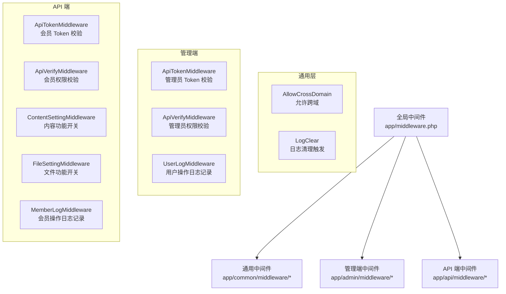
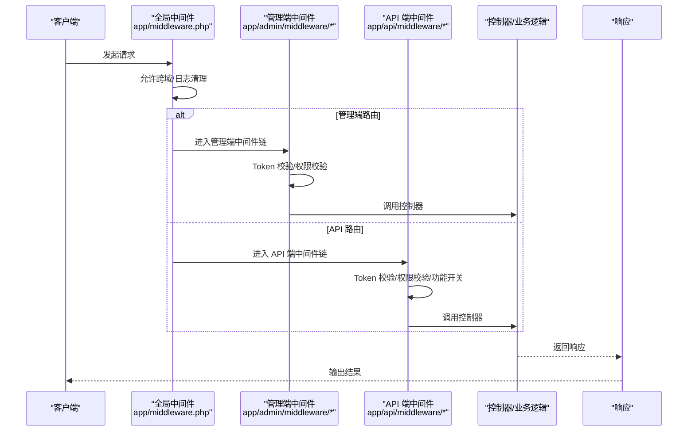
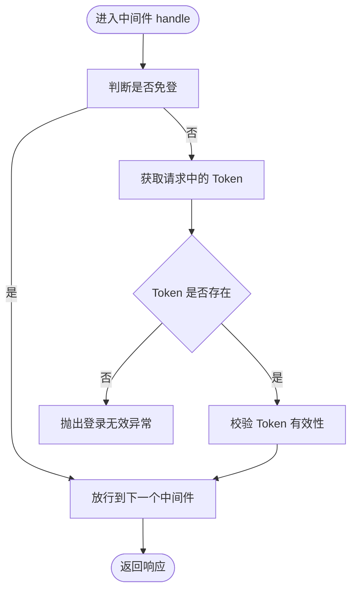
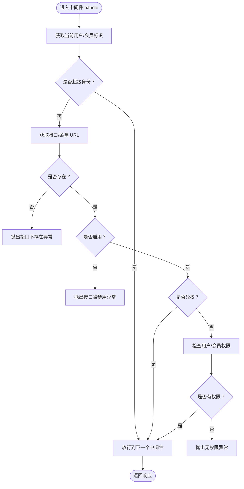
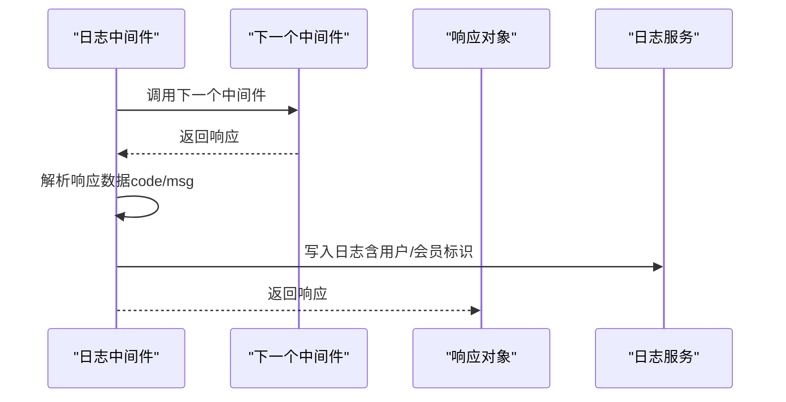
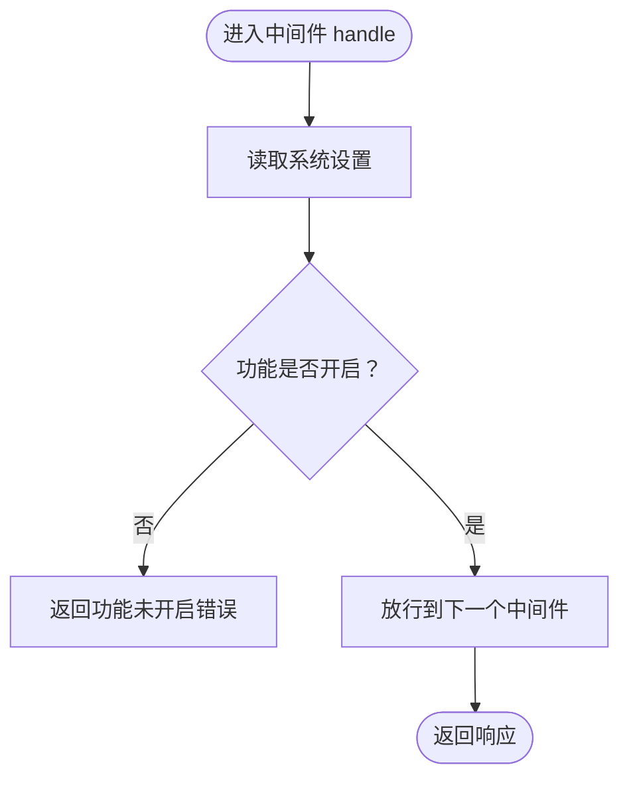
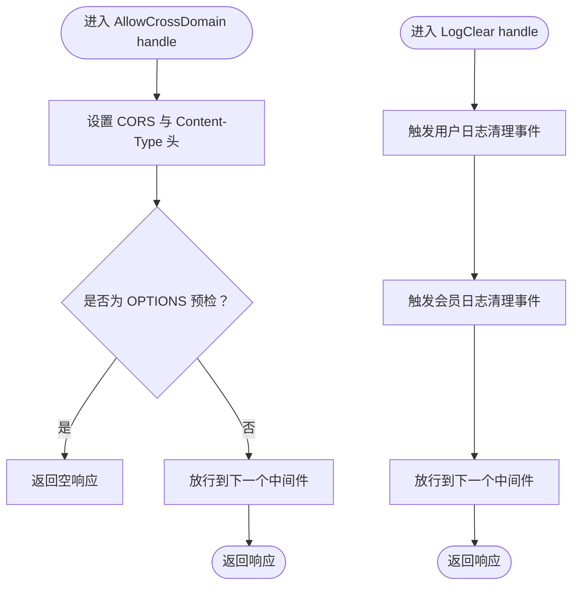
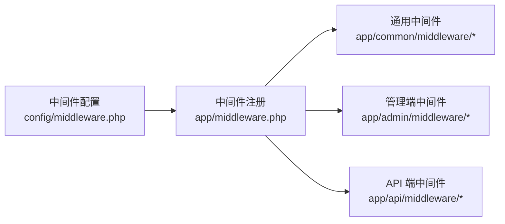

# 插件开发

<cite>
**本文引用的文件**
- [gccd_server/app/middleware.php](file://gccd_server/app/middleware.php)
- [gccd_server/config/middleware.php](file://gccd_server/config/middleware.php)
- [gccd_server/app/common/middleware/AllowCrossDomain.php](file://gccd_server/app/common/middleware/AllowCrossDomain.php)
- [gccd_server/app/common/middleware/LogClear.php](file://gccd_server/app/common/middleware/LogClear.php)
- [gccd_server/app/admin/middleware/ApiTokenMiddleware.php](file://gccd_server/app/admin/middleware/ApiTokenMiddleware.php)
- [gccd_server/app/admin/middleware/ApiVerifyMiddleware.php](file://gccd_server/app/admin/middleware/ApiVerifyMiddleware.php)
- [gccd_server/app/admin/middleware/UserLogMiddleware.php](file://gccd_server/app/admin/middleware/UserLogMiddleware.php)
- [gccd_server/app/api/middleware/ApiTokenMiddleware.php](file://gccd_server/app/api/middleware/ApiTokenMiddleware.php)
- [gccd_server/app/api/middleware/ApiVerifyMiddleware.php](file://gccd_server/app/api/middleware/ApiVerifyMiddleware.php)
- [gccd_server/app/api/middleware/ContentSettingMiddleware.php](file://gccd_server/app/api/middleware/ContentSettingMiddleware.php)
- [gccd_server/app/api/middleware/FileSettingMiddleware.php](file://gccd_server/app/api/middleware/FileSettingMiddleware.php)
- [gccd_server/app/api/middleware/MemberLogMiddleware.php](file://gccd_server/app/api/middleware/MemberLogMiddleware.php)
</cite>

## 目录
1. [简介](#简介)
2. [项目结构](#项目结构)
3. [核心组件](#核心组件)
4. [架构总览](#架构总览)
5. [详细组件分析](#详细组件分析)
6. [依赖分析](#依赖分析)
7. [性能考虑](#性能考虑)
8. [故障排查指南](#故障排查指南)
9. [结论](#结论)
10. [附录](#附录)

## 简介
本指南面向高齿传动项目的插件（中间件）开发者，基于 ThinkPHP 8 框架在 gccd_server 后端工程中的现有中间件实现，系统讲解中间件的创建、注册与配置方法，并结合项目中已有的认证、权限、日志等中间件，给出可复用的实现模式与最佳实践。读者将掌握中间件的执行顺序、参数传递、异常处理等关键概念，并获得扩展与优化中间件功能的实用建议。

## 项目结构
gccd_server 工程采用 ThinkPHP 8 的模块化目录组织方式，中间件主要分布在以下位置：
- 全局中间件：app/middleware.php
- 中间件配置：config/middleware.php
- 通用中间件：app/common/middleware/*
- 管理端中间件：app/admin/middleware/*
- API 端中间件：app/api/middleware/*

下图展示了中间件在应用中的分布与职责划分：

图表来源
- [gccd_server/app/middleware.php:11-22](file://gccd_server/app/middleware.php#L11-L22)
- [gccd_server/app/common/middleware/AllowCrossDomain.php:19-41](file://gccd_server/app/common/middleware/AllowCrossDomain.php#L19-L41)
- [gccd_server/app/common/middleware/LogClear.php:20-39](file://gccd_server/app/common/middleware/LogClear.php#L20-L39)
- [gccd_server/app/admin/middleware/ApiTokenMiddleware.php:20-44](file://gccd_server/app/admin/middleware/ApiTokenMiddleware.php#L20-L44)
- [gccd_server/app/admin/middleware/ApiVerifyMiddleware.php:23-79](file://gccd_server/app/admin/middleware/ApiVerifyMiddleware.php#L23-L79)
- [gccd_server/app/admin/middleware/UserLogMiddleware.php:20-51](file://gccd_server/app/admin/middleware/UserLogMiddleware.php#L20-L51)
- [gccd_server/app/api/middleware/ApiTokenMiddleware.php:20-46](file://gccd_server/app/api/middleware/ApiTokenMiddleware.php#L20-L46)
- [gccd_server/app/api/middleware/ApiVerifyMiddleware.php:24-85](file://gccd_server/app/api/middleware/ApiVerifyMiddleware.php#L24-L85)
- [gccd_server/app/api/middleware/ContentSettingMiddleware.php:20-38](file://gccd_server/app/api/middleware/ContentSettingMiddleware.php#L20-L38)
- [gccd_server/app/api/middleware/FileSettingMiddleware.php:20-38](file://gccd_server/app/api/middleware/FileSettingMiddleware.php#L20-L38)
- [gccd_server/app/api/middleware/MemberLogMiddleware.php:20-54](file://gccd_server/app/api/middleware/MemberLogMiddleware.php#L20-L54)

章节来源
- [gccd_server/app/middleware.php:11-22](file://gccd_server/app/middleware.php#L11-L22)
- [gccd_server/config/middleware.php:11-16](file://gccd_server/config/middleware.php#L11-L16)

## 核心组件
本节梳理项目中已实现的关键中间件及其职责：
- 允许跨域中间件：统一设置 CORS 头部，处理预检请求，确保前后端联调顺畅。
- 日志清理中间件：通过事件触发清理用户与会员相关日志，保持日志库整洁。
- 管理端 Token 校验中间件：对非免登接口进行管理员 Token 校验，保障后台接口安全。
- 管理端权限校验中间件：在超管场景下，校验菜单是否存在、是否启用、是否免权以及用户角色授权。
- 用户操作日志中间件：在响应返回后收集状态码与消息，写入用户日志表。
- API 端 Token 校验中间件：对非免登接口进行会员 Token 校验，保障开放接口安全。
- API 端权限校验中间件：在非超级会员场景下，校验 API 是否存在、是否启用、是否免权以及会员 API 权限。
- 内容功能开关中间件：统一控制内容类接口的启用状态。
- 文件功能开关中间件：统一控制文件类接口的启用状态。
- 会员操作日志中间件：在响应返回后收集状态码与消息，写入会员日志表。

章节来源
- [gccd_server/app/common/middleware/AllowCrossDomain.php:19-41](file://gccd_server/app/common/middleware/AllowCrossDomain.php#L19-L41)
- [gccd_server/app/common/middleware/LogClear.php:20-39](file://gccd_server/app/common/middleware/LogClear.php#L20-L39)
- [gccd_server/app/admin/middleware/ApiTokenMiddleware.php:20-44](file://gccd_server/app/admin/middleware/ApiTokenMiddleware.php#L20-L44)
- [gccd_server/app/admin/middleware/ApiVerifyMiddleware.php:23-79](file://gccd_server/app/admin/middleware/ApiVerifyMiddleware.php#L23-L79)
- [gccd_server/app/admin/middleware/UserLogMiddleware.php:20-51](file://gccd_server/app/admin/middleware/UserLogMiddleware.php#L20-L51)
- [gccd_server/app/api/middleware/ApiTokenMiddleware.php:20-46](file://gccd_server/app/api/middleware/ApiTokenMiddleware.php#L20-L46)
- [gccd_server/app/api/middleware/ApiVerifyMiddleware.php:24-85](file://gccd_server/app/api/middleware/ApiVerifyMiddleware.php#L24-L85)
- [gccd_server/app/api/middleware/ContentSettingMiddleware.php:20-38](file://gccd_server/app/api/middleware/ContentSettingMiddleware.php#L20-L38)
- [gccd_server/app/api/middleware/FileSettingMiddleware.php:20-38](file://gccd_server/app/api/middleware/FileSettingMiddleware.php#L20-L38)
- [gccd_server/app/api/middleware/MemberLogMiddleware.php:20-54](file://gccd_server/app/api/middleware/MemberLogMiddleware.php#L20-L54)

## 架构总览
下图展示了请求从进入应用到返回响应的典型流程，以及各中间件在链路中的位置与作用：

图表来源
- [gccd_server/app/middleware.php:11-22](file://gccd_server/app/middleware.php#L11-L22)
- [gccd_server/app/common/middleware/AllowCrossDomain.php:28-40](file://gccd_server/app/common/middleware/AllowCrossDomain.php#L28-L40)
- [gccd_server/app/common/middleware/LogClear.php:29-37](file://gccd_server/app/common/middleware/LogClear.php#L29-L37)
- [gccd_server/app/admin/middleware/ApiTokenMiddleware.php:29-43](file://gccd_server/app/admin/middleware/ApiTokenMiddleware.php#L29-L43)
- [gccd_server/app/admin/middleware/ApiVerifyMiddleware.php:32-78](file://gccd_server/app/admin/middleware/ApiVerifyMiddleware.php#L32-L78)
- [gccd_server/app/admin/middleware/UserLogMiddleware.php:29-50](file://gccd_server/app/admin/middleware/UserLogMiddleware.php#L29-L50)
- [gccd_server/app/api/middleware/ApiTokenMiddleware.php:29-45](file://gccd_server/app/api/middleware/ApiTokenMiddleware.php#L29-L45)
- [gccd_server/app/api/middleware/ApiVerifyMiddleware.php:33-84](file://gccd_server/app/api/middleware/ApiVerifyMiddleware.php#L33-L84)
- [gccd_server/app/api/middleware/ContentSettingMiddleware.php:29-37](file://gccd_server/app/api/middleware/ContentSettingMiddleware.php#L29-L37)
- [gccd_server/app/api/middleware/FileSettingMiddleware.php:29-37](file://gccd_server/app/api/middleware/FileSettingMiddleware.php#L29-L37)
- [gccd_server/app/api/middleware/MemberLogMiddleware.php:29-53](file://gccd_server/app/api/middleware/MemberLogMiddleware.php#L29-L53)

## 详细组件分析

### 认证中间件（管理员与会员）
- 管理端 Token 校验中间件：在非免登菜单下，从请求中提取管理员 Token 并进行有效性校验，失败时抛出异常并终止后续处理。
- API 端 Token 校验中间件：在非免登接口下，从请求中提取会员 Token 并进行有效性校验，失败时抛出异常并终止后续处理。

图表来源
- [gccd_server/app/admin/middleware/ApiTokenMiddleware.php:29-43](file://gccd_server/app/admin/middleware/ApiTokenMiddleware.php#L29-L43)
- [gccd_server/app/api/middleware/ApiTokenMiddleware.php:29-45](file://gccd_server/app/api/middleware/ApiTokenMiddleware.php#L29-L45)

章节来源
- [gccd_server/app/admin/middleware/ApiTokenMiddleware.php:20-44](file://gccd_server/app/admin/middleware/ApiTokenMiddleware.php#L20-L44)
- [gccd_server/app/api/middleware/ApiTokenMiddleware.php:20-46](file://gccd_server/app/api/middleware/ApiTokenMiddleware.php#L20-L46)

### 权限验证中间件（管理员与会员）
- 管理端权限校验中间件：在非超管场景下，校验菜单是否存在、是否启用、是否免权；若需授权，则检查用户角色是否包含该菜单 URL。
- API 端权限校验中间件：在非超级会员场景下，校验 API 是否存在、是否启用、是否免权；若需授权，则检查会员 API 权限列表是否包含该 API URL。

图表来源
- [gccd_server/app/admin/middleware/ApiVerifyMiddleware.php:32-78](file://gccd_server/app/admin/middleware/ApiVerifyMiddleware.php#L32-L78)
- [gccd_server/app/api/middleware/ApiVerifyMiddleware.php:33-84](file://gccd_server/app/api/middleware/ApiVerifyMiddleware.php#L33-L84)

章节来源
- [gccd_server/app/admin/middleware/ApiVerifyMiddleware.php:23-79](file://gccd_server/app/admin/middleware/ApiVerifyMiddleware.php#L23-L79)
- [gccd_server/app/api/middleware/ApiVerifyMiddleware.php:24-85](file://gccd_server/app/api/middleware/ApiVerifyMiddleware.php#L24-L85)

### 日志记录中间件（管理员与会员）
- 用户操作日志中间件：在响应返回后，从响应对象中解析 code 与 msg 字段，结合当前用户 ID 写入用户日志。
- 会员操作日志中间件：在响应返回后，从响应对象中解析 code 与 msg 字段，结合会员 ID、平台与应用信息写入会员日志。

图表来源
- [gccd_server/app/admin/middleware/UserLogMiddleware.php:29-50](file://gccd_server/app/admin/middleware/UserLogMiddleware.php#L29-L50)
- [gccd_server/app/api/middleware/MemberLogMiddleware.php:29-53](file://gccd_server/app/api/middleware/MemberLogMiddleware.php#L29-L53)

章节来源
- [gccd_server/app/admin/middleware/UserLogMiddleware.php:20-51](file://gccd_server/app/admin/middleware/UserLogMiddleware.php#L20-L51)
- [gccd_server/app/api/middleware/MemberLogMiddleware.php:20-54](file://gccd_server/app/api/middleware/MemberLogMiddleware.php#L20-L54)

### 功能开关中间件（内容与文件）
- 内容功能开关中间件：读取系统设置，若内容功能未开启则直接返回错误响应。
- 文件功能开关中间件：读取系统设置，若文件功能未开启则直接返回错误响应。

图表来源
- [gccd_server/app/api/middleware/ContentSettingMiddleware.php:29-37](file://gccd_server/app/api/middleware/ContentSettingMiddleware.php#L29-L37)
- [gccd_server/app/api/middleware/FileSettingMiddleware.php:29-37](file://gccd_server/app/api/middleware/FileSettingMiddleware.php#L29-L37)

章节来源
- [gccd_server/app/api/middleware/ContentSettingMiddleware.php:20-38](file://gccd_server/app/api/middleware/ContentSettingMiddleware.php#L20-L38)
- [gccd_server/app/api/middleware/FileSettingMiddleware.php:20-38](file://gccd_server/app/api/middleware/FileSettingMiddleware.php#L20-L38)

### 跨域与日志清理中间件
- 允许跨域中间件：统一设置 CORS 头部，对 OPTIONS 预检请求直接返回空响应，其余请求继续链路。
- 日志清理中间件：在请求进入时触发用户与会员日志清理事件，随后放行。

图表来源
- [gccd_server/app/common/middleware/AllowCrossDomain.php:28-40](file://gccd_server/app/common/middleware/AllowCrossDomain.php#L28-L40)
- [gccd_server/app/common/middleware/LogClear.php:29-37](file://gccd_server/app/common/middleware/LogClear.php#L29-L37)

章节来源
- [gccd_server/app/common/middleware/AllowCrossDomain.php:19-41](file://gccd_server/app/common/middleware/AllowCrossDomain.php#L19-L41)
- [gccd_server/app/common/middleware/LogClear.php:20-39](file://gccd_server/app/common/middleware/LogClear.php#L20-L39)

## 依赖分析
- 中间件注册：全局中间件在 app/middleware.php 中集中声明，按数组顺序依次执行。
- 中间件配置：config/middleware.php 提供别名与优先级设置占位，便于扩展与排序。
- 组件耦合：中间件通过服务层（如 RetCodeUtils、UserCache、SettingService 等）完成业务校验与数据访问，保持良好的分层与解耦。
- 执行顺序：全局中间件先于模块中间件执行；同一层级内按注册顺序执行；可通过配置项调整优先级。

图表来源
- [gccd_server/config/middleware.php:11-16](file://gccd_server/config/middleware.php#L11-L16)
- [gccd_server/app/middleware.php:11-22](file://gccd_server/app/middleware.php#L11-L22)

章节来源
- [gccd_server/config/middleware.php:11-16](file://gccd_server/config/middleware.php#L11-L16)
- [gccd_server/app/middleware.php:11-22](file://gccd_server/app/middleware.php#L11-L22)

## 性能考虑
- 尽量减少中间件内的阻塞操作，避免在 handle 中执行耗时数据库查询或外部网络请求。
- 对需要鉴权的接口，优先使用缓存（如 UserCache）降低重复查询成本。
- 在日志中间件中仅解析必要字段，避免对大响应体做深度处理。
- 使用事件触发清理任务，避免在请求路径中直接执行重负载逻辑。
- 对 OPTIONS 预检请求快速返回，减少不必要的链路开销。

## 故障排查指南
- 登录无效/权限不足：检查对应中间件的 Token 获取与校验逻辑，确认异常码与提示信息是否正确返回。
- 接口不存在/被禁用：核对菜单/API 的存在性与启用状态，确认调试模式下的详细提示是否开启。
- 日志未记录：确认日志中间件是否在响应链路中执行，且响应对象包含 code/msg 字段。
- 跨域失败：检查 AllowCrossDomain 中间件是否生效，确认预检请求是否被正确拦截与返回。
- 功能开关导致接口不可用：确认对应设置项是否开启，避免误关导致业务中断。

章节来源
- [gccd_server/app/admin/middleware/ApiTokenMiddleware.php:34-42](file://gccd_server/app/admin/middleware/ApiTokenMiddleware.php#L34-L42)
- [gccd_server/app/admin/middleware/ApiVerifyMiddleware.php:42-74](file://gccd_server/app/admin/middleware/ApiVerifyMiddleware.php#L42-L74)
- [gccd_server/app/api/middleware/ApiTokenMiddleware.php:32-42](file://gccd_server/app/api/middleware/ApiTokenMiddleware.php#L32-L42)
- [gccd_server/app/api/middleware/ApiVerifyMiddleware.php:47-80](file://gccd_server/app/api/middleware/ApiVerifyMiddleware.php#L47-L80)
- [gccd_server/app/common/middleware/AllowCrossDomain.php:30-37](file://gccd_server/app/common/middleware/AllowCrossDomain.php#L30-L37)
- [gccd_server/app/api/middleware/ContentSettingMiddleware.php:31-34](file://gccd_server/app/api/middleware/ContentSettingMiddleware.php#L31-L34)
- [gccd_server/app/api/middleware/FileSettingMiddleware.php:31-34](file://gccd_server/app/api/middleware/FileSettingMiddleware.php#L31-L34)

## 结论
通过遵循现有中间件的实现模式，开发者可以快速构建认证、权限、日志与功能开关等通用能力。建议在新增中间件时：
- 明确职责边界，单一中间件只做一件事；
- 严格区分“请求前”与“响应后”的处理时机；
- 使用统一的异常与返回格式，便于前端与监控系统消费；
- 通过配置项与事件机制提升可扩展性与可维护性。

## 附录
- 新中间件开发模板（步骤说明）
  - 创建文件：在相应模块目录下新建中间件类，命名遵循现有风格。
  - 实现 handle 方法：接收 Request 与闭包 $next，按需在进入与返回阶段处理。
  - 注册中间件：在 app/middleware.php 中添加注册项，或在模块路由中局部挂载。
  - 配置优先级：如需调整执行顺序，可在 config/middleware.php 中配置 alias/priority。
  - 异常处理：统一使用异常抛出与返回工具，保证错误码与消息一致。
  - 性能优化：避免在 handle 中做重 IO 操作，必要时使用缓存与事件异步化。
  - 日志记录：在日志中间件中统一采集 code/msg，便于审计与追踪。

章节来源
- [gccd_server/app/middleware.php:11-22](file://gccd_server/app/middleware.php#L11-L22)
- [gccd_server/config/middleware.php:11-16](file://gccd_server/config/middleware.php#L11-L16)