# 第三方集成

<cite>
**本文引用的文件**
- [WxMiniapp.php](file://gccd_server/extend/thirdsdk/WxMiniapp.php)
- [WxOffiacc.php](file://gccd_server/extend/thirdsdk/WxOffiacc.php)
- [QqMiniapp.php](file://gccd_server/extend/thirdsdk/QqMiniapp.php)
- [WbWebsite.php](file://gccd_server/extend/thirdsdk/WbWebsite.php)
- [Http.php](file://gccd_server/extend/thirdsdk/Http.php)
- [easysms.php](file://gccd_server/config/easysms.php)
- [queue.php](file://gccd_server/config/queue.php)
- [QueueJob.php](file://gccd_server/app/job/QueueJob.php)
- [event.php](file://gccd_server/app/event.php)
- [UserLogListener.php](file://gccd_server/app/listener/UserLogListener.php)
</cite>

## 目录
1. [简介](#简介)
2. [项目结构](#项目结构)
3. [核心组件](#核心组件)
4. [架构总览](#架构总览)
5. [详细组件分析](#详细组件分析)
6. [依赖分析](#依赖分析)
7. [性能考量](#性能考量)
8. [故障排查指南](#故障排查指南)
9. [结论](#结论)
10. [附录](#附录)

## 简介
本指南面向需要与高齿传动项目进行第三方系统集成的开发者，覆盖以下主题：
- 外部系统对接方式：API 接口对接、数据同步机制、消息队列集成
- 第三方 SDK 集成：微信小程序 SDK、QQ 小程序 SDK、微博网站应用 SDK
- Webhook 回调处理：回调接收、数据校验、重试与幂等
- 事件驱动架构：事件监听、消息处理、异步处理
- 集成最佳实践：错误处理、超时控制、安全与鉴权
- 集成示例与实现模板：基于现有代码的路径指引与流程图示例

## 项目结构
本项目采用 ThinkPHP 框架，第三方集成相关能力主要集中在以下位置：
- 第三方 SDK：位于扩展目录，封装了微信、QQ、微博平台的登录与授权流程
- 配置：短信网关与队列驱动配置
- 队列：任务投递与消费模型
- 事件：事件定义与监听器

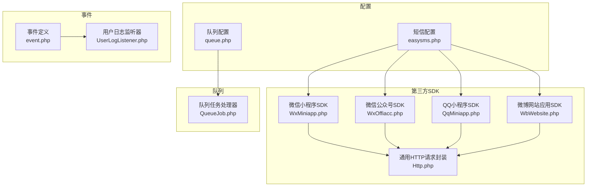

**图表来源**
- [WxMiniapp.php:1-119](file://gccd_server/extend/thirdsdk/WxMiniapp.php#L1-L119)
- [WxOffiacc.php:1-118](file://gccd_server/extend/thirdsdk/WxOffiacc.php#L1-L118)
- [QqMiniapp.php:1-102](file://gccd_server/extend/thirdsdk/QqMiniapp.php#L1-L102)
- [WbWebsite.php:1-126](file://gccd_server/extend/thirdsdk/WbWebsite.php#L1-L126)
- [Http.php:1-116](file://gccd_server/extend/thirdsdk/Http.php#L1-L116)
- [easysms.php:1-35](file://gccd_server/config/easysms.php#L1-L35)
- [queue.php:1-56](file://gccd_server/config/queue.php#L1-L56)
- [QueueJob.php:1-48](file://gccd_server/app/job/QueueJob.php#L1-L48)
- [event.php:1-31](file://gccd_server/app/event.php#L1-L31)
- [UserLogListener.php:1-32](file://gccd_server/app/listener/UserLogListener.php#L1-L32)

**章节来源**
- [WxMiniapp.php:1-119](file://gccd_server/extend/thirdsdk/WxMiniapp.php#L1-L119)
- [WxOffiacc.php:1-118](file://gccd_server/extend/thirdsdk/WxOffiacc.php#L1-L118)
- [QqMiniapp.php:1-102](file://gccd_server/extend/thirdsdk/QqMiniapp.php#L1-L102)
- [WbWebsite.php:1-126](file://gccd_server/extend/thirdsdk/WbWebsite.php#L1-L126)
- [Http.php:1-116](file://gccd_server/extend/thirdsdk/Http.php#L1-L116)
- [easysms.php:1-35](file://gccd_server/config/easysms.php#L1-L35)
- [queue.php:1-56](file://gccd_server/config/queue.php#L1-L56)
- [QueueJob.php:1-48](file://gccd_server/app/job/QueueJob.php#L1-L48)
- [event.php:1-31](file://gccd_server/app/event.php#L1-L31)
- [UserLogListener.php:1-32](file://gccd_server/app/listener/UserLogListener.php#L1-L32)

## 核心组件
- 第三方 SDK 统一由 Http 类封装 HTTP 请求与响应拦截，支持微信、QQ、微博平台差异字段映射与异常抛出
- 短信服务通过 EasySMS 网关配置，支持阿里云等网关与错误日志记录
- 队列系统支持数据库与 Redis 驱动，提供任务监听与失败处理
- 事件系统支持绑定与监听，便于扩展异步处理与审计日志

**章节来源**
- [Http.php:1-116](file://gccd_server/extend/thirdsdk/Http.php#L1-L116)
- [easysms.php:1-35](file://gccd_server/config/easysms.php#L1-L35)
- [queue.php:1-56](file://gccd_server/config/queue.php#L1-L56)
- [QueueJob.php:1-48](file://gccd_server/app/job/QueueJob.php#L1-L48)
- [event.php:1-31](file://gccd_server/app/event.php#L1-L31)

## 架构总览
下图展示了第三方集成的整体架构：前端或外部系统通过 SDK 或 API 与后端交互；后端根据业务场景选择直接调用第三方平台或通过队列异步处理；事件系统用于解耦日志与审计。

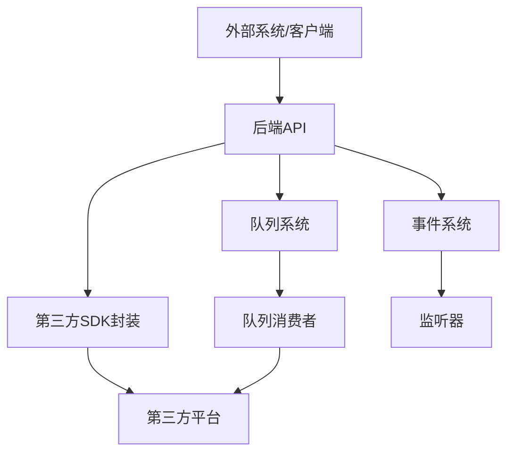

[此图为概念性架构示意，不直接映射具体源码文件，故无“图表来源”]

## 详细组件分析

### 微信小程序 SDK（WxMiniapp）
- 功能要点
  - 登录换取 session：使用小程序 AppID/Secret 与临时登录凭证换取 openid/unionid
  - 获取 Access Token：自动缓存，避免频繁请求
  - 获取手机号：基于 Access Token 调用业务接口获取脱敏手机号
- 关键实现路径
  - 登录流程：[login 方法:67-77](file://gccd_server/extend/thirdsdk/WxMiniapp.php#L67-L77)
  - Access Token 缓存与获取：[getAccessToken 方法:84-100](file://gccd_server/extend/thirdsdk/WxMiniapp.php#L84-L100)
  - 获取手机号：[getPhoneNumber 方法:109-117](file://gccd_server/extend/thirdsdk/WxMiniapp.php#L109-L117)
- 与通用 HTTP 的关系
  - 通过 Http::get/post 完成网络请求与响应拦截：[Http::get/post:42-89](file://gccd_server/extend/thirdsdk/Http.php#L42-L89)

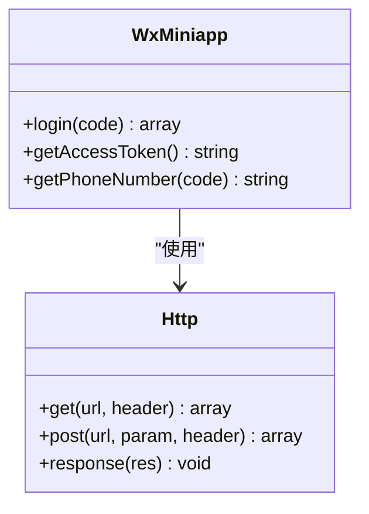

**图表来源**
- [WxMiniapp.php:1-119](file://gccd_server/extend/thirdsdk/WxMiniapp.php#L1-L119)
- [Http.php:1-116](file://gccd_server/extend/thirdsdk/Http.php#L1-L116)

**章节来源**
- [WxMiniapp.php:1-119](file://gccd_server/extend/thirdsdk/WxMiniapp.php#L1-L119)
- [Http.php:1-116](file://gccd_server/extend/thirdsdk/Http.php#L1-L116)

### 微信公众号 SDK（WxOffiacc）
- 功能要点
  - 发起授权登录：生成授权链接并跳转
  - 获取 Access Token：使用授权码换取 token
  - 获取用户信息：基于 token 与 openid 拉取用户资料
- 关键实现路径
  - 授权登录跳转：[login 方法:66-78](file://gccd_server/extend/thirdsdk/WxOffiacc.php#L66-L78)
  - 获取 Access Token：[getAccessToken 方法:87-97](file://gccd_server/extend/thirdsdk/WxOffiacc.php#L87-L97)
  - 获取用户信息：[getUserinfo 方法:106-116](file://gccd_server/extend/thirdsdk/WxOffiacc.php#L106-L116)

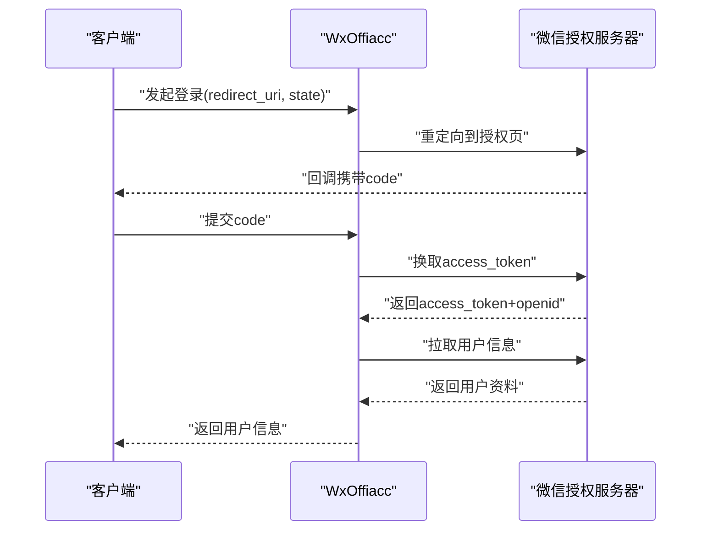

**图表来源**
- [WxOffiacc.php:1-118](file://gccd_server/extend/thirdsdk/WxOffiacc.php#L1-L118)

**章节来源**
- [WxOffiacc.php:1-118](file://gccd_server/extend/thirdsdk/WxOffiacc.php#L1-L118)

### QQ 小程序 SDK（QqMiniapp）
- 功能要点
  - 登录换取 session：使用 QQ 小程序 AppID/Secret 与临时登录凭证
  - 获取 Access Token：自动缓存，避免频繁请求
- 关键实现路径
  - 登录流程：[login 方法:67-77](file://gccd_server/extend/thirdsdk/QqMiniapp.php#L67-L77)
  - Access Token 缓存与获取：[getAccessToken 方法:84-100](file://gccd_server/extend/thirdsdk/QqMiniapp.php#L84-L100)

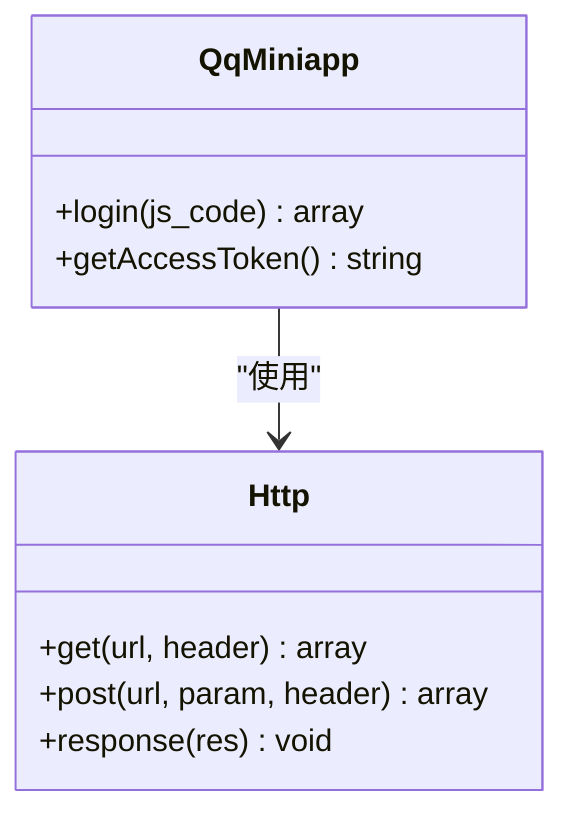

**图表来源**
- [QqMiniapp.php:1-102](file://gccd_server/extend/thirdsdk/QqMiniapp.php#L1-L102)
- [Http.php:1-116](file://gccd_server/extend/thirdsdk/Http.php#L1-L116)

**章节来源**
- [QqMiniapp.php:1-102](file://gccd_server/extend/thirdsdk/QqMiniapp.php#L1-L102)
- [Http.php:1-116](file://gccd_server/extend/thirdsdk/Http.php#L1-L116)

### 微博网站应用 SDK（WbWebsite）
- 功能要点
  - 发起授权登录：生成授权链接并跳转
  - 获取 Access Token：使用授权码换取 token
  - 获取用户信息：基于 token 与 uid 拉取用户资料，并做字段映射
- 关键实现路径
  - 授权登录跳转：[login 方法:66-77](file://gccd_server/extend/thirdsdk/WbWebsite.php#L66-L77)
  - 获取 Access Token：[getAccessToken 方法:113-124](file://gccd_server/extend/thirdsdk/WbWebsite.php#L113-L124)
  - 获取用户信息与字段映射：[getUserInfo 方法:87-103](file://gccd_server/extend/thirdsdk/WbWebsite.php#L87-L103)

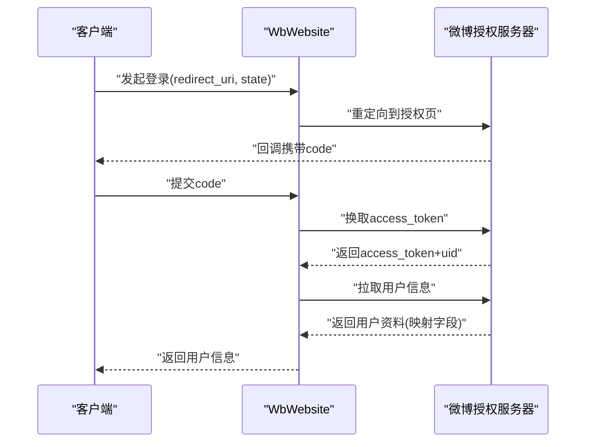

**图表来源**
- [WbWebsite.php:1-126](file://gccd_server/extend/thirdsdk/WbWebsite.php#L1-L126)

**章节来源**
- [WbWebsite.php:1-126](file://gccd_server/extend/thirdsdk/WbWebsite.php#L1-L126)

### 通用 HTTP 请求封装（Http）
- 功能要点
  - GET/POST 请求封装，统一 JSON 头部与编码
  - 响应拦截：按平台识别 errcode/errmsg 并抛出异常
- 关键实现路径
  - GET 请求：[get 方法:42-58](file://gccd_server/extend/thirdsdk/Http.php#L42-L58)
  - POST 请求：[post 方法:69-89](file://gccd_server/extend/thirdsdk/Http.php#L69-L89)
  - 响应拦截：[response 方法:98-114](file://gccd_server/extend/thirdsdk/Http.php#L98-L114)

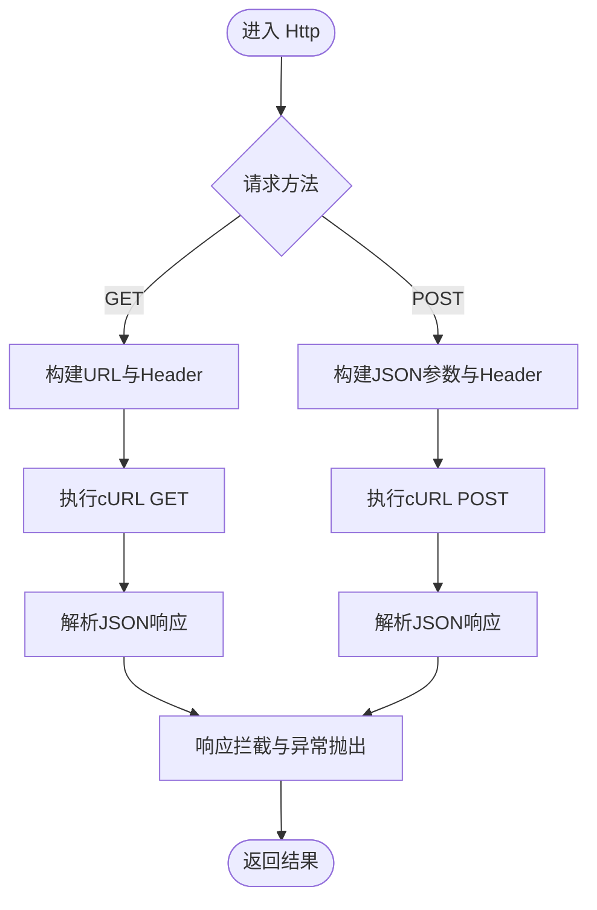

**图表来源**
- [Http.php:1-116](file://gccd_server/extend/thirdsdk/Http.php#L1-L116)

**章节来源**
- [Http.php:1-116](file://gccd_server/extend/thirdsdk/Http.php#L1-L116)

### 短信服务集成（EasySMS）
- 配置要点
  - 超时时间、默认网关策略、可用网关列表、阿里云网关参数
  - 错误日志输出路径
- 关键实现路径
  - 配置入口：[easysms.php:1-35](file://gccd_server/config/easysms.php#L1-L35)

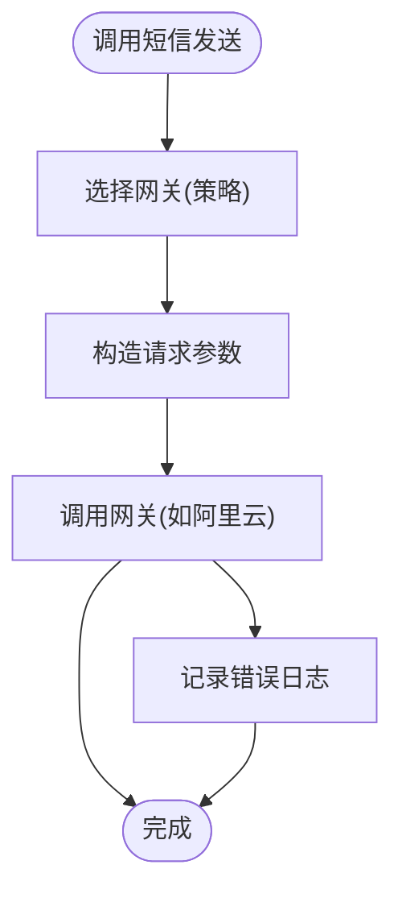

**图表来源**
- [easysms.php:1-35](file://gccd_server/config/easysms.php#L1-L35)

**章节来源**
- [easysms.php:1-35](file://gccd_server/config/easysms.php#L1-L35)

### 队列系统集成（Think Queue）
- 配置要点
  - 驱动类型：sync、database、redis
  - 数据库驱动：表名、队列名
  - Redis 驱动：主机、端口、密码、select
  - 失败任务存储
- 任务处理器
  - 队列任务执行与日志记录
  - 失败回调与重试控制
- 关键实现路径
  - 配置入口：[queue.php:1-56](file://gccd_server/config/queue.php#L1-L56)
  - 任务处理器：[QueueJob.php:1-48](file://gccd_server/app/job/QueueJob.php#L1-L48)

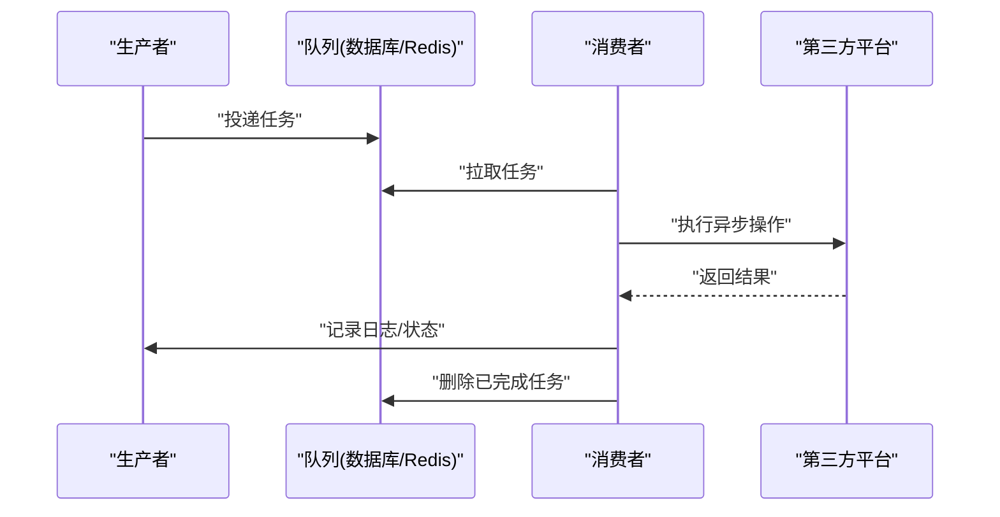

**图表来源**
- [queue.php:1-56](file://gccd_server/config/queue.php#L1-L56)
- [QueueJob.php:1-48](file://gccd_server/app/job/QueueJob.php#L1-L48)

**章节来源**
- [queue.php:1-56](file://gccd_server/config/queue.php#L1-L56)
- [QueueJob.php:1-48](file://gccd_server/app/job/QueueJob.php#L1-L48)

### 事件驱动集成（Event/Listener）
- 事件定义
  - 支持 AppInit、HttpRun、HttpEnd、LogLevel、LogWrite 等生命周期事件
  - 自定义事件：UserLog、MemberLog
- 监听器
  - 用户日志清理监听器
- 关键实现路径
  - 事件定义：[event.php:1-31](file://gccd_server/app/event.php#L1-L31)
  - 用户日志监听器：[UserLogListener.php:1-32](file://gccd_server/app/listener/UserLogListener.php#L1-L32)

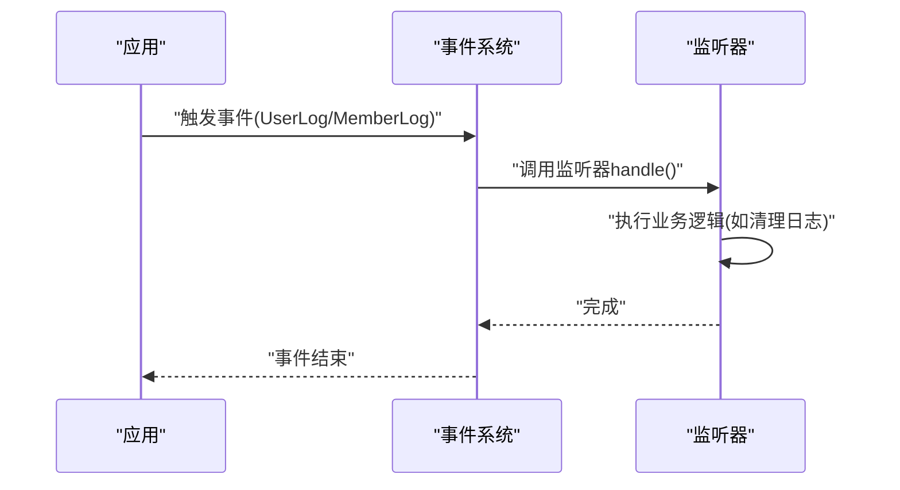

**图表来源**
- [event.php:1-31](file://gccd_server/app/event.php#L1-L31)
- [UserLogListener.php:1-32](file://gccd_server/app/listener/UserLogListener.php#L1-L32)

**章节来源**
- [event.php:1-31](file://gccd_server/app/event.php#L1-L31)
- [UserLogListener.php:1-32](file://gccd_server/app/listener/UserLogListener.php#L1-L32)

## 依赖分析
- 平台 SDK 对 Http 的依赖：所有平台 SDK 通过 Http 统一发起请求与处理响应
- 配置对 SDK 的依赖：短信配置影响 SDK 的可用网关与错误日志
- 队列对任务处理器的依赖：任务处理器负责实际执行与失败处理
- 事件对监听器的依赖：监听器负责事件触发后的业务处理

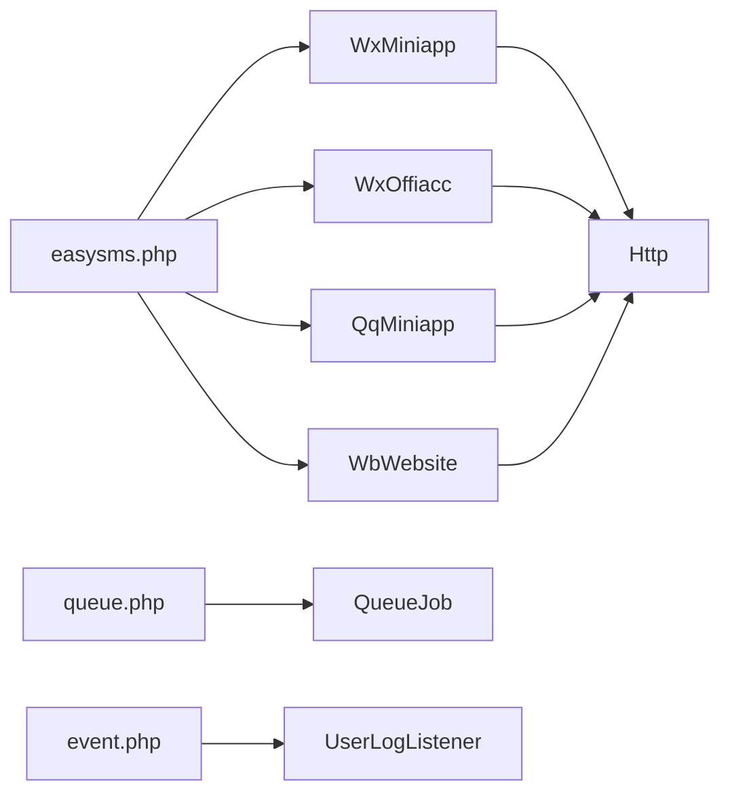

**图表来源**
- [WxMiniapp.php:1-119](file://gccd_server/extend/thirdsdk/WxMiniapp.php#L1-L119)
- [WxOffiacc.php:1-118](file://gccd_server/extend/thirdsdk/WxOffiacc.php#L1-L118)
- [QqMiniapp.php:1-102](file://gccd_server/extend/thirdsdk/QqMiniapp.php#L1-L102)
- [WbWebsite.php:1-126](file://gccd_server/extend/thirdsdk/WbWebsite.php#L1-L126)
- [Http.php:1-116](file://gccd_server/extend/thirdsdk/Http.php#L1-L116)
- [easysms.php:1-35](file://gccd_server/config/easysms.php#L1-L35)
- [queue.php:1-56](file://gccd_server/config/queue.php#L1-L56)
- [QueueJob.php:1-48](file://gccd_server/app/job/QueueJob.php#L1-L48)
- [event.php:1-31](file://gccd_server/app/event.php#L1-L31)
- [UserLogListener.php:1-32](file://gccd_server/app/listener/UserLogListener.php#L1-L32)

**章节来源**
- [WxMiniapp.php:1-119](file://gccd_server/extend/thirdsdk/WxMiniapp.php#L1-L119)
- [WxOffiacc.php:1-118](file://gccd_server/extend/thirdsdk/WxOffiacc.php#L1-L118)
- [QqMiniapp.php:1-102](file://gccd_server/extend/thirdsdk/QqMiniapp.php#L1-L102)
- [WbWebsite.php:1-126](file://gccd_server/extend/thirdsdk/WbWebsite.php#L1-L126)
- [Http.php:1-116](file://gccd_server/extend/thirdsdk/Http.php#L1-L116)
- [easysms.php:1-35](file://gccd_server/config/easysms.php#L1-L35)
- [queue.php:1-56](file://gccd_server/config/queue.php#L1-L56)
- [QueueJob.php:1-48](file://gccd_server/app/job/QueueJob.php#L1-L48)
- [event.php:1-31](file://gccd_server/app/event.php#L1-L31)
- [UserLogListener.php:1-32](file://gccd_server/app/listener/UserLogListener.php#L1-L32)

## 性能考量
- SDK 请求优化
  - 使用 Access Token 缓存减少第三方请求频率
  - 合理设置超时时间，避免阻塞线程
- 队列性能
  - 根据任务复杂度调整 --timeout 与 --memory 参数
  - 选择合适的队列驱动（数据库/Redis），在高并发场景优先 Redis
- 事件与监听器
  - 将耗时操作放入队列，监听器仅做轻量处理
- 短信网关
  - 设置合理的超时与重试策略，避免阻塞主流程

[本节为通用指导，无需“章节来源”]

## 故障排查指南
- SDK 异常
  - Http::response 会在检测到 errcode 时抛出异常，需捕获并记录
  - 参考路径：[Http::response:98-114](file://gccd_server/extend/thirdsdk/Http.php#L98-L114)
- 队列任务失败
  - 检查任务处理器是否正确删除任务或释放重试
  - 参考路径：[QueueJob::fire/failed:20-41](file://gccd_server/app/job/QueueJob.php#L20-L41)
- 事件监听未生效
  - 确认事件定义与监听器绑定是否正确
  - 参考路径：[event.php:16-26](file://gccd_server/app/event.php#L16-L26)、[UserLogListener.php:27-30](file://gccd_server/app/listener/UserLogListener.php#L27-L30)
- 短信发送失败
  - 检查网关配置与错误日志路径
  - 参考路径：[easysms.php:22-34](file://gccd_server/config/easysms.php#L22-L34)

**章节来源**
- [Http.php:98-114](file://gccd_server/extend/thirdsdk/Http.php#L98-L114)
- [QueueJob.php:20-41](file://gccd_server/app/job/QueueJob.php#L20-L41)
- [event.php:16-26](file://gccd_server/app/event.php#L16-L26)
- [UserLogListener.php:27-30](file://gccd_server/app/listener/UserLogListener.php#L27-L30)
- [easysms.php:22-34](file://gccd_server/config/easysms.php#L22-L34)

## 结论
本指南基于现有代码梳理了第三方集成的关键能力与最佳实践，建议在实际集成中：
- 优先使用 SDK 封装以降低平台差异带来的复杂度
- 将耗时与不可靠操作放入队列异步处理
- 通过事件系统解耦日志与审计等横切关注点
- 在配置层统一管理超时、重试与日志策略

[本节为总结性内容，无需“章节来源”]

## 附录

### 集成示例与实现模板（路径指引）
- 微信小程序登录流程
  - 登录换取 session：[WxMiniapp::login:67-77](file://gccd_server/extend/thirdsdk/WxMiniapp.php#L67-L77)
  - 获取 Access Token：[WxMiniapp::getAccessToken:84-100](file://gccd_server/extend/thirdsdk/WxMiniapp.php#L84-L100)
  - 获取手机号：[WxMiniapp::getPhoneNumber:109-117](file://gccd_server/extend/thirdsdk/WxMiniapp.php#L109-L117)
- 微信公众号授权登录
  - 授权跳转：[WxOffiacc::login:66-78](file://gccd_server/extend/thirdsdk/WxOffiacc.php#L66-L78)
  - 获取 Access Token：[WxOffiacc::getAccessToken:87-97](file://gccd_server/extend/thirdsdk/WxOffiacc.php#L87-L97)
  - 获取用户信息：[WxOffiacc::getUserinfo:106-116](file://gccd_server/extend/thirdsdk/WxOffiacc.php#L106-L116)
- QQ 小程序登录
  - 登录换取 session：[QqMiniapp::login:67-77](file://gccd_server/extend/thirdsdk/QqMiniapp.php#L67-L77)
  - 获取 Access Token：[QqMiniapp::getAccessToken:84-100](file://gccd_server/extend/thirdsdk/QqMiniapp.php#L84-L100)
- 微博网站应用授权
  - 授权跳转：[WbWebsite::login:66-77](file://gccd_server/extend/thirdsdk/WbWebsite.php#L66-L77)
  - 获取 Access Token：[WbWebsite::getAccessToken:113-124](file://gccd_server/extend/thirdsdk/WbWebsite.php#L113-L124)
  - 获取用户信息：[WbWebsite::getUserInfo:87-103](file://gccd_server/extend/thirdsdk/WbWebsite.php#L87-L103)
- 队列任务处理
  - 任务执行与日志：[QueueJob::fire:20-36](file://gccd_server/app/job/QueueJob.php#L20-L36)
  - 失败处理：[QueueJob::failed:38-41](file://gccd_server/app/job/QueueJob.php#L38-L41)
- 事件监听
  - 事件定义：[event.php:16-26](file://gccd_server/app/event.php#L16-L26)
  - 监听器处理：[UserLogListener::handle:27-30](file://gccd_server/app/listener/UserLogListener.php#L27-L30)
- 短信配置
  - 网关与超时：[easysms.php:12-20](file://gccd_server/config/easysms.php#L12-L20)
  - 阿里云参数：[easysms.php:28-32](file://gccd_server/config/easysms.php#L28-L32)

[本节为路径指引，无需“章节来源”]