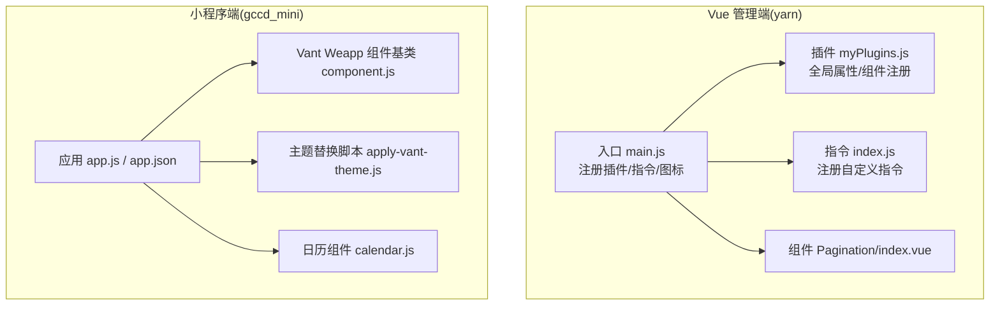
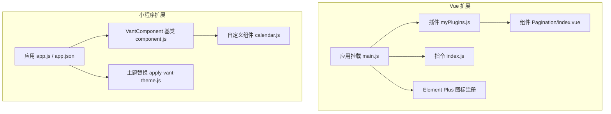
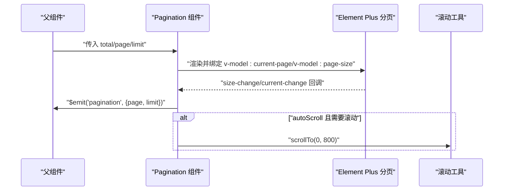
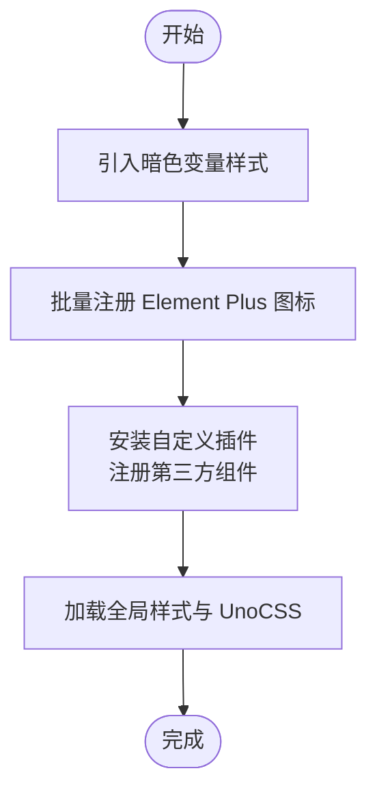
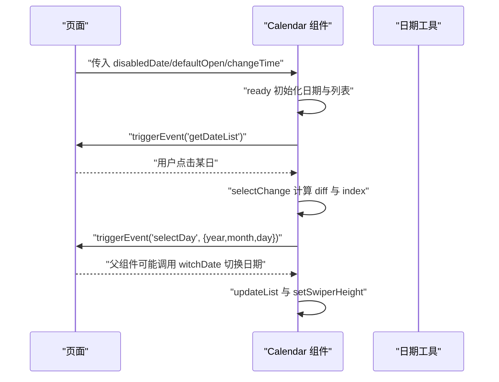
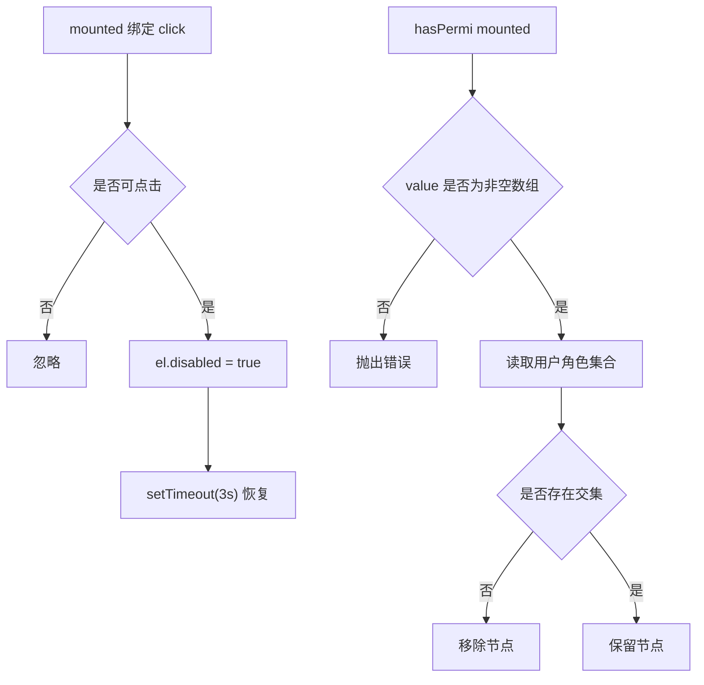
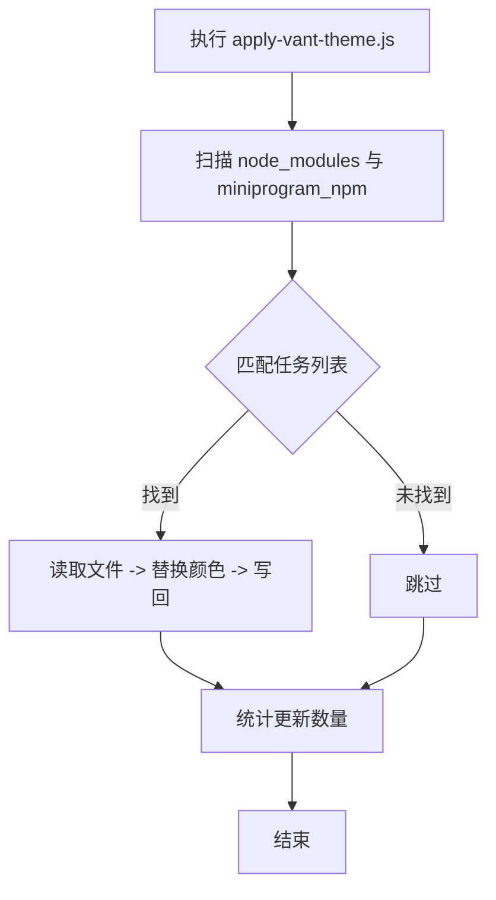
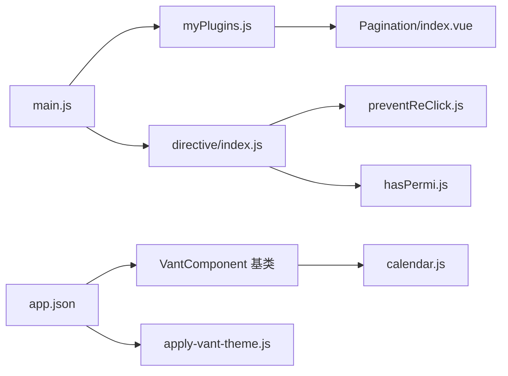

# 组件扩展

<cite>
**本文引用的文件**
- [gccd_mini/app.js](file://gccd_mini/app.js)
- [gccd_mini/app.json](file://gccd_mini/app.json)
- [gccd_mini/scripts/apply-vant-theme.js](file://gccd_mini/scripts/apply-vant-theme.js)
- [gccd_mini/miniprogram_npm/@vant/weapp/common/component.js](file://gccd_mini/miniprogram_npm/@vant/weapp/common/component.js)
- [gccd_mini/pageMine/components/calendar/calendar.js](file://gccd_mini/pageMine/components/calendar/calendar.js)
- [yarn/src/main.js](file://yarn/src/main.js)
- [yarn/package.json](file://yarn/package.json)
- [yarn/src/plugins/myPlugins.js](file://yarn/src/plugins/myPlugins.js)
- [yarn/src/directive/index.js](file://yarn/src/directive/index.js)
- [yarn/src/directive/common/preventReClick.js](file://yarn/src/directive/common/preventReClick.js)
- [yarn/src/directive/common/hasPermi.js](file://yarn/src/directive/common/hasPermi.js)
- [yarn/src/components/Pagination/index.vue](file://yarn/src/components/Pagination/index.vue)
- [yarn/src/utils/index.js](file://yarn/src/utils/index.js)
</cite>

## 目录
1. [简介](#简介)
2. [项目结构](#项目结构)
3. [核心组件](#核心组件)
4. [架构总览](#架构总览)
5. [详细组件分析](#详细组件分析)
6. [依赖关系分析](#依赖关系分析)
7. [性能考量](#性能考量)
8. [故障排查指南](#故障排查指南)
9. [结论](#结论)
10. [附录](#附录)

## 简介
本指南面向“高齿传动”项目的前端与小程序团队，系统讲解如何在现有工程基础上进行组件扩展开发，涵盖以下内容：
- Vue 3 组件的创建、封装与发布流程
- Element Plus 组件的定制化（主题、样式、功能）
- 小程序组件的开发模式（生命周期、数据绑定、事件处理）
- 指令系统的扩展（自定义指令的开发与注册）
- 组件开发最佳实践（设计原则、性能优化、可复用性）
- 提供可直接参考的实现模板与示例路径

## 项目结构
项目由三部分组成：
- Vue 管理端（yarn）：基于 Vite + Vue 3 + Element Plus，统一注册插件、指令与全局工具
- 小程序端（gccd_mini）：基于微信小程序原生组件体系，使用 Vant Weapp 作为基础组件库
- 服务端（gccd_server）：后端接口与业务逻辑，与前端通过 API 交互

**图表来源**
- [yarn/src/main.js:1-44](file://yarn/src/main.js#L1-L44)
- [yarn/src/plugins/myPlugins.js:1-74](file://yarn/src/plugins/myPlugins.js#L1-L74)
- [yarn/src/directive/index.js:1-8](file://yarn/src/directive/index.js#L1-L8)
- [yarn/src/components/Pagination/index.vue:1-116](file://yarn/src/components/Pagination/index.vue#L1-L116)
- [gccd_mini/app.js:1-33](file://gccd_mini/app.js#L1-L33)
- [gccd_mini/app.json:1-99](file://gccd_mini/app.json#L1-L99)
- [gccd_mini/miniprogram_npm/@vant/weapp/common/component.js:1-50](file://gccd_mini/miniprogram_npm/@vant/weapp/common/component.js#L1-L50)
- [gccd_mini/pageMine/components/calendar/calendar.js:1-524](file://gccd_mini/pageMine/components/calendar/calendar.js#L1-L524)
- [gccd_mini/scripts/apply-vant-theme.js:1-95](file://gccd_mini/scripts/apply-vant-theme.js#L1-L95)

**章节来源**
- [yarn/src/main.js:1-44](file://yarn/src/main.js#L1-L44)
- [gccd_mini/app.js:1-33](file://gccd_mini/app.js#L1-L33)
- [gccd_mini/app.json:1-99](file://gccd_mini/app.json#L1-L99)

## 核心组件
本节聚焦于已有的可扩展组件与机制，帮助你快速理解如何在现有工程中新增组件。

- Vue 管理端组件
  - Pagination：基于 Element Plus 的分页封装，支持尺寸联动、滚动定位、事件透传
  - 插件机制：myPlugins.js 统一注入全局工具与组件，便于集中管理
  - 指令系统：preventReClick 防重复点击、hasPermi 权限控制
- 小程序端组件
  - Vant Weapp 基类：提供属性映射、生命周期映射、外部样式类、表单字段行为等
  - 日历组件 calendar：展示复杂交互（滑动、展开/收起、禁用日期、事件触发）

**章节来源**
- [yarn/src/components/Pagination/index.vue:1-116](file://yarn/src/components/Pagination/index.vue#L1-L116)
- [yarn/src/plugins/myPlugins.js:1-74](file://yarn/src/plugins/myPlugins.js#L1-L74)
- [yarn/src/directive/common/preventReClick.js:1-16](file://yarn/src/directive/common/preventReClick.js#L1-L16)
- [yarn/src/directive/common/hasPermi.js:1-23](file://yarn/src/directive/common/hasPermi.js#L1-L23)
- [gccd_mini/miniprogram_npm/@vant/weapp/common/component.js:1-50](file://gccd_mini/miniprogram_npm/@vant/weapp/common/component.js#L1-L50)
- [gccd_mini/pageMine/components/calendar/calendar.js:1-524](file://gccd_mini/pageMine/components/calendar/calendar.js#L1-L524)

## 架构总览
下图展示了 Vue 端与小程序端的组件扩展架构要点与集成点。

**图表来源**
- [yarn/src/main.js:1-44](file://yarn/src/main.js#L1-L44)
- [yarn/src/plugins/myPlugins.js:1-74](file://yarn/src/plugins/myPlugins.js#L1-L74)
- [yarn/src/directive/index.js:1-8](file://yarn/src/directive/index.js#L1-L8)
- [yarn/src/components/Pagination/index.vue:1-116](file://yarn/src/components/Pagination/index.vue#L1-L116)
- [gccd_mini/app.js:1-33](file://gccd_mini/app.js#L1-L33)
- [gccd_mini/app.json:1-99](file://gccd_mini/app.json#L1-L99)
- [gccd_mini/miniprogram_npm/@vant/weapp/common/component.js:1-50](file://gccd_mini/miniprogram_npm/@vant/weapp/common/component.js#L1-L50)
- [gccd_mini/pageMine/components/calendar/calendar.js:1-524](file://gccd_mini/pageMine/components/calendar/calendar.js#L1-L524)
- [gccd_mini/scripts/apply-vant-theme.js:1-95](file://gccd_mini/scripts/apply-vant-theme.js#L1-L95)

## 详细组件分析

### Vue 组件扩展：以 Pagination 为例
- 设计思路
  - 包裹 Element Plus 的分页组件，统一对外属性与事件
  - 支持根据全局尺寸状态切换小尺寸
  - 自动滚动至顶部，提升用户体验
- 关键点
  - 双向绑定：通过计算属性桥接父组件的 page/limit
  - 事件透传：将内部变更转换为标准事件，便于父组件监听
  - 性能：仅在需要时滚动，避免频繁 DOM 操作

**图表来源**
- [yarn/src/components/Pagination/index.vue:18-102](file://yarn/src/components/Pagination/index.vue#L18-L102)

**章节来源**
- [yarn/src/components/Pagination/index.vue:1-116](file://yarn/src/components/Pagination/index.vue#L1-L116)

### Element Plus 定制化开发
- 主题定制
  - 使用暗色变量样式文件与全局样式入口，便于整体切换
  - 通过图标注册批量挂载图标组件，统一使用方式
- 样式覆盖
  - 在全局样式入口引入 UnoCSS 与业务样式，按需覆盖默认样式
- 功能扩展
  - 通过插件机制统一注册第三方组件（如图表、粒子效果），减少重复配置

**图表来源**
- [yarn/src/main.js:13-15](file://yarn/src/main.js#L13-L15)
- [yarn/src/main.js:41-43](file://yarn/src/main.js#L41-L43)
- [yarn/src/plugins/myPlugins.js:36-71](file://yarn/src/plugins/myPlugins.js#L36-L71)

**章节来源**
- [yarn/src/main.js:13-15](file://yarn/src/main.js#L13-L15)
- [yarn/src/main.js:41-43](file://yarn/src/main.js#L41-L43)
- [yarn/src/plugins/myPlugins.js:36-71](file://yarn/src/plugins/myPlugins.js#L36-L71)

### 小程序组件开发模式：以 Calendar 为例
- 生命周期与数据绑定
  - ready 初始化：设置当前日期、渲染前后月份、计算高度
  - properties/observers：接收外部属性与响应式更新
- 事件处理
  - 通过 triggerEvent 触发 selectDay/openChange 等事件，供父组件订阅
- 复杂交互
  - 滑动切换月份/周、展开/收起、禁用日期过滤、高度自适应

**图表来源**
- [gccd_mini/pageMine/components/calendar/calendar.js:484-523](file://gccd_mini/pageMine/components/calendar/calendar.js#L484-L523)
- [gccd_mini/pageMine/components/calendar/calendar.js:384-455](file://gccd_mini/pageMine/components/calendar/calendar.js#L384-L455)

**章节来源**
- [gccd_mini/pageMine/components/calendar/calendar.js:1-524](file://gccd_mini/pageMine/components/calendar/calendar.js#L1-L524)
- [gccd_mini/miniprogram_npm/@vant/weapp/common/component.js:12-47](file://gccd_mini/miniprogram_npm/@vant/weapp/common/component.js#L12-L47)

### 指令系统扩展：preventReClick 与 hasPermi
- 防重复点击
  - 在 mounted 钩子绑定 click 事件，触发后临时禁用按钮，3 秒后恢复
- 权限控制
  - 读取用户角色集合，若不包含任一权限标识则移除节点
  - 对非法使用（未传值或类型错误）抛出明确异常

**图表来源**
- [yarn/src/directive/common/preventReClick.js:4-15](file://yarn/src/directive/common/preventReClick.js#L4-L15)
- [yarn/src/directive/common/hasPermi.js:4-22](file://yarn/src/directive/common/hasPermi.js#L4-L22)

**章节来源**
- [yarn/src/directive/common/preventReClick.js:1-16](file://yarn/src/directive/common/preventReClick.js#L1-L16)
- [yarn/src/directive/common/hasPermi.js:1-23](file://yarn/src/directive/common/hasPermi.js#L1-L23)
- [yarn/src/directive/index.js:1-8](file://yarn/src/directive/index.js#L1-L8)

### 小程序主题定制：Vant Weapp 主色替换
- 目标：将 Vant Weapp 默认品牌蓝替换为项目主色
- 实现：脚本扫描 @vant/weapp 的多处文件，批量替换颜色常量与样式选择器
- 触发：安装依赖后自动执行，或重装依赖后再次执行

**图表来源**
- [gccd_mini/scripts/apply-vant-theme.js:76-95](file://gccd_mini/scripts/apply-vant-theme.js#L76-L95)

**章节来源**
- [gccd_mini/scripts/apply-vant-theme.js:1-95](file://gccd_mini/scripts/apply-vant-theme.js#L1-L95)

## 依赖关系分析
- Vue 端
  - 应用入口依赖插件与指令注册，插件负责全局工具与组件注册
  - 组件依赖 Element Plus 与第三方库（如图表、粒子）
- 小程序端
  - 组件基于 VantComponent 基类，统一生命周期与属性映射
  - 主题替换脚本依赖 @vant/weapp 的构建产物

**图表来源**
- [yarn/src/main.js:19-39](file://yarn/src/main.js#L19-L39)
- [yarn/src/plugins/myPlugins.js:36-71](file://yarn/src/plugins/myPlugins.js#L36-L71)
- [yarn/src/directive/index.js:4-7](file://yarn/src/directive/index.js#L4-L7)
- [gccd_mini/app.json:21](file://gccd_mini/app.json#L21)
- [gccd_mini/miniprogram_npm/@vant/weapp/common/component.js:12-47](file://gccd_mini/miniprogram_npm/@vant/weapp/common/component.js#L12-L47)
- [gccd_mini/pageMine/components/calendar/calendar.js:1-524](file://gccd_mini/pageMine/components/calendar/calendar.js#L1-L524)
- [gccd_mini/scripts/apply-vant-theme.js:16-74](file://gccd_mini/scripts/apply-vant-theme.js#L16-L74)

**章节来源**
- [yarn/src/main.js:19-39](file://yarn/src/main.js#L19-L39)
- [gccd_mini/app.json:21](file://gccd_mini/app.json#L21)

## 性能考量
- Vue 端
  - 按需引入第三方库，避免打包冗余
  - 合理使用计算属性与事件透传，减少不必要的重渲染
  - 在分页组件中仅在需要时滚动，降低滚动抖动
- 小程序端
  - 日历组件通过预渲染前后月份列表与高度自适应，减少布局抖动
  - 使用 observer 与 setData 时尽量合并更新，避免频繁触发视图层更新

[本节为通用指导，无需列出具体文件来源]

## 故障排查指南
- 指令未生效
  - 确认已在入口完成指令注册
  - 检查指令钩子是否正确绑定（如 mounted）
- 权限控制异常
  - 确保传入的权限标识为非空数组
  - 核对用户角色集合是否正确注入
- 小程序主题色未更新
  - 检查脚本是否执行成功
  - 确认 @vant/weapp 的构建目录存在
- 组件样式冲突
  - 使用外部样式类或作用域样式隔离
  - 在全局样式中谨慎覆盖第三方组件样式

**章节来源**
- [yarn/src/directive/index.js:4-7](file://yarn/src/directive/index.js#L4-L7)
- [yarn/src/directive/common/hasPermi.js:8-21](file://yarn/src/directive/common/hasPermi.js#L8-L21)
- [gccd_mini/scripts/apply-vant-theme.js:76-95](file://gccd_mini/scripts/apply-vant-theme.js#L76-L95)

## 结论
通过现有工程的插件、指令与组件机制，可以高效地扩展新的 Vue 组件与小程序组件。建议遵循统一的注册与命名规范、最小依赖原则与可复用性设计，确保新组件与现有生态无缝衔接。

[本节为总结性内容，无需列出具体文件来源]

## 附录

### Vue 组件开发模板（步骤指引）
- 创建组件文件：在对应业务目录新建 .vue 文件
- 导出默认配置：包含 props、computed、methods、emits 等
- 在插件中注册：将组件注册为全局组件，或在页面局部引入
- 使用 Element Plus：按需引入图标与组件，保持一致的交互风格

**章节来源**
- [yarn/src/plugins/myPlugins.js:36-71](file://yarn/src/plugins/myPlugins.js#L36-L71)
- [yarn/src/main.js:41-43](file://yarn/src/main.js#L41-L43)

### 小程序组件开发模板（步骤指引）
- 组件声明：使用 Component 定义 properties/data/methods/observers/lifetimes
- 生命周期：在 ready 中初始化数据与渲染
- 事件通信：通过 triggerEvent 向父组件传递数据
- 主题适配：结合主题替换脚本与外部样式类

**章节来源**
- [gccd_mini/pageMine/components/calendar/calendar.js:484-523](file://gccd_mini/pageMine/components/calendar/calendar.js#L484-L523)
- [gccd_mini/miniprogram_npm/@vant/weapp/common/component.js:12-47](file://gccd_mini/miniprogram_npm/@vant/weapp/common/component.js#L12-L47)
- [gccd_mini/scripts/apply-vant-theme.js:16-74](file://gccd_mini/scripts/apply-vant-theme.js#L16-L74)

### Element Plus 定制化清单
- 主题：引入暗色变量样式与全局样式入口
- 图标：批量注册图标组件
- 插件：统一安装第三方组件与工具

**章节来源**
- [yarn/src/main.js:13-15](file://yarn/src/main.js#L13-L15)
- [yarn/src/main.js:41-43](file://yarn/src/main.js#L41-L43)
- [yarn/src/plugins/myPlugins.js:36-71](file://yarn/src/plugins/myPlugins.js#L36-L71)