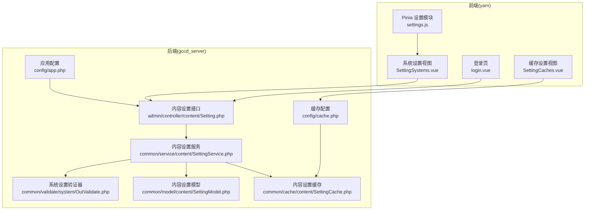
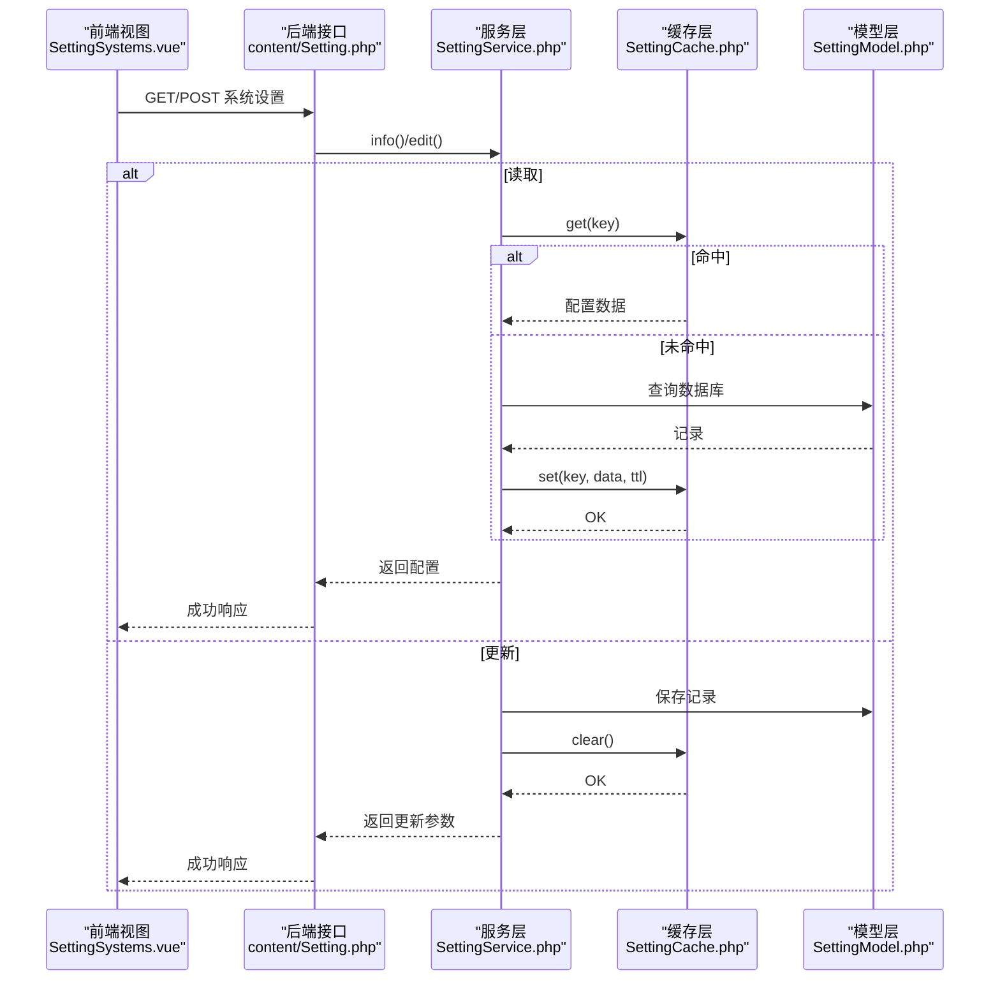
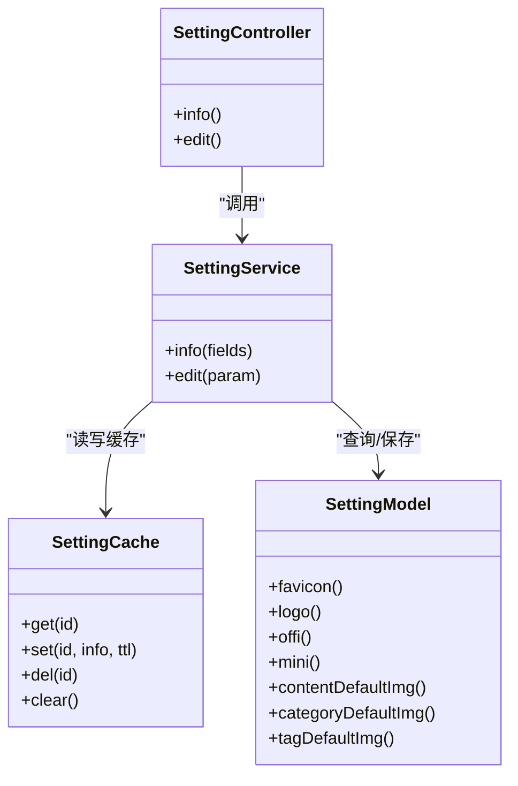
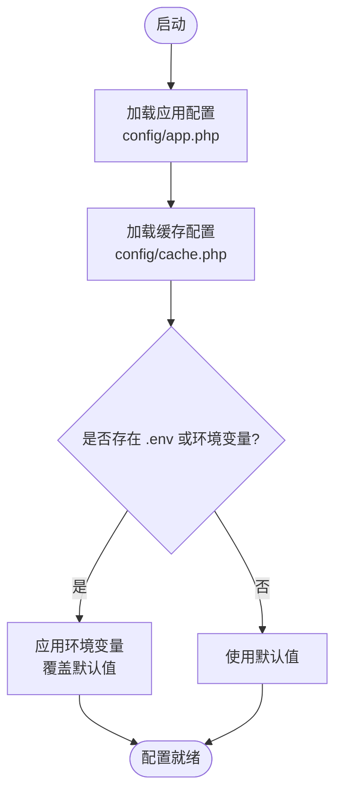
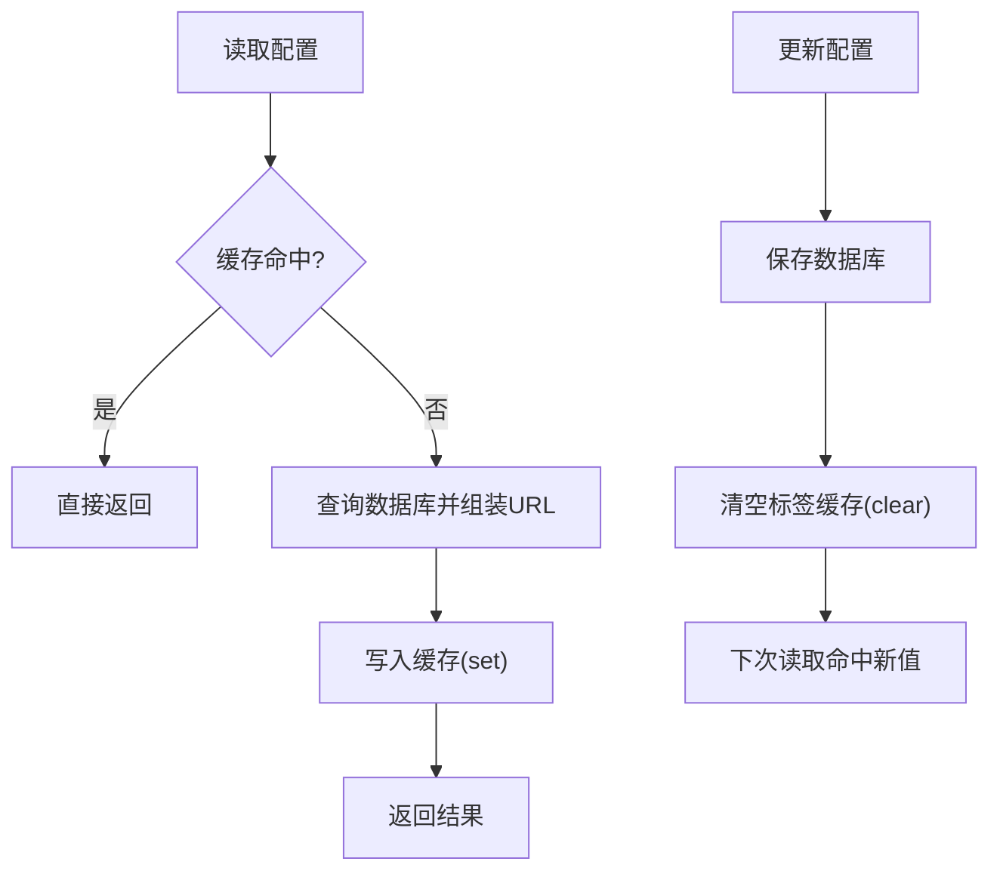
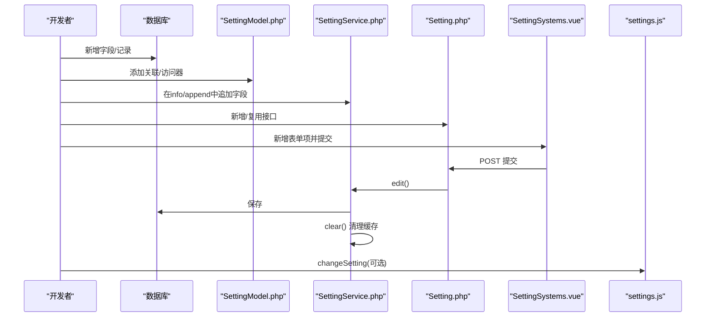
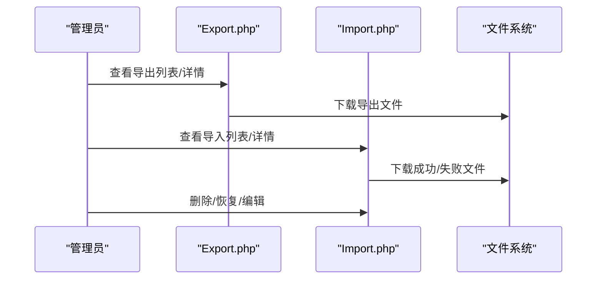
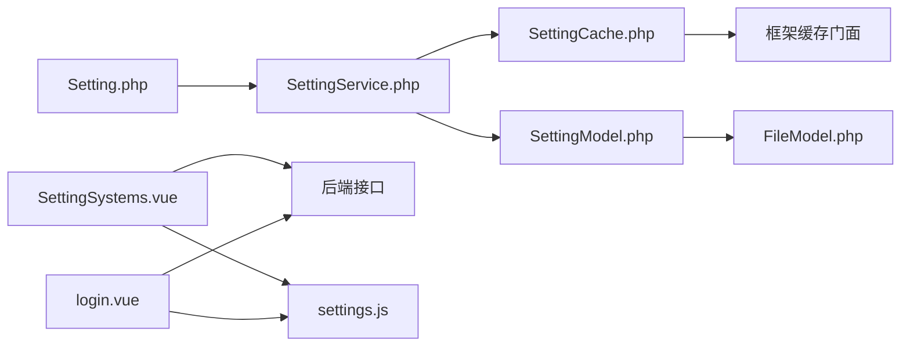

# 配置扩展

<cite>
**本文引用的文件**   
- [gccd_server/config/app.php](file://gccd_server/config/app.php)
- [gccd_server/config/cache.php](file://gccd_server/config/cache.php)
- [gccd_server/app/admin/controller/content/Setting.php](file://gccd_server/app/admin/controller/content/Setting.php)
- [gccd_server/app/common/service/content/SettingService.php](file://gccd_server/app/common/service/content/SettingService.php)
- [gccd_server/app/common/model/content/SettingModel.php](file://gccd_server/app/common/model/content/SettingModel.php)
- [gccd_server/app/common/cache/content/SettingCache.php](file://gccd_server/app/common/cache/content/SettingCache.php)
- [gccd_server/app/common/validate/system/OutValidate.php](file://gccd_server/app/common/validate/system/OutValidate.php)
- [yarn/src/store/modules/settings.js](file://yarn/src/store/modules/settings.js)
- [yarn/src/settings.js](file://yarn/src/settings.js)
- [yarn/src/views/system/components/SettingSystems.vue](file://yarn/src/views/system/components/SettingSystems.vue)
- [yarn/src/views/system/components/SettingCaches.vue](file://yarn/src/views/system/components/SettingCaches.vue)
- [yarn/src/views/system/components/SettingLogs.vue](file://yarn/src/views/system/components/SettingLogs.vue)
- [yarn/src/views/system/login.vue](file://yarn/src/views/system/login.vue)
- [gccd_server/app/admin/controller/file/Export.php](file://gccd_server/app/admin/controller/file/Export.php)
- [gccd_server/app/admin/controller/file/Import.php](file://gccd_server/app/admin/controller/file/Import.php)
- [.gitignore](file://gccd_server/.gitignore)
</cite>

## 目录
1. [简介](#简介)
2. [项目结构](#项目结构)
3. [核心组件](#核心组件)
4. [架构总览](#架构总览)
5. [详细组件分析](#详细组件分析)
6. [依赖关系分析](#依赖关系分析)
7. [性能考量](#性能考量)
8. [故障排查指南](#故障排查指南)
9. [结论](#结论)
10. [附录](#附录)

## 简介
本指南面向“高齿传动”项目的配置扩展开发，围绕动态配置系统的设计与实现，系统性讲解以下主题：
- 配置项的定义、读取、更新机制
- 环境变量的使用与管理（开发/测试/生产差异）
- 配置缓存的实现（热更新、缓存失效、配置同步）
- 系统设置的扩展开发（自定义设置项、配置验证、导入导出）
- 配置管理最佳实践（安全、版本控制、备份与恢复）
- 提供可直接复用的扩展示例与实现模板路径

## 项目结构
本项目采用前后端分离架构：
- 后端基于 ThinkPHP 框架，配置集中在 gccd_server/config 下，通过控制器-服务-缓存-模型的链路提供配置能力
- 前端基于 Vue3 + Pinia，通过本地存储持久化用户界面与系统设置，并在登录时拉取后端配置进行初始化

**图表来源**
- [gccd_server/config/app.php:1-44](file://gccd_server/config/app.php#L1-L44)
- [gccd_server/config/cache.php:1-86](file://gccd_server/config/cache.php#L1-L86)
- [gccd_server/app/admin/controller/content/Setting.php:1-77](file://gccd_server/app/admin/controller/content/Setting.php#L1-L77)
- [gccd_server/app/common/service/content/SettingService.php:1-113](file://gccd_server/app/common/service/content/SettingService.php#L1-L113)
- [gccd_server/app/common/cache/content/SettingCache.php:1-88](file://gccd_server/app/common/cache/content/SettingCache.php#L1-L88)
- [gccd_server/app/common/model/content/SettingModel.php:1-103](file://gccd_server/app/common/model/content/SettingModel.php#L1-L103)
- [gccd_server/app/common/validate/system/OutValidate.php:1-29](file://gccd_server/app/common/validate/system/OutValidate.php#L1-L29)
- [yarn/src/store/modules/settings.js:1-104](file://yarn/src/store/modules/settings.js#L1-L104)
- [yarn/src/views/system/components/SettingSystems.vue:1-156](file://yarn/src/views/system/components/SettingSystems.vue#L1-L156)
- [yarn/src/views/system/components/SettingCaches.vue:1-53](file://yarn/src/views/system/components/SettingCaches.vue#L1-L53)
- [yarn/src/views/system/login.vue:331-363](file://yarn/src/views/system/login.vue#L331-L363)

**章节来源**
- [gccd_server/config/app.php:1-44](file://gccd_server/config/app.php#L1-L44)
- [gccd_server/config/cache.php:1-86](file://gccd_server/config/cache.php#L1-L86)
- [yarn/src/store/modules/settings.js:1-104](file://yarn/src/store/modules/settings.js#L1-L104)

## 核心组件
- 应用配置与环境变量
  - 应用层配置集中于 config/app.php，大量关键行为通过 env() 从环境变量读取，便于在不同环境切换
  - 缓存层配置集中于 config/cache.php，支持 file/redis/memcache/wincache 多驱动，且同样通过 env() 注入运行时参数
- 配置读取与更新
  - 后端通过 admin/content/Setting 控制器提供配置查询与编辑接口；服务层 SettingService 负责业务逻辑与缓存协调；缓存层 SettingCache 提供统一的增删查清能力；模型层 SettingModel 完成字段拼装与 URL 追加
- 前端设置与持久化
  - 前端通过 Pinia store/modules/settings.js 将系统设置持久化到本地存储，并在登录页拉取后端配置进行初始化渲染

**章节来源**
- [gccd_server/app/admin/controller/content/Setting.php:1-77](file://gccd_server/app/admin/controller/content/Setting.php#L1-L77)
- [gccd_server/app/common/service/content/SettingService.php:1-113](file://gccd_server/app/common/service/content/SettingService.php#L1-L113)
- [gccd_server/app/common/cache/content/SettingCache.php:1-88](file://gccd_server/app/common/cache/content/SettingCache.php#L1-L88)
- [gccd_server/app/common/model/content/SettingModel.php:1-103](file://gccd_server/app/common/model/content/SettingModel.php#L1-L103)
- [yarn/src/store/modules/settings.js:1-104](file://yarn/src/store/modules/settings.js#L1-L104)

## 架构总览
下图展示了“系统设置”的端到端流程：前端发起请求 -> 后端控制器 -> 服务层 -> 缓存层 -> 模型层 -> 数据库；以及更新后的缓存失效与前端设置变更。

**图表来源**
- [gccd_server/app/admin/controller/content/Setting.php:1-77](file://gccd_server/app/admin/controller/content/Setting.php#L1-L77)
- [gccd_server/app/common/service/content/SettingService.php:1-113](file://gccd_server/app/common/service/content/SettingService.php#L1-L113)
- [gccd_server/app/common/cache/content/SettingCache.php:1-88](file://gccd_server/app/common/cache/content/SettingCache.php#L1-L88)
- [gccd_server/app/common/model/content/SettingModel.php:1-103](file://gccd_server/app/common/model/content/SettingModel.php#L1-L103)

## 详细组件分析

### 组件一：系统设置（内容设置）扩展
- 配置项定义与读取
  - 控制器提供 info/edit 接口，读取时根据请求类型区分 CLI/CMD 与 CGI 场景，动态追加 URL 字段并隐藏敏感字段
  - 服务层在缓存未命中时查询数据库并写入缓存，支持按字段切片返回
- 配置更新与缓存失效
  - 编辑成功后调用缓存层 clear() 清空标签缓存，确保后续读取命中最新值
- 前端集成
  - 视图组件 SettingSystems.vue 负责表单渲染与提交；登录页 login.vue 在登录成功后拉取系统设置并调用前端 store 的 changeSetting 动态更新界面

**图表来源**
- [gccd_server/app/admin/controller/content/Setting.php:1-77](file://gccd_server/app/admin/controller/content/Setting.php#L1-L77)
- [gccd_server/app/common/service/content/SettingService.php:1-113](file://gccd_server/app/common/service/content/SettingService.php#L1-L113)
- [gccd_server/app/common/cache/content/SettingCache.php:1-88](file://gccd_server/app/common/cache/content/SettingCache.php#L1-L88)
- [gccd_server/app/common/model/content/SettingModel.php:1-103](file://gccd_server/app/common/model/content/SettingModel.php#L1-L103)

**章节来源**
- [gccd_server/app/admin/controller/content/Setting.php:1-77](file://gccd_server/app/admin/controller/content/Setting.php#L1-L77)
- [gccd_server/app/common/service/content/SettingService.php:1-113](file://gccd_server/app/common/service/content/SettingService.php#L1-L113)
- [gccd_server/app/common/cache/content/SettingCache.php:1-88](file://gccd_server/app/common/cache/content/SettingCache.php#L1-L88)
- [gccd_server/app/common/model/content/SettingModel.php:1-103](file://gccd_server/app/common/model/content/SettingModel.php#L1-L103)
- [yarn/src/views/system/components/SettingSystems.vue:1-156](file://yarn/src/views/system/components/SettingSystems.vue#L1-L156)
- [yarn/src/views/system/login.vue:331-363](file://yarn/src/views/system/login.vue#L331-L363)

### 组件二：环境变量与配置差异管理
- 应用配置
  - app.php 中大量配置项通过 env() 读取，如调试模式、主机地址、时区等，便于在不同环境（开发/测试/生产）通过 .env 文件或容器环境变量进行差异化配置
- 缓存配置
  - cache.php 支持多种驱动，且通过 env() 注入驱动类型、过期时间、序列化、前缀、主机、端口、密码、持久化等参数，满足不同部署形态
- 版本与忽略
  - .gitignore 中包含 .env，避免将敏感配置提交到版本库

**图表来源**
- [gccd_server/config/app.php:1-44](file://gccd_server/config/app.php#L1-L44)
- [gccd_server/config/cache.php:1-86](file://gccd_server/config/cache.php#L1-L86)
- [.gitignore:1-27](file://gccd_server/.gitignore#L1-L27)

**章节来源**
- [gccd_server/config/app.php:1-44](file://gccd_server/config/app.php#L1-L44)
- [gccd_server/config/cache.php:1-86](file://gccd_server/config/cache.php#L1-L86)
- [.gitignore:1-27](file://gccd_server/.gitignore#L1-L27)

### 组件三：配置缓存与热更新
- 缓存策略
  - SettingCache 使用标签（tag）与键前缀（prefix）组织缓存，get/set/del/clear 提供细粒度控制
  - SettingService 在 info() 中按请求类型生成 key 并在未命中时写入缓存；edit() 后执行 clear()，保证热更新
- 前端缓存与同步
  - 前端 store/modules/settings.js 通过 useStorage 将设置持久化到本地存储；changeSetting 可即时更新 DOM 属性与样式，实现界面热更新
  - SettingCaches.vue 提供缓存信息查看与刷新/清理操作入口

**图表来源**
- [gccd_server/app/common/cache/content/SettingCache.php:1-88](file://gccd_server/app/common/cache/content/SettingCache.php#L1-L88)
- [gccd_server/app/common/service/content/SettingService.php:1-113](file://gccd_server/app/common/service/content/SettingService.php#L1-L113)
- [yarn/src/store/modules/settings.js:1-104](file://yarn/src/store/modules/settings.js#L1-L104)
- [yarn/src/views/system/components/SettingCaches.vue:1-53](file://yarn/src/views/system/components/SettingCaches.vue#L1-L53)

**章节来源**
- [gccd_server/app/common/cache/content/SettingCache.php:1-88](file://gccd_server/app/common/cache/content/SettingCache.php#L1-L88)
- [gccd_server/app/common/service/content/SettingService.php:1-113](file://gccd_server/app/common/service/content/SettingService.php#L1-L113)
- [yarn/src/store/modules/settings.js:1-104](file://yarn/src/store/modules/settings.js#L1-L104)
- [yarn/src/views/system/components/SettingCaches.vue:1-53](file://yarn/src/views/system/components/SettingCaches.vue#L1-L53)

### 组件四：系统设置扩展开发（自定义设置项）
- 新增设置项步骤
  1) 在数据库中新增对应字段或记录（建议沿用现有单条记录策略）
  2) 在 SettingModel 中添加关联与访问器，实现字段拼装与 URL 追加
  3) 在 SettingService::info() 中追加字段到 append/hidden 列表，确保返回结构完整
  4) 在 SettingService::edit() 中接收并保存新字段
  5) 在 SettingController 中新增接口或复用现有 edit 接口
  6) 在前端 SettingSystems.vue 中新增表单项，并在提交时调用接口
  7) 如需前端即时生效，可在 login.vue 或相应页面拉取后调用 changeSetting 更新 store
- 配置验证
  - 可参考 OutValidate.php 的规则风格，为新增字段补充验证场景与范围约束

**图表来源**
- [gccd_server/app/common/model/content/SettingModel.php:1-103](file://gccd_server/app/common/model/content/SettingModel.php#L1-L103)
- [gccd_server/app/common/service/content/SettingService.php:1-113](file://gccd_server/app/common/service/content/SettingService.php#L1-L113)
- [gccd_server/app/admin/controller/content/Setting.php:1-77](file://gccd_server/app/admin/controller/content/Setting.php#L1-L77)
- [yarn/src/views/system/components/SettingSystems.vue:1-156](file://yarn/src/views/system/components/SettingSystems.vue#L1-L156)
- [yarn/src/store/modules/settings.js:1-104](file://yarn/src/store/modules/settings.js#L1-L104)

**章节来源**
- [gccd_server/app/common/model/content/SettingModel.php:1-103](file://gccd_server/app/common/model/content/SettingModel.php#L1-L103)
- [gccd_server/app/common/service/content/SettingService.php:1-113](file://gccd_server/app/common/service/content/SettingService.php#L1-L113)
- [gccd_server/app/admin/controller/content/Setting.php:1-77](file://gccd_server/app/admin/controller/content/Setting.php#L1-L77)
- [yarn/src/views/system/components/SettingSystems.vue:1-156](file://yarn/src/views/system/components/SettingSystems.vue#L1-L156)
- [yarn/src/store/modules/settings.js:1-104](file://yarn/src/store/modules/settings.js#L1-L104)

### 组件五：配置导入导出（文件导入导出）
- 导入/导出功能
  - 后端提供 Import/Export 控制器，支持列表、详情、编辑、删除、回收站恢复/删除等完整流程
  - 支持下载成功/失败文件与原始文件，便于问题定位与审计
- 配置迁移建议
  - 可将系统设置以 JSON 形式导出，作为配置快照；导入时校验字段完整性与格式合法性，失败回滚并记录日志

**图表来源**
- [gccd_server/app/admin/controller/file/Export.php:1-157](file://gccd_server/app/admin/controller/file/Export.php#L1-L157)
- [gccd_server/app/admin/controller/file/Import.php:1-168](file://gccd_server/app/admin/controller/file/Import.php#L1-L168)

**章节来源**
- [gccd_server/app/admin/controller/file/Export.php:1-157](file://gccd_server/app/admin/controller/file/Export.php#L1-L157)
- [gccd_server/app/admin/controller/file/Import.php:1-168](file://gccd_server/app/admin/controller/file/Import.php#L1-L168)

## 依赖关系分析
- 后端
  - SettingController 依赖 SettingService；SettingService 依赖 SettingCache 与 SettingModel；SettingCache 依赖框架 Cache；SettingModel 依赖 FileModel 与 where_disdel 条件
  - 配置读取链路：Controller -> Service -> Cache -> Model -> DB
  - 配置更新链路：Controller -> Service -> DB -> Service -> Cache.clear()
- 前端
  - SettingSystems.vue 依赖 API 与 Pinia store；login.vue 在登录后拉取系统设置并调用 changeSetting

**图表来源**
- [gccd_server/app/admin/controller/content/Setting.php:1-77](file://gccd_server/app/admin/controller/content/Setting.php#L1-L77)
- [gccd_server/app/common/service/content/SettingService.php:1-113](file://gccd_server/app/common/service/content/SettingService.php#L1-L113)
- [gccd_server/app/common/cache/content/SettingCache.php:1-88](file://gccd_server/app/common/cache/content/SettingCache.php#L1-L88)
- [gccd_server/app/common/model/content/SettingModel.php:1-103](file://gccd_server/app/common/model/content/SettingModel.php#L1-L103)
- [yarn/src/views/system/components/SettingSystems.vue:1-156](file://yarn/src/views/system/components/SettingSystems.vue#L1-L156)
- [yarn/src/views/system/login.vue:331-363](file://yarn/src/views/system/login.vue#L331-L363)
- [yarn/src/store/modules/settings.js:1-104](file://yarn/src/store/modules/settings.js#L1-L104)

**章节来源**
- [gccd_server/app/admin/controller/content/Setting.php:1-77](file://gccd_server/app/admin/controller/content/Setting.php#L1-L77)
- [gccd_server/app/common/service/content/SettingService.php:1-113](file://gccd_server/app/common/service/content/SettingService.php#L1-L113)
- [gccd_server/app/common/cache/content/SettingCache.php:1-88](file://gccd_server/app/common/cache/content/SettingCache.php#L1-L88)
- [gccd_server/app/common/model/content/SettingModel.php:1-103](file://gccd_server/app/common/model/content/SettingModel.php#L1-L103)
- [yarn/src/views/system/components/SettingSystems.vue:1-156](file://yarn/src/views/system/components/SettingSystems.vue#L1-L156)
- [yarn/src/views/system/login.vue:331-363](file://yarn/src/views/system/login.vue#L331-L363)
- [yarn/src/store/modules/settings.js:1-104](file://yarn/src/store/modules/settings.js#L1-L104)

## 性能考量
- 缓存命中率
  - 通过合理的 TTL（如 SettingService 中默认 43200 秒）与标签清理策略，减少数据库压力
- 读写分离
  - 读路径尽量走缓存，写路径后触发 clear()，避免脏读
- 前端本地存储
  - settings.js 使用 useStorage 将设置持久化，降低重复请求成本
- 批量字段返回
  - SettingService::info() 支持 fields 参数按需返回，减少传输与处理开销

[本节为通用指导，不直接分析具体文件]

## 故障排查指南
- 配置未生效
  - 检查后端 SettingService::edit() 是否调用了 clear()；确认前端是否在登录后拉取并调用 changeSetting
- 缓存异常
  - 使用 SettingCaches.vue 的“刷新/清除”按钮验证缓存状态；检查 cache.php 中 driver/prefix/host/port/password 等 env() 注入是否正确
- 环境变量未生效
  - 确认 .env 是否被忽略（.gitignore 包含 .env），并在部署环境正确注入；检查 config/app.php 与 config/cache.php 中的 env() 默认值
- 验证失败
  - 参考 OutValidate.php 的规则风格，为新增字段补充验证场景与范围约束，避免非法值进入数据库

**章节来源**
- [gccd_server/app/common/service/content/SettingService.php:1-113](file://gccd_server/app/common/service/content/SettingService.php#L1-L113)
- [gccd_server/app/common/validate/system/OutValidate.php:1-29](file://gccd_server/app/common/validate/system/OutValidate.php#L1-L29)
- [gccd_server/config/cache.php:1-86](file://gccd_server/config/cache.php#L1-L86)
- [.gitignore:1-27](file://gccd_server/.gitignore#L1-L27)

## 结论
本项目通过“控制器-服务-缓存-模型”的清晰分层，结合环境变量与本地存储，实现了可扩展、可热更新的动态配置体系。遵循本文提供的扩展步骤与最佳实践，可在不破坏现有架构的前提下快速新增配置项、保障一致性与安全性，并通过导入导出实现配置的版本化管理与迁移。

[本节为总结，不直接分析具体文件]

## 附录
- 扩展清单
  - 新增字段：在 SettingModel 中添加关联与访问器
  - 读取增强：在 SettingService::info() 的 append/hidden 中追加字段
  - 更新逻辑：在 SettingService::edit() 中接收并保存
  - 接口暴露：在 Setting.php 中新增或复用接口
  - 前端联动：在 SettingSystems.vue 中新增表单项；在 login.vue 中拉取并调用 changeSetting
- 最佳实践模板路径
  - 配置读取链路：[gccd_server/app/admin/controller/content/Setting.php:1-77](file://gccd_server/app/admin/controller/content/Setting.php#L1-L77) → [gccd_server/app/common/service/content/SettingService.php:1-113](file://gccd_server/app/common/service/content/SettingService.php#L1-L113) → [gccd_server/app/common/cache/content/SettingCache.php:1-88](file://gccd_server/app/common/cache/content/SettingCache.php#L1-L88) → [gccd_server/app/common/model/content/SettingModel.php:1-103](file://gccd_server/app/common/model/content/SettingModel.php#L1-L103)
  - 前端设置联动：[yarn/src/store/modules/settings.js:1-104](file://yarn/src/store/modules/settings.js#L1-L104) → [yarn/src/views/system/components/SettingSystems.vue:1-156](file://yarn/src/views/system/components/SettingSystems.vue#L1-L156) → [yarn/src/views/system/login.vue:331-363](file://yarn/src/views/system/login.vue#L331-L363)
  - 环境变量与缓存：[gccd_server/config/app.php:1-44](file://gccd_server/config/app.php#L1-L44) → [gccd_server/config/cache.php:1-86](file://gccd_server/config/cache.php#L1-L86)
  - 导入导出：[gccd_server/app/admin/controller/file/Import.php:1-168](file://gccd_server/app/admin/controller/file/Import.php#L1-L168) → [gccd_server/app/admin/controller/file/Export.php:1-157](file://gccd_server/app/admin/controller/file/Export.php#L1-L157)