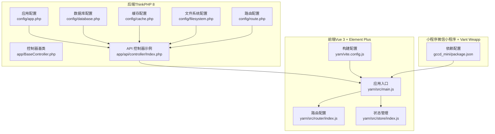
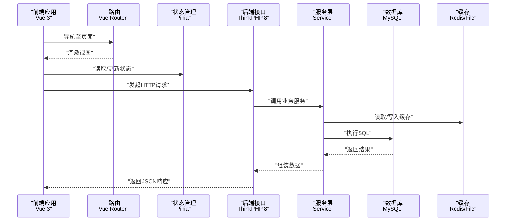
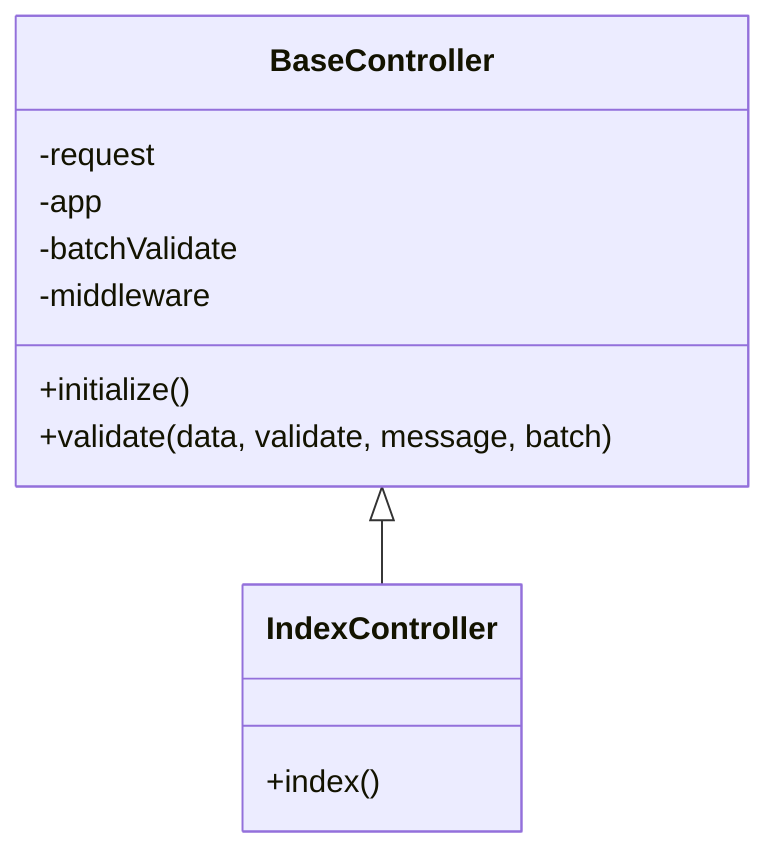
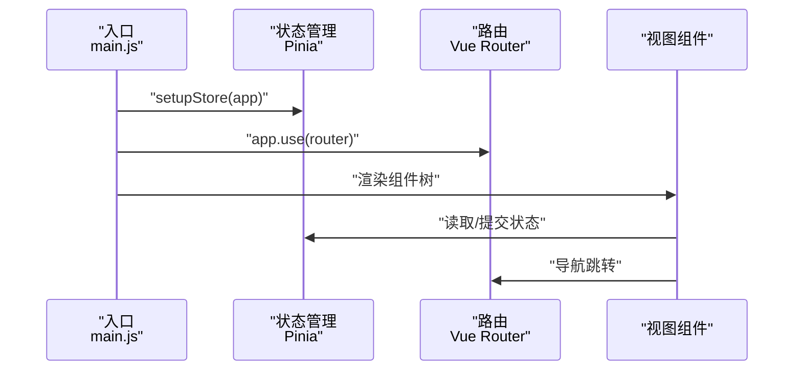
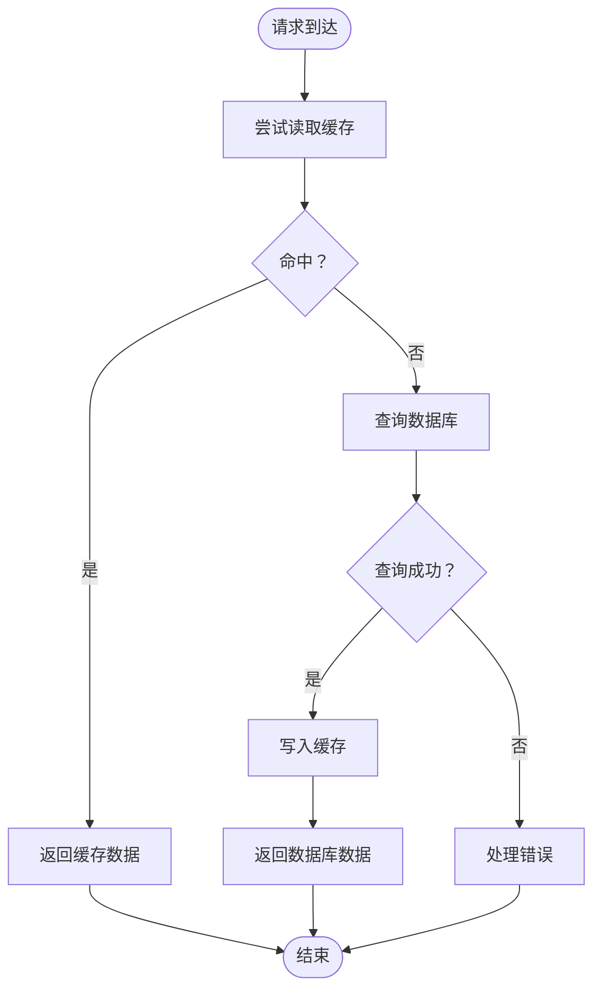
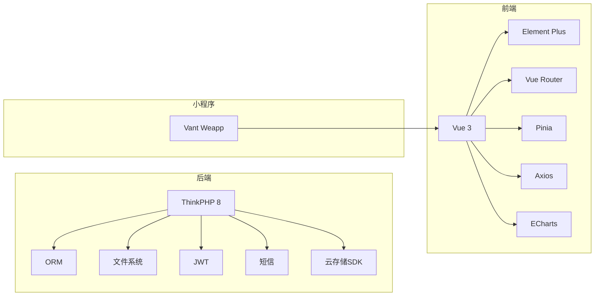

# 技术栈详解

<cite>
**本文引用的文件**
- [composer.json](file://gccd_server/composer.json)
- [app.php](file://gccd_server/config/app.php)
- [database.php](file://gccd_server/config/database.php)
- [cache.php](file://gccd_server/config/cache.php)
- [filesystem.php](file://gccd_server/config/filesystem.php)
- [route.php](file://gccd_server/config/route.php)
- [BaseController.php](file://gccd_server/app/BaseController.php)
- [Index.php](file://gccd_server/app/api/controller/Index.php)
- [package.json（后端）](file://gccd_server/composer.json)
- [package.json（前端）](file://yarn/package.json)
- [package.json（小程序）](file://gccd_mini/package.json)
- [vite.config.js](file://yarn/vite.config.js)
- [main.js](file://yarn/src/main.js)
- [router/index.js](file://yarn/src/router/index.js)
- [store/index.js](file://yarn/src/store/index.js)
</cite>

## 目录
1. [引言](#引言)
2. [项目结构](#项目结构)
3. [核心组件](#核心组件)
4. [架构总览](#架构总览)
5. [详细组件分析](#详细组件分析)
6. [依赖分析](#依赖分析)
7. [性能考虑](#性能考虑)
8. [故障排查指南](#故障排查指南)
9. [结论](#结论)
10. [附录](#附录)

## 引言
本技术栈文档面向“高齿传动”项目，系统梳理后端 ThinkPHP 8、前端 Vue 3 + Element Plus、微信小程序以及基础设施（数据库、缓存、文件存储）的整体技术选型与实现要点。文档以仓库现有配置与代码为依据，结合架构图与流程图，帮助开发者快速理解系统设计、掌握集成方式，并在实际运维与优化中遵循最佳实践。

## 项目结构
项目采用前后端分离架构，后端基于 ThinkPHP 8 的多应用模式，前端使用 Vite + Vue 3 + Element Plus，小程序基于微信原生生态与 Vant Weapp 组件库。核心模块划分如下：
- 后端（ThinkPHP 8）
  - 多应用：admin、api 等应用隔离
  - 中间件与路由配置
  - 服务化设计（Service 层）
  - 文件存储与缓存
- 前端（Vue 3 + Element Plus）
  - Composition API、Pinia 状态管理、Vue Router
  - Vite 构建与插件生态
- 小程序（微信小程序）
  - Vant Weapp 组件库与主题定制脚本

图表来源
- [app.php:11-43](file://gccd_server/config/app.php#L11-L43)
- [database.php:27-66](file://gccd_server/config/database.php#L27-L66)
- [cache.php:13-85](file://gccd_server/config/cache.php#L13-L85)
- [filesystem.php:11-32](file://gccd_server/config/filesystem.php#L11-L32)
- [route.php:11-50](file://gccd_server/config/route.php#L11-L50)
- [BaseController.php:19-99](file://gccd_server/app/BaseController.php#L19-L99)
- [Index.php:21-35](file://gccd_server/app/api/controller/Index.php#L21-L35)
- [main.js:1-44](file://yarn/src/main.js#L1-L44)
- [router/index.js:1-106](file://yarn/src/router/index.js#L1-L106)
- [store/index.js:1-10](file://yarn/src/store/index.js#L1-L10)
- [vite.config.js:13-184](file://yarn/vite.config.js#L13-L184)
- [package.json（小程序）:1-12](file://gccd_mini/package.json#L1-L12)

章节来源
- [app.php:11-43](file://gccd_server/config/app.php#L11-L43)
- [route.php:11-50](file://gccd_server/config/route.php#L11-L50)
- [BaseController.php:19-99](file://gccd_server/app/BaseController.php#L19-L99)
- [Index.php:21-35](file://gccd_server/app/api/controller/Index.php#L21-L35)
- [main.js:1-44](file://yarn/src/main.js#L1-L44)
- [router/index.js:1-106](file://yarn/src/router/index.js#L1-L106)
- [store/index.js:1-10](file://yarn/src/store/index.js#L1-L10)
- [vite.config.js:13-184](file://yarn/vite.config.js#L13-L184)
- [package.json（小程序）:1-12](file://gccd_mini/package.json#L1-L12)

## 核心组件
- 后端框架与多应用
  - ThinkPHP 8：通过应用配置启用多应用模式，支持 admin 与 api 等应用隔离，便于权限与接口分层。
  - 默认应用与命名空间：默认应用为 api，便于前端直连接口。
- 中间件机制
  - 控制器基类提供中间件钩子，便于在控制器层面统一接入鉴权、日志、限流等能力。
- 服务化设计
  - 控制器调用 Service 层进行业务编排，提升可测试性与复用性。
- 前端技术栈
  - Vue 3 + Composition API：逻辑组合与响应式更灵活；Element Plus 提供丰富的 UI 组件与暗色主题支持。
  - Pinia：轻量状态管理，与 Vue 3 协同良好。
  - Vue Router：基于 hash 模式的路由，适配内网与静态部署。
  - Vite：现代化构建工具，配合插件生态实现自动导入、组件按需注册、SVG 图标等。
- 微信小程序
  - 使用 Vant Weapp 组件库，提供主题定制脚本，统一视觉风格。

章节来源
- [app.php:24-34](file://gccd_server/config/app.php#L24-L34)
- [BaseController.php:40-43](file://gccd_server/app/BaseController.php#L40-L43)
- [Index.php:12-14](file://gccd_server/app/api/controller/Index.php#L12-L14)
- [main.js:1-44](file://yarn/src/main.js#L1-L44)
- [router/index.js:1-106](file://yarn/src/router/index.js#L1-L106)
- [store/index.js:1-10](file://yarn/src/store/index.js#L1-L10)
- [vite.config.js:38-70](file://yarn/vite.config.js#L38-L70)
- [package.json（小程序）:8-10](file://gccd_mini/package.json#L8-L10)

## 架构总览
下图展示从前端到后端、再到数据库与缓存的典型请求链路，体现多应用模式与服务化设计：

图表来源
- [router/index.js:1-106](file://yarn/src/router/index.js#L1-L106)
- [store/index.js:1-10](file://yarn/src/store/index.js#L1-L10)
- [Index.php:29-35](file://gccd_server/app/api/controller/Index.php#L29-L35)
- [database.php:27-66](file://gccd_server/config/database.php#L27-L66)
- [cache.php:18-52](file://gccd_server/config/cache.php#L18-L52)

## 详细组件分析

### 后端：ThinkPHP 8 多应用与中间件
- 多应用模式
  - 应用映射与域名绑定：通过应用配置控制不同应用的访问边界，避免 common 应用被直接访问。
  - 默认应用：默认进入 api 应用，便于前端直连接口。
- 中间件机制
  - 控制器基类提供中间件数组，可在具体控制器中声明所需中间件，实现横切关注点（鉴权、审计、限流等）。
- 路由与控制器
  - 路由配置支持多种参数与缓存策略；控制器基类提供统一的验证方法，便于参数校验与异常处理。
- 示例：首页控制器
  - 控制器继承基类，调用服务层返回数据，统一使用成功响应封装。

图表来源
- [BaseController.php:19-99](file://gccd_server/app/BaseController.php#L19-L99)
- [Index.php:21-35](file://gccd_server/app/api/controller/Index.php#L21-L35)

章节来源
- [app.php:24-34](file://gccd_server/config/app.php#L24-L34)
- [route.php:11-50](file://gccd_server/config/route.php#L11-L50)
- [BaseController.php:40-99](file://gccd_server/app/BaseController.php#L40-L99)
- [Index.php:21-35](file://gccd_server/app/api/controller/Index.php#L21-L35)

### 前端：Vue 3 + Element Plus + Pinia + Vue Router
- 应用入口与插件
  - 入口文件注册路由、状态管理、国际化、粒子动画、自定义指令与图标组件，形成统一启动流程。
- 路由设计
  - 静态路由表包含登录页、仪表盘、重定向、401/404 页面与业务模块路由，采用 hash 模式便于部署。
- 状态管理
  - Pinia 在入口处集中创建与挂载，便于全局状态共享与模块化组织。
- 构建与插件
  - Vite 配置启用自动导入（Vue、Router、Pinia、Element Plus、图标）、组件自动注册、SVG 图标缓存、预打包依赖与生产压缩策略。

图表来源
- [main.js:1-44](file://yarn/src/main.js#L1-L44)
- [store/index.js:1-10](file://yarn/src/store/index.js#L1-L10)
- [router/index.js:1-106](file://yarn/src/router/index.js#L1-L106)

章节来源
- [main.js:1-44](file://yarn/src/main.js#L1-L44)
- [router/index.js:1-106](file://yarn/src/router/index.js#L1-L106)
- [store/index.js:1-10](file://yarn/src/store/index.js#L1-L10)
- [vite.config.js:38-70](file://yarn/vite.config.js#L38-L70)

### 小程序：Vant Weapp 与主题定制
- 依赖与脚本
  - 使用 Vant Weapp 组件库，提供主题定制脚本，在安装后自动应用主题。
- 适用场景
  - 适合企业内部或移动端轻量交互场景，组件丰富、样式统一。

章节来源
- [package.json（小程序）:8-10](file://gccd_mini/package.json#L8-L10)

### 基础设施：数据库、缓存与文件存储
- 数据库
  - 默认使用 MySQL，支持表前缀、字段缓存、断线重连与 SQL 触发等配置项，便于生产环境稳定性与可观测性。
- 缓存
  - 支持 file、redis、memcache、wincache 等驱动，可通过环境变量切换与配置前缀、过期策略、序列化机制等。
- 文件存储
  - 提供 local 与 public 磁盘，public 磁盘映射到对外可访问的 URL，便于静态资源与上传文件的统一管理。

图表来源
- [cache.php:18-52](file://gccd_server/config/cache.php#L18-L52)
- [database.php:27-66](file://gccd_server/config/database.php#L27-L66)

章节来源
- [database.php:27-66](file://gccd_server/config/database.php#L27-L66)
- [cache.php:18-52](file://gccd_server/config/cache.php#L18-L52)
- [filesystem.php:11-32](file://gccd_server/config/filesystem.php#L11-L32)

## 依赖分析
- 后端依赖（部分）
  - ThinkPHP 8 核心、ORM、多应用、文件系统、Worker、限流、队列、JWT、短信、邮件、验证码、云存储 SDK、Excel、二维码等。
- 前端依赖（部分）
  - Vue 3、Element Plus、Vue Router、Pinia、Axios、ECharts、WangEditor、QRCode、XLSX、UnoCSS、TSParticles 等。
- 小程序依赖
  - Vant Weapp 组件库。

图表来源
- [composer.json:23-47](file://gccd_server/composer.json#L23-L47)
- [package.json（后端）:23-47](file://gccd_server/composer.json#L23-L47)
- [package.json（前端）:25-57](file://yarn/package.json#L25-L57)
- [package.json（小程序）:8-10](file://gccd_mini/package.json#L8-L10)

章节来源
- [composer.json:23-47](file://gccd_server/composer.json#L23-L47)
- [package.json（后端）:23-47](file://gccd_server/composer.json#L23-L47)
- [package.json（前端）:25-57](file://yarn/package.json#L25-L57)
- [package.json（小程序）:8-10](file://gccd_mini/package.json#L8-L10)

## 性能考虑
- 前端
  - Vite 预打包常用依赖与 Element Plus 组件样式，减少首包体积与冷启动时间。
  - 生产构建移除 console 与 debugger，压缩注释，拆分大包，降低传输体积。
  - 图标与媒体资源分类命名，便于缓存与 CDN 加速。
- 后端
  - 数据库字段缓存与断线重连配置，减少元数据查询与连接抖动。
  - 多应用模式与路由配置合理化，避免不必要的解析与匹配开销。
- 缓存
  - Redis 作为首选缓存，结合过期策略与标签前缀，提升热点数据命中率与失效粒度。
- 文件存储
  - public 磁盘映射到对外 URL，结合 CDN 或静态托管，加速资源访问。

章节来源
- [vite.config.js:72-181](file://yarn/vite.config.js#L72-L181)
- [cache.php:33-52](file://gccd_server/config/cache.php#L33-L52)
- [database.php:62-65](file://gccd_server/config/database.php#L62-L65)
- [filesystem.php:20-29](file://gccd_server/config/filesystem.php#L20-L29)

## 故障排查指南
- 后端
  - 应用配置：确认默认应用、命名空间与禁止访问列表，避免路由或访问异常。
  - 路由配置：核对控制器层、默认控制器与动作、是否开启路由延迟解析等。
  - 控制器基类：若出现参数校验异常，检查 validate 方法调用与消息配置。
- 前端
  - 路由：确认 hash 模式与静态路由表是否正确，避免 404。
  - 插件：检查自动导入与组件注册是否生效，SVG 图标缓存路径是否正确。
- 基础设施
  - 数据库：核对主机、端口、用户名、密码、字符集与表前缀。
  - 缓存：根据运行环境切换 driver，检查 host/port/password 与过期策略。
  - 文件存储：确认 public 磁盘 URL 与可见性，确保静态资源可访问。

章节来源
- [app.php:11-43](file://gccd_server/config/app.php#L11-L43)
- [route.php:11-50](file://gccd_server/config/route.php#L11-L50)
- [BaseController.php:74-99](file://gccd_server/app/BaseController.php#L74-L99)
- [router/index.js:1-106](file://yarn/src/router/index.js#L1-L106)
- [vite.config.js:38-70](file://yarn/vite.config.js#L38-L70)
- [database.php:27-66](file://gccd_server/config/database.php#L27-L66)
- [cache.php:18-52](file://gccd_server/config/cache.php#L18-L52)
- [filesystem.php:11-32](file://gccd_server/config/filesystem.php#L11-L32)

## 结论
本项目以 ThinkPHP 8 的多应用模式与服务化设计为后端骨架，结合 Vue 3 + Element Plus 的现代化前端技术栈，辅以完善的构建与插件体系，形成前后端分离、职责清晰、易于扩展的工程化方案。小程序侧采用 Vant Weapp 组件库，满足移动端与内嵌场景需求。基础设施方面，数据库、缓存与文件存储均提供灵活配置，便于在不同环境中快速落地与优化。

## 附录
- 版本与配置要点
  - 后端 ThinkPHP 8、ORM、多应用、文件系统、Worker、限流、队列、JWT、短信、邮件、验证码、云存储 SDK、Excel、二维码等。
  - 前端 Vue 3、Element Plus、Vue Router、Pinia、Axios、ECharts、WangEditor、QRCode、XLSX、UnoCSS、TSParticles 等。
  - 小程序 Vant Weapp 组件库与主题定制脚本。
- 最佳实践
  - 后端：统一使用控制器基类进行参数校验与异常处理；服务层聚焦业务逻辑；合理利用缓存与数据库字段缓存。
  - 前端：按需引入组件与图标；利用自动导入减少样板代码；生产构建开启压缩与注释清理。
  - 基础设施：生产环境优先 Redis 缓存；数据库连接参数与断线重连按需开启；文件存储对外 URL 与 CDN 结合使用。

章节来源
- [composer.json:23-47](file://gccd_server/composer.json#L23-L47)
- [package.json（后端）:23-47](file://gccd_server/composer.json#L23-L47)
- [package.json（前端）:25-57](file://yarn/package.json#L25-L57)
- [package.json（小程序）:8-10](file://gccd_mini/package.json#L8-L10)
- [vite.config.js:13-184](file://yarn/vite.config.js#L13-L184)