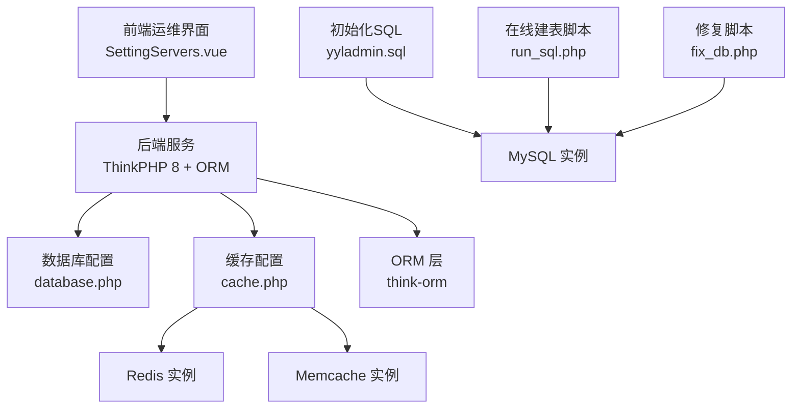
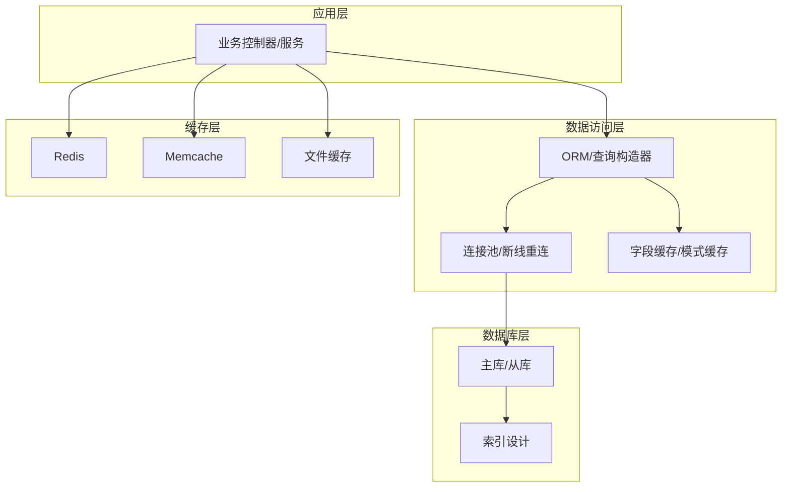
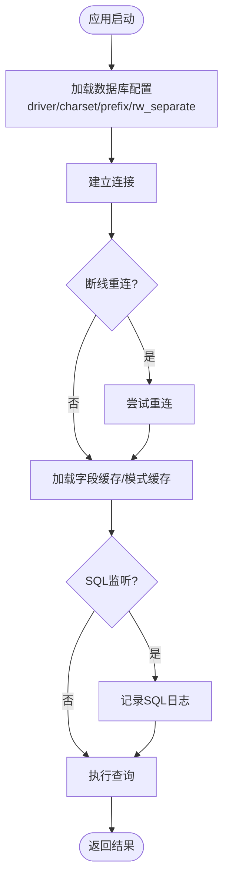
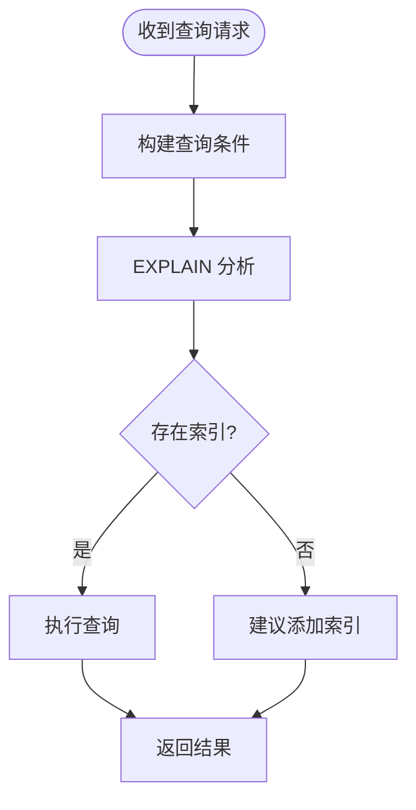
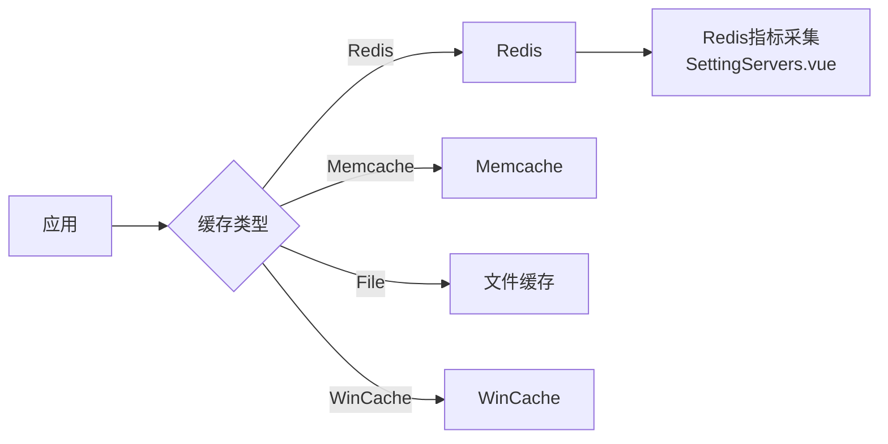
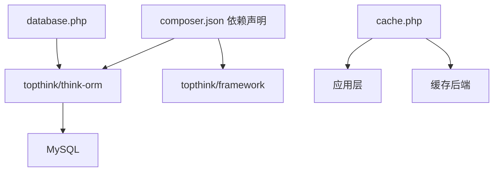

# 数据库性能优化

<cite>
**本文引用的文件**   
- [gccd_server/config/database.php](file://gccd_server/config/database.php)
- [gccd_server/config/cache.php](file://gccd_server/config/cache.php)
- [gccd_server/composer.json](file://gccd_server/composer.json)
- [gccd_server/private/database/yyladmin.sql](file://gccd_server/private/database/yyladmin.sql)
- [gccd_server/public/run_sql.php](file://gccd_server/public/run_sql.php)
- [gccd_server/public/fix_db.php](file://gccd_server/public/fix_db.php)
- [yarn/src/views/system/components/SettingServers.vue](file://yarn/src/views/system/components/SettingServers.vue)
</cite>

## 目录
1. [简介](#简介)
2. [项目结构](#项目结构)
3. [核心组件](#核心组件)
4. [架构总览](#架构总览)
5. [详细组件分析](#详细组件分析)
6. [依赖关系分析](#依赖关系分析)
7. [性能考量](#性能考量)
8. [故障排查指南](#故障排查指南)
9. [结论](#结论)
10. [附录](#附录)

## 简介
本文件面向数据库性能优化，结合仓库中的配置与脚本，系统梳理数据库连接配置、连接池管理、查询优化策略、索引设计原则、缓存策略、监控指标、备份恢复、读写分离与分库分表等主题，并提供可落地的配置示例与调优案例路径，帮助在现有项目基础上实现稳定高效的数据库性能。

## 项目结构
本项目由三部分构成：前端可视化运维界面、后端服务（ThinkPHP 8 + ORM）、数据库初始化与修复脚本。数据库相关的关键位置如下：
- 数据库连接配置：gccd_server/config/database.php
- 缓存配置：gccd_server/config/cache.php
- 后端框架与ORM依赖：gccd_server/composer.json
- 数据库初始化SQL：gccd_server/private/database/yyladmin.sql
- 在线建表与索引示例脚本：gccd_server/public/run_sql.php、gccd_server/public/fix_db.php
- Redis监控展示（前端）：yarn/src/views/system/components/SettingServers.vue

**图表来源**
- [gccd_server/config/database.php:11-70](file://gccd_server/config/database.php#L11-L70)
- [gccd_server/config/cache.php:13-85](file://gccd_server/config/cache.php#L13-L85)
- [gccd_server/composer.json:23-47](file://gccd_server/composer.json#L23-L47)
- [gccd_server/private/database/yyladmin.sql:1-200](file://gccd_server/private/database/yyladmin.sql#L1-L200)
- [gccd_server/public/run_sql.php:33-63](file://gccd_server/public/run_sql.php#L33-L63)
- [gccd_server/public/fix_db.php:52-62](file://gccd_server/public/fix_db.php#L52-L62)
- [yarn/src/views/system/components/SettingServers.vue:34-95](file://yarn/src/views/system/components/SettingServers.vue#L34-L95)

**章节来源**
- [gccd_server/config/database.php:11-70](file://gccd_server/config/database.php#L11-L70)
- [gccd_server/config/cache.php:13-85](file://gccd_server/config/cache.php#L13-L85)
- [gccd_server/composer.json:23-47](file://gccd_server/composer.json#L23-L47)
- [gccd_server/private/database/yyladmin.sql:1-200](file://gccd_server/private/database/yyladmin.sql#L1-L200)
- [gccd_server/public/run_sql.php:33-63](file://gccd_server/public/run_sql.php#L33-L63)
- [gccd_server/public/fix_db.php:52-62](file://gccd_server/public/fix_db.php#L52-L62)
- [yarn/src/views/system/components/SettingServers.vue:34-95](file://yarn/src/views/system/components/SettingServers.vue#L34-L95)

## 核心组件
- 数据库连接配置：集中于 database.php，支持默认驱动、字符集、表前缀、读写分离开关、断线重连、字段缓存、SQL监听等。
- 缓存配置：集中于 cache.php，支持 file、redis、memcache、wincache 多种驱动，统一过期时间、序列化、前缀、持久化等。
- ORM与框架：通过 composer.json 可见使用 topthink/think-orm 作为数据访问层，具备查询构建器、模型、事务、队列等能力。
- 初始化与修复：yyladmin.sql 提供完整表结构；run_sql.php、fix_db.php 提供在线建表与索引示例，便于演示索引对查询的影响。

**章节来源**
- [gccd_server/config/database.php:11-70](file://gccd_server/config/database.php#L11-L70)
- [gccd_server/config/cache.php:13-85](file://gccd_server/config/cache.php#L13-L85)
- [gccd_server/composer.json:23-47](file://gccd_server/composer.json#L23-L47)
- [gccd_server/private/database/yyladmin.sql:1-200](file://gccd_server/private/database/yyladmin.sql#L1-L200)
- [gccd_server/public/run_sql.php:33-63](file://gccd_server/public/run_sql.php#L33-L63)
- [gccd_server/public/fix_db.php:52-62](file://gccd_server/public/fix_db.php#L52-L62)

## 架构总览
下图展示了数据库层、缓存层与应用层的交互关系，以及读写分离与字段缓存的启用位置。

**图表来源**
- [gccd_server/config/database.php:27-66](file://gccd_server/config/database.php#L27-L66)
- [gccd_server/config/cache.php:18-83](file://gccd_server/config/cache.php#L18-L83)
- [gccd_server/composer.json:23-47](file://gccd_server/composer.json#L23-L47)

## 详细组件分析

### 数据库连接配置与连接池管理
- 默认驱动与字符集：默认驱动与字符集可通过环境变量覆盖，字符集建议使用 utf8mb4 以兼容表情符号。
- 表前缀与字段严格性：表前缀统一为 ya_，字段严格性可按需开启，有助于避免无效字段引发的异常。
- 读写分离：rw_separate 默认关闭，deploy 为集中式部署；如需主从分离，应开启 rw_separate 并合理配置 master_num 与 slave_no。
- 断线重连：break_reconnect 可按需开启，提升网络抖动下的稳定性。
- 字段缓存与SQL监听：fields_cache 与 trigger_sql 可用于调试与性能优化，生产环境建议谨慎开启。
- 连接池：ThinkORM 默认无内置连接池，可通过外部连接池组件或应用服务器连接池实现；本项目未直接体现连接池配置项。

**图表来源**
- [gccd_server/config/database.php:27-66](file://gccd_server/config/database.php#L27-L66)

**章节来源**
- [gccd_server/config/database.php:11-70](file://gccd_server/config/database.php#L11-L70)

### 查询优化策略与执行计划分析
- 使用索引：run_sql.php 与 fix_db.php 中均展示了为外键字段建立单列索引的做法，可显著降低 JOIN 与过滤成本。
- 执行计划：建议在开发/测试环境开启 SQL 监听（trigger_sql），结合 EXPLAIN 分析查询路径，定位全表扫描与回表问题。
- 字段缓存：开启 fields_cache 可减少元数据查询次数，降低 ORM 初始化开销。

**图表来源**
- [gccd_server/public/run_sql.php:33-63](file://gccd_server/public/run_sql.php#L33-L63)
- [gccd_server/public/fix_db.php:52-62](file://gccd_server/public/fix_db.php#L52-L62)
- [gccd_server/config/database.php:60-66](file://gccd_server/config/database.php#L60-L66)

**章节来源**
- [gccd_server/public/run_sql.php:33-63](file://gccd_server/public/run_sql.php#L33-L63)
- [gccd_server/public/fix_db.php:52-62](file://gccd_server/public/fix_db.php#L52-L62)
- [gccd_server/config/database.php:60-66](file://gccd_server/config/database.php#L60-L66)

### 索引设计原则与选择策略
- 单列索引：针对高频过滤字段（如外键、状态、时间范围）建立单列索引，提升点查与范围查询效率。
- 复合索引：遵循“最左前缀原则”，将选择性高的列放在左侧，避免过多重复索引导致写入放大。
- 唯一索引：对唯一约束字段建立唯一索引，保证数据一致性的同时提升查找性能。
- 维护成本：定期评估索引使用率，清理不命中或冗余索引，平衡写入与查询性能。

**章节来源**
- [gccd_server/public/run_sql.php:33-63](file://gccd_server/public/run_sql.php#L33-L63)
- [gccd_server/public/fix_db.php:52-62](file://gccd_server/public/fix_db.php#L52-L62)

### 缓存策略设计
- 多驱动支持：cache.php 提供 file、redis、memcache、wincache 四种驱动，可按环境灵活切换。
- 前缀与过期：统一前缀与过期策略，避免键冲突；根据业务热点设置合理的 TTL。
- Redis 优势：适合高并发读取与复杂数据结构；前端 SettingServers.vue 展示了 Redis 关键指标（连接数、内存、命令数等）采集入口。
- 本地缓存：file 驱动适合低并发与轻量场景；wincache 适合 Windows 环境。
- 缓存穿透与雪崩：建议引入布隆过滤器与随机 TTL，配合热点数据预热。

**图表来源**
- [gccd_server/config/cache.php:18-83](file://gccd_server/config/cache.php#L18-L83)
- [yarn/src/views/system/components/SettingServers.vue:34-95](file://yarn/src/views/system/components/SettingServers.vue#L34-L95)

**章节来源**
- [gccd_server/config/cache.php:13-85](file://gccd_server/config/cache.php#L13-L85)
- [yarn/src/views/system/components/SettingServers.vue:34-95](file://yarn/src/views/system/components/SettingServers.vue#L34-L95)

### 数据库监控指标
- 连接数：Redis 的 connected_clients、total_connections_received 可反映连接压力。
- 内存使用：used_memory_human、used_memory_peak_human、mem_fragmentation_ratio 反映内存占用与碎片。
- 命令处理：total_commands_processed 反映吞吐。
- 慢查询与锁等待：建议在数据库侧开启慢查询日志与锁等待监控（如 MySQL 的 slow_query_log、Innodb_lock_monitor），结合应用侧 SQL 监听进行定位。

**章节来源**
- [yarn/src/views/system/components/SettingServers.vue:34-95](file://yarn/src/views/system/components/SettingServers.vue#L34-L95)
- [gccd_server/config/database.php:60-61](file://gccd_server/config/database.php#L60-L61)

### 备份恢复策略
- 初始化SQL：yyladmin.sql 提供完整结构与示例数据，可用于快速初始化与回归验证。
- 建议流程：定期导出结构+数据，校验导入流程；对关键业务表增加增量备份与时间点恢复能力。

**章节来源**
- [gccd_server/private/database/yyladmin.sql:1-200](file://gccd_server/private/database/yyladmin.sql#L1-L200)

### 读写分离配置
- 当前配置：rw_separate 默认关闭，适用于单实例部署。
- 启用步骤：开启 rw_separate，配置 master_num 与 slave_no，确保主从同步健康；读操作路由到从库，写操作路由到主库。

**章节来源**
- [gccd_server/config/database.php:48-55](file://gccd_server/config/database.php#L48-L55)

### 分库分表方案
- 本仓库未直接提供分库分表配置；可在应用层通过逻辑分片或中间件实现，结合数据库配置中的表前缀与连接池策略，逐步迁移与验证。

## 依赖关系分析
- ThinkORM 作为 ORM 核心，负责查询构建、模型映射与事务控制。
- 数据库配置与缓存配置分别位于独立文件，耦合度低，便于按需调整。
- 初始化SQL与在线脚本为数据库演进提供支撑，建议与版本管理协同。

**图表来源**
- [gccd_server/composer.json:23-47](file://gccd_server/composer.json#L23-L47)
- [gccd_server/config/database.php:11-70](file://gccd_server/config/database.php#L11-L70)
- [gccd_server/config/cache.php:13-85](file://gccd_server/config/cache.php#L13-L85)

**章节来源**
- [gccd_server/composer.json:23-47](file://gccd_server/composer.json#L23-L47)
- [gccd_server/config/database.php:11-70](file://gccd_server/config/database.php#L11-L70)
- [gccd_server/config/cache.php:13-85](file://gccd_server/config/cache.php#L13-L85)

## 性能考量
- 连接与池化：在应用服务器或第三方组件中启用连接池，减少连接建立开销。
- 索引与查询：优先为高频过滤字段建立单列索引，必要时使用复合索引；避免 SELECT *，只取所需字段。
- 缓存策略：热点数据走 Redis，冷数据走文件缓存；设置合理 TTL 与失效策略。
- 监控与告警：结合 Redis 指标与数据库慢查询日志，建立阈值告警与定期巡检。
- 读写分离：在高并发读场景下启用，确保主从延迟可控。

## 故障排查指南
- SQL 监听：开启 trigger_sql 记录慢SQL，结合 EXPLAIN 定位问题。
- 字段缓存：fields_cache 可加速字段发现，但需注意 schema 变更后的缓存失效。
- 连接失败：启用 break_reconnect 并检查网络与防火墙策略。
- Redis 异常：关注连接数、内存与碎片率，必要时扩容或优化键结构。

**章节来源**
- [gccd_server/config/database.php:60-66](file://gccd_server/config/database.php#L60-L66)

## 结论
通过规范的数据库连接配置、合理的索引设计、多级缓存策略与完善的监控体系，可在现有项目上实现稳定且高性能的数据库运行。建议优先落地以下动作：启用 SQL 监听与 EXPLAIN 分析、为高频字段建立索引、按需开启读写分离、统一缓存前缀与过期策略，并持续监控关键指标。

## 附录
- 配置示例路径
  - 数据库连接配置：[gccd_server/config/database.php:11-70](file://gccd_server/config/database.php#L11-L70)
  - 缓存配置：[gccd_server/config/cache.php:13-85](file://gccd_server/config/cache.php#L13-L85)
  - 初始化SQL：[gccd_server/private/database/yyladmin.sql:1-200](file://gccd_server/private/database/yyladmin.sql#L1-L200)
  - 在线建表与索引示例：[gccd_server/public/run_sql.php:33-63](file://gccd_server/public/run_sql.php#L33-L63)、[gccd_server/public/fix_db.php:52-62](file://gccd_server/public/fix_db.php#L52-L62)
  - Redis监控展示（前端）：[yarn/src/views/system/components/SettingServers.vue:34-95](file://yarn/src/views/system/components/SettingServers.vue#L34-L95)
- 调优案例路径
  - 为外键字段建立单列索引，参考：[gccd_server/public/run_sql.php:33-63](file://gccd_server/public/run_sql.php#L33-L63)、[gccd_server/public/fix_db.php:52-62](file://gccd_server/public/fix_db.php#L52-L62)
  - 启用 SQL 监听与 EXPLAIN 分析，参考：[gccd_server/config/database.php:60-61](file://gccd_server/config/database.php#L60-L61)
  - 统一缓存前缀与过期策略，参考：[gccd_server/config/cache.php:18-83](file://gccd_server/config/cache.php#L18-L83)