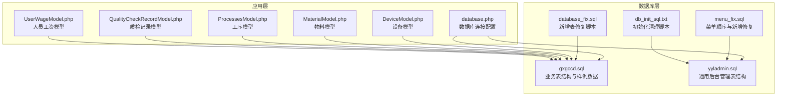
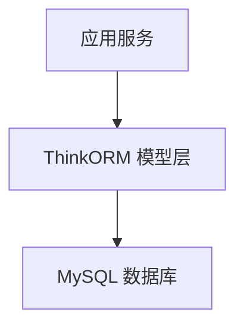
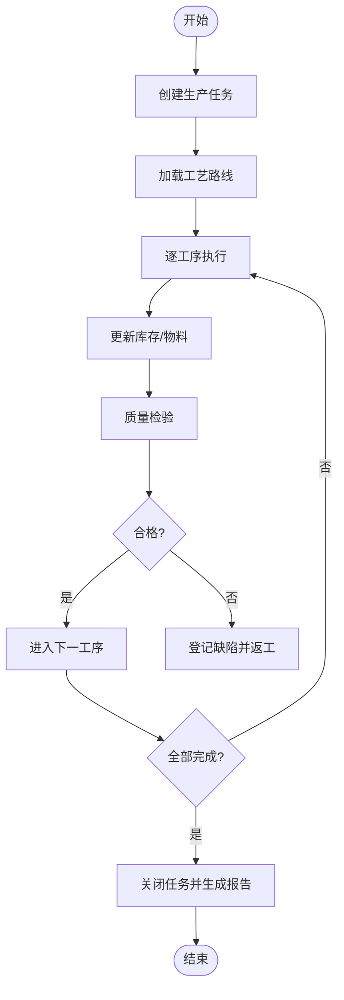
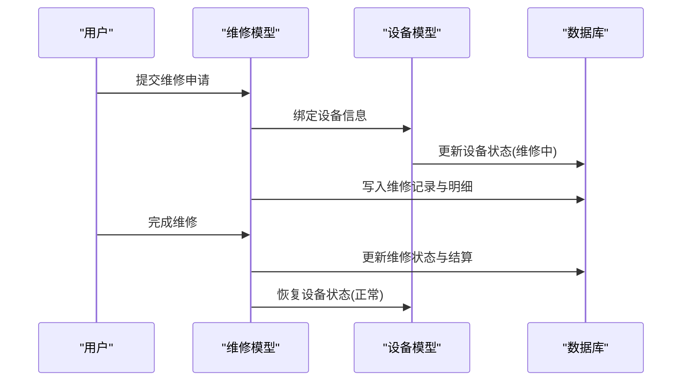
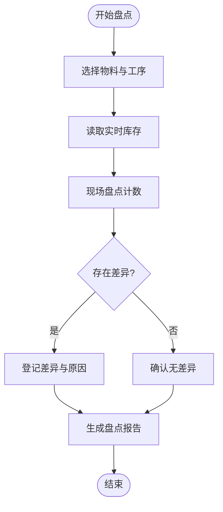
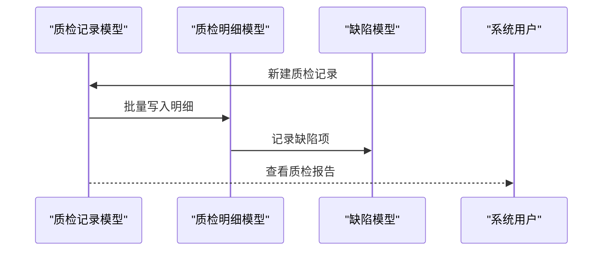
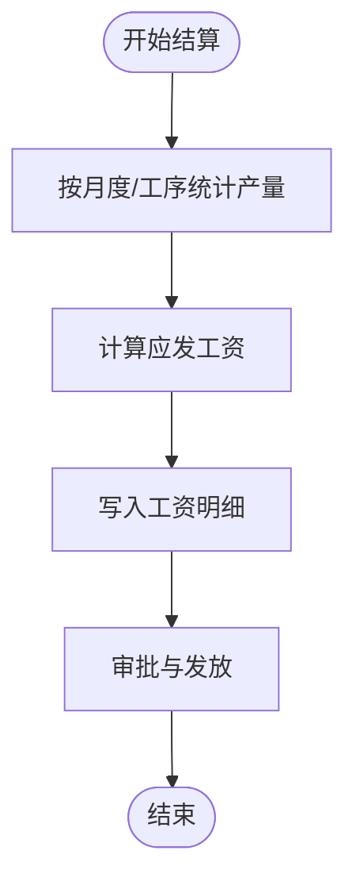
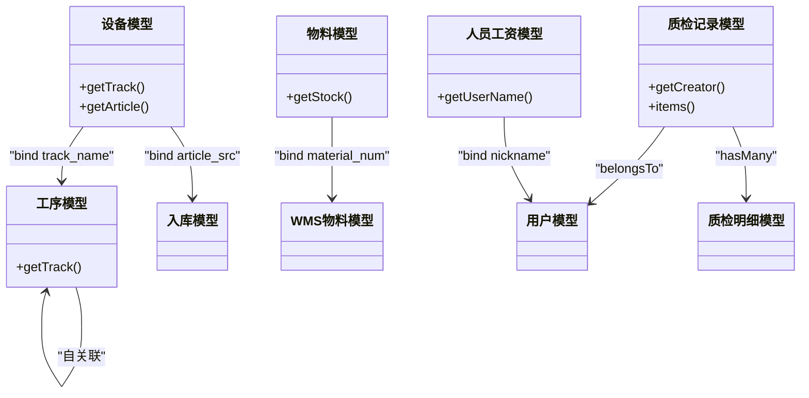

# 数据库设计

<cite>
**本文引用的文件**
- [gxgccd.sql](file://gccd_server/private/database/gxgccd.sql)
- [yyladmin.sql](file://gccd_server/private/database/yyladmin.sql)
- [database.php](file://gccd_server/config/database.php)
- [db_init_sql.txt](file://gccd_server/private/database/db_init_sql.txt)
- [database_fix.sql](file://gccd_server/database_fix.sql)
- [menu_fix.sql](file://gccd_server/menu_fix.sql)
- [DeviceModel.php](file://gccd_server/app/common/model/admin/DeviceModel.php)
- [MaterialModel.php](file://gccd_server/app/common/model/admin/MaterialModel.php)
- [ProcessesModel.php](file://gccd_server/app/common/model/admin/ProcessesModel.php)
- [QualityCheckRecordModel.php](file://gccd_server/app/common/model/admin/QualityCheckRecordModel.php)
- [UserWageModel.php](file://gccd_server/app/common/model/admin/UserWageModel.php)
</cite>

## 目录
1. [简介](#简介)
2. [项目结构](#项目结构)
3. [核心组件](#核心组件)
4. [架构总览](#架构总览)
5. [详细组件分析](#详细组件分析)
6. [依赖分析](#依赖分析)
7. [性能考虑](#性能考虑)
8. [故障排查指南](#故障排查指南)
9. [结论](#结论)
10. [附录](#附录)

## 简介
本设计文档面向“高齿传动”项目，聚焦数据库层面的核心业务表与模型关系，覆盖工单管理、设备管理、物料管理、能源管理、质量管理、人员管理等模块，并给出数据字典、字段定义、索引策略、性能优化、迁移与版本管理、备份恢复、连接配置与事务并发控制等工程实践建议。文档以仓库中的数据库初始化SQL、模型映射与配置文件为依据，结合项目实际业务场景进行系统化梳理。

## 项目结构
- 数据库初始化与样例数据：通过初始化SQL文件提供基础表结构与示例数据，便于快速搭建开发环境。
- 连接配置：统一的数据库连接配置，支持多环境参数注入与连接池特性。
- 模型映射：ThinkORM模型类映射到具体业务表，体现表间关联关系与字段绑定。
- 运维脚本：提供数据库修复与菜单权限修复脚本，保障系统演进过程中的结构一致性与菜单顺序。

**图表来源**
- [gxgccd.sql](file://gccd_server/private/database/gxgccd.sql)
- [yyladmin.sql](file://gccd_server/private/database/yyladmin.sql)
- [database.php](file://gccd_server/config/database.php)
- [database_fix.sql](file://gccd_server/database_fix.sql)
- [menu_fix.sql](file://gccd_server/menu_fix.sql)
- [db_init_sql.txt](file://gccd_server/private/database/db_init_sql.txt)
- [DeviceModel.php](file://gccd_server/app/common/model/admin/DeviceModel.php)
- [MaterialModel.php](file://gccd_server/app/common/model/admin/MaterialModel.php)
- [ProcessesModel.php](file://gccd_server/app/common/model/admin/ProcessesModel.php)
- [QualityCheckRecordModel.php](file://gccd_server/app/common/model/admin/QualityCheckRecordModel.php)
- [UserWageModel.php](file://gccd_server/app/common/model/admin/UserWageModel.php)

**章节来源**
- [gxgccd.sql](file://gccd_server/private/database/gxgccd.sql)
- [yyladmin.sql](file://gccd_server/private/database/yyladmin.sql)
- [database.php](file://gccd_server/config/database.php)
- [db_init_sql.txt](file://gccd_server/private/database/db_init_sql.txt)
- [database_fix.sql](file://gccd_server/database_fix.sql)
- [menu_fix.sql](file://gccd_server/menu_fix.sql)

## 核心组件
- 工单/生产相关：ya_check（工序）、ya_production（生产任务）、ya_production_detail（生产明细）、ya_routing（工艺路线）、ya_routing_detail（工艺路线明细）、ya_stock（库存）、ya_stock_material（库存物料）、ya_material_inventory（生产盘点）
- 设备管理：ya_device（设备）、ya_repair（维修记录）、ya_repair_detail（维修明细）
- 物料管理：ya_material（物料）、ya_in_stock（入库）、ya_out_stock（出库）、ya_wms_material（WMS物料）
- 能源管理：ya_power（能耗）
- 质量管理：ya_quality_check_record（质检记录主表）、ya_quality_check_item（质检记录明细）、ya_quality_check_defect（缺陷明细）
- 人员管理：ya_user（用户）、ya_user_wage（人员工资）、ya_user_wage_detail（工资明细）
- 文件与内容：ya_file、ya_content、ya_content_category、ya_content_tag、ya_content_setting
- 系统与权限：ya_system_menu、ya_system_user、ya_system_role、ya_system_dept、ya_system_post、ya_system_notice

上述表均以ya_为前缀，遵循统一命名规范，便于维护与扩展。

**章节来源**
- [gxgccd.sql](file://gccd_server/private/database/gxgccd.sql)
- [yyladmin.sql](file://gccd_server/private/database/yyladmin.sql)

## 架构总览
数据库层采用集中式部署，连接配置支持断线重连与字段缓存，满足高并发下的稳定性与性能需求。应用层通过ThinkORM模型类映射业务表，利用关联查询与字段绑定实现跨表聚合展示。

[此图为概念性架构示意，不直接对应具体文件，故无图表来源]

## 详细组件分析

### 工单管理（生产任务与明细）
- 表结构要点
  - ya_production：生产任务主表，包含任务编号、工序编码、计划/实际开始/结束时间、状态、创建时间等。
  - ya_production_detail：生产任务明细，记录每道工序的执行情况、产出数量、质量状态等。
  - ya_routing / ya_routing_detail：工艺路线与明细，定义产品加工路径与工序顺序。
  - ya_stock / ya_stock_material：库存与库存物料，支撑生产用料与成品入库。
- 关联关系
  - 生产任务与明细一对多；明细与库存/物料关联；路由决定工序执行顺序。
- 索引策略
  - 对任务编号、工序编码、状态、创建时间建立索引，提升查询效率。
- 复杂逻辑流程（生产任务执行）

**章节来源**
- [gxgccd.sql](file://gccd_server/private/database/gxgccd.sql)

### 设备管理（设备与维修）
- 表结构要点
  - ya_device：设备信息，包含设备编码、名称、关联工序编码、维修状态、二维码等。
  - ya_repair / ya_repair_detail：维修记录与明细，记录维修申请、派工、完成与费用。
- 关联关系
  - 设备与维修记录一对多；维修明细与工单/物料关联。
- 索引策略
  - 对设备编码、状态、创建时间建立索引，便于检索与统计。
- 典型流程（设备维修）

**章节来源**
- [gxgccd.sql](file://gccd_server/private/database/gxgccd.sql)
- [DeviceModel.php](file://gccd_server/app/common/model/admin/DeviceModel.php)

### 物料管理（出入库与库存）
- 表结构要点
  - ya_material：物料基础信息，规格、型号、单位、供应商、厂家、属性等。
  - ya_in_stock / ya_out_stock：入库与出库记录，支持按批次、规格、数量追踪。
  - ya_stock / ya_stock_material：实时库存与库存物料，支撑生产用料与销售发货。
  - ya_material_inventory：生产盘点，记录白/夜班吨数与差异。
- 关联关系
  - 物料与出入库、库存一一对应；盘点与物料、工序关联。
- 索引策略
  - 对物料编号、规格、批次、出入库时间建立复合索引，提升统计与报表效率。
- 复杂逻辑流程（库存盘点）

**章节来源**
- [gxgccd.sql](file://gccd_server/private/database/gxgccd.sql)
- [MaterialModel.php](file://gccd_server/app/common/model/admin/MaterialModel.php)

### 能源管理（能耗统计）
- 表结构要点
  - ya_power：能耗记录，包含设备、工序、时段、用量、费用等。
- 关联关系
  - 能耗与设备、工序、时间维度关联，支撑成本核算与能效分析。
- 索引策略
  - 对设备编码、工序编码、日期区间建立索引，支持快速统计。

**章节来源**
- [gxgccd.sql](file://gccd_server/private/database/gxgccd.sql)

### 质量管理（质检记录与缺陷）
- 表结构要点
  - ya_quality_check_record：质检记录主表，包含日期、工序、创建人等。
  - ya_quality_check_item：明细，记录原料/成品规格、型号等。
  - ya_quality_check_defect：缺陷明细，记录缺陷类型、描述、白/夜班数量。
- 关联关系
  - 主表与明细一对多；明细与缺陷一对多；明细可关联工单/物料。
- 索引策略
  - 对主表日期、工序、创建人；明细record_id；缺陷item_id建立索引。
- 典型流程（质量检验）

**章节来源**
- [gxgccd.sql](file://gccd_server/private/database/gxgccd.sql)
- [QualityCheckRecordModel.php](file://gccd_server/app/common/model/admin/QualityCheckRecordModel.php)
- [database_fix.sql](file://gccd_server/database_fix.sql)

### 人员管理（用户与工资）
- 表结构要点
  - ya_user：用户信息，与系统用户表关联。
  - ya_user_wage / ya_user_wage_detail：工资主表与明细，支持按月度、工序、产量计算。
- 关联关系
  - 用户与工资记录一对一或一对多；明细与工单/工序关联。
- 索引策略
  - 对用户ID、月份、工序编码建立索引，提升结算效率。
- 典型流程（工资结算）

**章节来源**
- [gxgccd.sql](file://gccd_server/private/database/gxgccd.sql)
- [UserWageModel.php](file://gccd_server/app/common/model/admin/UserWageModel.php)

### 数据字典与字段定义
- 通用字段约定
  - is_delete、create_uid、update_uid、delete_uid、create_time、update_time、delete_time：软删除与审计字段。
  - sort、remark、is_disable、is_top、is_hot、is_rec：内容与分类的展示与状态控制。
- 表前缀与命名
  - 业务表统一以ya_为前缀，避免与其他系统冲突；表名与字段注释清晰表达业务含义。
- 数据类型选择
  - 数值类使用decimal保证精度；文本类使用mediumtext承载长文本；时间类使用datetime统一格式。
- 字段绑定
  - ThinkORM模型通过bind实现跨表字段绑定，减少多次查询与拼装逻辑。

**章节来源**
- [gxgccd.sql](file://gccd_server/private/database/gxgccd.sql)
- [yyladmin.sql](file://gccd_server/private/database/yyladmin.sql)
- [DeviceModel.php](file://gccd_server/app/common/model/admin/DeviceModel.php)
- [MaterialModel.php](file://gccd_server/app/common/model/admin/MaterialModel.php)
- [ProcessesModel.php](file://gccd_server/app/common/model/admin/ProcessesModel.php)
- [QualityCheckRecordModel.php](file://gccd_server/app/common/model/admin/QualityCheckRecordModel.php)
- [UserWageModel.php](file://gccd_server/app/common/model/admin/UserWageModel.php)

## 依赖分析
- 模型到表的映射
  - 设备模型：hasOne关联工序与入库任务，bind绑定字段。
  - 物料模型：hasOne关联WMS物料，bind绑定库存数量。
  - 工序模型：自关联父级工序，bind绑定父级名称。
  - 质检记录模型：belongsTo关联系统用户，hasMany关联明细。
  - 人员工资模型：hasOne关联系统用户，bind绑定昵称。
- 外键约束现状
  - 初始化SQL未显式声明外键约束，实际业务通过模型关联与应用层校验保证一致性。如需强一致，可在生产环境补充外键约束与级联策略。

**图表来源**
- [DeviceModel.php](file://gccd_server/app/common/model/admin/DeviceModel.php)
- [MaterialModel.php](file://gccd_server/app/common/model/admin/MaterialModel.php)
- [ProcessesModel.php](file://gccd_server/app/common/model/admin/ProcessesModel.php)
- [QualityCheckRecordModel.php](file://gccd_server/app/common/model/admin/QualityCheckRecordModel.php)
- [UserWageModel.php](file://gccd_server/app/common/model/admin/UserWageModel.php)

**章节来源**
- [DeviceModel.php](file://gccd_server/app/common/model/admin/DeviceModel.php)
- [MaterialModel.php](file://gccd_server/app/common/model/admin/MaterialModel.php)
- [ProcessesModel.php](file://gccd_server/app/common/model/admin/ProcessesModel.php)
- [QualityCheckRecordModel.php](file://gccd_server/app/common/model/admin/QualityCheckRecordModel.php)
- [UserWageModel.php](file://gccd_server/app/common/model/admin/UserWageModel.php)

## 性能考虑
- 查询优化
  - 为高频查询字段建立单列或复合索引，如任务编号、设备编码、日期区间、用户ID等。
  - 使用EXPLAIN分析慢查询，避免SELECT *，仅取必要字段。
- 索引设计
  - 建议在以下字段建立索引：生产任务(任务编号、状态、创建时间)、设备(设备编码、状态)、物料(物料编号、规格)、质检(记录ID、缺陷类型)、用户(用户ID、部门)。
- 分区策略
  - 对历史数据量大的表（如能耗、质检、出入库）按月/年分区，提升归档与查询效率。
- 连接与事务
  - 启用连接池与断线重连；事务中尽量缩短持有锁的时间，批量写入使用事务包裹。
- 缓存与字段缓存
  - 启用字段缓存路径，减少重复解析表结构带来的开销。

[本节为通用性能指导，不直接分析具体文件，故无章节来源]

## 故障排查指南
- 初始化与修复
  - 使用db_init_sql.txt进行初始化清理，确保测试环境干净。
  - 使用database_fix.sql修复缺失表结构，确保新增功能可用。
  - 使用menu_fix.sql调整菜单顺序与新增“盘点检验”目录及子菜单。
- 日志与审计
  - 利用软删除字段与审计字段定位误删与异常变更。
- 连接问题
  - 检查database.php中的主机、端口、用户名、密码、字符集与前缀配置，确保与目标数据库一致。

**章节来源**
- [db_init_sql.txt](file://gccd_server/private/database/db_init_sql.txt)
- [database_fix.sql](file://gccd_server/database_fix.sql)
- [menu_fix.sql](file://gccd_server/menu_fix.sql)
- [database.php](file://gccd_server/config/database.php)

## 结论
本设计文档基于仓库中的数据库初始化SQL与模型映射，系统梳理了高齿传动项目的核心业务表与关联关系，给出了字段定义、索引策略与性能优化建议，并提供了运维脚本与连接配置说明。建议在生产环境中补充外键约束与分区策略，持续完善索引覆盖与查询计划，以保障系统的稳定性与可扩展性。

## 附录
- 实际SQL示例（路径引用）
  - 质检记录主表创建：[database_fix.sql](file://gccd_server/database_fix.sql)
  - 质检记录明细创建：[database_fix.sql](file://gccd_server/database_fix.sql)
  - 质检缺陷明细创建：[database_fix.sql](file://gccd_server/database_fix.sql)
  - 生产盘点记录表创建：[database_fix.sql](file://gccd_server/database_fix.sql)
  - 菜单修复与排序调整：[menu_fix.sql](file://gccd_server/menu_fix.sql)
  - 初始化清理脚本：[db_init_sql.txt](file://gccd_server/private/database/db_init_sql.txt)
  - 数据库连接配置：[database.php](file://gccd_server/config/database.php)
  - 业务表结构（示例）：[gxgccd.sql](file://gccd_server/private/database/gxgccd.sql)
  - 通用后台表结构（示例）：[yyladmin.sql](file://gccd_server/private/database/yyladmin.sql)