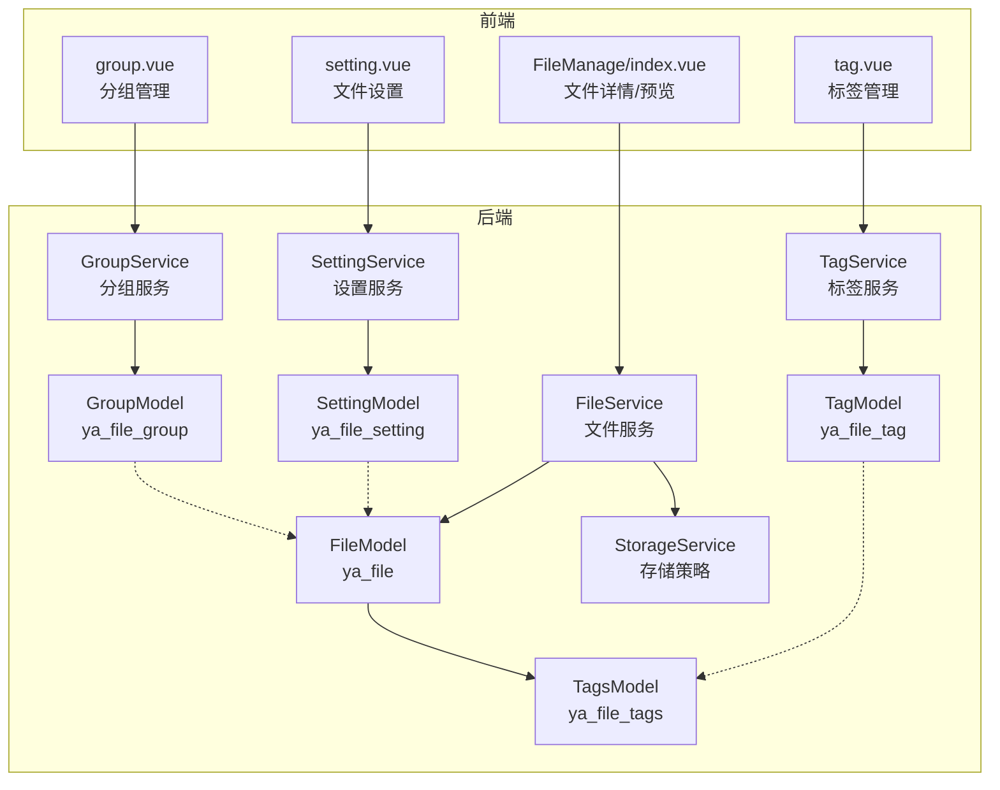
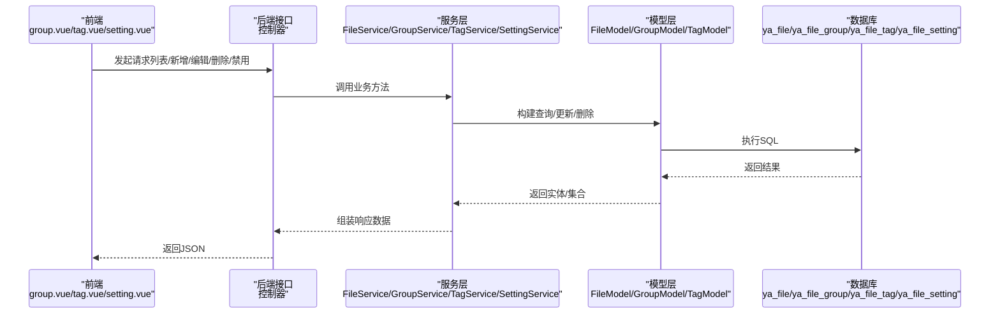
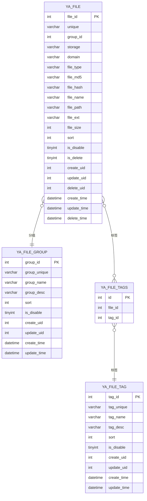
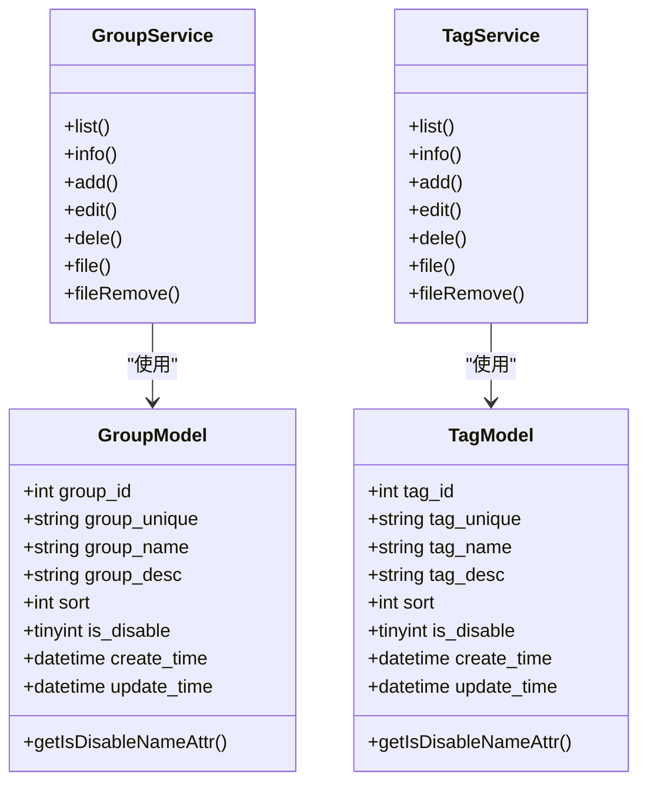
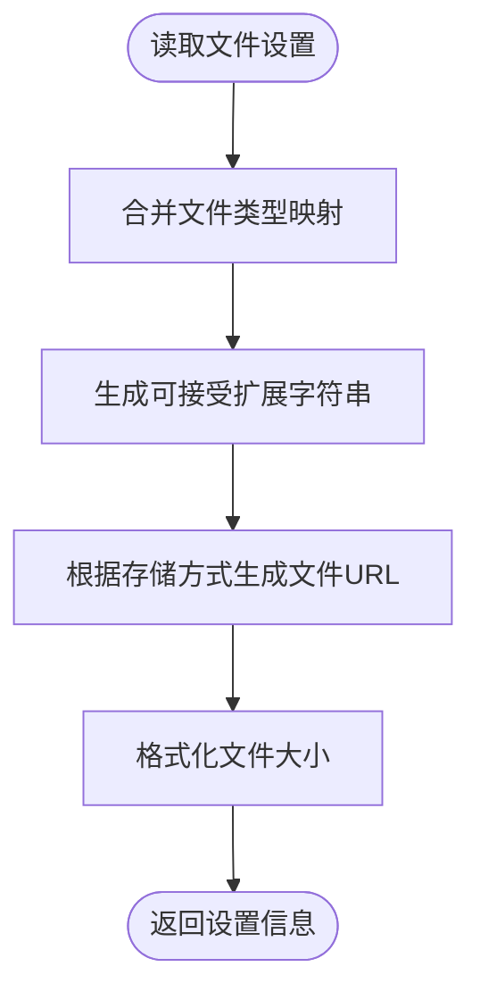
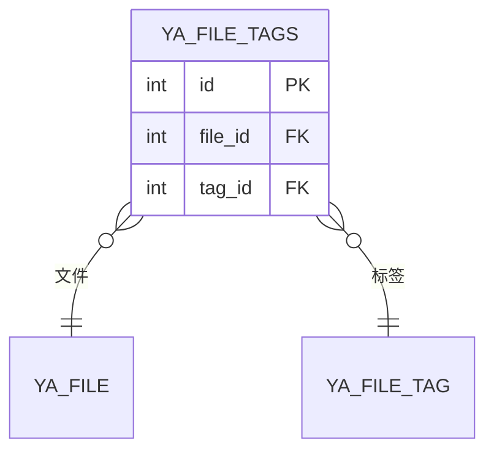
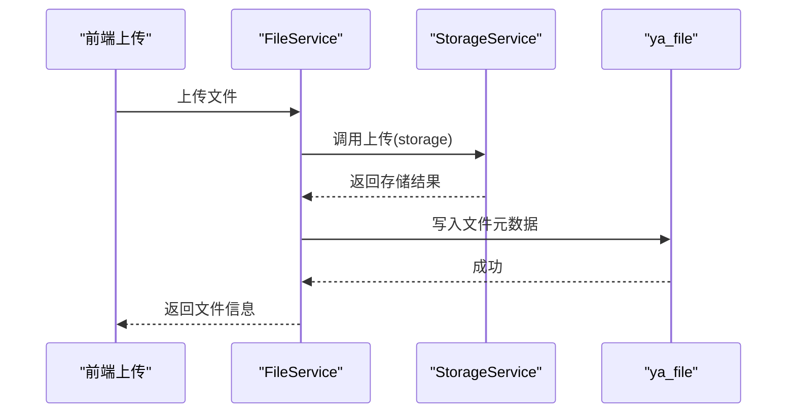
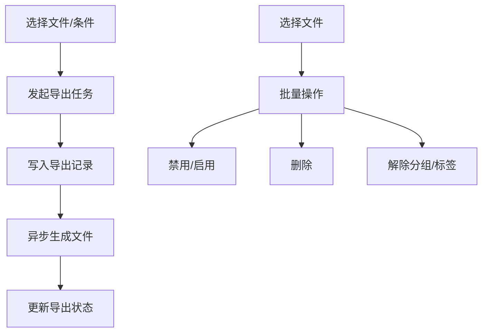
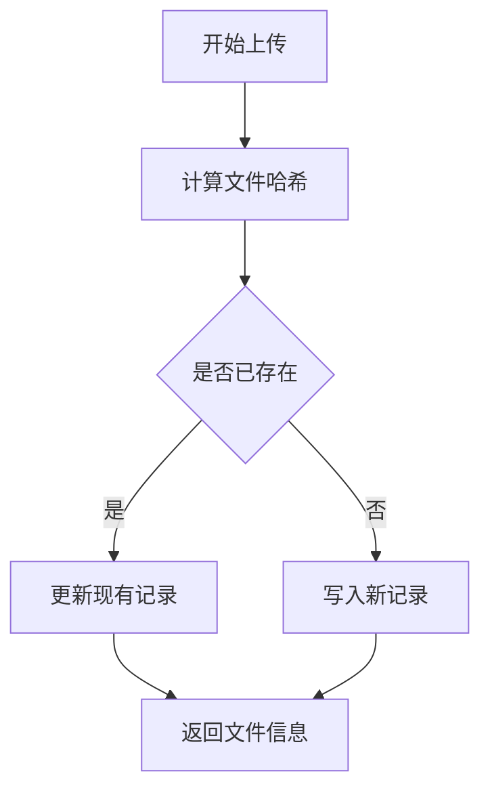
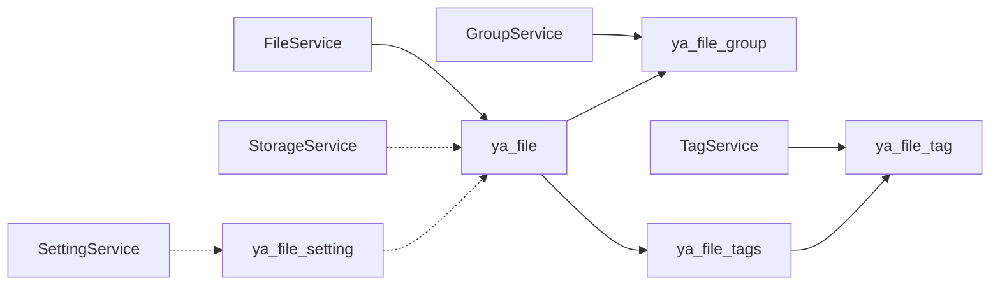

# 文件系统数据表

<cite>
**本文引用的文件**
- [yyladmin.sql](file://gccd_server/private/database/yyladmin.sql)
- [FileService.php](file://gccd_server/app/common/service/file/FileService.php)
- [GroupService.php](file://gccd_server/app/common/service/file/GroupService.php)
- [TagService.php](file://gccd_server/app/common/service/file/TagService.php)
- [SettingService.php](file://gccd_server/app/common/service/file/SettingService.php)
- [StorageService.php](file://gccd_server/app/common/service/file/StorageService.php)
- [FileModel.php](file://gccd_server/app/common/model/file/FileModel.php)
- [GroupModel.php](file://gccd_server/app/common/model/file/GroupModel.php)
- [TagModel.php](file://gccd_server/app/common/model/file/TagModel.php)
- [TagsModel.php](file://gccd_server/app/common/model/file/TagsModel.php)
- [SettingFilesModel.php](file://gccd_server/app/common/model/setting/SettingFilesModel.php)
- [group.vue](file://yarn/src/views/file/group.vue)
- [tag.vue](file://yarn/src/views/file/tag.vue)
- [setting.vue](file://yarn/src/views/file/setting.vue)
- [mediaCompress.js](file://gccd_mini/utils/mediaCompress.js)
- [index.vue](file://yarn/src/components/FileManage/index.vue)
</cite>

## 目录
1. [引言](#引言)
2. [项目结构](#项目结构)
3. [核心组件](#核心组件)
4. [架构总览](#架构总览)
5. [详细组件分析](#详细组件分析)
6. [依赖关系分析](#依赖关系分析)
7. [性能考量](#性能考量)
8. [故障排查指南](#故障排查指南)
9. [结论](#结论)
10. [附录](#附录)

## 引言
本文件系统数据表设计文档围绕文件主表 ya_file、文件分组表 ya_file_group、文件标签表 ya_file_tag、文件设置表 ya_file_setting 及其关联表 ya_file_tags 进行系统性梳理，明确字段定义、元数据模型、分类与标签体系、权限控制边界、存储策略（本地/云存储/分布式）以及导入导出、批量操作、版本管理等扩展能力的设计要点与落地依据。文档同时结合后端服务层与前端界面，给出完整业务流程的数据支撑。

## 项目结构
- 后端采用 ThinkPHP ORM 模型与服务层封装，文件管理涉及文件主表、分组、标签、设置及关联表。
- 前端基于 Vue 的文件管理界面，提供分组、标签、设置等管理视图与文件预览、批量操作能力。
- 存储策略通过设置表与存储服务统一抽象，支持本地与多家云存储。

**图表来源**
- [FileModel.php:19-34](file://gccd_server/app/common/model/file/FileModel.php#L19-L34)
- [GroupModel.php:18-34](file://gccd_server/app/common/model/file/GroupModel.php#L18-L34)
- [TagModel.php:18-34](file://gccd_server/app/common/model/file/TagModel.php#L18-L34)
- [TagsModel.php:17-21](file://gccd_server/app/common/model/file/TagsModel.php#L17-L21)
- [SettingService.php:36-76](file://gccd_server/app/common/service/file/SettingService.php#L36-L76)
- [StorageService.php:65-135](file://gccd_server/app/common/service/file/StorageService.php#L65-L135)
- [FileService.php:52-121](file://gccd_server/app/common/service/file/FileService.php#L52-L121)
- [GroupService.php:47-81](file://gccd_server/app/common/service/file/GroupService.php#L47-L81)
- [TagService.php:47-81](file://gccd_server/app/common/service/file/TagService.php#L47-L81)
- [group.vue:364-382](file://yarn/src/views/file/group.vue#L364-L382)
- [tag.vue:361-375](file://yarn/src/views/file/tag.vue#L361-L375)
- [setting.vue:1-54](file://yarn/src/views/file/setting.vue#L1-L54)
- [index.vue:800-825](file://yarn/src/components/FileManage/index.vue#L800-L825)

**章节来源**
- [yyladmin.sql:178-206](file://gccd_server/private/database/yyladmin.sql#L178-L206)
- [yyladmin.sql:241-260](file://gccd_server/private/database/yyladmin.sql#L241-L260)
- [yyladmin.sql:366-385](file://gccd_server/private/database/yyladmin.sql#L366-L385)
- [yyladmin.sql:297-359](file://gccd_server/private/database/yyladmin.sql#L297-L359)

## 核心组件
- 文件主表 ya_file：承载文件元数据与基础属性，如名称、大小、类型、路径、哈希、存储方式、分组、标签、启用/删除状态、时间戳等。
- 文件分组表 ya_file_group：用于文件分类管理，支持唯一标识、名称、描述、排序、禁用/删除状态。
- 文件标签表 ya_file_tag：用于文件标签体系，支持唯一标识、名称、描述、排序、禁用/删除状态。
- 文件设置表 ya_file_setting：集中管理文件上传开关、存储方式、各云存储配置、文件类型与大小限制、前台功能开关等。
- 文件标签关联表 ya_file_tags：多对多关系，连接文件与标签。
- 相关模型与服务：FileModel、GroupModel、TagModel、TagsModel、SettingService、StorageService、FileService、GroupService、TagService。

**章节来源**
- [yyladmin.sql:178-206](file://gccd_server/private/database/yyladmin.sql#L178-L206)
- [yyladmin.sql:241-260](file://gccd_server/private/database/yyladmin.sql#L241-L260)
- [yyladmin.sql:366-385](file://gccd_server/private/database/yyladmin.sql#L366-L385)
- [yyladmin.sql:297-359](file://gccd_server/private/database/yyladmin.sql#L297-L359)
- [FileModel.php:19-34](file://gccd_server/app/common/model/file/FileModel.php#L19-L34)
- [GroupModel.php:18-34](file://gccd_server/app/common/model/file/GroupModel.php#L18-L34)
- [TagModel.php:18-34](file://gccd_server/app/common/model/file/TagModel.php#L18-L34)
- [TagsModel.php:17-21](file://gccd_server/app/common/model/file/TagsModel.php#L17-L21)
- [SettingService.php:36-76](file://gccd_server/app/common/service/file/SettingService.php#L36-L76)
- [StorageService.php:65-135](file://gccd_server/app/common/service/file/StorageService.php#L65-L135)
- [FileService.php:52-121](file://gccd_server/app/common/service/file/FileService.php#L52-L121)
- [GroupService.php:47-81](file://gccd_server/app/common/service/file/GroupService.php#L47-L81)
- [TagService.php:47-81](file://gccd_server/app/common/service/file/TagService.php#L47-L81)

## 架构总览
文件系统管理采用“模型-服务-控制器-前端”的分层架构：
- 模型层：对应 ya_* 表，负责字段映射与基础查询。
- 服务层：封装业务逻辑，如文件上传、分组/标签管理、设置读取与校验、存储策略调用。
- 控制器层：接收前端请求，调用服务层并返回结果。
- 前端：提供文件列表、分组/标签管理、设置配置、文件预览与批量操作界面。

**图表来源**
- [group.vue:364-382](file://yarn/src/views/file/group.vue#L364-L382)
- [tag.vue:361-375](file://yarn/src/views/file/tag.vue#L361-L375)
- [setting.vue:1-54](file://yarn/src/views/file/setting.vue#L1-L54)
- [FileService.php:52-121](file://gccd_server/app/common/service/file/FileService.php#L52-L121)
- [GroupService.php:47-81](file://gccd_server/app/common/service/file/GroupService.php#L47-L81)
- [TagService.php:47-81](file://gccd_server/app/common/service/file/TagService.php#L47-L81)
- [SettingService.php:36-76](file://gccd_server/app/common/service/file/SettingService.php#L36-L76)

## 详细组件分析

### 文件主表 ya_file 结构与元数据模型
- 主键 file_id，唯一标识 unique，便于外部引用与去重。
- 分组 group_id，外键关联 ya_file_group。
- 存储策略 storage 支持本地与多家云存储；域名 domain 与文件路径 file_path 组成可访问 URL。
- 文件类型 file_type 支持 image/video/audio/word/other，并通过后端服务自动识别。
- 哈希与校验：file_md5、file_hash（sha1）用于重复检测与一致性校验。
- 名称 file_name、后缀 file_ext、大小 file_size（字节）、排序 sort、禁用/删除状态 is_disable/is_delete。
- 时间戳 create_time/update_time/delete_time 与用户 create_uid/update_uid/delete_uid。
- 附加字段：file_url（由 SettingService 生成）、storage_name、file_type_name、tag_names 等通过模型追加。

**图表来源**
- [yyladmin.sql:178-206](file://gccd_server/private/database/yyladmin.sql#L178-L206)
- [yyladmin.sql:241-260](file://gccd_server/private/database/yyladmin.sql#L241-L260)
- [yyladmin.sql:366-385](file://gccd_server/private/database/yyladmin.sql#L366-L385)
- [yyladmin.sql:392-400](file://gccd_server/private/database/yyladmin.sql#L392-L400)

**章节来源**
- [yyladmin.sql:178-206](file://gccd_server/private/database/yyladmin.sql#L178-L206)
- [FileModel.php:19-34](file://gccd_server/app/common/model/file/FileModel.php#L19-L34)
- [SettingService.php:234-253](file://gccd_server/app/common/service/file/SettingService.php#L234-L253)

### 文件分组表 ya_file_group 与标签表 ya_file_tag
- 分组表：group_id、group_unique、group_name、group_desc、remark、sort、is_disable、is_delete 及时间与用户字段。
- 标签表：tag_id、tag_unique、tag_name、tag_desc、remark、sort、is_disable、is_delete 及时间与用户字段。
- 服务层提供列表、详情、新增、修改、删除（软删）、禁用切换、与文件的关联/解除等能力。

**图表来源**
- [GroupModel.php:18-34](file://gccd_server/app/common/model/file/GroupModel.php#L18-L34)
- [TagModel.php:18-34](file://gccd_server/app/common/model/file/TagModel.php#L18-L34)
- [GroupService.php:47-81](file://gccd_server/app/common/service/file/GroupService.php#L47-L81)
- [TagService.php:47-81](file://gccd_server/app/common/service/file/TagService.php#L47-L81)

**章节来源**
- [yyladmin.sql:241-260](file://gccd_server/private/database/yyladmin.sql#L241-L260)
- [yyladmin.sql:366-385](file://gccd_server/private/database/yyladmin.sql#L366-L385)
- [GroupService.php:229-232](file://gccd_server/app/common/service/file/GroupService.php#L229-L232)
- [TagService.php:229-232](file://gccd_server/app/common/service/file/TagService.php#L229-L232)

### 文件设置表 ya_file_setting 与存储策略
- 开关：is_upload_admin、is_upload_api、is_api_file。
- 存储方式 storage 及各云存储配置项（AccessKey/Secret、Bucket、Endpoint/Domain 等）。
- 文件类型与大小限制：image_ext/image_size、video_ext/video_size、audio_ext/audio_size、word_ext/word_size、other_ext/other_size。
- 前台功能限制：api_file_types、api_file_group_ids、api_file_tag_ids。
- 服务层提供设置读取、合并文件类型与可接受扩展、生成文件 URL、格式化文件大小等工具方法。

**图表来源**
- [SettingService.php:36-76](file://gccd_server/app/common/service/file/SettingService.php#L36-L76)
- [SettingService.php:262-276](file://gccd_server/app/common/service/file/SettingService.php#L262-L276)
- [SettingService.php:234-253](file://gccd_server/app/common/service/file/SettingService.php#L234-L253)
- [SettingService.php:160-174](file://gccd_server/app/common/service/file/SettingService.php#L160-L174)

**章节来源**
- [yyladmin.sql:297-359](file://gccd_server/private/database/yyladmin.sql#L297-L359)
- [SettingService.php:36-76](file://gccd_server/app/common/service/file/SettingService.php#L36-L76)
- [SettingService.php:262-276](file://gccd_server/app/common/service/file/SettingService.php#L262-L276)

### 文件标签关联表 ya_file_tags 与多对多关系
- 多对多：文件与标签通过 ya_file_tags 关联，支持批量打标与解除。
- 服务层提供 file/remove 功能，按分组/标签维度解除文件关联。

**图表来源**
- [yyladmin.sql:392-400](file://gccd_server/private/database/yyladmin.sql#L392-L400)

**章节来源**
- [yyladmin.sql:392-400](file://gccd_server/private/database/yyladmin.sql#L392-L400)
- [TagService.php:242-254](file://gccd_server/app/common/service/file/TagService.php#L242-L254)

### 文件上传与存储策略（本地/云存储）
- 本地存储：文件保存在服务器 public/storage 目录，按文件散列命名，域名为空时通过 file_url 生成绝对 URL。
- 云存储：支持七牛、阿里云、腾讯云、百度云、又拍云、华为云、AWS S3 等，通过设置表配置相应参数，服务层统一上传与删除。
- 压缩与限制：小程序端对媒体文件进行压缩与大小限制，避免超限上传。

**图表来源**
- [FileService.php:244-246](file://gccd_server/app/common/service/file/FileService.php#L244-L246)
- [StorageService.php:65-135](file://gccd_server/app/common/service/file/StorageService.php#L65-L135)
- [SettingService.php:234-253](file://gccd_server/app/common/service/file/SettingService.php#L234-L253)

**章节来源**
- [yyladmin.sql:185-193](file://gccd_server/private/database/yyladmin.sql#L185-L193)
- [StorageService.php:65-135](file://gccd_server/app/common/service/file/StorageService.php#L65-L135)
- [mediaCompress.js:69-98](file://gccd_mini/utils/mediaCompress.js#L69-L98)

### 文件导入导出与批量操作
- 导入：ya_file_import 记录导入任务，包含类型、文件名、路径、大小、状态、耗时、参数、备注等。
- 导出：ya_file_export 记录导出任务，包含类型、文件名、路径、大小、状态、耗时、参数、备注等。
- 批量操作：前端提供勾选、禁用/启用、删除、解除分组/标签等批量动作，服务层统一处理。

**图表来源**
- [yyladmin.sql:213-234](file://gccd_server/private/database/yyladmin.sql#L213-L234)
- [yyladmin.sql:267-290](file://gccd_server/private/database/yyladmin.sql#L267-L290)
- [FileService.php:394-413](file://gccd_server/app/common/service/file/FileService.php#L394-L413)

**章节来源**
- [yyladmin.sql:213-234](file://gccd_server/private/database/yyladmin.sql#L213-L234)
- [yyladmin.sql:267-290](file://gccd_server/private/database/yyladmin.sql#L267-L290)
- [FileService.php:394-413](file://gccd_server/app/common/service/file/FileService.php#L394-L413)

### 版本管理与去重
- 去重策略：基于 file_hash（sha1）与 file_md5 进行重复检测，避免重复入库。
- 版本管理：当前未见独立版本表，可通过 file_hash 实现“同文件仅存一份”的版本控制思路；若需多版本，可在 ya_file 上扩展版本号字段并在上传时生成新记录。

**图表来源**
- [FileService.php:235-242](file://gccd_server/app/common/service/file/FileService.php#L235-L242)

**章节来源**
- [FileService.php:235-242](file://gccd_server/app/common/service/file/FileService.php#L235-L242)

## 依赖关系分析
- 文件主表依赖分组与标签的多对一/多对多关系。
- 设置服务依赖 ya_file_setting 并提供文件类型与存储方式映射。
- 存储服务依赖设置表配置，统一处理本地与云存储。
- 前端视图依赖后端接口，提供 CRUD、批量操作与文件预览。

**图表来源**
- [yyladmin.sql:178-206](file://gccd_server/private/database/yyladmin.sql#L178-L206)
- [yyladmin.sql:241-260](file://gccd_server/private/database/yyladmin.sql#L241-L260)
- [yyladmin.sql:366-385](file://gccd_server/private/database/yyladmin.sql#L366-L385)
- [yyladmin.sql:297-359](file://gccd_server/private/database/yyladmin.sql#L297-L359)
- [SettingService.php:36-76](file://gccd_server/app/common/service/file/SettingService.php#L36-L76)
- [StorageService.php:65-135](file://gccd_server/app/common/service/file/StorageService.php#L65-L135)
- [FileService.php:52-121](file://gccd_server/app/common/service/file/FileService.php#L52-L121)
- [GroupService.php:47-81](file://gccd_server/app/common/service/file/GroupService.php#L47-L81)
- [TagService.php:47-81](file://gccd_server/app/common/service/file/TagService.php#L47-L81)

**章节来源**
- [yyladmin.sql:178-206](file://gccd_server/private/database/yyladmin.sql#L178-L206)
- [yyladmin.sql:241-260](file://gccd_server/private/database/yyladmin.sql#L241-L260)
- [yyladmin.sql:366-385](file://gccd_server/private/database/yyladmin.sql#L366-L385)
- [yyladmin.sql:297-359](file://gccd_server/private/database/yyladmin.sql#L297-L359)

## 性能考量
- 索引建议：file_hash、file_md5、group_id、file_type、is_delete、create_time 等常用过滤与排序字段应建立索引。
- 缓存：设置与分组/标签信息可缓存，减少重复查询。
- 分页与排序：列表接口默认按 update_time/file_id 降序，避免全表扫描。
- 存储：本地存储需确保目录权限与磁盘空间；云存储注意并发与带宽限制。

## 故障排查指南
- 上传失败：检查存储配置（AccessKey/Secret、Bucket、Endpoint/Domain）、网络连通性与权限。
- 文件不可访问：确认 domain 与 file_path 组合是否正确，本地存储时 file_url 生成逻辑。
- 重复文件未去重：核对 file_hash 与 file_md5 是否一致，确认是否存在历史重复记录。
- 批量操作异常：检查 ids 参数格式与权限，关注事务回滚日志。

**章节来源**
- [StorageService.php:65-135](file://gccd_server/app/common/service/file/StorageService.php#L65-L135)
- [SettingService.php:234-253](file://gccd_server/app/common/service/file/SettingService.php#L234-L253)
- [FileService.php:343-392](file://gccd_server/app/common/service/file/FileService.php#L343-L392)

## 结论
本设计以 ya_file 为核心，配合 ya_file_group、ya_file_tag、ya_file_tags 与 ya_file_setting 构建了完整的文件元数据与组织体系。通过服务层抽象存储策略与业务流程，前端提供直观的管理界面与批量操作能力。当前实现具备良好的扩展性，可在不破坏现有结构的前提下引入版本管理、权限控制细化与更多存储后端。

## 附录
- 前端文件管理界面字段展示：文件大小、后缀、MD5、散列、添加时间等，便于核对与排错。
- 小程序端媒体压缩：对图片与文件进行压缩与大小限制，降低上传压力。

**章节来源**
- [index.vue:800-825](file://yarn/src/components/FileManage/index.vue#L800-L825)
- [mediaCompress.js:69-98](file://gccd_mini/utils/mediaCompress.js#L69-L98)