# 核心业务表结构

<cite>
**本文档引用的文件**
- [yyladmin.sql](file://gccd_server/private/database/yyladmin.sql)
- [db_init_sql.txt](file://gccd_server/private/database/db_init_sql.txt)
- [menu_fix.sql](file://gccd_server/menu_fix.sql)
- [database_fix.sql](file://gccd_server/database_fix.sql)
</cite>

## 目录
1. [项目概述](#项目概述)
2. [系统架构概览](#系统架构概览)
3. [核心业务表结构](#核心业务表结构)
4. [表关系映射](#表关系映射)
5. [数据完整性约束](#数据完整性约束)
6. [索引设计策略](#索引设计策略)
7. [业务流程分析](#业务流程分析)
8. [性能优化建议](#性能优化建议)
9. [故障排查指南](#故障排查指南)
10. [总结](#总结)

## 项目概述

本项目是一个基于ThinkPHP框架开发的企业级管理系统，采用前后端分离架构。系统包含完整的用户权限管理体系、内容管理和文件管理功能。通过分析数据库结构，可以清晰地看到系统的三层架构设计：基础数据层、业务逻辑层和表现层。

系统采用MySQL作为主要数据库，支持UTF-8字符集，使用InnoDB存储引擎。整体设计遵循企业级应用的标准规范，具备良好的扩展性和维护性。

## 系统架构概览

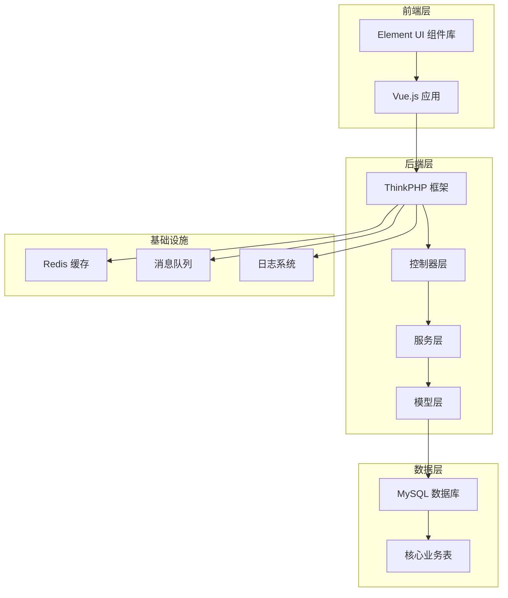

**图表来源**
- [yyladmin.sql:44193-44255](file://gccd_server/private/database/yyladmin.sql#L44193-L44255)
- [yyladmin.sql:44561-44637](file://gccd_server/private/database/yyladmin.sql#L44561-L44637)

## 核心业务表结构

### 系统管理表

#### 部门表 (ya_system_dept)
部门管理表用于存储企业组织架构信息，支持多级部门嵌套结构。

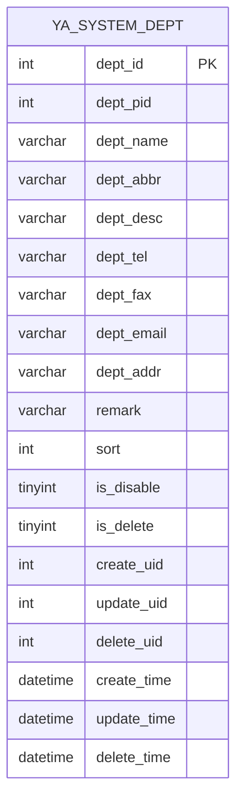

**字段说明：**
- `dept_id`: 部门唯一标识，自增主键
- `dept_pid`: 上级部门ID，支持树形结构
- `dept_name`: 部门全称，必填字段
- `dept_abbr`: 部门简称，便于显示
- `dept_desc`: 部门描述信息
- `dept_tel`: 部门联系电话
- `dept_fax`: 部门传真号码
- `dept_email`: 部门邮箱地址
- `dept_addr`: 部门办公地址
- `remark`: 备注信息
- `sort`: 排序权重，数值越小显示越靠前
- `is_disable`: 是否禁用，0-启用，1-禁用
- `is_delete`: 逻辑删除标记
- `create_uid/update_uid/delete_uid`: 操作用户ID
- `create_time/update_time/delete_time`: 操作时间戳

**数据类型与约束：**
- 主键：`dept_id` (AUTO_INCREMENT)
- 索引：`dept_pid` (普通索引)
- 默认值：`sort=250`, `is_disable=0`, `is_delete=0`
- 字符集：utf8mb4

**图表来源**
- [yyladmin.sql:44196-44217](file://gccd_server/private/database/yyladmin.sql#L44196-L44217)

#### 菜单表 (ya_system_menu)
菜单权限管理表，支持三级菜单结构（目录-菜单-按钮）。

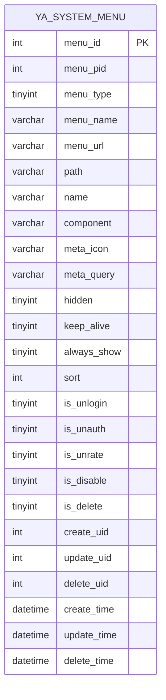

**字段说明：**
- `menu_type`: 菜单类型，0-目录，1-菜单，2-按钮
- `menu_url`: 权限标识符，用于接口权限控制
- `path/name/component`: 前端路由配置
- `meta_icon/meta_query`: 路由元信息配置
- `hidden/keep_alive/always_show`: 前端显示控制
- `is_unlogin/is_unauth/is_unrate`: 权限豁免标志

**权限控制机制：**
- 免登录权限：`is_unlogin=1`
- 免权限检查：`is_unauth=1`
- 免频率限制：`is_unrate=1`

**图表来源**
- [yyladmin.sql:44227-44254](file://gccd_server/private/database/yyladmin.sql#L44227-L44254)

#### 角色表 (ya_system_role)
角色管理表，实现基于角色的权限控制（RBAC）。

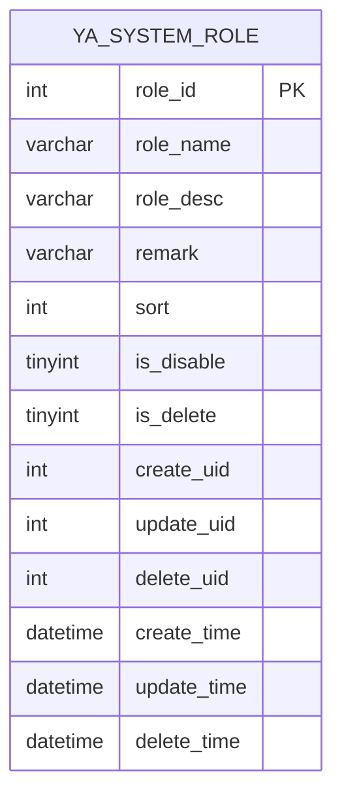

**默认角色：**
- 管理员角色：`role_name='管理员'`
- 普通员工角色：`role_name=' 牛马'`

**图表来源**
- [yyladmin.sql:44622-44636](file://gccd_server/private/database/yyladmin.sql#L44622-L44636)

#### 角色菜单关联表 (ya_system_role_menus)
多对多关联表，建立角色与菜单的权限映射关系。

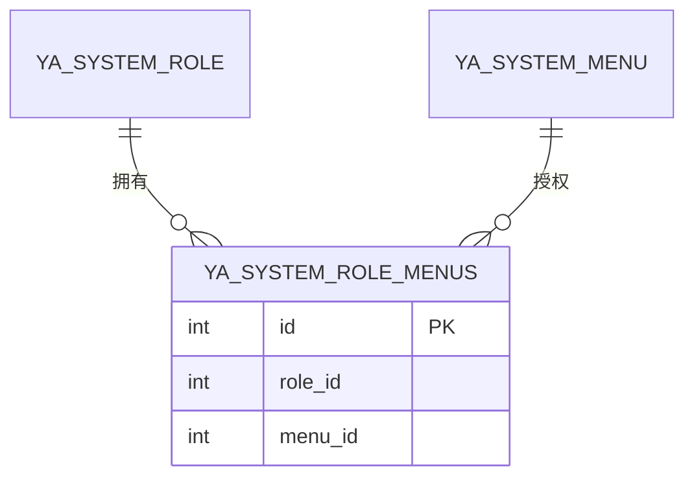

**图表来源**
- [yyladmin.sql:44648-44653](file://gccd_server/private/database/yyladmin.sql#L44648-L44653)

#### 职位表 (ya_system_post)
职位管理表，支持职位层级结构。

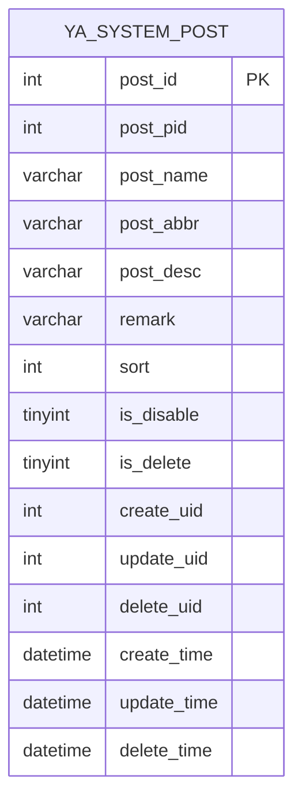

**图表来源**
- [yyladmin.sql:44595-44611](file://gccd_server/private/database/yyladmin.sql#L44595-L44611)

#### 公告表 (ya_system_notice)
系统公告管理表。

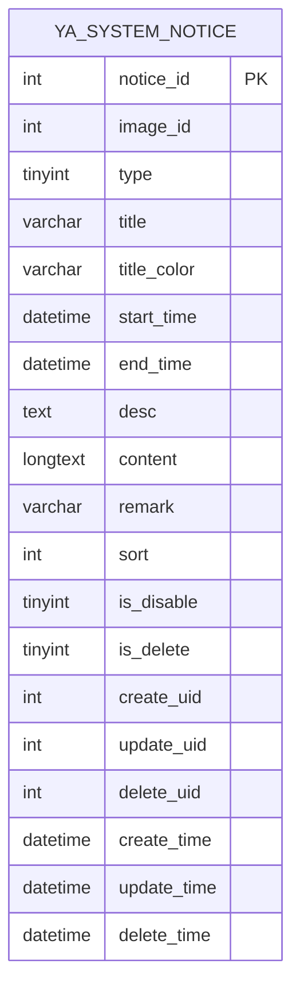

**图表来源**
- [yyladmin.sql:44564-44584](file://gccd_server/private/database/yyladmin.sql#L44564-L44584)

### 会员管理表

#### 会员表 (ya_member)
会员用户管理表，支持多种登录方式。

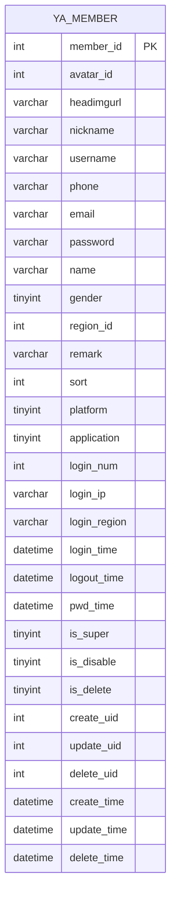

**登录统计字段：**
- `login_num`: 登录次数统计
- `login_ip/login_region`: 最近登录信息
- `login_time/logout_time`: 登录时间记录
- `pwd_time`: 密码修改时间

**图表来源**
- [yyladmin.sql:410-441](file://gccd_server/private/database/yyladmin.sql#L410-L441)

#### 会员接口表 (ya_member_api)
会员相关接口权限管理。

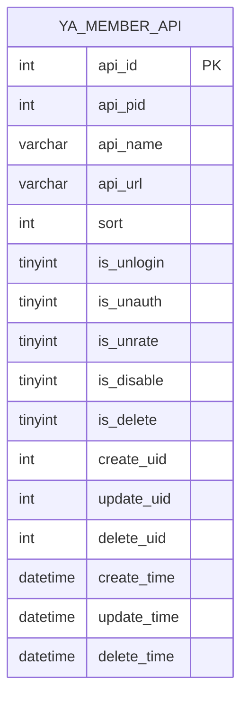

**图表来源**
- [yyladmin.sql:449-469](file://gccd_server/private/database/yyladmin.sql#L449-L469)

#### 会员分组表 (ya_member_group)
会员分组管理。

```mermaid
ermaid
erDiagram
YA_MEMBER_GROUP {
int group_id PK
varchar group_name
varchar group_desc
varchar remark
int sort
tinyint is_default
tinyint is_disable
tinyint is_delete
int create_uid
int update_uid
int delete_uid
datetime create_time
datetime update_time
datetime delete_time
}
```

**图表来源**
- [yyladmin.sql:561-577](file://gccd_server/private/database/yyladmin.sql#L561-L577)

#### 会员标签表 (ya_member_tag)
会员标签管理。

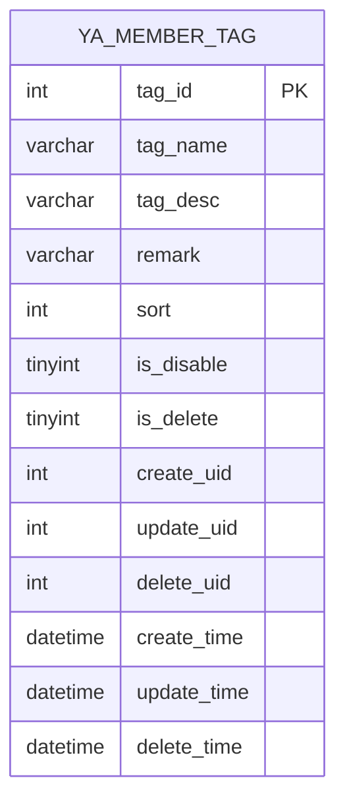

**图表来源**
- [yyladmin.sql:724-739](file://gccd_server/private/database/yyladmin.sql#L724-L739)

#### 会员第三方账号表 (ya_member_third)
第三方登录账号绑定。

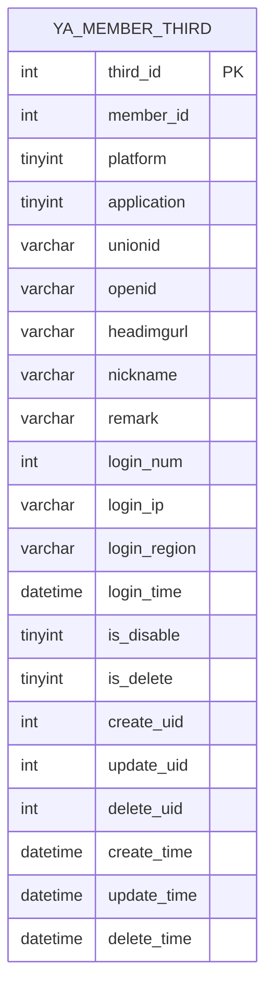

**图表来源**
- [yyladmin.sql:747-771](file://gccd_server/private/database/yyladmin.sql#L747-L771)

### 设置管理表

#### 地区表 (ya_setting_region)
全国行政区划数据。

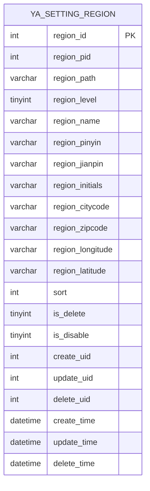

**数据特点：**
- 支持四级行政区划：省、市、区县、乡镇
- 包含地理坐标信息
- 支持拼音和简拼查询

**图表来源**
- [yyladmin.sql:800-820](file://gccd_server/private/database/yyladmin.sql#L800-L820)

#### 协议表 (ya_setting_accord)
用户协议管理。

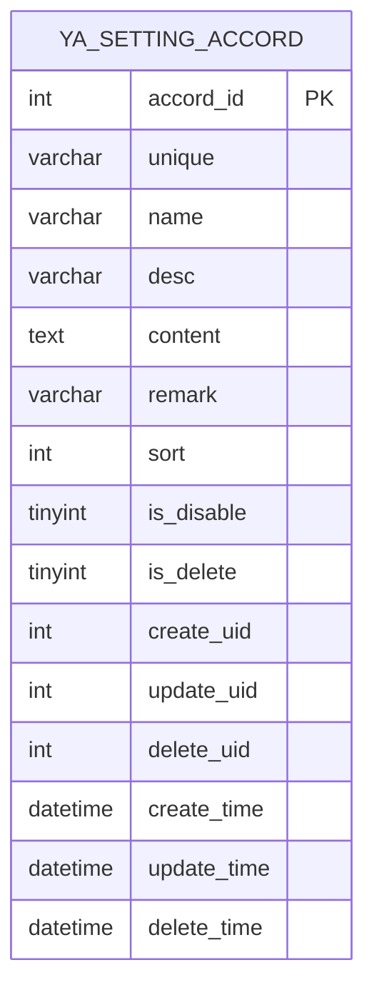

**图表来源**
- [yyladmin.sql:800-820](file://gccd_server/private/database/yyladmin.sql#L800-L820)

#### 轮播表 (ya_setting_carousel)
首页轮播图管理。

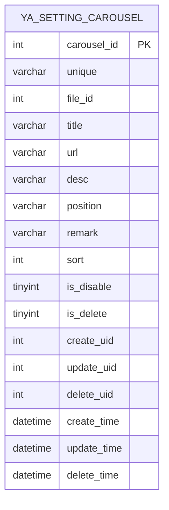

**图表来源**
- [yyladmin.sql:800-820](file://gccd_server/private/database/yyladmin.sql#L800-L820)

#### 反馈表 (ya_setting_feedback)
用户反馈管理。

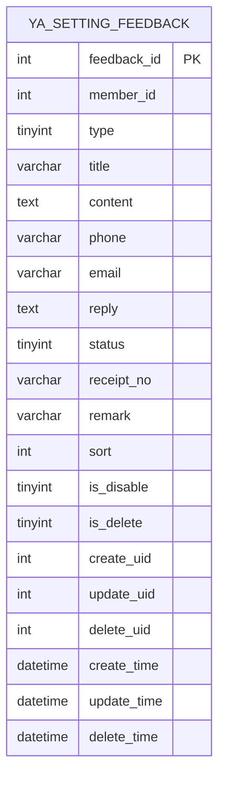

**图表来源**
- [yyladmin.sql:800-820](file://gccd_server/private/database/yyladmin.sql#L800-L820)

## 表关系映射

### 实体关系图

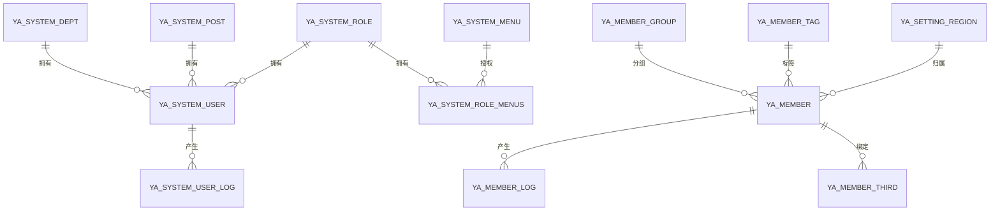

**图表来源**
- [yyladmin.sql:44196-44217](file://gccd_server/private/database/yyladmin.sql#L44196-L44217)
- [yyladmin.sql:44595-44611](file://gccd_server/private/database/yyladmin.sql#L44595-L44611)
- [yyladmin.sql:44622-44636](file://gccd_server/private/database/yyladmin.sql#L44622-L44636)

### 关联关系分析

#### 一对一关系
- `ya_system_user` → `ya_system_user_log`: 用户与登录日志
- `ya_member` → `ya_member_log`: 会员与操作日志

#### 一对多关系
- `ya_system_dept` → `ya_system_user`: 部门与员工
- `ya_system_post` → `ya_system_user`: 职位与员工  
- `ya_system_role` → `ya_system_user`: 角色与用户
- `ya_member_group` → `ya_member`: 分组与会员
- `ya_member_tag` → `ya_member`: 标签与会员

#### 多对多关系
- `ya_system_role` ↔ `ya_system_menu`: 角色与菜单权限
- `ya_member` ↔ `ya_member_group`: 会员与分组
- `ya_member` ↔ `ya_member_tag`: 会员与标签

## 数据完整性约束

### 主键约束
所有核心表均设置自增主键，确保数据唯一性：

```sql
-- 示例：部门表主键
PRIMARY KEY (`dept_id`)

-- 示例：菜单表主键  
PRIMARY KEY (`menu_id`)

-- 示例：角色表主键
PRIMARY KEY (`role_id`)
```

### 外键约束
系统采用软外键设计，通过业务逻辑保证数据一致性：

```sql
-- 角色菜单关联表
CREATE TABLE `ya_system_role_menus` (
  `id` int(11) NOT NULL AUTO_INCREMENT,
  `role_id` int(11) DEFAULT 0 COMMENT '角色id',
  `menu_id` int(11) DEFAULT 0 COMMENT '菜单id',
  PRIMARY KEY (`id`)
) ENGINE=InnoDB DEFAULT CHARSET=utf8mb4 COMMENT='角色菜单关联'
```

### 默认值约束
关键字段设置合理的默认值：

```sql
-- 禁用状态默认值
tinyint is_disable DEFAULT 0 COMMENT '是否禁用，1是0否'

-- 删除状态默认值  
tinyint is_delete DEFAULT 0 COMMENT '是否删除，1是0否'

-- 排序默认值
int sort DEFAULT 250 COMMENT '排序'

-- 时间戳默认值
datetime create_time DEFAULT NULL
datetime update_time DEFAULT NULL
datetime delete_time DEFAULT NULL
```

### 非空约束
重要业务字段设置NOT NULL约束：

```sql
-- 部门名称必填
`dept_name` varchar(255) NOT NULL DEFAULT '' COMMENT '部门名称'

-- 菜单名称必填
`menu_name` varchar(100) NOT NULL DEFAULT '' COMMENT '菜单名称'

-- 角色名称必填
`role_name` varchar(100) NOT NULL DEFAULT '' COMMENT '角色名称'
```

## 索引设计策略

### 主键索引
所有表的主键自动创建唯一索引，确保主键唯一性。

### 普通索引
针对常用查询字段建立索引：

```sql
-- 部门表索引
CREATE INDEX idx_dept_pid ON ya_system_dept(dept_pid);

-- 菜单表索引  
CREATE INDEX idx_menu_pid ON ya_system_menu(menu_pid);
CREATE INDEX idx_menu_type ON ya_system_menu(menu_type);

-- 角色菜单关联索引
CREATE INDEX idx_role_id ON ya_system_role_menus(role_id);
CREATE INDEX idx_menu_id ON ya_system_role_menus(menu_id);

-- 会员表索引
CREATE INDEX idx_username ON ya_member(username);
CREATE INDEX idx_phone ON ya_member(phone);
CREATE INDEX idx_email ON ya_member(email);
```

### 复合索引
针对复杂查询场景建立复合索引：

```sql
-- 会员登录统计索引
CREATE INDEX idx_login_time ON ya_member(login_time);
CREATE INDEX idx_login_ip ON ya_member(login_ip);

-- 创建时间索引
CREATE INDEX idx_create_time ON ya_system_menu(create_time);
CREATE INDEX idx_update_time ON ya_system_menu(update_time);
```

### 唯一索引
敏感字段建立唯一约束：

```sql
-- 会员用户名唯一
UNIQUE KEY uk_username ON ya_member(username);

-- 菜单URL唯一
UNIQUE KEY uk_menu_url ON ya_system_menu(menu_url);
```

## 业务流程分析

### 用户登录流程

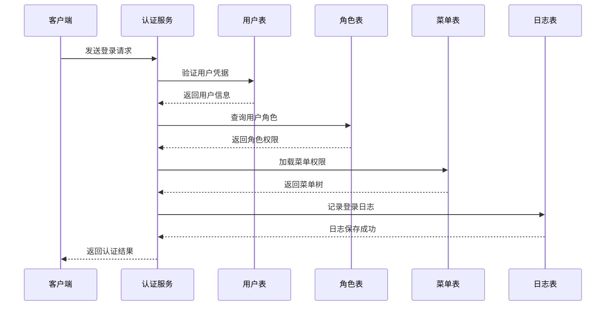

**流程来源**
- [yyladmin.sql:44227-44254](file://gccd_server/private/database/yyladmin.sql#L44227-L44254)
- [yyladmin.sql:44619-44636](file://gccd_server/private/database/yyladmin.sql#L44619-L44636)

### 权限控制流程

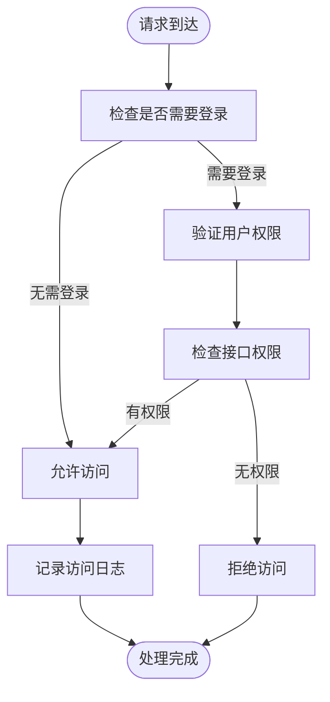

### 数据初始化流程

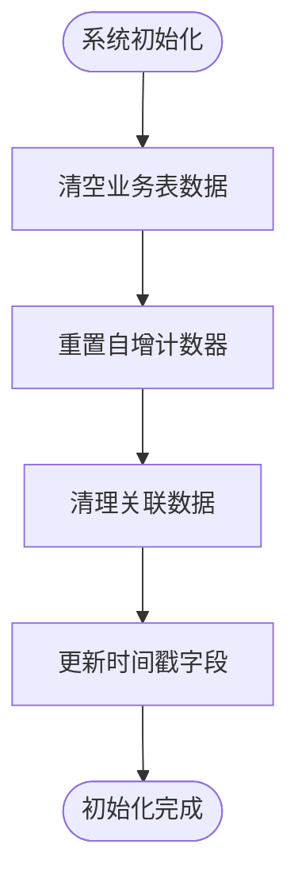

**流程来源**
- [db_init_sql.txt:50-61](file://gccd_server/private/database/db_init_sql.txt#L50-L61)

## 性能优化建议

### 查询优化
1. **索引优化**：为高频查询字段建立适当索引
2. **查询限制**：合理使用LIMIT限制结果集大小
3. **连接优化**：避免N+1查询问题，使用JOIN替代多次查询

### 存储优化
1. **数据归档**：定期归档历史日志数据
2. **分区策略**：对大表考虑按时间分区
3. **压缩存储**：对文本字段考虑压缩存储

### 缓存策略
1. **热点数据缓存**：菜单权限等热点数据缓存
2. **分布式缓存**：使用Redis缓存用户会话
3. **缓存失效**：设置合理的缓存过期时间

## 故障排查指南

### 常见问题诊断

#### 数据不一致问题
**症状**：用户权限异常，菜单显示错误
**排查步骤**：
1. 检查角色菜单关联表数据完整性
2. 验证用户角色分配正确性
3. 确认菜单权限配置有效性

#### 性能问题
**症状**：系统响应缓慢，查询超时
**排查步骤**：
1. 分析慢查询日志
2. 检查索引使用情况
3. 优化SQL查询语句

#### 数据丢失问题
**症状**：业务数据意外删除
**排查步骤**：
1. 检查逻辑删除字段状态
2. 查看数据变更历史
3. 考虑数据恢复方案

### 监控指标

#### 关键性能指标
- **数据库连接数**：监控并发连接使用情况
- **查询响应时间**：跟踪慢查询性能
- **索引命中率**：评估索引使用效果
- **锁等待时间**：监控数据库锁竞争

#### 业务监控指标
- **用户活跃度**：登录次数和活跃用户数
- **接口调用频次**：各接口访问量统计
- **错误率统计**：接口错误和异常情况
- **数据增长趋势**：各表数据量变化情况

## 总结

本系统采用标准化的数据库设计，建立了完善的权限管理体系和业务支撑结构。通过合理的表结构设计、索引策略和约束机制，确保了系统的稳定性、可扩展性和安全性。

核心优势包括：
1. **清晰的层次结构**：从基础数据到业务逻辑的完整分层
2. **完善的权限控制**：基于角色的细粒度权限管理
3. **灵活的扩展性**：支持多租户和多应用场景
4. **良好的性能特征**：通过索引和缓存优化提升响应速度

建议在后续开发中重点关注：
- 持续优化查询性能和索引策略
- 加强数据备份和恢复机制
- 完善监控告警体系
- 建立规范的数据库版本管理流程