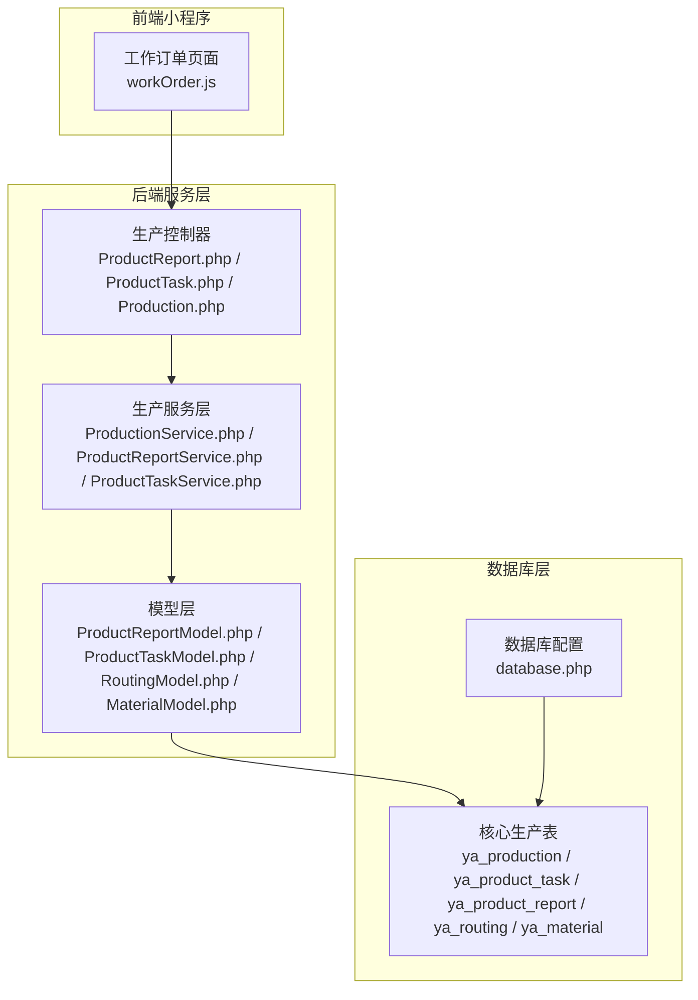
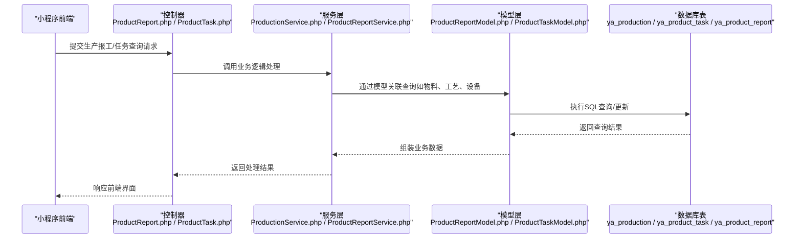
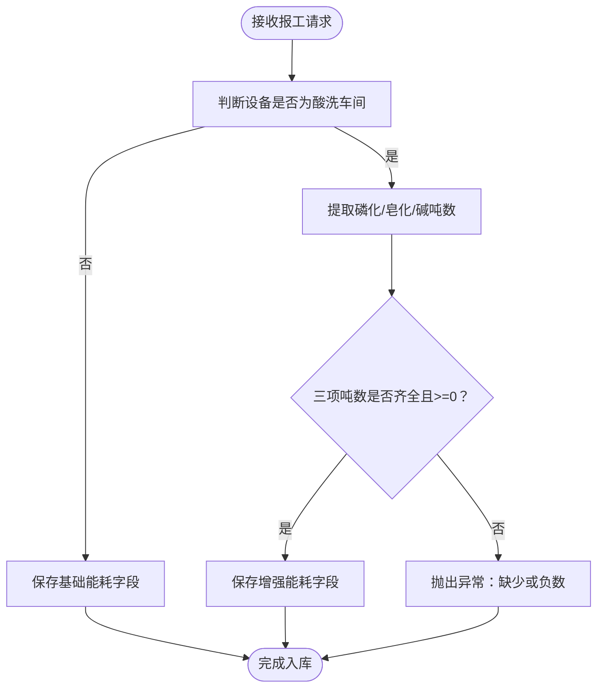
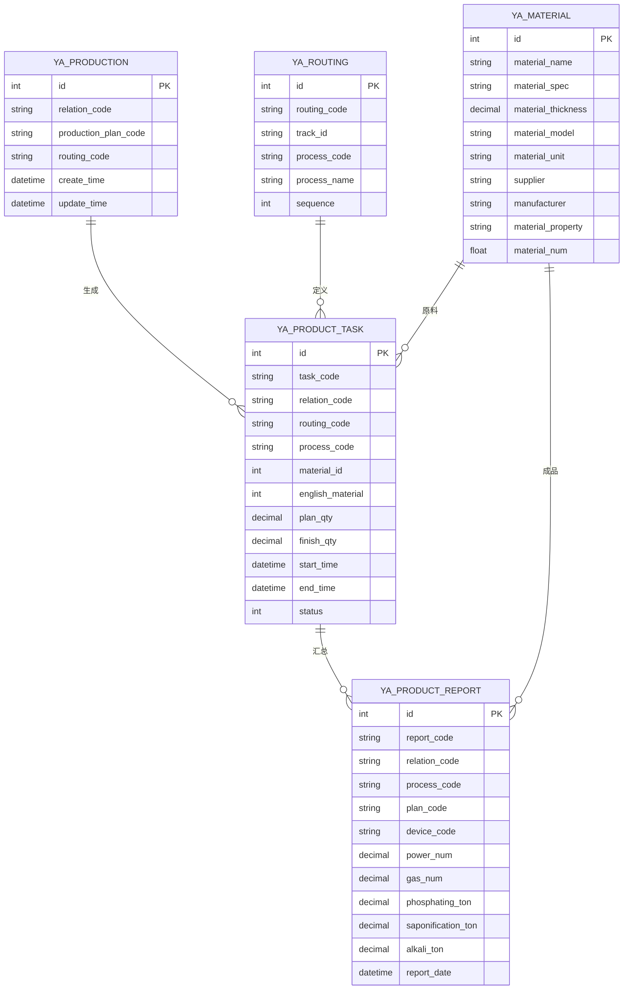

# 生产管理数据表

<cite>
**本文档引用的文件**
- [gxgccd.sql](file://gxgccd.sql)
- [database.php](file://gccd_server/config/database.php)
- [ProductReportModel.php](file://gccd_server/app/common/model/admin/ProductReportModel.php)
- [ProductTaskModel.php](file://gccd_server/app/common/model/admin/ProductTaskModel.php)
- [RoutingModel.php](file://gccd_server/app/common/model/admin/RoutingModel.php)
- [MaterialModel.php](file://gccd_server/app/common/model/admin/MaterialModel.php)
- [ProductReportPowerPicklingExample.php](file://gccd_server/reference/ProductReportPowerPicklingExample.php)
- [ProductReport.php](file://gccd_server/app/admin/controller/production/ProductReport.php)
- [ProductTask.php](file://gccd_server/app/admin/controller/production/ProductTask.php)
- [Production.php](file://gccd_server/app/admin/controller/production/Production.php)
- [InStock.php](file://gccd_server/app/admin/controller/stock/InStock.php)
- [ProductionService.php](file://gccd_server/app/common/service/admin/ProductionService.php)
- [MessageService.php](file://gccd_server/app/common/service/admin/MessageService.php)
- [workOrder.js](file://gccd_mini/pages/workOrder/workOrder.js)
</cite>

## 目录
1. [简介](#简介)
2. [项目结构](#项目结构)
3. [核心组件](#核心组件)
4. [架构概览](#架构概览)
5. [详细组件分析](#详细组件分析)
6. [依赖分析](#依赖分析)
7. [性能考虑](#性能考虑)
8. [故障排除指南](#故障排除指南)
9. [结论](#结论)

## 简介
本文件为高齿传动项目的生产管理模块数据表设计文档，重点覆盖以下核心生产数据表的结构设计与业务逻辑：
- 工单管理表：ya_work_order（对应数据库中的 ya_production 表）
- 产品任务表：ya_product_task
- 生产报表表：ya_product_report
- 工艺路线表：ya_routing
- 物料表：ya_material

文档将详细说明各表的业务字段定义、数据类型选择、约束条件和索引策略，阐述生产流程中的数据流转关系（工单到任务的分解、任务到报表的汇总、物料到生产的消耗），并提供统计分析字段设计与历史数据管理策略。

## 项目结构
该项目采用前后端分离架构，生产管理模块主要涉及后端 ThinkPHP 框架的服务层与模型层，以及前端小程序页面的数据交互。数据库层通过 ThinkORM 连接，表前缀统一为 ya_。

**图表来源**
- [database.php:27-66](file://gccd_server/config/database.php#L27-L66)
- [ProductReport.php:78](file://gccd_server/app/admin/controller/production/ProductReport.php#L78)
- [ProductTask.php](file://gccd_server/app/admin/controller/production/ProductTask.php)
- [Production.php](file://gccd_server/app/admin/controller/production/Production.php)
- [ProductReportModel.php:10-76](file://gccd_server/app/common/model/admin/ProductReportModel.php#L10-L76)
- [ProductTaskModel.php:10-67](file://gccd_server/app/common/model/admin/ProductTaskModel.php#L10-L67)
- [RoutingModel.php:10-25](file://gccd_server/app/common/model/admin/RoutingModel.php#L10-L25)
- [MaterialModel.php:10-25](file://gccd_server/app/common/model/admin/MaterialModel.php#L10-L25)

**章节来源**
- [database.php:11-66](file://gccd_server/config/database.php#L11-L66)

## 核心组件
本节概述生产管理模块的核心数据表及其职责：
- ya_production（对应 ya_work_order）：承载生产工单主数据，包含计划编号、产品规格、工艺路线、状态等关键字段，用于驱动生产任务的生成与跟踪。
- ya_product_task：承载具体的产品任务明细，关联工单、工艺路线、工序、物料等，记录任务执行过程中的关键指标。
- ya_product_report：承载生产报工与统计报表数据，汇总任务执行结果、设备能耗、质量数据等，支持多维度分析。
- ya_routing：承载工艺路线主数据与明细，定义产品加工的工序序列、设备要求、质量控制点等。
- ya_material：承载物料主数据，包含物料名称、规格、型号、单位、供应商等，支撑生产领料与消耗统计。

**章节来源**
- [gxgccd.sql:519-542](file://gxgccd.sql#L519-L542)
- [ProductReportModel.php:16-75](file://gccd_server/app/common/model/admin/ProductReportModel.php#L16-L75)
- [ProductTaskModel.php:16-66](file://gccd_server/app/common/model/admin/ProductTaskModel.php#L16-L66)
- [RoutingModel.php:16-24](file://gccd_server/app/common/model/admin/RoutingModel.php#L16-L24)
- [MaterialModel.php:16-24](file://gccd_server/app/common/model/admin/MaterialModel.php#L16-L24)

## 架构概览
生产管理模块的数据流从工单（ya_production）开始，经过任务分解（ya_product_task）、执行报工（ya_product_report），最终形成统计分析与历史归档。物料（ya_material）贯穿整个流程，用于领料、消耗与库存管理。

**图表来源**
- [ProductReport.php:78](file://gccd_server/app/admin/controller/production/ProductReport.php#L78)
- [ProductionService.php:523](file://gccd_server/app/common/service/admin/ProductionService.php#L523)
- [ProductReportModel.php:16-75](file://gccd_server/app/common/model/admin/ProductReportModel.php#L16-L75)
- [ProductTaskModel.php:16-66](file://gccd_server/app/common/model/admin/ProductTaskModel.php#L16-L66)

## 详细组件分析

### 工单管理表（ya_production 对应 ya_work_order）
- 表结构要点
  - 主键：自增 id
  - 关联字段：relation_code（与产品任务/报表关联）、production_plan_code（生产计划编号）、routing_code（工艺路线编号）
  - 业务字段：产品规格、型号、计划数量、完成数量、状态、创建/更新时间等
  - 约束与索引：主键索引；建议在 relation_code、production_plan_code、routing_code 上建立普通索引以提升关联查询性能
- 数据类型选择
  - 文本类字段使用 varchar，长度根据业务需求设定；日期时间使用 datetime
  - 数值类字段使用 decimal 以保证精度（如数量、重量）
- 业务逻辑
  - 工单作为生产任务的源头，驱动产品任务的生成与分配
  - 与生产报表进行汇总关联，形成统计口径

**章节来源**
- [gxgccd.sql:519-542](file://gxgccd.sql#L519-L542)
- [ProductionService.php:523](file://gccd_server/app/common/service/admin/ProductionService.php#L523)

### 产品任务表（ya_product_task）
- 表结构要点
  - 主键：自增 id
  - 关联字段：task_code（任务编号）、relation_code（关联工单/计划）、routing_code（工艺路线）、process_code（工序编码）
  - 物料关联：material_id（原料）、english_material（成品）
  - 业务字段：计划数量、完成数量、开始/结束时间、状态、备注
  - 约束与索引：主键索引；建议在 task_code、relation_code、routing_code、process_code、material_id、english_material 上建立索引
- 数据类型选择
  - 数量字段使用 decimal，确保统计准确性
  - 时间字段使用 datetime
- 业务逻辑
  - 任务从工单分解而来，承载具体工序执行细节
  - 与物料表进行绑定，记录原料与成品的对应关系

**章节来源**
- [ProductTaskModel.php:16-66](file://gccd_server/app/common/model/admin/ProductTaskModel.php#L16-L66)
- [gxgccd.sql:519-542](file://gxgccd.sql#L519-L542)

### 生产报表表（ya_product_report）
- 表结构要点
  - 主键：自增 id
  - 关联字段：report_code（报表编号）、relation_code（关联任务/工单）、process_code（工序编码）、plan_code（计划编号）
  - 设备关联：device_code（设备编号）
  - 能耗与质量字段：power_num（电量）、gas_num（气量）、磷化/皂化/碱吨数（酸洗车间专用）
  - 统计字段：日班/夜班产量、合格率、损耗率等
  - 约束与索引：主键索引；建议在 report_code、relation_code、process_code、device_code、plan_code 上建立索引
- 数据类型选择
  - 能耗与质量字段使用 decimal，保留合适的小数位数
- 业务逻辑
  - 报表汇总任务执行结果，支持按日/月/年统计分析
  - 酸洗车间场景下，磷化、皂化、碱的吨数字段需强制校验与保留三位小数

**图表来源**
- [ProductReportPowerPicklingExample.php:37-137](file://gccd_server/reference/ProductReportPowerPicklingExample.php#L37-L137)

**章节来源**
- [ProductReportModel.php:16-75](file://gccd_server/app/common/model/admin/ProductReportModel.php#L16-L75)
- [ProductReportPowerPicklingExample.php:14-27](file://gccd_server/reference/ProductReportPowerPicklingExample.php#L14-L27)

### 工艺路线表（ya_routing）
- 表结构要点
  - 主键：自增 id
  - 关联字段：routing_code（路线编号）、track_id（路线模板）
  - 明细字段：工序编码、工序名称、设备要求、质量控制点、顺序号等
  - 约束与索引：主键索引；建议在 routing_code、process_code 上建立索引
- 数据类型选择
  - 文本类字段使用 varchar；数值类使用 int 或 decimal
- 业务逻辑
  - 定义产品的标准加工流程，指导任务生成与报工录入

**章节来源**
- [RoutingModel.php:16-24](file://gccd_server/app/common/model/admin/RoutingModel.php#L16-L24)
- [gxgccd.sql:519-542](file://gxgccd.sql#L519-L542)

### 物料表（ya_material）
- 表结构要点
  - 主键：自增 id
  - 业务字段：物料名称、规格、厚度、型号、单位、供应商、厂家、属性、库存数量等
  - 约束与索引：主键索引；建议在 material_name、material_spec、material_model 上建立索引
- 数据类型选择
  - 库存数量使用 float 或 decimal；文本字段使用 varchar
- 业务逻辑
  - 支撑生产领料、消耗统计与库存管理
  - 与任务/报表进行绑定，记录原料与成品的对应关系

**章节来源**
- [MaterialModel.php:16-24](file://gccd_server/app/common/model/admin/MaterialModel.php#L16-L24)
- [gxgccd.sql:519-542](file://gxgccd.sql#L519-L542)

## 依赖分析
生产管理模块的表间依赖关系如下：

**图表来源**
- [gxgccd.sql:519-542](file://gxgccd.sql#L519-L542)
- [ProductReportModel.php:16-75](file://gccd_server/app/common/model/admin/ProductReportModel.php#L16-L75)
- [ProductTaskModel.php:16-66](file://gccd_server/app/common/model/admin/ProductTaskModel.php#L16-L66)
- [RoutingModel.php:16-24](file://gccd_server/app/common/model/admin/RoutingModel.php#L16-L24)
- [MaterialModel.php:16-24](file://gccd_server/app/common/model/admin/MaterialModel.php#L16-L24)

**章节来源**
- [ProductionService.php:523](file://gccd_server/app/common/service/admin/ProductionService.php#L523)
- [MessageService.php:258](file://gccd_server/app/common/service/admin/MessageService.php#L258)
- [MessageService.php:290](file://gccd_server/app/common/service/admin/MessageService.php#L290)

## 性能考虑
- 索引策略
  - 在高频查询字段上建立索引：relation_code、production_plan_code、routing_code、process_code、device_code、material_id、english_material
  - 复合索引：针对常用查询组合（如 plan_code + process_code）建立复合索引
- 查询优化
  - 使用 JOIN 时注意字段类型一致，避免隐式转换
  - 对大数据量表进行分页查询，避免一次性加载过多数据
- 缓存策略
  - 对静态配置（如工艺路线、设备信息）进行缓存，减少重复查询
- 存储与归档
  - 历史数据定期归档至冷存储，清理过期数据以降低查询压力

## 故障排除指南
- 常见问题
  - 表不存在或字段缺失：检查数据库初始化脚本与迁移脚本，确保表结构完整
  - 关联查询失败：确认外键字段类型与取值范围一致，检查索引是否存在
  - 报表字段异常（如酸洗车间磷化/皂化/碱吨数）：按照参考示例进行字段校验与四舍五入处理
- 日志定位
  - 查看运行时日志目录下的错误日志，定位 SQL 语法错误或权限问题
- 前端交互
  - 小程序页面通过接口获取工序名称映射，若出现空名称，检查后端接口返回与缓存机制

**章节来源**
- [runtime/admin/log/202509/29_error.log:5-9](file://gccd_server/runtime/admin/log/202509/29_error.log#L5-L9)
- [workOrder.js:134-162](file://gccd_mini/pages/workOrder/workOrder.js#L134-L162)

## 结论
本设计文档基于现有代码库梳理了生产管理模块的核心数据表结构与业务逻辑，明确了工单、任务、报表、工艺路线与物料之间的数据流转关系。通过合理的索引策略、字段类型选择与统计分析字段设计，能够有效支撑生产执行与管理决策。建议在后续迭代中持续完善字段校验、缓存与归档策略，以提升整体性能与稳定性。