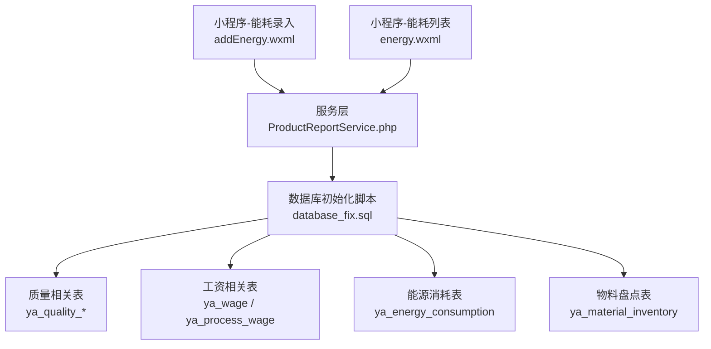
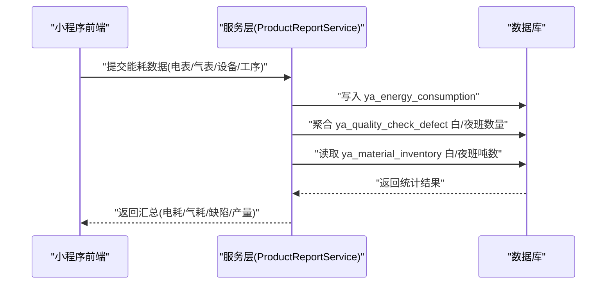
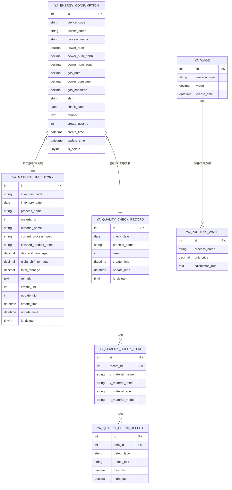

# 能源与质量数据表

<cite>
**本文引用的文件**
- [database_fix.sql](file://gccd_server/database_fix.sql)
- [QualityCheckRecordModel.php](file://gccd_server/app/common/model/admin/QualityCheckRecordModel.php)
- [QualityCheckItemModel.php](file://gccd_server/app/common/model/admin/QualityCheckItemModel.php)
- [QualityCheckDefectModel.php](file://gccd_server/app/common/model/admin/QualityCheckDefectModel.php)
- [WageModel.php](file://gccd_server/app/common/model/admin/WageModel.php)
- [ProcessWageModel.php](file://gccd_server/app/common/model/admin/ProcessWageModel.php)
- [ProductReportService.php](file://gccd_server/app/common/service/admin/ProductReportService.php)
- [addEnergy.wxml](file://gccd_mini/pageEnergy/pages/addEnergy/addEnergy.wxml)
- [energy.wxml](file://gccd_mini/pages/energy/energy.wxml)
- [workRecord.wxml](file://gccd_mini/pageMine/pages/workRecord/workRecord.wxml)
</cite>

## 目录
1. [引言](#引言)
2. [项目结构](#项目结构)
3. [核心组件](#核心组件)
4. [架构总览](#架构总览)
5. [详细组件分析](#详细组件分析)
6. [依赖关系分析](#依赖关系分析)
7. [性能考虑](#性能考虑)
8. [故障排查指南](#故障排查指南)
9. [结论](#结论)
10. [附录](#附录)

## 引言
本文件面向能源管理与质量管理两大专业领域，系统梳理并设计以下数据表结构与业务字段，支撑电耗统计、能耗对比、成本核算、质量检验流程、质量统计分析、工资计算与效率评估、能耗优化等关键业务场景。内容覆盖：
- 能源消耗表 ya_energy_consumption（基于现有前端字段与服务端统计逻辑推导）
- 质量检查记录表 ya_quality_check_record
- 质量检验项目表 ya_quality_check_item
- 质量缺陷明细表 ya_quality_check_defect
- 工资管理表 ya_wage
- 工序工资表 ya_process_wage
- 生产物料盘点表 ya_material_inventory（用于质量追溯与能耗关联）

## 项目结构
后端采用 ThinkPHP 框架，数据库初始化脚本位于 server 端；前端小程序页面展示能耗录入与查看界面；服务层负责能耗统计与报表聚合。

**图表来源**
- [addEnergy.wxml:13-27](file://gccd_mini/pageEnergy/pages/addEnergy/addEnergy.wxml#L13-L27)
- [energy.wxml:65-88](file://gccd_mini/pages/energy/energy.wxml#L65-L88)
- [ProductReportService.php:1176-1212](file://gccd_server/app/common/service/admin/ProductReportService.php#L1176-L1212)
- [database_fix.sql:1-58](file://gccd_server/database_fix.sql#L1-L58)

**章节来源**
- [addEnergy.wxml:13-27](file://gccd_mini/pageEnergy/pages/addEnergy/addEnergy.wxml#L13-L27)
- [energy.wxml:65-88](file://gccd_mini/pages/energy/energy.wxml#L65-L88)
- [ProductReportService.php:1176-1212](file://gccd_server/app/common/service/admin/ProductReportService.php#L1176-L1212)
- [database_fix.sql:1-58](file://gccd_server/database_fix.sql#L1-L58)

## 核心组件
- 能源消耗表 ya_energy_consumption：承载电表/气表读数、消耗量、设备/工序、班次、记录人、时间戳等字段，支撑日/月度电耗统计与对比分析。
- 质量检查记录表 ya_quality_check_record：记录质检日期、工序、创建人、时间等，作为质量检验流程的主单据。
- 质量检验项目表 ya_quality_check_item：记录每条质检记录下的原料/成品规格、型号等信息。
- 质量缺陷明细表 ya_quality_check_defect：记录缺陷类型、描述及白/夜班数量，支撑质量统计分析与追溯。
- 工资管理表 ya_wage：维护不同规格/工序的工资标准，支持按规格、工序维度配置。
- 工序工资表 ya_process_wage：记录工序级别的工资单价与计算规则，支持按班次/产量进行工资结算。
- 物料盘点表 ya_material_inventory：记录白/夜班吨数与总吨数，为质量追溯与能耗优化提供基础数据。

**章节来源**
- [database_fix.sql:1-58](file://gccd_server/database_fix.sql#L1-L58)

## 架构总览
下图展示从前端录入到服务端统计、再到数据库落库的整体流程，以及与质量、工资、盘点表的关联关系。

**图表来源**
- [addEnergy.wxml:13-27](file://gccd_mini/pageEnergy/pages/addEnergy/addEnergy.wxml#L13-L27)
- [ProductReportService.php:1176-1212](file://gccd_server/app/common/service/admin/ProductReportService.php#L1176-L1212)
- [database_fix.sql:1-58](file://gccd_server/database_fix.sql#L1-L58)

## 详细组件分析

### 能源消耗表 ya_energy_consumption
- 设计目标：统一记录设备/工序的电表/气表读数与消耗量，支持按日/月统计与对比分析。
- 建议字段（基于前端展示与服务端统计逻辑推导）：
  - id：自增主键
  - device_code/device_name：设备编码/名称
  - process_name：工序名称
  - power_num/power_num_north/power_num_south：电表读数（含南北电表场景）
  - gas_num：气表读数
  - power_consume/gas_consume：当次电量/气量消耗
  - shift：班次（白班/夜班）
  - check_date：质检日期（可与质量记录对齐）
  - remark：备注
  - create_user_id/create_time/update_time：记录人与时间
  - is_delete：逻辑删除标记
- 关键处理：
  - 电表/气表读数差值计算消耗量
  - 支持单电表与双电表（南北）场景
  - 与质量缺陷数量、物料盘点吨数联动，用于能耗优化分析

**章节来源**
- [addEnergy.wxml:13-27](file://gccd_mini/pageEnergy/pages/addEnergy/addEnergy.wxml#L13-L27)
- [energy.wxml:65-88](file://gccd_mini/pages/energy/energy.wxml#L65-L88)
- [ProductReportService.php:1176-1212](file://gccd_server/app/common/service/admin/ProductReportService.php#L1176-L1212)

### 质量检查记录表 ya_quality_check_record
- 设计目标：作为质量检验流程的主单据，记录质检日期、工序、创建人等。
- 字段要点：
  - id：主键
  - check_date：质检日期
  - process_name：工序名称
  - user_id：创建人ID
  - create_time/update_time：创建/更新时间
  - is_delete：逻辑删除
- 关联关系：
  - 一对多：记录项 ya_quality_check_item
  - 多对一：用户表（通过模型绑定用户名/昵称）

**章节来源**
- [database_fix.sql:2-11](file://gccd_server/database_fix.sql#L2-L11)
- [QualityCheckRecordModel.php:1-21](file://gccd_server/app/common/model/admin/QualityCheckRecordModel.php#L1-L21)

### 质量检验项目表 ya_quality_check_item
- 设计目标：记录每条质检记录下的原料/成品规格、型号等信息。
- 字段要点：
  - id：主键
  - record_id：关联主表ID
  - y_material_name/y_material_spec：原料名称/规格
  - c_material_spec/c_material_model：成品规格/型号
- 关联关系：
  - 多对一：质检记录主表
  - 一对多：缺陷明细 ya_quality_check_defect

**章节来源**
- [database_fix.sql:14-23](file://gccd_server/database_fix.sql#L14-L23)
- [QualityCheckItemModel.php:1-16](file://gccd_server/app/common/model/admin/QualityCheckItemModel.php#L1-L16)

### 质量缺陷明细表 ya_quality_check_defect
- 设计目标：记录缺陷类型、描述及白/夜班数量，支撑质量统计分析与追溯。
- 字段要点：
  - id：主键
  - item_id：关联明细表ID
  - defect_type：缺陷类型
  - defect_text：缺陷描述
  - day_qty：白班数量
  - night_qty：夜班数量
- 关联关系：
  - 多对一：质检项目表

**章节来源**
- [database_fix.sql:26-35](file://gccd_server/database_fix.sql#L26-L35)
- [QualityCheckDefectModel.php:1-11](file://gccd_server/app/common/model/admin/QualityCheckDefectModel.php#L1-L11)

### 工资管理表 ya_wage
- 设计目标：维护不同规格/工序的工资标准，支持按规格、工序维度配置。
- 字段要点：
  - id：主键
  - material_spec：规格
  - wage：工资
  - create_time：创建时间
  - 其他通用审计字段（如 update_time、create_user_id 等）
- 关联关系：
  - 可与 ya_process_wage 配合，形成“规格-工序”双维工资体系

**章节来源**
- [WageModel.php:1-22](file://gccd_server/app/common/model/admin/WageModel.php#L1-L22)

### 工序工资表 ya_process_wage
- 设计目标：记录工序级别的工资单价与计算规则，支持按班次/产量进行工资结算。
- 字段要点：
  - id：主键
  - process_name：工序名称
  - unit_price：单价
  - calculation_rule：计算规则（如按产量、按班次）
  - 其他通用审计字段
- 关联关系：
  - 与 ya_wage 形成互补，分别从“规格”和“工序”维度支撑工资计算

**章节来源**
- [ProcessWageModel.php:1-22](file://gccd_server/app/common/model/admin/ProcessWageModel.php#L1-L22)

### 物料盘点表 ya_material_inventory
- 设计目标：记录白/夜班吨数与总吨数，为质量追溯与能耗优化提供基础数据。
- 字段要点：
  - id：主键
  - inventory_code：盘点单号
  - inventory_date：盘点日期
  - process_name：工序名称
  - material_id/material_name：物料信息
  - current_process_spec：当前加工型号
  - finished_product_spec：成品型号
  - day_shift_tonnage：白班吨数
  - night_shift_tonnage：夜班吨数
  - total_tonnage：总吨数
  - remark：备注
  - create_uid/update_uid：创建/更新人
  - create_time/update_time：创建/更新时间
  - is_delete：逻辑删除
- 关联关系：
  - 与 ya_quality_check_record/ya_quality_check_item/ya_quality_check_defect 联动，支撑质量追溯

**章节来源**
- [database_fix.sql:38-57](file://gccd_server/database_fix.sql#L38-L57)

## 依赖关系分析
- 能源侧：
  - ya_energy_consumption 依赖设备/工序信息，与质量缺陷数量、物料盘点吨数存在统计关联。
- 质量侧：
  - ya_quality_check_record → ya_quality_check_item → ya_quality_check_defect，形成“记录-项目-缺陷”的三级结构。
- 工资侧：
  - ya_wage 与 ya_process_wage 共同构成工资标准体系，服务于工资结算与效率评估。
- 追溯与优化：
  - 物料盘点表与质量缺陷表共同为能耗优化提供输入，例如“某工序在特定规格下的缺陷率与能耗关系”。

**图表来源**
- [database_fix.sql:1-58](file://gccd_server/database_fix.sql#L1-L58)
- [QualityCheckRecordModel.php:1-21](file://gccd_server/app/common/model/admin/QualityCheckRecordModel.php#L1-L21)
- [QualityCheckItemModel.php:1-16](file://gccd_server/app/common/model/admin/QualityCheckItemModel.php#L1-L16)
- [QualityCheckDefectModel.php:1-11](file://gccd_server/app/common/model/admin/QualityCheckDefectModel.php#L1-L11)
- [WageModel.php:1-22](file://gccd_server/app/common/model/admin/WageModel.php#L1-L22)
- [ProcessWageModel.php:1-22](file://gccd_server/app/common/model/admin/ProcessWageModel.php#L1-L22)

## 性能考虑
- 索引策略：
  - 能源表：按 device_code、process_name、check_date 建立索引，提升按设备/工序/日期的统计效率。
  - 质量表：按 record_id、item_id 建立索引，加速明细与缺陷统计。
  - 工资表：按 material_spec、process_name 建立索引，便于快速匹配工资标准。
- 统计口径：
  - 电耗/气耗按日聚合，避免高频小粒度查询。
  - 缺陷数量按白/夜班拆分统计，便于班次对比与优化。
- 数据分区：
  - 建议按年/月对 ya_energy_consumption 与 ya_material_inventory 进行分区，降低大表扫描成本。

## 故障排查指南
- 能耗统计异常：
  - 现象：电表/气表读数差值为负或异常波动。
  - 排查：确认前端录入字段映射（单电表/双电表），核对服务端差值计算逻辑与边界值处理。
  - 参考路径：[addEnergy.wxml:13-27](file://gccd_mini/pageEnergy/pages/addEnergy/addEnergy.wxml#L13-L27)，[ProductReportService.php:1176-1212](file://gccd_server/app/common/service/admin/ProductReportService.php#L1176-L1212)
- 质量缺陷统计不一致：
  - 现象：缺陷数量与实际不符。
  - 排查：检查 ya_quality_check_item 与 ya_quality_check_defect 的关联字段，确认白/夜班数量拆分逻辑。
  - 参考路径：[database_fix.sql:14-35](file://gccd_server/database_fix.sql#L14-L35)
- 工资计算偏差：
  - 现象：按规格/工序计算的工资与预期不符。
  - 排查：核对 ya_wage 与 ya_process_wage 的匹配规则与单价，确认计算规则字段。
  - 参考路径：[WageModel.php:1-22](file://gccd_server/app/common/model/admin/WageModel.php#L1-L22)，[ProcessWageModel.php:1-22](file://gccd_server/app/common/model/admin/ProcessWageModel.php#L1-L22)

**章节来源**
- [addEnergy.wxml:13-27](file://gccd_mini/pageEnergy/pages/addEnergy/addEnergy.wxml#L13-L27)
- [ProductReportService.php:1176-1212](file://gccd_server/app/common/service/admin/ProductReportService.php#L1176-L1212)
- [database_fix.sql:14-35](file://gccd_server/database_fix.sql#L14-L35)
- [WageModel.php:1-22](file://gccd_server/app/common/model/admin/WageModel.php#L1-L22)
- [ProcessWageModel.php:1-22](file://gccd_server/app/common/model/admin/ProcessWageModel.php#L1-L22)

## 结论
本文基于现有前端界面与服务端统计逻辑，构建了覆盖能源、质量、工资、盘点四大领域的数据表设计方案，并明确了各表之间的依赖关系与关键字段。通过规范化的字段设计与合理的索引策略，可有效支撑电耗统计、能耗对比、成本核算、质量追溯、工资计算与效率评估等业务场景，为后续能耗优化与质量改进提供坚实的数据基础。

## 附录
- 业务字段速查：
  - 能源：device_code/device_name、process_name、power_num/gas_num、power_consume/gas_consume、shift、check_date、remark
  - 质量：check_date、process_name、user_id、y_material_spec/c_material_spec/model、defect_type/text、day_qty/night_qty
  - 工资：material_spec、wage、process_name、unit_price、calculation_rule
  - 盘点：inventory_code、inventory_date、process_name、material_name/spec、day_shift_tonnage/night_shift_tonnage/total_tonnage
- 统计分析建议：
  - 能耗：按日/月趋势、工序对比、设备对比、能耗强度（单位产量耗能）
  - 质量：缺陷率（白/夜班）、工序缺陷分布、质量成本（与能耗联动）
  - 工资：按规格/工序的人效与成本对比、班次效率分析
  - 追溯：从物料盘点到质量缺陷再到能耗的全链路回溯