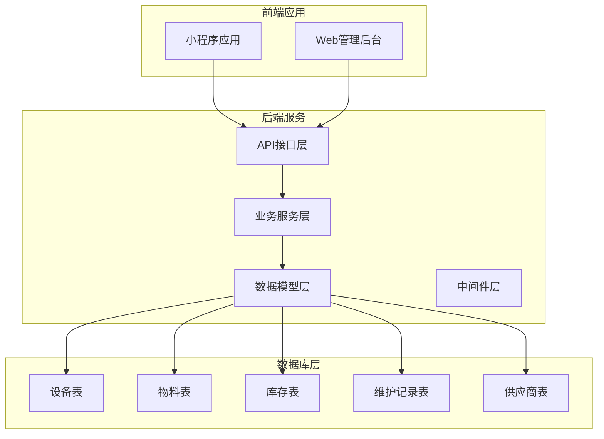
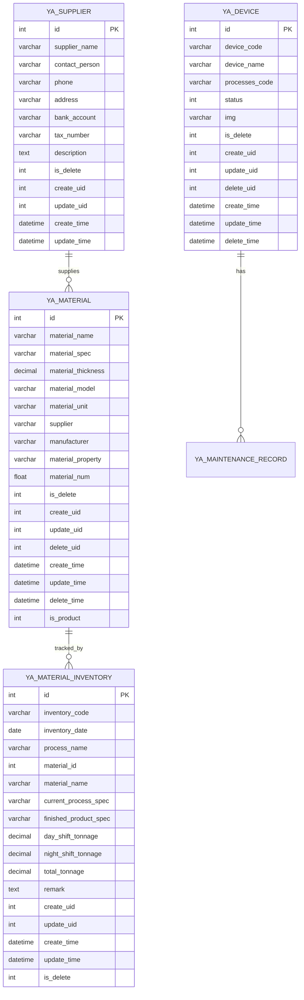
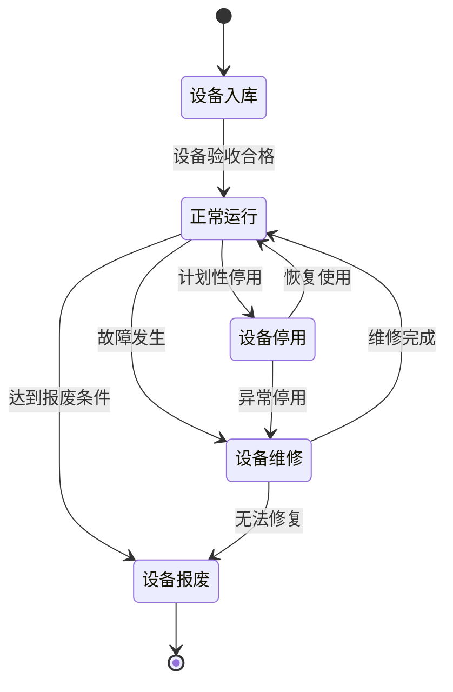
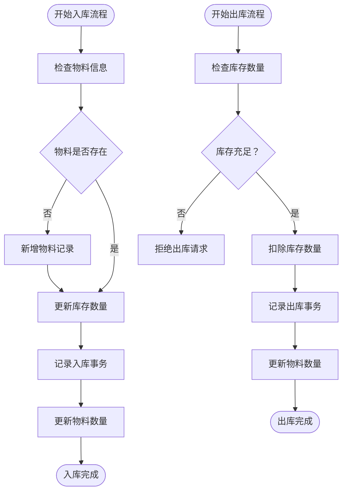
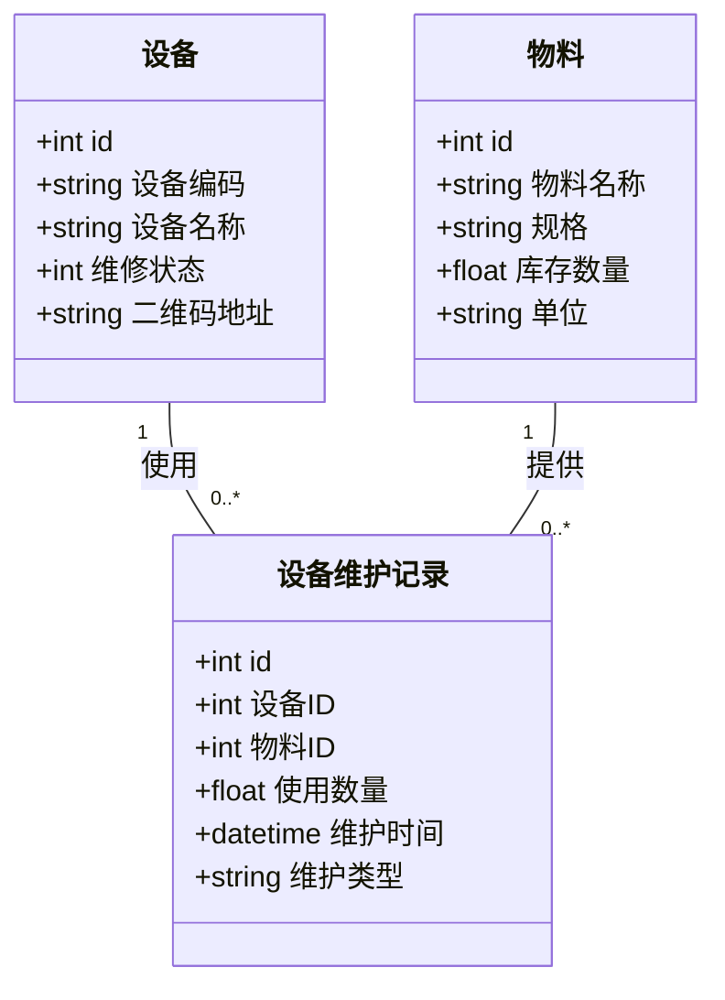
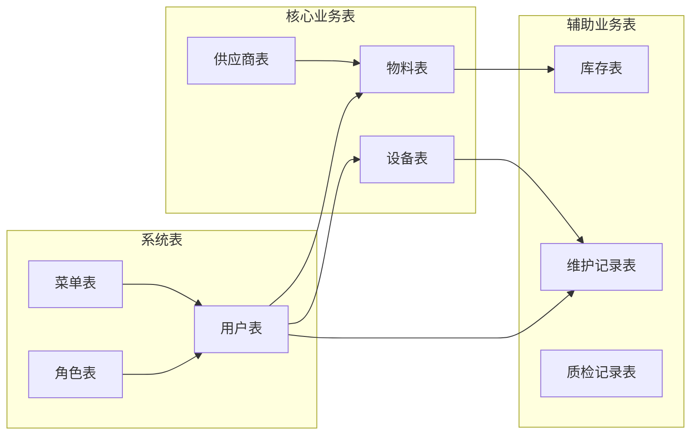

# 设备与物料数据表

<cite>
**本文档引用的文件**
- [gxgccd.sql](file://gxgccd.sql)
- [gxgccd.sql](file://gccd_server/private/database/gxgccd.sql)
- [MaterialInventoryService.php](file://gccd_server/app/common/service/admin/MaterialInventoryService.php)
- [database_fix.sql](file://gccd_server/database_fix.sql)
- [fix_inventory_fields.sql](file://gccd_server/public/fix_inventory_fields.sql)
</cite>

## 目录
1. [项目概述](#项目概述)
2. [项目结构](#项目结构)
3. [核心组件](#核心组件)
4. [架构概览](#架构概览)
5. [详细组件分析](#详细组件分析)
6. [依赖关系分析](#依赖关系分析)
7. [性能考虑](#性能考虑)
8. [故障排除指南](#故障排除指南)
9. [结论](#结论)

## 项目概述
本项目是一个高齿传动设备管理与物料管理系统，包含设备台账管理、设备维护记录、物料库存管理、物料结算以及供应商管理等核心业务模块。系统采用ThinkPHP框架开发，数据库使用MySQL，支持设备生命周期管理和物料出入库流程。

## 项目结构
项目采用前后端分离架构，包含以下主要模块：

**图表来源**
- [gxgccd.sql:207-246](file://gxgccd.sql#L207-L246)
- [gxgccd.sql:207-246](file://gccd_server/private/database/gxgccd.sql#L207-L246)

**章节来源**
- [gxgccd.sql:1-100](file://gxgccd.sql#L1-L100)
- [gxgccd.sql:1-100](file://gccd_server/private/database/gxgccd.sql#L1-L100)

## 核心组件

### 设备管理模块
设备管理模块包含设备台账管理和设备维护记录两大核心功能：

#### 设备台账表 (ya_device)
设备台账表是设备管理的核心数据表，记录所有设备的基本信息和状态。

**表结构定义：**
- 主键：id (自增)
- 设备编码：device_code (varchar)
- 设备名称：device_name (varchar)
- 关联工序编码：processes_code (varchar)
- 维修状态：status (tinyint, 0正常 1正在维修)
- 二维码地址：img (varchar)
- 删除标记：is_delete (tinyint)
- 创建人：create_uid (int)
- 更新人：update_uid (int)
- 删除人：delete_uid (int)
- 创建时间：create_time (datetime)
- 更新时间：update_time (datetime)
- 删除时间：delete_time (datetime)

#### 物料管理模块
物料管理模块涵盖物料库存、出入库记录、供应商管理等功能。

**表结构定义：**
- 主键：id (自增)
- 物料名称：material_name (varchar)
- 物料规格：material_spec (varchar)
- 物料厚度：material_thickness (decimal)
- 物料型号：material_model (varchar)
- 物料单位：material_unit (varchar)
- 供应商：supplier (varchar)
- 厂家：manufacturer (varchar)
- 物料属性：material_property (varchar)
- 库存数量：material_num (float)
- 删除标记：is_delete (tinyint)
- 创建人：create_uid (int)
- 更新人：update_uid (int)
- 删除人：delete_uid (int)
- 创建时间：create_time (datetime)
- 更新时间：update_time (datetime)
- 删除时间：delete_time (datetime)
- 是否为生产原料：is_product (tinyint)

**章节来源**
- [gxgccd.sql:207-246](file://gxgccd.sql#L207-L246)
- [gxgccd.sql:519-542](file://gxgccd.sql#L519-L542)
- [gxgccd.sql:207-246](file://gccd_server/private/database/gxgccd.sql#L207-L246)
- [gxgccd.sql:519-542](file://gccd_server/private/database/gxgccd.sql#L519-L542)

## 架构概览

**图表来源**
- [gxgccd.sql:207-246](file://gxgccd.sql#L207-L246)
- [gxgccd.sql:519-542](file://gxgccd.sql#L519-L542)
- [gxgccd.sql:207-246](file://gccd_server/private/database/gxgccd.sql#L207-L246)
- [gxgccd.sql:519-542](file://gccd_server/private/database/gxgccd.sql#L519-L542)

## 详细组件分析

### 设备生命周期管理

**图表来源**
- [gxgccd.sql:207-246](file://gxgccd.sql#L207-L246)
- [gxgccd.sql:207-246](file://gccd_server/private/database/gxgccd.sql#L207-L246)

设备生命周期管理通过设备状态字段实现，支持设备的正常运行、维修中、停用、报废等状态转换。每个状态转换都会记录相应的维护记录和操作日志。

**章节来源**
- [gxgccd.sql:207-246](file://gxgccd.sql#L207-L246)
- [gxgccd.sql:207-246](file://gccd_server/private/database/gxgccd.sql#L207-L246)

### 物料出入库流程

**图表来源**
- [gxgccd.sql:519-542](file://gxgccd.sql#L519-L542)
- [gxgccd.sql:519-542](file://gccd_server/private/database/gxgccd.sql#L519-L542)

物料出入库流程通过库存表和物料表的关联实现，支持自动化的库存管理和实时的库存预警。

**章节来源**
- [gxgccd.sql:519-542](file://gxgccd.sql#L519-L542)
- [gxgccd.sql:519-542](file://gccd_server/private/database/gxgccd.sql#L519-L542)

### 供应商信息管理

供应商管理模块提供完整的供应商信息维护功能，包括供应商基本信息、联系信息、银行账户等。

**表结构定义：**
- 主键：id (自增)
- 供应商名称：supplier_name (varchar)
- 联系人：contact_person (varchar)
- 电话：phone (varchar)
- 地址：address (varchar)
- 银行账户：bank_account (varchar)
- 税号：tax_number (varchar)
- 描述：description (text)
- 删除标记：is_delete (tinyint)
- 创建人：create_uid (int)
- 更新人：update_uid (int)
- 创建时间：create_time (datetime)
- 更新时间：update_time (datetime)

**章节来源**
- [gxgccd.sql:519-542](file://gxgccd.sql#L519-L542)
- [gxgccd.sql:519-542](file://gccd_server/private/database/gxgccd.sql#L519-L542)

### 设备与物料关联关系

**图表来源**
- [gxgccd.sql:207-246](file://gxgccd.sql#L207-L246)
- [gxgccd.sql:519-542](file://gxgccd.sql#L519-L542)

设备与物料之间通过设备维护记录建立关联关系，支持设备使用物料进行维护保养的完整追踪。

**章节来源**
- [gxgccd.sql:207-246](file://gxgccd.sql#L207-L246)
- [gxgccd.sql:519-542](file://gxgccd.sql#L519-L542)

## 依赖关系分析

**图表来源**
- [gxgccd.sql:207-246](file://gxgccd.sql#L207-L246)
- [gxgccd.sql:519-542](file://gxgccd.sql#L519-L542)

系统采用标准化的数据库设计，通过外键约束和索引优化保证数据一致性和查询性能。

**章节来源**
- [gxgccd.sql:1-100](file://gxgccd.sql#L1-L100)
- [gxgccd.sql:1-100](file://gccd_server/private/database/gxgccd.sql#L1-L100)

## 性能考虑

### 数据库优化策略
1. **索引优化**：为常用查询字段建立合适的索引
2. **分区策略**：对大量历史数据表进行分区管理
3. **缓存机制**：实现热点数据的缓存策略
4. **连接池管理**：优化数据库连接池配置

### 查询优化建议
1. **批量操作**：使用批量插入和更新减少数据库交互
2. **分页查询**：对大数据量表实施分页查询
3. **索引使用**：合理使用复合索引提高查询效率
4. **查询优化**：避免N+1查询问题

## 故障排除指南

### 常见问题及解决方案

**设备状态异常**
- 问题：设备状态显示不正确
- 解决方案：检查设备维护记录，确认状态转换逻辑

**物料库存不准确**
- 问题：库存数量与实际不符
- 解决方案：核对出入库记录，检查盘点流程

**供应商信息缺失**
- 问题：物料关联供应商信息为空
- 解决方案：完善供应商基础数据，检查外键约束

**章节来源**
- [gxgccd.sql:207-246](file://gxgccd.sql#L207-L246)
- [gxgccd.sql:519-542](file://gxgccd.sql#L519-L542)

## 结论

本设备与物料管理系统通过规范化的数据库设计和完善的业务流程，实现了设备全生命周期管理和物料精细化管控。系统采用模块化设计，具有良好的扩展性和维护性，能够满足高齿传动企业的实际业务需求。

通过设备台账管理、物料库存管理、供应商管理等核心功能的有机结合，系统为企业提供了完整的设备物料管理解决方案，有助于提高生产效率和管理水平。