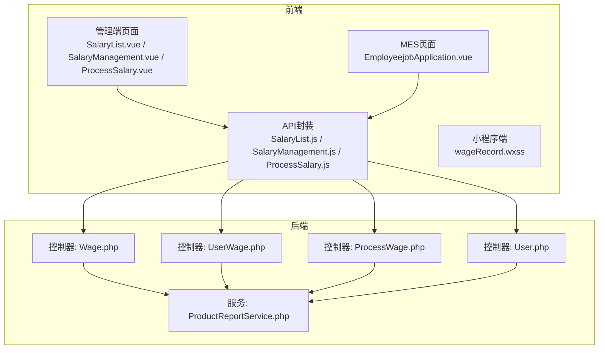
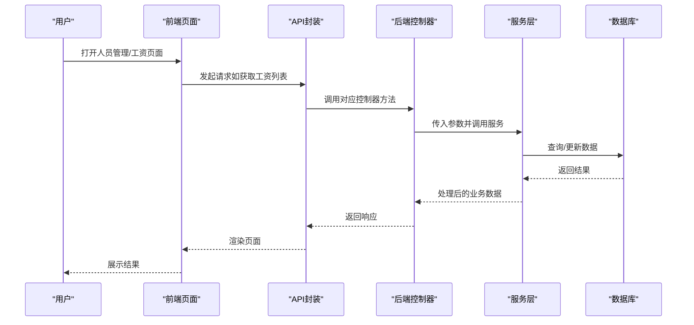
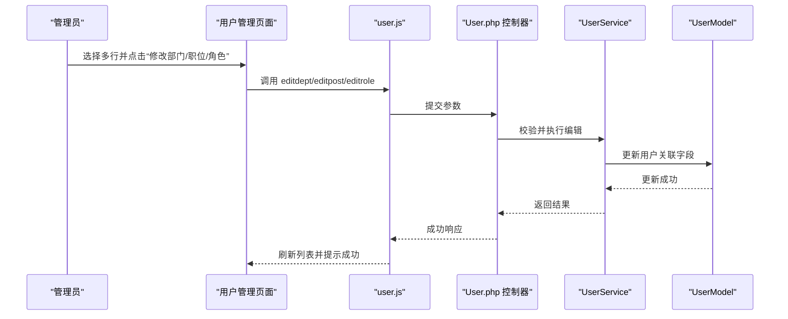
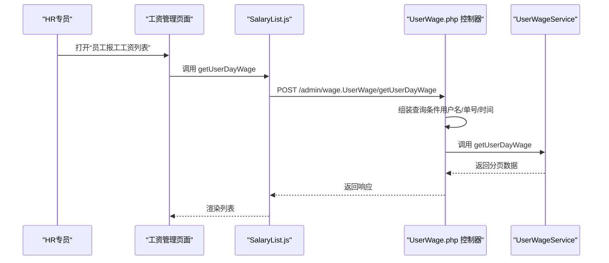
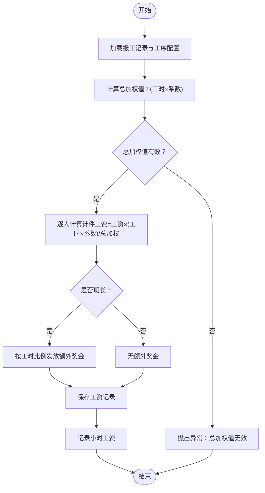

# 人员管理模块

<cite>
**本文引用的文件**
- [Wage.php](file://gccd_server/app/admin/controller/wage/Wage.php)
- [UserWage.php](file://gccd_server/app/admin/controller/wage/UserWage.php)
- [ProcessWage.php](file://gccd_server/app/admin/controller/wage/ProcessWage.php)
- [User.php](file://gccd_server/app/admin/controller/system/User.php)
- [ProductReportService.php](file://gccd_server/app/common/service/admin/ProductReportService.php)
- [SalaryList.js](file://yarn/src/api/mes/SalaryList/SalaryList.js)
- [SalaryManagement.js](file://yarn/admin/js/SalaryManagement.EHUvU4Gz.js)
- [ProcessSalary.js](file://yarn/admin/js/ProcessSalary.V_waEoGb.js)
- [SalaryList.vue](file://yarn/src/views/mes/BasicSettings/SalaryList.vue)
- [SalaryManagement.vue](file://yarn/src/views/mes/BasicSettings/SalaryManagement.vue)
- [ProcessSalary.vue](file://yarn/src/views/mes/BasicSettings/ProcessSalary.vue)
- [EmployeejobApplication.vue](file://yarn/src/views/mes/BasicSettings/EmployeejobApplication.vue)
- [wageRecord.wxss](file://gccd_mini/pageMine/pages/wageRecord/wageRecord.wxss)
- [post.js](file://yarn/src/api/system/post.js)
- [user.js](file://yarn/src/api/system/user.js)
- [user.vue](file://yarn/src/views/system/user.vue)
- [post.vue](file://yarn/src/views/system/post.vue)
</cite>

## 目录
1. [简介](#简介)
2. [项目结构](#项目结构)
3. [核心组件](#核心组件)
4. [架构总览](#架构总览)
5. [详细组件分析](#详细组件分析)
6. [依赖关系分析](#依赖关系分析)
7. [性能考量](#性能考量)
8. [故障排查指南](#故障排查指南)
9. [结论](#结论)
10. [附录](#附录)

## 简介
本文件面向“高齿传动”项目的人力资源管理模块，聚焦于人员全生命周期管理与薪酬体系的数字化实现。内容覆盖员工档案与组织关系变更、考勤与报工、工资标准与发放、绩效与奖金、薪资结构明细、薪酬统计分析以及合规与最佳实践建议。通过前后端分层设计，前端采用 Vue 3 + Element Plus，后端基于 ThinkPHP 框架，提供 REST 风格接口与小程序端展示。

## 项目结构
人员管理相关模块在项目中分布如下：
- 后端控制器与服务层：位于 gccd_server/app/admin/controller 与 gccd_server/app/common/service 下，分别负责接口编排与业务逻辑。
- 前端页面与 API：位于 yarn/src/views 与 yarn/src/api 下，提供系统管理与基础设置页面，以及 Mes（制造执行）相关页面。
- 小程序端展示：位于 gccd_mini/pageMine/pages 下，提供移动端工资记录展示。

图表来源
- [SalaryList.vue:66-110](file://yarn/src/views/mes/BasicSettings/SalaryList.vue#L66-L110)
- [SalaryManagement.vue:96-143](file://yarn/src/views/mes/BasicSettings/SalaryManagement.vue#L96-L143)
- [ProcessSalary.vue:87-130](file://yarn/src/views/mes/BasicSettings/ProcessSalary.vue#L87-L130)
- [EmployeejobApplication.vue:66-116](file://yarn/src/views/mes/BasicSettings/EmployeejobApplication.vue#L66-L116)
- [SalaryList.js:1-27](file://yarn/src/api/mes/SalaryList/SalaryList.js#L1-L27)
- [SalaryManagement.js:1-1](file://yarn/admin/js/SalaryManagement.EHUvU4Gz.js#L1-L1)
- [ProcessSalary.js:1-1](file://yarn/admin/js/ProcessSalary.V_waEoGb.js#L1-L1)
- [Wage.php:1-123](file://gccd_server/app/admin/controller/wage/Wage.php#L1-L123)
- [UserWage.php:1-158](file://gccd_server/app/admin/controller/wage/UserWage.php#L1-L158)
- [ProcessWage.php:1-127](file://gccd_server/app/admin/controller/wage/ProcessWage.php#L1-L127)
- [User.php:1-238](file://gccd_server/app/admin/controller/system/User.php#L1-L238)
- [ProductReportService.php:888-944](file://gccd_server/app/common/service/admin/ProductReportService.php#L888-L944)

章节来源
- [SalaryList.vue:66-110](file://yarn/src/views/mes/BasicSettings/SalaryList.vue#L66-L110)
- [SalaryManagement.vue:96-143](file://yarn/src/views/mes/BasicSettings/SalaryManagement.vue#L96-L143)
- [ProcessSalary.vue:87-130](file://yarn/src/views/mes/BasicSettings/ProcessSalary.vue#L87-L130)
- [EmployeejobApplication.vue:66-116](file://yarn/src/views/mes/BasicSettings/EmployeejobApplication.vue#L66-L116)
- [SalaryList.js:1-27](file://yarn/src/api/mes/SalaryList/SalaryList.js#L1-L27)
- [SalaryManagement.js:1-1](file://yarn/admin/js/SalaryManagement.EHUvU4Gz.js#L1-L1)
- [ProcessSalary.js:1-1](file://yarn/admin/js/ProcessSalary.V_waEoGb.js#L1-L1)
- [Wage.php:1-123](file://gccd_server/app/admin/controller/wage/Wage.php#L1-L123)
- [UserWage.php:1-158](file://gccd_server/app/admin/controller/wage/UserWage.php#L1-L158)
- [ProcessWage.php:1-127](file://gccd_server/app/admin/controller/wage/ProcessWage.php#L1-L127)
- [User.php:1-238](file://gccd_server/app/admin/controller/system/User.php#L1-L238)
- [ProductReportService.php:888-944](file://gccd_server/app/common/service/admin/ProductReportService.php#L888-L944)

## 核心组件
- 员工与组织管理：用户增删改查、部门与职位调整、角色与权限管理。
- 薪资与报工：工序工资设置、员工日工资查询、报工计件与小时工资计算。
- MES 报工与工资：基于报工记录自动计算工资，支持班长额外奖金与系数加权。
- 统计与分析：按部门、工序、人员维度汇总工资数据，辅助薪酬成本控制与结构优化。

章节来源
- [User.php:26-238](file://gccd_server/app/admin/controller/system/User.php#L26-L238)
- [UserWage.php:24-158](file://gccd_server/app/admin/controller/wage/UserWage.php#L24-L158)
- [ProcessWage.php:24-127](file://gccd_server/app/admin/controller/wage/ProcessWage.php#L24-L127)
- [Wage.php:24-123](file://gccd_server/app/admin/controller/wage/Wage.php#L24-L123)
- [ProductReportService.php:888-944](file://gccd_server/app/common/service/admin/ProductReportService.php#L888-L944)

## 架构总览
人员管理模块采用前后端分离架构：
- 前端通过 API 封装调用后端控制器，控制器委托对应服务层完成业务处理。
- 服务层结合模型层与数据库交互，实现数据持久化与复杂计算。
- 小程序端提供移动端工资记录展示，便于员工自助查询。

图表来源
- [SalaryList.js:1-27](file://yarn/src/api/mes/SalaryList/SalaryList.js#L1-L27)
- [SalaryList.vue:66-110](file://yarn/src/views/mes/BasicSettings/SalaryList.vue#L66-L110)
- [UserWage.php:38-72](file://gccd_server/app/admin/controller/wage/UserWage.php#L38-L72)
- [UserWage.php:133-156](file://gccd_server/app/admin/controller/wage/UserWage.php#L133-L156)

## 详细组件分析

### 员工基本信息与组织关系管理
- 功能范围
  - 员工档案建立与维护：头像、姓名、账号、手机号、邮箱、排序等。
  - 部门与职位调整：支持批量修改部门、职位、角色。
  - 密码重置与状态管理：启用/禁用、超级管理员标记。
- 前端交互
  - 用户列表页提供批量操作弹窗，选择部门/职位/角色后提交。
  - 支持级联选择器联动部门与职位树。
- 接口要点
  - 列表、信息、添加、修改、删除、修改部门、修改职位、修改角色、重置密码、是否超管、是否禁用等。

图表来源
- [user.vue:100-106](file://yarn/src/views/system/user.vue#L100-L106)
- [user.vue:748-784](file://yarn/src/views/system/user.vue#L748-L784)
- [user.js:72-135](file://yarn/src/api/system/user.js#L72-L135)
- [User.php:133-159](file://gccd_server/app/admin/controller/system/User.php#L133-L159)

章节来源
- [user.vue:100-106](file://yarn/src/views/system/user.vue#L100-L106)
- [user.vue:748-784](file://yarn/src/views/system/user.vue#L748-L784)
- [user.js:72-135](file://yarn/src/api/system/user.js#L72-L135)
- [User.php:133-159](file://gccd_server/app/admin/controller/system/User.php#L133-L159)

### 薪资结构与工资标准管理
- 功能范围
  - 工序工资设置：为不同工序设定单价或固定工资，支持按月结算标识。
  - 工资列表与详情：支持分页、搜索、导出等。
  - 日工资查询：按员工、报工单号、时间范围查询日工资明细。
- 前端交互
  - 工资列表页支持新增、编辑、删除、查看详情。
  - 新增/编辑对话框中可选择是否月工资、绑定工序与用户。
- 接口要点
  - 工资列表、详情、新增、编辑、删除。
  - 员工报工工资列表：支持按用户名、报工单号、时间范围查询。

图表来源
- [EmployeejobApplication.vue:66-116](file://yarn/src/views/mes/BasicSettings/EmployeejobApplication.vue#L66-L116)
- [SalaryList.js:17-27](file://yarn/src/api/mes/SalaryList/SalaryList.js#L17-L27)
- [UserWage.php:133-156](file://gccd_server/app/admin/controller/wage/UserWage.php#L133-L156)

章节来源
- [SalaryList.vue:66-110](file://yarn/src/views/mes/BasicSettings/SalaryList.vue#L66-L110)
- [SalaryManagement.vue:96-143](file://yarn/src/views/mes/BasicSettings/SalaryManagement.vue#L96-L143)
- [ProcessSalary.vue:87-130](file://yarn/src/views/mes/BasicSettings/ProcessSalary.vue#L87-L130)
- [SalaryList.js:1-27](file://yarn/src/api/mes/SalaryList/SalaryList.js#L1-L27)
- [SalaryManagement.js:1-1](file://yarn/admin/js/SalaryManagement.EHUvU4Gz.js#L1-L1)
- [ProcessSalary.js:1-1](file://yarn/admin/js/ProcessSalary.V_waEoGb.js#L1-L1)
- [UserWage.php:38-72](file://gccd_server/app/admin/controller/wage/UserWage.php#L38-L72)
- [UserWage.php:133-156](file://gccd_server/app/admin/controller/wage/UserWage.php#L133-L156)

### 考勤与报工、工资计算
- 功能范围
  - 报工计件：根据报工记录与工序单价计算计件工资，并按系数加权分配。
  - 班长额外奖金：按班长工时占比发放额外奖金。
  - 小时工资记录：用于统计与核对。
- 计算流程
  - 统计每人的工时与类型系数，计算总加权值。
  - 按加权比例分配计件工资；班长按工时比例获得额外奖金。
  - 生成工资记录并保存。

图表来源
- [ProductReportService.php:888-944](file://gccd_server/app/common/service/admin/ProductReportService.php#L888-L944)

章节来源
- [ProductReportService.php:888-944](file://gccd_server/app/common/service/admin/ProductReportService.php#L888-L944)

### 薪资结构明细管理
- 明细构成
  - 基本工资：固定月工资或按月结算标识。
  - 绩效工资：与绩效考核结果挂钩的浮动部分。
  - 津贴补贴：岗位、地区、班次等附加收入。
  - 扣款项目：缺勤、迟到、违规等扣款。
- 管理方式
  - 通过“工序工资设置”与“工资管理”页面维护各明细项的规则与数值。
  - 日工资查询支持按时间范围与人员筛选，便于核对与审计。

章节来源
- [ProcessWage.php:24-127](file://gccd_server/app/admin/controller/wage/ProcessWage.php#L24-L127)
- [Wage.php:24-123](file://gccd_server/app/admin/controller/wage/Wage.php#L24-L123)
- [UserWage.php:38-72](file://gccd_server/app/admin/controller/wage/UserWage.php#L38-L72)

### 薪酬统计分析
- 统计维度
  - 部门工资汇总：按部门聚合工资总额与平均值。
  - 人均工资分析：按工序、岗位、时间段分析人均产出与薪酬。
  - 成本控制：对比预算与实际支出，识别异常波动。
  - 结构优化：基于历史趋势与行业对标，提出结构调整建议。
- 实现路径
  - 基于日工资查询与报工记录，按部门、工序、人员维度聚合统计。
  - 与 MES 报工数据打通，确保统计口径一致。

章节来源
- [UserWage.php:133-156](file://gccd_server/app/admin/controller/wage/UserWage.php#L133-L156)
- [ProductReportService.php:888-944](file://gccd_server/app/common/service/admin/ProductReportService.php#L888-L944)

### 人员管理与合规
- 合规要点
  - 数据最小化与访问控制：严格限制敏感数据的可见范围。
  - 审计日志：关键操作（修改部门/职位/角色、重置密码、启停工资）需留痕。
  - 权限分离：HR 与财务职责分离，避免越权操作。
- 最佳实践
  - 定期校验组织架构与人员信息一致性。
  - 工资规则变更需双人复核与公告。
  - 考勤与报工数据需与系统记录保持一致，杜绝手工篡改。

## 依赖关系分析
- 控制器到服务层：控制器仅负责参数接收与返回封装，具体业务由服务层实现。
- 服务层到模型层：服务层组合多个模型进行数据读写与计算。
- 前端到后端：前端通过 API 封装统一调用，控制器与服务层解耦清晰。

图表来源
- [SalaryList.js:1-27](file://yarn/src/api/mes/SalaryList/SalaryList.js#L1-L27)
- [UserWage.php:38-72](file://gccd_server/app/admin/controller/wage/UserWage.php#L38-L72)
- [User.php:46-56](file://gccd_server/app/admin/controller/system/User.php#L46-L56)

章节来源
- [SalaryList.js:1-27](file://yarn/src/api/mes/SalaryList/SalaryList.js#L1-L27)
- [UserWage.php:38-72](file://gccd_server/app/admin/controller/wage/UserWage.php#L38-L72)
- [User.php:46-56](file://gccd_server/app/admin/controller/system/User.php#L46-L56)

## 性能考量
- 分页与索引：列表查询应使用分页与合适索引，避免全表扫描。
- 批量操作：部门/职位/角色批量修改时，服务层应合并事务，减少往返。
- 缓存策略：高频查询（如工序单价、岗位信息）可引入缓存，降低数据库压力。
- 前端渲染：大列表分页加载，避免一次性渲染过多节点。

## 故障排查指南
- 常见问题
  - 工资计算异常：检查报工记录是否存在、系数是否正确、总加权值是否为零。
  - 日工资查询为空：确认查询条件（用户名、单号、时间范围）是否匹配。
  - 批量修改失败：确认所选用户是否存在、权限是否足够。
- 排查步骤
  - 查看后端日志与接口返回状态。
  - 对照报工记录与工序单价配置。
  - 使用最小复现集验证服务层逻辑。

章节来源
- [UserWage.php:133-156](file://gccd_server/app/admin/controller/wage/UserWage.php#L133-L156)
- [ProductReportService.php:888-944](file://gccd_server/app/common/service/admin/ProductReportService.php#L888-L944)
- [user.vue:748-784](file://yarn/src/views/system/user.vue#L748-L784)

## 结论
人员管理模块以“组织管理+报工计薪+统计分析”为核心闭环，通过前后端协作实现从员工档案到工资发放的全链路数字化。建议持续完善权限与审计机制，强化数据一致性与可追溯性，并结合业务发展迭代统计分析能力，支撑薪酬体系的持续优化。

## 附录
- 小程序端工资记录展示样式参考：wageRecord.wxss
- 职位管理 API 参考：post.js
- 用户管理 API 参考：user.js

章节来源
- [wageRecord.wxss:1-89](file://gccd_mini/pageMine/pages/wageRecord/wageRecord.wxss#L1-L89)
- [post.js:1-76](file://yarn/src/api/system/post.js#L1-L76)
- [user.js:72-135](file://yarn/src/api/system/user.js#L72-L135)