# 核心业务模块

<cite>
**本文引用的文件**
- [app.json](file://gccd_mini/app.json)
- [workOrder.js](file://gccd_mini/pages/workOrder/workOrder.js)
- [workOrderInfo.js](file://gccd_mini/pageWorkOrder/pages/workOrderInfo/workOrderInfo.js)
- [workOrderProcess.js](file://gccd_mini/pageWorkOrder/pages/workOrderProcess/workOrderProcess.js)
- [maintenanceRecord.js](file://gccd_mini/pageEquipment/pages/maintenanceRecord/maintenanceRecord.js)
- [repairRecords.js](file://gccd_mini/pageEquipment/pages/repairRecords/repairRecords.js)
- [material.js](file://gccd_mini/pages/material/material.js)
- [energy.js](file://gccd_mini/pages/energy/energy.js)
- [stocktake.js](file://gccd_mini/pages/stocktake/stocktake.js)
- [Inventory.php](file://gccd_server/app/admin/controller/production/Inventory.php)
- [MaterialInventoryModel.php](file://gccd_server/app/common/model/admin/MaterialInventoryModel.php)
- [ProductReportService.php](file://gccd_server/app/common/service/admin/ProductReportService.php)
- [WxRegisterService.php](file://gccd_server/app/common/service/wechat/WxRegisterService.php)
- [menu_fix.sql](file://gccd_server/menu_fix.sql)
- [database_fix.sql](file://gccd_server/database_fix.sql)
- [LargeScreen.vue](file://yarn/src/views/mes/LargeScreen/LargeScreen.vue)
- [ProductionOrderList.vue](file://yarn/src/views/mes/ProductionOrderList/ProductionOrderList.vue)
- [MaintenanceRecord.vue](file://yarn/src/views/mes/EquipmentLedger/MaintenanceRecord.vue)
- [MaterialInventory.vue](file://yarn/src/views/mes/WarehouseManagement/MaterialInventory/MaterialInventory.vue)
- [InboundList.vue](file://yarn/src/views/mes/WarehouseManagement/WarehousingManagement/InboundList/InboundList.vue)
- [ProductStocktake.vue](file://yarn/src/views/mes/ProductStocktake/ProductStocktake.vue)
- [EnergyStatistics.vue](file://yarn/src/views/mes/EnergyConsumption/EnergyStatistics.vue)
- [QualityInspectionRecord.vue](file://yarn/src/views/mes/QualityInspectionRecord/QualityInspectionRecord.vue)
- [QualityInspectionRecord.js](file://yarn/src/api/mes/QualityInspectionRecord/QualityInspectionRecord.js)
- [SalaryList.js](file://yarn/src/api/mes/SalaryList/SalaryList.js)
- [wageRecord.wxss](file://gccd_mini/pageMine/pages/wageRecord/wageRecord.wxss)
</cite>

## 目录
1. [引言](#引言)
2. [项目结构](#项目结构)
3. [核心组件](#核心组件)
4. [架构总览](#架构总览)
5. [详细组件分析](#详细组件分析)
6. [依赖分析](#依赖分析)
7. [性能考虑](#性能考虑)
8. [故障排查指南](#故障排查指南)
9. [结论](#结论)
10. [附录](#附录)

## 引言
本文件面向高齿传动项目的移动端与后台管理系统，系统性梳理核心业务模块的功能与实现，覆盖生产管理（工单管理、工序管理、生产报表）、设备管理（设备台账、维护记录、维修管理）、物料管理（采购管理、入库出库、库存盘点）、能源管理（电耗统计、能耗分析）、质量管理（质检项目、质检记录、质量统计）、人员管理（工资管理、考勤记录、绩效统计）。文档提供业务流程图、数据流转与用户操作指南，帮助研发与运营人员快速理解与使用。

## 项目结构
项目采用前后端分离架构：
- 移动端（小程序）：gccd_mini，负责业务前端交互与数据展示。
- 后端（ThinkPHP）：gccd_server，提供REST风格API与业务服务。
- 后台管理前端（Vue）：yarn，提供MES大屏与各类业务管理界面。

```mermaid
graph TB
subgraph "移动端小程序"
A_workOrder["工单页面<br/>workOrder.js"]
A_info["工单详情<br/>workOrderInfo.js"]
A_process["工序页面<br/>workOrderProcess.js"]
A_equipment["设备页面<br/>equipment.js"]
A_maintain["维修记录详情<br/>maintenanceRecord.js"]
A_repairList["维修记录列表<br/>repairRecords.js"]
A_material["物料页面<br/>material.js"]
A_energy["能耗页面<br/>energy.js"]
A_stocktake["盘点/质检入口<br/>stocktake.js"]
end
subgraph "后端APIThinkPHP"
B_api["控制器与服务层<br/>Inventory.php<br/>ProductReportService.php<br/>MaterialInventoryModel.php"]
end
subgraph "后台管理前端Vue"
C_large["大屏看板<br/>LargeScreen.vue"]
C_prodList["生产订单列表<br/>ProductionOrderList.vue"]
C_maintainVue["设备维护记录<br/>MaintenanceRecord.vue"]
C_invVue["物料库存<br/>MaterialInventory.vue"]
C_inboundVue["入库管理<br/>InboundList.vue"]
C_stocktakeVue["生产盘点<br/>ProductStocktake.vue"]
C_energyVue["能耗统计<br/>EnergyStatistics.vue"]
C_qcVue["质量检验记录<br/>QualityInspectionRecord.vue"]
end
A_workOrder --> B_api
A_info --> B_api
A_process --> B_api
A_maintain --> B_api
A_repairList --> B_api
A_material --> B_api
A_energy --> B_api
A_stocktake --> B_api
C_large --> B_api
C_prodList --> B_api
C_maintainVue --> B_api
C_invVue --> B_api
C_inboundVue --> B_api
C_stocktakeVue --> B_api
C_energyVue --> B_api
C_qcVue --> B_api
```

图表来源
- [workOrder.js:1-796](file://gccd_mini/pages/workOrder/workOrder.js#L1-L796)
- [workOrderInfo.js:1-235](file://gccd_mini/pageWorkOrder/pages/workOrderInfo/workOrderInfo.js#L1-L235)
- [workOrderProcess.js:1-116](file://gccd_mini/pageWorkOrder/pages/workOrderProcess/workOrderProcess.js#L1-L116)
- [maintenanceRecord.js:1-154](file://gccd_mini/pageEquipment/pages/maintenanceRecord/maintenanceRecord.js#L1-L154)
- [repairRecords.js:1-119](file://gccd_mini/pageEquipment/pages/repairRecords/repairRecords.js#L1-L119)
- [material.js:1-800](file://gccd_mini/pages/material/material.js#L1-L800)
- [energy.js:1-480](file://gccd_mini/pages/energy/energy.js#L1-L480)
- [stocktake.js:1-22](file://gccd_mini/pages/stocktake/stocktake.js#L1-L22)
- [Inventory.php:1-47](file://gccd_server/app/admin/controller/production/Inventory.php#L1-L47)
- [ProductReportService.php:1176-1212](file://gccd_server/app/common/service/admin/ProductReportService.php#L1176-L1212)
- [MaterialInventoryModel.php:1-23](file://gccd_server/app/common/model/admin/MaterialInventoryModel.php#L1-L23)
- [LargeScreen.vue:133-173](file://yarn/src/views/mes/LargeScreen/LargeScreen.vue#L133-L173)
- [ProductionOrderList.vue:207-252](file://yarn/src/views/mes/ProductionOrderList/ProductionOrderList.vue#L207-L252)
- [MaintenanceRecord.vue:150-210](file://yarn/src/views/mes/EquipmentLedger/MaintenanceRecord.vue#L150-L210)
- [MaterialInventory.vue:200-250](file://yarn/src/views/mes/WarehouseManagement/MaterialInventory/MaterialInventory.vue#L200-L250)
- [InboundList.vue:247-305](file://yarn/src/views/mes/WarehouseManagement/WarehousingManagement/InboundList/InboundList.vue#L247-L305)
- [ProductStocktake.vue:1-37](file://yarn/src/views/mes/ProductStocktake/ProductStocktake.vue#L1-L37)
- [EnergyStatistics.vue:87-146](file://yarn/src/views/mes/EnergyConsumption/EnergyStatistics.vue#L87-L146)
- [QualityInspectionRecord.vue:166-232](file://yarn/src/views/mes/QualityInspectionRecord/QualityInspectionRecord.vue#L166-L232)

章节来源
- [app.json:1-99](file://gccd_mini/app.json#L1-L99)

## 核心组件
- 生产管理
  - 工单管理：列表、筛选、分页、完成标记、报工跳转、扫码报修。
  - 工序管理：根据工艺编码获取工序清单，逐工序报工与能耗录入。
  - 生产报表：能耗列表与统计接口。
- 设备管理
  - 设备台账：设备二维码扫码触发报修。
  - 维护记录：维修记录详情与列表，计算维修时长。
  - 维修管理：维修记录查询与图片预览。
- 物料管理
  - 采购/入库：入库列表与查询。
  - 出库/领料：领料记录列表与状态展示。
  - 库存盘点：生产盘点记录与查询。
- 能源管理
  - 电耗统计：按日期范围统计能耗。
  - 能耗分析：后台大屏轮询刷新。
- 质量管理
  - 质检项目：按工序名称与日期范围查询。
  - 质检记录：列表、详情、新增与删除。
  - 质量统计：后台统计视图。
- 人员管理
  - 工资管理：员工工资列表与日工资查询。
  - 考勤记录：移动端工资记录展示。
  - 绩效统计：后台统计视图。

章节来源
- [workOrder.js:1-796](file://gccd_mini/pages/workOrder/workOrder.js#L1-L796)
- [workOrderInfo.js:1-235](file://gccd_mini/pageWorkOrder/pages/workOrderInfo/workOrderInfo.js#L1-L235)
- [workOrderProcess.js:1-116](file://gccd_mini/pageWorkOrder/pages/workOrderProcess/workOrderProcess.js#L1-L116)
- [maintenanceRecord.js:1-154](file://gccd_mini/pageEquipment/pages/maintenanceRecord/maintenanceRecord.js#L1-L154)
- [repairRecords.js:1-119](file://gccd_mini/pageEquipment/pages/repairRecords/repairRecords.js#L1-L119)
- [material.js:1-800](file://gccd_mini/pages/material/material.js#L1-L800)
- [energy.js:1-480](file://gccd_mini/pages/energy/energy.js#L1-L480)
- [stocktake.js:1-22](file://gccd_mini/pages/stocktake/stocktake.js#L1-L22)
- [Inventory.php:1-47](file://gccd_server/app/admin/controller/production/Inventory.php#L1-L47)
- [ProductReportService.php:1176-1212](file://gccd_server/app/common/service/admin/ProductReportService.php#L1176-L1212)
- [LargeScreen.vue:133-173](file://yarn/src/views/mes/LargeScreen/LargeScreen.vue#L133-L173)
- [QualityInspectionRecord.vue:166-232](file://yarn/src/views/mes/QualityInspectionRecord/QualityInspectionRecord.vue#L166-L232)
- [SalaryList.js:1-27](file://yarn/src/api/mes/SalaryList/SalaryList.js#L1-L27)
- [wageRecord.wxss:1-89](file://gccd_mini/pageMine/pages/wageRecord/wageRecord.wxss#L1-L89)

## 架构总览
系统通过小程序与后台管理前端调用后端API，后端控制器聚合服务层，服务层访问模型与数据库，形成清晰的分层架构。

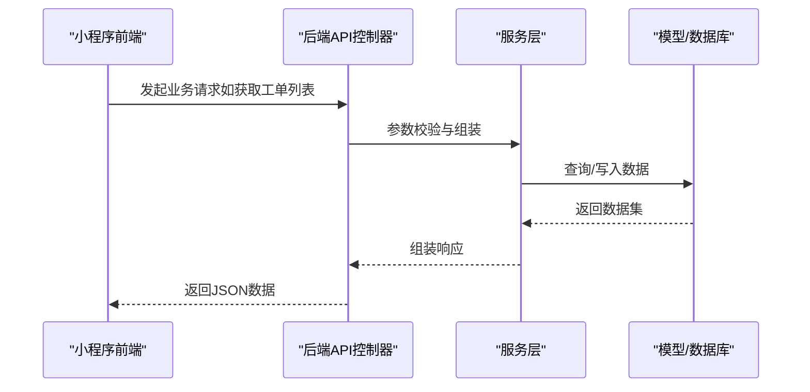

图表来源
- [workOrder.js:190-247](file://gccd_mini/pages/workOrder/workOrder.js#L190-L247)
- [workOrderProcess.js:44-75](file://gccd_mini/pageWorkOrder/pages/workOrderProcess/workOrderProcess.js#L44-L75)
- [Inventory.php:17-37](file://gccd_server/app/admin/controller/production/Inventory.php#L17-L37)
- [ProductReportService.php:1176-1212](file://gccd_server/app/common/service/admin/ProductReportService.php#L1176-L1212)

## 详细组件分析

### 生产管理模块

#### 工单管理
- 功能要点
  - 列表分页与筛选（按规格/型号/客户型号），支持下拉刷新与上拉加载。
  - 完成标记：基于报工数量与任务数量判断，弹窗确认后调用编辑接口。
  - 报工跳转：根据工单的工艺编码跳转到工序页面，逐工序报工与能耗录入。
  - 扫码报修：支持二维码/条形码扫码，填写原因与图片上传后提交报修。
- 关键流程

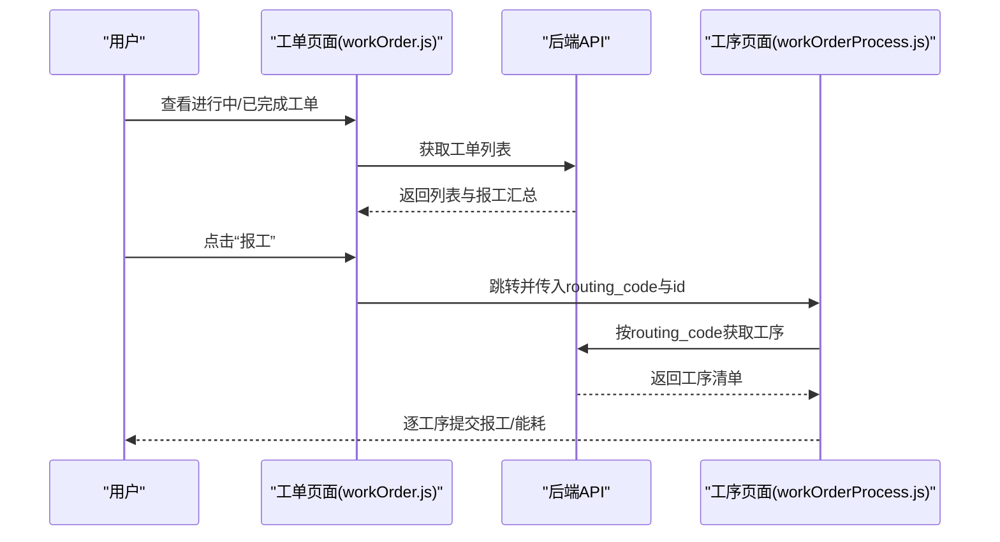

图表来源
- [workOrder.js:189-305](file://gccd_mini/pages/workOrder/workOrder.js#L189-L305)
- [workOrderProcess.js:44-81](file://gccd_mini/pageWorkOrder/pages/workOrderProcess/workOrderProcess.js#L44-L81)

章节来源
- [workOrder.js:1-796](file://gccd_mini/pages/workOrder/workOrder.js#L1-L796)
- [workOrderInfo.js:1-235](file://gccd_mini/pageWorkOrder/pages/workOrderInfo/workOrderInfo.js#L1-L235)
- [workOrderProcess.js:1-116](file://gccd_mini/pageWorkOrder/pages/workOrderProcess/workOrderProcess.js#L1-L116)

#### 工序管理
- 功能要点
  - 根据工艺编码获取工序清单，支持重试加载。
  - 逐工序提交报工与能耗录入，支持返回刷新。
- 关键流程

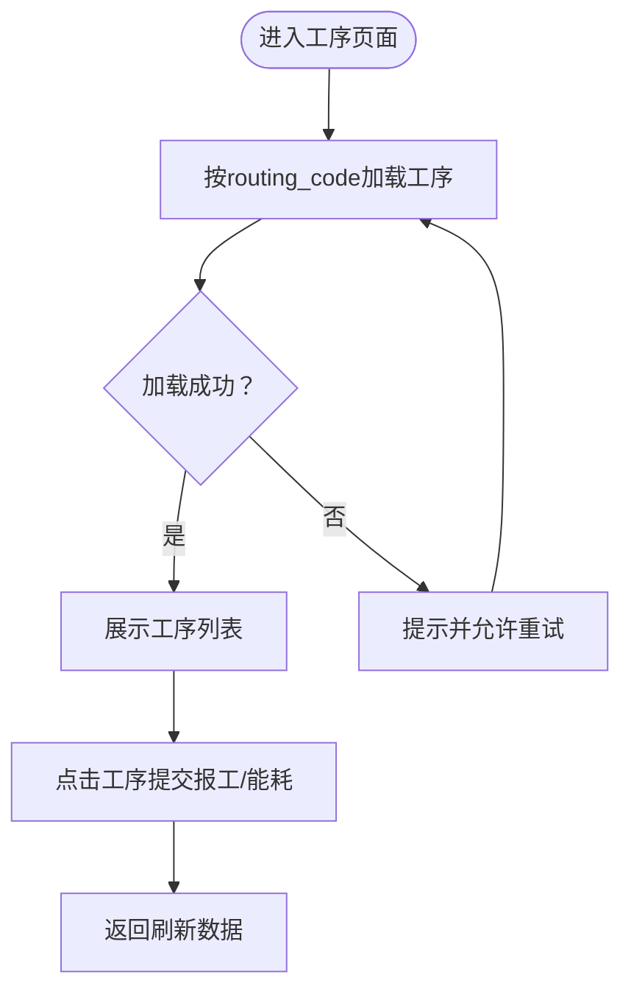

图表来源
- [workOrderProcess.js:44-81](file://gccd_mini/pageWorkOrder/pages/workOrderProcess/workOrderProcess.js#L44-L81)

章节来源
- [workOrderProcess.js:1-116](file://gccd_mini/pageWorkOrder/pages/workOrderProcess/workOrderProcess.js#L1-L116)

#### 生产报表
- 功能要点
  - 能耗列表：分页查询，支持加载更多。
  - 能耗统计：按日期范围统计总能耗，异常时抛出建议使用手动报工。
- 关键流程

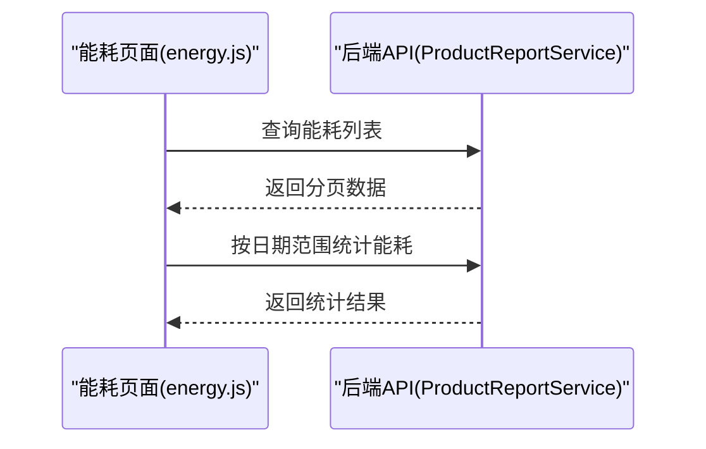

图表来源
- [energy.js:46-82](file://gccd_mini/pages/energy/energy.js#L46-L82)
- [ProductReportService.php:1176-1212](file://gccd_server/app/common/service/admin/ProductReportService.php#L1176-L1212)

章节来源
- [energy.js:1-480](file://gccd_mini/pages/energy/energy.js#L1-L480)
- [ProductReportService.php:1176-1212](file://gccd_server/app/common/service/admin/ProductReportService.php#L1176-L1212)

### 设备管理模块

#### 设备台账与维修管理
- 功能要点
  - 设备二维码扫码触发报修，填写原因与图片上传。
  - 维修记录详情：支持图片预览，计算维修时长（仅完成态且具备时间）。
  - 维修记录列表：按设备编码分页查询，支持图片预览。
- 关键流程

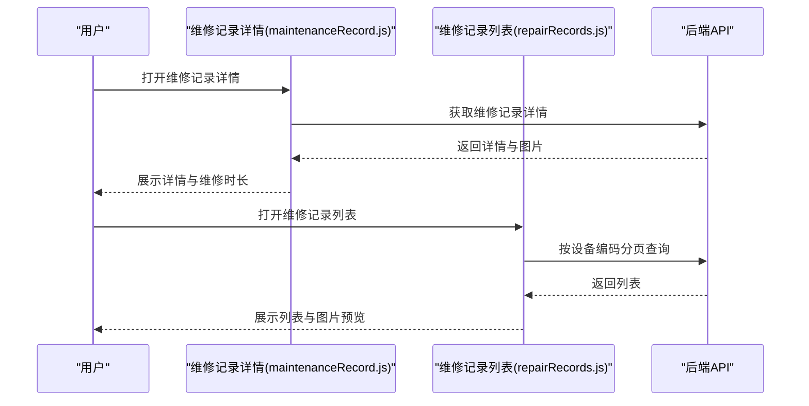

图表来源
- [maintenanceRecord.js:34-102](file://gccd_mini/pageEquipment/pages/maintenanceRecord/maintenanceRecord.js#L34-L102)
- [repairRecords.js:40-86](file://gccd_mini/pageEquipment/pages/repairRecords/repairRecords.js#L40-L86)

章节来源
- [maintenanceRecord.js:1-154](file://gccd_mini/pageEquipment/pages/maintenanceRecord/maintenanceRecord.js#L1-L154)
- [repairRecords.js:1-119](file://gccd_mini/pageEquipment/pages/repairRecords/repairRecords.js#L1-L119)

### 物料管理模块

#### 采购/入库/出库/领料
- 功能要点
  - 物料列表：支持多字段筛选与防抖搜索，分页加载。
  - 领料记录：按关键字搜索，展示状态文本与类名。
  - 入库管理：按入库单号/关联单号/物料名称/仓库/批次/日期范围查询。
  - 库存盘点：按物料名称/工序名称/日期范围查询。
- 关键流程

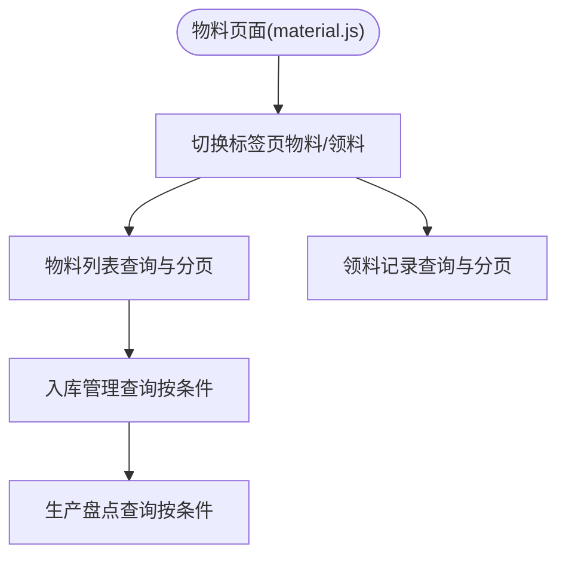

图表来源
- [material.js:198-251](file://gccd_mini/pages/material/material.js#L198-L251)
- [material.js:96-159](file://gccd_mini/pages/material/material.js#L96-L159)
- [InboundList.vue:247-305](file://yarn/src/views/mes/WarehouseManagement/WarehousingManagement/InboundList/InboundList.vue#L247-L305)
- [ProductStocktake.vue:1-37](file://yarn/src/views/mes/ProductStocktake/ProductStocktake.vue#L1-L37)

章节来源
- [material.js:1-800](file://gccd_mini/pages/material/material.js#L1-L800)
- [InboundList.vue:247-305](file://yarn/src/views/mes/WarehouseManagement/WarehousingManagement/InboundList/InboundList.vue#L247-L305)
- [ProductStocktake.vue:1-37](file://yarn/src/views/mes/ProductStocktake/ProductStocktake.vue#L1-L37)

### 能源管理模块

#### 电耗统计与能耗分析
- 功能要点
  - 能耗列表：分页查询，支持加载更多。
  - 能耗统计：按日期范围统计总能耗，异常时提示使用手动报工。
  - 后台大屏：轮询刷新生产计划与调度数据。
- 关键流程

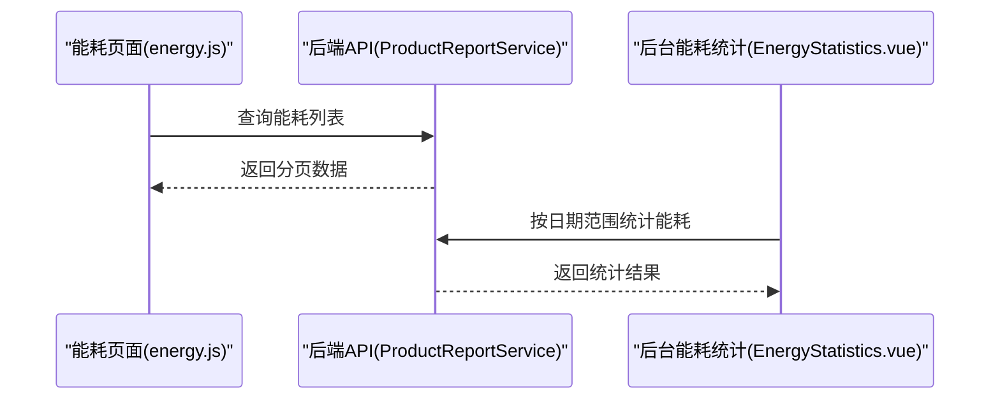

图表来源
- [energy.js:46-82](file://gccd_mini/pages/energy/energy.js#L46-L82)
- [ProductReportService.php:1204-1212](file://gccd_server/app/common/service/admin/ProductReportService.php#L1204-L1212)
- [EnergyStatistics.vue:145-146](file://yarn/src/views/mes/EnergyConsumption/EnergyStatistics.vue#L145-L146)

章节来源
- [energy.js:1-480](file://gccd_mini/pages/energy/energy.js#L1-L480)
- [ProductReportService.php:1176-1212](file://gccd_server/app/common/service/admin/ProductReportService.php#L1176-L1212)
- [EnergyStatistics.vue:87-146](file://yarn/src/views/mes/EnergyConsumption/EnergyStatistics.vue#L87-L146)
- [LargeScreen.vue:133-173](file://yarn/src/views/mes/LargeScreen/LargeScreen.vue#L133-L173)

### 质量管理模块

#### 质检项目与记录
- 功能要点
  - 质检记录：按工序名称与日期范围查询，支持详情抽屉查看。
  - 质检API：提供列表、详情、新增、修改、删除接口。
- 关键流程

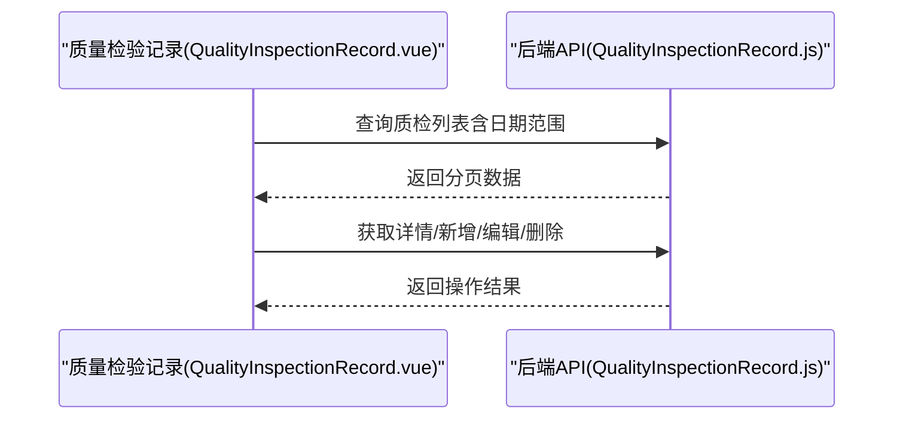

图表来源
- [QualityInspectionRecord.vue:166-232](file://yarn/src/views/mes/QualityInspectionRecord/QualityInspectionRecord.vue#L166-L232)
- [QualityInspectionRecord.js:1-63](file://yarn/src/api/mes/QualityInspectionRecord/QualityInspectionRecord.js#L1-L63)

章节来源
- [QualityInspectionRecord.vue:166-232](file://yarn/src/views/mes/QualityInspectionRecord/QualityInspectionRecord.vue#L166-L232)
- [QualityInspectionRecord.js:1-63](file://yarn/src/api/mes/QualityInspectionRecord/QualityInspectionRecord.js#L1-L63)

### 人员管理模块

#### 工资管理与考勤记录
- 功能要点
  - 工资列表：按条件查询员工工资记录。
  - 日工资查询：按日期范围查询员工日工资。
  - 考勤记录：移动端展示工资记录卡片样式。
- 关键流程

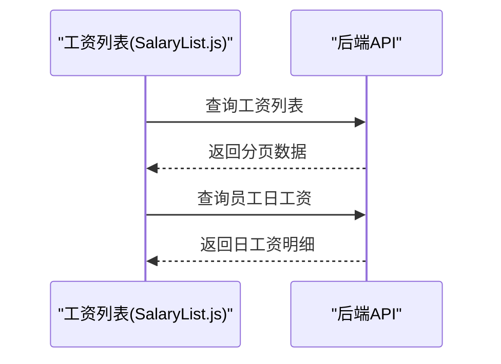

图表来源
- [SalaryList.js:1-27](file://yarn/src/api/mes/SalaryList/SalaryList.js#L1-L27)

章节来源
- [SalaryList.js:1-27](file://yarn/src/api/mes/SalaryList/SalaryList.js#L1-L27)
- [wageRecord.wxss:1-89](file://gccd_mini/pageMine/pages/wageRecord/wageRecord.wxss#L1-L89)

## 依赖分析
- 前端依赖
  - 小程序端：util工具、媒体压缩、Vant Weapp组件库。
  - 后台前端：Element UI、Vue Router、Vuex、Axios。
- 后端依赖
  - ThinkPHP框架、数据库ORM、缓存与队列中间件。
- 数据库依赖
  - 生产物料库存表、生产盘点记录表、能耗统计表等。

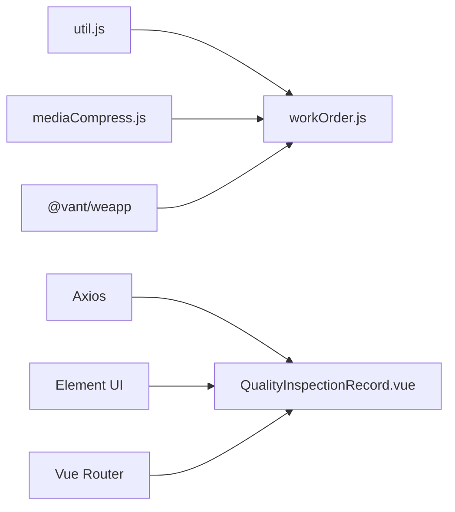

图表来源
- [workOrder.js:1-796](file://gccd_mini/pages/workOrder/workOrder.js#L1-L796)
- [QualityInspectionRecord.vue:166-232](file://yarn/src/views/mes/QualityInspectionRecord/QualityInspectionRecord.vue#L166-L232)

章节来源
- [workOrder.js:1-796](file://gccd_mini/pages/workOrder/workOrder.js#L1-L796)
- [QualityInspectionRecord.vue:166-232](file://yarn/src/views/mes/QualityInspectionRecord/QualityInspectionRecord.vue#L166-L232)

## 性能考虑
- 前端
  - 列表分页与懒加载，减少一次性渲染压力；防抖搜索降低请求频率。
  - 图片上传前本地压缩，提升上传效率与用户体验。
- 后端
  - 分页查询与条件过滤，避免全表扫描；统计接口按日期范围限制。
  - 后台大屏轮询刷新，注意节流与并发控制。

## 故障排查指南
- 工单报工失败
  - 检查工单是否配置工艺编码；确认网络状态与接口返回码。
  - 参考路径：[workOrder.js:316-328](file://gccd_mini/pages/workOrder/workOrder.js#L316-L328)
- 维修记录无法加载
  - 确认设备编码与记录ID；检查图片路径替换逻辑。
  - 参考路径：[repairRecords.js:40-86](file://gccd_mini/pageEquipment/pages/repairRecords/repairRecords.js#L40-L86)，[maintenanceRecord.js:34-83](file://gccd_mini/pageEquipment/pages/maintenanceRecord/maintenanceRecord.js#L34-L83)
- 能耗统计异常
  - 检查日期范围参数与异常捕获逻辑，必要时使用手动报工接口。
  - 参考路径：[ProductReportService.php:1176-1194](file://gccd_server/app/common/service/admin/ProductReportService.php#L1176-L1194)
- 质检记录查询无结果
  - 核对工序名称与日期范围；确认后端接口权限与参数。
  - 参考路径：[QualityInspectionRecord.js:9-15](file://yarn/src/api/mes/QualityInspectionRecord/QualityInspectionRecord.js#L9-L15)

章节来源
- [workOrder.js:316-328](file://gccd_mini/pages/workOrder/workOrder.js#L316-L328)
- [repairRecords.js:40-86](file://gccd_mini/pageEquipment/pages/repairRecords/repairRecords.js#L40-L86)
- [maintenanceRecord.js:34-83](file://gccd_mini/pageEquipment/pages/maintenanceRecord/maintenanceRecord.js#L34-L83)
- [ProductReportService.php:1176-1194](file://gccd_server/app/common/service/admin/ProductReportService.php#L1176-L1194)
- [QualityInspectionRecord.js:9-15](file://yarn/src/api/mes/QualityInspectionRecord/QualityInspectionRecord.js#L9-L15)

## 结论
本项目围绕生产制造核心业务，构建了覆盖工单、工序、报表、设备、物料、能源、质量与人员管理的完整体系。前端以小程序与Vue为主，后端以ThinkPHP提供稳定API支撑，配合数据库与菜单脚本完善业务边界。通过本文档的流程图与操作指南，可快速落地各模块的日常运维与开发迭代。

## 附录

### 数据模型与表结构（参考）
- 生产物料库存表（ya_material_inventory）
  - 字段：盘点单号、盘点日期、工序名称、物料ID/名称、型号、白夜班吨数、总吨数、备注、创建/更新人与时间。
  - 参考路径：[database_fix.sql:37-57](file://gccd_server/database_fix.sql#L37-L57)
- 菜单修复脚本（菜单排序与新增“盘点检验”目录）
  - 参考路径：[menu_fix.sql:1-31](file://gccd_server/menu_fix.sql#L1-L31)

章节来源
- [database_fix.sql:37-57](file://gccd_server/database_fix.sql#L37-L57)
- [menu_fix.sql:1-31](file://gccd_server/menu_fix.sql#L1-L31)