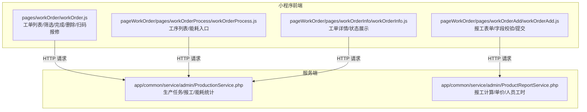
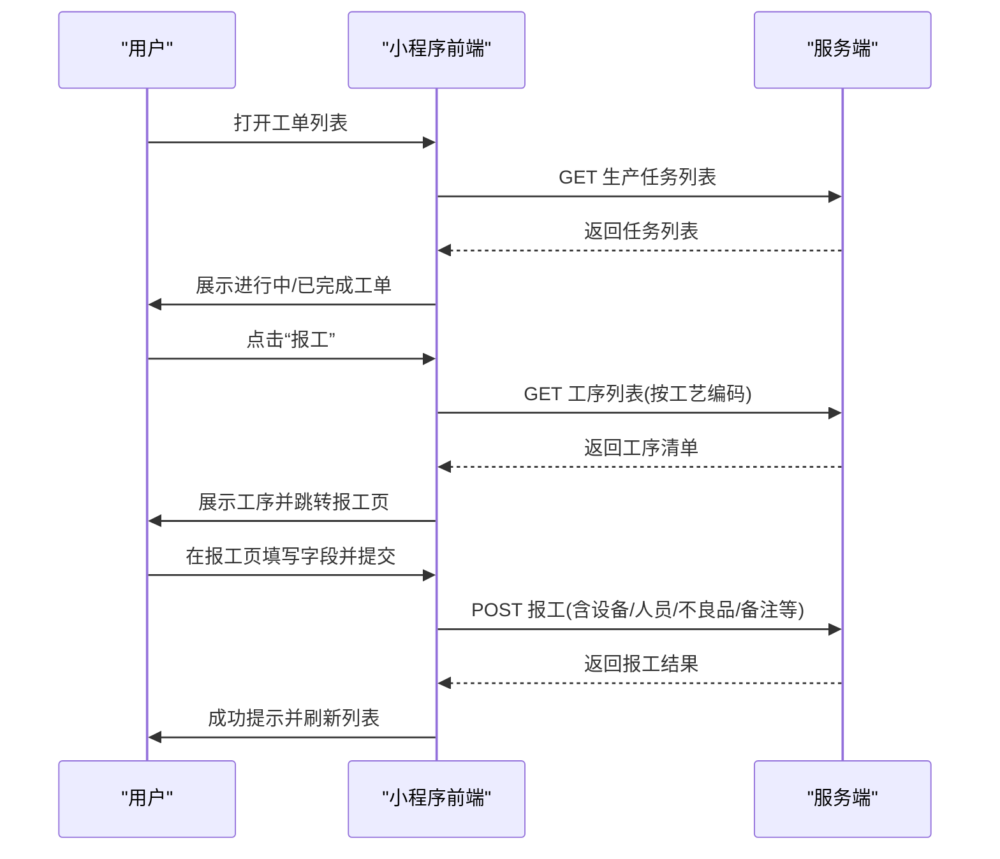
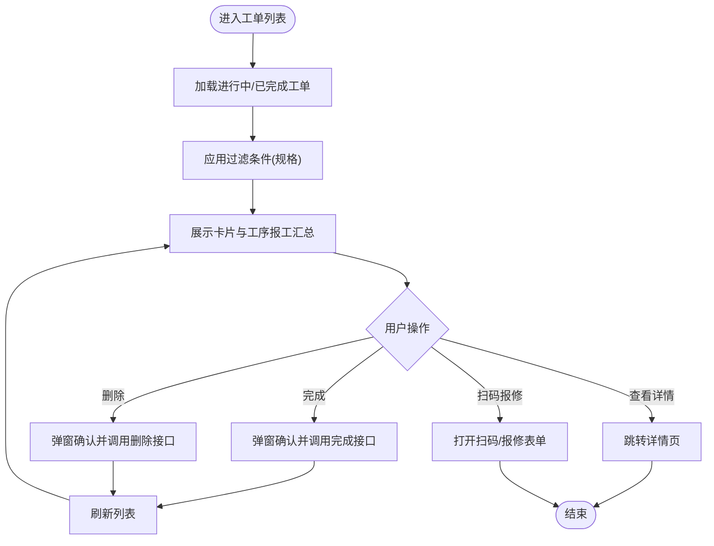
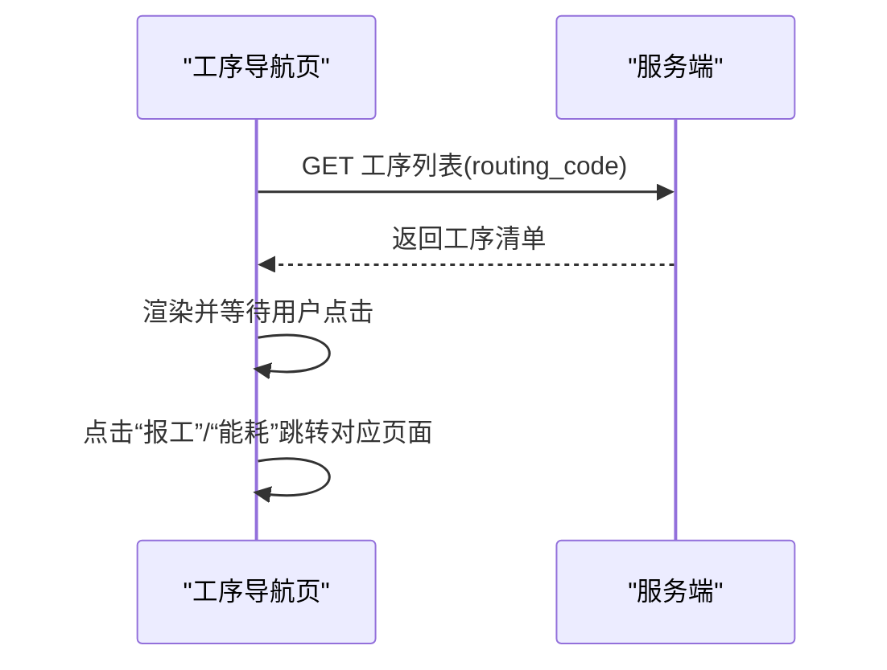
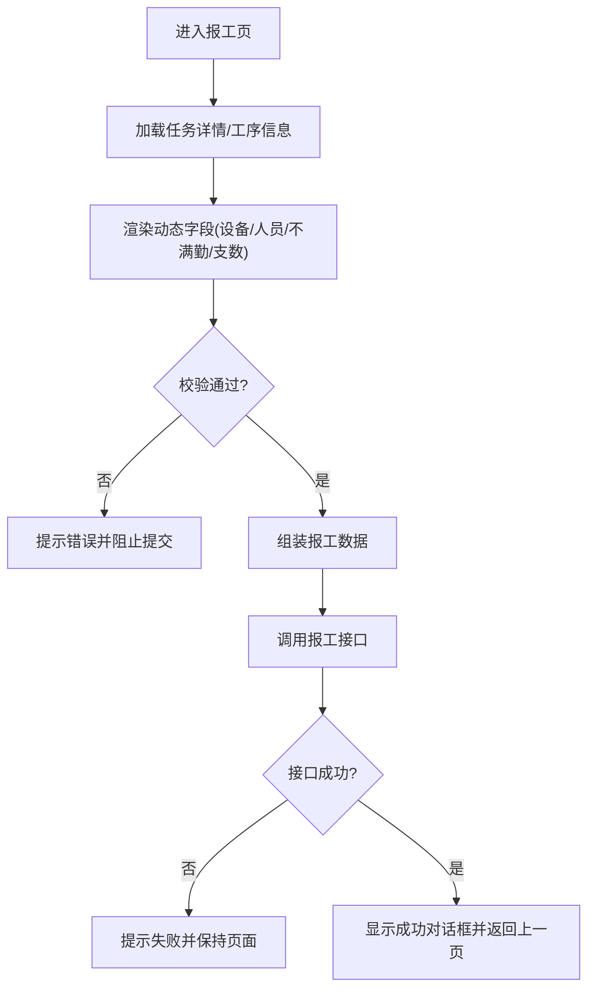
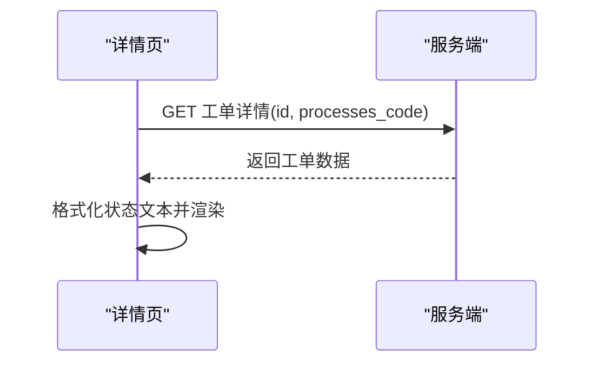
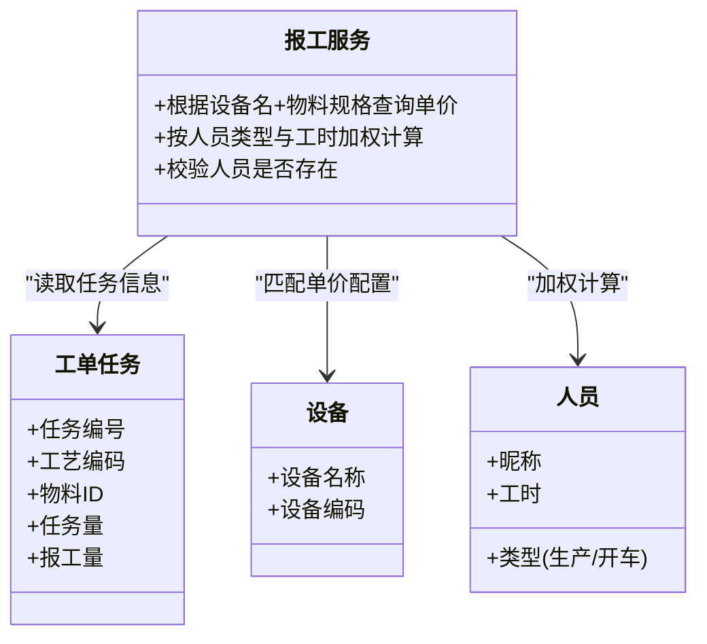
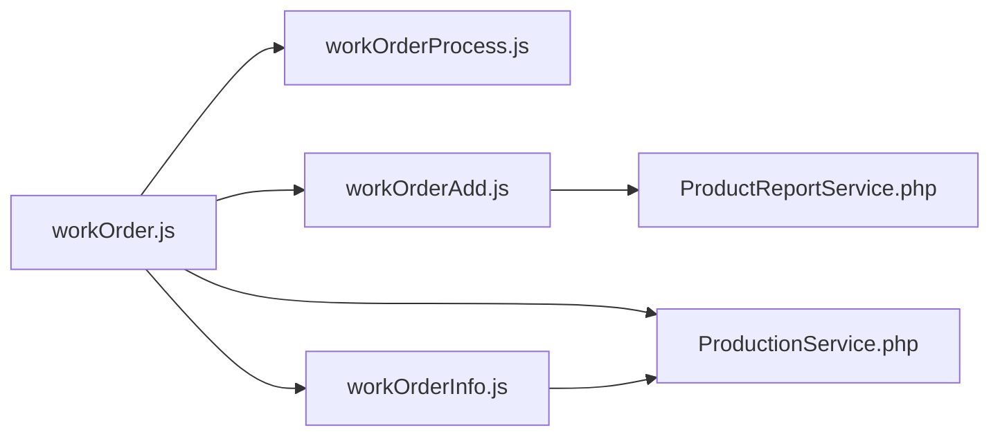

# 工单管理

<cite>
**本文引用的文件**
- [workOrder.js](file://gccd_mini/pages/workOrder/workOrder.js)
- [workOrder.json](file://gccd_mini/pages/workOrder/workOrder.json)
- [workOrderAdd.js](file://gccd_mini/pageWorkOrder/pages/workOrderAdd/workOrderAdd.js)
- [workOrderInfo.js](file://gccd_mini/pageWorkOrder/pages/workOrderInfo/workOrderInfo.js)
- [workOrderProcess.js](file://gccd_mini/pageWorkOrder/pages/workOrderProcess/workOrderProcess.js)
- [ProductReportService.php](file://gccd_server/app/common/service/admin/ProductReportService.php)
- [ProductionService.php](file://gccd_server/app/common/service/admin/ProductionService.php)
</cite>

## 目录
1. [简介](#简介)
2. [项目结构](#项目结构)
3. [核心组件](#核心组件)
4. [架构总览](#架构总览)
5. [详细组件分析](#详细组件分析)
6. [依赖关系分析](#依赖关系分析)
7. [性能考量](#性能考量)
8. [故障排查指南](#故障排查指南)
9. [结论](#结论)
10. [附录](#附录)

## 简介
本文件面向“工单管理系统”的功能与实现，围绕工单的全生命周期（创建、编辑、审批、执行、监控、关闭）进行系统化梳理；同时覆盖工单类型与优先级、资源分配规则、时间计划、状态流转、与物料/设备/人员的匹配算法、执行期数据采集与异常报警、导入导出与批量操作、报表统计、权限控制与数据校验、API 接口与前端组件使用示例等内容。文档以仓库现有代码为依据，结合可视化图示帮助读者快速理解与落地。

## 项目结构
工单管理由小程序前端与服务端共同实现：
- 小程序前端负责工单列表、详情、报工、工序导航、扫码报修、图片上传等交互；
- 服务端提供工单任务、报工、能耗、工资单价、物料等后端能力。

**图表来源**
- [workOrder.js:190-247](file://gccd_mini/pages/workOrder/workOrder.js#L190-L247)
- [workOrderProcess.js:44-75](file://gccd_mini/pageWorkOrder/pages/workOrderProcess/workOrderProcess.js#L44-L75)
- [workOrderAdd.js:752-858](file://gccd_mini/pageWorkOrder/pages/workOrderAdd/workOrderAdd.js#L752-L858)
- [workOrderInfo.js:56-124](file://gccd_mini/pageWorkOrder/pages/workOrderInfo/workOrderInfo.js#L56-L124)
- [ProductionService.php:451-489](file://gccd_server/app/common/service/admin/ProductionService.php#L451-L489)
- [ProductReportService.php:833-891](file://gccd_server/app/common/service/admin/ProductReportService.php#L833-L891)

**章节来源**
- [workOrder.js:1-120](file://gccd_mini/pages/workOrder/workOrder.js#L1-L120)
- [workOrder.json:1-17](file://gccd_mini/pages/workOrder/workOrder.json#L1-L17)

## 核心组件
- 工单列表页：分页加载、下拉刷新、上拉加载更多、按规格过滤、完成/删除操作、扫码报修、导航至报工。
- 工序导航页：按工艺编码获取工序列表，支持能耗入口。
- 报工页：按工序动态渲染字段，校验输入，提交报工并联动人员/设备/不满勤等数据。
- 工单详情页：展示任务编号、关联编号、工艺信息、物料、任务量、报工量、状态、创建时间等。
- 服务端服务：提供生产任务查询、报工记录、能耗统计、工资单价计算等能力。

**章节来源**
- [workOrder.js:189-305](file://gccd_mini/pages/workOrder/workOrder.js#L189-L305)
- [workOrderProcess.js:43-80](file://gccd_mini/pageWorkOrder/pages/workOrderProcess/workOrderProcess.js#L43-L80)
- [workOrderAdd.js:546-587](file://gccd_mini/pageWorkOrder/pages/workOrderAdd/workOrderAdd.js#L546-L587)
- [workOrderInfo.js:56-124](file://gccd_mini/pageWorkOrder/pages/workOrderInfo/workOrderInfo.js#L56-L124)

## 架构总览
工单管理采用前后端分离模式：
- 前端通过统一工具发起 HTTP 请求，调用服务端接口；
- 服务端提供生产任务、报工、能耗、工资单价等服务；
- 数据流贯穿“查询—报工—统计—展示”。

**图表来源**
- [workOrder.js:315-328](file://gccd_mini/pages/workOrder/workOrder.js#L315-L328)
- [workOrderProcess.js:22-41](file://gccd_mini/pageWorkOrder/pages/workOrderProcess/workOrderProcess.js#L22-L41)
- [workOrderAdd.js:752-858](file://gccd_mini/pageWorkOrder/pages/workOrderAdd/workOrderAdd.js#L752-L858)

## 详细组件分析

### 工单列表与状态流转
- 列表加载：分页加载进行中与已完成两类，支持下拉刷新与上拉加载更多。
- 状态判断：基于报工量与任务量比较判断是否完成。
- 操作：完成（标记状态为完成）、删除、导航至详情、扫码报修。
- 工序报工汇总：固定5道工序，按名称匹配报工数据，前端组装展示。

**图表来源**
- [workOrder.js:189-305](file://gccd_mini/pages/workOrder/workOrder.js#L189-L305)

**章节来源**
- [workOrder.js:111-140](file://gccd_mini/pages/workOrder/workOrder.js#L111-L140)
- [workOrder.js:189-305](file://gccd_mini/pages/workOrder/workOrder.js#L189-L305)

### 工序导航与能耗入口
- 根据工艺编码获取工序清单，逐项展示并支持“报工”“能耗”入口。
- 返回时刷新数据，避免重复请求。

**图表来源**
- [workOrderProcess.js:43-80](file://gccd_mini/pageWorkOrder/pages/workOrderProcess/workOrderProcess.js#L43-L80)

**章节来源**
- [workOrderProcess.js:22-41](file://gccd_mini/pageWorkOrder/pages/workOrderProcess/workOrderProcess.js#L22-L41)

### 报工表单与数据采集
- 动态字段：根据工序显示设备、人员、不满勤、支数等字段。
- 输入校验：数字格式、必填项、工序特有校验。
- 提交流程：组装报工数据，附加不良品、人员、设备、不满勤等明细，调用报工接口。
- 计算逻辑：支持按支数计算吨数（接口调用）。

**图表来源**
- [workOrderAdd.js:546-587](file://gccd_mini/pageWorkOrder/pages/workOrderAdd/workOrderAdd.js#L546-L587)
- [workOrderAdd.js:652-731](file://gccd_mini/pageWorkOrder/pages/workOrderAdd/workOrderAdd.js#L652-L731)
- [workOrderAdd.js:752-858](file://gccd_mini/pageWorkOrder/pages/workOrderAdd/workOrderAdd.js#L752-L858)

**章节来源**
- [workOrderAdd.js:88-170](file://gccd_mini/pageWorkOrder/pages/workOrderAdd/workOrderAdd.js#L88-L170)
- [workOrderAdd.js:652-731](file://gccd_mini/pageWorkOrder/pages/workOrderAdd/workOrderAdd.js#L652-L731)
- [workOrderAdd.js:752-858](file://gccd_mini/pageWorkOrder/pages/workOrderAdd/workOrderAdd.js#L752-L858)

### 工单详情与状态展示
- 展示任务编号、关联编号、工艺编码/名称、物料信息、任务量、报工量、状态文本、创建时间等。
- 状态文本根据状态码映射展示。

**图表来源**
- [workOrderInfo.js:56-124](file://gccd_mini/pageWorkOrder/pages/workOrderInfo/workOrderInfo.js#L56-L124)

**章节来源**
- [workOrderInfo.js:71-85](file://gccd_mini/pageWorkOrder/pages/workOrderInfo/workOrderInfo.js#L71-L85)

### 与物料需求、设备资源、人员技能的关联匹配
- 物料：通过任务详情接口获取物料信息，用于展示与后续统计。
- 设备：按工序名称筛选设备列表，断钢/穿孔等工序需选择设备。
- 人员：按工序筛选人员列表，穿孔需选择生产人员与开车人员，酸洗/球化需选择生产人员，部分工序支持不满勤时长。
- 匹配算法（服务端）：报工时根据设备名称与物料规格组合查询单价配置，再按人员类型与工时加权计算。

**图表来源**
- [ProductReportService.php:833-891](file://gccd_server/app/common/service/admin/ProductReportService.php#L833-L891)
- [ProductionService.php:451-489](file://gccd_server/app/common/service/admin/ProductionService.php#L451-L489)

**章节来源**
- [workOrderAdd.js:306-338](file://gccd_mini/pageWorkOrder/pages/workOrderAdd/workOrderAdd.js#L306-L338)
- [workOrderAdd.js:361-507](file://gccd_mini/pageWorkOrder/pages/workOrderAdd/workOrderAdd.js#L361-L507)
- [ProductReportService.php:833-891](file://gccd_server/app/common/service/admin/ProductReportService.php#L833-L891)

### 执行期数据采集、进度跟踪与异常报警
- 数据采集：报工页收集报工量、设备、人员、不满勤、不良品、备注等。
- 进度跟踪：列表页展示工序报工汇总表，按固定5道工序名称对齐报工数据。
- 异常报警：接口失败、网络不佳、输入非法等场景均有明确提示与降级处理。

**章节来源**
- [workOrder.js:127-187](file://gccd_mini/pages/workOrder/workOrder.js#L127-L187)
- [workOrder.js:584-621](file://gccd_mini/pages/workOrder/workOrder.js#L584-L621)

### 导入导出、批量操作与报表统计
- 导入导出：仓库未提供专门的导入导出页面或接口，建议在服务端扩展导入模板与导出报表功能。
- 批量操作：列表页支持删除（单条），未见批量删除/完成等批量操作入口。
- 报表统计：服务端提供能耗统计等能力，前端未见独立报表页，可在 MES 管理端扩展。

**章节来源**
- [ProductionService.php:486-489](file://gccd_server/app/common/service/admin/ProductionService.php#L486-L489)

### 权限控制策略与数据验证规则
- 权限控制：前端未见显式的鉴权拦截逻辑；服务端通过中间件与 Token 校验保障接口安全（参考服务端目录结构）。
- 数据验证：前端对输入格式（数字、支数）与必填项进行即时校验；服务端对关键参数（如单价配置、人员存在性）进行严格校验与异常抛出。

**章节来源**
- [workOrderAdd.js:172-211](file://gccd_mini/pageWorkOrder/pages/workOrderAdd/workOrderAdd.js#L172-L211)
- [ProductReportService.php:833-891](file://gccd_server/app/common/service/admin/ProductReportService.php#L833-L891)

## 依赖关系分析
- 前端模块间依赖：列表页依赖报工页与详情页；报工页依赖人员/设备/物料接口；详情页依赖任务详情接口。
- 服务端模块间依赖：报工业务依赖用户模型与单价配置模型；生产服务提供任务与能耗统计。

**图表来源**
- [workOrder.js:1-120](file://gccd_mini/pages/workOrder/workOrder.js#L1-L120)
- [workOrderProcess.js:1-40](file://gccd_mini/pageWorkOrder/pages/workOrderProcess/workOrderProcess.js#L1-L40)
- [workOrderAdd.js:1-80](file://gccd_mini/pageWorkOrder/pages/workOrderAdd/workOrderAdd.js#L1-L80)
- [workOrderInfo.js:1-40](file://gccd_mini/pageWorkOrder/pages/workOrderInfo/workOrderInfo.js#L1-L40)
- [ProductReportService.php:833-891](file://gccd_server/app/common/service/admin/ProductReportService.php#L833-L891)
- [ProductionService.php:451-489](file://gccd_server/app/common/service/admin/ProductionService.php#L451-L489)

**章节来源**
- [workOrder.js:1-120](file://gccd_mini/pages/workOrder/workOrder.js#L1-L120)
- [workOrderProcess.js:1-40](file://gccd_mini/pageWorkOrder/pages/workOrderProcess/workOrderProcess.js#L1-L40)
- [workOrderAdd.js:1-80](file://gccd_mini/pageWorkOrder/pages/workOrderAdd/workOrderAdd.js#L1-L80)
- [workOrderInfo.js:1-40](file://gccd_mini/pageWorkOrder/pages/workOrderInfo/workOrderInfo.js#L1-L40)

## 性能考量
- 列表分页与懒加载：减少一次性渲染压力，提升首屏与滚动体验。
- 缓存工序名称映射：按工艺编码缓存工序名称，避免重复请求。
- 图片上传压缩：上传前压缩与分片处理，降低带宽与耗时。
- 防重复提交：提交锁与加载态，避免重复请求导致的数据异常。

**章节来源**
- [workOrder.js:143-187](file://gccd_mini/pages/workOrder/workOrder.js#L143-L187)
- [workOrder.js:503-565](file://gccd_mini/pages/workOrder/workOrder.js#L503-L565)
- [workOrderAdd.js:752-858](file://gccd_mini/pageWorkOrder/pages/workOrderAdd/workOrderAdd.js#L752-L858)

## 故障排查指南
- 接口失败：检查网络状态与 Token；查看失败提示并重试。
- 报工失败：确认必填字段与格式；核对设备/人员是否存在；查看服务端异常信息。
- 列表空白：确认过滤条件与分页参数；尝试下拉刷新。
- 扫码报修失败：确认相机权限与二维码有效性；更换图片识别方式。

**章节来源**
- [workOrder.js:238-246](file://gccd_mini/pages/workOrder/workOrder.js#L238-L246)
- [workOrder.js:584-621](file://gccd_mini/pages/workOrder/workOrder.js#L584-L621)
- [workOrderAdd.js:652-731](file://gccd_mini/pageWorkOrder/pages/workOrderAdd/workOrderAdd.js#L652-L731)

## 结论
本工单管理方案在前端实现了完整的工单生命周期交互，在服务端提供了报工与能耗统计等核心能力。建议后续完善导入导出、批量操作与报表统计功能，并在前端增加权限拦截与更丰富的异常处理，以进一步提升可用性与稳定性。

## 附录

### API 接口文档（路径与用途）
- 获取生产任务列表
  - 方法与路径：GET admin/production.ProductTask/list
  - 参数：limit、page
  - 用途：工单列表加载
  - 章节来源
    - [workOrder.js:197-200](file://gccd_mini/pages/workOrder/workOrder.js#L197-L200)

- 编辑工单状态
  - 方法与路径：POST admin/production.ProductTask/edit
  - 参数：id、status
  - 用途：标记工单完成
  - 章节来源
    - [workOrder.js:351-352](file://gccd_mini/pages/workOrder/workOrder.js#L351-L352)

- 删除工单
  - 方法与路径：POST admin/production.ProductTask/dele
  - 参数：ids
  - 用途：删除任务
  - 章节来源
    - [workOrder.js:380-386](file://gccd_mini/pages/workOrder/workOrder.js#L380-L386)

- 获取工序列表
  - 方法与路径：POST admin/production.Routing/getProcess
  - 参数：routing_code
  - 用途：工序导航
  - 章节来源
    - [workOrderProcess.js:50-50](file://gccd_mini/pageWorkOrder/pages/workOrderProcess/workOrderProcess.js#L50-L50)

- 提交报工
  - 方法与路径：POST admin/production.ProductReport/report
  - 参数：relation_code、routing_code、processes_code、material_id、report_num、remark、defective_num、is_replace、product_user、card_user、device_name、device_code、not_full_attend（可选，数组项为 `name`+`hours`）、yarn_count、class 等；其中 **not_full_attend** 在穿孔、球化、酸洗、**矫直** 有不满勤登记时随报文提交，后端会合并为 `work_hours` 参与工资按实际上班小时折算（矫直：5 元/吨与班长/代班长 200 元/天均按小时÷12 折算，班长与代班长津贴互斥）。
  - 用途：报工提交
  - 章节来源
    - [workOrderAdd.js:752-858](file://gccd_mini/pageWorkOrder/pages/workOrderAdd/workOrderAdd.js#L752-L858)

- 获取任务详情
  - 方法与路径：POST admin/production.ProductTask/info
  - 参数：id、processes_code
  - 用途：详情展示
  - 章节来源
    - [workOrderInfo.js:62-65](file://gccd_mini/pageWorkOrder/pages/workOrderInfo/workOrderInfo.js#L62-L65)

- 获取物料信息
  - 方法与路径：POST admin/production.Material/info
  - 参数：id
  - 用途：详情展示物料名称
  - 章节来源
    - [workOrderInfo.js:127-130](file://gccd_mini/pageWorkOrder/pages/workOrderInfo/workOrderInfo.js#L127-L130)

- 报工计算（按支数）
  - 方法与路径：POST admin/production.ProductReport/count
  - 参数：count、task_code
  - 用途：支数换算吨数
  - 章节来源
    - [workOrderAdd.js:144-148](file://gccd_mini/pageWorkOrder/pages/workOrderAdd/workOrderAdd.js#L144-L148)

- 获取设备列表
  - 方法与路径：POST admin/repair.Device/list
  - 参数：page、limit、device_name（按工序筛选）
  - 用途：断钢/穿孔设备选择
  - 章节来源
    - [workOrderAdd.js:306-338](file://gccd_mini/pageWorkOrder/pages/workOrderAdd/workOrderAdd.js#L306-L338)

- 获取人员列表
  - 方法与路径：POST admin/system.User/productlist
  - 参数：limit、page、processes_name
  - 用途：按工序筛选人员
  - 章节来源
    - [workOrderAdd.js:399-437](file://gccd_mini/pageWorkOrder/pages/workOrderAdd/workOrderAdd.js#L399-L437)

- 获取不良品类型
  - 方法与路径：POST admin/check.Check/list
  - 参数：limit
  - 用途：不良品类型选择
  - 章节来源
    - [workOrderAdd.js:218-242](file://gccd_mini/pageWorkOrder/pages/workOrderAdd/workOrderAdd.js#L218-L242)

- 报修提交
  - 方法与路径：POST admin/repair.Device/report
  - 参数：device_code、reason、img
  - 用途：扫码报修
  - 章节来源
    - [workOrder.js:584-621](file://gccd_mini/pages/workOrder/workOrder.js#L584-L621)

### 前端组件使用示例
- 使用 Vant Weapp 组件
  - 按钮、弹窗、字段、对话框、标签页、加载、空状态、上传器等组件已在页面中注册与使用。
  - 章节来源
    - [workOrder.json:3-16](file://gccd_mini/pages/workOrder/workOrder.json#L3-L16)

- 扫码与图片识别
  - 支持扫码与图片识别二维码，失败时提供提示与回退方案。
  - 章节来源
    - [workOrder.js:404-478](file://gccd_mini/pages/workOrder/workOrder.js#L404-L478)

- 图片上传与压缩
  - 上传前压缩、多图上传、删除图片、错误提示。
  - 章节来源
    - [workOrder.js:503-580](file://gccd_mini/pages/workOrder/workOrder.js#L503-L580)