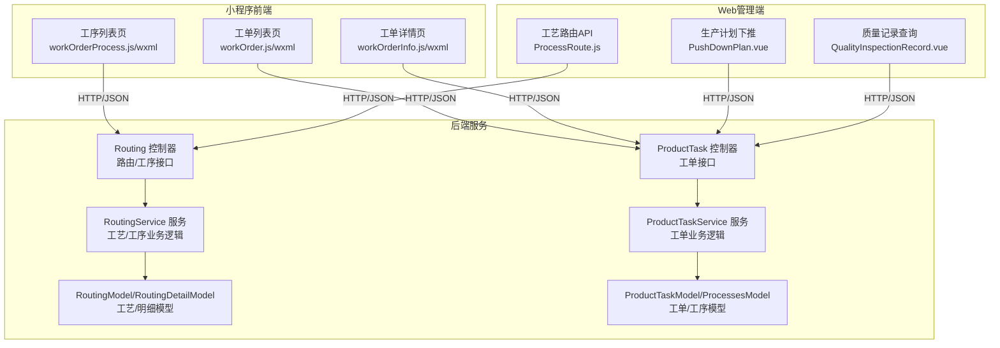
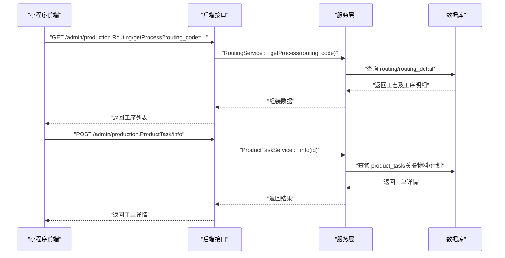
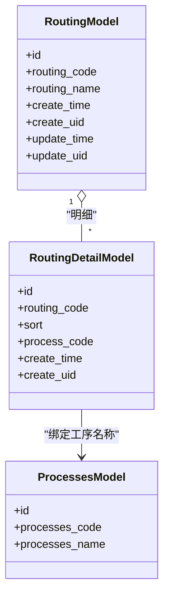
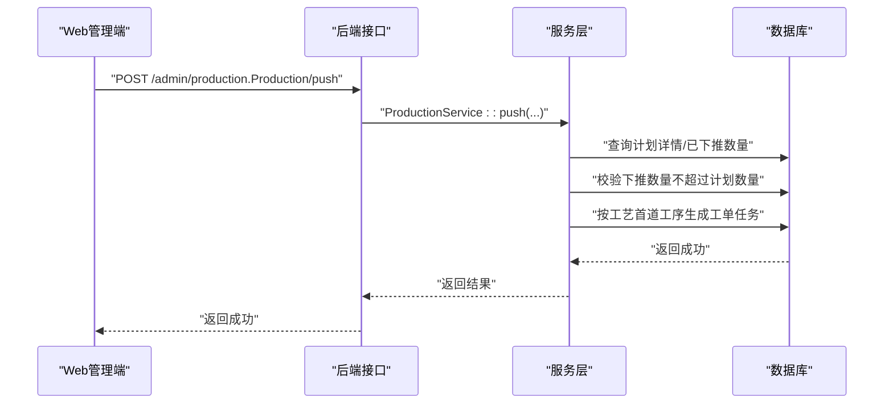
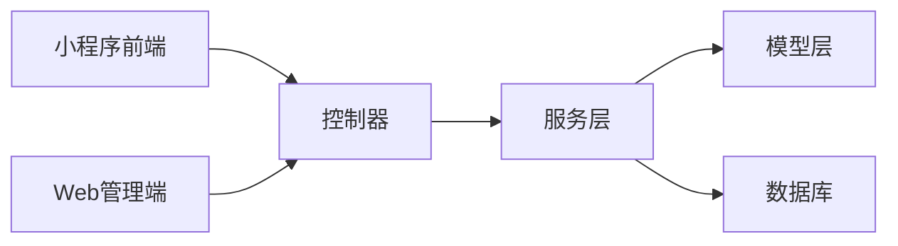

# 工序管理

<cite>
**本文引用的文件**
- [Routing.php](file://gccd_server/app/admin/controller/production/Routing.php)
- [RoutingService.php](file://gccd_server/app/common/service/admin/RoutingService.php)
- [ProductTask.php](file://gccd_server/app/admin/controller/production/ProductTask.php)
- [ProductTaskService.php](file://gccd_server/app/common/service/admin/ProductTaskService.php)
- [ProductTaskModel.php](file://gccd_server/app/common/model/admin/ProductTaskModel.php)
- [RoutingModel.php](file://gccd_server/app/common/model/admin/RoutingModel.php)
- [RoutingDetailModel.php](file://gccd_server/app/common/model/admin/RoutingDetailModel.php)
- [ProcessesModel.php](file://gccd_server/app/common/model/admin/ProcessesModel.php)
- [workOrder.js](file://gccd_mini/pages/workOrder/workOrder.js)
- [workOrder.wxml](file://gccd_mini/pages/workOrder/workOrder.wxml)
- [workOrderProcess.js](file://gccd_mini/pageWorkOrder/pages/workOrderProcess/workOrderProcess.js)
- [workOrderProcess.wxml](file://gccd_mini/pageWorkOrder/pages/workOrderProcess/workOrderProcess.wxml)
- [workOrderInfo.js](file://gccd_mini/pageWorkOrder/pages/workOrderInfo/workOrderInfo.js)
- [workOrderInfo.wxml](file://gccd_mini/pageWorkOrder/pages/workOrderInfo/workOrderInfo.wxml)
- [ProcessRoute.js](file://yarn/src/api/mes/ProcessRoute/ProcessRoute.js)
- [ProductionOrderList.vue](file://yarn/src/views/mes/ProductionOrderList/components/PushDownPlan.vue)
- [QualityInspectionRecord.vue](file://yarn/src/views/mes/QualityInspectionRecord/QualityInspectionRecord.vue)
- [qualityCheckAdd.js](file://gccd_mini/pageWorkOrder/pages/qualityCheckAdd/qualityCheckAdd.js)
</cite>

## 目录
1. [引言](#引言)
2. [项目结构](#项目结构)
3. [核心组件](#核心组件)
4. [架构总览](#架构总览)
5. [详细组件分析](#详细组件分析)
6. [依赖分析](#依赖分析)
7. [性能考虑](#性能考虑)
8. [故障排查指南](#故障排查指南)
9. [结论](#结论)
10. [附录](#附录)

## 引言
本文件面向“工序管理系统”的功能与实现，围绕工艺路线的设计与管理、工序任务的创建/分配/执行/验收、工序间依赖与并行执行、资源冲突处理、质量标准与检验点、效率分析与瓶颈识别、变更管理与历史追溯、最佳实践与常见问题，以及前后端交互与API说明展开。系统由三部分组成：后端服务（PHP/Tp6）、小程序前端（WeUI/Vant Weapp）、Web管理端（Vue Element Plus）。本文以仓库现有代码为依据，结合业务流程进行说明。

## 项目结构
项目采用多端分层组织：
- 后端：基于 ThinkPHP 6 的 admin/api 层控制器与 service/model 层，提供 REST 风格接口与数据访问。
- 小程序：提供工单列表、工序查看、报工入口、质量检验等移动端能力。
- Web 管理端：提供工艺路线维护、生产计划下推、质量记录查询等管理功能。



图表来源
- [Routing.php:25-36](file://gccd_server/app/admin/controller/production/Routing.php#L25-L36)
- [RoutingService.php:57-103](file://gccd_server/app/common/service/admin/RoutingService.php#L57-L103)
- [ProductTask.php:62-104](file://gccd_server/app/admin/controller/production/ProductTask.php#L62-L104)
- [ProductTaskService.php:60-174](file://gccd_server/app/common/service/admin/ProductTaskService.php#L60-L174)
- [workOrder.js:307-334](file://gccd_mini/pages/workOrder/workOrder.js#L307-L334)
- [workOrderProcess.js:44-116](file://gccd_mini/pageWorkOrder/pages/workOrderProcess/workOrderProcess.js#L44-L116)
- [workOrderInfo.js:56-86](file://gccd_mini/pageWorkOrder/pages/workOrderInfo/workOrderInfo.js#L56-L86)
- [ProcessRoute.js:1-75](file://yarn/src/api/mes/ProcessRoute/ProcessRoute.js#L1-L75)
- [ProductionOrderList.vue:34-80](file://yarn/src/views/mes/ProductionOrderList/components/PushDownPlan.vue#L34-L80)
- [QualityInspectionRecord.vue:166-232](file://yarn/src/views/mes/QualityInspectionRecord/QualityInspectionRecord.vue#L166-L232)

章节来源
- [Routing.php:25-36](file://gccd_server/app/admin/controller/production/Routing.php#L25-L36)
- [RoutingService.php:57-103](file://gccd_server/app/common/service/admin/RoutingService.php#L57-L103)
- [ProductTask.php:62-104](file://gccd_server/app/admin/controller/production/ProductTask.php#L62-L104)
- [ProductTaskService.php:60-174](file://gccd_server/app/common/service/admin/ProductTaskService.php#L60-L174)
- [workOrder.js:307-334](file://gccd_mini/pages/workOrder/workOrder.js#L307-L334)
- [workOrderProcess.js:44-116](file://gccd_mini/pageWorkOrder/pages/workOrderProcess/workOrderProcess.js#L44-L116)
- [workOrderInfo.js:56-86](file://gccd_mini/pageWorkOrder/pages/workOrderInfo/workOrderInfo.js#L56-L86)
- [ProcessRoute.js:1-75](file://yarn/src/api/mes/ProcessRoute/ProcessRoute.js#L1-L75)
- [ProductionOrderList.vue:34-80](file://yarn/src/views/mes/ProductionOrderList/components/PushDownPlan.vue#L34-L80)
- [QualityInspectionRecord.vue:166-232](file://yarn/src/views/mes/QualityInspectionRecord/QualityInspectionRecord.vue#L166-L232)

## 核心组件
- 工艺路由模块（后端）：负责工艺路线的增删改查、工序明细维护、按工艺获取工序列表。
- 工单任务模块（后端）：负责工单创建、关联工艺与计划、工单详情与统计。
- 小程序前端：提供工单列表、工序列表、工单详情、报工入口、质量检验提交。
- Web 管理端：提供工艺路由 API、生产计划下推、质量记录查询。

章节来源
- [RoutingService.php:57-103](file://gccd_server/app/common/service/admin/RoutingService.php#L57-L103)
- [ProductTaskService.php:60-174](file://gccd_server/app/common/service/admin/ProductTaskService.php#L60-L174)
- [workOrder.js:307-334](file://gccd_mini/pages/workOrder/workOrder.js#L307-L334)
- [workOrderProcess.js:44-116](file://gccd_mini/pageWorkOrder/pages/workOrderProcess/workOrderProcess.js#L44-L116)
- [workOrderInfo.js:56-86](file://gccd_mini/pageWorkOrder/pages/workOrderInfo/workOrderInfo.js#L56-L86)
- [ProcessRoute.js:1-75](file://yarn/src/api/mes/ProcessRoute/ProcessRoute.js#L1-L75)
- [ProductionOrderList.vue:34-80](file://yarn/src/views/mes/ProductionOrderList/components/PushDownPlan.vue#L34-L80)
- [QualityInspectionRecord.vue:166-232](file://yarn/src/views/mes/QualityInspectionRecord/QualityInspectionRecord.vue#L166-L232)

## 架构总览
系统采用“控制器-服务-模型”三层架构，前后端通过 HTTP/JSON 通信。小程序与 Web 管理端均消费后端提供的统一接口。



图表来源
- [Routing.php:25-36](file://gccd_server/app/admin/controller/production/Routing.php#L25-L36)
- [RoutingService.php:257-274](file://gccd_server/app/common/service/admin/RoutingService.php#L257-L274)
- [ProductTask.php:71-77](file://gccd_server/app/admin/controller/production/ProductTask.php#L71-L77)
- [ProductTaskService.php:140-174](file://gccd_server/app/common/service/admin/ProductTaskService.php#L140-L174)
- [workOrderProcess.js:50-74](file://gccd_mini/pageWorkOrder/pages/workOrderProcess/workOrderProcess.js#L50-L74)
- [workOrderInfo.js:62-86](file://gccd_mini/pageWorkOrder/pages/workOrderInfo/workOrderInfo.js#L62-L86)

## 详细组件分析

### 工艺路线设计与管理
- 功能要点
  - 工艺维护：新增/编辑/删除工艺；为工艺配置工序顺序与内容。
  - 工序明细：按 sort 排序维护工序明细，支持同一工艺内排序唯一性校验。
  - 工序查询：按工艺编码获取完整工序列表，包含工序名称等绑定字段。
- 数据模型
  - 工艺主表与明细表分离，明细通过外键关联工艺编码与工序编码。
- 业务流程
  - 新增工艺时生成唯一工艺编码，写入主表与明细表；编辑时先清空旧明细再重建。
  - 查询时将工艺与明细合并返回，便于前端展示。



图表来源
- [RoutingModel.php:10-25](file://gccd_server/app/common/model/admin/RoutingModel.php#L10-L25)
- [RoutingDetailModel.php:10-25](file://gccd_server/app/common/model/admin/RoutingDetailModel.php#L10-L25)
- [ProcessesModel.php:7-22](file://gccd_server/app/common/model/admin/ProcessesModel.php#L7-L22)

章节来源
- [RoutingService.php:57-103](file://gccd_server/app/common/service/admin/RoutingService.php#L57-L103)
- [RoutingService.php:111-148](file://gccd_server/app/common/service/admin/RoutingService.php#L111-L148)
- [RoutingService.php:191-226](file://gccd_server/app/common/service/admin/RoutingService.php#L191-L226)
- [RoutingService.php:257-274](file://gccd_server/app/common/service/admin/RoutingService.php#L257-L274)
- [Routing.php:25-36](file://gccd_server/app/admin/controller/production/Routing.php#L25-L36)

### 工序任务创建、分配、执行与验收
- 创建与分配
  - 生产计划下推：Web 管理端选择计划与物料，输入下推数量，后端校验计划数量与已下推数量，生成工单任务并绑定工艺编码。
  - 工单创建：后端批量插入工单任务，统一设置任务编码、关联计划与工艺。
- 执行与验收
  - 小程序工单列表页提供“报工”入口，点击后跳转至工序列表页，按工艺顺序逐项报工。
  - 工单详情页展示任务编号、计划编号、工艺名称、计划数量、已报工数量、不良品数量等关键指标。
  - 质量检验：小程序提供质量检验录入页，支持日期选择、记录添加与提交。



图表来源
- [ProductionOrderList.vue:34-80](file://yarn/src/views/mes/ProductionOrderList/components/PushDownPlan.vue#L34-L80)
- [ProductTaskService.php:182-208](file://gccd_server/app/common/service/admin/ProductTaskService.php#L182-L208)

章节来源
- [ProductTaskService.php:182-208](file://gccd_server/app/common/service/admin/ProductTaskService.php#L182-L208)
- [workOrder.js:316-328](file://gccd_mini/pages/workOrder/workOrder.js#L316-L328)
- [workOrderProcess.js:23-41](file://gccd_mini/pageWorkOrder/pages/workOrderProcess/workOrderProcess.js#L23-L41)
- [workOrderInfo.js:56-86](file://gccd_mini/pageWorkOrder/pages/workOrderInfo/workOrderInfo.js#L56-L86)
- [qualityCheckAdd.js:261-284](file://gccd_mini/pageWorkOrder/pages/qualityCheckAdd/qualityCheckAdd.js#L261-L284)

### 工序间的依赖关系、并行执行与资源冲突处理
- 依赖关系
  - 工序顺序通过 sort 字段严格控制，同一工艺内排序唯一，体现线性依赖。
- 并行执行
  - 系统未见显式的并行执行策略或资源池管理逻辑，通常默认按顺序执行。
- 资源冲突
  - 代码未体现设备/人员/工具等资源占用与冲突检测逻辑，建议在后续版本中引入资源占用表与冲突算法。

章节来源
- [RoutingService.php:126-138](file://gccd_server/app/common/service/admin/RoutingService.php#L126-L138)
- [RoutingService.php:204-216](file://gccd_server/app/common/service/admin/RoutingService.php#L204-L216)

### 工序质量标准与检验点配置
- 质量检验
  - Web 端提供质量记录查询页面，支持按工序名称、检查日期范围筛选。
  - 小程序端提供质量检验录入页面，支持日期选择、记录添加与提交。
- 检验点
  - 代码未体现“检验点”与“工序”的强绑定关系，建议在模型中增加检验点配置字段并在工序执行时强制校验。

章节来源
- [QualityInspectionRecord.vue:166-232](file://yarn/src/views/mes/QualityInspectionRecord/QualityInspectionRecord.vue#L166-L232)
- [qualityCheckAdd.js:261-284](file://gccd_mini/pageWorkOrder/pages/qualityCheckAdd/qualityCheckAdd.js#L261-L284)

### 工序效率分析、瓶颈识别与优化建议
- 效率分析
  - 代码未提供工序耗时、产出效率等指标计算逻辑。
- 瓶颈识别
  - 未见工序执行时序与资源占用的可视化或统计报表。
- 建议
  - 引入工序开始/结束时间戳、报工数量、能耗等指标，结合趋势分析识别瓶颈。

章节来源
- [workOrderProcess.js:23-41](file://gccd_mini/pageWorkOrder/pages/workOrderProcess/workOrderProcess.js#L23-L41)

### 工序变更管理与历史追溯
- 变更管理
  - 工艺编辑会清空旧明细并重建，具备版本化基础；建议增加“变更日志”与“回滚机制”。
- 历史追溯
  - 工单详情包含物料、计划、工艺等历史信息，便于追溯。

章节来源
- [RoutingService.php:202-216](file://gccd_server/app/common/service/admin/RoutingService.php#L202-L216)
- [ProductTaskService.php:140-174](file://gccd_server/app/common/service/admin/ProductTaskService.php#L140-L174)

### 工序管理最佳实践与常见问题
- 最佳实践
  - 工艺维护：确保同一工艺内排序唯一，工序名称与描述清晰。
  - 工单下推：严格校验下推数量不超过计划数量，避免超发。
  - 质量检验：在关键工序设置检验点，保证数据可追溯。
- 常见问题
  - 工单未设置工艺：小程序提示“请先在后台配置”，需完善引导。
  - 历史数据缺失：服务层对工单缺少 routing_code 的兜底修复逻辑，建议完善字段校验与迁移脚本。

章节来源
- [workOrder.js:321-324](file://gccd_mini/pages/workOrder/workOrder.js#L321-L324)
- [ProductTaskService.php:87-97](file://gccd_server/app/common/service/admin/ProductTaskService.php#L87-L97)

### API 接口说明（后端）
- 工艺相关
  - GET /admin/production.Routing/list：分页列出工艺
  - GET /admin/production.Routing/info：获取工艺详情
  - POST /admin/production.Routing/add：新增工艺
  - POST /admin/production.Routing/edit：编辑工艺
  - POST /admin/production.Routing/dele：删除工艺
  - GET /admin/production.Routing/getProcess：按工艺编码获取工序列表
- 工单相关
  - POST /admin/production.ProductTask/list：分页列出工单
  - POST /admin/production.ProductTask/info：获取工单详情
  - POST /admin/production.ProductTask/add：创建工单任务
  - POST /admin/production.Production/push：生产计划下推生成工单

章节来源
- [Routing.php:25-36](file://gccd_server/app/admin/controller/production/Routing.php#L25-L36)
- [RoutingService.php:57-103](file://gccd_server/app/common/service/admin/RoutingService.php#L57-L103)
- [ProductTask.php:62-104](file://gccd_server/app/admin/controller/production/ProductTask.php#L62-L104)
- [ProductTaskService.php:60-174](file://gccd_server/app/common/service/admin/ProductTaskService.php#L60-L174)

### 前端交互示例
- 工单列表页
  - 点击“报工”按钮，校验是否配置工艺，若未配置则提示；否则跳转至工序列表页。
- 工序列表页
  - 加载工艺下的工序列表，支持失败重试；点击“提交报工”跳转至报工页面。
- 工单详情页
  - 展示任务编号、计划编号、工艺名称、计划数量、已报工数量、不良品数量等。

章节来源
- [workOrder.js:316-328](file://gccd_mini/pages/workOrder/workOrder.js#L316-L328)
- [workOrderProcess.js:44-116](file://gccd_mini/pageWorkOrder/pages/workOrderProcess/workOrderProcess.js#L44-L116)
- [workOrderInfo.js:56-86](file://gccd_mini/pageWorkOrder/pages/workOrderInfo/workOrderInfo.js#L56-L86)

## 依赖分析
- 组件耦合
  - 控制器仅负责参数接收与返回封装，业务逻辑集中在服务层，模型层承担数据映射。
- 外部依赖
  - ThinkPHP ORM、Apidoc 注解用于接口文档生成。
- 潜在风险
  - 历史数据兼容性：服务层对缺失字段的兜底修复逻辑需配合数据库迁移与字段校验。



图表来源
- [RoutingService.php:57-103](file://gccd_server/app/common/service/admin/RoutingService.php#L57-L103)
- [ProductTaskService.php:60-174](file://gccd_server/app/common/service/admin/ProductTaskService.php#L60-L174)

章节来源
- [RoutingService.php:57-103](file://gccd_server/app/common/service/admin/RoutingService.php#L57-L103)
- [ProductTaskService.php:60-174](file://gccd_server/app/common/service/admin/ProductTaskService.php#L60-L174)

## 性能考虑
- 分页与排序
  - 列表接口默认按创建时间倒序，建议在高频查询字段建立索引。
- 关联查询
  - 工单列表与详情涉及多表关联，建议对关联字段建立索引并限制返回字段。
- 前端渲染
  - 小程序列表使用虚拟列表与懒加载，减少渲染压力。

## 故障排查指南
- 工单未设置工艺
  - 现象：点击“报工”提示“请先在后台配置”
  - 处理：在后台为工单绑定工艺编码后再发起报工
- 工序列表加载失败
  - 现象：显示“加载失败，请点击重试”
  - 处理：检查网络与后端接口可用性；确认 routing_code 参数正确
- 下推数量超限
  - 现象：提示“下推数量已经超过计划数量”
  - 处理：核对计划数量与已下推数量，调整下推数量

章节来源
- [workOrder.js:321-324](file://gccd_mini/pages/workOrder/workOrder.js#L321-L324)
- [workOrderProcess.js:59-74](file://gccd_mini/pageWorkOrder/pages/workOrderProcess/workOrderProcess.js#L59-L74)
- [ProductTaskService.php:336-355](file://gccd_server/app/common/service/admin/ProductTaskService.php#L336-L355)

## 结论
本系统已实现工艺路线与工单任务的基础管理能力，覆盖了从计划下推、工序执行到质量检验的关键路径。建议后续增强资源冲突检测、效率分析与瓶颈识别、检验点配置与变更审计等功能，以满足复杂制造场景的需求。

## 附录
- 数据模型关系图（简化）

```mermaid
erDiagram
ROUTING {
bigint id PK
string routing_code UK
string routing_name
datetime create_time
bigint create_uid
datetime update_time
bigint update_uid
}
ROUTING_DETAIL {
bigint id PK
string routing_code FK
int sort
string process_code
datetime create_time
bigint create_uid
}
PROCESSES {
bigint id PK
string processes_code UK
string processes_name
}
PRODUCT_TASK {
bigint id PK
string task_code
string relation_code
string routing_code FK
string material_id
int status
datetime create_time
bigint create_uid
}
ROUTING ||--o{ ROUTING_DETAIL : "包含"
ROUTING_DETAIL --> PROCESSES : "绑定工序"
PRODUCT_TASK }o--|| ROUTING : "关联工艺"
```

图表来源
- [RoutingModel.php:10-25](file://gccd_server/app/common/model/admin/RoutingModel.php#L10-L25)
- [RoutingDetailModel.php:10-25](file://gccd_server/app/common/model/admin/RoutingDetailModel.php#L10-L25)
- [ProcessesModel.php:7-22](file://gccd_server/app/common/model/admin/ProcessesModel.php#L7-L22)
- [ProductTaskModel.php:10-67](file://gccd_server/app/common/model/admin/ProductTaskModel.php#L10-L67)