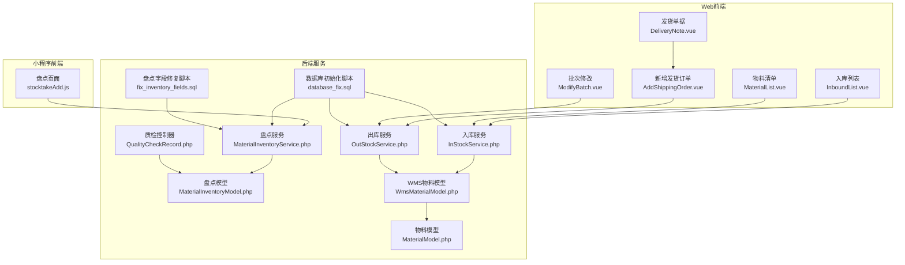
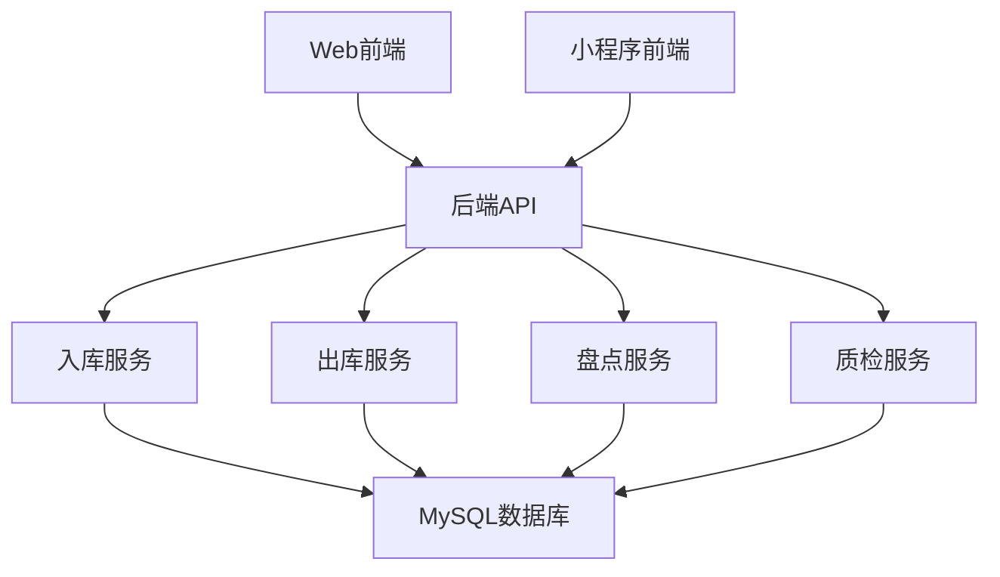
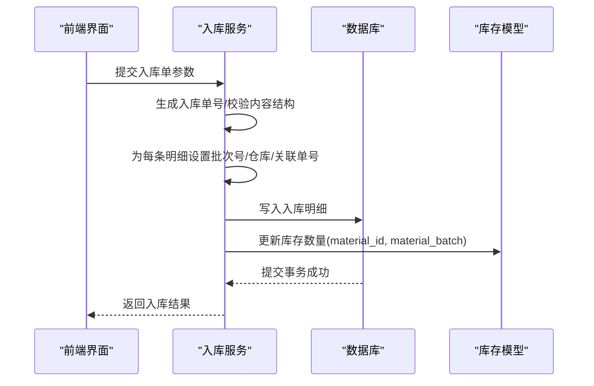
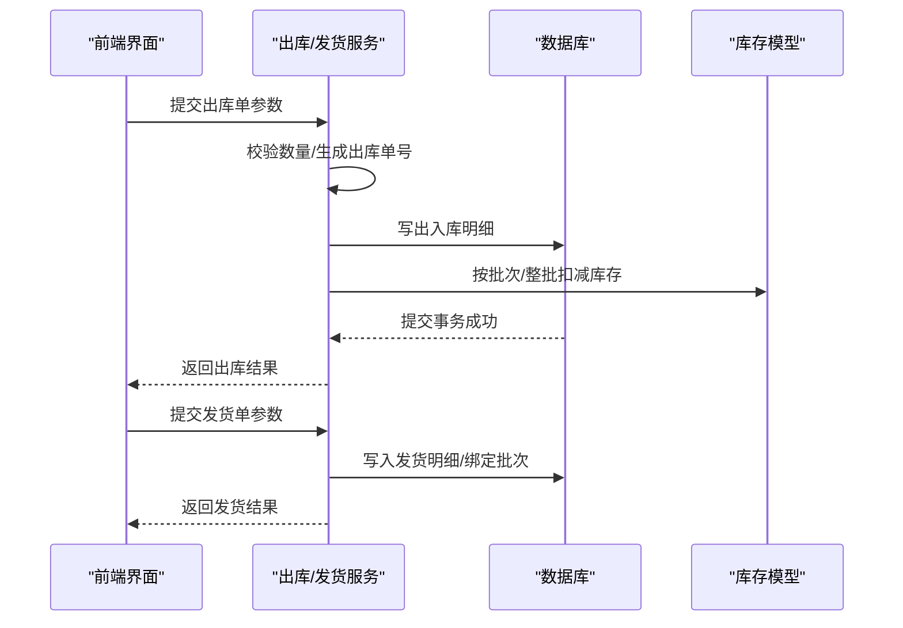
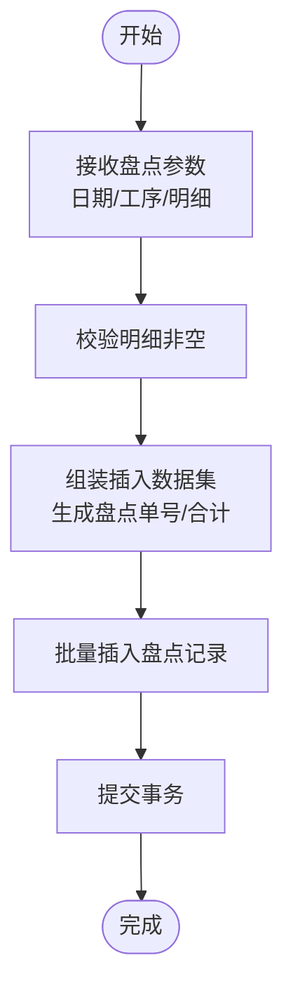
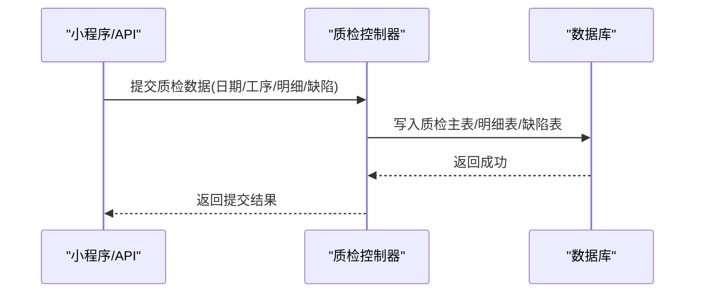
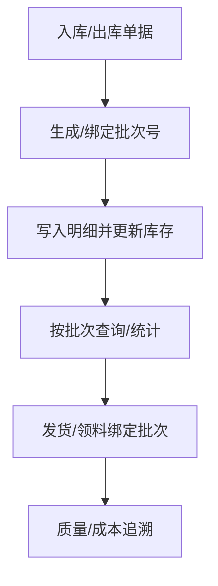
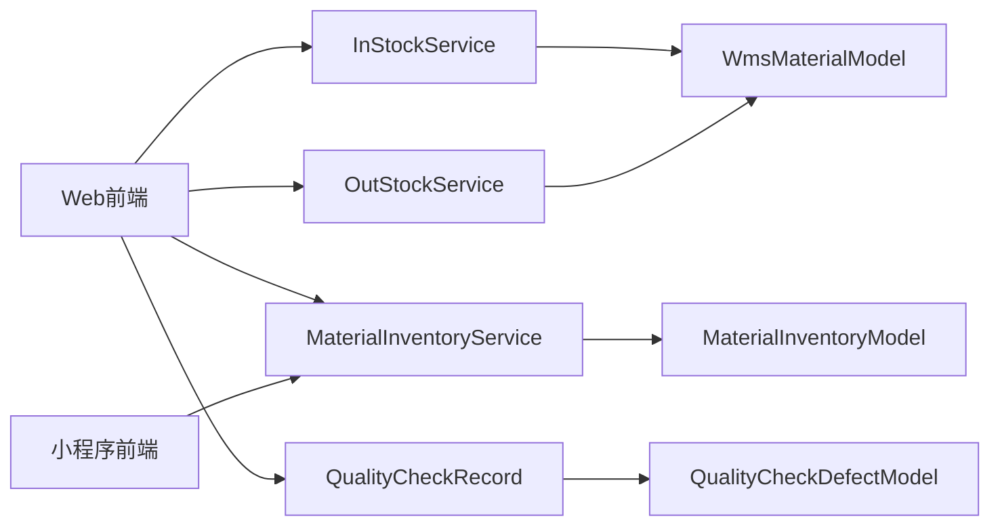
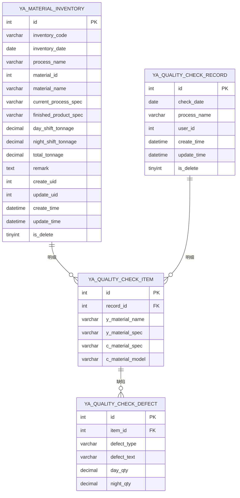

# 物料供应链

<cite>
**本文引用的文件**
- [gccd_server/app/common/service/admin/MaterialInventoryService.php](file://gccd_server/app/common/service/admin/MaterialInventoryService.php)
- [gccd_server/app/common/service/admin/InStockService.php](file://gccd_server/app/common/service/admin/InStockService.php)
- [gccd_server/app/common/service/admin/OutStockService.php](file://gccd_server/app/common/service/admin/OutStockService.php)
- [gccd_server/app/common/model/admin/MaterialInventoryModel.php](file://gccd_server/app/common/model/admin/MaterialInventoryModel.php)
- [gccd_server/app/common/model/admin/WmsMaterialModel.php](file://gccd_server/app/common/model/admin/WmsMaterialModel.php)
- [gccd_server/app/common/model/admin/MaterialModel.php](file://gccd_server/app/common/model/admin/MaterialModel.php)
- [gccd_server/database_fix.sql](file://gccd_server/database_fix.sql)
- [gccd_server/public/fix_inventory_fields.sql](file://gccd_server/public/fix_inventory_fields.sql)
- [gccd_server/app/admin/controller/production/QualityCheckRecord.php](file://gccd_server/app/admin/controller/production/QualityCheckRecord.php)
- [gccd_server/app/common/model/admin/QualityCheckDefectModel.php](file://gccd_server/app/common/model/admin/QualityCheckDefectModel.php)
- [gccd_server/public/storage/20250613110401_发货状态.txt](file://gccd_server/public/storage/20250613110401_发货状态.txt)
- [gccd_server/app/common/service/wechat/WxRegisterService.php](file://gccd_server/app/common/service/wechat/WxRegisterService.php)
- [gccd_mini/pageWorkOrder/pages/stocktakeAdd/stocktakeAdd.js](file://gccd_mini/pageWorkOrder/pages/stocktakeAdd/stocktakeAdd.js)
- [yarn/src/views/mes/WarehouseManagement/WarehousingManagement/InboundList/InboundList.vue](file://yarn/src/views/mes/WarehouseManagement/WarehousingManagement/InboundList/InboundList.vue)
- [yarn/src/views/mes/WarehouseManagement/DeliveryNote/DeliveryNote.vue](file://yarn/src/views/mes/WarehouseManagement/DeliveryNote/DeliveryNote.vue)
- [yarn/src/views/mes/WarehouseManagement/DeliveryNote/components/AddShippingOrder.vue](file://yarn/src/views/mes/WarehouseManagement/DeliveryNote/components/AddShippingOrder.vue)
- [yarn/src/views/mes/WarehouseManagement/OutboundManagement/OutboundList/components/ModifyBatch.vue](file://yarn/src/views/mes/WarehouseManagement/OutboundManagement/OutboundList/components/ModifyBatch.vue)
- [yarn/src/views/mes/MaterialList/MaterialList.vue](file://yarn/src/views/mes/MaterialList/MaterialList.vue)
</cite>

## 目录
1. [简介](#简介)
2. [项目结构](#项目结构)
3. [核心组件](#核心组件)
4. [架构总览](#架构总览)
5. [详细组件分析](#详细组件分析)
6. [依赖关系分析](#依赖关系分析)
7. [性能考量](#性能考量)
8. [故障排查指南](#故障排查指南)
9. [结论](#结论)
10. [附录](#附录)

## 简介
本文件面向“物料供应链管理系统”，系统覆盖从“物料需求预测、采购计划制定、供应商管理、采购执行、收货验收入库、库存管理、盘点与损耗控制、呆滞物料处理、发货管理、订单处理、包装、物流跟踪、客户签收、物料追溯与批次管理、供应商评估与价格管理、合同管理、供应链优化与风控”等全链路能力。本文以仓库管理、出入库、盘点、发货、质量检验、批次与追溯为核心，结合服务端 PHP 与前端 Vue 组件，给出可落地的实现路径与最佳实践。

## 项目结构
系统由三部分组成：
- 后端服务（ThinkPHP）：提供仓储、出入库、盘点、发货、质量检验、批次与追溯等业务服务与接口。
- 小程序前端（Vant Weapp）：移动端扫码、盘点、查询等场景。
- Web 前端（Vue + Element Plus）：PC 端仓库管理、入库/出库、发货、物料清单、批次维护等。

图表来源
- [yarn/src/views/mes/WarehouseManagement/WarehousingManagement/InboundList/InboundList.vue:247-305](file://yarn/src/views/mes/WarehouseManagement/WarehousingManagement/InboundList/InboundList.vue#L247-L305)
- [yarn/src/views/mes/WarehouseManagement/DeliveryNote/DeliveryNote.vue:92-140](file://yarn/src/views/mes/WarehouseManagement/DeliveryNote/DeliveryNote.vue#L92-L140)
- [yarn/src/views/mes/WarehouseManagement/DeliveryNote/components/AddShippingOrder.vue:98-127](file://yarn/src/views/mes/WarehouseManagement/DeliveryNote/components/AddShippingOrder.vue#L98-L127)
- [yarn/src/views/mes/WarehouseManagement/OutboundManagement/OutboundList/components/ModifyBatch.vue:39-72](file://yarn/src/views/mes/WarehouseManagement/OutboundManagement/OutboundList/components/ModifyBatch.vue#L39-L72)
- [yarn/src/views/mes/MaterialList/MaterialList.vue:34-73](file://yarn/src/views/mes/MaterialList/MaterialList.vue#L34-L73)
- [gccd_mini/pageWorkOrder/pages/stocktakeAdd/stocktakeAdd.js:1-65](file://gccd_mini/pageWorkOrder/pages/stocktakeAdd/stocktakeAdd.js#L1-L65)
- [gccd_server/app/common/service/admin/InStockService.php:63-84](file://gccd_server/app/common/service/admin/InStockService.php#L63-L84)
- [gccd_server/app/common/service/admin/OutStockService.php:58-76](file://gccd_server/app/common/service/admin/OutStockService.php#L58-L76)
- [gccd_server/app/common/service/admin/MaterialInventoryService.php:56-75](file://gccd_server/app/common/service/admin/MaterialInventoryService.php#L56-L75)
- [gccd_server/app/common/model/admin/MaterialInventoryModel.php:1-23](file://gccd_server/app/common/model/admin/MaterialInventoryModel.php#L1-L23)
- [gccd_server/app/common/model/admin/WmsMaterialModel.php:1-47](file://gccd_server/app/common/model/admin/WmsMaterialModel.php#L1-L47)
- [gccd_server/app/common/model/admin/MaterialModel.php:1-25](file://gccd_server/app/common/model/admin/MaterialModel.php#L1-L25)
- [gccd_server/database_fix.sql:1-35](file://gccd_server/database_fix.sql#L1-L35)
- [gccd_server/public/fix_inventory_fields.sql:1-38](file://gccd_server/public/fix_inventory_fields.sql#L1-L38)

章节来源
- [yarn/src/views/mes/WarehouseManagement/WarehousingManagement/InboundList/InboundList.vue:247-305](file://yarn/src/views/mes/WarehouseManagement/WarehousingManagement/InboundList/InboundList.vue#L247-L305)
- [gccd_server/app/common/service/admin/InStockService.php:63-84](file://gccd_server/app/common/service/admin/InStockService.php#L63-L84)
- [gccd_server/app/common/service/admin/OutStockService.php:58-76](file://gccd_server/app/common/service/admin/OutStockService.php#L58-L76)
- [gccd_server/app/common/service/admin/MaterialInventoryService.php:56-75](file://gccd_server/app/common/service/admin/MaterialInventoryService.php#L56-L75)

## 核心组件
- 入库服务（InStockService）：负责入库单据创建、批次号生成与库存数量更新；支持按仓库权限过滤与用户仓库绑定。
- 出库服务（OutStockService）：负责出库单据创建、按批次或整批扣减库存、状态流转与工资结算联动。
- 盘点服务（MaterialInventoryService）：支持批量提交盘点数据、按工序/型号/日期检索、计算总吨数。
- 质量检验（QualityCheckRecord 控制器与缺陷模型）：提供质检记录主/明细/缺陷三层结构，支撑质量追溯。
- 物料与WMS模型：物料基础信息、WMS物料与仓库库位绑定、批次与价格汇总。
- 数据库脚本：初始化盘点表、质检表、修复盘点字段等。

章节来源
- [gccd_server/app/common/service/admin/InStockService.php:123-194](file://gccd_server/app/common/service/admin/InStockService.php#L123-L194)
- [gccd_server/app/common/service/admin/OutStockService.php:114-143](file://gccd_server/app/common/service/admin/OutStockService.php#L114-L143)
- [gccd_server/app/common/service/admin/MaterialInventoryService.php:142-200](file://gccd_server/app/common/service/admin/MaterialInventoryService.php#L142-L200)
- [gccd_server/app/admin/controller/production/QualityCheckRecord.php:17-44](file://gccd_server/app/admin/controller/production/QualityCheckRecord.php#L17-L44)
- [gccd_server/app/common/model/admin/MaterialInventoryModel.php:14-22](file://gccd_server/app/common/model/admin/MaterialInventoryModel.php#L14-L22)
- [gccd_server/app/common/model/admin/WmsMaterialModel.php:13-47](file://gccd_server/app/common/model/admin/WmsMaterialModel.php#L13-L47)
- [gccd_server/database_fix.sql:1-35](file://gccd_server/database_fix.sql#L1-L35)
- [gccd_server/public/fix_inventory_fields.sql:1-38](file://gccd_server/public/fix_inventory_fields.sql#L1-L38)

## 架构总览
系统采用前后端分离架构，Web 前端通过 API 与后端交互，小程序通过微信服务层对接后端服务。仓储业务围绕“入库—库存—出库—发货—质量—追溯—报表”闭环展开。

图表来源
- [gccd_server/app/common/service/admin/InStockService.php:123-194](file://gccd_server/app/common/service/admin/InStockService.php#L123-L194)
- [gccd_server/app/common/service/admin/OutStockService.php:114-143](file://gccd_server/app/common/service/admin/OutStockService.php#L114-L143)
- [gccd_server/app/common/service/admin/MaterialInventoryService.php:142-200](file://gccd_server/app/common/service/admin/MaterialInventoryService.php#L142-L200)
- [gccd_server/app/admin/controller/production/QualityCheckRecord.php:17-44](file://gccd_server/app/admin/controller/production/QualityCheckRecord.php#L17-L44)

## 详细组件分析

### 入库管理（收货验收入库）
- 功能要点
  - 自动生成入库单号与批次号；成品库强制使用关联单号作为批次号。
  - 校验入库数量合法性，逐条写入入库明细并更新库存数量。
  - 支持按仓库权限过滤与用户仓库绑定，避免越权访问。
- 关键流程

图表来源
- [gccd_server/app/common/service/admin/InStockService.php:123-194](file://gccd_server/app/common/service/admin/InStockService.php#L123-L194)
- [gccd_server/app/common/service/admin/InStockService.php:253-275](file://gccd_server/app/common/service/admin/InStockService.php#L253-L275)

章节来源
- [gccd_server/app/common/service/admin/InStockService.php:123-194](file://gccd_server/app/common/service/admin/InStockService.php#L123-L194)
- [gccd_server/app/common/service/admin/InStockService.php:253-275](file://gccd_server/app/common/service/admin/InStockService.php#L253-L275)
- [yarn/src/views/mes/WarehouseManagement/WarehousingManagement/InboundList/InboundList.vue:247-305](file://yarn/src/views/mes/WarehouseManagement/WarehousingManagement/InboundList/InboundList.vue#L247-L305)

### 出库与发货管理（领料/出库/发货）
- 功能要点
  - 出库单据创建时校验数量合法性；支持按批次或整批扣减库存。
  - 发货单据支持新增、分页查询、关联客户与成品库出库。
  - 支持批次修改与价格/供应商字段维护，便于成本核算与追溯。
- 关键流程

图表来源
- [gccd_server/app/common/service/admin/OutStockService.php:114-143](file://gccd_server/app/common/service/admin/OutStockService.php#L114-L143)
- [gccd_server/app/common/service/admin/OutStockService.php:200-239](file://gccd_server/app/common/service/admin/OutStockService.php#L200-L239)
- [yarn/src/views/mes/WarehouseManagement/DeliveryNote/DeliveryNote.vue:92-140](file://yarn/src/views/mes/WarehouseManagement/DeliveryNote/DeliveryNote.vue#L92-L140)
- [yarn/src/views/mes/WarehouseManagement/DeliveryNote/components/AddShippingOrder.vue:98-127](file://yarn/src/views/mes/WarehouseManagement/DeliveryNote/components/AddShippingOrder.vue#L98-L127)
- [yarn/src/views/mes/WarehouseManagement/OutboundManagement/OutboundList/components/ModifyBatch.vue:39-72](file://yarn/src/views/mes/WarehouseManagement/OutboundManagement/OutboundList/components/ModifyBatch.vue#L39-L72)

章节来源
- [gccd_server/app/common/service/admin/OutStockService.php:114-143](file://gccd_server/app/common/service/admin/OutStockService.php#L114-L143)
- [gccd_server/app/common/service/admin/OutStockService.php:200-239](file://gccd_server/app/common/service/admin/OutStockService.php#L200-L239)
- [yarn/src/views/mes/WarehouseManagement/DeliveryNote/DeliveryNote.vue:92-140](file://yarn/src/views/mes/WarehouseManagement/DeliveryNote/DeliveryNote.vue#L92-L140)
- [yarn/src/views/mes/WarehouseManagement/DeliveryNote/components/AddShippingOrder.vue:98-127](file://yarn/src/views/mes/WarehouseManagement/DeliveryNote/components/AddShippingOrder.vue#L98-L127)
- [yarn/src/views/mes/WarehouseManagement/OutboundManagement/OutboundList/components/ModifyBatch.vue:39-72](file://yarn/src/views/mes/WarehouseManagement/OutboundManagement/OutboundList/components/ModifyBatch.vue#L39-L72)

### 盘点与库存管理
- 功能要点
  - 支持批量提交盘点数据（小程序/API），自动计算总吨数，绑定工序/型号/日期。
  - 支持按物料名称、成品型号、当前加工型号、工序名称、盘点日期范围检索。
  - 提供盘点字段修复脚本，确保线上数据库字段一致性。
- 关键流程

图表来源
- [gccd_server/app/common/service/admin/MaterialInventoryService.php:142-200](file://gccd_server/app/common/service/admin/MaterialInventoryService.php#L142-L200)
- [gccd_server/public/fix_inventory_fields.sql:1-38](file://gccd_server/public/fix_inventory_fields.sql#L1-L38)

章节来源
- [gccd_server/app/common/service/admin/MaterialInventoryService.php:56-75](file://gccd_server/app/common/service/admin/MaterialInventoryService.php#L56-L75)
- [gccd_server/app/common/service/admin/MaterialInventoryService.php:142-200](file://gccd_server/app/common/service/admin/MaterialInventoryService.php#L142-L200)
- [gccd_mini/pageWorkOrder/pages/stocktakeAdd/stocktakeAdd.js:1-65](file://gccd_mini/pageWorkOrder/pages/stocktakeAdd/stocktakeAdd.js#L1-L65)
- [gccd_server/public/fix_inventory_fields.sql:1-38](file://gccd_server/public/fix_inventory_fields.sql#L1-L38)

### 质量检验与缺陷记录
- 功能要点
  - 质检记录主表、明细表、缺陷表三层结构，支持按日期/工序检索。
  - 小程序/API 支持批量提交质检数据，便于现场快速录入。
- 关键流程

图表来源
- [gccd_server/app/admin/controller/production/QualityCheckRecord.php:39-44](file://gccd_server/app/admin/controller/production/QualityCheckRecord.php#L39-L44)
- [gccd_server/app/common/model/admin/QualityCheckDefectModel.php:1-10](file://gccd_server/app/common/model/admin/QualityCheckDefectModel.php#L1-L10)
- [gccd_server/database_fix.sql:1-35](file://gccd_server/database_fix.sql#L1-L35)

章节来源
- [gccd_server/app/admin/controller/production/QualityCheckRecord.php:17-44](file://gccd_server/app/admin/controller/production/QualityCheckRecord.php#L17-L44)
- [gccd_server/app/common/model/admin/QualityCheckDefectModel.php:1-10](file://gccd_server/app/common/model/admin/QualityCheckDefectModel.php#L1-L10)
- [gccd_server/database_fix.sql:1-35](file://gccd_server/database_fix.sql#L1-L35)

### 物料追溯与批次管理
- 功能要点
  - 入库/出库均绑定批次号，支持按批次查询与价格汇总。
  - 成品库入库强制使用关联单号作为批次号，便于发货追溯。
  - 出库支持按批次扣减，保障先进先出与批次可追溯。
- 关键流程

图表来源
- [gccd_server/app/common/service/admin/InStockService.php:162-175](file://gccd_server/app/common/service/admin/InStockService.php#L162-L175)
- [gccd_server/app/common/service/admin/OutStockService.php:200-239](file://gccd_server/app/common/service/admin/OutStockService.php#L200-L239)
- [gccd_server/app/common/model/admin/WmsMaterialModel.php:13-47](file://gccd_server/app/common/model/admin/WmsMaterialModel.php#L13-L47)

章节来源
- [gccd_server/app/common/service/admin/InStockService.php:162-175](file://gccd_server/app/common/service/admin/InStockService.php#L162-L175)
- [gccd_server/app/common/service/admin/OutStockService.php:200-239](file://gccd_server/app/common/service/admin/OutStockService.php#L200-L239)
- [gccd_server/app/common/model/admin/WmsMaterialModel.php:13-47](file://gccd_server/app/common/model/admin/WmsMaterialModel.php#L13-L47)

### 库存策略与ABC分类（建议）
- 安全库存：基于历史消耗波动与交货周期设定，结合实时库存与在途量动态调整。
- 最小/最大库存：按物料重要度与缺货成本设定阈值，触发补货提醒。
- ABC 分类：按金额占比与消耗频次划分，A 类重点监控、B/C 类简化管理。
- 盘点与损耗控制：定期循环盘点+全盘，差异分析与审批流程；损耗率纳入KPI。
- 呆滞物料处理：建立超期预警与处置流程，推动销售、调拨、报废审批。

（本节为通用实践建议，不直接分析具体文件）

### 供应商管理与合同管理（现状与建议）
- 现状：系统包含供应商字段与价格字段，支持按供应商筛选与价格维护。
- 建议：补充供应商档案、评估指标（质量、交付、价格、服务）、合同生命周期管理、到期提醒与电子签章集成。

章节来源
- [yarn/src/views/mes/MaterialList/MaterialList.vue:34-73](file://yarn/src/views/mes/MaterialList/MaterialList.vue#L34-L73)
- [yarn/src/views/mes/WarehouseManagement/OutboundManagement/OutboundList/components/ModifyBatch.vue:39-72](file://yarn/src/views/mes/WarehouseManagement/OutboundManagement/OutboundList/components/ModifyBatch.vue#L39-L72)

### 发货管理（订单处理、包装、物流跟踪、签收）
- 现状：发货单据支持客户选择、成品库出库、批次绑定；发货状态需按最新状态定义。
- 建议：完善发货状态机（未提交/已提交/已驳回/已审核/未计划/部分计划/已计划/未发货/已发货/部分发货），接入物流平台获取轨迹，客户签收确认与异常处理闭环。

章节来源
- [yarn/src/views/mes/WarehouseManagement/DeliveryNote/DeliveryNote.vue:92-140](file://yarn/src/views/mes/WarehouseManagement/DeliveryNote/DeliveryNote.vue#L92-L140)
- [yarn/src/views/mes/WarehouseManagement/DeliveryNote/components/AddShippingOrder.vue:98-127](file://yarn/src/views/mes/WarehouseManagement/DeliveryNote/components/AddShippingOrder.vue#L98-L127)
- [gccd_server/public/storage/20250613110401_发货状态.txt:1-23](file://gccd_server/public/storage/20250613110401_发货状态.txt#L1-L23)

## 依赖关系分析
- 服务层依赖模型层与公共服务（单据号生成、时间格式化等）。
- 入库/出库服务依赖库存模型进行数量更新，涉及事务控制与异常回滚。
- 质检服务依赖质检主/明细/缺陷三层模型，保证质量数据完整性。
- Web/小程序前端通过 API 与服务层交互，统一数据格式与权限校验。

图表来源
- [gccd_server/app/common/service/admin/InStockService.php:1-368](file://gccd_server/app/common/service/admin/InStockService.php#L1-L368)
- [gccd_server/app/common/service/admin/OutStockService.php:1-290](file://gccd_server/app/common/service/admin/OutStockService.php#L1-L290)
- [gccd_server/app/common/service/admin/MaterialInventoryService.php:1-262](file://gccd_server/app/common/service/admin/MaterialInventoryService.php#L1-L262)
- [gccd_server/app/admin/controller/production/QualityCheckRecord.php:1-45](file://gccd_server/app/admin/controller/production/QualityCheckRecord.php#L1-L45)
- [gccd_server/app/common/model/admin/MaterialInventoryModel.php:1-23](file://gccd_server/app/common/model/admin/MaterialInventoryModel.php#L1-L23)
- [gccd_server/app/common/model/admin/WmsMaterialModel.php:1-47](file://gccd_server/app/common/model/admin/WmsMaterialModel.php#L1-L47)
- [gccd_server/app/common/model/admin/MaterialModel.php:1-25](file://gccd_server/app/common/model/admin/MaterialModel.php#L1-L25)
- [gccd_server/app/common/model/admin/QualityCheckDefectModel.php:1-10](file://gccd_server/app/common/model/admin/QualityCheckDefectModel.php#L1-L10)

章节来源
- [gccd_server/app/common/service/admin/InStockService.php:1-368](file://gccd_server/app/common/service/admin/InStockService.php#L1-L368)
- [gccd_server/app/common/service/admin/OutStockService.php:1-290](file://gccd_server/app/common/service/admin/OutStockService.php#L1-L290)
- [gccd_server/app/common/service/admin/MaterialInventoryService.php:1-262](file://gccd_server/app/common/service/admin/MaterialInventoryService.php#L1-L262)
- [gccd_server/app/admin/controller/production/QualityCheckRecord.php:1-45](file://gccd_server/app/admin/controller/production/QualityCheckRecord.php#L1-L45)

## 性能考量
- 数据库索引：为常用查询字段（如入库/出库单号、物料ID、批次号、创建时间）建立索引，提升检索与分页性能。
- 事务边界：入库/出库涉及多表写入，应保持事务原子性，避免脏读与重复计数。
- 缓存策略：对高频物料基础信息与仓库权限做缓存，降低重复查询开销。
- 分页与排序：默认按创建时间倒序，合理设置分页大小，避免一次性加载过多数据。
- 日志与追踪：对批量提交与关键业务节点记录 trace 日志，便于问题定位与审计。

（本节为通用指导，不直接分析具体文件）

## 故障排查指南
- 入库/出库数量异常
  - 检查前端输入与后端校验逻辑，确保数量为正且不为空。
  - 查看库存模型是否存在对应批次或整批库存，避免负数扣减。
- 批次号缺失或不一致
  - 成品库入库强制使用关联单号作为批次号；其他库若未传入则自动生成。
  - 出库时若未指定批次，按整批扣减，可能导致批次不可追溯。
- 盘点数据异常
  - 使用批量提交接口时，确保明细非空；查看日志中示例数据与总数。
  - 若线上缺少字段，执行字段修复脚本后再试。
- 发货状态不一致
  - 参考发货状态定义文件，核对状态迁移逻辑与表结构变更。

章节来源
- [gccd_server/app/common/service/admin/InStockService.php:153-178](file://gccd_server/app/common/service/admin/InStockService.php#L153-L178)
- [gccd_server/app/common/service/admin/OutStockService.php:200-239](file://gccd_server/app/common/service/admin/OutStockService.php#L200-L239)
- [gccd_server/app/common/service/admin/MaterialInventoryService.php:152-154](file://gccd_server/app/common/service/admin/MaterialInventoryService.php#L152-L154)
- [gccd_server/public/fix_inventory_fields.sql:1-38](file://gccd_server/public/fix_inventory_fields.sql#L1-L38)
- [gccd_server/public/storage/20250613110401_发货状态.txt:1-23](file://gccd_server/public/storage/20250613110401_发货状态.txt#L1-L23)

## 结论
本系统围绕“入库—库存—出库—发货—质量—追溯—报表”构建了完整的供应链闭环，具备批次管理、质量检验与库存盘点等关键能力。建议后续补齐供应商评估、价格管理与合同管理模块，并完善发货状态机与物流对接，持续优化库存策略与风控体系，提升整体供应链效率与透明度。

## 附录

### 数据模型概览

图表来源
- [gccd_server/database_fix.sql:1-35](file://gccd_server/database_fix.sql#L1-L35)
- [gccd_server/app/common/model/admin/MaterialInventoryModel.php:1-23](file://gccd_server/app/common/model/admin/MaterialInventoryModel.php#L1-L23)
- [gccd_server/app/common/model/admin/QualityCheckDefectModel.php:1-10](file://gccd_server/app/common/model/admin/QualityCheckDefectModel.php#L1-L10)

### API 与前端组件使用示例（路径指引）
- 入库列表与查询
  - [入口组件:247-305](file://yarn/src/views/mes/WarehouseManagement/WarehousingManagement/InboundList/InboundList.vue#L247-L305)
- 发货单据与新增
  - [发货单据页面:92-140](file://yarn/src/views/mes/WarehouseManagement/DeliveryNote/DeliveryNote.vue#L92-L140)
  - [新增发货订单组件:98-127](file://yarn/src/views/mes/WarehouseManagement/DeliveryNote/components/AddShippingOrder.vue#L98-L127)
- 出库与批次修改
  - [出库列表与批次修改:39-72](file://yarn/src/views/mes/WarehouseManagement/OutboundManagement/OutboundList/components/ModifyBatch.vue#L39-L72)
- 物料清单与筛选
  - [物料清单页面:34-73](file://yarn/src/views/mes/MaterialList/MaterialList.vue#L34-L73)
- 小程序盘点
  - [盘点页面:1-65](file://gccd_mini/pageWorkOrder/pages/stocktakeAdd/stocktakeAdd.js#L1-L65)

章节来源
- [yarn/src/views/mes/WarehouseManagement/WarehousingManagement/InboundList/InboundList.vue:247-305](file://yarn/src/views/mes/WarehouseManagement/WarehousingManagement/InboundList/InboundList.vue#L247-L305)
- [yarn/src/views/mes/WarehouseManagement/DeliveryNote/DeliveryNote.vue:92-140](file://yarn/src/views/mes/WarehouseManagement/DeliveryNote/DeliveryNote.vue#L92-L140)
- [yarn/src/views/mes/WarehouseManagement/DeliveryNote/components/AddShippingOrder.vue:98-127](file://yarn/src/views/mes/WarehouseManagement/DeliveryNote/components/AddShippingOrder.vue#L98-L127)
- [yarn/src/views/mes/WarehouseManagement/OutboundManagement/OutboundList/components/ModifyBatch.vue:39-72](file://yarn/src/views/mes/WarehouseManagement/OutboundManagement/OutboundList/components/ModifyBatch.vue#L39-L72)
- [yarn/src/views/mes/MaterialList/MaterialList.vue:34-73](file://yarn/src/views/mes/MaterialList/MaterialList.vue#L34-L73)
- [gccd_mini/pageWorkOrder/pages/stocktakeAdd/stocktakeAdd.js:1-65](file://gccd_mini/pageWorkOrder/pages/stocktakeAdd/stocktakeAdd.js#L1-L65)