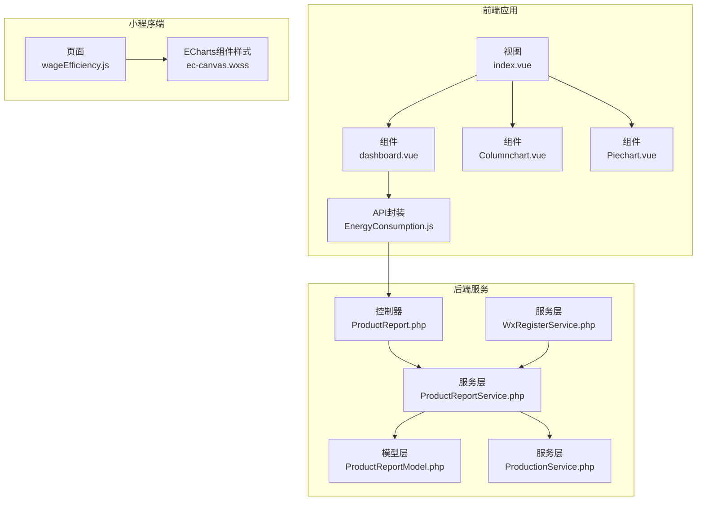
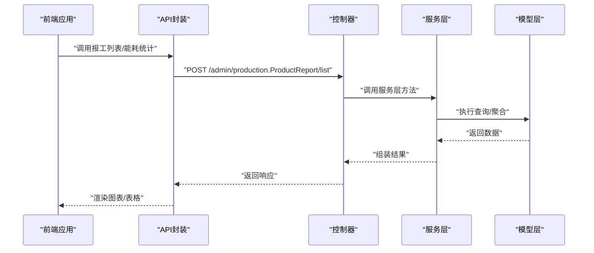
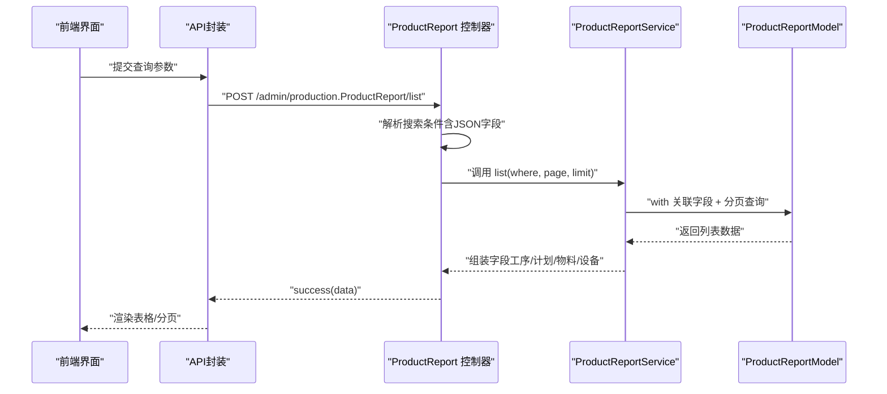
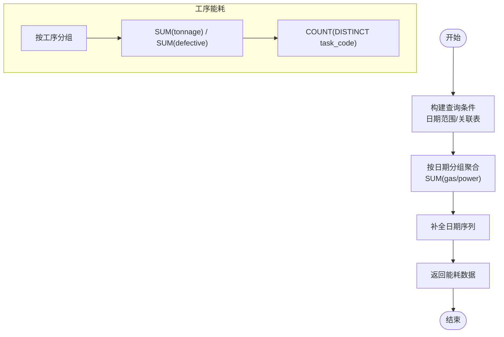
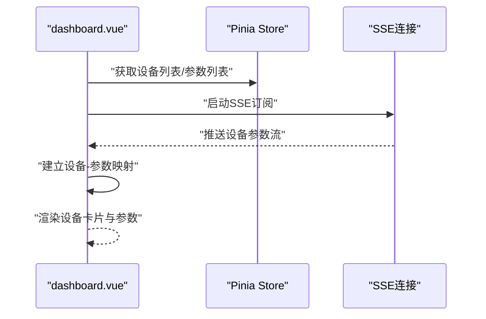
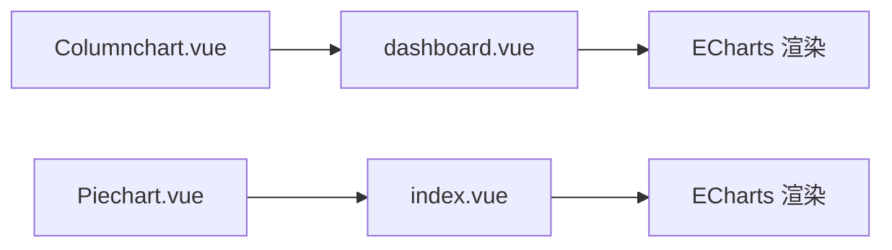
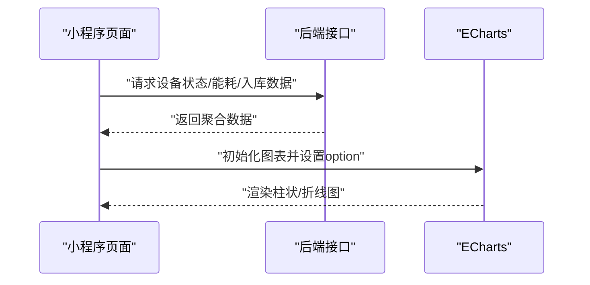
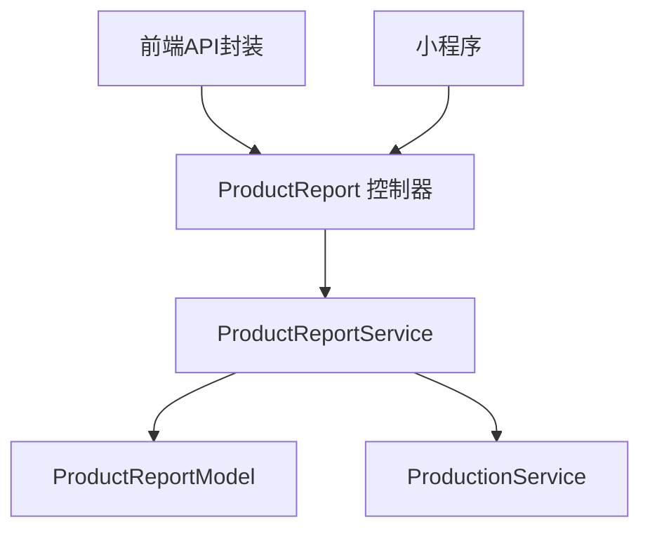

# 生产报表

<cite>
**本文引用的文件**
- [ProductReport.php](file://gccd_server/app/admin/controller/production/ProductReport.php)
- [ProductReportService.php](file://gccd_server/app/common/service/admin/ProductReportService.php)
- [ProductReportModel.php](file://gccd_server/app/common/model/admin/ProductReportModel.php)
- [ProductionService.php](file://gccd_server/app/common/service/admin/ProductionService.php)
- [WxRegisterService.php](file://gccd_server/app/common/service/wechat/WxRegisterService.php)
- [EnergyConsumption.js](file://yarn/src/api/mes/EnergyConsumption/EnergyConsumption.js)
- [EnergyConsumption.DF1tSNZR.js](file://yarn/admin/js/EnergyConsumption.DF1tSNZR.js)
- [dashboard.vue](file://yarn/src/components/goodsquery/dashboard.vue)
- [Columnchart.vue](file://yarn/src/components/goodsquery/Columnchart.vue)
- [Piechart.vue](file://yarn/src/components/goodsquery/Piechart.vue)
- [index.vue](file://yarn/src/views/system/index.vue)
- [wageEfficiency.js](file://gccd_mini/pageMine/pages/wageEfficiency/wageEfficiency.js)
- [ec-canvas.wxss](file://gccd_mini/pageMine/components/ec-canvas/ec-canvas.wxss)
- [README.md](file://gccd_server/README.md)
</cite>

## 目录
1. [简介](#简介)
2. [项目结构](#项目结构)
3. [核心组件](#核心组件)
4. [架构总览](#架构总览)
5. [详细组件分析](#详细组件分析)
6. [依赖关系分析](#依赖关系分析)
7. [性能考虑](#性能考虑)
8. [故障排查指南](#故障排查指南)
9. [结论](#结论)
10. [附录](#附录)

## 简介
本文件面向“生产报表系统”，围绕生产数据采集、处理与分析，系统性梳理以下能力：
- 采集与加工：报工记录、能耗记录、质量检验、设备状态、人员绩效等
- 关键指标：产量统计、质量指标、设备效率、人员绩效等
- 报表模板：日报、周报、月报、年报的生成规则与数据来源
- 实时监控：仪表板构建与动态更新机制
- 可视化：趋势图、对比图、分布图等图表类型与配置
- 权限与安全：接口权限控制与数据安全策略
- 性能优化：大数据量处理与前端渲染优化
- 最佳实践：报表使用建议与数据分析要点
- 接口与组件：具体接口路径与前端展示组件示例

## 项目结构
系统由三部分组成：
- 后端服务（ThinkPHP8）：提供生产报表、能耗统计、设备与人员绩效等接口
- 前端应用（Vue3 + ECharts）：负责仪表板、图表渲染与交互
- 小程序端（微信小程序 + ECharts）：移动端看板与图表展示

**图表来源**
- [ProductReport.php:1-416](file://gccd_server/app/admin/controller/production/ProductReport.php#L1-L416)
- [ProductReportService.php:1-200](file://gccd_server/app/common/service/admin/ProductReportService.php#L1-L200)
- [ProductReportModel.php:1-76](file://gccd_server/app/common/model/admin/ProductReportModel.php#L1-L76)
- [ProductionService.php:1-200](file://gccd_server/app/common/service/admin/ProductionService.php#L1-L200)
- [WxRegisterService.php:244-278](file://gccd_server/app/common/service/wechat/WxRegisterService.php#L244-L278)
- [index.vue:41-137](file://yarn/src/views/system/index.vue#L41-L137)
- [dashboard.vue:1-117](file://yarn/src/components/goodsquery/dashboard.vue#L1-L117)
- [Columnchart.vue:1-102](file://yarn/src/components/goodsquery/Columnchart.vue#L1-L102)
- [Piechart.vue:1-131](file://yarn/src/components/goodsquery/Piechart.vue#L1-L131)
- [EnergyConsumption.js:1-100](file://yarn/src/api/mes/EnergyConsumption/EnergyConsumption.js#L1-L100)
- [wageEfficiency.js:1-275](file://gccd_mini/pageMine/pages/wageEfficiency/wageEfficiency.js#L1-L275)
- [ec-canvas.wxss:1-4](file://gccd_mini/pageMine/components/ec-canvas/ec-canvas.wxss#L1-L4)

**章节来源**
- [README.md:1-189](file://gccd_server/README.md#L1-L189)

## 核心组件
- 报工记录管理：提供报工列表、详情、新增、编辑、删除、能耗填报、按工序统计等功能
- 能耗统计：按日期聚合燃气与电量消耗，支持按工序统计吨数
- 设备与人员：设备状态统计、能耗与缺陷统计、人员绩效汇总
- 实时仪表板：设备参数订阅、参数绑定与动态展示
- 图表组件：柱状图、折线图、饼图等可视化组件
- 小程序看板：移动端能耗与产量趋势展示

**章节来源**
- [ProductReport.php:32-412](file://gccd_server/app/admin/controller/production/ProductReport.php#L32-L412)
- [ProductReportService.php:93-188](file://gccd_server/app/common/service/admin/ProductReportService.php#L93-L188)
- [ProductionService.php:486-520](file://gccd_server/app/common/service/admin/ProductionService.php#L486-L520)
- [WxRegisterService.php:244-278](file://gccd_server/app/common/service/wechat/WxRegisterService.php#L244-L278)
- [dashboard.vue:1-117](file://yarn/src/components/goodsquery/dashboard.vue#L1-L117)
- [Columnchart.vue:1-102](file://yarn/src/components/goodsquery/Columnchart.vue#L1-L102)
- [Piechart.vue:1-131](file://yarn/src/components/goodsquery/Piechart.vue#L1-L131)
- [wageEfficiency.js:1-275](file://gccd_mini/pageMine/pages/wageEfficiency/wageEfficiency.js#L1-L275)

## 架构总览
后端采用“控制器-服务-模型”分层，前端通过API封装调用后端接口，小程序直接请求后端接口并使用ECharts渲染。

**图表来源**
- [EnergyConsumption.js:1-100](file://yarn/src/api/mes/EnergyConsumption/EnergyConsumption.js#L1-L100)
- [ProductReport.php:43-182](file://gccd_server/app/admin/controller/production/ProductReport.php#L43-L182)
- [ProductReportService.php:93-188](file://gccd_server/app/common/service/admin/ProductReportService.php#L93-L188)
- [ProductReportModel.php:1-76](file://gccd_server/app/common/model/admin/ProductReportModel.php#L1-L76)

## 详细组件分析

### 报工记录管理
- 功能点：列表查询（支持多字段搜索）、详情、新增、编辑、删除、能耗填报、按工序统计
- 关键流程：控制器接收参数，构造查询条件（含JSON字段与多表关联），服务层执行查询与聚合，模型层关联绑定字段

**图表来源**
- [ProductReport.php:43-182](file://gccd_server/app/admin/controller/production/ProductReport.php#L43-L182)
- [ProductReportService.php:93-188](file://gccd_server/app/common/service/admin/ProductReportService.php#L93-L188)
- [ProductReportModel.php:16-75](file://gccd_server/app/common/model/admin/ProductReportModel.php#L16-L75)

**章节来源**
- [ProductReport.php:32-412](file://gccd_server/app/admin/controller/production/ProductReport.php#L32-L412)
- [ProductReportService.php:93-188](file://gccd_server/app/common/service/admin/ProductReportService.php#L93-L188)
- [ProductReportModel.php:16-75](file://gccd_server/app/common/model/admin/ProductReportModel.php#L16-L75)

### 能耗统计与工序能耗
- 能耗统计：按日期聚合燃气与电量，补全日期序列，支持近N日数据
- 工序能耗：按工序统计吨数，支持起止日期筛选

**图表来源**
- [WxRegisterService.php:244-278](file://gccd_server/app/common/service/wechat/WxRegisterService.php#L244-L278)
- [ProductionService.php:486-520](file://gccd_server/app/common/service/admin/ProductionService.php#L486-L520)

**章节来源**
- [WxRegisterService.php:244-278](file://gccd_server/app/common/service/wechat/WxRegisterService.php#L244-L278)
- [ProductionService.php:486-520](file://gccd_server/app/common/service/admin/ProductionService.php#L486-L520)

### 实时监控仪表板
- 设备参数订阅：通过Store获取设备列表与参数列表，建立设备-参数映射
- 参数展示：设备卡片内展示参数值与流量等
- 动态更新：监听设备/参数变化，自动刷新映射

**图表来源**
- [dashboard.vue:1-117](file://yarn/src/components/goodsquery/dashboard.vue#L1-L117)

**章节来源**
- [dashboard.vue:1-117](file://yarn/src/components/goodsquery/dashboard.vue#L1-L117)

### 图表组件与可视化
- 柱状图：设备状态统计（总数、正常、工作、停止）
- 折线图：入库/产量趋势
- 饼图：入库信息（示例为折线图，可替换为饼图）

**图表来源**
- [Columnchart.vue:1-102](file://yarn/src/components/goodsquery/Columnchart.vue#L1-L102)
- [dashboard.vue:1-117](file://yarn/src/components/goodsquery/dashboard.vue#L1-L117)
- [Piechart.vue:1-131](file://yarn/src/components/goodsquery/Piechart.vue#L1-L131)
- [index.vue:41-137](file://yarn/src/views/system/index.vue#L41-L137)

**章节来源**
- [Columnchart.vue:1-102](file://yarn/src/components/goodsquery/Columnchart.vue#L1-L102)
- [Piechart.vue:1-131](file://yarn/src/components/goodsquery/Piechart.vue#L1-L131)
- [index.vue:41-137](file://yarn/src/views/system/index.vue#L41-L137)

### 小程序看板与移动端图表
- 能耗看板：柱状图展示燃气/电量消耗
- 产量看板：折线图展示日产量趋势
- 设备状态：设备明细表与状态统计

**图表来源**
- [wageEfficiency.js:186-275](file://gccd_mini/pageMine/pages/wageEfficiency/wageEfficiency.js#L186-L275)
- [ec-canvas.wxss:1-4](file://gccd_mini/pageMine/components/ec-canvas/ec-canvas.wxss#L1-L4)

**章节来源**
- [wageEfficiency.js:1-275](file://gccd_mini/pageMine/pages/wageEfficiency/wageEfficiency.js#L1-L275)
- [ec-canvas.wxss:1-4](file://gccd_mini/pageMine/components/ec-canvas/ec-canvas.wxss#L1-L4)

## 依赖关系分析
- 控制器依赖服务层，服务层依赖模型层与关联表
- 前端组件依赖API封装，API封装调用控制器接口
- 小程序直接调用后端接口并渲染图表

**图表来源**
- [ProductReport.php:1-416](file://gccd_server/app/admin/controller/production/ProductReport.php#L1-L416)
- [ProductReportService.php:1-200](file://gccd_server/app/common/service/admin/ProductReportService.php#L1-L200)
- [ProductReportModel.php:1-76](file://gccd_server/app/common/model/admin/ProductReportModel.php#L1-L76)
- [ProductionService.php:1-200](file://gccd_server/app/common/service/admin/ProductionService.php#L1-L200)
- [EnergyConsumption.js:1-100](file://yarn/src/api/mes/EnergyConsumption/EnergyConsumption.js#L1-L100)
- [wageEfficiency.js:186-203](file://gccd_mini/pageMine/pages/wageEfficiency/wageEfficiency.js#L186-L203)

**章节来源**
- [ProductReport.php:1-416](file://gccd_server/app/admin/controller/production/ProductReport.php#L1-L416)
- [ProductReportService.php:1-200](file://gccd_server/app/common/service/admin/ProductReportService.php#L1-L200)
- [ProductReportModel.php:1-76](file://gccd_server/app/common/model/admin/ProductReportModel.php#L1-L76)
- [ProductionService.php:1-200](file://gccd_server/app/common/service/admin/ProductionService.php#L1-L200)
- [EnergyConsumption.js:1-100](file://yarn/src/api/mes/EnergyConsumption/EnergyConsumption.js#L1-L100)
- [wageEfficiency.js:186-203](file://gccd_mini/pageMine/pages/wageEfficiency/wageEfficiency.js#L186-L203)

## 性能考虑
- 查询优化：对JSON字段搜索采用先全量查询再过滤的方式，建议在数据量大时引入索引或预处理字段
- 聚合优化：按日期分组聚合时，尽量限定时间范围，避免全量扫描
- 前端渲染：ECharts按需初始化，避免重复渲染；图表数据分批加载
- SSE订阅：合理设置心跳与断线重连，避免频繁重建连接
- 小程序渲染：使用原生Canvas初始化，减少DOM操作

[本节为通用指导，无需列出具体文件来源]

## 故障排查指南
- 接口无数据：确认查询参数（日期范围、设备/工序编码）是否正确
- JSON字段搜索无效：检查数据中JSON字段是否存在及格式是否正确
- 图表空白：检查容器尺寸与初始化回调是否正确设置
- 小程序图表不显示：确认ECharts初始化回调与容器宽高设置

**章节来源**
- [ProductReport.php:76-98](file://gccd_server/app/admin/controller/production/ProductReport.php#L76-L98)
- [wageEfficiency.js:242-262](file://gccd_mini/pageMine/pages/wageEfficiency/wageEfficiency.js#L242-L262)

## 结论
本系统以“控制器-服务-模型”分层实现生产数据的采集、处理与分析，结合前端与小程序的可视化组件，形成完整的生产报表体系。通过能耗统计、工序统计、设备状态与人员绩效等指标，支撑日报、周报、月报与年报的生成与展示。建议在大数据场景下进一步优化查询与渲染性能，并完善权限控制与数据安全策略。

[本节为总结性内容，无需列出具体文件来源]

## 附录

### 报表模板与生成规则
- 日报：按日聚合能耗、入库数量、设备状态与质量指标
- 周报：按自然周聚合，叠加趋势对比
- 月报：按自然月聚合，包含累计与同比
- 年报：按年聚合，包含季度拆分与目标达成率

[本节为概念性说明，无需列出具体文件来源]

### 实时监控仪表板与动态更新
- 设备参数订阅：通过SSE持续接收设备参数流
- 参数映射：建立设备与参数的双向映射，自动刷新展示
- 更新频率：根据业务需求设定轮询/推送间隔

**章节来源**
- [dashboard.vue:1-117](file://yarn/src/components/goodsquery/dashboard.vue#L1-L117)

### 数据可视化图表选择与配置
- 趋势图：折线图展示日/周/月趋势
- 对比图：柱状图对比不同维度（工序、设备、班次）
- 分布图：饼图/环形图展示占比

**章节来源**
- [Piechart.vue:1-131](file://yarn/src/components/goodsquery/Piechart.vue#L1-L131)
- [wageEfficiency.js:132-184](file://gccd_mini/pageMine/pages/wageEfficiency/wageEfficiency.js#L132-L184)

### 报表权限控制与数据安全
- 接口鉴权：后端基于中间件与权限控制，确保仅授权用户访问
- 数据脱敏：敏感字段在接口返回前进行脱敏处理
- 日志审计：记录关键操作与异常行为

**章节来源**
- [README.md:15-29](file://gccd_server/README.md#L15-L29)

### 报表性能优化与大数据量处理策略
- 分页与懒加载：前端分页与无限滚动
- 查询裁剪：限定时间范围与必要字段
- 缓存策略：热点数据缓存与失效策略
- 渲染优化：虚拟列表与按需渲染

**章节来源**
- [ProductReport.php:43-182](file://gccd_server/app/admin/controller/production/ProductReport.php#L43-L182)
- [EnergyConsumption.js:1-100](file://yarn/src/api/mes/EnergyConsumption/EnergyConsumption.js#L1-L100)

### 报表使用最佳实践与数据分析建议
- 明确KPI：以“产量、质量、效率、成本”为核心指标
- 对标基准：设置目标值与预警阈值
- 多维分析：按工序、设备、人员、班次交叉分析
- 自动化报告：定时生成并推送关键指标摘要

[本节为通用建议，无需列出具体文件来源]

### 报表接口与前端组件示例
- 报工列表接口：POST /admin/production.ProductReport/list
- 能耗统计接口：POST /admin/production.ProductReport/powerStat
- 工序能耗统计：POST /admin/production.ProductReport/getPowerConsumptionStats
- 前端API封装：参考 EnergyConsumption.js 与 EnergyConsumption.DF1tSNZR.js
- 前端组件：dashboard.vue、Columnchart.vue、Piechart.vue
- 小程序看板：wageEfficiency.js

**章节来源**
- [ProductReport.php:319-412](file://gccd_server/app/admin/controller/production/ProductReport.php#L319-L412)
- [EnergyConsumption.js:1-100](file://yarn/src/api/mes/EnergyConsumption/EnergyConsumption.js#L1-L100)
- [EnergyConsumption.DF1tSNZR.js:1-1](file://yarn/admin/js/EnergyConsumption.DF1tSNZR.js#L1-L1)
- [dashboard.vue:1-117](file://yarn/src/components/goodsquery/dashboard.vue#L1-L117)
- [Columnchart.vue:1-102](file://yarn/src/components/goodsquery/Columnchart.vue#L1-L102)
- [Piechart.vue:1-131](file://yarn/src/components/goodsquery/Piechart.vue#L1-L131)
- [wageEfficiency.js:186-275](file://gccd_mini/pageMine/pages/wageEfficiency/wageEfficiency.js#L186-L275)