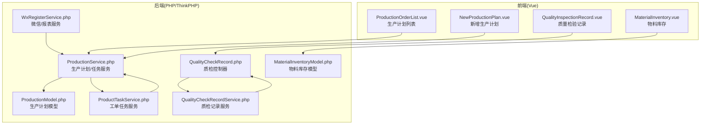
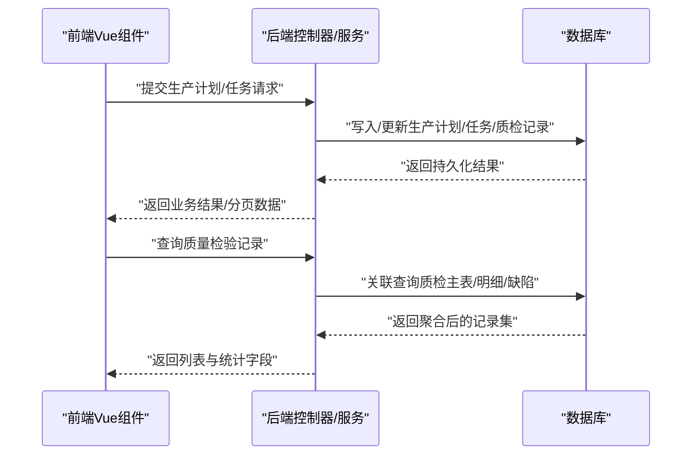
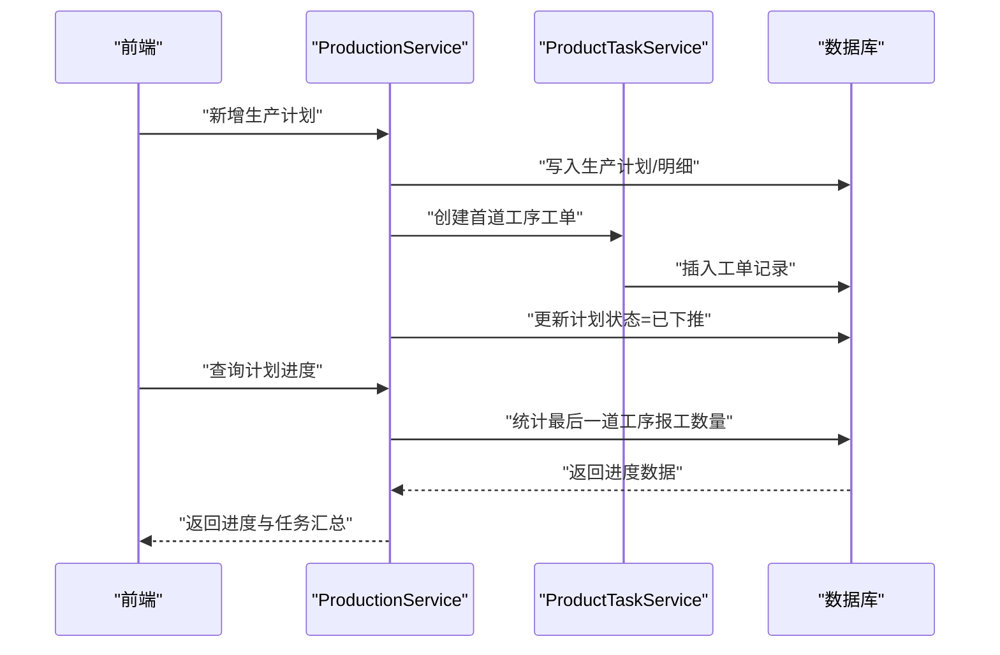
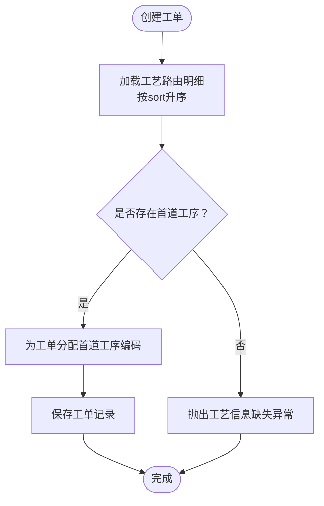
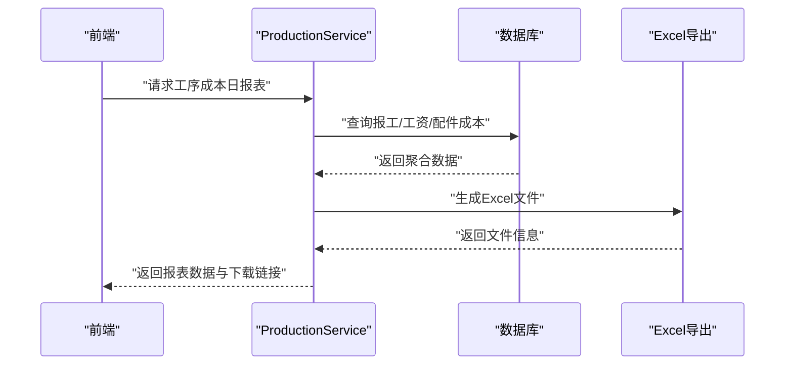
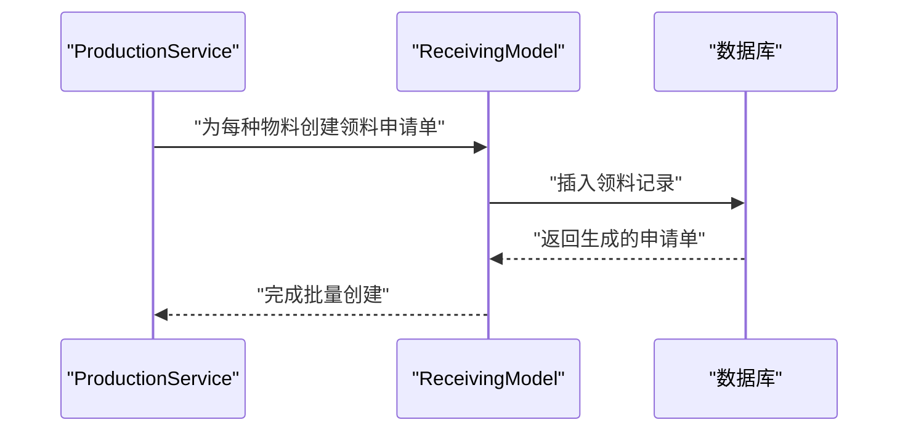
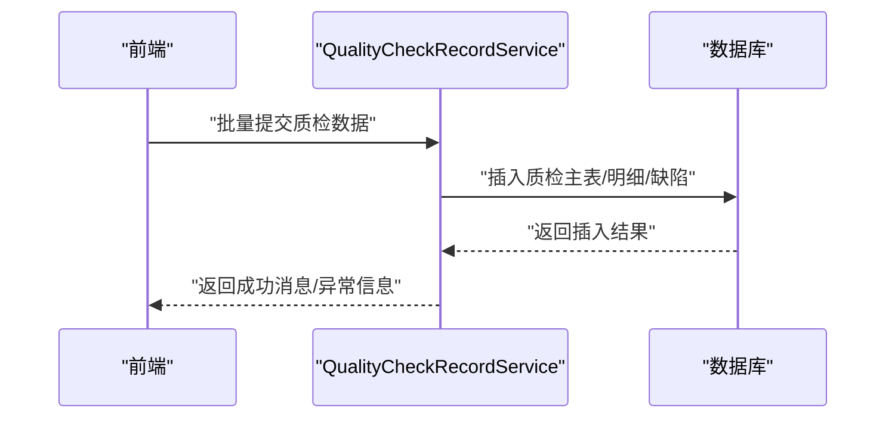
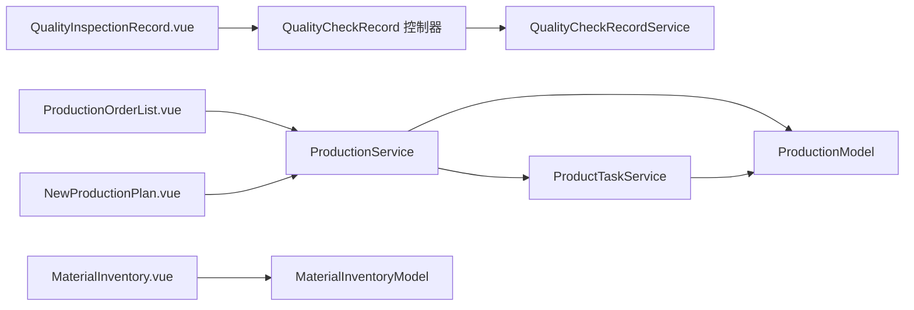

# 生产管理模块

<cite>
**本文档引用的文件**
- [ProductionOrderList.vue](file://yarn/src/views/mes/ProductionOrderList/ProductionOrderList.vue)
- [NewProductionPlan.vue](file://yarn/src/views/mes/ProductionOrderList/components/NewProductionPlan.vue)
- [QualityInspectionRecord.vue](file://yarn/src/views/mes/QualityInspectionRecord/QualityInspectionRecord.vue)
- [MaterialInventory.vue](file://yarn/src/views/mes/WarehouseManagement/MaterialInventory/MaterialInventory.vue)
- [ProductionService.php](file://gccd_server/app/common/service/admin/ProductionService.php)
- [ProductTaskService.php](file://gccd_server/app/common/service/admin/ProductTaskService.php)
- [QualityCheckRecordService.php](file://gccd_server/app/common/service/admin/QualityCheckRecordService.php)
- [ProductionModel.php](file://gccd_server/app/common/model/admin/ProductionModel.php)
- [MaterialInventoryModel.php](file://gccd_server/app/common/model/admin/MaterialInventoryModel.php)
- [QualityCheckRecord.php](file://gccd_server/app/admin/controller/production/QualityCheckRecord.php)
- [WxRegisterService.php](file://gccd_server/app/common/service/wechat/WxRegisterService.php)
</cite>

## 目录
1. [简介](#简介)
2. [项目结构](#项目结构)
3. [核心组件](#核心组件)
4. [架构总览](#架构总览)
5. [详细组件分析](#详细组件分析)
6. [依赖关系分析](#依赖关系分析)
7. [性能考虑](#性能考虑)
8. [故障排除指南](#故障排除指南)
9. [结论](#结论)
10. [附录](#附录)

## 简介
本文件面向高齿传动项目的生产管理模块，围绕工单管理、工序管理、生产报表统计、任务调度与资源分配、MRP与库存联动、质量控制与异常处理等方面，提供从架构到实现细节的系统化文档。目标是帮助开发与运维人员快速理解系统设计、掌握关键流程，并在实际部署与维护中高效落地最佳实践。

## 项目结构
生产管理模块由前端 Vue 组件与后端 ThinkPHP 服务层共同构成，覆盖生产计划、工单任务、质量检验、物料库存与报表统计等子域。前端通过 API 层与后端交互，后端以服务层封装业务逻辑，模型层负责数据映射与关联查询。

图表来源
- [ProductionOrderList.vue:1-434](file://yarn/src/views/mes/ProductionOrderList/ProductionOrderList.vue#L1-L434)
- [NewProductionPlan.vue:1-416](file://yarn/src/views/mes/ProductionOrderList/components/NewProductionPlan.vue#L1-L416)
- [QualityInspectionRecord.vue:1-440](file://yarn/src/views/mes/QualityInspectionRecord/QualityInspectionRecord.vue#L1-L440)
- [MaterialInventory.vue:1-377](file://yarn/src/views/mes/WarehouseManagement/MaterialInventory/MaterialInventory.vue#L1-L377)
- [ProductionService.php:1-799](file://gccd_server/app/common/service/admin/ProductionService.php#L1-L799)
- [ProductTaskService.php:1-299](file://gccd_server/app/common/service/admin/ProductTaskService.php#L1-L299)
- [QualityCheckRecordService.php:1-124](file://gccd_server/app/common/service/admin/QualityCheckRecordService.php#L1-L124)
- [ProductionModel.php:1-32](file://gccd_server/app/common/model/admin/ProductionModel.php#L1-L32)
- [MaterialInventoryModel.php:1-23](file://gccd_server/app/common/model/admin/MaterialInventoryModel.php#L1-L23)
- [QualityCheckRecord.php:1-45](file://gccd_server/app/admin/controller/production/QualityCheckRecord.php#L1-L45)
- [WxRegisterService.php:643-677](file://gccd_server/app/common/service/wechat/WxRegisterService.php#L643-L677)

章节来源
- [ProductionOrderList.vue:1-434](file://yarn/src/views/mes/ProductionOrderList/ProductionOrderList.vue#L1-L434)
- [ProductionService.php:1-799](file://gccd_server/app/common/service/admin/ProductionService.php#L1-L799)

## 核心组件
- 生产计划管理：前端提供列表、新增、编辑、导出、删除等功能；后端提供计划 CRUD、下推生产任务、进度统计与报表导出。
- 工单任务管理：后端服务负责任务创建、工序流转、报工统计与进度汇总。
- 质量检验管理：前端提供检索与详情抽屉；后端支持批量提交、明细统计与导出。
- 物料库存管理：前端按仓库分页展示；后端提供库存模型与关联查询。
- 报表统计：后端提供工序成本日报表生成与 Excel 导出，支持按日期聚合。

章节来源
- [ProductionOrderList.vue:220-424](file://yarn/src/views/mes/ProductionOrderList/ProductionOrderList.vue#L220-L424)
- [ProductionService.php:72-109](file://gccd_server/app/common/service/admin/ProductionService.php#L72-L109)
- [ProductTaskService.php:60-114](file://gccd_server/app/common/service/admin/ProductTaskService.php#L60-L114)
- [QualityInspectionRecord.vue:162-225](file://yarn/src/views/mes/QualityInspectionRecord/QualityInspectionRecord.vue#L162-L225)
- [QualityCheckRecordService.php:20-56](file://gccd_server/app/common/service/admin/QualityCheckRecordService.php#L20-L56)
- [MaterialInventory.vue:216-367](file://yarn/src/views/mes/WarehouseManagement/MaterialInventory/MaterialInventory.vue#L216-L367)
- [MaterialInventoryModel.php:1-23](file://gccd_server/app/common/model/admin/MaterialInventoryModel.php#L1-L23)

## 架构总览
生产管理采用前后端分离架构：前端 Vue 通过 API 与后端交互；后端以服务层封装业务规则，模型层负责数据映射与关联查询；控制器负责请求参数解析与响应封装。

图表来源
- [ProductionService.php:152-217](file://gccd_server/app/common/service/admin/ProductionService.php#L152-L217)
- [ProductTaskService.php:182-208](file://gccd_server/app/common/service/admin/ProductTaskService.php#L182-L208)
- [QualityCheckRecordService.php:20-56](file://gccd_server/app/common/service/admin/QualityCheckRecordService.php#L20-L56)

## 详细组件分析

### 工单管理系统（创建、分配、执行、跟踪、完成）
- 创建与下推：前端新增生产计划后，后端自动生成计划编号，写入计划与明细，并调用下推逻辑创建首道工序工单与领料单。
- 分配与执行：后端根据工艺路由顺序创建工单，记录工序编码与工艺编码，支持报工与工序流转。
- 跟踪与完成：后端统计最后一道工序的报工数量作为完成度，支持按计划查询进度。

图表来源
- [ProductionService.php:152-217](file://gccd_server/app/common/service/admin/ProductionService.php#L152-L217)
- [ProductionService.php:314-415](file://gccd_server/app/common/service/admin/ProductionService.php#L314-L415)
- [ProductionService.php:417-459](file://gccd_server/app/common/service/admin/ProductionService.php#L417-L459)
- [ProductTaskService.php:182-208](file://gccd_server/app/common/service/admin/ProductTaskService.php#L182-L208)

章节来源
- [ProductionOrderList.vue:297-320](file://yarn/src/views/mes/ProductionOrderList/ProductionOrderList.vue#L297-L320)
- [NewProductionPlan.vue:367-401](file://yarn/src/views/mes/ProductionOrderList/components/NewProductionPlan.vue#L367-L401)
- [ProductionService.php:314-415](file://gccd_server/app/common/service/admin/ProductionService.php#L314-L415)
- [ProductTaskService.php:60-114](file://gccd_server/app/common/service/admin/ProductTaskService.php#L60-L114)

### 工序管理（工艺路线、参数、优先级）
- 工艺路由：后端通过路由明细表按排序创建工序链路，首道工序自动分配给新建工单。
- 参数配置：工单包含工序编码、工艺编码、关联单号等字段，支持后续报工与流转。
- 优先级管理：当前实现基于路由排序决定执行顺序；如需优先级策略，可在路由明细中扩展字段并在服务层加入调度逻辑。

图表来源
- [ProductionService.php:357-384](file://gccd_server/app/common/service/admin/ProductionService.php#L357-L384)

章节来源
- [ProductionService.php:357-384](file://gccd_server/app/common/service/admin/ProductionService.php#L357-L384)
- [ProductTaskService.php:215-242](file://gccd_server/app/common/service/admin/ProductTaskService.php#L215-L242)

### 生产报表统计（数据采集、处理、展示）
- 数据采集：后端从报工记录、工资明细、领料单等维度采集数据。
- 处理逻辑：按工序聚合报工吨位、不良品数量、工单数量，计算单位成本与总成本。
- 展示与导出：前端展示汇总卡片与明细表格；后端生成 Excel 报表并返回下载地址。

图表来源
- [ProductionService.php:486-637](file://gccd_server/app/common/service/admin/ProductionService.php#L486-L637)
- [ProductionService.php:664-795](file://gccd_server/app/common/service/admin/ProductionService.php#L664-L795)

章节来源
- [ProductionService.php:486-637](file://gccd_server/app/common/service/admin/ProductionService.php#L486-L637)
- [ProductionService.php:664-795](file://gccd_server/app/common/service/admin/ProductionService.php#L664-L795)

### 生产任务调度与资源分配
- 调度策略：当前实现按工艺路由顺序自动派发到首道工序，未见显式的优先级/冲突避让算法。
- 资源分配：后端在创建工单时仅记录工序与工艺编码，未见设备/人员绑定逻辑；如需资源约束，可在路由明细或工单模型中扩展字段并完善服务层调度。

章节来源
- [ProductionService.php:357-384](file://gccd_server/app/common/service/admin/ProductionService.php#L357-L384)
- [ProductTaskService.php:182-208](file://gccd_server/app/common/service/admin/ProductTaskService.php#L182-L208)

### 物料需求计划（MRP）与库存联动
- MRP集成：后端在下推生产计划时，会为每种物料生成一条领料申请单，实现从生产到领料的闭环。
- 库存联动：库存模型提供物料与创建人关联，便于追溯；实际出入库可通过 WMS 流程对接。

图表来源
- [ProductionService.php:466-484](file://gccd_server/app/common/service/admin/ProductionService.php#L466-L484)
- [MaterialInventoryModel.php:1-23](file://gccd_server/app/common/model/admin/MaterialInventoryModel.php#L1-L23)

章节来源
- [ProductionService.php:466-484](file://gccd_server/app/common/service/admin/ProductionService.php#L466-L484)
- [MaterialInventoryModel.php:1-23](file://gccd_server/app/common/model/admin/MaterialInventoryModel.php#L1-L23)

### 质量控制点与异常处理
- 质量控制点：前端提供按工序与日期检索的质量检验记录，支持查看物料明细与不良项分布。
- 异常处理：后端服务支持批量提交质检数据，自动计算不良品总数；异常统一通过服务层抛出，前端捕获并提示。

图表来源
- [QualityCheckRecordService.php:61-122](file://gccd_server/app/common/service/admin/QualityCheckRecordService.php#L61-L122)
- [QualityCheckRecord.php:39-44](file://gccd_server/app/admin/controller/production/QualityCheckRecord.php#L39-L44)

章节来源
- [QualityInspectionRecord.vue:162-225](file://yarn/src/views/mes/QualityInspectionRecord/QualityInspectionRecord.vue#L162-L225)
- [QualityCheckRecordService.php:61-122](file://gccd_server/app/common/service/admin/QualityCheckRecordService.php#L61-L122)
- [QualityCheckRecord.php:17-44](file://gccd_server/app/admin/controller/production/QualityCheckRecord.php#L17-L44)

## 依赖关系分析
- 前端组件依赖 API 层，API 层依赖后端服务；服务层依赖模型层与数据库。
- 生产服务与工单服务耦合紧密，前者负责计划与下推，后者负责任务与报工。
- 质检服务独立于生产服务，但两者均可影响报表统计。

图表来源
- [ProductionOrderList.vue:220-226](file://yarn/src/views/mes/ProductionOrderList/ProductionOrderList.vue#L220-L226)
- [NewProductionPlan.vue:219-221](file://yarn/src/views/mes/ProductionOrderList/components/NewProductionPlan.vue#L219-L221)
- [QualityInspectionRecord.vue:163-163](file://yarn/src/views/mes/QualityInspectionRecord/QualityInspectionRecord.vue#L163-L163)
- [ProductionService.php:1-799](file://gccd_server/app/common/service/admin/ProductionService.php#L1-L799)
- [ProductTaskService.php:1-299](file://gccd_server/app/common/service/admin/ProductTaskService.php#L1-L299)
- [QualityCheckRecordService.php:1-124](file://gccd_server/app/common/service/admin/QualityCheckRecordService.php#L1-L124)
- [ProductionModel.php:1-32](file://gccd_server/app/common/model/admin/ProductionModel.php#L1-L32)
- [MaterialInventoryModel.php:1-23](file://gccd_server/app/common/model/admin/MaterialInventoryModel.php#L1-L23)

章节来源
- [ProductionService.php:1-799](file://gccd_server/app/common/service/admin/ProductionService.php#L1-L799)
- [ProductTaskService.php:1-299](file://gccd_server/app/common/service/admin/ProductTaskService.php#L1-L299)
- [QualityCheckRecordService.php:1-124](file://gccd_server/app/common/service/admin/QualityCheckRecordService.php#L1-L124)

## 性能考虑
- 分页与排序：后端列表接口默认按创建时间倒序，前端分页参数透传，避免一次性加载大量数据。
- 聚合查询：报表统计涉及多表关联与分组，建议在数据库层面建立合适索引（如工序编码、日期范围、关联单号）。
- 缓存策略：对于静态配置（如工艺路线、工序字典），可在服务层引入缓存减少重复查询。
- 导出性能：Excel 导出为服务端生成，建议限制导出范围与并发，必要时异步生成并提供下载链接。

## 故障排除指南
- 下推失败：检查生产计划是否存在、工艺编码是否填写、下推数量是否超过计划数量。
- 工单进度为 0：确认最后一道工序是否存在且报工记录是否正确。
- 质检提交异常：检查提交数据结构与必填字段，确保记录非空。
- 库存查询无数据：确认仓库类型与筛选条件，检查库存模型关联字段是否正确。

章节来源
- [ProductionService.php:324-355](file://gccd_server/app/common/service/admin/ProductionService.php#L324-L355)
- [ProductionService.php:417-459](file://gccd_server/app/common/service/admin/ProductionService.php#L417-L459)
- [QualityCheckRecordService.php:61-122](file://gccd_server/app/common/service/admin/QualityCheckRecordService.php#L61-L122)

## 结论
本模块以“计划—任务—质量—库存—报表”为主线，实现了从生产计划创建到工单执行、质量检验与成本统计的闭环。当前实现具备良好的扩展性，可在现有服务层基础上补充资源调度、优先级策略与更丰富的报表维度，以满足复杂场景下的生产管理需求。

## 附录
- 最佳实践
  - 在路由明细中明确工序顺序与关键控制点，确保执行一致性。
  - 对报表统计的关键字段建立索引，提升查询性能。
  - 将异常处理标准化，前端统一提示，后端记录日志以便追踪。
- 常见问题
  - 工单无法下推：核对计划状态与工艺配置。
  - 报表数据不准确：检查报工与工资统计的时间范围与关联关系。
- 性能优化建议
  - 分页与懒加载结合，避免全量拉取。
  - 对高频查询引入缓存，降低数据库压力。
  - 导出任务异步化，避免阻塞主线程。