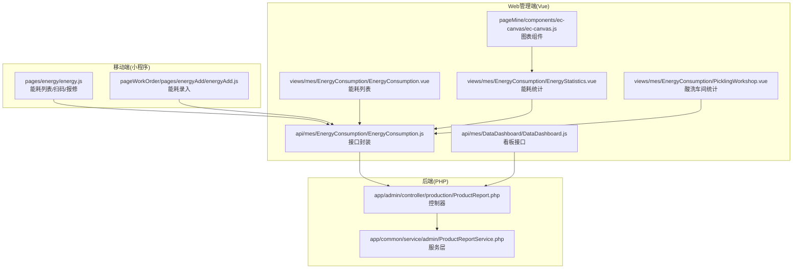
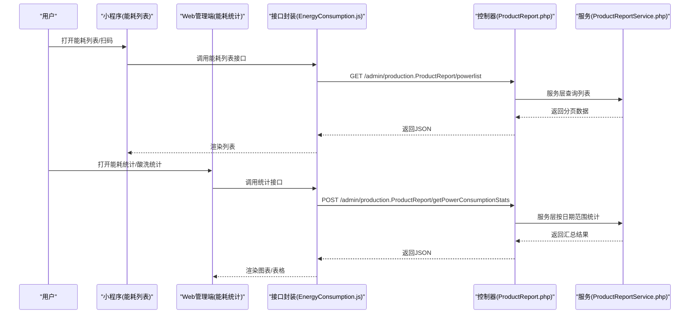
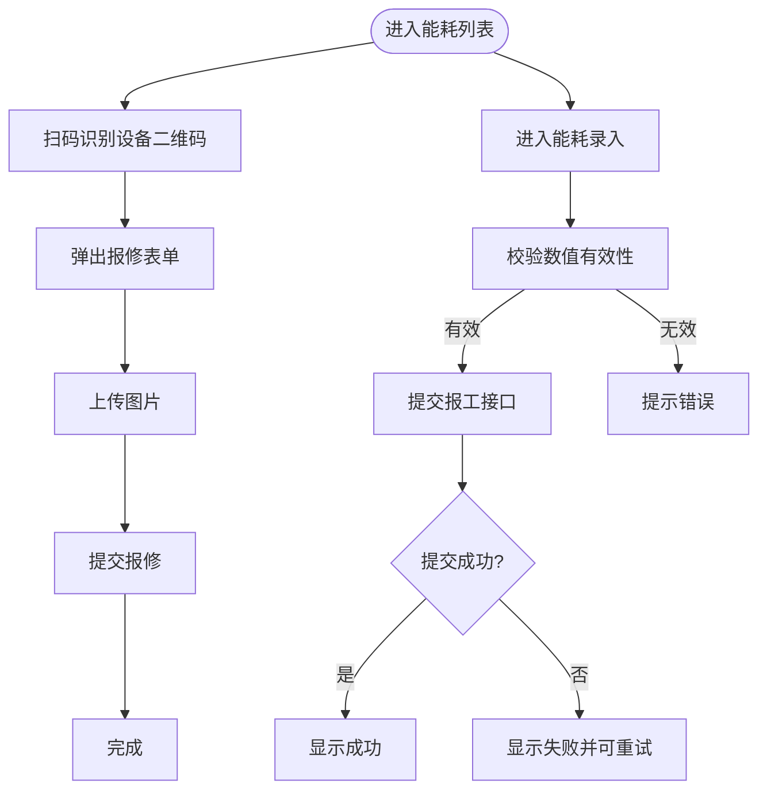
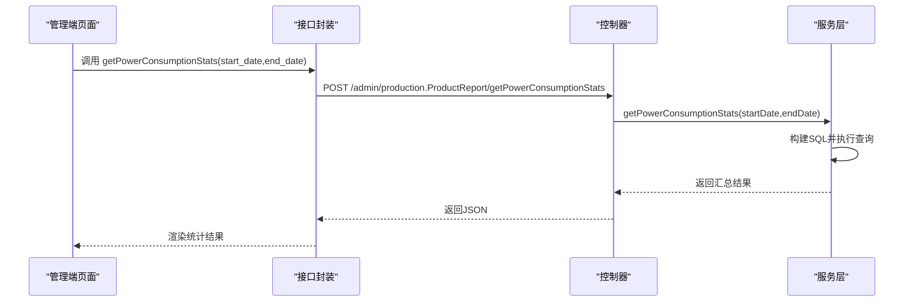
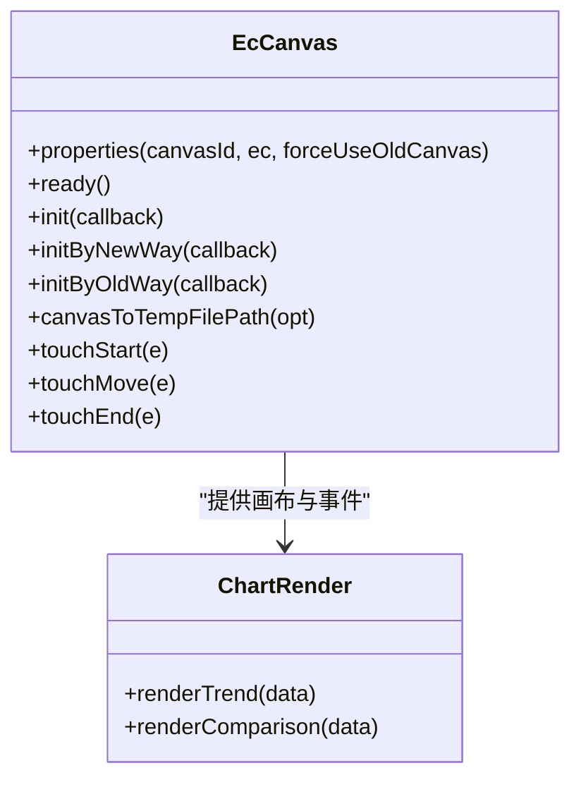
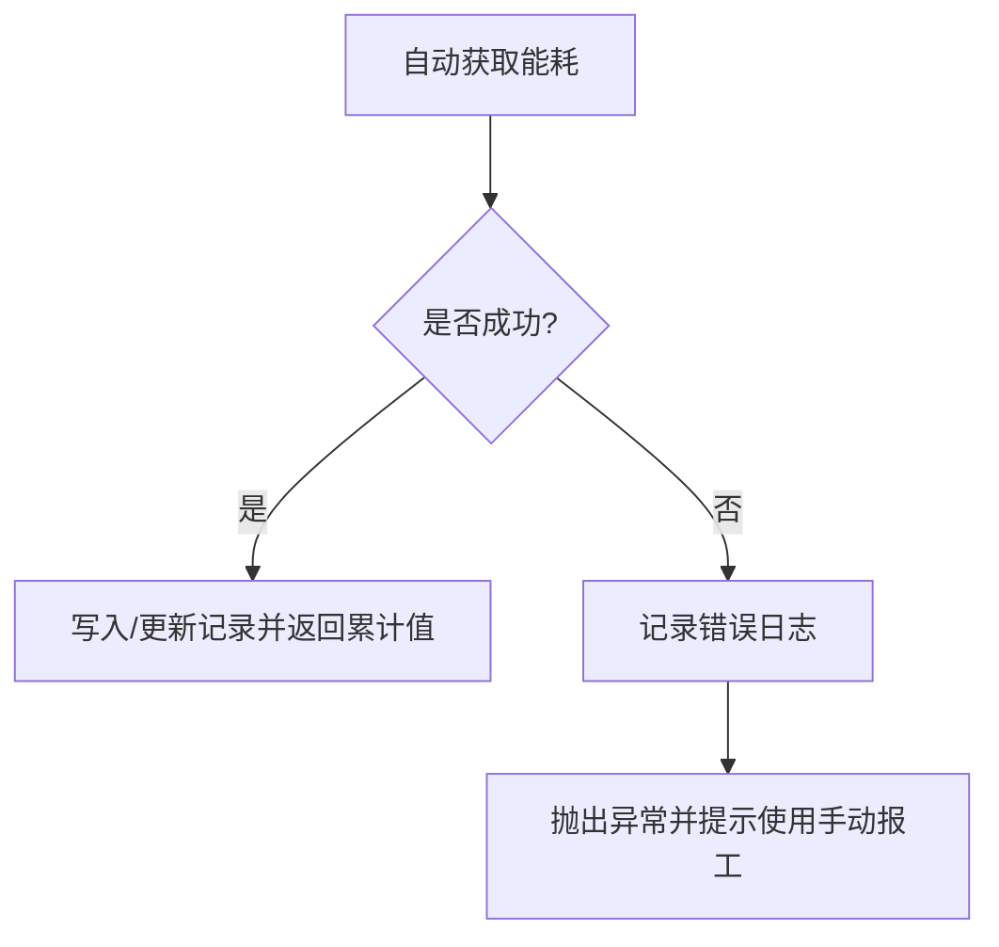
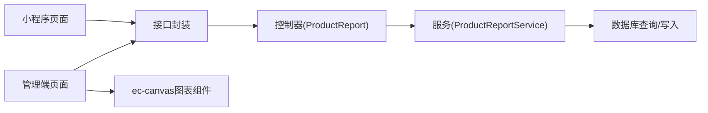

# 能源管理模块

<cite>
**本文引用的文件**
- [gccd_mini/pages/energy/energy.js](file://gccd_mini/pages/energy/energy.js)
- [gccd_mini/pages/energy/energy.json](file://gccd_mini/pages/energy/energy.json)
- [gccd_mini/pageWorkOrder/pages/energyAdd/energyAdd.js](file://gccd_mini/pageWorkOrder/pages/energyAdd/energyAdd.js)
- [gccd_server/app/admin/controller/production/ProductReport.php](file://gccd_server/app/admin/controller/production/ProductReport.php)
- [gccd_server/app/common/service/admin/ProductReportService.php](file://gccd_server/app/common/service/admin/ProductReportService.php)
- [yarn/src/api/mes/EnergyConsumption/EnergyConsumption.js](file://yarn/src/api/mes/EnergyConsumption/EnergyConsumption.js)
- [yarn/src/views/mes/EnergyConsumption/EnergyConsumption.vue](file://yarn/src/views/mes/EnergyConsumption/EnergyConsumption.vue)
- [yarn/src/views/mes/EnergyConsumption/EnergyStatistics.vue](file://yarn/src/views/mes/EnergyConsumption/EnergyStatistics.vue)
- [yarn/src/views/mes/EnergyConsumption/PicklingWorkshop.vue](file://yarn/src/views/mes/EnergyConsumption/PicklingWorkshop.vue)
- [yarn/src/api/mes/DataDashboard/DataDashboard.js](file://yarn/src/api/mes/DataDashboard/DataDashboard.js)
- [gccd_mini/pageMine/components/ec-canvas/ec-canvas.js](file://gccd_mini/pageMine/components/ec-canvas/ec-canvas.js)
- [gccd_mini/pageMine/components/ec-canvas/ec-canvas.wxss](file://gccd_mini/pageMine/components/ec-canvas/ec-canvas.wxss)
</cite>

## 目录
1. [简介](#简介)
2. [项目结构](#项目结构)
3. [核心组件](#核心组件)
4. [架构总览](#架构总览)
5. [详细组件分析](#详细组件分析)
6. [依赖关系分析](#依赖关系分析)
7. [性能考量](#性能考量)
8. [故障排查指南](#故障排查指南)
9. [结论](#结论)
10. [附录](#附录)

## 简介
本模块围绕“高齿传动”项目的能源管理需求，提供电耗统计与分析能力，覆盖分区域、分设备、分工序的能耗计量与统计；构建能耗监控仪表板，支持实时能耗显示、历史趋势分析、能耗对比展示与异常报警；实现单位产品电耗计算、能耗效率评估、节能潜力分析与成本核算；并通过各车间/生产线的能耗对比与排名机制推动持续改进；同时包含能耗数据质量控制与异常处理机制，以及最佳实践与节能策略建议。

## 项目结构
能源管理模块由三部分组成：
- 移动端（小程序）：能耗录入、列表查看、扫码报修等前端交互。
- Web 管理端（Vue）：能耗统计、酸洗车间能耗汇总、图表展示、数据筛选与导出。
- 后端服务（PHP/ThinkAdmin）：提供能耗数据的采集、计算、统计与查询接口。

**图表来源**
- [gccd_mini/pages/energy/energy.js:1-480](file://gccd_mini/pages/energy/energy.js#L1-L480)
- [gccd_mini/pageWorkOrder/pages/energyAdd/energyAdd.js:1-187](file://gccd_mini/pageWorkOrder/pages/energyAdd/energyAdd.js#L1-L187)
- [yarn/src/views/mes/EnergyConsumption/EnergyConsumption.vue:1-200](file://yarn/src/views/mes/EnergyConsumption/EnergyConsumption.vue#L1-L200)
- [yarn/src/views/mes/EnergyConsumption/EnergyStatistics.vue:1-160](file://yarn/src/views/mes/EnergyConsumption/EnergyStatistics.vue#L1-L160)
- [yarn/src/views/mes/EnergyConsumption/PicklingWorkshop.vue:1-120](file://yarn/src/views/mes/EnergyConsumption/PicklingWorkshop.vue#L1-L120)
- [yarn/src/api/mes/EnergyConsumption/EnergyConsumption.js:1-101](file://yarn/src/api/mes/EnergyConsumption/EnergyConsumption.js#L1-L101)
- [yarn/src/api/mes/DataDashboard/DataDashboard.js:1-16](file://yarn/src/api/mes/DataDashboard/DataDashboard.js#L1-L16)
- [gccd_mini/pageMine/components/ec-canvas/ec-canvas.js:1-285](file://gccd_mini/pageMine/components/ec-canvas/ec-canvas.js#L1-L285)
- [gccd_server/app/admin/controller/production/ProductReport.php:1-200](file://gccd_server/app/admin/controller/production/ProductReport.php#L1-L200)
- [gccd_server/app/common/service/admin/ProductReportService.php:1170-1262](file://gccd_server/app/common/service/admin/ProductReportService.php#L1170-L1262)

**章节来源**
- [gccd_mini/pages/energy/energy.js:1-480](file://gccd_mini/pages/energy/energy.js#L1-L480)
- [gccd_mini/pageWorkOrder/pages/energyAdd/energyAdd.js:1-187](file://gccd_mini/pageWorkOrder/pages/energyAdd/energyAdd.js#L1-L187)
- [yarn/src/views/mes/EnergyConsumption/EnergyConsumption.vue:1-200](file://yarn/src/views/mes/EnergyConsumption/EnergyConsumption.vue#L1-L200)
- [yarn/src/views/mes/EnergyConsumption/EnergyStatistics.vue:1-160](file://yarn/src/views/mes/EnergyConsumption/EnergyStatistics.vue#L1-L160)
- [yarn/src/views/mes/EnergyConsumption/PicklingWorkshop.vue:1-120](file://yarn/src/views/mes/EnergyConsumption/PicklingWorkshop.vue#L1-L120)
- [yarn/src/api/mes/EnergyConsumption/EnergyConsumption.js:1-101](file://yarn/src/api/mes/EnergyConsumption/EnergyConsumption.js#L1-L101)
- [yarn/src/api/mes/DataDashboard/DataDashboard.js:1-16](file://yarn/src/api/mes/DataDashboard/DataDashboard.js#L1-L16)
- [gccd_mini/pageMine/components/ec-canvas/ec-canvas.js:1-285](file://gccd_mini/pageMine/components/ec-canvas/ec-canvas.js#L1-L285)
- [gccd_server/app/admin/controller/production/ProductReport.php:1-200](file://gccd_server/app/admin/controller/production/ProductReport.php#L1-L200)
- [gccd_server/app/common/service/admin/ProductReportService.php:1170-1262](file://gccd_server/app/common/service/admin/ProductReportService.php#L1170-L1262)

## 核心组件
- 移动端能耗列表与扫码报修：提供能耗记录的浏览、分页、下拉刷新、上拉加载，支持扫码识别设备二维码并弹出报修表单，支持图片上传与报修提交。
- 能耗录入（小程序）：提供能耗录入界面，校验电力/气力消耗数值有效性，提交至后端报工接口。
- Web 管理端能耗列表与统计：提供能耗记录的筛选、分页、批量删除；能耗统计页面支持按日/月维度聚合；酸洗车间统计页面支持按日期范围汇总磷化、皂化、碱液消耗。
- 后端接口与服务：提供能耗列表、编辑、删除、报工、能耗统计等接口；服务层负责能耗数据的自动/手动采集、历史累计与异常处理。
- 图表组件：基于 ec-canvas 的 ECharts 小程序组件，支持图表初始化、触摸交互与截图导出。

**章节来源**
- [gccd_mini/pages/energy/energy.js:1-480](file://gccd_mini/pages/energy/energy.js#L1-L480)
- [gccd_mini/pageWorkOrder/pages/energyAdd/energyAdd.js:1-187](file://gccd_mini/pageWorkOrder/pages/energyAdd/energyAdd.js#L1-L187)
- [yarn/src/views/mes/EnergyConsumption/EnergyConsumption.vue:80-140](file://yarn/src/views/mes/EnergyConsumption/EnergyConsumption.vue#L80-L140)
- [yarn/src/views/mes/EnergyConsumption/EnergyStatistics.vue:80-160](file://yarn/src/views/mes/EnergyConsumption/EnergyStatistics.vue#L80-L160)
- [yarn/src/views/mes/EnergyConsumption/PicklingWorkshop.vue:33-120](file://yarn/src/views/mes/EnergyConsumption/PicklingWorkshop.vue#L33-L120)
- [gccd_server/app/admin/controller/production/ProductReport.php:184-200](file://gccd_server/app/admin/controller/production/ProductReport.php#L184-L200)
- [gccd_server/app/common/service/admin/ProductReportService.php:1170-1262](file://gccd_server/app/common/service/admin/ProductReportService.php#L1170-L1262)
- [gccd_mini/pageMine/components/ec-canvas/ec-canvas.js:1-285](file://gccd_mini/pageMine/components/ec-canvas/ec-canvas.js#L1-L285)

## 架构总览
系统采用前后端分离架构：
- 前端通过统一 API 封装调用后端控制器；
- 控制器将参数交给服务层进行业务处理；
- 服务层执行数据查询、计算与写入；
- 图表组件在管理端渲染趋势与对比数据。

**图表来源**
- [yarn/src/api/mes/EnergyConsumption/EnergyConsumption.js:57-100](file://yarn/src/api/mes/EnergyConsumption/EnergyConsumption.js#L57-L100)
- [gccd_server/app/admin/controller/production/ProductReport.php:399-415](file://gccd_server/app/admin/controller/production/ProductReport.php#L399-L415)
- [gccd_server/app/common/service/admin/ProductReportService.php:1204-1259](file://gccd_server/app/common/service/admin/ProductReportService.php#L1204-L1259)

## 详细组件分析

### 数据采集与录入流程
- 小程序能耗列表：支持扫码识别设备二维码，弹出报修表单，上传图片并提交报修；同时提供能耗列表的分页与刷新。
- 能耗录入：校验电力/气力消耗数值有效性，提交报工接口，返回成功提示或错误信息。

**图表来源**
- [gccd_mini/pages/energy/energy.js:106-195](file://gccd_mini/pages/energy/energy.js#L106-L195)
- [gccd_mini/pageWorkOrder/pages/energyAdd/energyAdd.js:37-130](file://gccd_mini/pageWorkOrder/pages/energyAdd/energyAdd.js#L37-L130)

**章节来源**
- [gccd_mini/pages/energy/energy.js:106-195](file://gccd_mini/pages/energy/energy.js#L106-L195)
- [gccd_mini/pageWorkOrder/pages/energyAdd/energyAdd.js:37-130](file://gccd_mini/pageWorkOrder/pages/energyAdd/energyAdd.js#L37-L130)

### 能耗统计与分析（Web端）
- 能耗列表：支持按工艺编码、关联单号、工序编码、设备编码、日期范围等筛选，分页加载，支持批量删除。
- 能耗统计：按日/月维度聚合，支持选择多日进行对比；支持导出与图表展示。
- 酸洗车间统计：按日期范围汇总磷化、皂化、碱液消耗，支持搜索与重置。

**图表来源**
- [yarn/src/views/mes/EnergyConsumption/PicklingWorkshop.vue:33-120](file://yarn/src/views/mes/EnergyConsumption/PicklingWorkshop.vue#L33-L120)
- [yarn/src/api/mes/EnergyConsumption/EnergyConsumption.js:94-100](file://yarn/src/api/mes/EnergyConsumption/EnergyConsumption.js#L94-L100)
- [gccd_server/app/admin/controller/production/ProductReport.php:399-415](file://gccd_server/app/admin/controller/production/ProductReport.php#L399-L415)
- [gccd_server/app/common/service/admin/ProductReportService.php:1204-1259](file://gccd_server/app/common/service/admin/ProductReportService.php#L1204-L1259)

**章节来源**
- [yarn/src/views/mes/EnergyConsumption/EnergyConsumption.vue:80-140](file://yarn/src/views/mes/EnergyConsumption/EnergyConsumption.vue#L80-L140)
- [yarn/src/views/mes/EnergyConsumption/EnergyStatistics.vue:80-160](file://yarn/src/views/mes/EnergyConsumption/EnergyStatistics.vue#L80-L160)
- [yarn/src/views/mes/EnergyConsumption/PicklingWorkshop.vue:33-120](file://yarn/src/views/mes/EnergyConsumption/PicklingWorkshop.vue#L33-L120)
- [yarn/src/api/mes/EnergyConsumption/EnergyConsumption.js:57-100](file://yarn/src/api/mes/EnergyConsumption/EnergyConsumption.js#L57-L100)
- [gccd_server/app/admin/controller/production/ProductReport.php:399-415](file://gccd_server/app/admin/controller/production/ProductReport.php#L399-L415)
- [gccd_server/app/common/service/admin/ProductReportService.php:1204-1259](file://gccd_server/app/common/service/admin/ProductReportService.php#L1204-L1259)

### 实时监控与历史趋势（图表组件）
- ec-canvas 组件：兼容新旧微信基础库版本，支持初始化、触摸交互、图表事件绑定与截图导出，用于在管理端渲染趋势与对比图表。
- 数据来源：Web端通过接口获取统计数据，传入图表组件进行渲染。

**图表来源**
- [gccd_mini/pageMine/components/ec-canvas/ec-canvas.js:31-285](file://gccd_mini/pageMine/components/ec-canvas/ec-canvas.js#L31-L285)

**章节来源**
- [gccd_mini/pageMine/components/ec-canvas/ec-canvas.js:31-285](file://gccd_mini/pageMine/components/ec-canvas/ec-canvas.js#L31-L285)
- [gccd_mini/pageMine/components/ec-canvas/ec-canvas.wxss:1-4](file://gccd_mini/pageMine/components/ec-canvas/ec-canvas.wxss#L1-L4)

### 异常报警与质量控制
- 异常处理：服务层在自动获取设备能耗失败时记录日志并抛出异常，提示使用手动报工方式。
- 质量控制：前端对能耗录入进行数值校验；后端接口对日期范围与必填字段进行约束；列表支持按多条件筛选与精确搜索。

**图表来源**
- [gccd_server/app/common/service/admin/ProductReportService.php:1189-1194](file://gccd_server/app/common/service/admin/ProductReportService.php#L1189-L1194)

**章节来源**
- [gccd_server/app/common/service/admin/ProductReportService.php:1189-1194](file://gccd_server/app/common/service/admin/ProductReportService.php#L1189-L1194)
- [gccd_mini/pageWorkOrder/pages/energyAdd/energyAdd.js:37-55](file://gccd_mini/pageWorkOrder/pages/energyAdd/energyAdd.js#L37-L55)

## 依赖关系分析
- 前端依赖关系
  - 页面组件依赖接口封装，接口封装统一调用后端控制器。
  - 图表组件独立于业务页面，仅依赖 ECharts 与 Canvas。
- 后端依赖关系
  - 控制器依赖服务层；服务层依赖数据库查询与事务处理。
- 数据流
  - 小程序与Web端通过统一接口访问后端；后端按业务规则返回结构化数据。

**图表来源**
- [yarn/src/api/mes/EnergyConsumption/EnergyConsumption.js:1-101](file://yarn/src/api/mes/EnergyConsumption/EnergyConsumption.js#L1-L101)
- [gccd_server/app/admin/controller/production/ProductReport.php:1-200](file://gccd_server/app/admin/controller/production/ProductReport.php#L1-L200)
- [gccd_server/app/common/service/admin/ProductReportService.php:1170-1262](file://gccd_server/app/common/service/admin/ProductReportService.php#L1170-L1262)
- [gccd_mini/pageMine/components/ec-canvas/ec-canvas.js:1-285](file://gccd_mini/pageMine/components/ec-canvas/ec-canvas.js#L1-L285)

**章节来源**
- [yarn/src/api/mes/EnergyConsumption/EnergyConsumption.js:1-101](file://yarn/src/api/mes/EnergyConsumption/EnergyConsumption.js#L1-L101)
- [gccd_server/app/admin/controller/production/ProductReport.php:1-200](file://gccd_server/app/admin/controller/production/ProductReport.php#L1-L200)
- [gccd_server/app/common/service/admin/ProductReportService.php:1170-1262](file://gccd_server/app/common/service/admin/ProductReportService.php#L1170-L1262)
- [gccd_mini/pageMine/components/ec-canvas/ec-canvas.js:1-285](file://gccd_mini/pageMine/components/ec-canvas/ec-canvas.js#L1-L285)

## 性能考量
- 列表分页与懒加载：移动端能耗列表支持分页与上拉加载，避免一次性加载大量数据。
- 图表性能：ec-canvas 在新旧微信基础库版本间自动选择初始化方式，减少兼容性问题带来的性能损耗。
- 接口幂等与缓存：建议在管理端对常用统计结果进行短期缓存，降低重复查询压力。
- 数据库查询：服务层按日期范围构建条件查询，避免全表扫描；建议在关键字段建立索引。

## 故障排查指南
- 小程序扫码/上传失败
  - 检查扫码权限与相机授权；确认图片压缩与上传流程正常。
  - 参考路径：[gccd_mini/pages/energy/energy.js:106-195](file://gccd_mini/pages/energy/energy.js#L106-L195)
- 能耗录入失败
  - 校验输入数值是否为正数且为有效数字；检查网络状态与接口返回。
  - 参考路径：[gccd_mini/pageWorkOrder/pages/energyAdd/energyAdd.js:37-130](file://gccd_mini/pageWorkOrder/pages/energyAdd/energyAdd.js#L37-L130)
- 统计接口异常
  - 确认日期范围参数格式正确；查看后端异常日志与抛出信息。
  - 参考路径：[gccd_server/app/common/service/admin/ProductReportService.php:1189-1194](file://gccd_server/app/common/service/admin/ProductReportService.php#L1189-L1194)
- 图表渲染异常
  - 检查 ec-canvas 版本兼容性与画布尺寸；确认初始化回调正确执行。
  - 参考路径：[gccd_mini/pageMine/components/ec-canvas/ec-canvas.js:74-192](file://gccd_mini/pageMine/components/ec-canvas/ec-canvas.js#L74-L192)

**章节来源**
- [gccd_mini/pages/energy/energy.js:106-195](file://gccd_mini/pages/energy/energy.js#L106-L195)
- [gccd_mini/pageWorkOrder/pages/energyAdd/energyAdd.js:37-130](file://gccd_mini/pageWorkOrder/pages/energyAdd/energyAdd.js#L37-L130)
- [gccd_server/app/common/service/admin/ProductReportService.php:1189-1194](file://gccd_server/app/common/service/admin/ProductReportService.php#L1189-L1194)
- [gccd_mini/pageMine/components/ec-canvas/ec-canvas.js:74-192](file://gccd_mini/pageMine/components/ec-canvas/ec-canvas.js#L74-L192)

## 结论
本模块通过移动端录入、Web端统计与后端服务协同，实现了从数据采集、处理到分析与可视化的完整闭环。结合酸洗车间能耗统计与图表组件，能够满足分区域、分设备、分工序的能耗计量与对比需求；通过异常处理与质量控制机制保障数据可靠性；后续可在接口缓存、索引优化与报表自动化方面进一步提升性能与用户体验。

## 附录
- 最佳实践
  - 建议在生产现场部署稳定的能耗采集设备，减少手工录入误差。
  - 对高频查询的统计结果进行缓存，缩短响应时间。
  - 定期对数据库关键字段建立索引，优化日期范围查询。
- 节能减排策略
  - 基于能耗统计结果识别高耗能工序与设备，制定节能改造计划。
  - 引入能效对标与KPI考核，推动各车间/生产线节能竞赛。
  - 结合成本核算，量化节能收益，形成持续改进闭环。