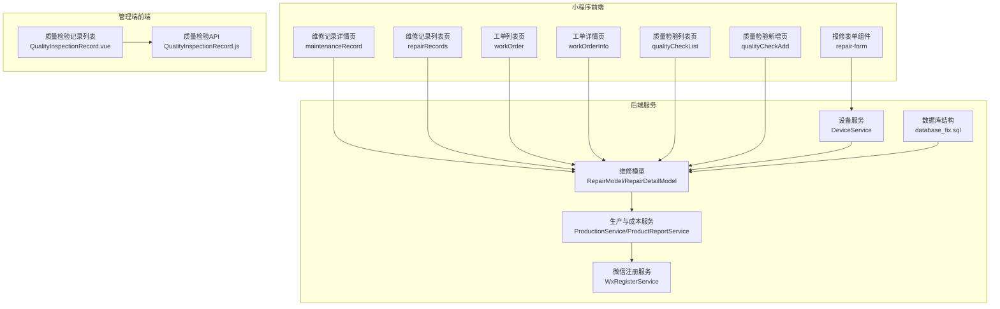
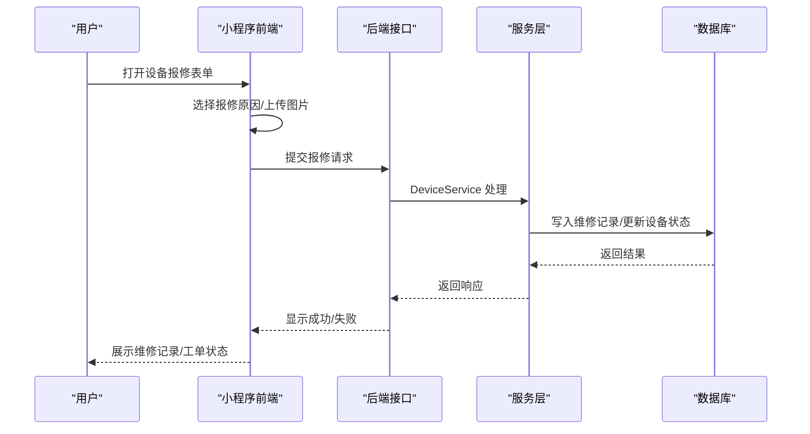
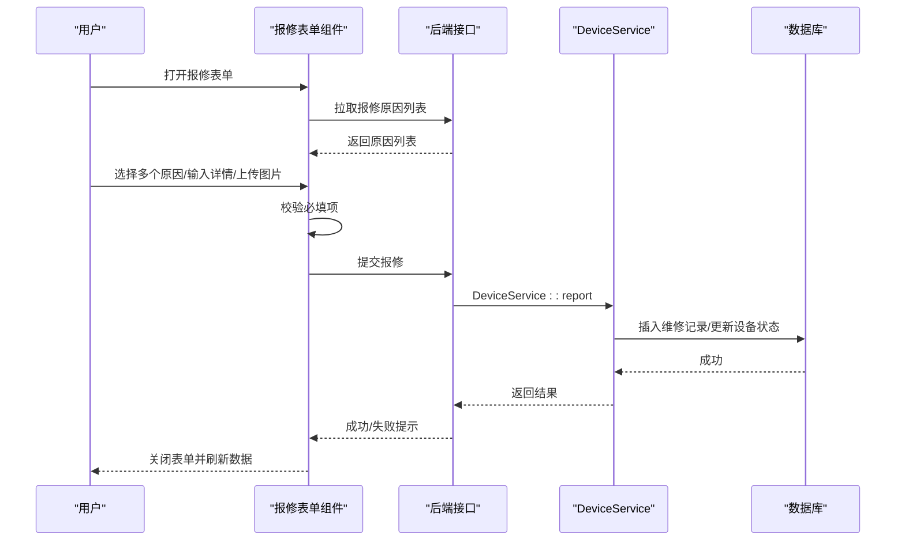
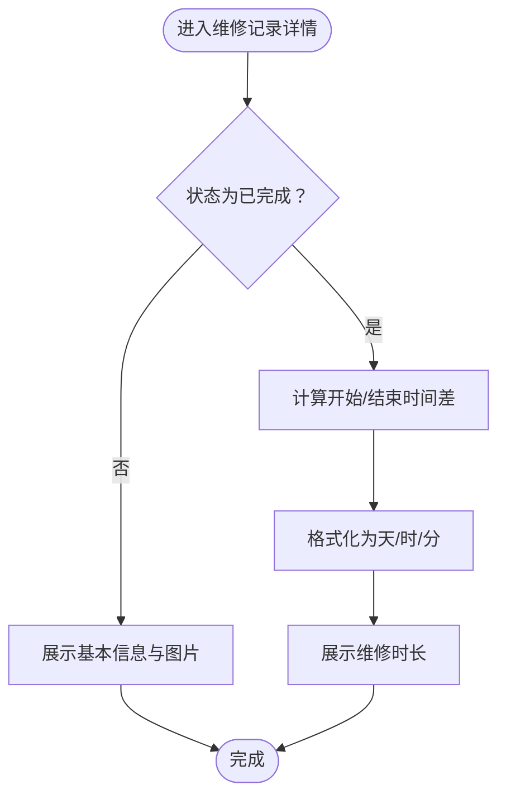
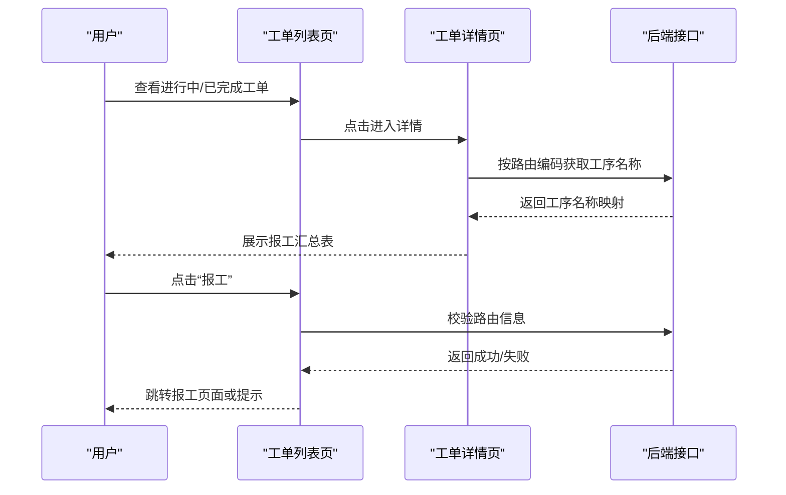
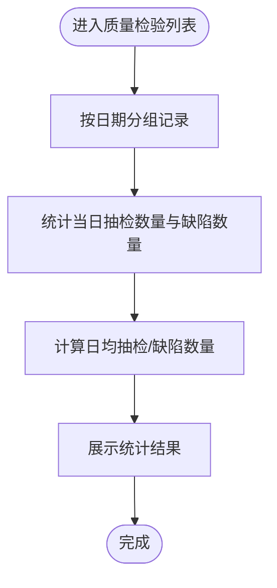
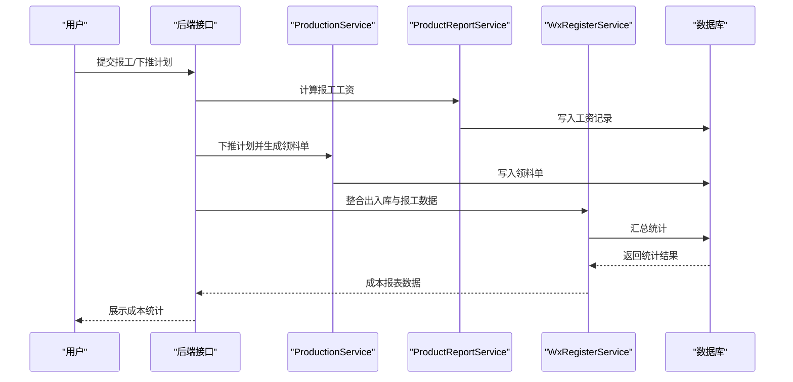
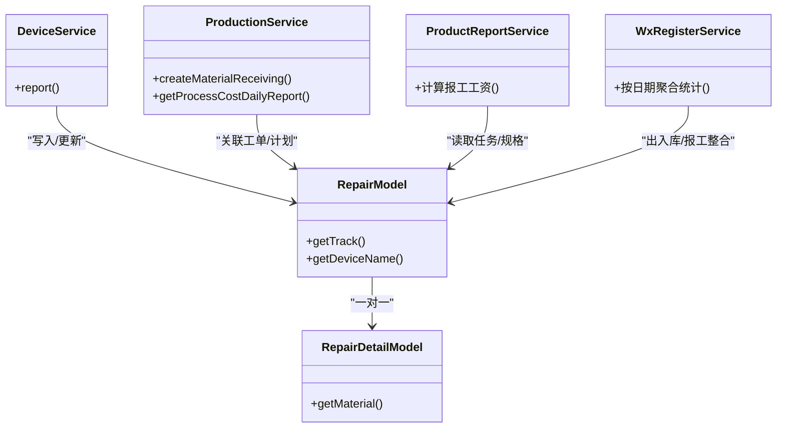

# 维修管理

<cite>
**本文引用的文件**
- [repair-form.wxml](file://gccd_mini/pages/components/repair-form/repair-form.wxml)
- [repair-form.js](file://gccd_mini/pages/components/repair-form/repair-form.js)
- [maintenanceRecord.js](file://gccd_mini/pageEquipment/pages/maintenanceRecord/maintenanceRecord.js)
- [maintenanceRecord.wxss](file://gccd_mini/pageEquipment/pages/maintenanceRecord/maintenanceRecord.wxss)
- [repairRecords.js](file://gccd_mini/pageEquipment/pages/repairRecords/repairRecords.js)
- [repairRecords.wxml](file://gccd_mini/pageEquipment/pages/repairRecords/repairRecords.wxml)
- [repairRecords.wxss](file://gccd_mini/pageEquipment/pages/repairRecords/repairRecords.wxss)
- [workOrder.js](file://gccd_mini/pages/workOrder/workOrder.js)
- [workOrder.wxml](file://gccd_mini/pages/workOrder/workOrder.wxml)
- [workOrderInfo.js](file://gccd_mini/pageWorkOrder/pages/workOrderInfo/workOrderInfo.js)
- [qualityCheckList.js](file://gccd_mini/pageWorkOrder/pages/qualityCheckList/qualityCheckList.js)
- [qualityCheckAdd.wxml](file://gccd_mini/pageWorkOrder/pages/qualityCheckAdd/qualityCheckAdd.wxml)
- [RepairModel.php](file://gccd_server/app/common/model/admin/RepairModel.php)
- [RepairDetailModel.php](file://gccd_server/app/common/model/admin/RepairDetailModel.php)
- [DeviceService.php](file://gccd_server/app/common/service/admin/DeviceService.php)
- [ProductionService.php](file://gccd_server/app/common/service/admin/ProductionService.php)
- [ProductReportService.php](file://gccd_server/app/common/service/admin/ProductReportService.php)
- [WxRegisterService.php](file://gccd_server/app/common/service/wechat/WxRegisterService.php)
- [QualityInspectionRecord.vue](file://yarn/src/views/mes/QualityInspectionRecord/QualityInspectionRecord.vue)
- [QualityInspectionRecord.js](file://yarn/src/api/mes/QualityInspectionRecord/QualityInspectionRecord.js)
- [database_fix.sql](file://gccd_server/database_fix.sql)
</cite>

## 目录
1. [简介](#简介)
2. [项目结构](#项目结构)
3. [核心组件](#核心组件)
4. [架构总览](#架构总览)
5. [详细组件分析](#详细组件分析)
6. [依赖关系分析](#依赖关系分析)
7. [性能考量](#性能考量)
8. [故障排查指南](#故障排查指南)
9. [结论](#结论)
10. [附录](#附录)

## 简介
本文件面向“设备维修管理系统”，系统覆盖从“故障发现—故障报修—故障诊断—维修派工—维修完成”的全生命周期管理，同时提供维修工单的创建、审批、执行与关闭机制；涵盖维修类型分类、紧急程度分级、维修资源调配与进度跟踪；实现维修成本管理（人工、材料、外委）的核算与统计；建立维修质量控制体系（标准执行、质量检验与验收）；并提供维修数据分析（故障原因、维修效率、备件消耗、成本趋势）。此外，系统支持维修知识库与经验分享机制，配套标准化流程与质量保证措施。

## 项目结构
系统由三部分组成：
- 小程序前端（设备端）：负责设备报修、维修记录查看、工单执行与质量检验。
- 后端服务（ThinkPHP）：提供维修工单、设备状态、报工与成本统计等核心业务能力。
- 管理端前端（Vue）：提供维修基础设置、质量检验记录与报表统计。

图表来源
- [repair-form.wxml:1-39](file://gccd_mini/pages/components/repair-form/repair-form.wxml#L1-L39)
- [repair-form.js:1-261](file://gccd_mini/pages/components/repair-form/repair-form.js#L1-L261)
- [maintenanceRecord.js:1-154](file://gccd_mini/pageEquipment/pages/maintenanceRecord/maintenanceRecord.js#L1-L154)
- [repairRecords.js:1-119](file://gccd_mini/pageEquipment/pages/repairRecords/repairRecords.js#L1-L119)
- [workOrder.js:134-162](file://gccd_mini/pages/workOrder/workOrder.js#L134-L162)
- [workOrderInfo.js:1-49](file://gccd_mini/pageWorkOrder/pages/workOrderInfo/workOrderInfo.js#L1-L49)
- [qualityCheckList.js:102-116](file://gccd_mini/pageWorkOrder/pages/qualityCheckList/qualityCheckList.js#L102-L116)
- [qualityCheckAdd.wxml:1-13](file://gccd_mini/pageWorkOrder/pages/qualityCheckAdd/qualityCheckAdd.wxml#L1-L13)
- [DeviceService.php:489-520](file://gccd_server/app/common/service/admin/DeviceService.php#L489-L520)
- [RepairModel.php:1-32](file://gccd_server/app/common/model/admin/RepairModel.php#L1-L32)
- [RepairDetailModel.php:1-21](file://gccd_server/app/common/model/admin/RepairDetailModel.php#L1-L21)
- [ProductionService.php:383-489](file://gccd_server/app/common/service/admin/ProductionService.php#L383-L489)
- [ProductReportService.php:772-806](file://gccd_server/app/common/service/admin/ProductReportService.php#L772-L806)
- [WxRegisterService.php:882-901](file://gccd_server/app/common/service/wechat/WxRegisterService.php#L882-L901)
- [QualityInspectionRecord.vue:166-232](file://yarn/src/views/mes/QualityInspectionRecord/QualityInspectionRecord.vue#L166-L232)
- [QualityInspectionRecord.js:1-63](file://yarn/src/api/mes/QualityInspectionRecord/QualityInspectionRecord.js#L1-L63)
- [database_fix.sql:1-35](file://gccd_server/database_fix.sql#L1-L35)

章节来源
- [repair-form.wxml:1-39](file://gccd_mini/pages/components/repair-form/repair-form.wxml#L1-L39)
- [repair-form.js:1-261](file://gccd_mini/pages/components/repair-form/repair-form.js#L1-L261)
- [maintenanceRecord.js:1-154](file://gccd_mini/pageEquipment/pages/maintenanceRecord/maintenanceRecord.js#L1-L154)
- [repairRecords.js:1-119](file://gccd_mini/pageEquipment/pages/repairRecords/repairRecords.js#L1-L119)
- [workOrder.js:134-162](file://gccd_mini/pages/workOrder/workOrder.js#L134-L162)
- [workOrderInfo.js:1-49](file://gccd_mini/pageWorkOrder/pages/workOrderInfo/workOrderInfo.js#L1-L49)
- [qualityCheckList.js:102-116](file://gccd_mini/pageWorkOrder/pages/qualityCheckList/qualityCheckList.js#L102-L116)
- [qualityCheckAdd.wxml:1-13](file://gccd_mini/pageWorkOrder/pages/qualityCheckAdd/qualityCheckAdd.wxml#L1-L13)
- [DeviceService.php:489-520](file://gccd_server/app/common/service/admin/DeviceService.php#L489-L520)
- [RepairModel.php:1-32](file://gccd_server/app/common/model/admin/RepairModel.php#L1-L32)
- [RepairDetailModel.php:1-21](file://gccd_server/app/common/model/admin/RepairDetailModel.php#L1-L21)
- [ProductionService.php:383-489](file://gccd_server/app/common/service/admin/ProductionService.php#L383-L489)
- [ProductReportService.php:772-806](file://gccd_server/app/common/service/admin/ProductReportService.php#L772-L806)
- [WxRegisterService.php:882-901](file://gccd_server/app/common/service/wechat/WxRegisterService.php#L882-L901)
- [QualityInspectionRecord.vue:166-232](file://yarn/src/views/mes/QualityInspectionRecord/QualityInspectionRecord.vue#L166-L232)
- [QualityInspectionRecord.js:1-63](file://yarn/src/api/mes/QualityInspectionRecord/QualityInspectionRecord.js#L1-L63)
- [database_fix.sql:1-35](file://gccd_server/database_fix.sql#L1-L35)

## 核心组件
- 设备报修表单组件：支持多选报修原因、图片上传、提交报修。
- 维修记录详情与列表：展示设备报修历史、图片、维修时长等。
- 工单管理：工单列表、详情、报工与完成。
- 质量检验：检验记录列表与新增页面。
- 成本与统计：按工序的成本统计、报工工资计算、耗材消耗统计。
- 质量控制：质检记录主表、明细表、缺陷项表结构支撑质量闭环。

章节来源
- [repair-form.wxml:1-39](file://gccd_mini/pages/components/repair-form/repair-form.wxml#L1-L39)
- [repair-form.js:44-137](file://gccd_mini/pages/components/repair-form/repair-form.js#L44-L137)
- [maintenanceRecord.js:34-118](file://gccd_mini/pageEquipment/pages/maintenanceRecord/maintenanceRecord.js#L34-L118)
- [repairRecords.js:40-86](file://gccd_mini/pageEquipment/pages/repairRecords/repairRecords.js#L40-L86)
- [workOrder.js:307-334](file://gccd_mini/pages/workOrder/workOrder.js#L307-L334)
- [workOrderInfo.js:1-49](file://gccd_mini/pageWorkOrder/pages/workOrderInfo/workOrderInfo.js#L1-L49)
- [qualityCheckList.js:102-116](file://gccd_mini/pageWorkOrder/pages/qualityCheckList/qualityCheckList.js#L102-L116)
- [qualityCheckAdd.wxml:1-13](file://gccd_mini/pageWorkOrder/pages/qualityCheckAdd/qualityCheckAdd.wxml#L1-L13)
- [ProductionService.php:622-774](file://gccd_server/app/common/service/admin/ProductionService.php#L622-L774)
- [ProductReportService.php:772-806](file://gccd_server/app/common/service/admin/ProductReportService.php#L772-L806)
- [WxRegisterService.php:643-677](file://gccd_server/app/common/service/wechat/WxRegisterService.php#L643-L677)
- [database_fix.sql:1-35](file://gccd_server/database_fix.sql#L1-L35)

## 架构总览
系统采用前后端分离架构：
- 小程序前端通过组件化封装报修、记录查看、工单与质量检验等场景。
- 后端以 ThinkPHP 模型与服务层承载维修工单、设备状态、报工与成本统计。
- 管理端 Vue 提供质量检验记录与报表查询能力。

图表来源
- [repair-form.js:221-259](file://gccd_mini/pages/components/repair-form/repair-form.js#L221-L259)
- [DeviceService.php:489-520](file://gccd_server/app/common/service/admin/DeviceService.php#L489-L520)

章节来源
- [repair-form.js:221-259](file://gccd_mini/pages/components/repair-form/repair-form.js#L221-L259)
- [DeviceService.php:489-520](file://gccd_server/app/common/service/admin/DeviceService.php#L489-L520)

## 详细组件分析

### 设备报修流程（故障发现—报修）
- 功能要点
  - 多选报修原因：从接口拉取原因列表，支持多选并展示文本。
  - 图片上传：本地压缩后上传至指定接口，返回URL并保存。
  - 提交报修：校验必填项，调用后端接口写入维修记录。
- 关键交互
  - 选择原因弹窗、图片上传与删除、提交按钮状态与提示。

图表来源
- [repair-form.wxml:1-39](file://gccd_mini/pages/components/repair-form/repair-form.wxml#L1-L39)
- [repair-form.js:44-137](file://gccd_mini/pages/components/repair-form/repair-form.js#L44-L137)
- [repair-form.js:221-259](file://gccd_mini/pages/components/repair-form/repair-form.js#L221-L259)
- [DeviceService.php:489-520](file://gccd_server/app/common/service/admin/DeviceService.php#L489-L520)

章节来源
- [repair-form.wxml:1-39](file://gccd_mini/pages/components/repair-form/repair-form.wxml#L1-L39)
- [repair-form.js:44-137](file://gccd_mini/pages/components/repair-form/repair-form.js#L44-L137)
- [repair-form.js:221-259](file://gccd_mini/pages/components/repair-form/repair-form.js#L221-L259)
- [DeviceService.php:489-520](file://gccd_server/app/common/service/admin/DeviceService.php#L489-L520)

### 维修记录查看（历史与时长）
- 功能要点
  - 维修记录详情页：展示设备信息、报修原因、图片、维修节点与完成时长。
  - 维修记录列表页：按设备编码分页查询，支持下拉刷新与上拉加载。
  - 时长计算：仅在“已完成”状态下，基于报修时间与维修完成时间计算时长并格式化展示。
- 样式与交互
  - 图片预览、状态标签、空状态与加载状态。

图表来源
- [maintenanceRecord.js:85-118](file://gccd_mini/pageEquipment/pages/maintenanceRecord/maintenanceRecord.js#L85-L118)
- [repairRecords.js:40-86](file://gccd_mini/pageEquipment/pages/repairRecords/repairRecords.js#L40-L86)

章节来源
- [maintenanceRecord.js:34-118](file://gccd_mini/pageEquipment/pages/maintenanceRecord/maintenanceRecord.js#L34-L118)
- [repairRecords.js:40-86](file://gccd_mini/pageEquipment/pages/repairRecords/repairRecords.js#L40-L86)
- [maintenanceRecord.wxss:87-100](file://gccd_mini/pageEquipment/pages/maintenanceRecord/maintenanceRecord.wxss#L87-L100)
- [repairRecords.wxss:83-105](file://gccd_mini/pageEquipment/pages/repairRecords/repairRecords.wxss#L83-L105)

### 工单管理（派工—执行—完成）
- 功能要点
  - 工单列表：区分“进行中/已完成”，支持查看详情与报工。
  - 工单详情：展示任务编号、关联编号、工艺编码、物料信息、状态与创建时间。
  - 报工与完成：点击“报工”跳转至报工页面；“完成”按钮用于关闭工单。
  - 工序名称映射：通过路由编码异步获取工序名称，构建报工汇总表。
- 关键交互
  - 导航跳转、按钮状态控制、加载更多与空状态。

图表来源
- [workOrder.js:134-162](file://gccd_mini/pages/workOrder/workOrder.js#L134-L162)
- [workOrder.js:307-334](file://gccd_mini/pages/workOrder/workOrder.js#L307-L334)
- [workOrderInfo.js:1-49](file://gccd_mini/pageWorkOrder/pages/workOrderInfo/workOrderInfo.js#L1-L49)

章节来源
- [workOrder.js:134-162](file://gccd_mini/pages/workOrder/workOrder.js#L134-L162)
- [workOrder.js:307-334](file://gccd_mini/pages/workOrder/workOrder.js#L307-L334)
- [workOrderInfo.js:1-49](file://gccd_mini/pageWorkOrder/pages/workOrderInfo/workOrderInfo.js#L1-L49)
- [workOrder.wxml:81-115](file://gccd_mini/pages/workOrder/workOrder.wxml#L81-L115)

### 质量检验与验收
- 功能要点
  - 质检记录列表：按日期分组，统计当日缺陷数量与抽检数量，计算平均值。
  - 质检新增页：展示质检日期、工序名称等信息。
  - 管理端质量检验记录：支持筛选、分页与抽屉式详情查看。
- 数据结构
  - 主表、明细表、缺陷项表，支撑缺陷类型、白班/夜班数量统计。

图表来源
- [qualityCheckList.js:102-116](file://gccd_mini/pageWorkOrder/pages/qualityCheckList/qualityCheckList.js#L102-L116)
- [qualityCheckAdd.wxml:1-13](file://gccd_mini/pageWorkOrder/pages/qualityCheckAdd/qualityCheckAdd.wxml#L1-L13)
- [QualityInspectionRecord.vue:166-232](file://yarn/src/views/mes/QualityInspectionRecord/QualityInspectionRecord.vue#L166-L232)
- [database_fix.sql:1-35](file://gccd_server/database_fix.sql#L1-L35)

章节来源
- [qualityCheckList.js:102-116](file://gccd_mini/pageWorkOrder/pages/qualityCheckList/qualityCheckList.js#L102-L116)
- [qualityCheckAdd.wxml:1-13](file://gccd_mini/pageWorkOrder/pages/qualityCheckAdd/qualityCheckAdd.wxml#L1-L13)
- [QualityInspectionRecord.vue:166-232](file://yarn/src/views/mes/QualityInspectionRecord/QualityInspectionRecord.vue#L166-L232)
- [QualityInspectionRecord.js:1-63](file://yarn/src/api/mes/QualityInspectionRecord/QualityInspectionRecord.js#L1-L63)
- [database_fix.sql:1-35](file://gccd_server/database_fix.sql#L1-L35)

### 维修成本管理（人工/材料/外委）
- 人工费用
  - 报工数量与工序结合，按规格计算工资金额，写入工资记录。
- 材料费用
  - 生产计划下推时自动生成领料单，统计材料出库数量与库存变化。
- 外委费用
  - 通过微信注册服务对出入库与报工数据进行整合，支持按日期维度统计。
- 成本报表
  - 按工序生成成本日报表，包含吨位、人工、辅料与总成本汇总。

图表来源
- [ProductReportService.php:772-806](file://gccd_server/app/common/service/admin/ProductReportService.php#L772-L806)
- [ProductionService.php:383-489](file://gccd_server/app/common/service/admin/ProductionService.php#L383-L489)
- [ProductionService.php:622-774](file://gccd_server/app/common/service/admin/ProductionService.php#L622-L774)
- [WxRegisterService.php:643-677](file://gccd_server/app/common/service/wechat/WxRegisterService.php#L643-L677)
- [WxRegisterService.php:882-901](file://gccd_server/app/common/service/wechat/WxRegisterService.php#L882-L901)

章节来源
- [ProductReportService.php:772-806](file://gccd_server/app/common/service/admin/ProductReportService.php#L772-L806)
- [ProductionService.php:383-489](file://gccd_server/app/common/service/admin/ProductionService.php#L383-L489)
- [ProductionService.php:622-774](file://gccd_server/app/common/service/admin/ProductionService.php#L622-L774)
- [WxRegisterService.php:643-677](file://gccd_server/app/common/service/wechat/WxRegisterService.php#L643-L677)
- [WxRegisterService.php:882-901](file://gccd_server/app/common/service/wechat/WxRegisterService.php#L882-L901)

### 维修数据分析（故障原因/效率/消耗/趋势）
- 故障原因分析：基于报修原因列表与维修记录统计，形成原因分布。
- 维修效率：通过维修时长计算与工单完成率评估。
- 备件消耗：通过领料单与出入库统计，分析材料使用趋势。
- 成本趋势：按日/月生成成本报表，对比人工与辅料成本变化。

章节来源
- [repairRecords.js:40-86](file://gccd_mini/pageEquipment/pages/repairRecords/repairRecords.js#L40-L86)
- [maintenanceRecord.js:85-118](file://gccd_mini/pageEquipment/pages/maintenanceRecord/maintenanceRecord.js#L85-L118)
- [ProductionService.php:622-774](file://gccd_server/app/common/service/admin/ProductionService.php#L622-L774)
- [WxRegisterService.php:643-677](file://gccd_server/app/common/service/wechat/WxRegisterService.php#L643-L677)

### 维修知识库与经验分享
- 建议机制
  - 在“维修记录详情”中增加“经验总结/知识库链接”入口。
  - 在“质量检验记录”中增加“问题归档/改进建议”字段。
  - 在“管理端”提供“维修案例库”模块，支持分类检索与收藏。
- 实施要点
  - 与现有“质检记录主/明细/缺陷项”表结构协同，避免重复字段。
  - 与“报修原因”联动，形成“原因—处理—效果”的闭环。

（本节为概念性建议，不直接分析具体文件）

## 依赖关系分析

图表来源
- [RepairModel.php:1-32](file://gccd_server/app/common/model/admin/RepairModel.php#L1-L32)
- [RepairDetailModel.php:1-21](file://gccd_server/app/common/model/admin/RepairDetailModel.php#L1-L21)
- [DeviceService.php:489-520](file://gccd_server/app/common/service/admin/DeviceService.php#L489-L520)
- [ProductionService.php:383-489](file://gccd_server/app/common/service/admin/ProductionService.php#L383-L489)
- [ProductReportService.php:772-806](file://gccd_server/app/common/service/admin/ProductReportService.php#L772-L806)
- [WxRegisterService.php:882-901](file://gccd_server/app/common/service/wechat/WxRegisterService.php#L882-L901)

章节来源
- [RepairModel.php:1-32](file://gccd_server/app/common/model/admin/RepairModel.php#L1-L32)
- [RepairDetailModel.php:1-21](file://gccd_server/app/common/model/admin/RepairDetailModel.php#L1-L21)
- [DeviceService.php:489-520](file://gccd_server/app/common/service/admin/DeviceService.php#L489-L520)
- [ProductionService.php:383-489](file://gccd_server/app/common/service/admin/ProductionService.php#L383-L489)
- [ProductReportService.php:772-806](file://gccd_server/app/common/service/admin/ProductReportService.php#L772-L806)
- [WxRegisterService.php:882-901](file://gccd_server/app/common/service/wechat/WxRegisterService.php#L882-L901)

## 性能考量
- 图片上传优化
  - 本地压缩后再上传，减少带宽与服务器压力。
- 异步加载与缓存
  - 工序名称按路由码缓存，避免重复请求。
- 分页与懒加载
  - 维修记录列表支持分页与上拉加载，降低首屏压力。
- 统计报表
  - 成本报表按日/月聚合，避免大表全量扫描。

（本节为通用指导，不直接分析具体文件）

## 故障排查指南
- 报修失败
  - 检查网络与接口连通性；确认必填项与原因选择；查看上传图片是否成功。
- 工单无法报工
  - 确认路由编码是否存在；检查权限与登录态；查看控制台输出。
- 维修时长不显示
  - 确认维修状态为“已完成”；检查开始/结束时间字段是否正确。
- 成本统计异常
  - 核对报工数量与规格是否一致；检查领料单生成是否成功；确认日期范围。

章节来源
- [repair-form.js:145-206](file://gccd_mini/pages/components/repair-form/repair-form.js#L145-L206)
- [workOrder.js:316-328](file://gccd_mini/pages/workOrder/workOrder.js#L316-L328)
- [maintenanceRecord.js:85-118](file://gccd_mini/pageEquipment/pages/maintenanceRecord/maintenanceRecord.js#L85-L118)
- [ProductionService.php:622-774](file://gccd_server/app/common/service/admin/ProductionService.php#L622-L774)

## 结论
本系统围绕“设备维修管理”实现了从报修到完成的全链路闭环，配合成本统计与质量检验，形成可量化、可追溯、可优化的管理体系。通过组件化与服务层解耦，系统具备良好的扩展性与维护性；建议进一步完善知识库与经验分享机制，持续提升维修标准化水平与质量保证能力。

## 附录
- 数据库结构参考：质检记录主表、明细表、缺陷项表。
- 管理端质量检验记录接口与页面。

章节来源
- [database_fix.sql:1-35](file://gccd_server/database_fix.sql#L1-L35)
- [QualityInspectionRecord.vue:166-232](file://yarn/src/views/mes/QualityInspectionRecord/QualityInspectionRecord.vue#L166-L232)
- [QualityInspectionRecord.js:1-63](file://yarn/src/api/mes/QualityInspectionRecord/QualityInspectionRecord.js#L1-L63)