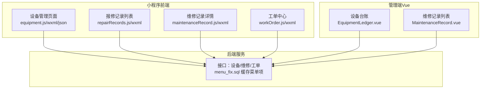
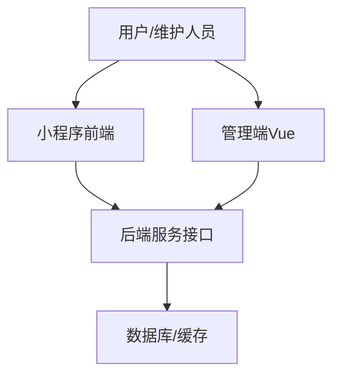
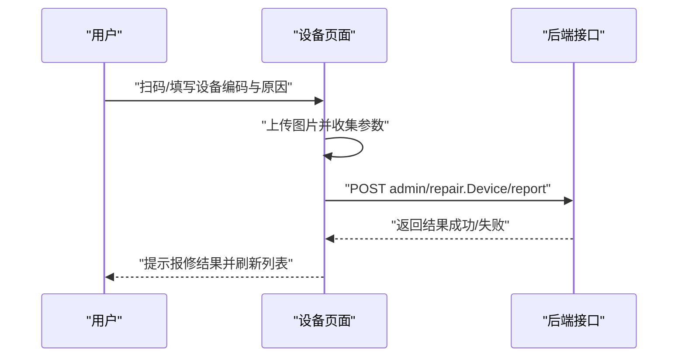
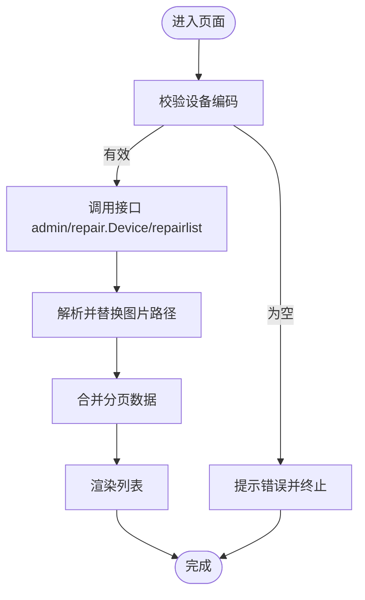
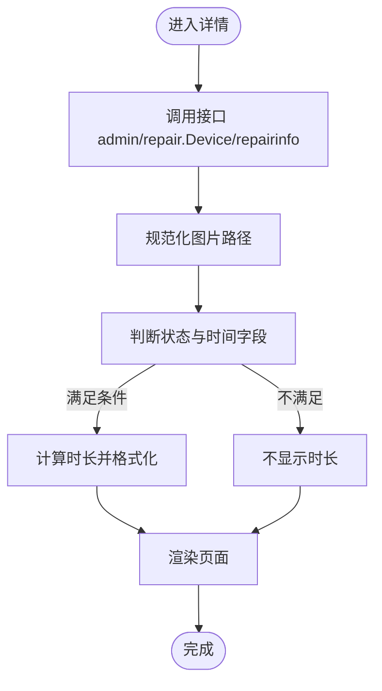
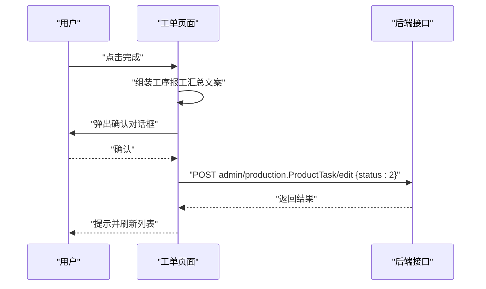
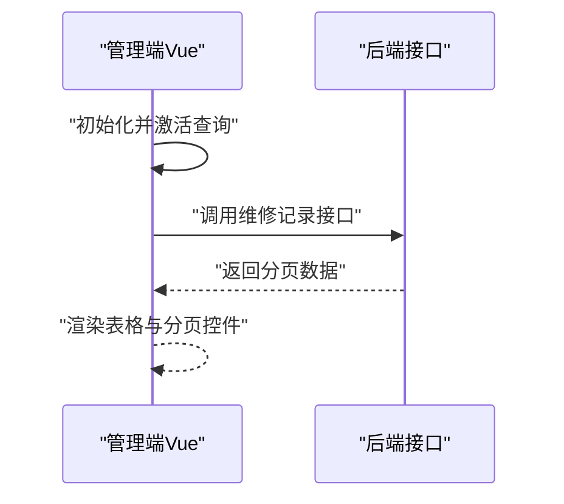
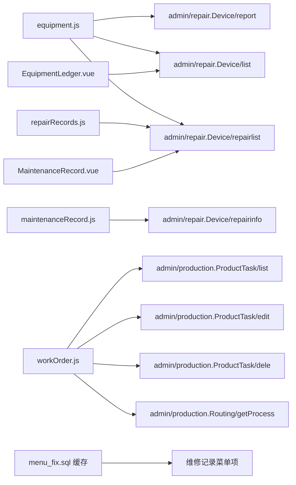

# 维护保养记录

<cite>
**本文引用的文件**
- [maintenanceRecord.js](file://gccd_mini/pageEquipment/pages/maintenanceRecord/maintenanceRecord.js)
- [maintenanceRecord.wxml](file://gccd_mini/pageEquipment/pages/maintenanceRecord/maintenanceRecord.wxml)
- [maintenanceRecord.wxss](file://gccd_mini/pageEquipment/pages/maintenanceRecord/maintenanceRecord.wxss)
- [repairRecords.js](file://gccd_mini/pageEquipment/pages/repairRecords/repairRecords.js)
- [repairRecords.wxml](file://gccd_mini/pageEquipment/pages/repairRecords/repairRecords.wxml)
- [workOrder.js](file://gccd_mini/pages/workOrder/workOrder.js)
- [workOrder.wxml](file://gccd_mini/pages/workOrder/workOrder.wxml)
- [equipment.js](file://gccd_mini/pages/equipment/equipment.js)
- [equipment.wxml](file://gccd_mini/pages/equipment/equipment.wxml)
- [menu_fix.sql](file://gccd_server/menu_fix.sql)
- [cache_...php](file://gccd_server/runtime/cache/yylAdmin/a6/9249e5b4e0ec6b9c1bff33c849c5d5.php)
- [MaintenanceRecord.vue](file://yarn/src/views/mes/EquipmentLedger/MaintenanceRecord.vue)
- [EquipmentLedger.vue](file://yarn/src/views/mes/EquipmentLedger/EquipmentLedger.vue)
</cite>

## 目录
1. [简介](#简介)
2. [项目结构](#项目结构)
3. [核心组件](#核心组件)
4. [架构总览](#架构总览)
5. [详细组件分析](#详细组件分析)
6. [依赖关系分析](#依赖关系分析)
7. [性能考虑](#性能考虑)
8. [故障排查指南](#故障排查指南)
9. [结论](#结论)
10. [附录](#附录)

## 简介
本文件面向“设备维护保养记录系统”，围绕预防性维护计划、日常点检计划、定期保养计划的制定与跟踪执行；维护工单的创建、派工、执行与验收；维护记录全生命周期管理（执行记录、工时统计、材料消耗、费用核算）；维护数据分析（故障率、成本、效果评估、计划优化）；维护知识库与经验沉淀；维护安全管理与作业许可；以及最佳实践与预防性维护策略等方面，提供系统化的功能文档与可视化说明。

## 项目结构
本系统由三部分组成：
- 微信小程序前端（设备与工单相关页面）
- Vue 管理端（设备台账与维修记录列表）
- 后端服务（提供设备、维修、工单等接口）

图表来源
- [equipment.js:1-800](file://gccd_mini/pages/equipment/equipment.js#L1-L800)
- [repairRecords.js:1-119](file://gccd_mini/pageEquipment/pages/repairRecords/repairRecords.js#L1-L119)
- [maintenanceRecord.js:1-154](file://gccd_mini/pageEquipment/pages/maintenanceRecord/maintenanceRecord.js#L1-L154)
- [workOrder.js:1-796](file://gccd_mini/pages/workOrder/workOrder.js#L1-L796)
- [EquipmentLedger.vue:93-195](file://yarn/src/views/mes/EquipmentLedger/EquipmentLedger.vue#L93-L195)
- [MaintenanceRecord.vue:150-210](file://yarn/src/views/mes/EquipmentLedger/MaintenanceRecord.vue#L150-L210)
- [menu_fix.sql:1-31](file://gccd_server/menu_fix.sql#L1-L31)

章节来源
- [equipment.js:1-800](file://gccd_mini/pages/equipment/equipment.js#L1-L800)
- [workOrder.js:1-796](file://gccd_mini/pages/workOrder/workOrder.js#L1-L796)
- [repairRecords.js:1-119](file://gccd_mini/pageEquipment/pages/repairRecords/repairRecords.js#L1-L119)
- [maintenanceRecord.js:1-154](file://gccd_mini/pageEquipment/pages/maintenanceRecord/maintenanceRecord.js#L1-L154)
- [EquipmentLedger.vue:93-195](file://yarn/src/views/mes/EquipmentLedger/EquipmentLedger.vue#L93-L195)
- [MaintenanceRecord.vue:150-210](file://yarn/src/views/mes/EquipmentLedger/MaintenanceRecord.vue#L150-L210)
- [menu_fix.sql:1-31](file://gccd_server/menu_fix.sql#L1-L31)

## 核心组件
- 设备管理与报修
  - 设备列表展示、扫码报修、维修记录跳转、图片预览
- 报修记录列表
  - 设备维度的报修历史分页展示、图片预览
- 维修记录详情
  - 报修信息、维修信息、维修时长计算、图片预览
- 工单中心
  - 工单列表、工序报工汇总、完成标记、删除、扫码报修
- 管理端设备台账与维修记录
  - 设备台账查询、维修记录列表查询

章节来源
- [equipment.js:1-800](file://gccd_mini/pages/equipment/equipment.js#L1-L800)
- [repairRecords.js:1-119](file://gccd_mini/pageEquipment/pages/repairRecords/repairRecords.js#L1-L119)
- [maintenanceRecord.js:1-154](file://gccd_mini/pageEquipment/pages/maintenanceRecord/maintenanceRecord.js#L1-L154)
- [workOrder.js:1-796](file://gccd_mini/pages/workOrder/workOrder.js#L1-L796)
- [EquipmentLedger.vue:93-195](file://yarn/src/views/mes/EquipmentLedger/EquipmentLedger.vue#L93-L195)
- [MaintenanceRecord.vue:150-210](file://yarn/src/views/mes/EquipmentLedger/MaintenanceRecord.vue#L150-L210)

## 架构总览
系统采用前后端分离架构，小程序负责移动端操作与展示，管理端Vue负责后台数据管理与报表，后端提供REST风格接口支撑。

图表来源
- [equipment.js:1-800](file://gccd_mini/pages/equipment/equipment.js#L1-L800)
- [workOrder.js:1-796](file://gccd_mini/pages/workOrder/workOrder.js#L1-L796)
- [EquipmentLedger.vue:93-195](file://yarn/src/views/mes/EquipmentLedger/EquipmentLedger.vue#L93-L195)
- [MaintenanceRecord.vue:150-210](file://yarn/src/views/mes/EquipmentLedger/MaintenanceRecord.vue#L150-L210)

## 详细组件分析

### 设备管理与报修（小程序）
- 功能要点
  - 扫码获取设备编码，打开报修表单
  - 上传图片并提交报修
  - 设备列表展示设备状态、跳转维修记录
  - 维修任务列表展示状态、操作按钮（维修、确认维修、维修记录）
  - 图片预览与多图处理
- 关键流程（报修提交）

图表来源
- [equipment.js:670-710](file://gccd_mini/pages/equipment/equipment.js#L670-L710)

章节来源
- [equipment.js:1-800](file://gccd_mini/pages/equipment/equipment.js#L1-L800)

### 报修记录列表（小程序）
- 功能要点
  - 按设备编码分页查询维修记录
  - 展示报修人、原因、时间、状态
  - 图片横向滚动预览
- 关键流程（加载列表）

图表来源
- [repairRecords.js:40-86](file://gccd_mini/pageEquipment/pages/repairRecords/repairRecords.js#L40-L86)

章节来源
- [repairRecords.js:1-119](file://gccd_mini/pageEquipment/pages/repairRecords/repairRecords.js#L1-L119)
- [repairRecords.wxml:1-73](file://gccd_mini/pageEquipment/pages/repairRecords/repairRecords.wxml#L1-L73)

### 维修记录详情（小程序）
- 功能要点
  - 展示设备编码、维修单号、报修信息、维修信息
  - 计算维修时长（完成状态下）
  - 报修/维修图片预览
- 关键流程（详情加载与时长计算）

图表来源
- [maintenanceRecord.js:34-118](file://gccd_mini/pageEquipment/pages/maintenanceRecord/maintenanceRecord.js#L34-L118)

章节来源
- [maintenanceRecord.js:1-154](file://gccd_mini/pageEquipment/pages/maintenanceRecord/maintenanceRecord.js#L1-L154)
- [maintenanceRecord.wxml:1-108](file://gccd_mini/pageEquipment/pages/maintenanceRecord/maintenanceRecord.wxml#L1-L108)
- [maintenanceRecord.wxss:1-85](file://gccd_mini/pageEquipment/pages/maintenanceRecord/maintenanceRecord.wxss#L1-L85)

### 工单中心（小程序）
- 功能要点
  - 进行中/已完成双标签页
  - 工序报工汇总表（固定5道工序）
  - 完成标记、删除、扫码报修、图片上传
- 关键流程（完成工单）

图表来源
- [workOrder.js:330-362](file://gccd_mini/pages/workOrder/workOrder.js#L330-L362)

章节来源
- [workOrder.js:1-796](file://gccd_mini/pages/workOrder/workOrder.js#L1-L796)
- [workOrder.wxml:1-221](file://gccd_mini/pages/workOrder/workOrder.wxml#L1-L221)

### 管理端设备台账与维修记录（Vue）
- 功能要点
  - 设备台账查询与分页
  - 维修记录列表查询
- 关键流程（维修记录列表）

图表来源
- [EquipmentLedger.vue:133-195](file://yarn/src/views/mes/EquipmentLedger/EquipmentLedger.vue#L133-L195)
- [MaintenanceRecord.vue:150-210](file://yarn/src/views/mes/EquipmentLedger/MaintenanceRecord.vue#L150-L210)

章节来源
- [EquipmentLedger.vue:93-195](file://yarn/src/views/mes/EquipmentLedger/EquipmentLedger.vue#L93-L195)
- [MaintenanceRecord.vue:150-210](file://yarn/src/views/mes/EquipmentLedger/MaintenanceRecord.vue#L150-L210)

## 依赖关系分析
- 小程序与后端接口
  - 设备管理：admin/repair.Device/report、admin/repair.Device/list、admin/repair.Device/repairlist
  - 工单中心：admin/production.ProductTask/list、admin/production.ProductTask/edit、admin/production.ProductTask/dele、admin/production.Routing/getProcess
  - 维修详情：admin/repair.Device/repairinfo
- 管理端与后端接口
  - 设备台账与维修记录列表接口（同上）
- 菜单与权限
  - 维修记录菜单项已在后端缓存中存在，路径与组件指向管理端视图

图表来源
- [equipment.js:1-800](file://gccd_mini/pages/equipment/equipment.js#L1-L800)
- [repairRecords.js:1-119](file://gccd_mini/pageEquipment/pages/repairRecords/repairRecords.js#L1-L119)
- [maintenanceRecord.js:1-154](file://gccd_mini/pageEquipment/pages/maintenanceRecord/maintenanceRecord.js#L1-L154)
- [workOrder.js:1-796](file://gccd_mini/pages/workOrder/workOrder.js#L1-L796)
- [EquipmentLedger.vue:93-195](file://yarn/src/views/mes/EquipmentLedger/EquipmentLedger.vue#L93-L195)
- [MaintenanceRecord.vue:150-210](file://yarn/src/views/mes/EquipmentLedger/MaintenanceRecord.vue#L150-L210)
- [menu_fix.sql:1-31](file://gccd_server/menu_fix.sql#L1-L31)
- [cache_...php:1-4](file://gccd_server/runtime/cache/yylAdmin/a6/9249e5b4e0ec6b9c1bff33c849c5d5.php#L1-L4)

章节来源
- [equipment.js:1-800](file://gccd_mini/pages/equipment/equipment.js#L1-L800)
- [workOrder.js:1-796](file://gccd_mini/pages/workOrder/workOrder.js#L1-L796)
- [repairRecords.js:1-119](file://gccd_mini/pageEquipment/pages/repairRecords/repairRecords.js#L1-L119)
- [maintenanceRecord.js:1-154](file://gccd_mini/pageEquipment/pages/maintenanceRecord/maintenanceRecord.js#L1-L154)
- [EquipmentLedger.vue:93-195](file://yarn/src/views/mes/EquipmentLedger/EquipmentLedger.vue#L93-L195)
- [MaintenanceRecord.vue:150-210](file://yarn/src/views/mes/EquipmentLedger/MaintenanceRecord.vue#L150-L210)
- [menu_fix.sql:1-31](file://gccd_server/menu_fix.sql#L1-L31)
- [cache_...php:1-4](file://gccd_server/runtime/cache/yylAdmin/a6/9249e5b4e0ec6b9c1bff33c849c5d5.php#L1-L4)

## 性能考虑
- 图片处理
  - 小程序端对图片路径进行统一替换与预览，避免跨域与路径问题
  - 上传前进行压缩与批量处理，减少网络传输与接口压力
- 分页与懒加载
  - 报修记录与设备/工单列表均采用分页与上拉加载，降低首屏渲染压力
- 接口调用
  - 工序名称映射采用缓存与并发请求，避免重复请求与渲染阻塞
- 状态与空态
  - 合理使用空态与加载态，提升用户体验与页面响应感

## 故障排查指南
- 报修失败
  - 检查设备编码是否为空、报修原因是否填写、图片上传是否成功
  - 查看接口返回码与消息，必要时重试或更换图片
- 维修记录为空
  - 确认设备编码正确、分页参数合理、网络状态正常
- 工单完成失败
  - 确认工序报工汇总是否完整、状态是否允许完成、接口返回是否成功
- 图片无法预览
  - 检查图片URL是否规范、是否为HTTP地址、是否存在跨域限制

章节来源
- [equipment.js:670-710](file://gccd_mini/pages/equipment/equipment.js#L670-L710)
- [repairRecords.js:40-86](file://gccd_mini/pageEquipment/pages/repairRecords/repairRecords.js#L40-L86)
- [workOrder.js:330-362](file://gccd_mini/pages/workOrder/workOrder.js#L330-L362)
- [maintenanceRecord.js:120-141](file://gccd_mini/pageEquipment/pages/maintenanceRecord/maintenanceRecord.js#L120-L141)

## 结论
本系统以设备与工单为核心，覆盖从报修、维修到工单执行与验收的全流程，并通过管理端实现设备台账与维修记录的集中管理。通过图片上传、时长计算、工序报工汇总等功能，为维护数据分析与计划优化提供了基础数据支撑。建议在后续迭代中完善预防性维护计划模块、维护知识库与安全作业许可机制，以进一步提升系统的完整性与智能化水平。

## 附录

### 维护保养计划与执行管理（概念性说明）
- 预防性维护计划
  - 基于设备运行周期与历史故障数据制定保养周期
  - 设置保养项目清单与标准作业程序（SOP）
- 日常点检计划
  - 每日/每班次关键参数巡检与记录
  - 异常预警与快速处置
- 定期保养计划
  - 按月/季/年设定深度保养任务
  - 资源配置与工时预算
- 计划跟踪执行
  - 通过工单中心下发任务，维护人员扫码执行
  - 记录执行过程、图片、工时与材料消耗

### 维护工单流程（概念性说明）
- 创建与派工
  - 管理端创建工单并关联设备与工序
  - 派发给指定维护人员
- 执行与验收
  - 维护人员扫码报工，按SOP执行
  - 完成后提交维修记录与图片
  - 管理员验收并关闭工单

### 维护记录生命周期（概念性说明）
- 计划执行记录
  - 计划生成、派工、执行、验收
- 工时统计
  - 维修时长、工单工时、人员工时
- 材料消耗
  - 配件、润滑脂、备品备件等
- 费用核算
  - 人工成本、材料成本、外委费用

### 维护数据分析（概念性说明）
- 设备故障率统计
  - 周期性统计故障频次与停机时长
- 维护成本分析
  - 人均维护成本、设备维护成本趋势
- 维护效果评估
  - 故障间隔时间、重复故障率、维修效率
- 计划优化建议
  - 基于数据调整保养周期与项目

### 维护知识库与经验积累（概念性说明）
- 维修案例库
  - 故障现象、原因分析、处理步骤、经验总结
- SOP标准化
  - 将典型维修流程固化为标准作业程序
- 知识分享
  - 维修经验分享、最佳实践推广

### 维护安全管理与作业许可（概念性说明）
- 安全交底
  - 维修前安全培训与风险告知
- 作业许可
  - 停电、挂牌上锁（LOTO）、受限空间作业许可
- 安全检查
  - 维修过程安全监督与检查记录

### 最佳实践与预防性维护策略（概念性说明）
- 基于状态的维护（CBM）
  - 利用传感器与监测数据预测故障
- 基于可靠性维护（RBI）
  - 评估设备失效模式与影响，优化维护策略
- 维护计划优化
  - 以数据驱动调整保养周期与项目，降低非计划停机