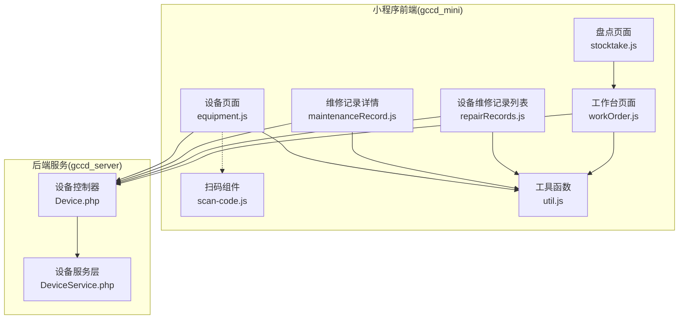
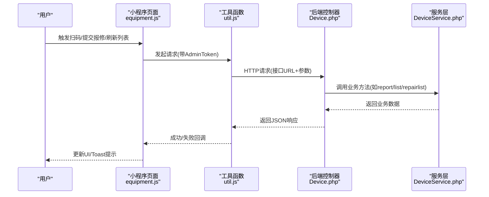
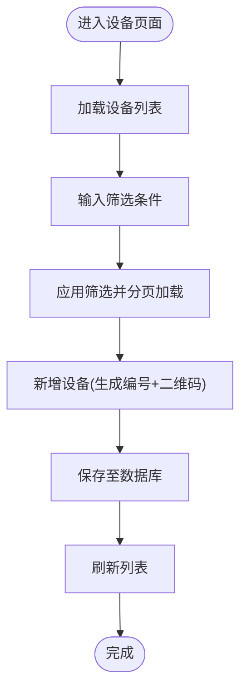
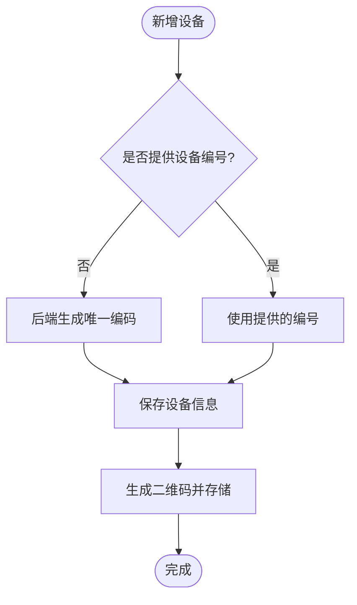
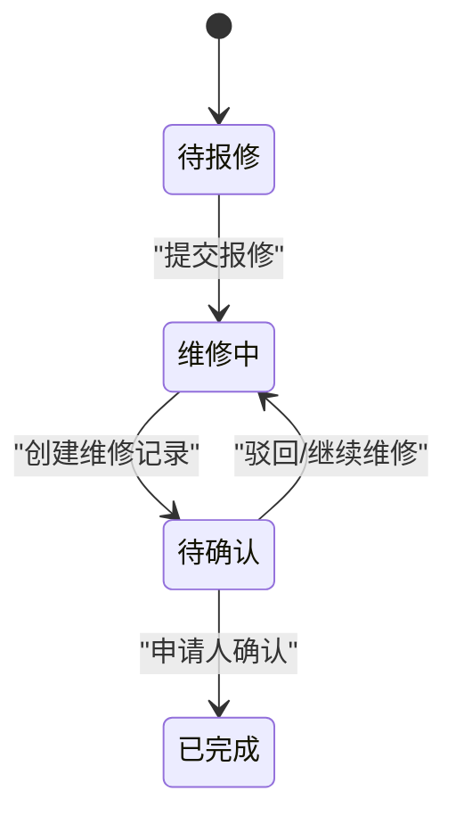
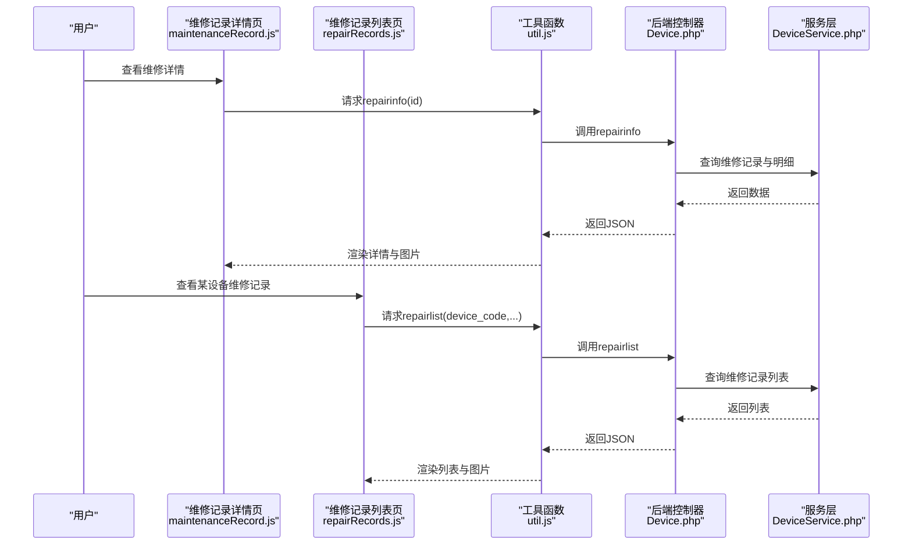
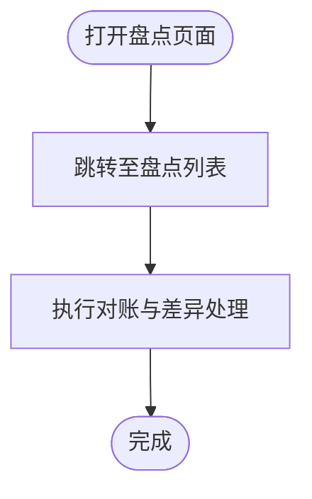
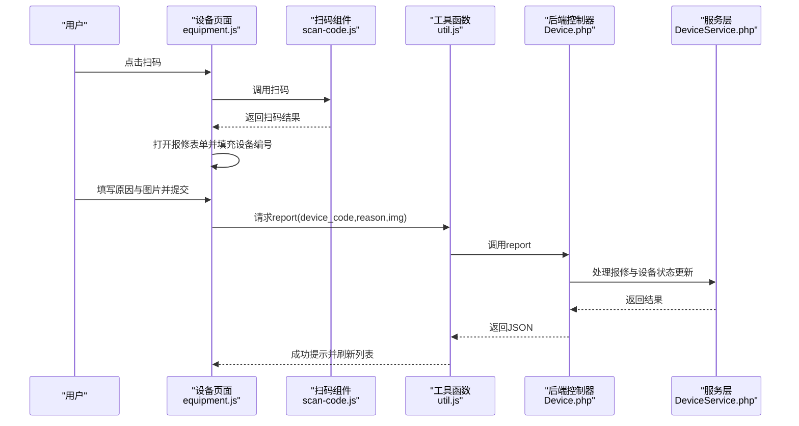
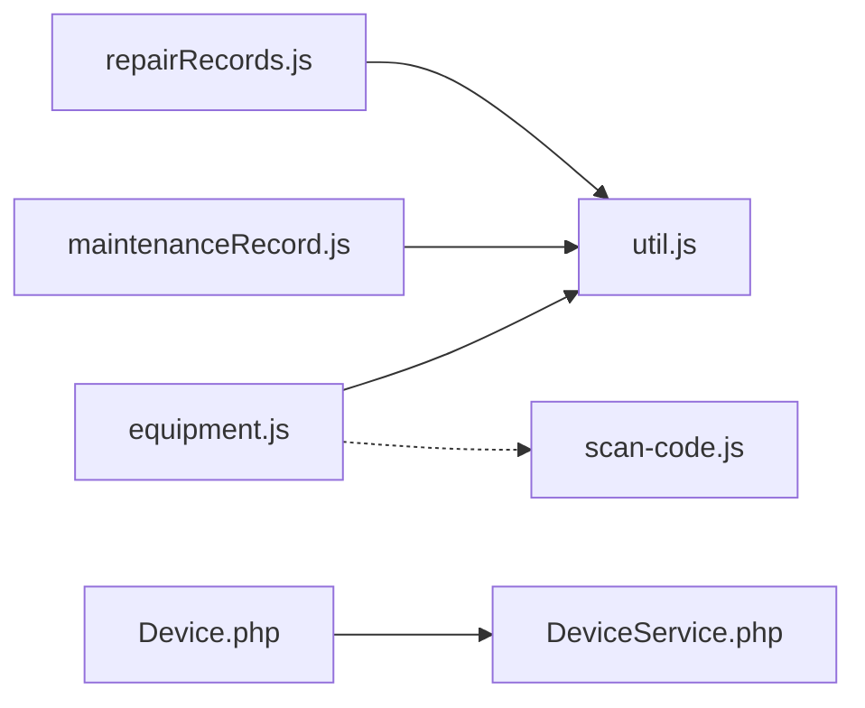

# 设备台账管理

<cite>
**本文引用的文件**
- [设备页面脚本 equipment.js](file://gccd_mini/pages/equipment/equipment.js)
- [设备页面组件定义 equipment.json](file://gccd_mini/pages/equipment/equipment.json)
- [维修记录详情页脚本 maintenanceRecord.js](file://gccd_mini/pageEquipment/pages/maintenanceRecord/maintenanceRecord.js)
- [设备维修记录列表页脚本 repairRecords.js](file://gccd_mini/pageEquipment/pages/repairRecords/repairRecords.js)
- [工具函数 util.js](file://gccd_mini/utils/util.js)
- [扫码组件 scan-code.js](file://gccd_mini/pages/components/scan-code/scan-code.js)
- [前端工作台页面 workOrder.js](file://gccd_mini/pages/workOrder/workOrder.js)
- [前端盘点页面 stocktake.js](file://gccd_mini/pages/stocktake/stocktake.js)
- [后端设备控制器 Device.php](file://gccd_server/app/admin/controller/repair/Device.php)
- [后端设备服务 DeviceService.php](file://gccd_server/app/common/service/admin/DeviceService.php)
</cite>

## 目录
1. [简介](#简介)
2. [项目结构](#项目结构)
3. [核心组件](#核心组件)
4. [架构总览](#架构总览)
5. [详细组件分析](#详细组件分析)
6. [依赖关系分析](#依赖关系分析)
7. [性能考量](#性能考量)
8. [故障排查指南](#故障排查指南)
9. [结论](#结论)
10. [附录](#附录)

## 简介
本文件面向“设备台账管理系统”，基于仓库中的小程序前端与ThinkPHP后端实现，系统性梳理设备基础信息管理、设备分类与编码、状态流转、关联信息（技术参数、操作手册、维修记录、检验报告等）、盘点与对账、转移/调拨/变更流程以及标准规范与数据质量控制。文档既提供代码级架构视图，也给出面向非技术用户的业务流程说明。

## 项目结构
系统由三部分组成：
- 小程序前端（gccd_mini）：负责设备列表、报修、维修记录查看、扫码、图片上传、筛选与分页等交互。
- ThinkPHP后端（gccd_server）：提供REST风格接口，处理设备台账、报修、维修记录、二维码生成、状态变更等业务。
- 工作台与盘点页面：工作台用于工单与报修联动，盘点页面用于资产对账入口。

**图表来源**
- [设备页面脚本 equipment.js:1-1202](file://gccd_mini/pages/equipment/equipment.js#L1-L1202)
- [维修记录详情页脚本 maintenanceRecord.js:1-154](file://gccd_mini/pageEquipment/pages/maintenanceRecord/maintenanceRecord.js#L1-L154)
- [设备维修记录列表页脚本 repairRecords.js:1-119](file://gccd_mini/pageEquipment/pages/repairRecords/repairRecords.js#L1-L119)
- [扫码组件 scan-code.js:1-63](file://gccd_mini/pages/components/scan-code/scan-code.js#L1-L63)
- [工具函数 util.js:1-98](file://gccd_mini/utils/util.js#L1-L98)
- [前端工作台页面 workOrder.js:1-796](file://gccd_mini/pages/workOrder/workOrder.js#L1-L796)
- [前端盘点页面 stocktake.js:1-22](file://gccd_mini/pages/stocktake/stocktake.js#L1-L22)
- [后端设备控制器 Device.php:1-281](file://gccd_server/app/admin/controller/repair/Device.php#L1-L281)
- [后端设备服务 DeviceService.php:1-540](file://gccd_server/app/common/service/admin/DeviceService.php#L1-L540)

**章节来源**
- [设备页面脚本 equipment.js:1-1202](file://gccd_mini/pages/equipment/equipment.js#L1-L1202)
- [设备页面组件定义 equipment.json:1-18](file://gccd_mini/pages/equipment/equipment.json#L1-L18)
- [后端设备控制器 Device.php:1-281](file://gccd_server/app/admin/controller/repair/Device.php#L1-L281)

## 核心组件
- 设备页面（equipment.js）：提供设备列表、任务列表、扫码报修、图片上传、维修记录跳转、分页加载等功能；与后端接口交互，支持设备状态变更与二维码生成。
- 维修记录详情页（maintenanceRecord.js）：展示单条维修记录及明细，支持图片预览与维修时长计算。
- 设备维修记录列表页（repairRecords.js）：按设备维度查看历史维修记录，支持分页与图片预览。
- 工具函数（util.js）：封装统一请求、鉴权头注入、错误处理与登录态失效跳转。
- 扫码组件（scan-code.js）：通用扫码能力，触发扫码事件供父页面处理。
- 后端控制器（Device.php）：提供设备列表、信息、报修、维修记录列表、二维码生成、状态变更等接口。
- 后端服务（DeviceService.php）：实现业务逻辑，如设备状态流转、维修记录创建、二维码生成、消息推送等。

**章节来源**
- [设备页面脚本 equipment.js:1-1202](file://gccd_mini/pages/equipment/equipment.js#L1-L1202)
- [维修记录详情页脚本 maintenanceRecord.js:1-154](file://gccd_mini/pageEquipment/pages/maintenanceRecord/maintenanceRecord.js#L1-L154)
- [设备维修记录列表页脚本 repairRecords.js:1-119](file://gccd_mini/pageEquipment/pages/repairRecords/repairRecords.js#L1-L119)
- [工具函数 util.js:1-98](file://gccd_mini/utils/util.js#L1-L98)
- [扫码组件 scan-code.js:1-63](file://gccd_mini/pages/components/scan-code/scan-code.js#L1-L63)
- [后端设备控制器 Device.php:1-281](file://gccd_server/app/admin/controller/repair/Device.php#L1-L281)
- [后端设备服务 DeviceService.php:1-540](file://gccd_server/app/common/service/admin/DeviceService.php#L1-L540)

## 架构总览
系统采用前后端分离模式：
- 前端通过util.js发起HTTP请求，携带AdminToken鉴权头，访问后端接口。
- 后端控制器Device.php接收请求，调用DeviceService.php执行业务逻辑，返回JSON响应。
- 前端根据响应更新UI，如刷新设备列表、维修记录列表、状态提示等。

**图表来源**
- [设备页面脚本 equipment.js:670-710](file://gccd_mini/pages/equipment/equipment.js#L670-L710)
- [工具函数 util.js:22-94](file://gccd_mini/utils/util.js#L22-L94)
- [后端设备控制器 Device.php:143-149](file://gccd_server/app/admin/controller/repair/Device.php#L143-L149)
- [后端设备服务 DeviceService.php:302-364](file://gccd_server/app/common/service/admin/DeviceService.php#L302-L364)

**章节来源**
- [设备页面脚本 equipment.js:670-710](file://gccd_mini/pages/equipment/equipment.js#L670-L710)
- [工具函数 util.js:22-94](file://gccd_mini/utils/util.js#L22-L94)
- [后端设备控制器 Device.php:143-149](file://gccd_server/app/admin/controller/repair/Device.php#L143-L149)
- [后端设备服务 DeviceService.php:302-364](file://gccd_server/app/common/service/admin/DeviceService.php#L302-L364)

## 详细组件分析

### 设备基础信息管理
- 关键字段与页面元素
  - 设备名称、设备编号、工序编号等基础字段在设备页面中通过表单收集与提交。
  - 设备列表与任务列表分页加载，支持按设备名称、设备编号、工序编号、时间范围等条件筛选。
- 业务流程
  - 新增设备：后端生成设备编号与二维码，写入设备表并返回。
  - 编辑/删除：支持批量编辑与删除，删除可软删或硬删。
- 数据质量控制
  - 前端对必填字段进行校验，后端对关键字段进行存在性与格式校验。
  - 二维码生成与存储路径规范化，避免重复与路径错误。

**图表来源**
- [设备页面脚本 equipment.js:119-155](file://gccd_mini/pages/equipment/equipment.js#L119-L155)
- [后端设备服务 DeviceService.php:195-221](file://gccd_server/app/common/service/admin/DeviceService.php#L195-L221)

**章节来源**
- [设备页面脚本 equipment.js:119-155](file://gccd_mini/pages/equipment/equipment.js#L119-L155)
- [后端设备服务 DeviceService.php:195-221](file://gccd_server/app/common/service/admin/DeviceService.php#L195-L221)

### 设备分类体系与编码规则
- 编码生成
  - 新增设备时，若未提供设备编号，后端通过公共服务生成唯一编码。
- 分类与检索
  - 前端支持按设备名称、设备编号、工序编号、时间范围等条件检索。
  - 后端控制器提供多字段查询条件拼装，支持模糊匹配与范围查询。

**图表来源**
- [后端设备服务 DeviceService.php:199-202](file://gccd_server/app/common/service/admin/DeviceService.php#L199-L202)
- [后端设备服务 DeviceService.php:277-300](file://gccd_server/app/common/service/admin/DeviceService.php#L277-L300)

**章节来源**
- [后端设备服务 DeviceService.php:199-202](file://gccd_server/app/common/service/admin/DeviceService.php#L199-L202)
- [后端设备服务 DeviceService.php:277-300](file://gccd_server/app/common/service/admin/DeviceService.php#L277-L300)

### 设备状态管理与审批流程
- 状态定义
  - 报修单状态：待报修、待确认、维修中、已完成等（后端通过状态字段区分）。
- 状态流转
  - 报修：提交报修时，设备状态变更为“维修中”。
  - 维修记录创建：创建维修明细时，设备状态变更为“在用”，报修单状态变更为“待确认”。
  - 确认维修：仅报修申请人可确认，确认后状态推进。
- 审批与消息
  - 报修后向角色（总经理、车间主任、设备维修）推送消息提醒。

**图表来源**
- [后端设备服务 DeviceService.php:323-323](file://gccd_server/app/common/service/admin/DeviceService.php#L323-L323)
- [后端设备服务 DeviceService.php:509-512](file://gccd_server/app/common/service/admin/DeviceService.php#L509-L512)
- [后端设备服务 DeviceService.php:524-536](file://gccd_server/app/common/service/admin/DeviceService.php#L524-L536)

**章节来源**
- [后端设备服务 DeviceService.php:323-323](file://gccd_server/app/common/service/admin/DeviceService.php#L323-L323)
- [后端设备服务 DeviceService.php:509-512](file://gccd_server/app/common/service/admin/DeviceService.php#L509-L512)
- [后端设备服务 DeviceService.php:524-536](file://gccd_server/app/common/service/admin/DeviceService.php#L524-L536)

### 设备关联信息管理（技术参数、操作手册、维修记录、检验报告等）
- 维修记录详情
  - 支持查看维修主记录与明细，图片路径统一处理与预览。
- 维修记录列表
  - 按设备维度查看历史维修记录，支持分页与图片预览。
- 附件上传
  - 前端支持图片上传压缩与批量上传，后端将URL拼接存储。

**图表来源**
- [维修记录详情页脚本 maintenanceRecord.js:34-83](file://gccd_mini/pageEquipment/pages/maintenanceRecord/maintenanceRecord.js#L34-L83)
- [设备维修记录列表页脚本 repairRecords.js:40-86](file://gccd_mini/pageEquipment/pages/repairRecords/repairRecords.js#L40-L86)
- [后端设备控制器 Device.php:87-93](file://gccd_server/app/admin/controller/repair/Device.php#L87-L93)
- [后端设备控制器 Device.php:161-240](file://gccd_server/app/admin/controller/repair/Device.php#L161-L240)
- [后端设备服务 DeviceService.php:133-187](file://gccd_server/app/common/service/admin/DeviceService.php#L133-L187)
- [后端设备服务 DeviceService.php:389-457](file://gccd_server/app/common/service/admin/DeviceService.php#L389-L457)

**章节来源**
- [维修记录详情页脚本 maintenanceRecord.js:34-83](file://gccd_mini/pageEquipment/pages/maintenanceRecord/maintenanceRecord.js#L34-L83)
- [设备维修记录列表页脚本 repairRecords.js:40-86](file://gccd_mini/pageEquipment/pages/repairRecords/repairRecords.js#L40-L86)
- [后端设备控制器 Device.php:87-93](file://gccd_server/app/admin/controller/repair/Device.php#L87-L93)
- [后端设备控制器 Device.php:161-240](file://gccd_server/app/admin/controller/repair/Device.php#L161-L240)
- [后端设备服务 DeviceService.php:133-187](file://gccd_server/app/common/service/admin/DeviceService.php#L133-L187)
- [后端设备服务 DeviceService.php:389-457](file://gccd_server/app/common/service/admin/DeviceService.php#L389-L457)

### 设备盘点与资产对账机制
- 盘点入口
  - 盘点页面提供跳转至盘点列表的能力，便于开展资产对账。
- 对账建议
  - 建议结合设备列表与维修记录统计，定期核对设备状态、二维码与实物一致性。

**图表来源**
- [前端盘点页面 stocktake.js:14-21](file://gccd_mini/pages/stocktake/stocktake.js#L14-L21)

**章节来源**
- [前端盘点页面 stocktake.js:14-21](file://gccd_mini/pages/stocktake/stocktake.js#L14-L21)

### 设备转移、调拨与变更流程
- 转移/调拨
  - 当前代码未直接暴露“设备转移/调拨”的专用接口或页面逻辑；可通过编辑设备信息（如使用部门、存放地点等）实现字段级变更。
- 变更建议
  - 建议在后端控制器与服务层增加专门的“转移/调拨”接口，记录变更日志与审批流程，确保可追溯性。

**章节来源**
- [后端设备控制器 Device.php:114-123](file://gccd_server/app/admin/controller/repair/Device.php#L114-L123)
- [后端设备服务 DeviceService.php:231-249](file://gccd_server/app/common/service/admin/DeviceService.php#L231-L249)

### 报修与扫码流程
- 扫码能力
  - 支持二维码/条形码扫码，亦支持从相册识别图片中的二维码。
- 报修流程
  - 扫码后打开报修表单，填写原因与图片，提交后设备状态变更为“维修中”。

**图表来源**
- [设备页面脚本 equipment.js:336-425](file://gccd_mini/pages/equipment/equipment.js#L336-L425)
- [设备页面脚本 equipment.js:670-710](file://gccd_mini/pages/equipment/equipment.js#L670-L710)
- [扫码组件 scan-code.js:7-27](file://gccd_mini/pages/components/scan-code/scan-code.js#L7-L27)
- [后端设备控制器 Device.php:143-149](file://gccd_server/app/admin/controller/repair/Device.php#L143-L149)
- [后端设备服务 DeviceService.php:302-364](file://gccd_server/app/common/service/admin/DeviceService.php#L302-L364)

**章节来源**
- [设备页面脚本 equipment.js:336-425](file://gccd_mini/pages/equipment/equipment.js#L336-L425)
- [设备页面脚本 equipment.js:670-710](file://gccd_mini/pages/equipment/equipment.js#L670-L710)
- [扫码组件 scan-code.js:7-27](file://gccd_mini/pages/components/scan-code/scan-code.js#L7-L27)
- [后端设备控制器 Device.php:143-149](file://gccd_server/app/admin/controller/repair/Device.php#L143-L149)
- [后端设备服务 DeviceService.php:302-364](file://gccd_server/app/common/service/admin/DeviceService.php#L302-L364)

## 依赖关系分析
- 前端依赖
  - 设备页面依赖工具函数进行统一请求与鉴权；依赖扫码组件提供扫码能力；依赖Vant组件库渲染UI。
  - 维修记录详情与列表页依赖工具函数与后端接口。
- 后端依赖
  - 控制器依赖服务层实现业务逻辑；服务层依赖模型层与公共服务（如二维码生成、编码生成）。

**图表来源**
- [设备页面脚本 equipment.js:1-10](file://gccd_mini/pages/equipment/equipment.js#L1-L10)
- [设备页面组件定义 equipment.json:2-16](file://gccd_mini/pages/equipment/equipment.json#L2-L16)
- [扫码组件 scan-code.js:1-63](file://gccd_mini/pages/components/scan-code/scan-code.js#L1-L63)
- [工具函数 util.js:1-98](file://gccd_mini/utils/util.js#L1-L98)
- [后端设备控制器 Device.php:1-281](file://gccd_server/app/admin/controller/repair/Device.php#L1-L281)
- [后端设备服务 DeviceService.php:1-540](file://gccd_server/app/common/service/admin/DeviceService.php#L1-L540)

**章节来源**
- [设备页面脚本 equipment.js:1-10](file://gccd_mini/pages/equipment/equipment.js#L1-L10)
- [设备页面组件定义 equipment.json:2-16](file://gccd_mini/pages/equipment/equipment.json#L2-L16)
- [扫码组件 scan-code.js:1-63](file://gccd_mini/pages/components/scan-code/scan-code.js#L1-L63)
- [工具函数 util.js:1-98](file://gccd_mini/utils/util.js#L1-L98)
- [后端设备控制器 Device.php:1-281](file://gccd_server/app/admin/controller/repair/Device.php#L1-L281)
- [后端设备服务 DeviceService.php:1-540](file://gccd_server/app/common/service/admin/DeviceService.php#L1-L540)

## 性能考量
- 前端
  - 列表分页加载与上拉触底加载，减少一次性渲染压力。
  - 图片上传前进行压缩，降低带宽与存储成本。
  - 统一错误提示与加载态，提升用户体验。
- 后端
  - 查询条件拼装与分页查询，避免全表扫描。
  - 事务控制保证报修与状态变更的一致性。

[本节为通用指导，无需特定文件来源]

## 故障排查指南
- 登录态失效
  - 当后端返回401时，前端自动清除本地Token并跳转登录页。
- 接口请求失败
  - 统一错误提示“网络异常，请检查网络”，建议检查网络与域名白名单。
- 二维码/图片问题
  - 上传图片后需确认URL可访问；预览图片时注意路径替换与协议处理。
- 报修状态异常
  - 确认设备状态与维修记录状态是否一致；检查消息推送是否正确。

**章节来源**
- [工具函数 util.js:57-68](file://gccd_mini/utils/util.js#L57-L68)
- [设备页面脚本 equipment.js:458-520](file://gccd_mini/pages/equipment/equipment.js#L458-L520)
- [后端设备服务 DeviceService.php:323-323](file://gccd_server/app/common/service/admin/DeviceService.php#L323-L323)

## 结论
本系统通过前后端协作实现了设备台账的基础管理、报修与维修记录、扫码与附件管理、状态流转与消息推送等核心能力。建议后续补充设备转移/调拨专用接口与审批流程，完善数据质量控制与审计日志，进一步提升系统的合规性与可追溯性。

[本节为总结性内容，无需特定文件来源]

## 附录
- 前端组件清单（来自设备页面组件定义）
  - 按钮、图标、字段、弹窗、对话框、标签页、上传器、空状态、选择器等。
- 工作台与报修联动
  - 工作台页面提供扫码报修入口与工单管理，便于生产场景下的设备运维协同。

**章节来源**
- [设备页面组件定义 equipment.json:2-16](file://gccd_mini/pages/equipment/equipment.json#L2-L16)
- [前端工作台页面 workOrder.js:405-423](file://gccd_mini/pages/workOrder/workOrder.js#L405-L423)