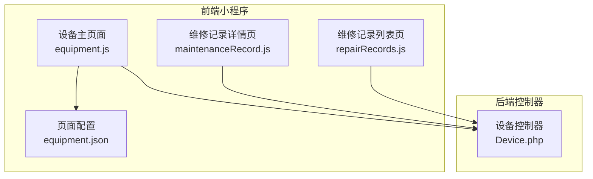
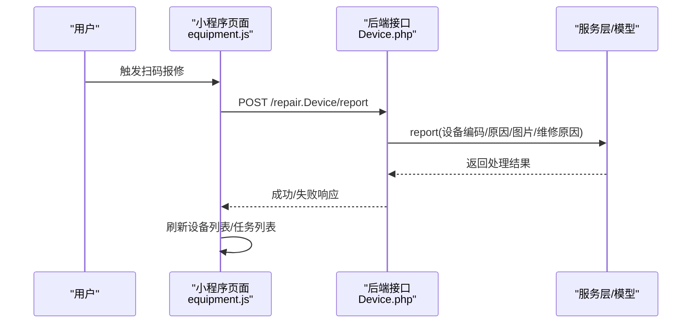
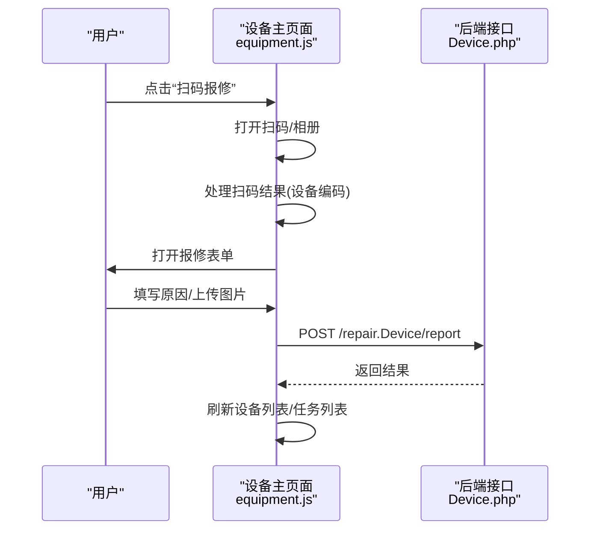
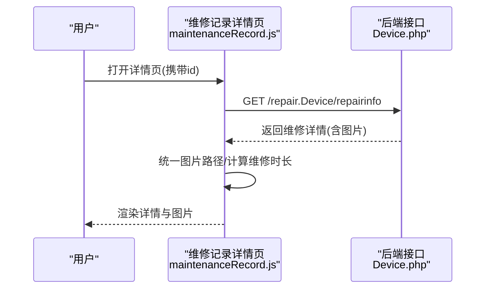
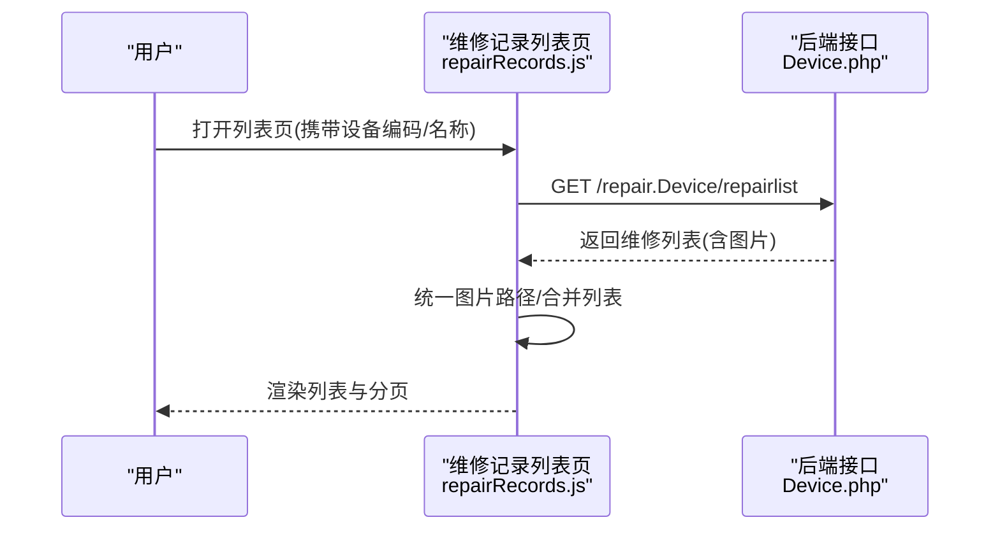
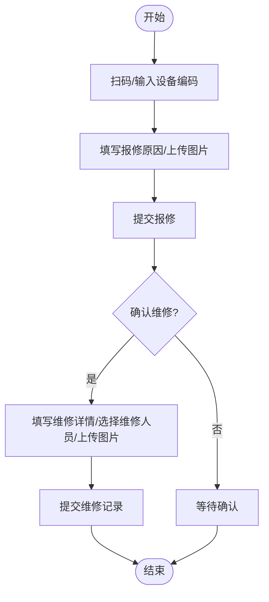
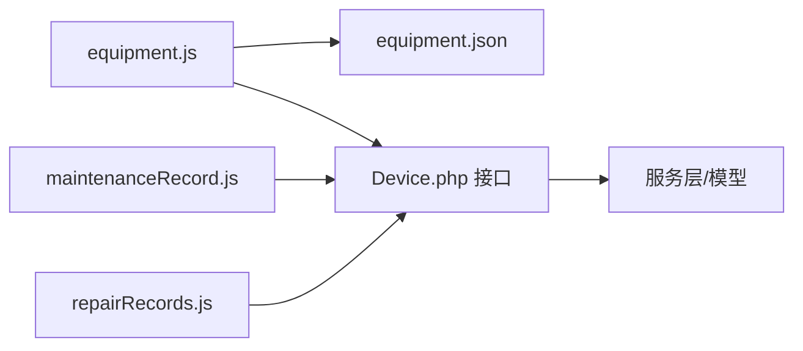

# 设备管理模块

<cite>
**本文引用的文件**
- [设备管理主页面脚本](file://gccd_mini/pages/equipment/equipment.js)
- [设备管理主页面配置](file://gccd_mini/pages/equipment/equipment.json)
- [维修记录详情页脚本](file://gccd_mini/pageEquipment/pages/maintenanceRecord/maintenanceRecord.js)
- [维修记录列表页脚本](file://gccd_mini/pageEquipment/pages/repairRecords/repairRecords.js)
- [设备管理控制器](file://gccd_server/app/admin/controller/repair/Device.php)
</cite>

## 目录
1. [简介](#简介)
2. [项目结构](#项目结构)
3. [核心组件](#核心组件)
4. [架构总览](#架构总览)
5. [详细组件分析](#详细组件分析)
6. [依赖关系分析](#依赖关系分析)
7. [性能考虑](#性能考虑)
8. [故障排查指南](#故障排查指南)
9. [结论](#结论)
10. [附录](#附录)

## 简介
本文件面向“高齿传动”项目的设备管理模块，围绕设备全生命周期管理进行系统化说明，涵盖设备台账管理、分类编码体系、技术参数与档案、维护保养计划与执行、故障报修与维修闭环、运行监控与状态监测、安全与培训管理，以及最佳实践与预防性维护策略。文档以实际代码为依据，结合前端页面与后端控制器接口，提供可操作的实现参考与可视化流程图。

## 项目结构
设备管理模块由三部分组成：
- 前端小程序页面：设备主列表、维修记录详情、维修记录列表
- 前端组件与工具：基于 Vant Weapp 组件库与通用工具函数
- 后端控制器：提供设备与维修相关接口，支撑前端业务

**图表来源**
- [设备管理主页面脚本:1-1202](file://gccd_mini/pages/equipment/equipment.js#L1-L1202)
- [设备管理主页面配置:1-18](file://gccd_mini/pages/equipment/equipment.json#L1-L18)
- [维修记录详情页脚本:1-154](file://gccd_mini/pageEquipment/pages/maintenanceRecord/maintenanceRecord.js#L1-L154)
- [维修记录列表页脚本:1-119](file://gccd_mini/pageEquipment/pages/repairRecords/repairRecords.js#L1-L119)
- [设备管理控制器:1-281](file://gccd_server/app/admin/controller/repair/Device.php#L1-L281)

**章节来源**
- [设备管理主页面脚本:1-1202](file://gccd_mini/pages/equipment/equipment.js#L1-L1202)
- [设备管理主页面配置:1-18](file://gccd_mini/pages/equipment/equipment.json#L1-L18)
- [维修记录详情页脚本:1-154](file://gccd_mini/pageEquipment/pages/maintenanceRecord/maintenanceRecord.js#L1-L154)
- [维修记录列表页脚本:1-119](file://gccd_mini/pageEquipment/pages/repairRecords/repairRecords.js#L1-L119)
- [设备管理控制器:1-281](file://gccd_server/app/admin/controller/repair/Device.php#L1-L281)

## 核心组件
- 设备主页面：负责设备列表展示、任务列表展示、扫码报修、维修记录提交、图片上传与预览、下拉刷新与上拉加载。
- 维修记录详情页：展示单条维修记录的完整信息，包含图片、维修时长计算与预览。
- 维修记录列表页：按设备维度查询历史维修记录，支持分页与图片预览。
- 设备控制器：提供设备列表、设备信息、维修记录列表、维修详情、扫码报修、新增维修记录、状态变更等接口。

**章节来源**
- [设备管理主页面脚本:1-1202](file://gccd_mini/pages/equipment/equipment.js#L1-L1202)
- [维修记录详情页脚本:1-154](file://gccd_mini/pageEquipment/pages/maintenanceRecord/maintenanceRecord.js#L1-L154)
- [维修记录列表页脚本:1-119](file://gccd_mini/pageEquipment/pages/repairRecords/repairRecords.js#L1-L119)
- [设备管理控制器:143-277](file://gccd_server/app/admin/controller/repair/Device.php#L143-L277)

## 架构总览
前端通过统一工具函数发起请求，调用后端控制器提供的接口；控制器封装服务层逻辑，返回标准响应。页面根据接口返回的数据渲染视图，支持扫码、图片上传、分页与刷新等交互。

**图表来源**
- [设备管理主页面脚本:670-710](file://gccd_mini/pages/equipment/equipment.js#L670-L710)
- [设备管理控制器:143-149](file://gccd_server/app/admin/controller/repair/Device.php#L143-L149)

**章节来源**
- [设备管理主页面脚本:670-710](file://gccd_mini/pages/equipment/equipment.js#L670-L710)
- [设备管理控制器:143-149](file://gccd_server/app/admin/controller/repair/Device.php#L143-L149)

## 详细组件分析

### 设备主页面（设备列表与任务列表）
- 功能要点
  - 设备列表与任务列表双标签页切换，分别调用设备列表与维修任务列表接口。
  - 支持扫码报修：扫码成功后打开报修表单，填写原因、上传图片并提交。
  - 维修记录提交：填写维修详情、选择维修人员、上传图片并提交。
  - 图片上传：本地压缩后上传至指定地址，支持多图批量上传与删除。
  - 分页与刷新：支持下拉刷新与上拉加载更多。
  - 拖拽悬浮按钮：用于快速触发扫码报修。
- 关键接口
  - 设备列表：admin/repair.Device/list
  - 任务列表：admin/repair.Device/repairlist
  - 扫码报修：admin/repair.Device/report
  - 新增维修记录：admin/repair.Device/addrecords
  - 确认维修状态：admin/repair.Device/editStatus
  - 报修原因列表：admin/production.ProductCount/list

**图表来源**
- [设备管理主页面脚本:336-425](file://gccd_mini/pages/equipment/equipment.js#L336-L425)
- [设备管理主页面脚本:670-710](file://gccd_mini/pages/equipment/equipment.js#L670-L710)
- [设备管理控制器:143-149](file://gccd_server/app/admin/controller/repair/Device.php#L143-L149)

**章节来源**
- [设备管理主页面脚本:81-181](file://gccd_mini/pages/equipment/equipment.js#L81-L181)
- [设备管理主页面脚本:336-425](file://gccd_mini/pages/equipment/equipment.js#L336-L425)
- [设备管理主页面脚本:670-710](file://gccd_mini/pages/equipment/equipment.js#L670-L710)
- [设备管理主页面脚本:825-1023](file://gccd_mini/pages/equipment/equipment.js#L825-L1023)
- [设备管理控制器:143-149](file://gccd_server/app/admin/controller/repair/Device.php#L143-L149)
- [设备管理控制器:161-240](file://gccd_server/app/admin/controller/repair/Device.php#L161-L240)
- [设备管理控制器:262-267](file://gccd_server/app/admin/controller/repair/Device.php#L262-L267)
- [设备管理控制器:273-277](file://gccd_server/app/admin/controller/repair/Device.php#L273-L277)

### 维修记录详情页
- 功能要点
  - 根据传入的维修记录ID加载详情，统一处理图片路径。
  - 计算维修时长：仅在完成状态下，基于报修时间与维修完成时间计算时长并格式化显示。
  - 图片预览：支持维修记录图片与详情图片的预览。
- 关键接口
  - 维修详情：admin/repair.Device/repairinfo

**图表来源**
- [维修记录详情页脚本:34-102](file://gccd_mini/pageEquipment/pages/maintenanceRecord/maintenanceRecord.js#L34-L102)
- [设备管理控制器:87-93](file://gccd_server/app/admin/controller/repair/Device.php#L87-L93)

**章节来源**
- [维修记录详情页脚本:34-102](file://gccd_mini/pageEquipment/pages/maintenanceRecord/maintenanceRecord.js#L34-L102)
- [设备管理控制器:87-93](file://gccd_server/app/admin/controller/repair/Device.php#L87-L93)

### 维修记录列表页
- 功能要点
  - 根据设备编码查询该设备的历史维修记录，支持分页加载。
  - 统一处理图片路径，支持图片预览。
- 关键接口
  - 维修列表：admin/repair.Device/repairlist

**图表来源**
- [维修记录列表页脚本:40-86](file://gccd_mini/pageEquipment/pages/repairRecords/repairRecords.js#L40-L86)
- [设备管理控制器:161-240](file://gccd_server/app/admin/controller/repair/Device.php#L161-L240)

**章节来源**
- [维修记录列表页脚本:40-86](file://gccd_mini/pageEquipment/pages/repairRecords/repairRecords.js#L40-L86)
- [设备管理控制器:161-240](file://gccd_server/app/admin/controller/repair/Device.php#L161-L240)

### 设备分类编码体系与技术参数管理
- 设备分类编码
  - 前端字段包含设备名称、设备编码、工序编码等，用于标识与检索。
  - 后端接口支持按设备编码、设备名称、工序编码等条件查询。
- 技术参数与档案
  - 前端提供设备表单字段，后端控制器提供设备信息与列表接口，支持扩展技术参数字段与档案附件上传。
- 建议
  - 建立统一的设备分类与编码规则，确保跨系统一致性。
  - 将技术参数与档案作为扩展字段接入，便于后续统计与分析。

**章节来源**
- [设备管理主页面脚本:18-22](file://gccd_mini/pages/equipment/equipment.js#L18-L22)
- [设备管理控制器:47-74](file://gccd_server/app/admin/controller/repair/Device.php#L47-L74)
- [设备管理控制器:161-240](file://gccd_server/app/admin/controller/repair/Device.php#L161-L240)

### 维护保养计划与执行
- 计划制定
  - 建议在后端维护保养计划表中定义设备保养周期、责任人、标准作业卡等。
- 执行与记录
  - 前端可扩展“保养记录”页面，调用类似维修记录的接口，实现保养工单的创建、执行与归档。
  - 保养记录应包含保养项目、耗材、工时、负责人、图片等。

**章节来源**
- [设备管理主页面脚本:825-1023](file://gccd_mini/pages/equipment/equipment.js#L825-L1023)
- [设备管理控制器:262-267](file://gccd_server/app/admin/controller/repair/Device.php#L262-L267)

### 故障报修与维修闭环
- 报修流程
  - 扫码/输入设备编码 → 填写报修原因/上传图片 → 提交报修 → 状态更新为“维修中”。
- 维修流程
  - 确认维修 → 填写维修详情/选择维修人员/上传图片 → 提交维修记录 → 完成维修。
- 状态管理
  - 后端提供状态变更接口，前端负责展示与引导。

**图表来源**
- [设备管理主页面脚本:336-425](file://gccd_mini/pages/equipment/equipment.js#L336-L425)
- [设备管理主页面脚本:825-1023](file://gccd_mini/pages/equipment/equipment.js#L825-L1023)
- [设备管理控制器:143-149](file://gccd_server/app/admin/controller/repair/Device.php#L143-L149)
- [设备管理控制器:273-277](file://gccd_server/app/admin/controller/repair/Device.php#L273-L277)

**章节来源**
- [设备管理主页面脚本:336-425](file://gccd_mini/pages/equipment/equipment.js#L336-L425)
- [设备管理主页面脚本:825-1023](file://gccd_mini/pages/equipment/equipment.js#L825-L1023)
- [设备管理控制器:143-149](file://gccd_server/app/admin/controller/repair/Device.php#L143-L149)
- [设备管理控制器:273-277](file://gccd_server/app/admin/controller/repair/Device.php#L273-L277)

### 运行监控与状态监测
- 设备效率分析
  - 可基于设备运行时长、维修时长、故障频次等指标构建效率看板。
- 故障预警
  - 结合保养计划与历史故障数据，设置阈值预警（如月度故障次数超限）。
- 维修成本统计
  - 统计维修工时、配件消耗、人工成本，形成成本报表。

**章节来源**
- [维修记录详情页脚本:85-118](file://gccd_mini/pageEquipment/pages/maintenanceRecord/maintenanceRecord.js#L85-L118)

### 安全管理、操作规程与人员培训
- 安全管理
  - 设备操作需绑定人员权限与安全培训记录，建议在用户与设备关联表中增加“安全许可”字段。
- 操作规程
  - 将标准作业卡与设备关联，移动端扫码即可查看操作步骤与注意事项。
- 人员培训
  - 建立培训档案与考核记录，与维修人员绑定，确保持证上岗。

**章节来源**
- [设备管理主页面脚本:802-823](file://gccd_mini/pages/equipment/equipment.js#L802-L823)

## 依赖关系分析
- 前端依赖
  - Vant Weapp 组件：按钮、图标、弹窗、字段、对话框、标签页、上传器、空状态、选择器等。
  - 工具函数：统一请求封装、媒体压缩与上传。
- 后端依赖
  - 控制器依赖服务层与模型层，提供设备与维修记录的增删改查、状态变更与列表查询。

**图表来源**
- [设备管理主页面配置:1-18](file://gccd_mini/pages/equipment/equipment.json#L1-L18)
- [设备管理主页面脚本:1-1202](file://gccd_mini/pages/equipment/equipment.js#L1-L1202)
- [维修记录详情页脚本:1-154](file://gccd_mini/pageEquipment/pages/maintenanceRecord/maintenanceRecord.js#L1-L154)
- [维修记录列表页脚本:1-119](file://gccd_mini/pageEquipment/pages/repairRecords/repairRecords.js#L1-L119)
- [设备管理控制器:1-281](file://gccd_server/app/admin/controller/repair/Device.php#L1-L281)

**章节来源**
- [设备管理主页面配置:1-18](file://gccd_mini/pages/equipment/equipment.json#L1-L18)
- [设备管理主页面脚本:1-1202](file://gccd_mini/pages/equipment/equipment.js#L1-L1202)
- [维修记录详情页脚本:1-154](file://gccd_mini/pageEquipment/pages/maintenanceRecord/maintenanceRecord.js#L1-L154)
- [维修记录列表页脚本:1-119](file://gccd_mini/pageEquipment/pages/repairRecords/repairRecords.js#L1-L119)
- [设备管理控制器:1-281](file://gccd_server/app/admin/controller/repair/Device.php#L1-L281)

## 性能考虑
- 图片处理
  - 前端对上传图片进行本地压缩，减少带宽占用与服务器压力。
- 分页与懒加载
  - 列表采用分页与上拉加载，避免一次性加载大量数据。
- 请求优化
  - 统一请求封装，减少重复代码与网络请求次数。
- 缓存策略
  - 对常用静态资源与列表数据进行缓存，提升首屏与切换速度。

**章节来源**
- [设备管理主页面脚本:458-520](file://gccd_mini/pages/equipment/equipment.js#L458-L520)
- [设备管理主页面脚本:902-964](file://gccd_mini/pages/equipment/equipment.js#L902-L964)
- [维修记录详情页脚本:120-141](file://gccd_mini/pageEquipment/pages/maintenanceRecord/maintenanceRecord.js#L120-L141)
- [维修记录列表页脚本:88-98](file://gccd_mini/pageEquipment/pages/repairRecords/repairRecords.js#L88-L98)

## 故障排查指南
- 扫码失败
  - 检查扫码权限与相机授权；若从相册识别，确认图片格式与大小。
- 图片上传失败
  - 检查上传接口返回与本地压缩流程；确认 AdminToken 与域名配置。
- 列表加载异常
  - 检查分页参数与接口返回；确认下拉刷新与上拉加载逻辑。
- 维修记录提交失败
  - 检查必填字段（维修详情、维修人员）与图片上传状态；核对后端接口签名与参数。

**章节来源**
- [设备管理主页面脚本:336-425](file://gccd_mini/pages/equipment/equipment.js#L336-L425)
- [设备管理主页面脚本:458-520](file://gccd_mini/pages/equipment/equipment.js#L458-L520)
- [设备管理主页面脚本:980-1023](file://gccd_mini/pages/equipment/equipment.js#L980-L1023)
- [维修记录详情页脚本:34-83](file://gccd_mini/pageEquipment/pages/maintenanceRecord/maintenanceRecord.js#L34-L83)
- [维修记录列表页脚本:40-86](file://gccd_mini/pageEquipment/pages/repairRecords/repairRecords.js#L40-L86)

## 结论
设备管理模块通过前后端协同，实现了设备台账、扫码报修、维修记录、图片管理与分页加载等核心能力。建议在此基础上完善设备分类编码体系、维护保养计划、运行监控与成本统计，并强化安全管理与人员培训管理，形成完整的设备全生命周期管理体系。

## 附录
- 最佳实践
  - 统一设备编码规则与分类标准，确保跨系统一致。
  - 引入预防性维护策略：基于设备运行时长与故障率设定保养周期。
  - 建立维修成本与效率分析看板，持续优化维护策略。
- 预防性维护策略
  - 按设备类型与关键等级划分维护级别。
  - 将标准作业卡与设备绑定，移动端扫码即可查看。
  - 设置阈值预警，提前干预潜在风险。