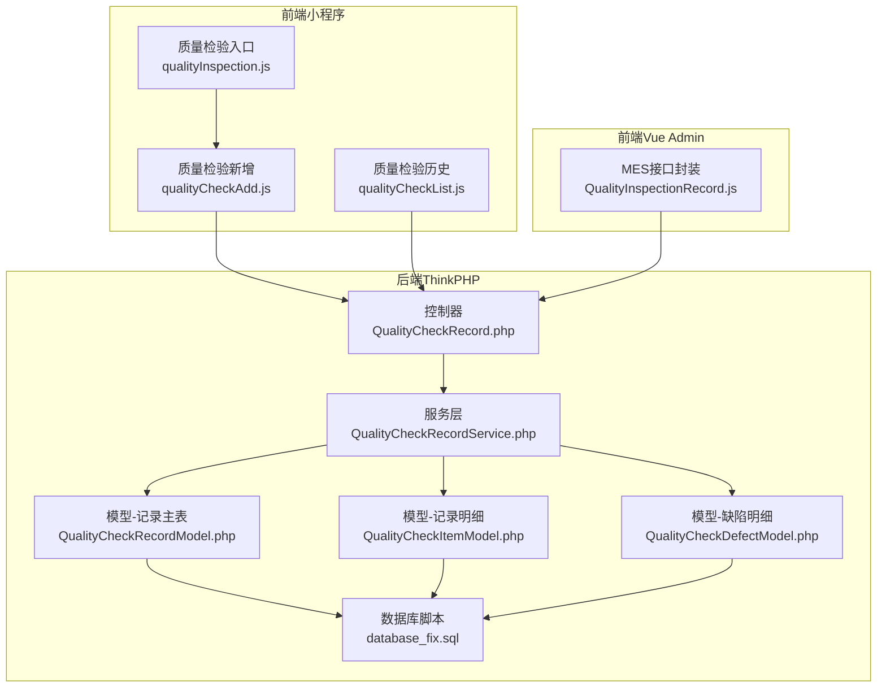
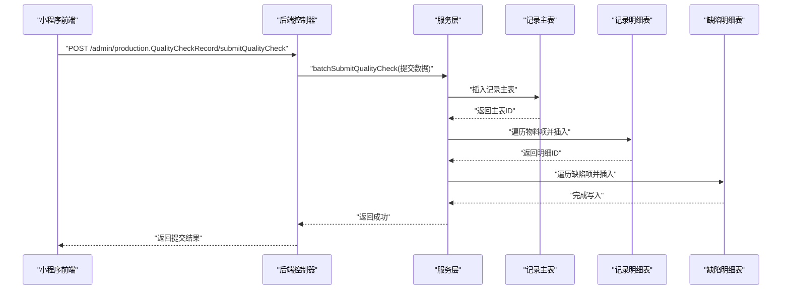
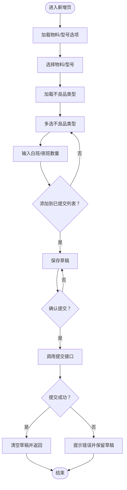
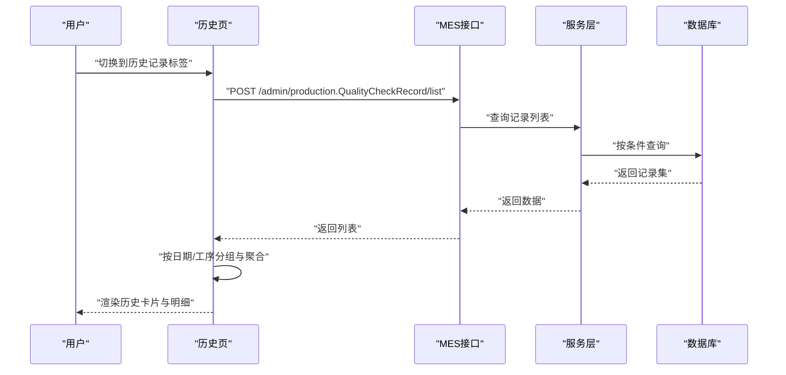
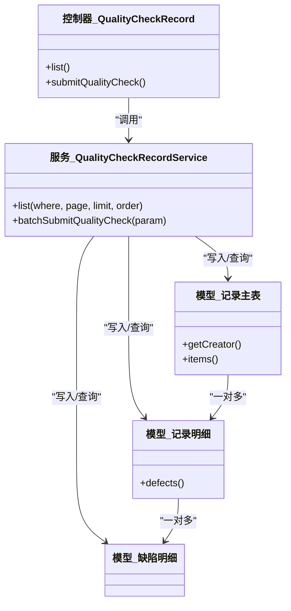
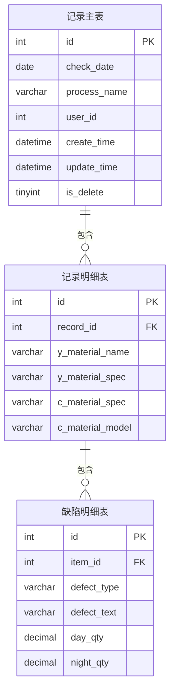
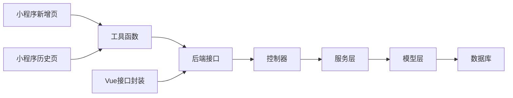

# 质量管理模块

<cite>
**本文引用的文件**
- [gccd_mini/pageWorkOrder/pages/qualityCheckAdd/qualityCheckAdd.js](file://gccd_mini/pageWorkOrder/pages/qualityCheckAdd/qualityCheckAdd.js)
- [gccd_mini/pageWorkOrder/pages/qualityCheckAdd/qualityCheckAdd.json](file://gccd_mini/pageWorkOrder/pages/qualityCheckAdd/qualityCheckAdd.json)
- [gccd_mini/pageWorkOrder/pages/qualityCheckList/qualityCheckList.js](file://gccd_mini/pageWorkOrder/pages/qualityCheckList/qualityCheckList.js)
- [gccd_mini/pageMine/pages/qualityInspection/qualityInspection.js](file://gccd_mini/pageMine/pages/qualityInspection/qualityInspection.js)
- [gccd_mini/pageMine/pages/qualityInspection/qualityInspection.json](file://gccd_mini/pageMine/pages/qualityInspection/qualityInspection.json)
- [gccd_server/app/admin/controller/production/QualityCheckRecord.php](file://gccd_server/app/admin/controller/production/QualityCheckRecord.php)
- [gccd_server/app/common/service/admin/QualityCheckRecordService.php](file://gccd_server/app/common/service/admin/QualityCheckRecordService.php)
- [gccd_server/app/common/model/admin/QualityCheckRecordModel.php](file://gccd_server/app/common/model/admin/QualityCheckRecordModel.php)
- [gccd_server/app/common/model/admin/QualityCheckItemModel.php](file://gccd_server/app/common/model/admin/QualityCheckItemModel.php)
- [gccd_server/app/common/model/admin/QualityCheckDefectModel.php](file://gccd_server/app/common/model/admin/QualityCheckDefectModel.php)
- [gccd_server/database_fix.sql](file://gccd_server/database_fix.sql)
- [yarn/src/api/mes/QualityInspectionRecord/QualityInspectionRecord.js](file://yarn/src/api/mes/QualityInspectionRecord/QualityInspectionRecord.js)
</cite>

## 目录
1. [引言](#引言)
2. [项目结构](#项目结构)
3. [核心组件](#核心组件)
4. [架构总览](#架构总览)
5. [详细组件分析](#详细组件分析)
6. [依赖关系分析](#依赖关系分析)
7. [性能考虑](#性能考虑)
8. [故障排查指南](#故障排查指南)
9. [结论](#结论)
10. [附录](#附录)

## 引言
本文件面向“高齿传动”项目的质量管理模块，聚焦于质量检验记录的采集、提交与查询，以及后续统计分析与追溯的基础能力。当前前端提供“质量检验记录新增”和“历史记录查询”页面；后端提供对应的控制器、服务层与数据模型，支撑质检记录的增删改查与批量提交。

本模块当前未直接实现以下能力：
- 检验标准制定、检验参数配置、检验频次设定、检验方法选择
- 统计分析（不合格品率、趋势、质量成本、改进效果评估）
- 质量控制图与SPC应用
- 质量改进项目的立项、实施与跟踪
- 国际标准与行业最佳实践的集成化展示

后续可在现有基础上扩展：在后端增加标准与参数模型、统计分析服务与报表接口，并在前端补充对应页面与图表组件。

## 项目结构
质量管理模块由三部分组成：
- 前端（微信小程序）：质量检验记录新增、历史记录查询、入口导航
- 后端（ThinkPHP）：控制器、服务层、数据模型与数据库脚本
- 前端（Vue Admin）：MES接口封装，供后台或PC端使用

**图示来源**
- [gccd_mini/pageWorkOrder/pages/qualityCheckAdd/qualityCheckAdd.js:1-336](file://gccd_mini/pageWorkOrder/pages/qualityCheckAdd/qualityCheckAdd.js#L1-L336)
- [gccd_mini/pageWorkOrder/pages/qualityCheckList/qualityCheckList.js:1-174](file://gccd_mini/pageWorkOrder/pages/qualityCheckList/qualityCheckList.js#L1-L174)
- [gccd_mini/pageMine/pages/qualityInspection/qualityInspection.js:1-18](file://gccd_mini/pageMine/pages/qualityInspection/qualityInspection.js#L1-L18)
- [yarn/src/api/mes/QualityInspectionRecord/QualityInspectionRecord.js:1-63](file://yarn/src/api/mes/QualityInspectionRecord/QualityInspectionRecord.js#L1-L63)
- [gccd_server/app/admin/controller/production/QualityCheckRecord.php:1-45](file://gccd_server/app/admin/controller/production/QualityCheckRecord.php#L1-L45)
- [gccd_server/app/common/service/admin/QualityCheckRecordService.php:1-95](file://gccd_server/app/common/service/admin/QualityCheckRecordService.php#L1-L95)
- [gccd_server/app/common/model/admin/QualityCheckRecordModel.php:1-20](file://gccd_server/app/common/model/admin/QualityCheckRecordModel.php#L1-L20)
- [gccd_server/app/common/model/admin/QualityCheckItemModel.php:1-15](file://gccd_server/app/common/model/admin/QualityCheckItemModel.php#L1-L15)
- [gccd_server/app/common/model/admin/QualityCheckDefectModel.php:1-10](file://gccd_server/app/common/model/admin/QualityCheckDefectModel.php#L1-L10)
- [gccd_server/database_fix.sql:1-35](file://gccd_server/database_fix.sql#L1-L35)

**章节来源**
- [gccd_mini/pageWorkOrder/pages/qualityCheckAdd/qualityCheckAdd.js:1-336](file://gccd_mini/pageWorkOrder/pages/qualityCheckAdd/qualityCheckAdd.js#L1-L336)
- [gccd_mini/pageWorkOrder/pages/qualityCheckList/qualityCheckList.js:1-174](file://gccd_mini/pageWorkOrder/pages/qualityCheckList/qualityCheckList.js#L1-L174)
- [gccd_mini/pageMine/pages/qualityInspection/qualityInspection.js:1-18](file://gccd_mini/pageMine/pages/qualityInspection/qualityInspection.js#L1-L18)
- [gccd_server/app/admin/controller/production/QualityCheckRecord.php:1-45](file://gccd_server/app/admin/controller/production/QualityCheckRecord.php#L1-L45)
- [gccd_server/app/common/service/admin/QualityCheckRecordService.php:1-95](file://gccd_server/app/common/service/admin/QualityCheckRecordService.php#L1-L95)
- [gccd_server/app/common/model/admin/QualityCheckRecordModel.php:1-20](file://gccd_server/app/common/model/admin/QualityCheckRecordModel.php#L1-L20)
- [gccd_server/app/common/model/admin/QualityCheckItemModel.php:1-15](file://gccd_server/app/common/model/admin/QualityCheckItemModel.php#L1-L15)
- [gccd_server/app/common/model/admin/QualityCheckDefectModel.php:1-10](file://gccd_server/app/common/model/admin/QualityCheckDefectModel.php#L1-L10)
- [gccd_server/database_fix.sql:1-35](file://gccd_server/database_fix.sql#L1-L35)
- [yarn/src/api/mes/QualityInspectionRecord/QualityInspectionRecord.js:1-63](file://yarn/src/api/mes/QualityInspectionRecord/QualityInspectionRecord.js#L1-L63)

## 核心组件
- 小程序前端页面
  - 质量检验新增：支持工序、日期、物料、成品型号、不良品类型选择与数量录入，支持草稿保存与提交。
  - 质量检验历史：按日期与工序聚合展示历史记录，支持展开查看明细。
  - 质量检验入口：导航至质量检验相关页面。
- 后端接口与服务
  - 控制器：提供质检列表查询与小程序批量提交接口。
  - 服务层：封装列表查询、批量提交逻辑，负责主从表写入。
  - 数据模型：记录主表、明细表、缺陷明细表，定义关联关系。
- 数据库脚本：定义质检记录主表、明细表、缺陷明细表及索引。

**章节来源**
- [gccd_mini/pageWorkOrder/pages/qualityCheckAdd/qualityCheckAdd.js:1-336](file://gccd_mini/pageWorkOrder/pages/qualityCheckAdd/qualityCheckAdd.js#L1-L336)
- [gccd_mini/pageWorkOrder/pages/qualityCheckList/qualityCheckList.js:1-174](file://gccd_mini/pageWorkOrder/pages/qualityCheckList/qualityCheckList.js#L1-L174)
- [gccd_mini/pageMine/pages/qualityInspection/qualityInspection.js:1-18](file://gccd_mini/pageMine/pages/qualityInspection/qualityInspection.js#L1-L18)
- [gccd_server/app/admin/controller/production/QualityCheckRecord.php:1-45](file://gccd_server/app/admin/controller/production/QualityCheckRecord.php#L1-L45)
- [gccd_server/app/common/service/admin/QualityCheckRecordService.php:1-95](file://gccd_server/app/common/service/admin/QualityCheckRecordService.php#L1-L95)
- [gccd_server/app/common/model/admin/QualityCheckRecordModel.php:1-20](file://gccd_server/app/common/model/admin/QualityCheckRecordModel.php#L1-L20)
- [gccd_server/app/common/model/admin/QualityCheckItemModel.php:1-15](file://gccd_server/app/common/model/admin/QualityCheckItemModel.php#L1-L15)
- [gccd_server/app/common/model/admin/QualityCheckDefectModel.php:1-10](file://gccd_server/app/common/model/admin/QualityCheckDefectModel.php#L1-L10)
- [gccd_server/database_fix.sql:1-35](file://gccd_server/database_fix.sql#L1-L35)

## 架构总览
质量管理模块采用前后端分离架构：
- 前端通过工具函数发起HTTP请求，调用后端REST风格接口。
- 后端控制器接收请求，调用服务层进行业务处理，持久化到数据库。
- 数据库三层结构：记录主表、明细表、缺陷明细表，形成“记录-物料项-缺陷项”的树形数据结构。

**图示来源**
- [gccd_server/app/admin/controller/production/QualityCheckRecord.php:36-44](file://gccd_server/app/admin/controller/production/QualityCheckRecord.php#L36-L44)
- [gccd_server/app/common/service/admin/QualityCheckRecordService.php:60-95](file://gccd_server/app/common/service/admin/QualityCheckRecordService.php#L60-L95)
- [gccd_server/app/common/model/admin/QualityCheckRecordModel.php:1-20](file://gccd_server/app/common/model/admin/QualityCheckRecordModel.php#L1-L20)
- [gccd_server/app/common/model/admin/QualityCheckItemModel.php:1-15](file://gccd_server/app/common/model/admin/QualityCheckItemModel.php#L1-L15)
- [gccd_server/app/common/model/admin/QualityCheckDefectModel.php:1-10](file://gccd_server/app/common/model/admin/QualityCheckDefectModel.php#L1-L10)

## 详细组件分析

### 组件一：质量检验新增（小程序）
职责与流程
- 加载物料与成品型号选项，支持搜索过滤与选择。
- 选择不良品类型，支持多选，逐项输入白班/夜班数量。
- 支持添加记录到“已提交列表”，并保存草稿；提交时校验必填项与数量。
- 调用后端接口提交，成功后清空草稿并返回上一页。

关键交互与数据流
- 物料/型号选择：通过远程接口加载，本地构建唯一键去重，支持关键词检索。
- 不良品类型：从检查标准接口加载，支持多选与去重。
- 数量录入：白班/夜班分别录入，提交前校验至少有一项非零。
- 草稿存储：以日期+工序为维度存入本地缓存，便于断点续填。

**图示来源**
- [gccd_mini/pageWorkOrder/pages/qualityCheckAdd/qualityCheckAdd.js:45-336](file://gccd_mini/pageWorkOrder/pages/qualityCheckAdd/qualityCheckAdd.js#L45-L336)

**章节来源**
- [gccd_mini/pageWorkOrder/pages/qualityCheckAdd/qualityCheckAdd.js:1-336](file://gccd_mini/pageWorkOrder/pages/qualityCheckAdd/qualityCheckAdd.js#L1-L336)
- [gccd_mini/pageWorkOrder/pages/qualityCheckAdd/qualityCheckAdd.json:1-10](file://gccd_mini/pageWorkOrder/pages/qualityCheckAdd/qualityCheckAdd.json#L1-L10)

### 组件二：质量检验历史（小程序）
职责与流程
- 默认展示“今日质检”状态（草稿条数），支持切换到“历史记录”标签。
- 历史记录按日期分组，再按工序分组，支持展开查看明细。
- 从后端接口拉取数据，按日期聚合统计缺陷总数与物料项数量。

关键交互与数据流
- 切换标签触发历史加载。
- 服务端返回列表后前端进行日期分组与聚合计算。
- 展开/收起支持用户快速浏览。

**图示来源**
- [gccd_mini/pageWorkOrder/pages/qualityCheckList/qualityCheckList.js:87-166](file://gccd_mini/pageWorkOrder/pages/qualityCheckList/qualityCheckList.js#L87-L166)
- [yarn/src/api/mes/QualityInspectionRecord/QualityInspectionRecord.js:9-15](file://yarn/src/api/mes/QualityInspectionRecord/QualityInspectionRecord.js#L9-L15)

**章节来源**
- [gccd_mini/pageWorkOrder/pages/qualityCheckList/qualityCheckList.js:1-174](file://gccd_mini/pageWorkOrder/pages/qualityCheckList/qualityCheckList.js#L1-L174)

### 组件三：后端控制器与服务层
职责与流程
- 控制器：提供列表查询与批量提交接口，封装参数校验与分页。
- 服务层：实现批量提交逻辑，先写主表，再写明细与缺陷表，保证事务一致性。
- 模型：定义主从表关联，支持查询时预加载创建人与明细信息。

**图示来源**
- [gccd_server/app/admin/controller/production/QualityCheckRecord.php:1-45](file://gccd_server/app/admin/controller/production/QualityCheckRecord.php#L1-L45)
- [gccd_server/app/common/service/admin/QualityCheckRecordService.php:1-95](file://gccd_server/app/common/service/admin/QualityCheckRecordService.php#L1-L95)
- [gccd_server/app/common/model/admin/QualityCheckRecordModel.php:1-20](file://gccd_server/app/common/model/admin/QualityCheckRecordModel.php#L1-L20)
- [gccd_server/app/common/model/admin/QualityCheckItemModel.php:1-15](file://gccd_server/app/common/model/admin/QualityCheckItemModel.php#L1-L15)
- [gccd_server/app/common/model/admin/QualityCheckDefectModel.php:1-10](file://gccd_server/app/common/model/admin/QualityCheckDefectModel.php#L1-L10)

**章节来源**
- [gccd_server/app/admin/controller/production/QualityCheckRecord.php:1-45](file://gccd_server/app/admin/controller/production/QualityCheckRecord.php#L1-L45)
- [gccd_server/app/common/service/admin/QualityCheckRecordService.php:1-95](file://gccd_server/app/common/service/admin/QualityCheckRecordService.php#L1-L95)
- [gccd_server/app/common/model/admin/QualityCheckRecordModel.php:1-20](file://gccd_server/app/common/model/admin/QualityCheckRecordModel.php#L1-L20)
- [gccd_server/app/common/model/admin/QualityCheckItemModel.php:1-15](file://gccd_server/app/common/model/admin/QualityCheckItemModel.php#L1-L15)
- [gccd_server/app/common/model/admin/QualityCheckDefectModel.php:1-10](file://gccd_server/app/common/model/admin/QualityCheckDefectModel.php#L1-L10)

### 组件四：数据模型与数据库设计
数据模型
- 记录主表：包含质检日期、工序名称、创建人、创建/更新时间等字段。
- 记录明细表：关联主表ID，记录物料与成品信息。
- 缺陷明细表：关联明细表ID，记录缺陷类型、描述与白班/夜班数量。

**图示来源**
- [gccd_server/database_fix.sql:1-35](file://gccd_server/database_fix.sql#L1-L35)
- [gccd_server/app/common/model/admin/QualityCheckRecordModel.php:1-20](file://gccd_server/app/common/model/admin/QualityCheckRecordModel.php#L1-L20)
- [gccd_server/app/common/model/admin/QualityCheckItemModel.php:1-15](file://gccd_server/app/common/model/admin/QualityCheckItemModel.php#L1-L15)
- [gccd_server/app/common/model/admin/QualityCheckDefectModel.php:1-10](file://gccd_server/app/common/model/admin/QualityCheckDefectModel.php#L1-L10)

**章节来源**
- [gccd_server/database_fix.sql:1-35](file://gccd_server/database_fix.sql#L1-L35)
- [gccd_server/app/common/model/admin/QualityCheckRecordModel.php:1-20](file://gccd_server/app/common/model/admin/QualityCheckRecordModel.php#L1-L20)
- [gccd_server/app/common/model/admin/QualityCheckItemModel.php:1-15](file://gccd_server/app/common/model/admin/QualityCheckItemModel.php#L1-L15)
- [gccd_server/app/common/model/admin/QualityCheckDefectModel.php:1-10](file://gccd_server/app/common/model/admin/QualityCheckDefectModel.php#L1-L10)

## 依赖关系分析
- 前端依赖
  - 小程序页面依赖工具函数发起HTTP请求，依赖Vant Weapp组件库渲染UI。
  - Vue Admin侧通过统一的API封装调用后端接口。
- 后端依赖
  - 控制器依赖服务层；服务层依赖模型与数据库；模型定义关联关系。
- 数据库依赖
  - 三张表存在外键约束关系，查询时需注意预加载与索引优化。

**图示来源**
- [gccd_mini/pageWorkOrder/pages/qualityCheckAdd/qualityCheckAdd.js:1-3](file://gccd_mini/pageWorkOrder/pages/qualityCheckAdd/qualityCheckAdd.js#L1-L3)
- [gccd_mini/pageWorkOrder/pages/qualityCheckList/qualityCheckList.js](file://gccd_mini/pageWorkOrder/pages/qualityCheckList/qualityCheckList.js#L1)
- [yarn/src/api/mes/QualityInspectionRecord/QualityInspectionRecord.js:1-63](file://yarn/src/api/mes/QualityInspectionRecord/QualityInspectionRecord.js#L1-L63)
- [gccd_server/app/admin/controller/production/QualityCheckRecord.php:1-45](file://gccd_server/app/admin/controller/production/QualityCheckRecord.php#L1-L45)
- [gccd_server/app/common/service/admin/QualityCheckRecordService.php:1-95](file://gccd_server/app/common/service/admin/QualityCheckRecordService.php#L1-L95)
- [gccd_server/app/common/model/admin/QualityCheckRecordModel.php:1-20](file://gccd_server/app/common/model/admin/QualityCheckRecordModel.php#L1-L20)

**章节来源**
- [gccd_mini/pageWorkOrder/pages/qualityCheckAdd/qualityCheckAdd.js:1-3](file://gccd_mini/pageWorkOrder/pages/qualityCheckAdd/qualityCheckAdd.js#L1-L3)
- [gccd_mini/pageWorkOrder/pages/qualityCheckList/qualityCheckList.js](file://gccd_mini/pageWorkOrder/pages/qualityCheckList/qualityCheckList.js#L1)
- [yarn/src/api/mes/QualityInspectionRecord/QualityInspectionRecord.js:1-63](file://yarn/src/api/mes/QualityInspectionRecord/QualityInspectionRecord.js#L1-L63)
- [gccd_server/app/admin/controller/production/QualityCheckRecord.php:1-45](file://gccd_server/app/admin/controller/production/QualityCheckRecord.php#L1-L45)
- [gccd_server/app/common/service/admin/QualityCheckRecordService.php:1-95](file://gccd_server/app/common/service/admin/QualityCheckRecordService.php#L1-L95)
- [gccd_server/app/common/model/admin/QualityCheckRecordModel.php:1-20](file://gccd_server/app/common/model/admin/QualityCheckRecordModel.php#L1-L20)

## 性能考虑
- 前端
  - 列表加载建议分页与懒加载，避免一次性渲染过多节点。
  - 搜索过滤在本地进行，建议限制候选集规模或增加防抖。
  - 草稿保存使用本地缓存，注意清理过期草稿。
- 后端
  - 查询接口建议对日期、工序等常用筛选字段建立索引。
  - 批量提交时尽量减少重复查询，合并写入操作。
  - 关联查询时使用预加载，避免N+1查询问题。
- 数据库
  - 三表关联查询时确保外键索引有效，必要时增加复合索引。

## 故障排查指南
常见问题与定位
- 新增提交失败
  - 检查必填项：物料、成品型号、不良品类型、至少一项数量。
  - 查看网络请求返回码与消息，确认后端接口是否抛出异常。
  - 检查本地草稿是否正确保存与清除。
- 历史记录为空
  - 确认筛选条件（日期范围、工序名）是否合理。
  - 检查后端查询条件拼接与分页参数。
- 数据不一致
  - 批量提交时若出现部分写入，需检查事务边界与异常处理。
  - 核对主从表ID映射关系，确保明细与缺陷表的外键正确。

**章节来源**
- [gccd_mini/pageWorkOrder/pages/qualityCheckAdd/qualityCheckAdd.js:218-252](file://gccd_mini/pageWorkOrder/pages/qualityCheckAdd/qualityCheckAdd.js#L218-L252)
- [gccd_mini/pageWorkOrder/pages/qualityCheckList/qualityCheckList.js:87-166](file://gccd_mini/pageWorkOrder/pages/qualityCheckList/qualityCheckList.js#L87-L166)
- [gccd_server/app/admin/controller/production/QualityCheckRecord.php:36-44](file://gccd_server/app/admin/controller/production/QualityCheckRecord.php#L36-L44)
- [gccd_server/app/common/service/admin/QualityCheckRecordService.php:60-95](file://gccd_server/app/common/service/admin/QualityCheckRecordService.php#L60-L95)

## 结论
质量管理模块当前已具备“质量检验记录新增与历史查询”的基础能力，覆盖了从检验计划执行、数据录入到结果提交与查询的闭环。为进一步完善质量管理，建议在现有基础上扩展：
- 检验标准与参数管理：新增标准维护、参数配置、频次与方法选择。
- 统计分析：开发不合格品率、趋势、成本与改进效果评估报表。
- 追溯体系：基于主从明细建立从原料到成品的全程记录与责任链路。
- SPC与改进：引入控制图与改进项目管理流程。

## 附录
- 国际标准与行业最佳实践
  - ISO 9001：质量管理体系要求
  - ISO 13485：医疗器械质量管理体系
  - IATF 16949：汽车行业质量管理体系
  - 六西格玛（DMAIC）与精益生产（TPM/TPS）
  - 质量功能展开（QFD）、失效模式与影响分析（FMEA）