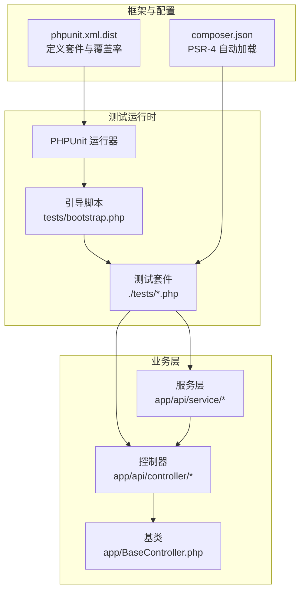
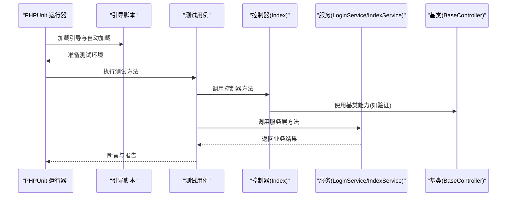
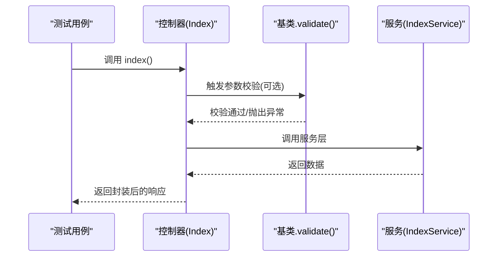
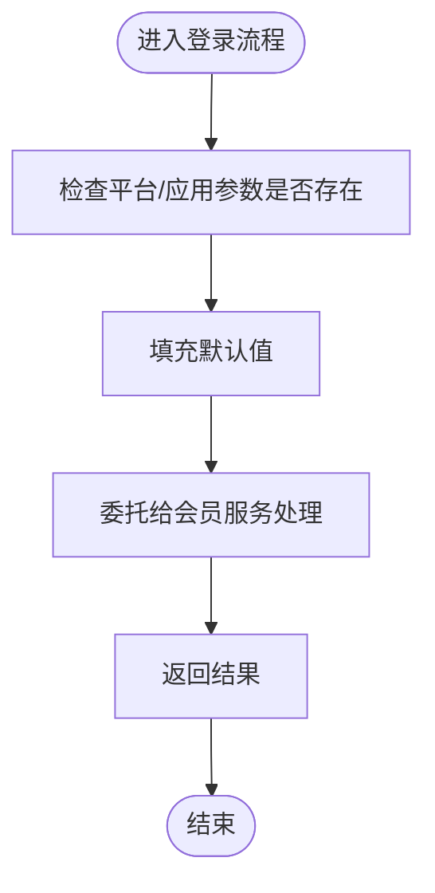
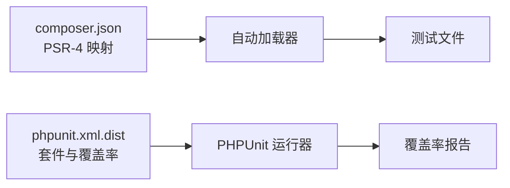

# 单元测试

<cite>
**本文引用的文件**
- [composer.json](file://gccd_server/composer.json)
- [phpunit.xml.dist](file://gccd_server/vendor/topthink/framework/phpunit.xml.dist)
- [BaseController.php](file://gccd_server/app/BaseController.php)
- [Index.php](file://gccd_server/app/api/controller/Index.php)
- [LoginService.php](file://gccd_server/app/api/service/LoginService.php)
- [config.js](file://gccd_server/public/apidoc/config.js)
</cite>

## 目录
1. [简介](#简介)
2. [项目结构](#项目结构)
3. [核心组件](#核心组件)
4. [架构总览](#架构总览)
5. [详细组件分析](#详细组件分析)
6. [依赖分析](#依赖分析)
7. [性能考虑](#性能考虑)
8. [故障排查指南](#故障排查指南)
9. [结论](#结论)
10. [附录](#附录)

## 简介
本文件面向高齿传动项目的单元测试实践，聚焦于 ThinkPHP 8 框架下的测试组织与编写方法，涵盖测试控制器、测试服务类、PHPUnit 配置与使用、测试环境搭建、测试数据准备、Mock 对象使用、覆盖率统计与提升策略，以及常见问题与最佳实践。内容基于仓库中现有的框架与配置文件进行归纳总结，确保读者能够快速落地到实际开发中。

## 项目结构
- 测试框架与入口
  - PHPUnit 配置位于 ThinkPHP 框架分发包内，通过 dist 文件定义测试套件与覆盖率范围。
  - Composer 配置声明了 PSR-4 自动加载命名空间，便于测试自动发现与加载。
- 测试目录约定
  - 根据 PHPUnit 的 dist 配置，测试套件扫描目录为 ./tests（以 Test.php 结尾的文件），建议将测试文件放置在该目录下，或在本地项目中按需调整。
- 业务层结构
  - 控制器：位于 app/api/controller 或 app/admin/controller 下，继承统一基类，便于统一处理请求与验证。
  - 服务层：位于 app/api/service 或 app/common/service 下，封装业务逻辑，便于独立测试与 Mock。
  - 模型与验证：位于 app/common/model 与 app/common/validate 下，可配合服务层进行单元测试。

**图表来源**
- [phpunit.xml.dist:1-28](file://gccd_server/vendor/topthink/framework/phpunit.xml.dist#L1-L28)
- [composer.json:52-59](file://gccd_server/composer.json#L52-L59)
- [BaseController.php:19-100](file://gccd_server/app/BaseController.php#L19-L100)
- [Index.php:21-36](file://gccd_server/app/api/controller/Index.php#L21-L36)

**章节来源**
- [phpunit.xml.dist:1-28](file://gccd_server/vendor/topthink/framework/phpunit.xml.dist#L1-L28)
- [composer.json:52-59](file://gccd_server/composer.json#L52-L59)

## 核心组件
- 控制器基类
  - 统一注入 App 与 Request 实例，提供 initialize 生命周期钩子，便于测试时替换依赖。
  - 提供 validate 方法用于参数校验，支持场景化校验与批量校验，利于测试边界条件与错误路径。
- API 控制器示例
  - Index 控制器继承 BaseController，调用服务层返回数据并封装响应，适合演示“控制器-服务”解耦的测试思路。
- API 服务示例
  - LoginService 将登录流程委托给 MemberService，便于对登录流程进行独立测试与 Mock。
- PHPUnit 配置
  - 定义测试套件名称与扫描目录，启用覆盖率统计并包含框架源码目录，便于评估测试覆盖度。

**章节来源**
- [BaseController.php:19-100](file://gccd_server/app/BaseController.php#L19-L100)
- [Index.php:21-36](file://gccd_server/app/api/controller/Index.php#L21-L36)
- [LoginService.php:17-62](file://gccd_server/app/api/service/LoginService.php#L17-L62)
- [phpunit.xml.dist:17-26](file://gccd_server/vendor/topthink/framework/phpunit.xml.dist#L17-L26)

## 架构总览
下图展示了从测试运行器到业务层的调用链路，以及覆盖率统计的范围。

**图表来源**
- [phpunit.xml.dist:6-16](file://gccd_server/vendor/topthink/framework/phpunit.xml.dist#L6-L16)
- [Index.php:29-35](file://gccd_server/app/api/controller/Index.php#L29-L35)
- [LoginService.php:27-61](file://gccd_server/app/api/service/LoginService.php#L27-L61)
- [BaseController.php:74-99](file://gccd_server/app/BaseController.php#L74-L99)

## 详细组件分析

### 控制器单元测试设计
- 测试目标
  - 验证控制器方法的输入输出、异常抛出、响应封装。
  - 验证基类 validate 方法在不同场景下的行为（批量校验、消息定制）。
- 测试策略
  - 使用 Mock 替换服务层依赖，隔离控制器逻辑。
  - 构造最小化的请求对象，传入必要参数，断言响应结构与状态。
  - 针对异常路径（如校验失败、业务异常），断言抛出的异常类型与消息。
- 示例要点（不展示具体代码）
  - 控制器方法调用顺序参考：[Index.php:29-35](file://gccd_server/app/api/controller/Index.php#L29-L35)
  - 参数校验调用顺序参考：[BaseController.php:74-99](file://gccd_server/app/BaseController.php#L74-L99)

**图表来源**
- [Index.php:29-35](file://gccd_server/app/api/controller/Index.php#L29-L35)
- [BaseController.php:74-99](file://gccd_server/app/BaseController.php#L74-L99)

**章节来源**
- [Index.php:21-36](file://gccd_server/app/api/controller/Index.php#L21-L36)
- [BaseController.php:74-99](file://gccd_server/app/BaseController.php#L74-L99)

### 服务类单元测试设计
- 测试目标
  - 验证服务层业务逻辑正确性、分支覆盖、异常处理。
  - 验证对外部依赖（如第三方登录、会员服务）的调用与参数传递。
- 测试策略
  - 使用静态代理或 Mock 对外部依赖进行替换，确保测试稳定可控。
  - 针对不同输入组合（正常、缺失字段、非法格式）进行覆盖。
  - 对关键流程（如登录、第三方登录、退出）绘制流程图，指导用例设计。
- 示例要点（不展示具体代码）
  - 登录流程委托关系参考：[LoginService.php:27-36](file://gccd_server/app/api/service/LoginService.php#L27-L36)
  - 第三方登录流程委托关系参考：[LoginService.php:46-49](file://gccd_server/app/api/service/LoginService.php#L46-L49)

**图表来源**
- [LoginService.php:27-36](file://gccd_server/app/api/service/LoginService.php#L27-L36)

**章节来源**
- [LoginService.php:17-62](file://gccd_server/app/api/service/LoginService.php#L17-L62)

### 数据验证与参数校验测试
- 利用基类 validate 方法进行参数校验测试，覆盖以下场景：
  - 正常参数：断言返回通过且无异常。
  - 缺失字段：断言抛出校验异常并包含对应提示。
  - 非法格式：断言抛出校验异常并包含对应提示。
  - 批量校验：断言一次性返回所有错误。
  - 场景化校验：针对不同场景（如新增、编辑）分别测试。
- 参考实现位置
  - 校验方法定义与调用：[BaseController.php:74-99](file://gccd_server/app/BaseController.php#L74-L99)

**章节来源**
- [BaseController.php:74-99](file://gccd_server/app/BaseController.php#L74-L99)

### API 接口测试设计
- 测试目标
  - 验证控制器方法对请求的解析、参数校验、服务调用与响应封装。
- 测试策略
  - 构造请求参数与头部信息，模拟真实调用路径。
  - 对返回的状态码、消息、数据结构进行断言。
  - 对异常路径（如未授权、参数错误、服务器内部错误）进行覆盖。
- 参考实现位置
  - 控制器方法与服务调用：[Index.php:29-35](file://gccd_server/app/api/controller/Index.php#L29-L35)

**章节来源**
- [Index.php:21-36](file://gccd_server/app/api/controller/Index.php#L21-L36)

### Mock 对象与外部依赖替换
- 建议做法
  - 使用静态代理或 Mock 框架替换服务层对外部系统的依赖（如第三方登录、缓存、队列等）。
  - 在测试前注入 Mock 实例，在测试后恢复或清理。
- 适用场景
  - 登录流程中的第三方回调、会员服务调用。
  - 文件上传、短信发送、邮件发送等外部系统交互。
- 参考实现位置
  - 登录流程委托关系：[LoginService.php:27-49](file://gccd_server/app/api/service/LoginService.php#L27-L49)

**章节来源**
- [LoginService.php:17-62](file://gccd_server/app/api/service/LoginService.php#L17-L62)

### 测试数据准备与数据库隔离
- 建议做法
  - 使用内存数据库或测试专用数据库，确保测试之间互不干扰。
  - 在测试前后执行数据清理（如 truncate 表、回滚事务）。
  - 通过工厂模式或固定数据集准备测试数据，保证可重复性。
- 适用场景
  - 涉及数据库读写的业务逻辑（如查询、插入、更新、删除）。
  - 需要真实数据参与的复杂流程（如报表生成、统计计算）。

### 测试覆盖率统计与提升策略
- 覆盖率统计
  - PHPUnit 配置已启用覆盖率统计并包含框架源码目录，可在运行后生成覆盖率报告。
  - 参考配置位置：[phpunit.xml.dist:17-21](file://gccd_server/vendor/topthink/framework/phpunit.xml.dist#L17-L21)
- 提升策略
  - 优先覆盖关键业务路径与异常分支。
  - 通过 Mock 降低外部依赖对覆盖率的影响，集中关注业务逻辑。
  - 使用断言细化（如断言字段存在、类型正确、范围合理）提升质量。
  - 定期审查低覆盖率模块，补充用例直至达到预期阈值。

**章节来源**
- [phpunit.xml.dist:17-21](file://gccd_server/vendor/topthink/framework/phpunit.xml.dist#L17-L21)

## 依赖分析
- 自动加载与测试发现
  - PSR-4 命名空间映射确保测试文件可被自动加载与发现。
  - 参考位置：[composer.json:52-59](file://gccd_server/composer.json#L52-L59)
- 测试运行与报告
  - PHPUnit 通过 dist 配置加载引导脚本、扫描测试套件、生成覆盖率报告。
  - 参考位置：[phpunit.xml.dist:6-16](file://gccd_server/vendor/topthink/framework/phpunit.xml.dist#L6-L16)

**图表来源**
- [composer.json:52-59](file://gccd_server/composer.json#L52-L59)
- [phpunit.xml.dist:6-16](file://gccd_server/vendor/topthink/framework/phpunit.xml.dist#L6-L16)

**章节来源**
- [composer.json:52-59](file://gccd_server/composer.json#L52-L59)
- [phpunit.xml.dist:6-16](file://gccd_server/vendor/topthink/framework/phpunit.xml.dist#L6-L16)

## 性能考虑
- 测试执行速度
  - 尽量减少外部依赖调用，使用 Mock 与内存存储。
  - 合理拆分测试用例，避免单测过长。
- 资源管理
  - 在测试结束后释放资源（如关闭连接、清理临时文件）。
- 并行与隔离
  - 使用独立数据库或命名空间隔离，避免并发测试冲突。

## 故障排查指南
- 常见问题
  - 测试无法启动：检查引导脚本路径与权限，确认自动加载配置正确。
  - 覆盖率统计为空：确认覆盖率 include 目录与实际源码目录一致。
  - Mock 不生效：检查命名空间与类名是否匹配，确保在测试前完成注入。
- 参考配置
  - 引导脚本与套件扫描：[phpunit.xml.dist:6-16](file://gccd_server/vendor/topthink/framework/phpunit.xml.dist#L6-L16)
  - 覆盖率包含目录：[phpunit.xml.dist:17-21](file://gccd_server/vendor/topthink/framework/phpunit.xml.dist#L17-L21)

**章节来源**
- [phpunit.xml.dist:6-21](file://gccd_server/vendor/topthink/framework/phpunit.xml.dist#L6-L21)

## 结论
通过合理的测试组织、清晰的控制器与服务层职责划分、完善的 PHPUnit 配置与 Mock 策略，可以在 ThinkPHP 8 框架下高效构建高质量的单元测试体系。建议优先覆盖关键业务与异常路径，结合覆盖率报告持续改进测试质量，并在团队内推广统一的测试规范与最佳实践。

## 附录
- 测试环境搭建步骤（概要）
  - 安装依赖：执行 Composer 安装命令，确保自动加载可用。
  - 创建测试目录：在项目根目录创建 tests 目录，遵循 Test.php 命名规范。
  - 配置引导脚本：确保引导脚本正确加载应用与自动加载器。
  - 运行测试：使用 PHPUnit 执行测试套件，查看覆盖率报告。
- 参考位置
  - PHPUnit 配置：[phpunit.xml.dist:1-28](file://gccd_server/vendor/topthink/framework/phpunit.xml.dist#L1-L28)
  - 自动加载配置：[composer.json:52-59](file://gccd_server/composer.json#L52-L59)
  - 控制器基类与验证方法：[BaseController.php:74-99](file://gccd_server/app/BaseController.php#L74-L99)
  - API 控制器示例：[Index.php:21-36](file://gccd_server/app/api/controller/Index.php#L21-L36)
  - API 服务示例：[LoginService.php:17-62](file://gccd_server/app/api/service/LoginService.php#L17-L62)
  - Apidoc 自定义配置（与测试无关但可辅助接口文档与联调）：[config.js:55-101](file://gccd_server/public/apidoc/config.js#L55-L101)