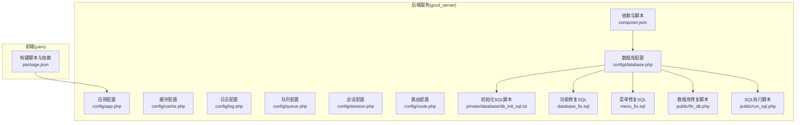
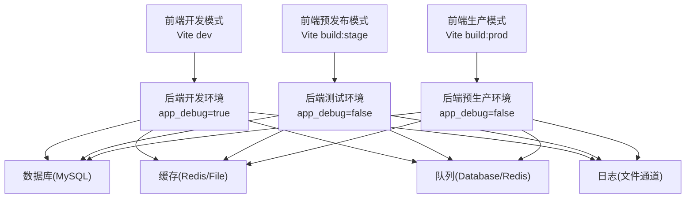
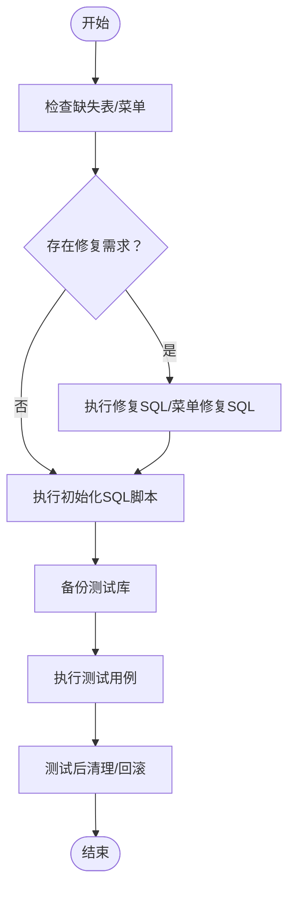
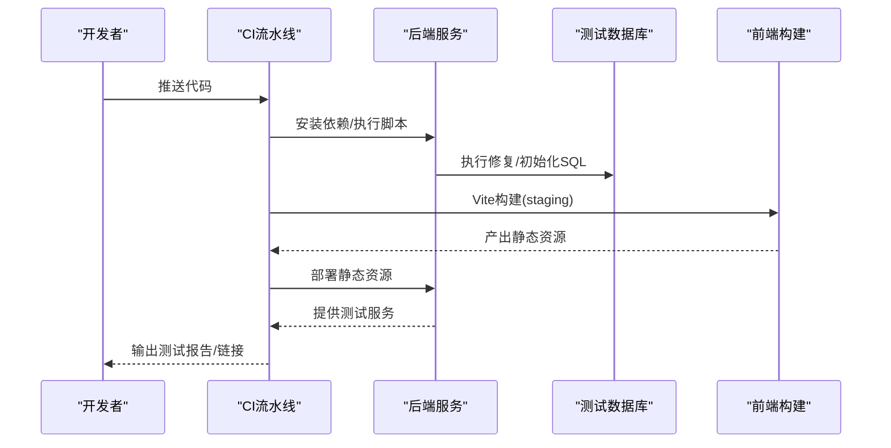
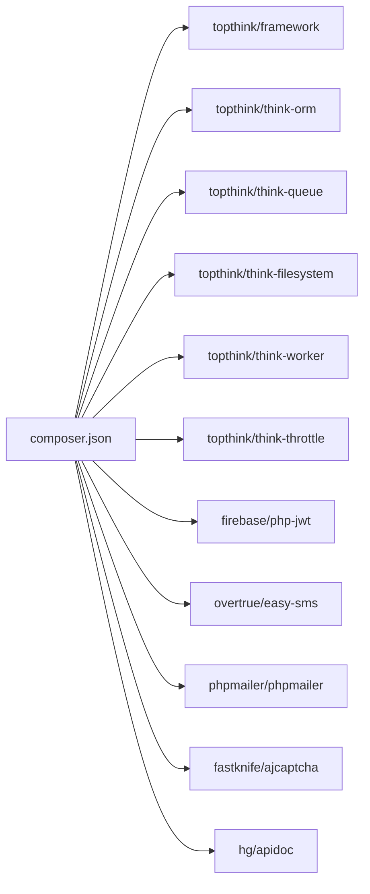

# 测试环境管理

<cite>
**本文引用的文件**
- [gccd_server/config/database.php](file://gccd_server/config/database.php)
- [gccd_server/config/app.php](file://gccd_server/config/app.php)
- [gccd_server/config/cache.php](file://gccd_server/config/cache.php)
- [gccd_server/config/log.php](file://gccd_server/config/log.php)
- [gccd_server/config/queue.php](file://gccd_server/config/queue.php)
- [gccd_server/config/session.php](file://gccd_server/config/session.php)
- [gccd_server/config/route.php](file://gccd_server/config/route.php)
- [gccd_server/composer.json](file://gccd_server/composer.json)
- [yarn/package.json](file://yarn/package.json)
- [gccd_server/private/database/db_init_sql.txt](file://gccd_server/private/database/db_init_sql.txt)
- [gccd_server/database_fix.sql](file://gccd_server/database_fix.sql)
- [gccd_server/menu_fix.sql](file://gccd_server/menu_fix.sql)
- [gccd_server/public/fix_db.php](file://gccd_server/public/fix_db.php)
- [gccd_server/public/run_sql.php](file://gccd_server/public/run_sql.php)
</cite>

## 目录
1. [引言](#引言)
2. [项目结构](#项目结构)
3. [核心组件](#核心组件)
4. [架构总览](#架构总览)
5. [详细组件分析](#详细组件分析)
6. [依赖分析](#依赖分析)
7. [性能考虑](#性能考虑)
8. [故障排查指南](#故障排查指南)
9. [结论](#结论)
10. [附录](#附录)

## 引言
本文件面向高齿传动项目的测试环境管理，系统性阐述开发、测试、预生产三类环境的差异与配置要点；覆盖测试数据库的备份与恢复、数据隔离策略；给出测试数据准备与清理（含脱敏）建议；提供监控与日志管理方案；并结合现有配置说明持续集成中的测试环境配置与自动化部署思路。目标是帮助测试与运维团队建立标准化、可重复、可追溯的测试环境管理体系。

## 项目结构
高齿传动项目由三部分组成：
- 后端服务（ThinkPHP 8）：gccd_server
- 前端管理（Vue 3 + Vite）：yarn
- 微信小程序前端：gccd_mini

测试环境管理主要围绕后端服务的配置与脚本展开，前端通过构建产物部署到测试环境的静态资源目录中。

图示来源
- [gccd_server/config/database.php:11-70](file://gccd_server/config/database.php#L11-L70)
- [gccd_server/config/app.php:11-43](file://gccd_server/config/app.php#L11-L43)
- [gccd_server/config/cache.php:13-85](file://gccd_server/config/cache.php#L13-L85)
- [gccd_server/config/log.php:11-50](file://gccd_server/config/log.php#L11-L50)
- [gccd_server/config/queue.php:23-55](file://gccd_server/config/queue.php#L23-L55)
- [gccd_server/config/session.php:11-24](file://gccd_server/config/session.php#L11-L24)
- [gccd_server/config/route.php:11-50](file://gccd_server/config/route.php#L11-L50)
- [gccd_server/composer.json:17-22](file://gccd_server/composer.json#L17-L22)
- [gccd_server/private/database/db_init_sql.txt:1-62](file://gccd_server/private/database/db_init_sql.txt#L1-L62)
- [gccd_server/database_fix.sql:1-58](file://gccd_server/database_fix.sql#L1-L58)
- [gccd_server/menu_fix.sql:1-32](file://gccd_server/menu_fix.sql#L1-L32)
- [gccd_server/public/fix_db.php:1-24](file://gccd_server/public/fix_db.php#L1-L24)
- [gccd_server/public/run_sql.php:33-63](file://gccd_server/public/run_sql.php#L33-L63)

章节来源
- [gccd_server/config/database.php:11-70](file://gccd_server/config/database.php#L11-L70)
- [gccd_server/config/app.php:11-43](file://gccd_server/config/app.php#L11-L43)
- [gccd_server/config/cache.php:13-85](file://gccd_server/config/cache.php#L13-L85)
- [gccd_server/config/log.php:11-50](file://gccd_server/config/log.php#L11-L50)
- [gccd_server/config/queue.php:23-55](file://gccd_server/config/queue.php#L23-L55)
- [gccd_server/config/session.php:11-24](file://gccd_server/config/session.php#L11-L24)
- [gccd_server/config/route.php:11-50](file://gccd_server/config/route.php#L11-L50)
- [gccd_server/composer.json:17-22](file://gccd_server/composer.json#L17-L22)
- [yarn/package.json:16-24](file://yarn/package.json#L16-L24)

## 核心组件
- 数据库配置：集中于数据库连接、字符集、表前缀、断线重连、SQL监听、字段缓存等，支持多环境通过环境变量切换。
- 应用配置：调试模式、时区、默认应用、异常模板、错误提示等。
- 缓存配置：支持文件、Redis、Memcache、WinCache等多种驱动，便于测试环境选择低延迟缓存。
- 日志配置：文件通道、独立级别、最大文件数、实时写入等，便于测试环境分级输出与归档。
- 队列配置：同步、数据库、Redis三种驱动，测试环境可按需选择。
- 会话配置：文件或缓存驱动，过期时间与前缀可控。
- 路由配置：路径分隔符、URL后缀、默认控制器与动作等。
- 构建与脚本：后端composer脚本、前端Vite模式化构建脚本。

章节来源
- [gccd_server/config/database.php:11-70](file://gccd_server/config/database.php#L11-L70)
- [gccd_server/config/app.php:11-43](file://gccd_server/config/app.php#L11-L43)
- [gccd_server/config/cache.php:13-85](file://gccd_server/config/cache.php#L13-L85)
- [gccd_server/config/log.php:11-50](file://gccd_server/config/log.php#L11-L50)
- [gccd_server/config/queue.php:23-55](file://gccd_server/config/queue.php#L23-L55)
- [gccd_server/config/session.php:11-24](file://gccd_server/config/session.php#L11-L24)
- [gccd_server/config/route.php:11-50](file://gccd_server/config/route.php#L11-L50)
- [gccd_server/composer.json:17-22](file://gccd_server/composer.json#L17-L22)
- [yarn/package.json:16-24](file://yarn/package.json#L16-L24)

## 架构总览
测试环境的运行时架构由“前端构建产物 + 后端服务 + 数据库/缓存/队列/日志”构成。前端通过Vite的development/staging/production模式构建，后端通过ThinkPHP的多应用与环境变量实现不同环境的差异化配置。

图示来源
- [yarn/package.json:16-24](file://yarn/package.json#L16-L24)
- [gccd_server/config/app.php:12-17](file://gccd_server/config/app.php#L12-L17)
- [gccd_server/config/cache.php:14-15](file://gccd_server/config/cache.php#L14-L15)
- [gccd_server/config/queue.php:24-25](file://gccd_server/config/queue.php#L24-L25)
- [gccd_server/config/log.php:12-13](file://gccd_server/config/log.php#L12-L13)

## 详细组件分析

### 环境差异与配置方法
- 开发环境（development）
  - 应用调试开启，便于本地联调与问题定位。
  - 缓存可选文件或Redis，便于快速迭代。
  - 日志实时写入与独立级别输出，便于问题追踪。
- 测试环境（staging）
  - 关闭调试，模拟真实运行状态。
  - 使用数据库队列或Redis队列，验证异步任务行为。
  - 日志按级别拆分，定期归档。
- 预生产环境（production）
  - 与生产一致的配置，仅数据隔离与访问控制不同。
  - 严格的时间字段格式与异常模板，保证一致性。

章节来源
- [gccd_server/config/app.php:12-17](file://gccd_server/config/app.php#L12-L17)
- [gccd_server/config/log.php:24-48](file://gccd_server/config/log.php#L24-L48)
- [gccd_server/config/queue.php:24-25](file://gccd_server/config/queue.php#L24-L25)

### 数据库管理（备份、恢复、隔离）
- 初始化与修复
  - 初始化SQL脚本提供批量清空与重置关键业务表的逻辑，适合测试环境快速回滚到干净状态。
  - 功能修复SQL与菜单修复SQL分别用于补齐缺失表与修复菜单顺序，保障测试功能完整性。
  - 在线修复脚本可在浏览器访问，自动连接数据库并执行修复，简化测试环境初始化。
- 备份与恢复
  - 建议在每次回归测试前对测试库进行快照或逻辑备份；恢复时优先使用初始化SQL脚本进行结构与基础数据的统一重置。
- 数据隔离
  - 通过不同的数据库实例或Schema隔离不同测试任务的数据，避免相互污染。
  - 使用独立的表前缀或命名空间区分不同测试场景。

图示来源
- [gccd_server/private/database/db_init_sql.txt:11-62](file://gccd_server/private/database/db_init_sql.txt#L11-L62)
- [gccd_server/database_fix.sql:1-58](file://gccd_server/database_fix.sql#L1-L58)
- [gccd_server/menu_fix.sql:5-31](file://gccd_server/menu_fix.sql#L5-L31)
- [gccd_server/public/fix_db.php:12-24](file://gccd_server/public/fix_db.php#L12-L24)

章节来源
- [gccd_server/private/database/db_init_sql.txt:1-62](file://gccd_server/private/database/db_init_sql.txt#L1-L62)
- [gccd_server/database_fix.sql:1-58](file://gccd_server/database_fix.sql#L1-L58)
- [gccd_server/menu_fix.sql:1-32](file://gccd_server/menu_fix.sql#L1-L32)
- [gccd_server/public/fix_db.php:1-24](file://gccd_server/public/fix_db.php#L1-L24)

### 测试数据准备与清理策略
- 准备策略
  - 使用初始化SQL脚本统一清理与重置核心业务表，确保测试基线一致。
  - 对于新增表，参考功能修复SQL的建表规范，保持字段与索引一致。
- 清理策略
  - 回归测试前后统一执行初始化SQL脚本，确保无残留数据影响后续用例。
  - 对临时数据与测试账号，采用固定前缀或独立Schema，便于批量清理。
- 数据脱敏
  - 建议在测试数据生成阶段对敏感字段（如手机号、邮箱、身份证号）进行脱敏处理，避免泄露风险。
  - 可在初始化SQL中对关键字段进行清洗或替换，确保测试数据不可逆向还原真实用户信息。

章节来源
- [gccd_server/private/database/db_init_sql.txt:28-59](file://gccd_server/private/database/db_init_sql.txt#L28-L59)
- [gccd_server/database_fix.sql:1-58](file://gccd_server/database_fix.sql#L1-L58)

### 监控与日志管理
- 日志通道
  - 文件通道支持独立级别输出与最大文件数控制，便于测试环境按错误等级分类归档。
  - 实时写入可选，建议在压力测试时关闭以降低IO开销。
- 监控建议
  - 结合后端队列与缓存通道，观察任务积压与缓存命中率。
  - 对关键接口增加埋点与链路追踪，配合日志进行端到端问题定位。

章节来源
- [gccd_server/config/log.php:24-48](file://gccd_server/config/log.php#L24-L48)
- [gccd_server/config/queue.php:24-25](file://gccd_server/config/queue.php#L24-L25)
- [gccd_server/config/cache.php:14-15](file://gccd_server/config/cache.php#L14-L15)

### 持续集成中的测试环境配置与自动化部署
- 前端构建
  - 使用Vite的staging模式构建测试环境产物，确保与后端测试环境配置一致。
- 后端脚本
  - composer的autoload钩子可用于自动发现服务与发布静态资源，减少手工步骤。
- 自动化流程建议
  - CI触发后端拉取代码、安装依赖、执行数据库修复与初始化脚本，随后启动后端服务与前端静态资源。
  - 测试完成后回收测试库快照或执行初始化SQL脚本，确保下一轮测试不受上次结果影响。

图示来源
- [yarn/package.json:16-24](file://yarn/package.json#L16-L24)
- [gccd_server/composer.json:17-22](file://gccd_server/composer.json#L17-L22)
- [gccd_server/public/fix_db.php:12-24](file://gccd_server/public/fix_db.php#L12-L24)
- [gccd_server/private/database/db_init_sql.txt:11-62](file://gccd_server/private/database/db_init_sql.txt#L11-L62)

章节来源
- [yarn/package.json:16-24](file://yarn/package.json#L16-L24)
- [gccd_server/composer.json:17-22](file://gccd_server/composer.json#L17-L22)

### 安全管理与访问控制
- 环境变量与密钥
  - 数据库与缓存的主机、端口、密码等通过环境变量注入，避免硬编码。
- 访问控制
  - 限制测试环境的网络访问范围，仅允许CI与测试人员访问。
  - 对外暴露的接口与静态资源，建议在网关层做限流与鉴权。
- 日志与审计
  - 敏感操作与登录行为应单独记录并定期审计，防止越权与滥用。

章节来源
- [gccd_server/config/database.php:30-46](file://gccd_server/config/database.php#L30-L46)
- [gccd_server/config/cache.php:42-51](file://gccd_server/config/cache.php#L42-L51)

## 依赖分析
后端依赖与脚本关系如下：

图示来源
- [gccd_server/composer.json:23-47](file://gccd_server/composer.json#L23-L47)

章节来源
- [gccd_server/composer.json:23-47](file://gccd_server/composer.json#L23-L47)

## 性能考虑
- 缓存与队列
  - 测试环境可启用Redis缓存与队列，验证高并发下的稳定性与性能瓶颈。
- 日志写入
  - 压力测试时建议关闭实时写入，降低磁盘IO对测试结果的影响。
- 数据库连接
  - 合理设置断线重连与字段缓存路径，避免频繁重建元数据导致的抖动。

章节来源
- [gccd_server/config/cache.php:14-15](file://gccd_server/config/cache.php#L14-L15)
- [gccd_server/config/queue.php:24-25](file://gccd_server/config/queue.php#L24-L25)
- [gccd_server/config/log.php:44-45](file://gccd_server/config/log.php#L44-L45)
- [gccd_server/config/database.php:59-65](file://gccd_server/config/database.php#L59-L65)

## 故障排查指南
- 数据库连接失败
  - 检查环境变量与数据库配置，确认主机、端口、用户名、密码正确。
  - 如需在线修复，可通过修复脚本访问并执行修复。
- 表缺失或菜单异常
  - 使用功能修复SQL与菜单修复SQL补全结构与权限。
  - 回归测试前统一执行初始化SQL脚本，确保基线一致。
- 队列任务堆积
  - 切换队列驱动至Redis并检查消费者进程状态。
- 日志无法输出
  - 检查日志通道配置与文件权限，必要时开启实时写入。

章节来源
- [gccd_server/public/fix_db.php:12-24](file://gccd_server/public/fix_db.php#L12-L24)
- [gccd_server/database_fix.sql:1-58](file://gccd_server/database_fix.sql#L1-L58)
- [gccd_server/menu_fix.sql:5-31](file://gccd_server/menu_fix.sql#L5-L31)
- [gccd_server/private/database/db_init_sql.txt:11-62](file://gccd_server/private/database/db_init_sql.txt#L11-L62)
- [gccd_server/config/queue.php:24-25](file://gccd_server/config/queue.php#L24-L25)
- [gccd_server/config/log.php:24-48](file://gccd_server/config/log.php#L24-L48)

## 结论
通过统一的环境配置、标准化的数据库初始化与修复脚本、规范化的测试数据准备与清理流程，以及完善的监控与日志管理，高齿传动项目的测试环境可以实现高效、稳定、可追溯的管理。结合现有配置与脚本，建议在CI中固化上述流程，确保每次回归测试均在同一基线上进行，提升测试效率与结果可信度。

## 附录
- 前端构建模式
  - development：本地开发调试
  - staging：测试环境预览
  - production：生产环境构建
- 后端脚本
  - autoload钩子：自动发现服务与发布静态资源
- 数据库脚本
  - 初始化SQL：清理与重置核心业务表
  - 功能修复SQL：补齐缺失表
  - 菜单修复SQL：修复菜单顺序与入口
  - 在线修复脚本：浏览器访问自动修复

章节来源
- [yarn/package.json:16-24](file://yarn/package.json#L16-L24)
- [gccd_server/composer.json:17-22](file://gccd_server/composer.json#L17-L22)
- [gccd_server/private/database/db_init_sql.txt:1-62](file://gccd_server/private/database/db_init_sql.txt#L1-L62)
- [gccd_server/database_fix.sql:1-58](file://gccd_server/database_fix.sql#L1-L58)
- [gccd_server/menu_fix.sql:1-32](file://gccd_server/menu_fix.sql#L1-L32)
- [gccd_server/public/fix_db.php:1-24](file://gccd_server/public/fix_db.php#L1-L24)