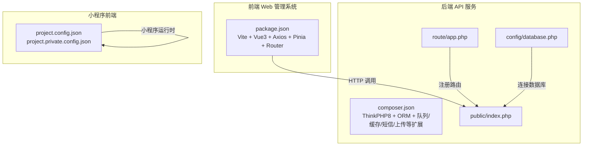
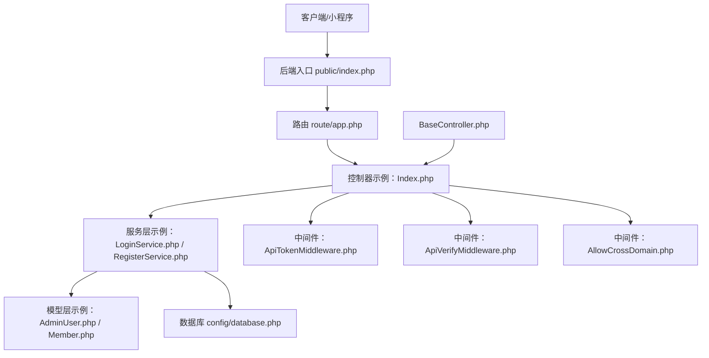
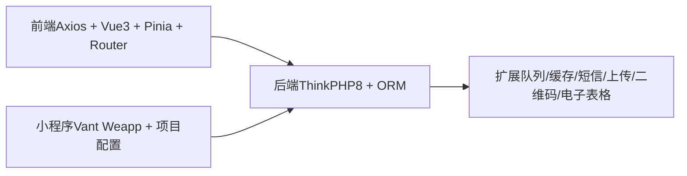

# 测试策略

<cite>
**本文引用的文件**
- [README.md](file://README.md)
- [gccd_server/composer.json](file://gccd_server/composer.json)
- [yarn/package.json](file://yarn/package.json)
- [gccd_mini/project.config.json](file://gccd_mini/project.config.json)
- [gccd_mini/project.private.config.json](file://gccd_mini/project.private.config.json)
- [gccd_server/app/api/controller/Index.php](file://gccd_server/app/api/controller/Index.php)
- [gccd_server/app/api/service/LoginService.php](file://gccd_server/app/api/service/LoginService.php)
- [gccd_server/app/api/service/RegisterService.php](file://gccd_server/app/api/service/RegisterService.php)
- [gccd_server/app/common/model/admin/AdminUser.php](file://gccd_server/app/common/model/admin/AdminUser.php)
- [gccd_server/app/common/model/member/Member.php](file://gccd_server/app/common/model/member/Member.php)
- [gccd_server/app/common/service/admin/AdminUserService.php](file://gccd_server/app/common/service/admin/AdminUserService.php)
- [gccd_server/app/common/service/member/MemberService.php](file://gccd_server/app/common/service/member/MemberService.php)
- [gccd_server/app/api/middleware/ApiTokenMiddleware.php](file://gccd_server/app/api/middleware/ApiTokenMiddleware.php)
- [gccd_server/app/api/middleware/ApiVerifyMiddleware.php](file://gccd_server/app/api/middleware/ApiVerifyMiddleware.php)
- [gccd_server/app/common/middleware/AllowCrossDomain.php](file://gccd_server/app/common/middleware/AllowCrossDomain.php)
- [gccd_server/app/BaseController.php](file://gccd_server/app/BaseController.php)
- [gccd_server/config/database.php](file://gccd_server/config/database.php)
- [gccd_server/public/index.php](file://gccd_server/public/index.php)
- [gccd_server/route/app.php](file://gccd_server/route/app.php)
- [gccd_server/app/api/controller/Index.php](file://gccd_server/app/api/controller/Index.php)
- [gccd_server/app/api/service/LoginService.php](file://gccd_server/app/api/service/LoginService.php)
- [gccd_server/app/api/service/RegisterService.php](file://gccd_server/app/api/service/RegisterService.php)
- [gccd_server/app/common/model/admin/AdminUser.php](file://gccd_server/app/common/model/admin/AdminUser.php)
- [gccd_server/app/common/model/member/Member.php](file://gccd_server/app/common/model/member/Member.php)
- [gccd_server/app/common/service/admin/AdminUserService.php](file://gccd_server/app/common/service/admin/AdminUserService.php)
- [gccd_server/app/common/service/member/MemberService.php](file://gccd_server/app/common/service/member/MemberService.php)
- [gccd_server/app/api/middleware/ApiTokenMiddleware.php](file://gccd_server/app/api/middleware/ApiTokenMiddleware.php)
- [gccd_server/app/api/middleware/ApiVerifyMiddleware.php](file://gccd_server/app/api/middleware/ApiVerifyMiddleware.php)
- [gccd_server/app/common/middleware/AllowCrossDomain.php](file://gccd_server/app/common/middleware/AllowCrossDomain.php)
- [gccd_server/app/BaseController.php](file://gccd_server/app/BaseController.php)
- [gccd_server/config/database.php](file://gccd_server/config/database.php)
- [gccd_server/public/index.php](file://gccd_server/public/index.php)
- [gccd_server/route/app.php](file://gccd_server/route/app.php)
</cite>

## 目录
1. 引言
2. 项目结构
3. 核心组件
4. 架构总览
5. 详细组件分析
6. 依赖分析
7. 性能考虑
8. 故障排查指南
9. 结论
10. 附录

## 引言
本测试策略面向“高齿传动”项目，覆盖前端（Vue3 + Vite）、后端（ThinkPHP 8）与小程序（WeApp）三端，目标是建立从单元测试、集成测试到端到端测试的完整测试体系，并配套测试覆盖率统计、测试环境管理、测试数据准备与清理、以及在持续集成中落地的质量门禁与自动化流程。由于当前仓库未包含现成的测试框架配置或测试脚本，本文将基于现有技术栈与目录结构，给出可落地的测试实施建议与最佳实践。

## 项目结构
项目由三个子工程组成：
- 前端 Web 管理系统：基于 Vue3 + Vite，使用 Element Plus、Axios、Pinia、Vue Router 等生态。
- 后端 API 服务：基于 ThinkPHP 8，提供 REST 接口与中间件、服务层、模型层、路由与配置。
- 小程序前端：基于 WeApp（微信小程序），使用 Vant Weapp 组件库与自定义页面结构。

图表来源
- [yarn/package.json:16-24](file://yarn/package.json#L16-L24)
- [gccd_server/composer.json:23-47](file://gccd_server/composer.json#L23-L47)
- [gccd_server/route/app.php](file://gccd_server/route/app.php)
- [gccd_server/config/database.php](file://gccd_server/config/database.php)
- [gccd_server/public/index.php](file://gccd_server/public/index.php)
- [gccd_mini/project.config.json](file://gccd_mini/project.config.json)
- [gccd_mini/project.private.config.json](file://gccd_mini/project.private.config.json)

章节来源
- [README.md:1-4](file://README.md#L1-L4)
- [yarn/package.json:16-24](file://yarn/package.json#L16-L24)
- [gccd_server/composer.json:23-47](file://gccd_server/composer.json#L23-L47)
- [gccd_server/route/app.php](file://gccd_server/route/app.php)
- [gccd_server/config/database.php](file://gccd_server/config/database.php)
- [gccd_server/public/index.php](file://gccd_server/public/index.php)
- [gccd_mini/project.config.json](file://gccd_mini/project.config.json)
- [gccd_mini/project.private.config.json](file://gccd_mini/project.private.config.json)

## 核心组件
- 前端工程
  - 构建与开发：Vite 脚手架，支持开发、预览与生产构建。
  - 依赖：Axios 用于 HTTP 请求，Pinia 用于状态管理，Vue Router 用于路由。
- 后端工程
  - 框架：ThinkPHP 8，多应用模式，ORM、队列、缓存、短信、上传等扩展。
  - 路由与入口：通过路由文件注册控制器，入口文件处理请求。
  - 中间件：API 认证、参数校验、跨域等。
  - 数据模型与服务：AdminUser、Member 等模型与对应服务层封装业务逻辑。
- 小程序工程
  - 配置：project.config.json 与 project.private.config.json 管理项目与私有配置。
  - 组件：Vant Weapp 组件库与自定义页面。

章节来源
- [yarn/package.json:25-58](file://yarn/package.json#L25-L58)
- [gccd_server/composer.json:23-47](file://gccd_server/composer.json#L23-L47)
- [gccd_server/app/common/middleware/AllowCrossDomain.php](file://gccd_server/app/common/middleware/AllowCrossDomain.php)
- [gccd_server/app/api/middleware/ApiTokenMiddleware.php](file://gccd_server/app/api/middleware/ApiTokenMiddleware.php)
- [gccd_server/app/api/middleware/ApiVerifyMiddleware.php](file://gccd_server/app/api/middleware/ApiVerifyMiddleware.php)
- [gccd_server/app/common/model/admin/AdminUser.php](file://gccd_server/app/common/model/admin/AdminUser.php)
- [gccd_server/app/common/model/member/Member.php](file://gccd_server/app/common/model/member/Member.php)
- [gccd_server/app/common/service/admin/AdminUserService.php](file://gccd_server/app/common/service/admin/AdminUserService.php)
- [gccd_server/app/common/service/member/MemberService.php](file://gccd_server/app/common/service/member/MemberService.php)
- [gccd_mini/project.config.json](file://gccd_mini/project.config.json)
- [gccd_mini/project.private.config.json](file://gccd_mini/project.private.config.json)

## 架构总览
后端采用 MVC 分层与中间件机制，前端通过 Axios 发起请求，小程序通过原生网络能力访问后端接口。数据库配置集中于 config/database.php，路由集中在 route/app.php。

图表来源
- [gccd_server/public/index.php](file://gccd_server/public/index.php)
- [gccd_server/route/app.php](file://gccd_server/route/app.php)
- [gccd_server/app/api/controller/Index.php](file://gccd_server/app/api/controller/Index.php)
- [gccd_server/app/api/service/LoginService.php](file://gccd_server/app/api/service/LoginService.php)
- [gccd_server/app/api/service/RegisterService.php](file://gccd_server/app/api/service/RegisterService.php)
- [gccd_server/app/common/model/admin/AdminUser.php](file://gccd_server/app/common/model/admin/AdminUser.php)
- [gccd_server/app/common/model/member/Member.php](file://gccd_server/app/common/model/member/Member.php)
- [gccd_server/config/database.php](file://gccd_server/config/database.php)
- [gccd_server/app/api/middleware/ApiTokenMiddleware.php](file://gccd_server/app/api/middleware/ApiTokenMiddleware.php)
- [gccd_server/app/api/middleware/ApiVerifyMiddleware.php](file://gccd_server/app/api/middleware/ApiVerifyMiddleware.php)
- [gccd_server/app/common/middleware/AllowCrossDomain.php](file://gccd_server/app/common/middleware/AllowCrossDomain.php)
- [gccd_server/app/BaseController.php](file://gccd_server/app/BaseController.php)

## 详细组件分析

### 前端工程（Vue3 + Vite）
- 单元测试
  - 测试框架：推荐 Vitest（与 Vite 生态契合）。
  - 测试用例设计：针对组合式函数、工具函数、组件渲染与交互进行断言；对异步逻辑使用事件/时间推进模拟。
  - Mock 数据：使用工厂函数生成测试数据，对第三方依赖（如 Axios）进行模块级 Mock。
- 集成测试
  - 接口测试：使用 MSW 或 Vitest 的 Mock 服务器拦截 HTTP 请求，验证请求参数、响应格式与错误处理。
  - 状态管理测试：对 Pinia Store 的 actions、getters 进行纯函数式测试。
- 端到端测试
  - 使用 Playwright/Cypress 进行浏览器自动化，覆盖登录、导航、表单提交等关键用户流程。
  - 性能回归：结合 Lighthouse 或自定义指标采集，监控首屏加载、交互延迟等。
- 覆盖率
  - Vitest 提供内置覆盖率统计，结合 CI 输出报告并与阈值门禁联动。

章节来源
- [yarn/package.json:16-24](file://yarn/package.json#L16-L24)
- [yarn/package.json:25-58](file://yarn/package.json#L25-L58)

### 后端工程（ThinkPHP 8）
- 单元测试
  - 测试框架：推荐 PHPUnit（与 ThinkPHP 生态契合）。
  - 测试用例设计：围绕服务层（Service）与控制器（Controller）进行测试；对模型层（Model）进行行为验证。
  - Mock 数据：使用工厂类或数据库填充器准备测试数据；对缓存、队列、短信等外部依赖进行 Mock。
- 集成测试
  - 接口测试：使用 HTTP 客户端（Guzzle 或 ThinkPHP 内置测试客户端）调用路由，验证鉴权中间件、参数校验中间件与业务返回。
  - 数据库测试：使用事务包裹测试，或在测试前/后执行迁移与回滚；确保隔离性与可重复性。
  - 第三方服务集成：对短信、对象存储、二维码等 SDK 进行 Mock，避免真实调用。
- 端到端测试
  - 使用 REST 客户端（如 Postman/Newman）或自定义脚本，按业务场景编排请求序列，验证工作流闭环。
  - 性能回归：对关键接口进行压力测试与响应时间监控。
- 覆盖率
  - PHPUnit 与 Xdebug/LCOV 配合生成覆盖率报告，CI 中设置最小覆盖率阈值。

章节来源
- [gccd_server/composer.json:23-47](file://gccd_server/composer.json#L23-L47)
- [gccd_server/app/api/middleware/ApiTokenMiddleware.php](file://gccd_server/app/api/middleware/ApiTokenMiddleware.php)
- [gccd_server/app/api/middleware/ApiVerifyMiddleware.php](file://gccd_server/app/api/middleware/ApiVerifyMiddleware.php)
- [gccd_server/app/common/middleware/AllowCrossDomain.php](file://gccd_server/app/common/middleware/AllowCrossDomain.php)
- [gccd_server/app/BaseController.php](file://gccd_server/app/BaseController.php)
- [gccd_server/config/database.php](file://gccd_server/config/database.php)
- [gccd_server/route/app.php](file://gccd_server/route/app.php)
- [gccd_server/public/index.php](file://gccd_server/public/index.php)

### 小程序工程（WeApp + Vant Weapp）
- 单元测试
  - 测试框架：推荐 miniprogram-automator + Jest 或 Vitest（需适配小程序环境）。
  - 测试用例设计：对页面生命周期、组件行为、工具函数进行断言；对网络请求进行 Mock。
- 集成测试
  - 接口测试：通过 Mock 服务器拦截 wx.request，验证请求头、参数与回调。
  - 组件测试：验证组件属性传递、事件触发与渲染结果。
- 端到端测试
  - 使用自动化测试平台（如 Miniprogram Test Runner 或企业微信开发者工具的自动化能力）执行关键用户流程。
- 覆盖率
  - 在 CI 中收集小程序测试覆盖率并输出报告。

章节来源
- [gccd_mini/project.config.json](file://gccd_mini/project.config.json)
- [gccd_mini/project.private.config.json](file://gccd_mini/project.private.config.json)

## 依赖分析
- 前端依赖
  - Axios：HTTP 客户端，用于与后端 API 通信。
  - Vue3/Pinia/Vue Router：前端核心框架与状态管理。
- 后端依赖
  - ThinkPHP8 + ORM：MVC 框架与数据持久化。
  - 多应用模式：便于模块化组织 API 与后台管理。
  - 扩展包：队列、缓存、短信、上传、二维码、电子表格等，需在测试中进行隔离与 Mock。
- 小程序依赖
  - Vant Weapp：UI 组件库。
  - 项目配置：project.config.json 与 project.private.config.json 控制编译与调试行为。

图表来源
- [yarn/package.json:25-58](file://yarn/package.json#L25-L58)
- [gccd_server/composer.json:23-47](file://gccd_server/composer.json#L23-L47)
- [gccd_mini/project.config.json](file://gccd_mini/project.config.json)
- [gccd_mini/project.private.config.json](file://gccd_mini/project.private.config.json)

章节来源
- [yarn/package.json:25-58](file://yarn/package.json#L25-L58)
- [gccd_server/composer.json:23-47](file://gccd_server/composer.json#L23-L47)
- [gccd_mini/project.config.json](file://gccd_mini/project.config.json)
- [gccd_mini/project.private.config.json](file://gccd_mini/project.private.config.json)

## 性能考虑
- 前端
  - 构建优化：启用 Tree Shaking、按需引入与代码分割；在 CI 中对比打包体积与首屏时间。
  - 接口性能：对高频接口进行缓存与节流；在 E2E 中记录关键路径耗时。
- 后端
  - 数据库查询：对慢查询进行索引优化与 SQL 分析；在集成测试中加入查询次数与耗时断言。
  - 中间件开销：减少不必要的鉴权与校验逻辑；对静态资源与跨域处理进行合理配置。
- 小程序
  - 页面渲染：避免过度 setData 与长列表虚拟化；在自动化测试中监控首屏与交互延迟。

## 故障排查指南
- 常见问题
  - 跨域与鉴权失败：检查 AllowCrossDomain、ApiTokenMiddleware、ApiVerifyMiddleware 的配置与顺序。
  - 数据库连接异常：核对 config/database.php 的连接参数与环境变量。
  - 路由未生效：确认 route/app.php 是否正确注册控制器与中间件。
- 日志与追踪
  - 后端日志：查看 runtime 目录下的日志文件，定位异常堆栈与请求上下文。
  - 前端错误：在浏览器控制台与 Network 面板中捕获异常与失败请求。
  - 小程序：使用开发者工具的 Console 与 Network 面板排查。

章节来源
- [gccd_server/app/common/middleware/AllowCrossDomain.php](file://gccd_server/app/common/middleware/AllowCrossDomain.php)
- [gccd_server/app/api/middleware/ApiTokenMiddleware.php](file://gccd_server/app/api/middleware/ApiTokenMiddleware.php)
- [gccd_server/app/api/middleware/ApiVerifyMiddleware.php](file://gccd_server/app/api/middleware/ApiVerifyMiddleware.php)
- [gccd_server/config/database.php](file://gccd_server/config/database.php)
- [gccd_server/route/app.php](file://gccd_server/route/app.php)

## 结论
本测试策略以“分层清晰、边界明确、可自动化”为核心原则，结合前端、后端与小程序三端特性，提出从单元到端到端的测试金字塔。建议优先完善测试框架与脚本配置，再逐步补齐各类测试用例与覆盖率阈值，最终在 CI 中实现质量门禁与自动化执行。

## 附录

### 测试环境搭建与管理
- 前端
  - Node 版本要求：参考 engines 字段；安装依赖后可直接 dev/build。
  - 开发环境：Vite 提供热更新与调试能力。
- 后端
  - PHP 版本：>= 8.0；Composer 安装依赖后启动服务。
  - 数据库：根据 config/database.php 配置初始化测试库。
- 小程序
  - 微信开发者工具：导入项目配置文件进行调试与真机预览。

章节来源
- [yarn/package.json:83-86](file://yarn/package.json#L83-L86)
- [gccd_server/composer.json:24](file://gccd_server/composer.json#L24)
- [gccd_server/config/database.php](file://gccd_server/config/database.php)
- [gccd_mini/project.config.json](file://gccd_mini/project.config.json)
- [gccd_mini/project.private.config.json](file://gccd_mini/project.private.config.json)

### 测试数据准备与清理
- 工厂与填充
  - 使用工厂类或数据库填充器生成测试数据，确保字段完整性与关联关系。
- 事务与回滚
  - 在单元测试中使用事务包裹，测试结束后回滚，保证隔离性。
- 清理策略
  - 对临时文件、上传目录、缓存键进行清理；对第三方服务的测试数据进行归档或删除。

### 持续集成与质量门禁
- CI 流程建议
  - 安装依赖 → 代码规范检查 → 单元测试 → 集成测试 → 覆盖率统计 → 构建产物与部署。
- 质量门禁
  - 设置最低覆盖率阈值；对关键分支与接口失败进行阻断。
- 报告与通知
  - 输出测试报告与覆盖率报告；在失败时发送通知。

### 最佳实践与常见问题
- 最佳实践
  - 先写单元测试再写实现；保持测试独立与可读性；对边界条件与异常路径充分覆盖。
  - 使用 Mock 与 Stub 隔离外部依赖；对数据库与第三方服务进行可控的替换。
- 常见问题
  - 测试不稳定：检查随机性因素（时间、随机数、并发）并进行固定或隔离。
  - 覆盖率低：补充边缘用例与错误路径；对公共工具函数单独测试。