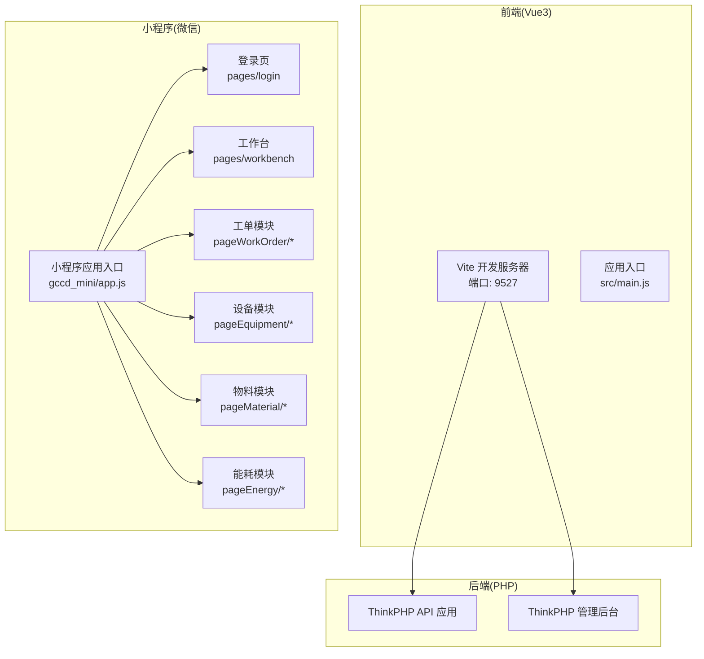
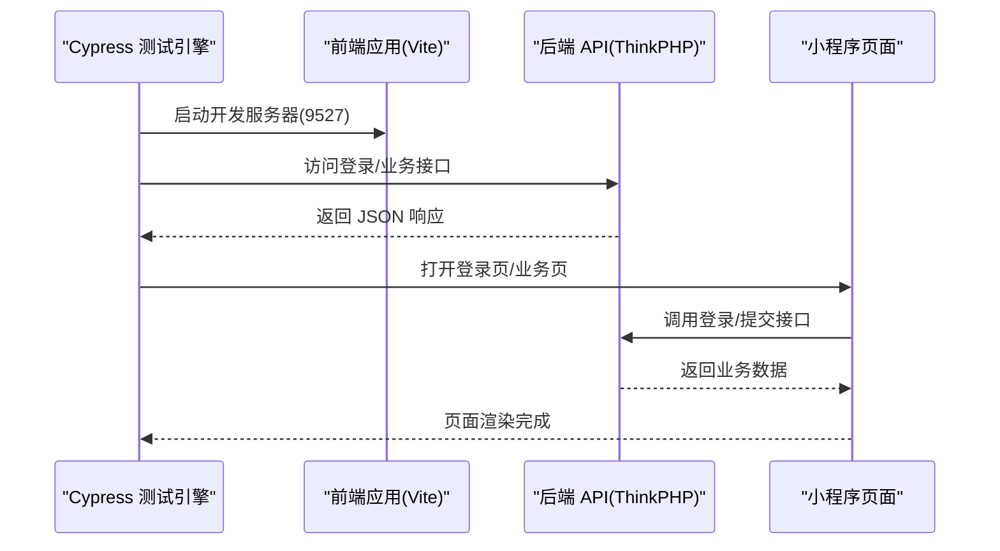
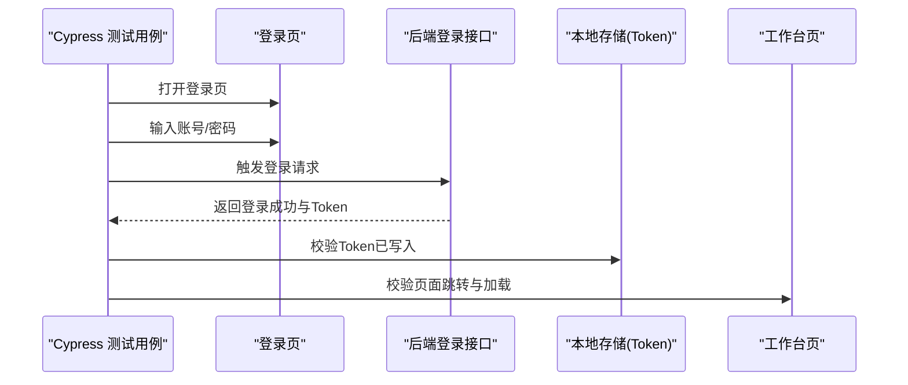
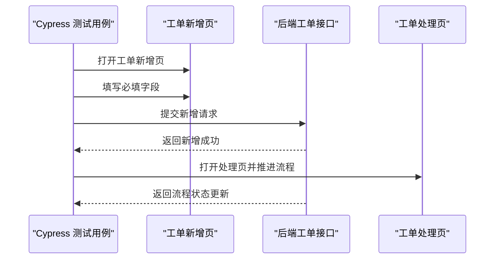
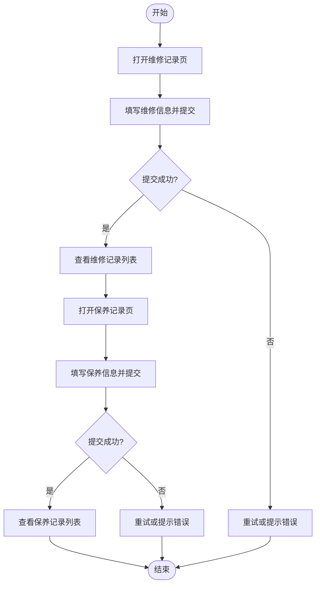
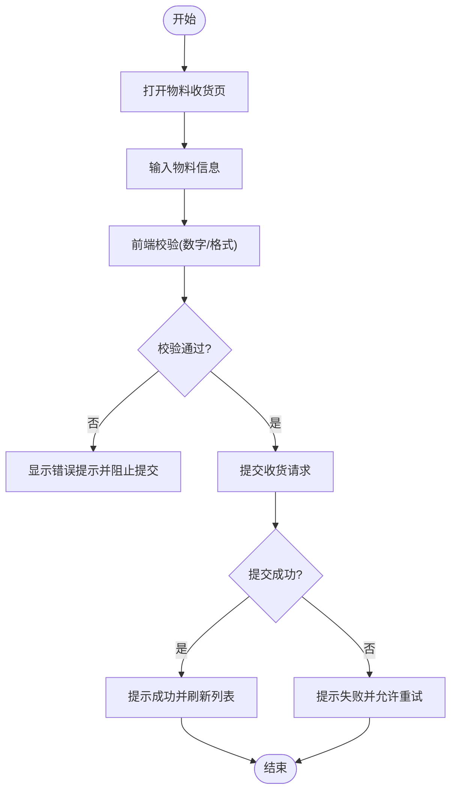
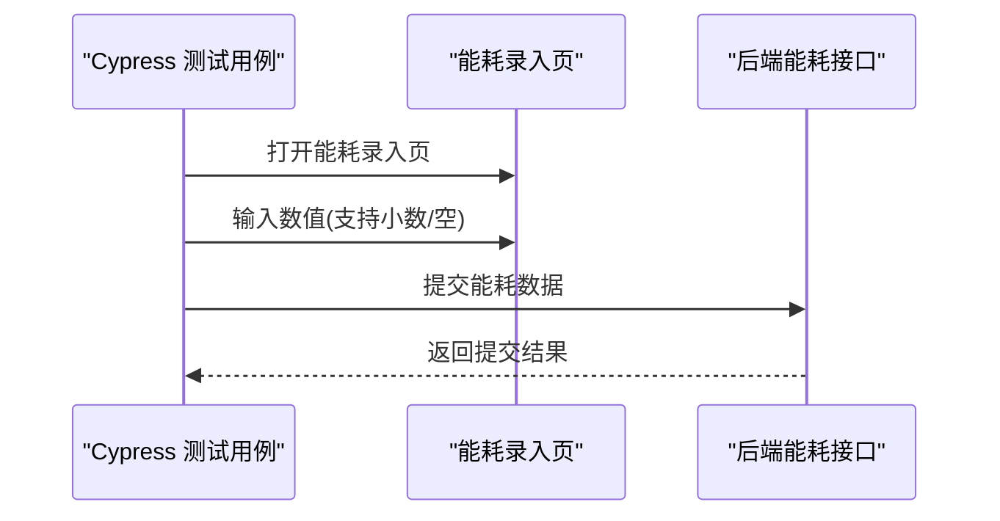
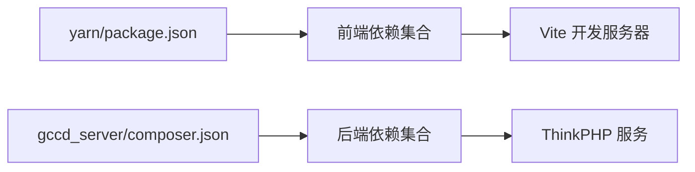

# 端到端测试

<cite>
**本文引用的文件**
- [README.md](file://README.md)
- [gccd_server/README.md](file://gccd_server/README.md)
- [gccd_server/composer.json](file://gccd_server/composer.json)
- [yarn/package.json](file://yarn/package.json)
- [yarn/vite.config.js](file://yarn/vite.config.js)
- [yarn/src/main.js](file://yarn/src/main.js)
- [gccd_mini/app.js](file://gccd_mini/app.js)
- [gccd_mini/pages/login/login.js](file://gccd_mini/pages/login/login.js)
- [gccd_mini/pages/login/login.json](file://gccd_mini/pages/login/login.json)
- [gccd_mini/pages/login/login.wxml](file://gccd_mini/pages/login/login.wxml)
- [gccd_mini/pages/login/login.wxss](file://gccd_mini/pages/login/login.wxss)
- [gccd_mini/pages/workbench/workbench.js](file://gccd_mini/pages/workbench/workbench.js)
- [gccd_mini/pages/workbench/workbench.json](file://gccd_mini/pages/workbench/workbench.json)
- [gccd_mini/pages/workbench/workbench.wxml](file://gccd_mini/pages/workbench/workbench.wxml)
- [gccd_mini/pages/workbench/workbench.wxss](file://gccd_mini/pages/workbench/workbench.wxss)
- [gccd_mini/pageWorkOrder/pages/workOrderAdd/workOrderAdd.js](file://gccd_mini/pageWorkOrder/pages/workOrderAdd/workOrderAdd.js)
- [gccd_mini/pageWorkOrder/pages/workOrderAdd/workOrderAdd.json](file://gccd_mini/pageWorkOrder/pages/workOrderAdd/workOrderAdd.json)
- [gccd_mini/pageWorkOrder/pages/workOrderAdd/workOrderAdd.wxml](file://gccd_mini/pageWorkOrder/pages/workOrderAdd/workOrderAdd.wxml)
- [gccd_mini/pageWorkOrder/pages/workOrderAdd/workOrderAdd.wxss](file://gccd_mini/pageWorkOrder/pages/workOrderAdd/workOrderAdd.wxss)
- [gccd_mini/pageWorkOrder/pages/workOrderProcess/workOrderProcess.js](file://gccd_mini/pageWorkOrder/pages/workOrderProcess/workOrderProcess.js)
- [gccd_mini/pageWorkOrder/pages/workOrderProcess/workOrderProcess.json](file://gccd_mini/pageWorkOrder/pages/workOrderProcess/workOrderProcess.json)
- [gccd_mini/pageWorkOrder/pages/workOrderProcess/workOrderProcess.wxml](file://gccd_mini/pageWorkOrder/pages/workOrderProcess/workOrderProcess.wxml)
- [gccd_mini/pageWorkOrder/pages/workOrderProcess/workOrderProcess.wxss](file://gccd_mini/pageWorkOrder/pages/workOrderProcess/workOrderProcess.wxss)
- [gccd_mini/pageEquipment/pages/maintenanceRecord/maintenanceRecord.js](file://gccd_mini/pageEquipment/pages/maintenanceRecord/maintenanceRecord.js)
- [gccd_mini/pageEquipment/pages/maintenanceRecord/maintenanceRecord.json](file://gccd_mini/pageEquipment/pages/maintenanceRecord/maintenanceRecord.json)
- [gccd_mini/pageEquipment/pages/maintenanceRecord/maintenanceRecord.wxml](file://gccd_mini/pageEquipment/pages/maintenanceRecord/maintenanceRecord.wxml)
- [gccd_mini/pageEquipment/pages/maintenanceRecord/maintenanceRecord.wxss](file://gccd_mini/pageEquipment/pages/maintenanceRecord/maintenanceRecord.wxss)
- [gccd_mini/pageEquipment/pages/repairRecords/repairRecords.js](file://gccd_mini/pageEquipment/pages/repairRecords/repairRecords.js)
- [gccd_mini/pageEquipment/pages/repairRecords/repairRecords.json](file://gccd_mini/pageEquipment/pages/repairRecords/repairRecords.json)
- [gccd_mini/pageEquipment/pages/repairRecords/repairRecords.wxml](file://gccd_mini/pageEquipment/pages/repairRecords/repairRecords.wxml)
- [gccd_mini/pageEquipment/pages/repairRecords/repairRecords.wxss](file://gccd_mini/pageEquipment/pages/repairRecords/repairRecords.wxss)
- [gccd_mini/pageMaterial/pages/receiveMaterial/receiveMaterial.js](file://gccd_mini/pageMaterial/pages/receiveMaterial/receiveMaterial.js)
- [gccd_mini/pageMaterial/pages/receiveMaterial/receiveMaterial.json](file://gccd_mini/pageMaterial/pages/receiveMaterial/receiveMaterial.json)
- [gccd_mini/pageMaterial/pages/receiveMaterial/receiveMaterial.wxml](file://gccd_mini/pageMaterial/pages/receiveMaterial/receiveMaterial.wxml)
- [gccd_mini/pageMaterial/pages/receiveMaterial/receiveMaterial.wxss](file://gccd_mini/pageMaterial/pages/receiveMaterial/receiveMaterial.wxss)
- [gccd_mini/pageEnergy/pages/addEnergy/addEnergy.js](file://gccd_mini/pageEnergy/pages/addEnergy/addEnergy.js)
- [gccd_mini/pageEnergy/pages/addEnergy/addEnergy.json](file://gccd_mini/pageEnergy/pages/addEnergy/addEnergy.json)
- [gccd_mini/pageEnergy/pages/addEnergy/addEnergy.wxml](file://gccd_mini/pageEnergy/pages/addEnergy/addEnergy.wxml)
- [gccd_mini/pageEnergy/pages/addEnergy/addEnergy.wxss](file://gccd_mini/pageEnergy/pages/addEnergy/addEnergy.wxss)
</cite>

## 目录
1. [简介](#简介)
2. [项目结构](#项目结构)
3. [核心组件](#核心组件)
4. [架构总览](#架构总览)
5. [详细组件分析](#详细组件分析)
6. [依赖分析](#依赖分析)
7. [性能考虑](#性能考虑)
8. [故障排查指南](#故障排查指南)
9. [结论](#结论)
10. [附录](#附录)

## 简介
本文件面向“高齿传动”项目，提供一套完整的端到端测试方案，覆盖以下方面：
- 测试框架与环境：以 Cypress 为核心，结合前端 Vite 开发服务器与后端 ThinkPHP 服务，实现 Web 端与小程序端的端到端验证。
- 用户流程测试：登录流程、业务操作流程（工单新增/处理、设备维修记录、物料收货、能耗录入）与数据提交流程。
- 性能回归测试：页面加载时间、API 响应时间、用户体验指标（如首屏渲染、交互延迟）。
- 测试数据准备与管理：本地化数据准备、环境隔离、测试数据清理与回放。
- 报告生成与分析：测试结果聚合、失败定位、趋势分析与回归基线。
- 测试环境部署与维护：开发、预发布、生产环境的部署要点与维护策略。

## 项目结构
该项目由三部分组成：
- 前端 Vue3 应用（yarn），通过 Vite 提供开发与构建服务。
- 后端 ThinkPHP 应用（gccd_server），提供 REST API 与管理后台。
- 微信小程序前端（gccd_mini），提供移动端/小程序端业务页面。

图表来源
- [yarn/vite.config.js:33-37](file://yarn/vite.config.js#L33-L37)
- [yarn/src/main.js:1-44](file://yarn/src/main.js#L1-L44)
- [gccd_mini/app.js:1-33](file://gccd_mini/app.js#L1-L33)

章节来源
- [yarn/vite.config.js:1-185](file://yarn/vite.config.js#L1-L185)
- [yarn/src/main.js:1-44](file://yarn/src/main.js#L1-L44)
- [gccd_mini/app.js:1-33](file://gccd_mini/app.js#L1-L33)

## 核心组件
- 前端应用启动与路由：应用在入口处初始化状态、插件、国际化与路由，并挂载到 DOM。开发服务器默认监听 9527 端口。
- 小程序应用启动：根据本地 Token 决定初始页面（登录或工作台），并触发登录流程。
- 关键业务页面：
  - 登录页：负责用户身份认证与 Token 存储。
  - 工作台：业务入口页，承载导航与快捷入口。
  - 工单模块：新增、处理、查看等流程页面。
  - 设备模块：维修记录与保养记录页面。
  - 物料模块：物料收货页面。
  - 能耗模块：能耗录入页面。

章节来源
- [yarn/src/main.js:1-44](file://yarn/src/main.js#L1-L44)
- [gccd_mini/app.js:1-33](file://gccd_mini/app.js#L1-L33)
- [gccd_mini/pages/login/login.js:1-200](file://gccd_mini/pages/login/login.js#L1-L200)
- [gccd_mini/pages/workbench/workbench.js:1-200](file://gccd_mini/pages/workbench/workbench.js#L1-L200)
- [gccd_mini/pageWorkOrder/pages/workOrderAdd/workOrderAdd.js:1-600](file://gccd_mini/pageWorkOrder/pages/workOrderAdd/workOrderAdd.js#L1-L600)
- [gccd_mini/pageWorkOrder/pages/workOrderProcess/workOrderProcess.js:1-600](file://gccd_mini/pageWorkOrder/pages/workOrderProcess/workOrderProcess.js#L1-L600)
- [gccd_mini/pageEquipment/pages/maintenanceRecord/maintenanceRecord.js:1-200](file://gccd_mini/pageEquipment/pages/maintenanceRecord/maintenanceRecord.js#L1-L200)
- [gccd_mini/pageEquipment/pages/repairRecords/repairRecords.js:1-200](file://gccd_mini/pageEquipment/pages/repairRecords/repairRecords.js#L1-L200)
- [gccd_mini/pageMaterial/pages/receiveMaterial/receiveMaterial.js:1-200](file://gccd_mini/pageMaterial/pages/receiveMaterial/receiveMaterial.js#L1-L200)
- [gccd_mini/pageEnergy/pages/addEnergy/addEnergy.js:1-200](file://gccd_mini/pageEnergy/pages/addEnergy/addEnergy.js#L1-L200)

## 架构总览
下图展示端到端测试的关键交互路径：Cypress 在本地启动前端开发服务器，访问后端 API，同时模拟小程序登录与业务流程。

图表来源
- [yarn/vite.config.js:33-37](file://yarn/vite.config.js#L33-L37)
- [gccd_server/README.md:46-150](file://gccd_server/README.md#L46-L150)
- [gccd_mini/pages/login/login.js:1-200](file://gccd_mini/pages/login/login.js#L1-L200)

## 详细组件分析

### 登录流程测试
目标：验证用户登录、Token 存储、登录后页面跳转与后续业务请求。

图表来源
- [gccd_mini/pages/login/login.js:1-200](file://gccd_mini/pages/login/login.js#L1-L200)
- [gccd_mini/pages/workbench/workbench.js:1-200](file://gccd_mini/pages/workbench/workbench.js#L1-L200)
- [gccd_mini/app.js:9-22](file://gccd_mini/app.js#L9-L22)

章节来源
- [gccd_mini/pages/login/login.js:1-200](file://gccd_mini/pages/login/login.js#L1-L200)
- [gccd_mini/app.js:9-22](file://gccd_mini/app.js#L9-L22)

### 工单新增与处理流程
目标：验证工单新增、保存、提交、流程推进与状态变更。

图表来源
- [gccd_mini/pageWorkOrder/pages/workOrderAdd/workOrderAdd.js:1-600](file://gccd_mini/pageWorkOrder/pages/workOrderAdd/workOrderAdd.js#L1-L600)
- [gccd_mini/pageWorkOrder/pages/workOrderProcess/workOrderProcess.js:1-600](file://gccd_mini/pageWorkOrder/pages/workOrderProcess/workOrderProcess.js#L1-L600)

章节来源
- [gccd_mini/pageWorkOrder/pages/workOrderAdd/workOrderAdd.js:1-600](file://gccd_mini/pageWorkOrder/pages/workOrderAdd/workOrderAdd.js#L1-L600)
- [gccd_mini/pageWorkOrder/pages/workOrderProcess/workOrderProcess.js:1-600](file://gccd_mini/pageWorkOrder/pages/workOrderProcess/workOrderProcess.js#L1-L600)

### 设备维修与保养记录流程
目标：验证维修记录与保养记录的新增、查询与展示。

图表来源
- [gccd_mini/pageEquipment/pages/repairRecords/repairRecords.js:1-200](file://gccd_mini/pageEquipment/pages/repairRecords/repairRecords.js#L1-L200)
- [gccd_mini/pageEquipment/pages/maintenanceRecord/maintenanceRecord.js:1-200](file://gccd_mini/pageEquipment/pages/maintenanceRecord/maintenanceRecord.js#L1-L200)

章节来源
- [gccd_mini/pageEquipment/pages/repairRecords/repairRecords.js:1-200](file://gccd_mini/pageEquipment/pages/repairRecords/repairRecords.js#L1-L200)
- [gccd_mini/pageEquipment/pages/maintenanceRecord/maintenanceRecord.js:1-200](file://gccd_mini/pageEquipment/pages/maintenanceRecord/maintenanceRecord.js#L1-L200)

### 物料收货流程
目标：验证物料收货页面的数据输入、校验与提交。

图表来源
- [gccd_mini/pageMaterial/pages/receiveMaterial/receiveMaterial.js:1-200](file://gccd_mini/pageMaterial/pages/receiveMaterial/receiveMaterial.js#L1-L200)
- [gccd_mini/pageWorkOrder/pages/workOrderAdd/workOrderAdd.js:90-90](file://gccd_mini/pageWorkOrder/pages/workOrderAdd/workOrderAdd.js#L90-L90)
- [gccd_mini/pageWorkOrder/pages/workOrderAdd/workOrderAdd.js:179-179](file://gccd_mini/pageWorkOrder/pages/workOrderAdd/workOrderAdd.js#L179-L179)
- [gccd_mini/pageWorkOrder/pages/workOrderAdd/workOrderAdd.js:512-512](file://gccd_mini/pageWorkOrder/pages/workOrderAdd/workOrderAdd.js#L512-L512)
- [gccd_mini/pageEnergy/pages/addEnergy/addEnergy.js:225-225](file://gccd_mini/pageEnergy/pages/addEnergy/addEnergy.js#L225-L225)

章节来源
- [gccd_mini/pageMaterial/pages/receiveMaterial/receiveMaterial.js:1-200](file://gccd_mini/pageMaterial/pages/receiveMaterial/receiveMaterial.js#L1-L200)
- [gccd_mini/pageWorkOrder/pages/workOrderAdd/workOrderAdd.js:90-90](file://gccd_mini/pageWorkOrder/pages/workOrderAdd/workOrderAdd.js#L90-L90)
- [gccd_mini/pageWorkOrder/pages/workOrderAdd/workOrderAdd.js:179-179](file://gccd_mini/pageWorkOrder/pages/workOrderAdd/workOrderAdd.js#L179-L179)
- [gccd_mini/pageWorkOrder/pages/workOrderAdd/workOrderAdd.js:512-512](file://gccd_mini/pageWorkOrder/pages/workOrderAdd/workOrderAdd.js#L512-L512)
- [gccd_mini/pageEnergy/pages/addEnergy/addEnergy.js:225-225](file://gccd_mini/pageEnergy/pages/addEnergy/addEnergy.js#L225-L225)

### 能耗录入流程
目标：验证能耗录入页面的数据输入、格式校验与提交。

图表来源
- [gccd_mini/pageEnergy/pages/addEnergy/addEnergy.js:1-200](file://gccd_mini/pageEnergy/pages/addEnergy/addEnergy.js#L1-L200)

章节来源
- [gccd_mini/pageEnergy/pages/addEnergy/addEnergy.js:1-200](file://gccd_mini/pageEnergy/pages/addEnergy/addEnergy.js#L1-L200)

## 依赖分析
- 前端依赖：Vue3、Vue Router、Pinia、Element Plus、Axios 等，开发服务器端口 9527。
- 后端依赖：ThinkPHP8、ORM、队列、短信、对象存储、API 文档等，提供 REST 接口。
- 小程序依赖：Vant Weapp 组件库、WXS 工具、本地存储等。

图表来源
- [yarn/package.json:25-58](file://yarn/package.json#L25-L58)
- [gccd_server/composer.json:23-47](file://gccd_server/composer.json#L23-L47)

章节来源
- [yarn/package.json:1-88](file://yarn/package.json#L1-L88)
- [gccd_server/composer.json:1-65](file://gccd_server/composer.json#L1-L65)

## 性能考虑
- 页面加载时间：通过浏览器性能 API 与 Cypress 命令采集首屏渲染、资源加载完成时间。
- API 响应时间：对关键接口（登录、工单新增、设备记录、物料收货、能耗录入）进行响应时间采样与阈值告警。
- 用户体验：关注交互延迟（点击到反馈）、滚动流畅度、图片懒加载与骨架屏表现。
- 基准建立：在稳定版本上建立性能基线，回归测试中对比波动范围。

## 故障排查指南
- 登录失败：检查 Token 写入逻辑、本地存储读写、后端登录接口返回。
- 页面跳转异常：确认小程序启动逻辑与 Token 判断分支。
- 数据提交失败：核对前端校验规则与后端接口约束，查看网络面板与控制台错误。
- 性能异常：使用浏览器性能面板与 Cypress 性能命令定位瓶颈。

章节来源
- [gccd_mini/app.js:9-22](file://gccd_mini/app.js#L9-L22)
- [gccd_mini/pages/login/login.js:1-200](file://gccd_mini/pages/login/login.js#L1-L200)

## 结论
通过将 Cypress 与现有前端、后端、小程序代码结构相结合，可以系统性地覆盖登录、业务操作与数据提交等关键用户流程，并以性能回归测试保障用户体验稳定性。建议在 CI 中集成端到端测试与性能基线对比，持续提升质量与交付效率。

## 附录

### 测试环境搭建与运行
- 前端开发服务器：确保 Node 版本满足要求，启动 Vite 开发服务器，默认端口 9527。
- 后端服务：按后端文档配置数据库、Redis、伪静态与环境变量。
- 小程序：使用微信开发者工具导入 gccd_mini，配置本地开发与调试。

章节来源
- [gccd_server/README.md:46-150](file://gccd_server/README.md#L46-L150)
- [yarn/vite.config.js:33-37](file://yarn/vite.config.js#L33-L37)

### 测试数据准备与管理
- 本地化数据：在测试环境中使用最小化数据集，避免跨环境污染。
- 环境隔离：区分开发、预发布、生产环境的测试数据与接口地址。
- 清理策略：测试结束后清理临时数据与缓存，保证下次测试一致性。

### 测试报告生成与分析
- 报告格式：HTML/Cypress 报告或 CI 平台集成报告。
- 分析维度：成功率、失败用例分类、性能回归、覆盖率与缺陷分布。

### 测试环境部署与维护
- 部署要点：固定前端端口、后端接口域名、小程序 AppID/域名白名单。
- 维护策略：定期更新依赖、修复兼容性问题、完善失败用例与断言。