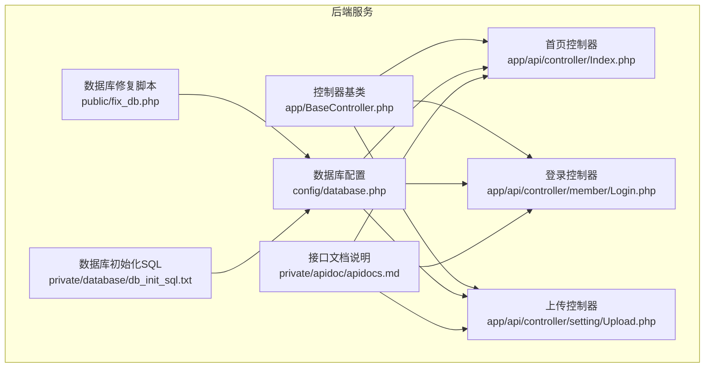
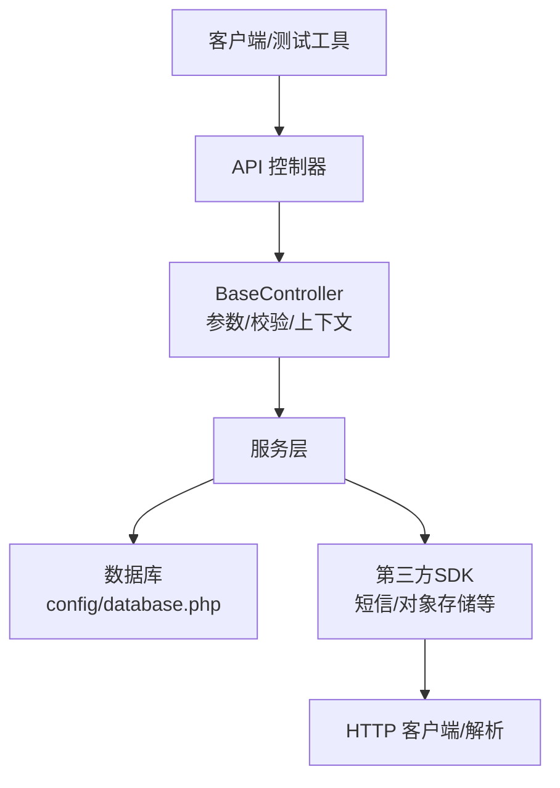
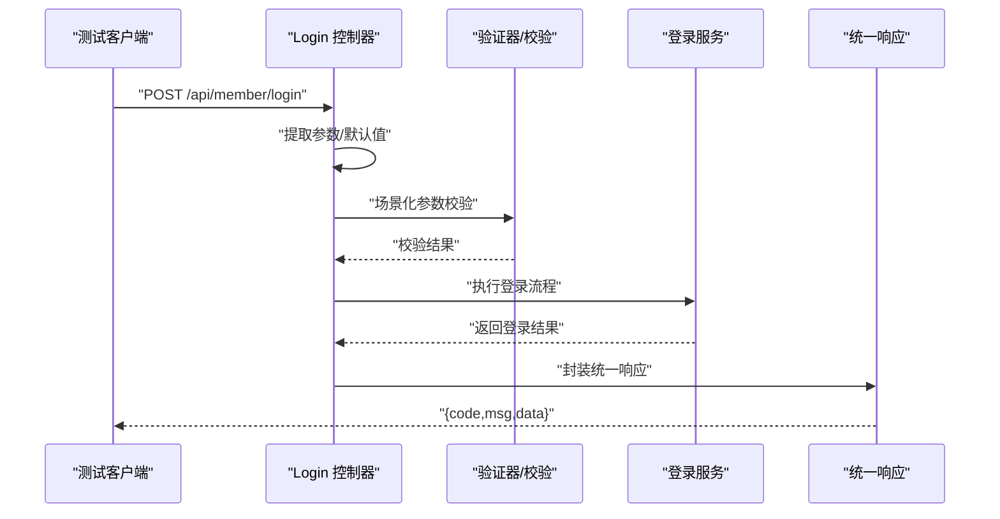
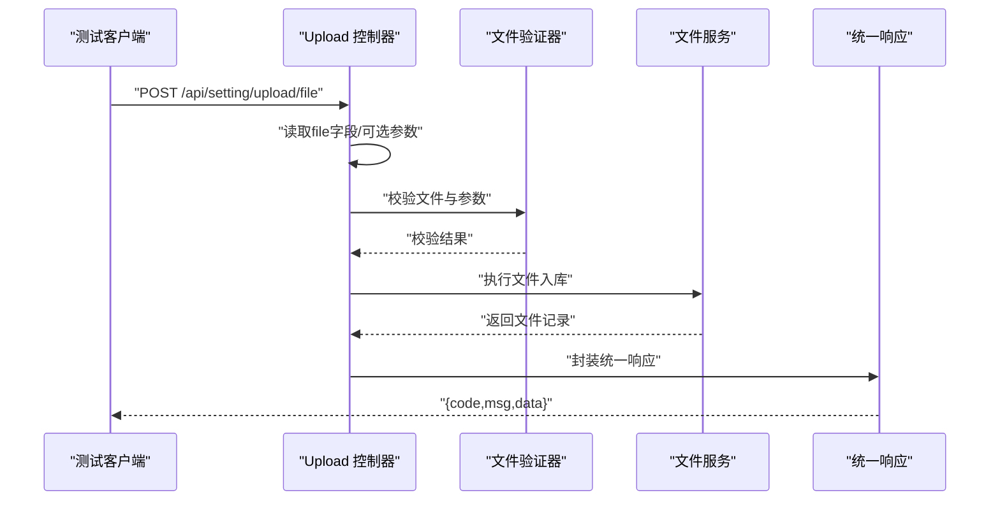
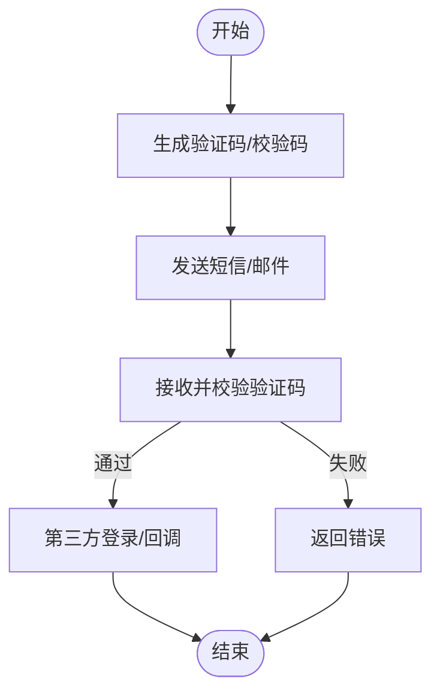
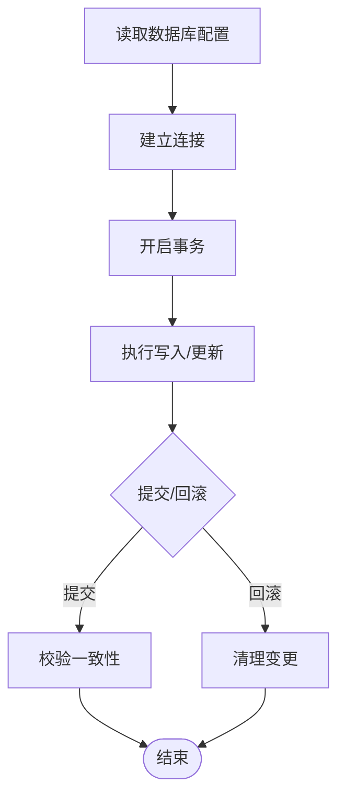
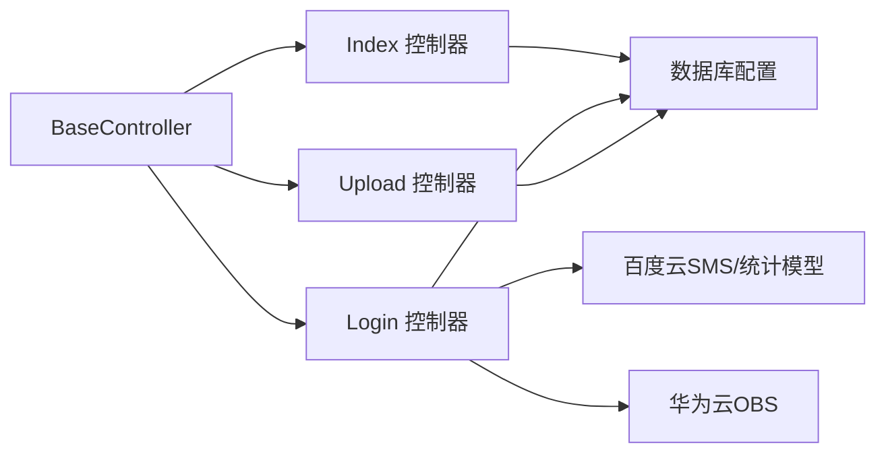

# 集成测试

<cite>
**本文引用的文件**   
- [gccd_server/config/database.php](file://gccd_server/config/database.php)
- [gccd_server/private/database/db_init_sql.txt](file://gccd_server/private/database/db_init_sql.txt)
- [gccd_server/public/fix_db.php](file://gccd_server/public/fix_db.php)
- [gccd_server/app/BaseController.php](file://gccd_server/app/BaseController.php)
- [gccd_server/app/api/controller/Index.php](file://gccd_server/app/api/controller/Index.php)
- [gccd_server/app/api/controller/member/Login.php](file://gccd_server/app/api/controller/member/Login.php)
- [gccd_server/app/api/controller/setting/Upload.php](file://gccd_server/app/api/controller/setting/Upload.php)
- [gccd_server/private/apidoc/apidocs.md](file://gccd_server/private/apidoc/apidocs.md)
- [gccd_server/private/apidoc/template/crud/controller.tpl](file://gccd_server/private/apidoc/template/crud/controller.tpl)
- [gccd_server/extend/bce-php-sdk-0.9.23/src/BaiduBce/Http/BceHttpClient.php](file://gccd_server/extend/bce-php-sdk-0.9.23/src/BaiduBce/Http/BceHttpClient.php)
- [gccd_server/extend/bce-php-sdk-0.9.23/src/BaiduBce/Services/Sms/model/StatisticsResult.php](file://gccd_server/extend/bce-php-sdk-0.9.23/src/BaiduBce/Services/Sms/model/StatisticsResult.php)
- [gccd_server/extend/esdk-obs-php-3.23.11/Obs/Internal/GetResponseTrait.php](file://gccd_server/extend/esdk-obs-php-3.23.11/Obs/Internal/GetResponseTrait.php)
</cite>

## 目录
1. [引言](#引言)
2. [项目结构](#项目结构)
3. [核心组件](#核心组件)
4. [架构总览](#架构总览)
5. [详细组件分析](#详细组件分析)
6. [依赖分析](#依赖分析)
7. [性能考虑](#性能考虑)
8. [故障排查指南](#故障排查指南)
9. [结论](#结论)
10. [附录](#附录)

## 引言
本文件面向“高齿传动”项目的集成测试，覆盖以下方面：
- API 接口集成测试：RESTful API 测试、参数校验测试、响应格式测试
- 数据库集成测试：连接测试、事务处理测试、数据一致性测试
- 第三方服务集成测试：文件上传、短信/邮件发送、支付接口等
- 测试环境配置与管理：测试数据库搭建、数据准备
- 测试数据隔离与清理策略
- 测试自动化与持续集成配置思路

## 项目结构
后端基于 ThinkPHP 框架，API 层位于 app/api/controller 下，通用控制器基类为 BaseController；数据库配置集中于 config/database.php；接口文档与示例位于 private/apidoc；部分第三方 SDK 位于 extend。

**图示来源**
- [gccd_server/config/database.php:11-70](file://gccd_server/config/database.php#L11-L70)
- [gccd_server/app/BaseController.php:19-100](file://gccd_server/app/BaseController.php#L19-L100)
- [gccd_server/app/api/controller/Index.php:16-36](file://gccd_server/app/api/controller/Index.php#L16-L36)
- [gccd_server/app/api/controller/member/Login.php:28-138](file://gccd_server/app/api/controller/member/Login.php#L28-L138)
- [gccd_server/app/api/controller/setting/Upload.php:20-76](file://gccd_server/app/api/controller/setting/Upload.php#L20-L76)
- [gccd_server/private/apidoc/apidocs.md:1-50](file://gccd_server/private/apidoc/apidocs.md#L1-L50)
- [gccd_server/public/fix_db.php:1-98](file://gccd_server/public/fix_db.php#L1-L98)
- [gccd_server/private/database/db_init_sql.txt:1-62](file://gccd_server/private/database/db_init_sql.txt#L1-L62)

**章节来源**
- [gccd_server/config/database.php:11-70](file://gccd_server/config/database.php#L11-L70)
- [gccd_server/app/BaseController.php:19-100](file://gccd_server/app/BaseController.php#L19-L100)
- [gccd_server/app/api/controller/Index.php:16-36](file://gccd_server/app/api/controller/Index.php#L16-L36)
- [gccd_server/app/api/controller/member/Login.php:28-138](file://gccd_server/app/api/controller/member/Login.php#L28-L138)
- [gccd_server/app/api/controller/setting/Upload.php:20-76](file://gccd_server/app/api/controller/setting/Upload.php#L20-L76)
- [gccd_server/private/apidoc/apidocs.md:1-50](file://gccd_server/private/apidoc/apidocs.md#L1-L50)
- [gccd_server/public/fix_db.php:1-98](file://gccd_server/public/fix_db.php#L1-L98)
- [gccd_server/private/database/db_init_sql.txt:1-62](file://gccd_server/private/database/db_init_sql.txt#L1-L62)

## 核心组件
- 控制器基类 BaseController：统一参数提取、批量校验、请求上下文注入
- API 控制器族：
  - Index：基础可用性校验
  - member/Login：登录、验证码、第三方登录（微信/QQ/微博等）与回调
  - setting/Upload：文件上传（支持分组、标签、前端标记）
- 数据库配置：集中化配置、字符集、断线重连、SQL 触发、字段缓存
- 文档与约定：统一响应结构、全局 Header/Query/Body 的 Token 注入

**章节来源**
- [gccd_server/app/BaseController.php:74-99](file://gccd_server/app/BaseController.php#L74-L99)
- [gccd_server/app/api/controller/Index.php:29-35](file://gccd_server/app/api/controller/Index.php#L29-L35)
- [gccd_server/app/api/controller/member/Login.php:47-138](file://gccd_server/app/api/controller/member/Login.php#L47-L138)
- [gccd_server/app/api/controller/setting/Upload.php:37-76](file://gccd_server/app/api/controller/setting/Upload.php#L37-L76)
- [gccd_server/config/database.php:27-66](file://gccd_server/config/database.php#L27-L66)
- [gccd_server/private/apidoc/apidocs.md:23-50](file://gccd_server/private/apidoc/apidocs.md#L23-L50)

## 架构总览
后端采用 MVC 架构，API 控制器通过 BaseController 统一处理请求与校验，调用服务层完成业务逻辑，最终返回统一格式响应。数据库通过配置中心化管理，第三方 SDK 用于对接外部服务。

**图示来源**
- [gccd_server/app/BaseController.php:50-99](file://gccd_server/app/BaseController.php#L50-L99)
- [gccd_server/config/database.php:27-66](file://gccd_server/config/database.php#L27-L66)
- [gccd_server/extend/bce-php-sdk-0.9.23/src/BaiduBce/Http/BceHttpClient.php:253-278](file://gccd_server/extend/bce-php-sdk-0.9.23/src/BaiduBce/Http/BceHttpClient.php#L253-L278)
- [gccd_server/extend/esdk-obs-php-3.23.11/Obs/Internal/GetResponseTrait.php:294-320](file://gccd_server/extend/esdk-obs-php-3.23.11/Obs/Internal/GetResponseTrait.php#L294-L320)

## 详细组件分析

### API 接口集成测试
- RESTful API 测试要点
  - 路由与方法：GET/POST/PUT/DELETE 的资源路径与幂等性
  - 请求参数：Query/Body/Form-data 的边界值与必填项
  - 响应格式：统一返回结构（code/msg/data），状态码映射
- 参数验证测试
  - 基于 ThinkPHP 验证器的场景化校验（如手机号、邮箱、验证码）
  - 控制器内显式参数提取与默认值处理
- 响应格式测试
  - 成功/失败分支的返回结构一致性
  - 异常场景的错误码与提示文案

**图示来源**
- [gccd_server/app/api/controller/member/Login.php:91-138](file://gccd_server/app/api/controller/member/Login.php#L91-L138)
- [gccd_server/app/BaseController.php:74-99](file://gccd_server/app/BaseController.php#L74-L99)
- [gccd_server/private/apidoc/apidocs.md:23-50](file://gccd_server/private/apidoc/apidocs.md#L23-L50)

**章节来源**
- [gccd_server/app/api/controller/member/Login.php:47-138](file://gccd_server/app/api/controller/member/Login.php#L47-L138)
- [gccd_server/app/BaseController.php:74-99](file://gccd_server/app/BaseController.php#L74-L99)
- [gccd_server/private/apidoc/apidocs.md:23-50](file://gccd_server/private/apidoc/apidocs.md#L23-L50)

### 文件上传集成测试
- 场景覆盖
  - 表单上传（multipart/form-data）
  - 可选分组/标签参数
  - 文件类型与名称约束
- 断言点
  - 返回结构中的文件信息字段
  - 上传开关控制（is_upload_api）

**图示来源**
- [gccd_server/app/api/controller/setting/Upload.php:37-76](file://gccd_server/app/api/controller/setting/Upload.php#L37-L76)
- [gccd_server/private/apidoc/apidocs.md:23-50](file://gccd_server/private/apidoc/apidocs.md#L23-L50)

**章节来源**
- [gccd_server/app/api/controller/setting/Upload.php:37-76](file://gccd_server/app/api/controller/setting/Upload.php#L37-L76)
- [gccd_server/private/apidoc/apidocs.md:23-50](file://gccd_server/private/apidoc/apidocs.md#L23-L50)

### 第三方服务集成测试
- 短信/邮件验证码
  - 登录前的验证码生成与校验
  - 缓存键值与有效期
- 第三方登录
  - 小程序/公众号/网站/移动应用登录链路
  - 回调参数 code/state 的正确性与跳转
- 外部 SDK
  - 百度云 SMS/统计模型
  - 华为云 OBS JSON 错误解析

**图示来源**
- [gccd_server/app/api/controller/member/Login.php:147-202](file://gccd_server/app/api/controller/member/Login.php#L147-L202)
- [gccd_server/app/api/controller/member/Login.php:289-340](file://gccd_server/app/api/controller/member/Login.php#L289-L340)
- [gccd_server/app/api/controller/member/Login.php:442-507](file://gccd_server/app/api/controller/member/Login.php#L442-L507)
- [gccd_server/extend/bce-php-sdk-0.9.23/src/BaiduBce/Services/Sms/model/StatisticsResult.php:78-500](file://gccd_server/extend/bce-php-sdk-0.9.23/src/BaiduBce/Services/Sms/model/StatisticsResult.php#L78-L500)
- [gccd_server/extend/esdk-obs-php-3.23.11/Obs/Internal/GetResponseTrait.php:294-320](file://gccd_server/extend/esdk-obs-php-3.23.11/Obs/Internal/GetResponseTrait.php#L294-L320)

**章节来源**
- [gccd_server/app/api/controller/member/Login.php:147-202](file://gccd_server/app/api/controller/member/Login.php#L147-L202)
- [gccd_server/app/api/controller/member/Login.php:289-340](file://gccd_server/app/api/controller/member/Login.php#L289-L340)
- [gccd_server/app/api/controller/member/Login.php:442-507](file://gccd_server/app/api/controller/member/Login.php#L442-L507)
- [gccd_server/extend/bce-php-sdk-0.9.23/src/BaiduBce/Services/Sms/model/StatisticsResult.php:78-500](file://gccd_server/extend/bce-php-sdk-0.9.23/src/BaiduBce/Services/Sms/model/StatisticsResult.php#L78-L500)
- [gccd_server/extend/esdk-obs-php-3.23.11/Obs/Internal/GetResponseTrait.php:294-320](file://gccd_server/extend/esdk-obs-php-3.23.11/Obs/Internal/GetResponseTrait.php#L294-L320)

### 数据库集成测试
- 连接测试
  - 读取 config/database.php 中的连接参数，验证主机、端口、数据库、用户名、密码、字符集
- 事务处理测试
  - 使用事务包裹多步写入，回滚验证一致性
- 数据一致性测试
  - 使用 private/database/db_init_sql.txt 中的 TRUNCATE/UPDATE 模板，准备与清理测试数据

**图示来源**
- [gccd_server/config/database.php:27-66](file://gccd_server/config/database.php#L27-L66)
- [gccd_server/private/database/db_init_sql.txt:11-62](file://gccd_server/private/database/db_init_sql.txt#L11-L62)

**章节来源**
- [gccd_server/config/database.php:27-66](file://gccd_server/config/database.php#L27-L66)
- [gccd_server/private/database/db_init_sql.txt:11-62](file://gccd_server/private/database/db_init_sql.txt#L11-L62)

## 依赖分析
- 控制器对基类的依赖：参数提取、批量校验、统一响应
- 服务层对数据库与第三方 SDK 的依赖：SQL 执行、HTTP 请求与错误解析
- 文档与接口契约：统一响应结构、Token 注入位置

**图示来源**
- [gccd_server/app/BaseController.php:50-99](file://gccd_server/app/BaseController.php#L50-L99)
- [gccd_server/app/api/controller/Index.php:29-35](file://gccd_server/app/api/controller/Index.php#L29-L35)
- [gccd_server/app/api/controller/member/Login.php:47-138](file://gccd_server/app/api/controller/member/Login.php#L47-L138)
- [gccd_server/app/api/controller/setting/Upload.php:37-76](file://gccd_server/app/api/controller/setting/Upload.php#L37-L76)
- [gccd_server/config/database.php:27-66](file://gccd_server/config/database.php#L27-L66)
- [gccd_server/extend/bce-php-sdk-0.9.23/src/BaiduBce/Services/Sms/model/StatisticsResult.php:78-500](file://gccd_server/extend/bce-php-sdk-0.9.23/src/BaiduBce/Services/Sms/model/StatisticsResult.php#L78-L500)
- [gccd_server/extend/esdk-obs-php-3.23.11/Obs/Internal/GetResponseTrait.php:294-320](file://gccd_server/extend/esdk-obs-php-3.23.11/Obs/Internal/GetResponseTrait.php#L294-L320)

**章节来源**
- [gccd_server/app/BaseController.php:50-99](file://gccd_server/app/BaseController.php#L50-L99)
- [gccd_server/app/api/controller/Index.php:29-35](file://gccd_server/app/api/controller/Index.php#L29-L35)
- [gccd_server/app/api/controller/member/Login.php:47-138](file://gccd_server/app/api/controller/member/Login.php#L47-L138)
- [gccd_server/app/api/controller/setting/Upload.php:37-76](file://gccd_server/app/api/controller/setting/Upload.php#L37-L76)
- [gccd_server/config/database.php:27-66](file://gccd_server/config/database.php#L27-L66)
- [gccd_server/extend/bce-php-sdk-0.9.23/src/BaiduBce/Services/Sms/model/StatisticsResult.php:78-500](file://gccd_server/extend/bce-php-sdk-0.9.23/src/BaiduBce/Services/Sms/model/StatisticsResult.php#L78-L500)
- [gccd_server/extend/esdk-obs-php-3.23.11/Obs/Internal/GetResponseTrait.php:294-320](file://gccd_server/extend/esdk-obs-php-3.23.11/Obs/Internal/GetResponseTrait.php#L294-L320)

## 性能考虑
- SQL 触发与字段缓存：开启 trigger_sql 与 fields_cache 可辅助定位慢查询与减少元数据查询
- 断线重连：break_reconnect 在网络抖动时提升稳定性
- 日志与监控：结合 runtime 日志目录定位异常

**章节来源**
- [gccd_server/config/database.php:60-65](file://gccd_server/config/database.php#L60-L65)

## 故障排查指南
- 统一响应结构
  - 成功：code=200，msg 为操作成功提示，data 为业务数据
  - 失败：code 非 200，message 为错误描述
- 错误码对照
  - 200：操作成功
  - 400：参数错误
  - 401：登录已失效
  - 402：第三方账号未注册
  - 403：无权限
  - 404：接口地址错误
  - 429：操作过于频繁
  - 500：服务器错误
- HTTP 错误解析
  - 百度云 HTTP 客户端在非 2xx 时尝试解析 JSON 错误体，提取 message/code
  - 华为云 OBS 在解析 JSON 错误时设置 requestId、exceptionCode、exceptionMessage

**章节来源**
- [gccd_server/private/apidoc/apidocs.md:23-50](file://gccd_server/private/apidoc/apidocs.md#L23-L50)
- [gccd_server/extend/bce-php-sdk-0.9.23/src/BaiduBce/Http/BceHttpClient.php:253-278](file://gccd_server/extend/bce-php-sdk-0.9.23/src/BaiduBce/Http/BceHttpClient.php#L253-L278)
- [gccd_server/extend/esdk-obs-php-3.23.11/Obs/Internal/GetResponseTrait.php:294-320](file://gccd_server/extend/esdk-obs-php-3.23.11/Obs/Internal/GetResponseTrait.php#L294-L320)

## 结论
本集成测试文档围绕 API、数据库与第三方服务三类关键领域，给出了测试目标、断言点与流程图示，并结合现有配置与注释明确了统一响应与错误处理规范。建议在 CI 中引入数据库快照/容器化、第三方服务模拟器以及统一的响应断言工具，以提升回归效率与稳定性。

## 附录

### 测试环境配置与管理
- 测试数据库
  - 使用 config/database.php 中的连接参数，确保 hostname/hostport/database/username/password/charset 正确
  - 使用 private/database/db_init_sql.txt 进行初始化/清理
  - 如需一键修复，可参考 public/fix_db.php 的连接与执行流程
- 接口文档与 Token
  - 参考 private/apidoc/apidocs.md 的 BASE_URL、AdminToken、ApiToken 与统一响应结构

**章节来源**
- [gccd_server/config/database.php:27-66](file://gccd_server/config/database.php#L27-L66)
- [gccd_server/private/database/db_init_sql.txt:11-62](file://gccd_server/private/database/db_init_sql.txt#L11-L62)
- [gccd_server/public/fix_db.php:10-22](file://gccd_server/public/fix_db.php#L10-L22)
- [gccd_server/private/apidoc/apidocs.md:1-50](file://gccd_server/private/apidoc/apidocs.md#L1-L50)

### 测试数据隔离与清理策略
- 隔离
  - 使用独立的测试数据库或 schema 前缀，避免与生产/开发数据冲突
  - 为每条测试用例分配唯一标识（如用户、订单号），降低并发干扰
- 清理
  - 借助 db_init_sql.txt 的 TRUNCATE/UPDATE 模板进行批量清理
  - 在测试结束后执行回滚或删除操作，恢复初始状态

**章节来源**
- [gccd_server/private/database/db_init_sql.txt:11-62](file://gccd_server/private/database/db_init_sql.txt#L11-L62)

### 测试自动化与持续集成
- 建议实践
  - 使用容器编排（如 Docker Compose）启动 MySQL 与后端服务
  - 在 CI 中执行：
    - 数据库初始化脚本（db_init_sql.txt）
    - API 集成测试套件（基于统一响应断言）
    - 第三方服务模拟（如短信/邮件/支付网关）
  - 将 ApiToken/AdminToken 注入到全局 Header/Query/Body，便于跨接口复用
- 与现有模板的结合
  - 可参考 private/apidoc/template/crud/controller.tpl 的注解风格，自动生成接口清单与断言模板

**章节来源**
- [gccd_server/private/apidoc/apidocs.md:1-50](file://gccd_server/private/apidoc/apidocs.md#L1-L50)
- [gccd_server/private/apidoc/template/crud/controller.tpl:17-59](file://gccd_server/private/apidoc/template/crud/controller.tpl#L17-L59)