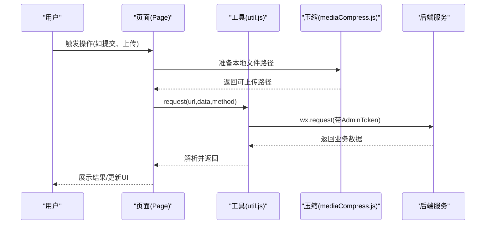
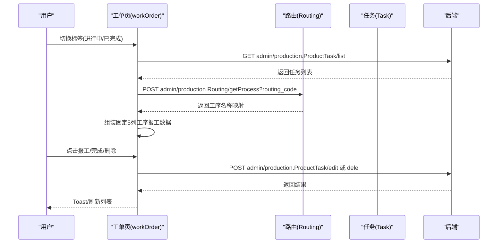
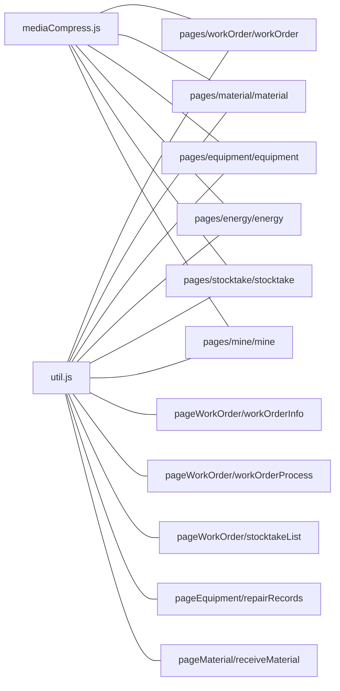
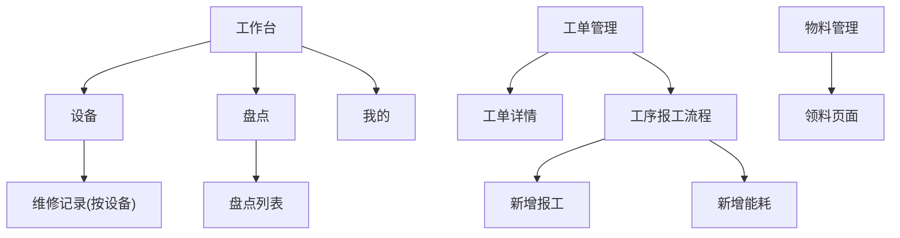

# 业务页面开发

<cite>
**本文引用的文件**
- [app.json](file://gccd_mini/app.json)
- [workbench.js](file://gccd_mini/pages/workbench/workbench.js)
- [workOrder.js](file://gccd_mini/pages/workOrder/workOrder.js)
- [material.js](file://gccd_mini/pages/material/material.js)
- [equipment.js](file://gccd_mini/pages/equipment/equipment.js)
- [energy.js](file://gccd_mini/pages/energy/energy.js)
- [stocktake.js](file://gccd_mini/pages/stocktake/stocktake.js)
- [util.js](file://gccd_mini/utils/util.js)
- [mediaCompress.js](file://gccd_mini/utils/mediaCompress.js)
- [main-tab-bar.js](file://gccd_mini/pages/components/main-tab-bar/main-tab-bar.js)
- [workOrderInfo.js](file://gccd_mini/pageWorkOrder/pages/workOrderInfo/workOrderInfo.js)
- [workOrderProcess.js](file://gccd_mini/pageWorkOrder/pages/workOrderProcess/workOrderProcess.js)
- [stocktakeList.js](file://gccd_mini/pageWorkOrder/pages/stocktakeList/stocktakeList.js)
- [repairRecords.js](file://gccd_mini/pageEquipment/pages/repairRecords/repairRecords.js)
- [receiveMaterial.js](file://gccd_mini/pageMaterial/pages/receiveMaterial/receiveMaterial.js)
- [mine.js](file://gccd_mini/pages/mine/mine.js)
</cite>

## 目录
1. [简介](#简介)
2. [项目结构](#项目结构)
3. [核心组件](#核心组件)
4. [架构总览](#架构总览)
5. [详细组件分析](#详细组件分析)
6. [依赖分析](#依赖分析)
7. [性能考虑](#性能考虑)
8. [故障排查指南](#故障排查指南)
9. [结论](#结论)
10. [附录](#附录)

## 简介
本文件面向“高齿传动”小程序的业务页面开发，系统梳理工作台、工单管理、物料管理、设备管理、能源管理、盘点等核心功能页面的设计与实现，覆盖数据结构、API 接口调用、用户交互逻辑、状态管理、页面间导航与数据流转、响应式适配策略、性能优化与最佳实践。目标是帮助开发者快速理解与迭代业务页面。

## 项目结构
小程序采用分包与主包结合的组织方式，核心页面位于主包 pages 下，业务子页面分别置于 pageWorkOrder、pageEquipment、pageMaterial、pageEnergy 等子包中，便于按需加载与维护。

```mermaid
graph TB
subgraph "主包 pages"
A["pages/workbench/workbench"]
B["pages/workOrder/workOrder"]
C["pages/material/material"]
D["pages/equipment/equipment"]
E["pages/energy/energy"]
F["pages/stocktake/stocktake"]
G["pages/mine/mine"]
end
subgraph "子包 pageWorkOrder"
H["pages/workOrderInfo/workOrderInfo"]
I["pages/workOrderProcess/workOrderProcess"]
J["pages/stocktakeList/stocktakeList"]
end
subgraph "子包 pageEquipment"
K["pages/repairRecords/repairRecords"]
end
subgraph "子包 pageMaterial"
L["pages/receiveMaterial/receiveMaterial"]
end
subgraph "子包 pageEnergy"
M["pages/addEnergy/addEnergy"]
end
N["utils/util.js"]
O["utils/mediaCompress.js"]
A --> N
B --> N
C --> N
D --> N
E --> N
F --> N
G --> N
H --> N
I --> N
J --> N
K --> N
L --> N
M --> N
B --> O
C --> O
D --> O
E --> O
F --> O
G --> O
```

图表来源
- [app.json:1-99](file://gccd_mini/app.json#L1-L99)
- [workbench.js:1-15](file://gccd_mini/pages/workbench/workbench.js#L1-L15)
- [workOrder.js:1-796](file://gccd_mini/pages/workOrder/workOrder.js#L1-L796)
- [material.js:1-905](file://gccd_mini/pages/material/material.js#L1-L905)
- [equipment.js:1-1202](file://gccd_mini/pages/equipment/equipment.js#L1-L1202)
- [energy.js:1-480](file://gccd_mini/pages/energy/energy.js#L1-L480)
- [stocktake.js:1-22](file://gccd_mini/pages/stocktake/stocktake.js#L1-L22)
- [util.js:1-98](file://gccd_mini/utils/util.js#L1-L98)
- [mediaCompress.js:1-104](file://gccd_mini/utils/mediaCompress.js#L1-L104)

章节来源
- [app.json:1-99](file://gccd_mini/app.json#L1-L99)

## 核心组件
- 页面级组件：工作台、工单管理、物料管理、设备管理、能源管理、盘点、我的
- 通用组件：底部导航组件 main-tab-bar，统一处理安全边距与页面切换
- 工具模块：util.js（封装 wx.request 与鉴权）、mediaCompress.js（上传前媒体压缩）

章节来源
- [main-tab-bar.js:1-56](file://gccd_mini/pages/components/main-tab-bar/main-tab-bar.js#L1-L56)
- [util.js:1-98](file://gccd_mini/utils/util.js#L1-L98)
- [mediaCompress.js:1-104](file://gccd_mini/utils/mediaCompress.js#L1-L104)

## 架构总览
小程序前端通过 Page 实例承载业务逻辑，统一通过 util.request 发起 HTTP 请求，携带 AdminToken；图片上传前通过 mediaCompress 压缩以满足平台限制；页面间通过 wx.navigateTo、wx.switchTab、wx.reLaunch 等进行导航与参数传递。

图表来源
- [util.js:22-94](file://gccd_mini/utils/util.js#L22-L94)
- [mediaCompress.js:48-98](file://gccd_mini/utils/mediaCompress.js#L48-L98)
- [workOrder.js:504-565](file://gccd_mini/pages/workOrder/workOrder.js#L504-L565)
- [material.js:646-713](file://gccd_mini/pages/material/material.js#L646-L713)
- [equipment.js:458-520](file://gccd_mini/pages/equipment/equipment.js#L458-L520)
- [energy.js:223-285](file://gccd_mini/pages/energy/energy.js#L223-L285)

## 详细组件分析

### 工作台（pages/workbench/workbench）
- 功能概述：获取系统状态栏高度，作为页面内布局参考；作为底部导航入口之一。
- 数据结构：statusBarHeight
- 交互与导航：无复杂交互，仅初始化状态栏高度
- 性能与适配：轻量初始化，无额外请求

章节来源
- [workbench.js:1-15](file://gccd_mini/pages/workbench/workbench.js#L1-L15)

### 工单管理（pages/workOrder/workOrder）
- 数据结构与状态
  - 列表与分页：进行中/已完成双列表，含 fullList/fullFinishedList、page/finishedPage、limit、count、pages、loading/loadingMore/noMore/refreshing 等
  - 过滤与检索：按 y_material_spec/c_material_spec/c_material_model 三字段过滤
  - 工序报工：固定5道工序（断钢、穿孔、球化、矫直、酸洗），通过 report 字段解析并映射到固定列
  - 报修：扫码识别二维码，支持从相册识别，图片上传压缩后提交
  - 按钮拖拽：悬浮按钮可拖动，边界约束
- API 接口
  - 获取进行中/已完成列表：admin/production.ProductTask/list
  - 获取工序名称映射：admin/production.Routing/getProcess
  - 完成工单：admin/production.ProductTask/edit
  - 删除任务：admin/production.ProductTask/dele
  - 报修提交：admin/repair.Device/report
  - 图片上传：admin/wechat.WeChat/upload
- 页面跳转与参数
  - 详情页：workOrderInfo，传递 id、processes_code
  - 报工页：workOrderProcess，传递 routing_code、id
  - 能耗添加：energyAdd，传递 id、process_code、processes_name
- 错误处理与体验
  - 统一 Toast 提示与 Dialog 确认
  - 401 自动跳转登录
  - 下拉刷新与上拉加载更多

图表来源
- [workOrder.js:189-305](file://gccd_mini/pages/workOrder/workOrder.js#L189-L305)
- [workOrder.js:142-187](file://gccd_mini/pages/workOrder/workOrder.js#L142-L187)
- [workOrder.js:330-362](file://gccd_mini/pages/workOrder/workOrder.js#L330-L362)

章节来源
- [workOrder.js:1-796](file://gccd_mini/pages/workOrder/workOrder.js#L1-L796)

### 工单详情（pageWorkOrder/pages/workOrderInfo/workOrderInfo）
- 数据结构：任务基础信息、状态文本、物料规格等
- 交互：返回上一页、跳转新增报工
- 状态管理：加载状态 loading，悬浮按钮拖拽

章节来源
- [workOrderInfo.js:1-235](file://gccd_mini/pageWorkOrder/pages/workOrderInfo/workOrderInfo.js#L1-L235)

### 工序报工流程（pageWorkOrder/pages/workOrderProcess/workOrderProcess）
- 数据结构：processList、routing_name、routing_code、id
- 交互：点击工序进入报工页，点击能耗进入能耗添加页
- 状态管理：加载状态 loading、失败标志 loadFailed

章节来源
- [workOrderProcess.js:1-116](file://gccd_mini/pageWorkOrder/pages/workOrderProcess/workOrderProcess.js#L1-L116)

### 物料管理（pages/material/material）
- 数据结构与状态
  - 标签页：物料列表、领料记录
  - 物料列表：list、分页 currentPage/pageSize/pages/count、搜索与筛选
  - 领料记录：receivingList、分页 receivingCurrentPage/receivingPageSize/receivingPages/receivingCount
  - 报修：扫码识别、图片上传压缩
- API 接口
  - 物料列表：admin/production.Material/list
  - 领料记录：admin/receiving.Receiving/list
  - 报修提交：admin/repair.Device/report
  - 图片上传：admin/wechat.WeChat/upload
- 页面跳转
  - 领料：navigateTo /pageMaterial/pages/receiveMaterial/receiveMaterial

章节来源
- [material.js:1-905](file://gccd_mini/pages/material/material.js#L1-L905)

### 领料页面（pageMaterial/pages/receiveMaterial/receiveMaterial）
- 数据结构：物料列表 materialList、选中物料 selectedMaterialsInfo、分页 currentPage/pageSize/totalPages
- 交互：搜索、勾选、数量输入、提交
- 提交校验：数量必填且大于0
- 成功后关闭弹窗并返回

章节来源
- [receiveMaterial.js:1-282](file://gccd_mini/pageMaterial/pages/receiveMaterial/receiveMaterial.js#L1-L282)

### 设备管理（pages/equipment/equipment）
- 数据结构与状态
  - 标签页：设备列表、维修任务列表
  - 设备列表：deviceList、分页 currentDevicePage/devicePages/deviceCount
  - 任务列表：list、分页 currentPage/pageSize/pages/count
  - 报修：扫码识别、维修原因多选、图片上传压缩
- API 接口
  - 设备列表：admin/repair.Device/list
  - 任务列表：admin/repair.Device/repairlist
  - 报修原因：admin/production.ProductCount/list
  - 报修提交：admin/repair.Device/report
  - 图片上传：admin/wechat.WeChat/upload
- 页面跳转
  - 维修记录：/pageEquipment/pages/repairRecords/repairRecords?device_code&device_name

章节来源
- [equipment.js:1-1202](file://gccd_mini/pages/equipment/equipment.js#L1-L1202)

### 维修记录（pageEquipment/pages/repairRecords/repairRecords）
- 数据结构：repairList、分页 currentPage/pageSize/pages/count
- 交互：图片预览、下拉刷新、上拉加载更多
- 参数：从上页传入 device_code、device_name

章节来源
- [repairRecords.js:1-119](file://gccd_mini/pageEquipment/pages/repairRecords/repairRecords.js#L1-L119)

### 能源管理（pages/energy/energy）
- 数据结构与状态
  - 列表：list、分页 currentPage/pageSize/pages/count
  - 报修：device_code、reason、show、loading、fileList/uploadImgUrls
  - 悬浮按钮：btnPosition、拖拽 startX/startY/btnStartX/btnStartY
- API 接口
  - 能源列表：admin/production.ProductReport/powerlist
  - 报修提交：admin/repair.Device/report
  - 图片上传：admin/wechat.WeChat/upload
- 页面跳转
  - 添加能耗：/pageEnergy/pages/addEnergy/addEnergy

章节来源
- [energy.js:1-480](file://gccd_mini/pages/energy/energy.js#L1-L480)

### 盘点（pages/stocktake/stocktake）
- 数据结构：statusBarHeight
- 交互：跳转到盘点列表与质量检查列表

章节来源
- [stocktake.js:1-22](file://gccd_mini/pages/stocktake/stocktake.js#L1-L22)

### 盘点列表（pageWorkOrder/pages/stocktakeList/stocktakeList）
- 数据结构
  - Tab1：今日填报 processes（固定5道工序，统计日班/夜班填报数）
  - Tab2：历史记录 historyDays（按日期分组，按工序分组，统计合计）
- 交互：展开/收起日期与工序、跳转到新增盘点页
- 状态：historyLoading、historyEmpty

章节来源
- [stocktakeList.js:1-194](file://gccd_mini/pageWorkOrder/pages/stocktakeList/stocktakeList.js#L1-L194)

### 我的（pages/mine/mine）
- 数据结构：nickName、loading
- 交互：退出登录，清理本地存储并跳转登录页

章节来源
- [mine.js:1-61](file://gccd_mini/pages/mine/mine.js#L1-L61)

## 依赖分析
- 页面到工具模块
  - 所有业务页面均依赖 util.js 进行网络请求与鉴权处理
  - 图片上传场景依赖 mediaCompress.js 进行压缩
- 页面到页面
  - 工单管理 -> 工单详情、工序报工、能耗添加
  - 物料管理 -> 领料页面
  - 设备管理 -> 维修记录
  - 底部导航 -> 主包与子包页面切换

图表来源
- [util.js:1-98](file://gccd_mini/utils/util.js#L1-L98)
- [mediaCompress.js:1-104](file://gccd_mini/utils/mediaCompress.js#L1-L104)
- [workOrder.js:1-796](file://gccd_mini/pages/workOrder/workOrder.js#L1-L796)
- [material.js:1-905](file://gccd_mini/pages/material/material.js#L1-L905)
- [equipment.js:1-1202](file://gccd_mini/pages/equipment/equipment.js#L1-L1202)
- [energy.js:1-480](file://gccd_mini/pages/energy/energy.js#L1-L480)
- [stocktake.js:1-22](file://gccd_mini/pages/stocktake/stocktake.js#L1-L22)
- [mine.js:1-61](file://gccd_mini/pages/mine/mine.js#L1-L61)
- [workOrderInfo.js:1-235](file://gccd_mini/pageWorkOrder/pages/workOrderInfo/workOrderInfo.js#L1-L235)
- [workOrderProcess.js:1-116](file://gccd_mini/pageWorkOrder/pages/workOrderProcess/workOrderProcess.js#L1-L116)
- [stocktakeList.js:1-194](file://gccd_mini/pageWorkOrder/pages/stocktakeList/stocktakeList.js#L1-L194)
- [repairRecords.js:1-119](file://gccd_mini/pageEquipment/pages/repairRecords/repairRecords.js#L1-L119)
- [receiveMaterial.js:1-282](file://gccd_mini/pageMaterial/pages/receiveMaterial/receiveMaterial.js#L1-L282)

## 性能考虑
- 数据缓存
  - 工序名称映射缓存：_processNameCache，避免重复请求
  - 本地草稿：盘点 Tab1 使用 wx.getStorageSync('stocktake_draft') 缓存当日草稿
- 懒加载与分页
  - 列表分页加载，上拉触底再请求下一页
  - 子包按需加载，减少首屏体积
- 图片优化
  - 上传前压缩至 200KB 内，优先降低质量与尺寸
- 网络与错误
  - 统一请求封装，401 自动登出并跳转
  - 失败提示与重试机制（如工序列表加载失败可重试）

章节来源
- [workOrder.js:142-187](file://gccd_mini/pages/workOrder/workOrder.js#L142-L187)
- [stocktakeList.js:90-106](file://gccd_mini/pageWorkOrder/pages/stocktakeList/stocktakeList.js#L90-L106)
- [mediaCompress.js:48-98](file://gccd_mini/utils/mediaCompress.js#L48-L98)
- [util.js:22-94](file://gccd_mini/utils/util.js#L22-L94)

## 故障排查指南
- 登录态失效
  - 现象：出现“请重新登录”
  - 处理：自动清除 AdminToken/nickname 并跳转登录页
- 网络异常
  - 现象：Toast 提示“网络异常，请检查网络”
  - 处理：检查网络与后端连通性
- 业务错误码
  - 现象：根据 code 提示“资源不存在/请求错误/请求失败(4xx/5xx)”
  - 处理：查看后端返回 msg，定位问题
- 图片上传失败
  - 现象：提示“解析返回数据失败/上传接口请求失败/图片无法压缩至200KB以内”
  - 处理：检查文件类型与大小，确认 AdminToken 有效

章节来源
- [util.js:57-83](file://gccd_mini/utils/util.js#L57-L83)
- [mediaCompress.js:89-96](file://gccd_mini/utils/mediaCompress.js#L89-L96)

## 结论
本项目围绕“高齿传动”小程序构建了完整的业务页面体系，涵盖工单、物料、设备、能源、盘点与我的模块，统一通过工具模块进行网络与鉴权处理，辅以图片压缩与分页懒加载提升性能。页面间通过参数传递与底部导航实现顺畅流转，具备良好的可维护性与扩展性。

## 附录

### 页面导航关系与参数传递

图表来源
- [app.json:24-55](file://gccd_mini/app.json#L24-L55)
- [workOrderProcess.js:27-39](file://gccd_mini/pageWorkOrder/pages/workOrderProcess/workOrderProcess.js#L27-L39)
- [workOrderInfo.js:51-53](file://gccd_mini/pageWorkOrder/pages/workOrderInfo/workOrderInfo.js#L51-L53)
- [receiveMaterial.js:1-282](file://gccd_mini/pageMaterial/pages/receiveMaterial/receiveMaterial.js#L1-L282)
- [stocktakeList.js:54-56](file://gccd_mini/pageWorkOrder/pages/stocktakeList/stocktakeList.js#L54-L56)
- [repairRecords.js:29-37](file://gccd_mini/pageEquipment/pages/repairRecords/repairRecords.js#L29-L37)

### 响应式与适配策略
- 安全边距：底部导航组件读取 safeAreaInsets.bottom，适配刘海屏
- 系统信息：页面 onLoad/onShow 中获取 statusBarHeight，用于顶部留白计算
- 悬浮按钮：根据系统宽高与状态栏高度动态定位，拖动时边界约束

章节来源
- [main-tab-bar.js:32-42](file://gccd_mini/pages/components/main-tab-bar/main-tab-bar.js#L32-L42)
- [workOrder.js:755-767](file://gccd_mini/pages/workOrder/workOrder.js#L755-L767)
- [material.js:774-792](file://gccd_mini/pages/material/material.js#L774-L792)
- [equipment.js:642-655](file://gccd_mini/pages/equipment/equipment.js#L642-L655)
- [energy.js:348-360](file://gccd_mini/pages/energy/energy.js#L348-L360)